# LUDI ON – Platform Diagram

**Version:** 1.0

**Status:** Draft

**Owner:** LUDI ON Core Team

**Last Update:** July 2026

---

# Functional Architecture Diagram

```mermaid
graph TD
    ROOT["LUDI ON Platform"]

    ROOT --> AUTH["Authentication & Accounts"]
    ROOT --> TEACHER["Teacher Portal"]
    ROOT --> STUDENT["Student Portal (Future)"]
    ROOT --> PARENT["Parent Portal (Future)"]
    ROOT --> ADMIN["Administrator Portal (Future)"]
    ROOT --> AI["AI Platform"]
    ROOT --> RESOURCES["Resource Center"]
    ROOT --> KNOWLEDGE["Knowledge Center"]
    ROOT --> COLLAB["Collaboration"]
    ROOT --> ANALYTICS["Analytics"]
    ROOT --> INFRA["Infrastructure"]

    TEACHER --> DASH["Dashboard"]
    TEACHER --> AB["Activity Builder"]
    TEACHER --> EDITOR["Activity Editor"]
    TEACHER --> PROJECTS["My Projects"]
    TEACHER --> LIBRARY["Personal Library"]
    TEACHER --> SCENARIO["Scenario Studio"]
    TEACHER --> ASSISTANT["AI Teaching Assistant"]
    TEACHER --> SETTINGS["Settings"]

    AB --> LESSON["Lesson Builder"]
    AB --> GAME["Game Builder"]
    AB --> WORKSHEET["Worksheet Builder"]
    AB --> ASSESSMENT["Assessment Builder"]
    AB --> STORY["Story Builder"]
    AB --> PRESENTATION["Presentation Builder"]
    AB --> ESCAPE["Escape Builder"]
    AB --> WIZARD["AI Wizard"]

    AI --> ORCH["AI Orchestrator"]
    AI --> PRIMA["PRIMA Engine"]
    AI --> PEDAGOGY["Pedagogy Engine"]
    AI --> CONTENT["Content Engine"]
    AI --> RES_ENGINE["Resource Engine"]
    AI --> VALIDATION["Validation Engine"]
    AI --> MEMORY["Learning Memory (Future)"]
```

---

# Overview

This diagram presents the functional architecture of LUDI ON as a hierarchy of platform modules.

The **Teacher Portal** is the primary workspace where teachers create and manage educational activities through specialized builders and supporting tools.

The **Activity Builder** groups all creation workflows—lessons, games, worksheets, assessments, and more—under a single guided entry point, including the **AI Wizard** for AI-assisted configuration.

The **AI Platform** provides the generation pipeline that transforms teacher input into validated instructional content and resources.

**Resource Center** and **Knowledge Center** support material delivery and curated educational content respectively.

Modules marked **(Future)** are planned extensions for additional user roles and capabilities.

For detailed functional descriptions of each module, see `PLATFORM_STRUCTURE.md`.
