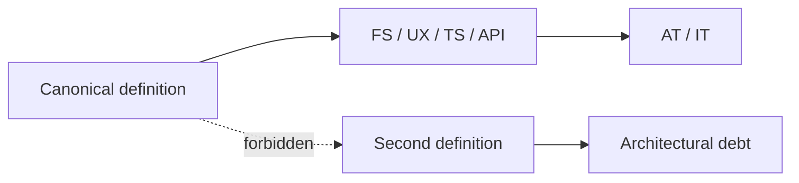
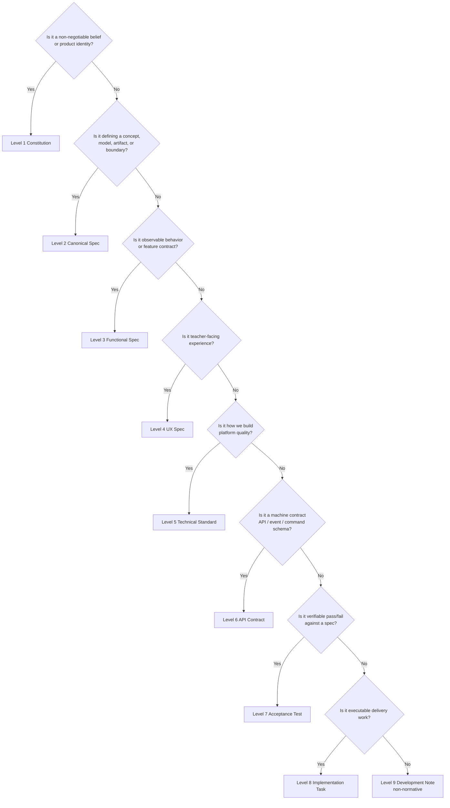
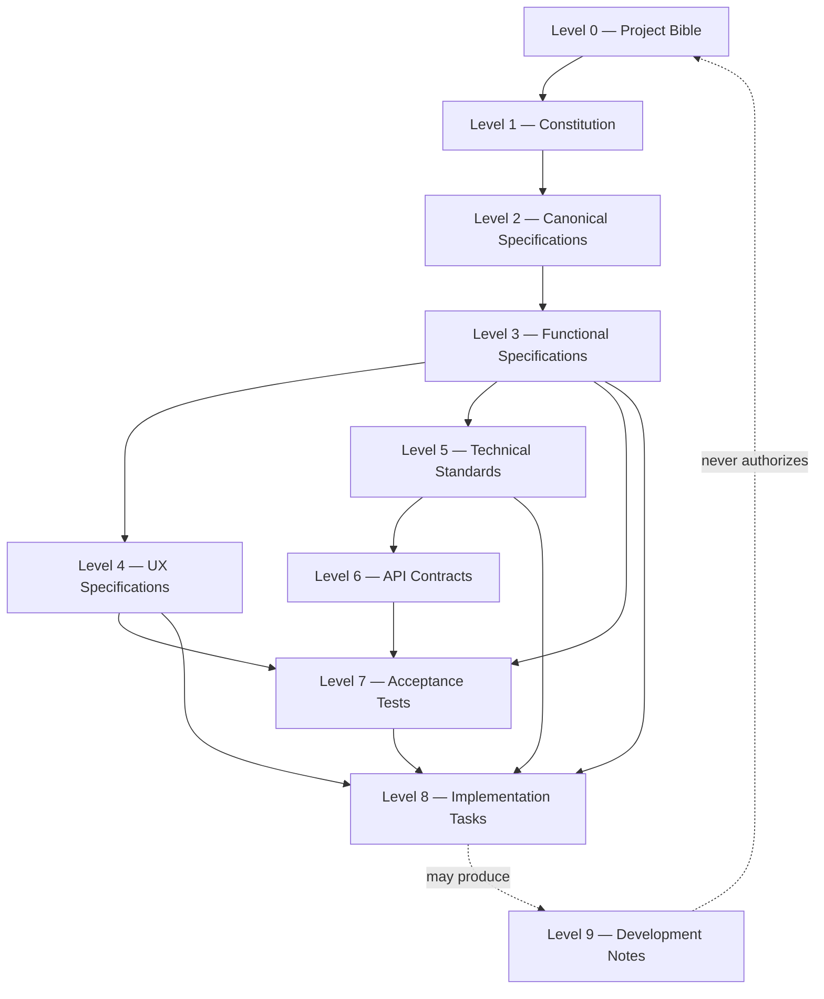
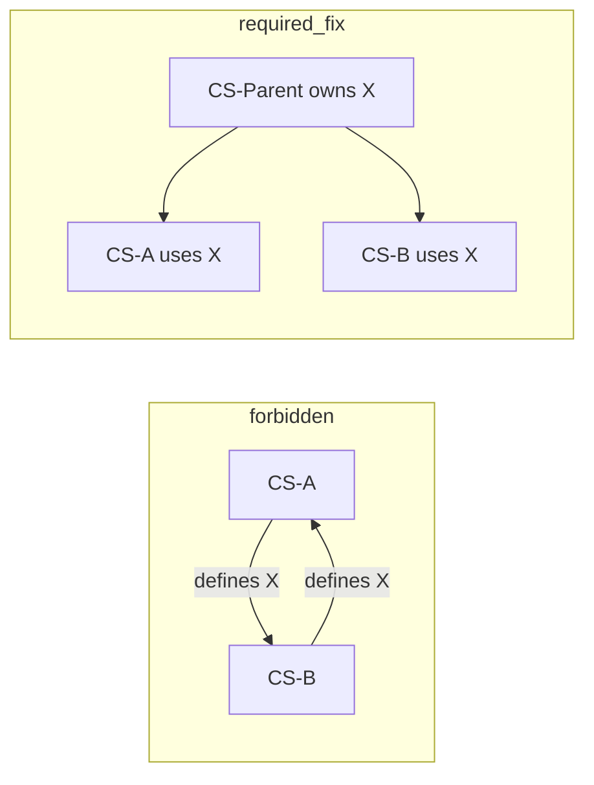
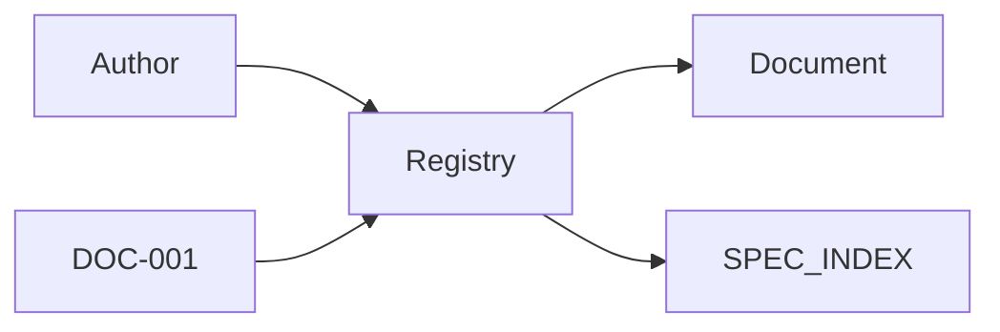
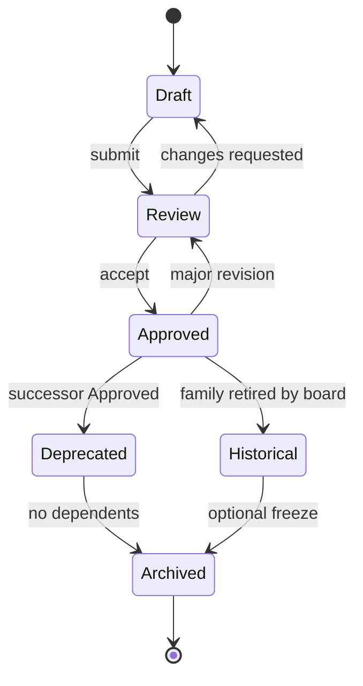
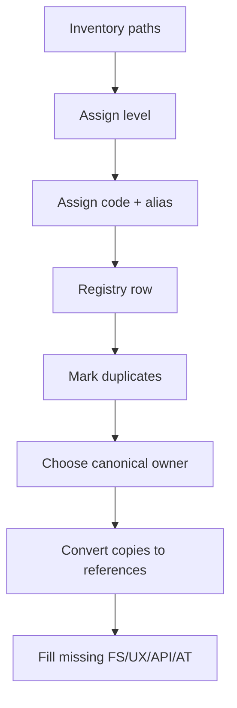

# PRIMA Documentation Architecture

**Code:** DOC-001  
**Title:** PRIMA Documentation Architecture  
**Version:** 2.0.0  
**Status:** Approved (Official)  

> Documentation is a product layer of the Educational Operating System.  
> This specification defines **classification, ownership, reference, versioning, and lifecycle** for every PRIMA document.  
> It does **not** redesign engines, rewrite Canonical Specifications, or invent parallel product concepts.  
> Existing codes (POSS, PAS-\*, PDC, ES-\*, CM-001, …) remain authoritative and are **classified** here via aliases.

---

# 1. Purpose

## 1.1 Why documentation architecture exists

PRIMA is no longer a simple application. It is becoming an **Educational Operating System**. At that scale, undocumented structure becomes structural risk.

Documentation architecture exists to ensure that, for the next decades:

1. Every concept has exactly one canonical home.  
2. Every future feature, engine, workflow, and implementation can be classified without ambiguity.  
3. Authority and precedence are explicit.  
4. Change is traceable from belief → definition → behavior → contract → proof → work.  
5. The cost of adding the *n*-th document grows linearly, not exponentially.

Without architecture, documentation grows by **accretion**.  
With architecture, documentation grows by **composition**.

## 1.2 Why documentation is a product

Documentation is not a side effect of engineering. It is a governed product surface that:

| Product property | Documentation equivalent |
|------------------|--------------------------|
| Users | Architects, engineers, designers, QA, AI agents, future maintainers |
| UX | Findability, clarity, cognitive load of reading |
| Reliability | Reference integrity and non-contradiction |
| Versioning | SemVer + lifecycle states |
| Support | Registry navigation and ownership |
| Debt | Duplication, drift, mixed responsibility |

Treating documentation as a product makes maintainability a first-class requirement, not an afterthought.

## 1.3 Why duplicated documentation creates architectural debt

Duplication is an integrity failure mode, not a formatting issue.

| Debt type | Mechanism | Long-term cost |
|-----------|-----------|----------------|
| Semantic drift | Two “definitions” diverge after a patch | Silent behavioral forks |
| Authority ambiguity | Readers pick the convenient copy | Unreviewable decisions |
| Traceability break | AT/IT cannot pin a stable target | False green releases |
| Review multiplication | Every change hunted across copies | Slow, error-prone governance |
| Prompt contradiction | Agents cite conflicting paragraphs | Unstable AI-assisted work |
| Constitutional erosion | Paraphrase softens non-negotiables | Product identity decay |

**Principle.** A broken reference is visible. A divergent paragraph is not. Prefer a stale link over a fresh copy.



---

# 2. Core Principles

These principles are normative. All other sections specialize them.

| Principle | Normative statement |
|-----------|---------------------|
| **Single Source of Truth** | Each concept, invariant, schema, and authority rule is defined in exactly one Approved document (or one owned section of that document’s layer). |
| **Reference First** | Documents that need a concept SHALL reference its owner; they SHALL NOT redefine it. |
| **Layer Isolation** | Each document belongs to exactly one layer. Mixed-layer documents are non-conformant. |
| **Ownership** | Every Approved document has exactly one accountable owner role (may delegate editors). |
| **Consistency** | Codes, headers, registry rows, and status values MUST agree. |
| **Governance** | Approval, deprecation, and major change follow declared workflows (and ADL-001 when architecture decisions are involved). |
| **Document Lifecycle** | Every governed document occupies exactly one lifecycle state at a time. |
| **Technology Independence** | Levels 0–2 MUST remain technology-agnostic. Lower layers MAY specialize technology without rewriting upper meaning. |
| **Backward Compatibility** | Legacy codes remain valid as **aliases**. Migration categorizes; it does not force mass rewrite. |
| **Future Extensibility** | New documents extend the registry by rows and codes — not by inventing new structural layers without amending DOC-001. |

### Decision tree — where does a new idea go?



---

# 3. Documentation Ecosystem

## 3.1 Hierarchy (Levels 0–9)



| Level | Prefix | Name | One-line responsibility |
|------:|--------|------|-------------------------|
| 0 | **BIB** | Project Bible | Ultimate product narrative authority and mission SSOT |
| 1 | **CON** | Constitution | Immutable principles, authority model, platform identity |
| 2 | **CS** | Canonical Specifications | Normative definitions of concepts, models, artifacts, boundaries |
| 3 | **FS** | Functional Specifications | What the system must do — behaviors, rules, flows |
| 4 | **UX** | UX Specifications | Teacher experience structure, interaction, cognitive load |
| 5 | **TS** | Technical Standards | How we build — engineering quality, modules, practices |
| 6 | **API** | API Contracts | Machine-facing contracts — APIs, events, commands, schemas |
| 7 | **AT** | Acceptance Tests | Verifiable proof that FS/UX/TS/API are satisfied |
| 8 | **IT** | Implementation Tasks | Executable delivery units |
| 9 | **DN** | Development Notes | Non-normative working notes, logs, explorations |
| — | **DOC** | Meta-documentation | Documentation system itself (this file, registry) |

## 3.2 Precedence

When documents conflict:

```text
BIB → CON → CS → FS → UX/TS → API → AT → IT
```

DN never wins.  
DOC governs documentation process only; it does not override BIB/CON/CS product meaning.

## 3.3 Compatibility with existing PRIMA codes

| Existing family | Level | Notes |
|-----------------|------:|-------|
| LUDI ON Project Bible | 0 | BIB-001 |
| Product DNA, Architectural Principles, POSS, PDC | 1 | CON aliases |
| Constitutional models, Canonical Artifacts, CM-001, PAS-001…006, CEA, Instructional Blueprint schema | 2 | CS aliases |
| Feature/engine *behavior* specs, solution workflows | 3 | FS |
| Teacher Experience, Design System application, Teacher Desk UX | 4 | UX |
| ES-\* platform standards, PPEF/PPS/PVC standards, composition rules | 5 | TS |
| Public package contracts, event/command envelopes when published as contracts | 6 | API |
| AGR acceptance criteria, AT suites | 7 | AT |
| Missions, sprint plans, blueprint implementation plans | 8 | IT |
| Session logs, research notes | 9 | DN (non-normative) |

**Migration rule.** New documents use BIB/CON/CS/FS/UX/TS/API/AT/IT/DN/DOC codes. Legacy codes remain **aliases** in the Document Registry.

---

# 4. Document Responsibilities

For each category: purpose, owner, consumers, input, output, allowed content, forbidden content, update frequency, approval authority.

## 4.1 Level 0 — Project Bible (BIB)

| Field | Specification |
|-------|----------------|
| **Purpose** | Ultimate product story, mission, and terminology north star |
| **Owner** | Product Architecture Board |
| **Consumers** | All roles; all higher governance docs |
| **Input** | Vision decisions, market/teacher truth, board resolutions |
| **Output** | Stable product identity narrative |
| **Allowed** | Mission, positioning, global teacher authority stance, glossary pointers to CS |
| **Forbidden** | APIs, UI pixels, sprint tasks, engine algorithms |
| **Update frequency** | Very rare |
| **Approval authority** | Product Architecture Board |

## 4.2 Level 1 — Constitution (CON)

| Field | Specification |
|-------|----------------|
| **Purpose** | Non-negotiable principles and authority model |
| **Owner** | Chief Product Architect + Chief Software Architect |
| **Consumers** | All authors and reviewers |
| **Input** | Bible; board-approved principles |
| **Output** | Binding constraints on all lower layers |
| **Allowed** | Principles, authority, global precedence, identity statements |
| **Forbidden** | Screens, schemas, tickets, technology stacks as identity |
| **Update frequency** | Rare (major) |
| **Approval authority** | Architecture Board |

## 4.3 Level 2 — Canonical Specifications (CS)

| Field | Specification |
|-------|----------------|
| **Purpose** | Single normative definition of concepts, models, artifacts, boundaries |
| **Owner** | Domain Architect (subject) / Chief Architect (cross-cutting) |
| **Consumers** | FS, UX, TS, API authors |
| **Input** | CON + Bible |
| **Output** | Definitions and invariants |
| **Allowed** | Entities, taxonomies, artifact schemas, engine *identity & boundaries*, state vocabularies |
| **Forbidden** | Layouts, React trees, sprint scope, paraphrased second definitions |
| **Update frequency** | Low–medium |
| **Approval authority** | Chief Architect (+ Domain Architect) |

## 4.4 Level 3 — Functional Specifications (FS)

| Field | Specification |
|-------|----------------|
| **Purpose** | Observable behaviors and feature contracts |
| **Owner** | Product Engineering Lead (feature) |
| **Consumers** | UX, TS, API, AT, IT |
| **Input** | CS (+ CON) |
| **Output** | Behavioral requirements |
| **Allowed** | Goals, flows, rules, edge cases, NFRs as requirements |
| **Forbidden** | Redefining CS; pixel UI; package trees as product truth |
| **Update frequency** | Medium |
| **Approval authority** | Feature owner + Domain Architect review |

## 4.5 Level 4 — UX Specifications (UX)

| Field | Specification |
|-------|----------------|
| **Purpose** | Teacher experience structure and interaction |
| **Owner** | UX Architect / Lead Frontend (experience) |
| **Consumers** | Frontend IT, AT, content design |
| **Input** | FS (+ CS terms) |
| **Output** | IA, states, CTA hierarchy, a11y UX rules |
| **Allowed** | Layouts, empty/loading/error, microcopy principles |
| **Forbidden** | New domain entities; engine internals |
| **Update frequency** | Medium |
| **Approval authority** | UX Architect |

## 4.6 Level 5 — Technical Standards (TS)

| Field | Specification |
|-------|----------------|
| **Purpose** | Engineering quality bars and build practices |
| **Owner** | Chief Software Architect / package stewards |
| **Consumers** | Engineers, CI, AGR |
| **Input** | CON, CS, FS (when implementing behavior) |
| **Output** | Standards and module rules |
| **Allowed** | Package rules, SDK standards, testing/security baselines |
| **Forbidden** | Product mission restatements; UX as API truth |
| **Update frequency** | Medium |
| **Approval authority** | Chief Software Architect |

## 4.7 Level 6 — API Contracts (API)

| Field | Specification |
|-------|----------------|
| **Purpose** | Machine-facing contracts between modules/systems |
| **Owner** | Contract owner (package/service) |
| **Consumers** | Implementers, AT, external integrators |
| **Input** | CS + FS + TS constraints |
| **Output** | Schemas, endpoints, events, commands, compatibility rules |
| **Allowed** | Types, envelopes, versioning, error codes, idempotency |
| **Forbidden** | UI; pedagogical essays; ticket lists |
| **Update frequency** | Medium–high with compatibility discipline |
| **Approval authority** | Contract owner + Architect review on breaking changes |

## 4.8 Level 7 — Acceptance Tests (AT)

| Field | Specification |
|-------|----------------|
| **Purpose** | Verifiable pass/fail against Approved specs |
| **Owner** | Quality Architect + feature owner |
| **Consumers** | QA, CI, release, AGR |
| **Input** | FS and/or UX and/or TS and/or API |
| **Output** | Test criteria and traceability IDs |
| **Allowed** | Given/When/Then, thresholds, negative cases |
| **Forbidden** | New requirements not in specs; IT as requirement source |
| **Update frequency** | High with FS/API change |
| **Approval authority** | Quality Architect |

## 4.9 Level 8 — Implementation Tasks (IT)

| Field | Specification |
|-------|----------------|
| **Purpose** | Executable delivery of Approved specs |
| **Owner** | Delivery lead |
| **Consumers** | Implementers |
| **Input** | FS/UX/TS/API + AT IDs |
| **Output** | Scoped work units |
| **Allowed** | Scope, deps, AT pointers, out-of-scope |
| **Forbidden** | Silent CS invention; scope inflation without FS update |
| **Update frequency** | High |
| **Approval authority** | Delivery lead (tech review as needed) |

## 4.10 Level 9 — Development Notes (DN)

| Field | Specification |
|-------|----------------|
| **Purpose** | Non-normative memory of exploration and sessions |
| **Owner** | Author |
| **Consumers** | Team (context only) |
| **Input** | Work in progress |
| **Output** | Notes, logs, questions |
| **Allowed** | Hypotheses, scratch diagrams, meeting outcomes |
| **Forbidden** | Being cited as normative `Depends On` for Approved docs |
| **Update frequency** | Ad hoc |
| **Approval authority** | None (not Approved authority) |

## 4.11 Meta — Documentation System (DOC)

| Field | Specification |
|-------|----------------|
| **Purpose** | Govern documentation architecture and registry |
| **Owner** | Documentation Architect |
| **Consumers** | All authors |
| **Allowed** | Process, layers, naming, lifecycle |
| **Forbidden** | Product concept definitions |
| **Approval authority** | Architecture Board |

---

# 5. Dependency Matrix

## 5.1 Legend

| Symbol | Meaning |
|--------|---------|
| **Must** | Required dependence for Approval when applicable |
| **May** | Allowed normative or contextual reference |
| **Never** | Forbidden as authority (and usually forbidden entirely) |

## 5.2 Matrix (From → To)

| From ↓ \ To → | BIB | CON | CS | FS | UX | TS | API | AT | IT | DN | DOC |
|---------------|:---:|:---:|:--:|:--:|:--:|:--:|:---:|:--:|:--:|:--:|:---:|
| **BIB** | — | Never | Never | Never | Never | Never | Never | Never | Never | Never | May |
| **CON** | Must | May* | Never | Never | Never | Never | Never | Never | Never | Never | May |
| **CS** | May | Must | May* | Never | Never | Never | Never | Never | Never | Never | May |
| **FS** | May | Must | Must | May* | Never | May† | Never | Never | Never | Never | May |
| **UX** | May | Must | Must‡ | Must | May* | Never | Never | Never | Never | Never | May |
| **TS** | May | Must | Must | May§ | Never | May* | Never | Never | Never | Never | May |
| **API** | May | May | Must | Must | Never | Must | May* | Never | Never | Never | May |
| **AT** | May | May | May | Must¶ | Must¶ | Must¶ | Must¶ | May* | Never | Never | May |
| **IT** | May | May | May | Must# | Must# | Must# | Must# | Must | May* | Never** | May |
| **DN** | May | May | May | May | May | May | May | May | May | May | May |
| **DOC** | May | May | May | May | May | May | May | May | May | May | May |

\* Same-layer references only for narrow interface/composition — never circular ownership of one concept.  
† FS may cite TS only for already-approved platform constraints.  
‡ UX references CS for terms only; behavior from FS.  
§ TS may reference FS when implementing a functional contract.  
¶ AT must reference at least one of FS/UX/TS/API under test.  
# IT must reference the specs it delivers (subset as applicable).  
\*\* IT may *produce* DN; IT must never treat DN as requirement authority.

## 5.3 Circular dependency rules

1. **No circular normative ownership** between two documents for the same concept.  
2. Same-layer “May” links MUST be acyclic for ownership; peer interfaces are allowed if each concept has a single owner document.  
3. If A and B both need a shared definition, extract or amend a **CS** (or CON) parent — do not cross-own.  
4. Detected cycles block Approval.



## 5.4 Must Never Reference (summary)

| Document | Must never treat as authority |
|----------|-------------------------------|
| Any Approved doc | DN, research notes, chat transcripts |
| CS | FS, UX, TS, API, AT, IT |
| FS | IT, DN; UX as domain definition |
| UX | TS/API internals; IT |
| API | UX; IT; DN |
| AT | IT as requirements; DN |
| IT | DN as requirements; inventing CS |

---

# 6. Reference Rules

## 6.1 Reference syntax (normative)

Inline:

```text
See CS-004 (Constitutional Engine Architecture) §3.2 @^1.0.0
```

Header:

```yaml
Depends On:
  - BIB-001
  - CON-001@^1.0.0
  - CS-004
  - FS-012@>=1.2.0 <2.0.0
Supersedes: FS-011
Deprecated By: FS-014   # when deprecated
```

## 6.2 Reference IDs

| ID form | Use |
|---------|-----|
| `PREFIX-NNN` | Document code |
| `PREFIX-NNN§section` | Section pin |
| `PREFIX-NNN@semver` | Version pin |
| `ALIAS` | Legacy public code mapped in registry |

## 6.3 Cross-document linking

1. Prefer repository-relative Markdown links **and** codes.  
2. Links alone are insufficient — codes enable registry traceability.  
3. Do not paste normative paragraphs; summarize in one sentence maximum when needed, then link.

## 6.4 Version references

| Form | Meaning |
|------|---------|
| `@1.2.0` | Exact |
| `@^1.2.0` | Compatible with 1.x ≥ 1.2.0 |
| `@>=1.2.0 <2.0.0` | Range |
| *(no pin)* | Current Approved (allowed for CON/CS stable refs; discouraged for API) |

Breaking API consumers SHOULD pin exact or `^` ranges deliberately.

## 6.5 Deprecation references

Deprecated documents MUST declare:

```yaml
Status: Deprecated
Superseded By: FS-014@1.0.0
Deprecated Since: 2026-07-26
```

Dependents MUST migrate `Depends On` to the successor before the deprecated document is Archived.

---

# 7. Naming Convention

## 7.1 Unique IDs

```text
<PREFIX>-<NNN>
```

| Prefix | Level |
|--------|------:|
| BIB | 0 |
| CON | 1 |
| CS | 2 |
| FS | 3 |
| UX | 4 |
| TS | 5 |
| API | 6 |
| AT | 7 |
| IT | 8 |
| DN | 9 |
| DOC | Meta |

- `<NNN>` zero-padded, unique per prefix, **permanent**.  
- Titles may change; codes do not.

## 7.2 File names

```text
PREFIX-NNN_SHORT_TITLE.md
```

Examples:

- `CON-001_PRODUCT_DNA.md`  
- `FS-014_TEACHER_TIMELINE.md`  
- `API-003_EVENT_ENVELOPE.md`  
- `DN-20260726_SESSION_NOTES.md` *(date allowed only for DN)*

**Forbidden in filenames:** `_v2`, technology stack names for BIB/CON/CS (`_REACT_`, `_POSTGRES_`).

## 7.3 Folder organization (guidance)

| Level | Default home |
|------:|----------------|
| 0–3 (product) | `docs/product/` |
| 2–5, 7 (engineering) | `docs/engineering/` |
| 4 / design | `docs/design/`, `docs/product/` |
| 6 | `docs/engineering/` or `packages/*/contracts` docs mirrored by API-\* |
| 8 | plans under `docs/product/` or issue tracker linked from IT-\* |
| 9 | `docs/session_logs/`, `docs/research/` |
| DOC | `docs/` root |

Logical layer is normative; folder is organizational.

## 7.4 Versioning in names

Version lives in the **header**, never in the filename.

## 7.5 Examples

| Code | Alias | Title |
|------|-------|-------|
| BIB-001 | Bible | LUDI ON Project Bible |
| CON-001 | DNA | PRIMA Product DNA |
| CS-001 | CA | Canonical Artifacts |
| FS-001 | — | Teacher Timeline (functional) |
| UX-001 | — | Teacher Desk Experience |
| TS-001 | ES-001 | Repository Foundation |
| API-001 | — | Event Envelope Contract |
| AT-001 | — | Teacher Desk Acceptance |
| IT-001 | — | Teacher Desk Production Implementation |
| DN-001 | — | Session exploration note |
| DOC-001 | — | Documentation Architecture |

---

# 8. Document Registry

## 8.1 Role

The **Document Registry** is the navigation system and catalog of record for the documentation ecosystem.

**Path:** [`docs/DOCUMENTATION_REGISTRY.md`](./DOCUMENTATION_REGISTRY.md) (DOC-002)



- Registry = **where** and **what status**  
- Document = **normative meaning**  
- SPEC_INDEX = engineering alias companion (not a second product bible)

## 8.2 Entry schema

| Field | Required | Description |
|-------|----------|-------------|
| code | Yes | Primary ID |
| alias | No | Legacy/public code |
| title | Yes | Human title |
| layer | Yes | 0–9 or DOC |
| path | Yes | Repo-relative path |
| status | Yes | Lifecycle state |
| version | Yes | Current Approved SemVer |
| owner | Yes | Accountable role |
| depends_on | Yes | Codes |
| supersedes | No | Prior code |
| at_coverage | No | AT codes |
| notes | No | Migration caveat |

## 8.3 Invariants

1. Unique `code` and unique `alias` among live rows.  
2. Unique `path` among non-Archived rows.  
3. No orphan Approved/Official document without a row.  
4. Registry contains **no** product definitions.  
5. Create/approve/deprecate REQUIRES registry update in the same change set.

## 8.4 Reservation workflow

1. Reserve code as Draft.  
2. Author document.  
3. Review → Approved.  
4. Update registry status/version.

---

# 9. Document Lifecycle

## 9.1 States

| State | Meaning | Normative cite? |
|-------|---------|-----------------|
| **Draft** | Work in progress | No |
| **Review** | Formal review | No |
| **Approved** | Normative (Official ≡ Approved) | Yes |
| **Deprecated** | Successor preferred | Migration only |
| **Archived** | Frozen history | No |
| **Historical** | Explicitly superseded family kept for archaeology (e.g. old PVC split) | No |

## 9.2 Transitions



| Transition | Gate |
|------------|------|
| Draft → Review | Header + registry row + SSOT self-check |
| Review → Approved | Layer steward + dependency matrix + quality checklist |
| Approved → Deprecated | Successor Approved + `Superseded By` |
| Deprecated → Archived | Zero Approved dependents |
| → Historical | Board/SPEC_INDEX declaration (rare) |

---

# 10. Version Governance

## 10.1 SemVer

| Bump | When |
|------|------|
| **MAJOR** | Incompatible normative change; breaks dependents |
| **MINOR** | Backward-compatible additive normative content |
| **PATCH** | Clarifications, typos, link fixes, non-normative examples |

## 10.2 Approval workflow

1. Author Draft (+ reserve code).  
2. Peer review (SSOT, duplication, layer fit).  
3. Layer steward review (CON/CS/TS/API: Architect; UX: UX Architect; AT: Quality).  
4. Approve → version tag in header → registry update.  
5. If architectural platform impact: follow **ADL-001**.

## 10.3 Deprecation workflow

1. Approve successor.  
2. Mark prior Deprecated with successor pin.  
3. Migrate dependents.  
4. Archive when clear.

## 10.4 Migration workflow (content)

1. **Categorize** existing doc into a level (do not rewrite).  
2. Assign primary code + alias.  
3. Register path/owner/status.  
4. Add `Depends On` stubs where missing.  
5. Open IT/DN notes for later deduplication work — do not mass-edit meaning in place unless correcting clear error under ownership.

---

# 11. Quality Standards

Every Approved document MUST satisfy:

| Standard | Test |
|----------|------|
| **Completeness** | Stated scope covered; out-of-scope explicit |
| **Consistency** | Aligns with higher layers; header/registry agree |
| **Traceability** | Codes and section pins usable by AT/IT |
| **Reference Integrity** | All `Depends On` resolve to live registry rows |
| **Maintainability** | Single owner can update without hunting copies |
| **Single Responsibility** | One layer, one job |
| **Explicit Ownership** | Owner role named |

### Approval checklist

- [ ] Correct level and prefix  
- [ ] Header complete  
- [ ] Registry row updated  
- [ ] No redefined upper-layer concepts  
- [ ] Dependency matrix respected  
- [ ] No DN/research as authority  
- [ ] Examples marked non-normative when needed  

---

# 12. Anti-patterns

The following are **forbidden**:

| Anti-pattern | Why it fails |
|--------------|--------------|
| Duplicated concepts | Breaks SSOT |
| Repeated definitions | Guarantees drift |
| Circular references of ownership | Unresolvable authority |
| Mixed responsibilities (CON+FS+UX in one file) | Unmaintainable |
| Technology-specific Canonical documents | Couples meaning to stack |
| Implementation inside Constitution | Freezes accidents as beliefs |
| UI layouts inside CS | Wrong layer |
| Requirements invented in IT/AT | Shadow product management |
| “Complete guide” megadoc | Accretion architecture |
| Citing session logs as `Depends On` | Non-normative authority |
| Second glossary | Extend Constitutional Language instead |
| Silent rewrite of CS during a sprint | Governance bypass |
| API contract embedded only in chat/PR | Not registered, not versioned |

---

# 13. Examples

## 13.1 GOOD documentation

**FS-014 Teacher Timeline (functional)**  
- Defines behaviors: week navigation, move suggestions require confirmation.  
- References CS for Lesson/Experience identity.  
- Does not paste engine boundary essays.  
- Points AT-014 for acceptance.

## 13.2 BAD documentation

**“Timeline Complete Guide”** that includes: product DNA paragraphs, React component lists, SQL, sprint tasks, and a new definition of “Lesson” disagreeing with CS.  
→ Violates layer isolation, SSOT, and ownership.

## 13.3 GOOD references

```yaml
Depends On:
  - CON-001@^1.0.0
  - CS-004
  - FS-014@^1.0.0
```

Inline: `Teacher confirmation is mandatory (FS-014§5.2); engine identity per CS-004.`

## 13.4 BAD references

- Pasting CS-004 §3 into an IT ticket as the new truth.  
- `Depends On: session_logs/2026-07-20_...`  
- UX doc: “A Lesson is redefined as…”  
- FS citing IT-003 as the source of a business rule.

---

# 14. Migration Strategy

**Do not rewrite existing documents as the first step.** Categorize, register, then deduplicate deliberately.

## 14.1 Steps



## 14.2 Initial categorization map (illustrative)

| Existing area | Level |
|---------------|------:|
| `LUDI_ON_PROJECT_BIBLE.md` | 0 |
| Product DNA, Architectural Principles, POSS, PDC | 1 |
| Constitutional_*, Canonical Artifacts, CM-001, PAS-*, CEA, Instructional Blueprint Spec | 2 |
| Engine *behavior* product docs, solution workflows | 3 |
| Teacher Experience, design system, UI guidelines, desk blueprint | 4 |
| ES-*, PPEF/PPS/PVC standards, composition root | 5 |
| packages contracts docs / envelope specs | 6 |
| AGR checklists, future AT suites | 7 |
| Sprint/mission/blueprint implementation plans | 8 |
| `research/`, `session_logs/` | 9 |

## 14.3 Missing document types (gaps to fill over time)

| Gap | Action |
|-----|--------|
| FS per shipped capability | Author FS; stop treating missions as FS |
| UX per major surface | Extract from blueprints |
| API-\* for public contracts | Promote from code/types with registry rows |
| AT-\* with FS traceability | Add before calling features “done” |
| Deduplicated CS ownership list | Use INV-001 + registry; resolve doubles |

## 14.4 Duplicated concepts — handling

1. Identify concept name.  
2. Find highest-layer existing definition (prefer CS/CON).  
3. Declare owner in registry notes.  
4. Replace secondary prose with references (IT work — not silent meaning change).  
5. If conflict: amend owner doc via Approval workflow (ADL-001 if architectural).

---

# 15. Future Evolution

## 15.1 Scale targets

| Scale | What changes | What must not change |
|------:|--------------|----------------------|
| **100+** | More registry rows; SPEC_INDEX stays companion | Layer model, SSOT, codes |
| **500+** | Domain stewards; prefix ranges reserved per domain | Dependency direction |
| **1000+** | Registry may split by prefix files *as views* of one logical registry | Single logical catalog; no second constitution |

## 15.2 Scaling mechanisms (no structural rewrite)

1. **Codes** absorb growth (`FS-001`…`FS-999`, then `FS-1000` policy via DOC amendment if ever needed).  
2. **Aliases** preserve external vocabulary.  
3. **Registry views** (by layer/domain) without duplicating definitions.  
4. **Section pins** (`§`) keep AT stable as docs grow.  
5. **Deprecation** retires without delete-driven broken history.  
6. **DOC-001 amendments** are the only way to add a new *level* — default is add documents, not layers.

## 15.3 Extensibility rule

New product areas SHALL map into Levels 0–9.  
If a proposed document fits none, the defect is usually mixed responsibility — split it — before proposing Level 10.

---

# Closing Authority Statement

DOC-001 v2.0.0 is the **governing specification** for the PRIMA documentation ecosystem.

After this document:

- every future document can be **classified**,  
- **located** via the registry,  
- **maintained** under ownership,  
- **versioned** under SemVer,  
- and **referenced** without ambiguity.

Product meaning remains owned by Bible, Constitution, and Canonical Specifications.  
This document owns only **how documentation itself works** — for the next twenty years of PRIMA.

---

## Document control

| Version | Date | Notes |
|---------|------|-------|
| 1.0.0 | July 2026 | Initial seven-layer governance model |
| 2.0.0 | July 2026 | Mission 000 Foundation: Levels 0–9, API & DN, full matrix, migration & scale |
