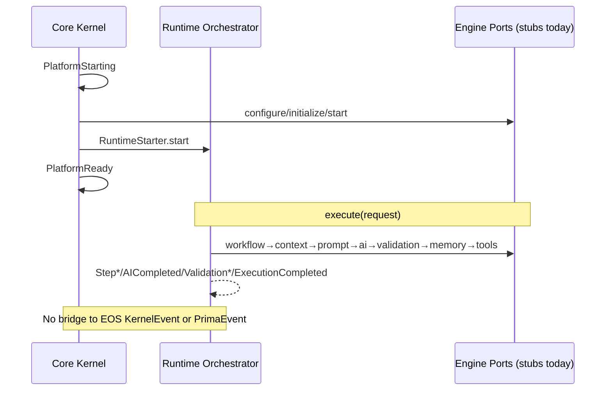

# AFPRR — PRIMA Core v1.0 Architecture Freeze & Production Readiness Review

> Independent enterprise audit. No new features were developed as part of this review.  
> Evidence is drawn from repository packages, contracts, tests, PAS maps, and ADR index as of 2026-07-28.

---

## 1. Executive Summary

PRIMA Core has produced **several high-quality isolated libraries** (Workflow FSM + catalog, Validation gate, Tool permissions/sandbox, Runtime pipeline mechanics, Core Kernel bootstrap, AI gateway shape). Package-level **acyclicity is healthy**: engines do not import each other.

However, **PRIMA Core is not an integrated, production-ready platform**:

1. **P-C-005 Prompt Builder & Compiler is missing** while the default Runtime pipeline requires `engineId: 'prompt'`.
2. **Composition path defaults to stubs** (`registerCoreStubs` / `createRuntimeBridge({ useStubs: true })` default). No production `RuntimeEnginePort` adapters wire real engines.
3. **Dual kernels** (`@prima/eos` vs `@prima/core-kernel`) duplicate lifecycle/DI/health/events; PAS maps only EOS; no ADR.
4. **Shared contracts are fragmented** (`ValidationReport` has ≥3 incompatible shapes; expected Core DTOs are not in `@prima/contracts`).
5. **Error taxonomy, ADR log, changelogs, Known Limitations, sequence diagrams, durable persistence, and unified observability** are incomplete or absent.
6. **Zero audited Core engines implement `BasePrimaEngine`** despite engines README requiring it (only Knowledge does).

**Certification:** ❌ **NOT READY** for Architecture Freeze / Phase II as an integrated Core runtime.

**Architecture Score:** **47 / 100**  
**Production Readiness Score:** **34 / 100**

---

## 2. Scope Inventory (Verified)

| ID | Component | Status | Package / Location |
|----|-----------|--------|--------------------|
| P-C-001 | Workflow Definitions | **Exists (colocated)** | `packages/engines/workflow/definitions/` + `src/catalog/` |
| P-C-002 | Workflow Engine | **Exists** | `@prima/engine-workflow` |
| P-C-003 | AI Orchestrator | **Exists** | `@prima/ai-orchestrator` |
| P-C-004 | Context Engine | **Exists** | `@prima/engine-context` |
| P-C-005 | Prompt Builder & Compiler | **MISSING** | No package; Runtime stub + AI `PromptDispatcher` only |
| P-C-006 | Validation Engine | **Exists** | `@prima/engine-validation` |
| P-C-007 | Memory Engine | **Exists (dual surface)** | `@prima/engine-memory` (PS-002 + structured core) |
| P-C-008 | Tool & Capability Engine | **Exists** | `@prima/engine-tools` |
| P-C-009 | Runtime Orchestrator | **Exists (stub-wired)** | `@prima/runtime-orchestrator` |
| P-C-010 | Core Kernel | **Exists (stub-wired)** | `@prima/core-kernel` |
| — | EOS Kernel (ENG-00) | **Exists, unwired to Core** | `@prima/eos` |

Approx source size (src excl. tests): Workflow ~2.6k LOC, Memory ~2.7k, AI ~1.6k, Core Kernel ~1.6k, Validation ~1.5k, Runtime ~1.1k, Tools ~1.1k, Context ~1.2k, EOS ~0.9k.

---

## 3. Audit 1 — Architecture

### Strengths
- Clear intent to separate orchestration from pedagogy.
- Engines are modular npm packages with empty mutual deps (good Open/Closed posture at package boundary).
- Runtime uses ports (`RuntimeEnginePort`) — Dependency Inversion at the coordinator layer.
- Core Kernel provides DI container (constructor/factory injection, child scopes for tests).
- Workflow AI dispatch ban is a strong domain invariant.

### Weaknesses / smells
| Finding | Severity | Evidence |
|---------|----------|----------|
| Dual-kernel anti-pattern | **Critical** | Parallel lifecycle, DI, health, events in eos vs core-kernel |
| Stub-as-default composition | **Critical** | `runtime-bridge.ts` registers stubs unless opted out |
| Missing Prompt engine | **Critical** | Pipeline step `prompt.compile` with no real package |
| Interface Segregation failure on contracts | **High** | Local type copies; colliding `ValidationReport` |
| Shared mutable execution bag | **Medium** | `RuntimeExecutionContext.bag` is mutable shared state |
| Dead declared dependencies | **Medium** | context/memory declare contracts+sdk, never import |
| Docs vs code (`BasePrimaEngine` MUST) | **High** | Engines README vs reality |
| Authority confusion (validation triad) | **High** | artifact gate vs `src/engines/validation` vs quality |

**SOLID summary:** SRP mostly OK per package; OCP OK for new engines via ports; LSP weak (incompatible ValidationReport); ISP weak (fat/local APIs); DIP good at Runtime, weak at Core Kernel↔real engines.

---

## 4. Audit 2 — Dependency Graph

### Package dependency matrix (declared)

| From \\ To | contracts | eos | engine-sdk | event-bus | runtime | core-kernel | engines* | ai |
|------------|-----------|-----|------------|-----------|---------|-------------|----------|-----|
| contracts | — | | | | | | | |
| eos | ✓ | — | | | | | | |
| engine-sdk | ✓ | | — | | | | | |
| event-bus | ✓ | | | — | | | | |
| runtime-orchestrator | | | | | — | | | |
| core-kernel | | | | | ✓ | — | | |
| ai-orchestrator | | | | | | | | — |
| workflow / validation / tools | | | | | | | — | |
| memory / context | ✓† | | ✓† | | | | — | |

† Declared but **unused** in TypeScript sources.

**Cycles:** none detected (package.json or TS imports among focus packages).  
**Cross-engine coupling:** none via imports (healthy).  
**Layer violation (semantic):** Core Kernel does not sit on EOS; PAS map omits core-kernel / runtime / ai-orchestrator.

```
@prima/contracts
      ↑
   @prima/eos          @prima/runtime-orchestrator ←── @prima/core-kernel
                              ↑ (ports only; no engine packages)

@prima/ai-orchestrator, workflow, validation, tools  →  (islands)
@prima/engine-context, memory → declare contracts/sdk (dead)
```

---

## 5. Audit 3 — Public API

### Export posture
Packages export **wide surfaces** (many types + factories). Acceptable for early libraries; **not freeze-ready** without:
- Explicit `@public` / `@internal` split
- SemVer policy and CHANGELOG
- Versioned contract schemas

### Notable leak risks
- Runtime exports **all stub factories** from main entry (`registerCoreStubs`) — production consumers can accidentally ship stubs.
- Memory exports **two complete platforms** from one entry — high confusion risk.
- Workflow exports catalog + engine + examples + store bind together.

### Version compatibility
All packages at `0.1.0` private workspace — no published semver discipline yet.

---

## 6. Audit 4 — Engine Contracts

| Expected contract | Actual | Location | Immutable? | Versioned? |
|-------------------|--------|----------|------------|------------|
| WorkflowContext | `WorkflowContext` | engine-workflow | mostly readonly | definition version only |
| ExecutionContext | Multiple (`ExecutionContext`, `RuntimeExecutionContext`, `CoreKernelContext`, …) | contracts / runtime / core-kernel | Runtime **mutable** | weak |
| PromptPackage | `PromptPackage` | ai-orchestrator only | readonly | schemaId only |
| ValidationReport | **4 incompatible shapes** | validation / context / ai / knowledge | mixed | no |
| MemorySnapshot | `MemorySnapshot` | memory/core | readonly | record versions |
| ToolExecutionResult | **missing** → `ToolResult` | tools | readonly | no |
| RuntimeExecution | **missing** → `RuntimeResult` | runtime | mostly readonly | no |

**None** of the Core pipeline DTOs are canonicalized in `@prima/contracts`.

---

## 7. Audit 5 — Event Architecture

### Event map (buses)

| Bus | Types (summary) | Correlation |
|-----|-----------------|-------------|
| EOS KernelEvent | Kernel*/Engine*/HealthChanged/Discovery* | optional correlationId |
| PlatformEvent | Platform*/Engine*/HealthChanged/Config* | required correlationId |
| RuntimeEvent | WorkflowStarted…Execution*/Step* | executionId (not correlationId) |
| MemoryEvent | MemoryCreated/Updated/… | none |
| ContextEvent | ContextUpdated, BlueprintChanged, … | none |
| Workflow FSM | CreateWorkflow, ValidationPassed, … | N/A (inputs) |

### Collisions
- `ValidationPassed` / `ValidationFailed` — Runtime bus **and** Workflow FSM inputs (different semantics).
- `EngineRegistered`, `HealthChanged`, `EngineInitialized`/`EngineFailed` — Kernel **and** Platform buses.
- No unified `PrimaEvent` bridge; no replay store; ordering only within each in-memory bus.



---

## 8. Audit 6 — Configuration

| Area | Status |
|------|--------|
| Environment separation | Core Kernel: `PRIMA_ENV` / `NODE_ENV` |
| Feature flags | `PRIMA_FEATURE_*` |
| Experimental | `PRIMA_EXPERIMENTAL_*` + security gate |
| Engine/provider config maps | Present on Core Kernel |
| Localization / logging | Present |
| Validation of config | Yes (`validateConfiguration`) |
| Per-engine package config | Weak / local only |
| Secret handling | **Absent** (no vault, no redaction policy) |
| Hardcoded secrets | **None found** in audited Core packages |

EOS uses simple `MapConfigurationProvider` — separate from Core Kernel config model.

---

## 9. Audit 7 — Error Model

| Expected | Actual |
|----------|--------|
| PrimaError | **Missing** |
| WorkflowError | `WorkflowEngineError` (approx) |
| ContextError | **Missing** |
| PromptError | Folded into `AIOrchestratorError` |
| ValidationError | **Missing** (generic `Error`) |
| MemoryError | **Missing** |
| ToolError | `ToolEngineError` (approx) |
| RuntimeError | `RuntimeOrchestratorError` |
| KernelError | contracts `KernelError` + parallel `CoreKernelError` |

Recoverability/retry exists locally (AI, Tools, Runtime steps, EOS start). **No shared hierarchy, serialization contract, or stable cross-package error codes.**

---

## 10. Audit 8 — Observability

| Capability | Coverage |
|------------|----------|
| Structured logging | Runtime logger (often no-op sink); AI ExecutionLogger |
| Metrics | Tools monitor snapshot; AI usage/cost in-memory; Runtime timings |
| Health checks | Core Kernel + EOS; not unified |
| Execution tracing | **No** distributed/OTel tracing |
| Correlation IDs | Platform + AI + partial Kernel; Runtime uses executionId |
| Diagnostics | Core Kernel DiagnosticsBundle (strongest) |
| Performance counters | Minimal |
| Monitoring hooks | Events/subscribers only |

---

## 11. Audit 9 — Security

| Control | Assessment |
|---------|------------|
| Permissions | Tools: strong; Workflow: AI_FORBIDDEN; others weak |
| Provider credentials | Transport-injected; no vault |
| Secret storage | None |
| Input validation | AI edu-context; Validation rules; Context structural |
| Output sanitization | Validation safety rules; AI output validator |
| Audit logs | Validation audit (in-memory); Tools monitor |
| Sandbox | Tools policy gates (**not** OS isolation) |
| Sensitive ops | Export/PDF stubs; no hardened boundary |

**Best-in-class Core security surface:** `@prima/engine-tools`.  
**Overall platform security:** not production-grade.

---

## 12. Audit 10 — Performance

| Topic | Assessment |
|-------|------------|
| Startup | Core Kernel sequential engine init; EOS supports parallel start waves |
| Memory footprint | In-process Maps; unbounded history risk on event buses |
| Lazy loading | ServiceRegistry lazy engines; Runtime stubs always registered |
| Parallel execution | Runtime `parallelGroup`; EOS parallel start |
| Cache | Validation rules / AI provider selection lightweight |
| Runtime overhead | Acceptable for in-proc mediator |
| Durable I/O | **Not present** — performance claims premature |

---

## 13. Audit 11 — Test Coverage

| Package | Test files | Nature | Est. coverage* |
|---------|------------|--------|----------------|
| workflow | 2 | Unit FSM + catalog | ~45–55% |
| ai-orchestrator | 1 | Unit gateway | ~30–40% |
| context | 1 | Acceptance PS-003 | ~50–60% |
| validation | 1 | Unit gate/repair | ~35–45% |
| memory | 2 | PS-002 + structured | ~40–50% |
| tools | 1 | Permission/sandbox/retry | ~45–55% |
| runtime | 2 | Stub pipeline + manager | ~50–60% (of stubs) |
| core-kernel | 3 | Boot/DI/stub integration | ~45–55% |
| eos | 1 | Lifecycle | ~40–50% |

\*Heuristic from suite breadth vs LOC; no Istanbul/c8 report in workspace.

**Gaps:** no contract tests binding Runtime↔real engines; no end-to-end critical path with real adapters; weak mutation/chaos; cancel assertions loose; Prompt engine untested (absent).

---

## 14. Audit 12 — Documentation

| Package | README | Arch | API | Examples | Integration | Seq diagrams | Changelog | Limitations | Dev notes |
|---------|--------|------|-----|----------|-------------|--------------|-----------|-------------|-----------|
| workflow | ✓ | partial | ✓ | ✓ | catalog doc | ✗ | ✗ | ✗ | ✗ |
| ai | ✓ | partial | partial | ✓ | weak | ✗ | ✗ | ✗ | ✗ |
| context | ✓ | partial | partial | ✓ | weak | ✗ | ✗ | ✗ | ✗ |
| validation | ✓ | partial | partial | ✓ | weak | ✗ | ✗ | ✗ | ✗ |
| memory | ✓ | ✓ | partial | ✓ | weak | ✗ | ✗ | ✗ | ✗ |
| tools | ✓ | ✓ | partial | ✓ | weak | ✗ | ✗ | ✗ | ✗ |
| runtime | ✓ | ✓ | partial | stubs | weak | ✗ | ✗ | implied | ✗ |
| core-kernel | ✓ | ✓ | partial | ✓ | weak | ✗ | ✗ | ✗ | ✗ |
| prompt | N/A | N/A | N/A | N/A | N/A | N/A | N/A | N/A | N/A |

---

## 15. Audit 13 — ADRs

**Present:** `docs/engineering/adr/README.md` + `TEMPLATE.md` only. Index states **no formal ADR files yet**.

| Expected ADR | Status |
|--------------|--------|
| Core Engine Separation | **Missing** |
| Execution Graph | **Missing** |
| Prompt AST | **Missing** |
| Educational Memory Graph | **Missing** |
| Capability-Based Architecture | **Missing** |
| Validation Gate | **Missing** |
| Runtime Orchestration | **Missing** |
| Architecture Freeze | **This AFPRR (decision: NOT READY)** |
| Dual Kernel (eos vs core-kernel) | **Missing (blocking)** |
| Shared Core DTO contracts | **Missing (blocking)** |

---

## 16. Audit 14 — Production Readiness Dimensions

| Dimension | Score (0–10) | Notes |
|-----------|--------------|-------|
| Maintainability | 5 | Modular packages; dual models/kernels hurt |
| Extensibility | 6 | Ports/pipelines good; missing adapters |
| Reliability | 3 | Stub path; in-memory; incomplete recovery story |
| Scalability | 3 | Single-process assumptions |
| Recoverability | 4 | Local retries; no saga/outbox |
| Portability | 6 | TS packages portable; no cloud adapters |
| Provider Independence | 7 | AI transport injection is sound |
| Developer Experience | 5 | Good READMEs; stub-default can mislead |
| Operational Readiness | 2 | No metrics export, secrets, durable audit |

---

## 17. Certification Matrix

| Engine / Component | Architecture | Code Quality | API Design | Docs | Testing | Security | Performance | Maintainability | Overall |
|--------------------|--------------|--------------|------------|------|---------|----------|-------------|-----------------|---------|
| P-C-001 Workflow Definitions | Gold | Gold | Silver | Silver | Silver | Silver | Gold | Gold | **Gold** |
| P-C-002 Workflow Engine | Gold | Gold | Silver | Silver | Silver | Silver | Silver | Gold | **Gold** |
| P-C-003 AI Orchestrator | Silver | Silver | Silver | Needs Imp. | Needs Imp. | Needs Imp. | Silver | Silver | **Silver** |
| P-C-004 Context Engine | Silver | Silver | Needs Imp. | Needs Imp. | Silver | Needs Imp. | Silver | Needs Imp. | **Needs Improvement** |
| P-C-005 Prompt Builder | Critical | Critical | Critical | Critical | Critical | Critical | Critical | Critical | **Critical** |
| P-C-006 Validation Engine | Gold | Silver | Silver | Silver | Silver | Silver | Silver | Silver | **Silver** |
| P-C-007 Memory Engine | Needs Imp. | Silver | Needs Imp. | Silver | Silver | Silver | Needs Imp. | Needs Imp. | **Needs Improvement** |
| P-C-008 Tool Engine | Gold | Gold | Silver | Silver | Gold | Gold | Silver | Silver | **Gold** |
| P-C-009 Runtime Orchestrator | Gold* | Gold | Silver | Silver | Silver† | Needs Imp. | Silver | Gold | **Silver**† |
| P-C-010 Core Kernel | Needs Imp. | Silver | Silver | Silver | Silver† | Needs Imp. | Needs Imp. | Needs Imp. | **Needs Improvement**† |
| EOS (related) | Gold | Gold | Silver | Needs Imp. | Silver | Silver | Silver | Gold | **Silver** |

\*Architecture of Runtime as mediator is strong.  
†Overall reduced because production wiring is stub-mediated.

**Platform overall grade: Critical / Needs Improvement** (integrated Core).

---

## 18. Technical Debt Assessment

| Debt class | Estimate | Notes |
|------------|----------|-------|
| Missing Prompt package + AST | Large | Blocks honest pipeline |
| Real Runtime adapters × 6–7 | Large | Composition root work |
| Dual-kernel reconciliation | Large | ADR + merge or bridge |
| Canonical contracts in `@prima/contracts` | Medium–Large | Breaks local copies |
| Unified PrimaError hierarchy | Medium | Cross-cutting |
| Memory dual-surface consolidation | Medium | Product decision |
| Validation authority policy | Medium | Three validators |
| Persistence adapters | Large | Required for prod |
| ADR backlog (8+) | Medium | Governance |
| Observability exporters | Medium | Ops |
| Docs Completeness (Limitations/Changelog/Seq) | Medium | Freeze hygiene |
| Dead deps / BasePrimaEngine conformance | Medium | Honesty to PAS |

**Overall debt posture:** High — suitable for **library incubation**, not Architecture Freeze.

---

## 19. Critical Risks

1. **False production confidence** — stub Core Kernel/Runtime path appears “green” in tests.
2. **Prompt hole** — default pipeline cannot truthfully compile prompts.
3. **Dual kernel divergence** — two sources of truth for lifecycle/health/events.
4. **Contract collisions** — `ValidationReport` name reuse will break composition.
5. **Authority confusion** — which validation/memory surface is constitutional?
6. **No durable audit/secrets** — unsuitable for educational data / provider keys.
7. **PAS map drift** — Core packages invisible to official module map.

---

## 20. Recommendations (prioritized)

### High (blocking Freeze)

| # | Recommendation | Rationale | Impact | Effort |
|---|----------------|-----------|--------|--------|
| H1 | Ship P-C-005 Prompt Builder **or** remove `prompt` from default pipeline until real | Pipeline honesty | Unblocks truthful Core path | M–L |
| H2 | Fail-closed Runtime bridge: stubs only with explicit `useStubs: true` | Prevent false readiness | Safety | S |
| H3 | Implement production `RuntimeEnginePort` adapters + composition root | Integrate islands | Enables E2E Core | L |
| H4 | ADR: Dual Kernel — choose EOS as ENG-00 supervisor **or** formally demote/rename Core Kernel | Stop duplication | Governance + clarity | M |
| H5 | Canonicalize Core DTOs in `@prima/contracts` (esp. ValidationReport, PromptPackage, RuntimeResult) | Stop collisions | Type safety | M |
| H6 | Write freeze ADRs for Runtime Orchestration, Validation Gate, Capability model | ADL compliance | Traceability | M |

### Medium

| # | Recommendation | Rationale | Impact | Effort |
|---|----------------|-----------|--------|--------|
| M1 | Unify `PrimaError` hierarchy | Operability | Cross-engine handling | M |
| M2 | Resolve Memory dual surface (split packages or facade) | DX + privacy | Clarity | M |
| M3 | Validation authority policy (artifact vs decision vs quality) | Pedagogy safety | Correctness | M |
| M4 | Context↔Runtime adapter (session platform ≠ pipeline step) | Contract fit | Integration | M |
| M5 | Event naming + correlation policy + optional PrimaEvent bridge | Traceability | Ops | M |
| M6 | Persistence ports + at least one durable adapter | Production | Reliability | L |
| M7 | Package CHANGELOG + Known Limitations + sequence diagrams | Freeze hygiene | Maintainability | S–M |
| M8 | Align engines with `BasePrimaEngine` **or** revise engines README | Doc/code honesty | Governance | M |

### Low

| # | Recommendation | Rationale | Impact | Effort |
|---|----------------|-----------|--------|--------|
| L1 | Trim public export surfaces / mark internals | API minimalism | SemVer | S |
| L2 | Bound in-memory event history | Resource safety | Perf | S |
| L3 | Add c8/istanbul coverage gates | Measurement | Quality | S |
| L4 | Metrics/OTel hooks | Ops readiness | Observability | M |
| L5 | Secret vault interface for providers | Security | Compliance | M |

---

## 21. Missing Components

- P-C-005 Prompt Builder & Compiler package
- Production Runtime adapters for all Core engines
- Executable app composition root (per COMPOSITION_ROOT.md — still incomplete)
- Shared Core contract module in `@prima/contracts`
- Unified error hierarchy
- Durable repositories / audit sinks
- Secret management
- Event replay / outbox (if required for Phase II reliability claims)

---

## 22. Missing Documentation

- All expected ADRs listed in Audit 13
- Package CHANGELOGs
- Known Limitations (especially stub/in-memory)
- Sequence diagrams for Core pipeline
- Integration guides beyond comments
- PAS_MODULE_PACKAGE_MAP entries for core-kernel, runtime-orchestrator, ai-orchestrator

---

## 23. Recommended Refactoring (no redesign unless necessary)

1. **Do not redesign** the Runtime pipeline shape — it is sound.
2. **Do not rewrite** Workflow/Validation/Tools cores — invest in adapters + contracts.
3. **Must reconcile** eos ↔ core-kernel via ADR before Freeze.
4. **Must replace** stub-default bootstrap with explicit test-only stubs.
5. **Must introduce** Prompt package or pipeline honesty change.
6. Prefer extracting Memory PS-002 vs structured into clear facades rather than a big-bang rewrite.

---

## 24. Future Risks (Phase II if frozen prematurely)

- Pedagogical bugs shipping under “validated” stub paths
- Provider lock-in via ad-hoc app calls bypassing AI Orchestrator
- Divergent event analytics across three buses
- Cost/token observability lost without unified Runtime↔AI adapter
- Regulatory/privacy failure if Memory privacy only covers one surface

---

## 25. Architecture Strengths (retain)

1. Engine package isolation (no peer imports)
2. Runtime Orchestrator mediator + pipeline controls (retry/timeout/parallel/rollback)
3. Workflow catalog + AI-forbidden invariant
4. Tool permission + sandbox policy model
5. Validation profiles + repair-without-inventing-curriculum intent
6. AI Orchestrator transport injection (provider independence)
7. Core Kernel diagnostics bundle and config/feature-flag loader
8. EOS Kernel contract alignment with `@prima/contracts` (constitutional path exists)

---

## 26. Scores

| Score | Value | Interpretation |
|-------|-------|----------------|
| Architecture | **47/100** | Sound islands; broken integration topology |
| Production Readiness | **34/100** | Not operable as integrated Core |

---

## 27. Final Certification

# ❌ NOT READY

**PRIMA Core v1.0 is NOT certified for Architecture Freeze and is NOT cleared to begin Phase II as an integrated Core runtime.**

**Nearest honest status:** *Incubating Core libraries + draft orchestrators* — suitable for continued foundational engineering under an explicit **Pre-Freeze Gate** checklist (H1–H6), not for Freeze.

**Re-audit trigger:** After H1–H6 are completed with evidence (real adapters, Prompt resolution, dual-kernel ADR, canonical contracts, stub fail-closed, freeze ADRs), schedule AFPRR v1.1.

---

## Appendix A — Evidence anchors

- Stub default: `packages/core-kernel/src/runtime/runtime-bridge.ts`
- Default pipeline prompt step: `packages/runtime-orchestrator/src/pipelines.ts`
- ADR empty log: `docs/engineering/adr/README.md`
- BasePrimaEngine only in Knowledge (+ engines README claim)
- Dead deps: `packages/engines/context/package.json`, `packages/engines/memory/package.json` vs zero `@prima/` imports in src
- PAS map omission: `docs/engineering/PAS_MODULE_PACKAGE_MAP.md` (no core-kernel/runtime/ai rows)

## Appendix B — Auditor statement

This AFPRR was performed as an independent technical audit. Findings prioritize production blast radius and architectural honesty over aspirational documentation. Certification requires demonstrated integration, not package existence alone.
