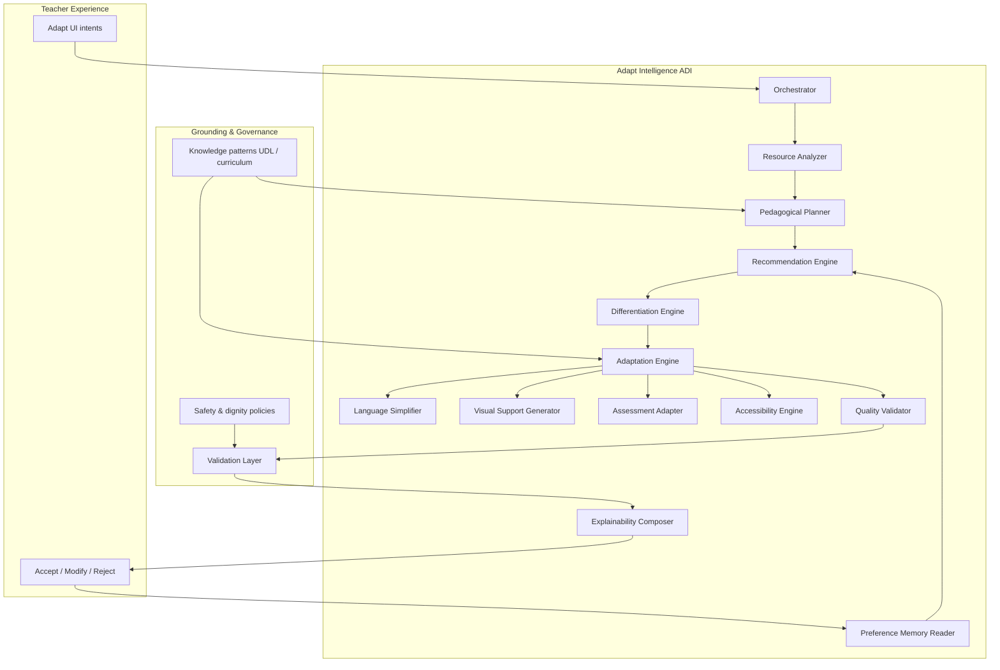
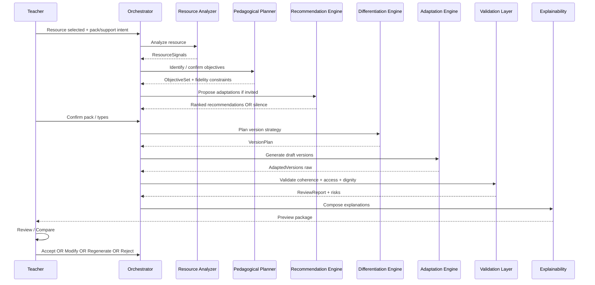
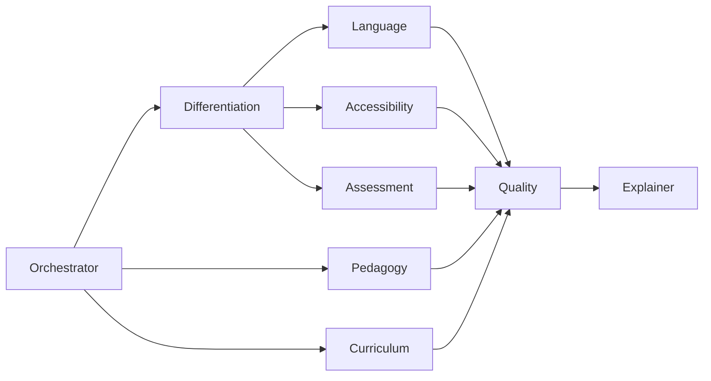

# PRIMA Adapt™  
# AI Architecture & Orchestration Document

**System name:** Adapt Intelligence (ADI)  
**Host engine (platform mapping):** Adapt Engine within EOS / PAS-005 worker model  
**Experience contract:** Pedagogical consultant — never chatbot, never generic LLM façade  

---

## Document control

| Item | Value |
|------|--------|
| What this defines | Subsystems, agents, workflows, context, validation, explainability, HITL, safety, memory, roadmap |
| What this forbids | Prompt corpora, model names, training recipes, UI chat runtimes, medical inference |
| Canon superiors | DOCUMENT-000 ≥ PAIM ≥ PAS-005 ≥ this document ≥ local Adapt AI choices |
| Dual Value (UX Absolute) | Every AI act must reduce teacher workload **and** improve learning access for every child — or remain silent |

---

# 0. AI Philosophy (normative)

## 0.1 Identity

Adapt Intelligence is an **experienced pedagogical consultant** embedded in a resource-adaptation atelier.

It proposes inclusive transformations of **materials**.  
It does **not** assess, diagnose, rank, or “fix” learners.

## 0.2 Hard norms

| Norm | Meaning |
|------|---------|
| **No diagnosis** | No clinical inference, no impairment labeling as system output |
| **No child labeling** | Version names and rationales describe supports, not students |
| **No replacement of judgment** | No silent Accept, Export, or objective change |
| **Support decisions** | Options, trade-offs, and drafts that teachers can own |
| **Explainability** | Every material recommendation carries Why / Benefit / Trade-off / Alternatives when significant |
| **Objective fidelity** | Preserve learning objectives whenever possible; flag dilution risks explicitly |
| **PAIM silence** | If confidence is low or value is unclear, do not speak |
| **Knowledge-first** | Prefer grounded pedagogical patterns over free invention |

## 0.3 Success criteria for intelligence

| Signal | Indicates health |
|--------|------------------|
| Teacher Accept rate with light edits | Useful drafts |
| Objective-preservation confirmations | Pedagogical integrity |
| Low discard-after-preview | Coherent proposals |
| Zero clinical-language incidents | Safety |
| Skip-default path remains first-class | Non-coercive AI |

---

# 1. AI Architecture

## 1.1 Overall shape

Adapt Intelligence is a **multi-capability orchestration** inside the Adapt Engine — not a single prompt, not a chat thread.

**PAS-005 alignment:** ADI capabilities are **conceptual workers/roles** invoked by the Adapt Engine. They must not invent a parallel authority chain. Teachers Approve via Application commands; AI never forges Accept/Export.

## 1.2 Subsystems and responsibilities

| Subsystem | Responsibility | Must not |
|-----------|----------------|----------|
| **Orchestrator** | Sequence capabilities; enforce stage gates; apply silence policy | Call UI; accept versions |
| **Resource Analyzer** | Structure resource: type, density, instruction load, media, assessment presence | Infer learner diagnoses |
| **Pedagogical Planner** | Recover/confirm learning objectives; pack→strategy mapping | Change objectives silently |
| **Recommendation Engine** | Suggest packs/chips/types with rank + explainability | Force preselection without teacher confirm |
| **Differentiation Engine** | Plan parallel pathways (support / core / extension) with shared goals | Create ranked “ability tracks” branded as deficit |
| **Adaptation Engine** | Coordinate production of adapted version(s) | Publish without validation |
| **Language Simplifier** | Clarify instructions; chunk steps; protect key vocabulary | Infantilize content or strip meaning |
| **Visual Support Generator** | Propose structural/visual scaffolds (hierarchy, icons, diagrams as descriptions) | Decorative noise without pedagogy |
| **Assessment Adapter** | Alternate evidence modes for same construct | Invent unfair shortcuts that void validity without warning |
| **Accessibility Engine** | Educational access checks (clarity, structure, representation, pacing) | Medical accessibility claims |
| **Quality Validator** | Holistic coherence before teacher review | Numeric shame scores shown as judgment of the teacher |
| **Explainability Composer** | Human rationales for changes and recommendations | Opaque “AI said so” |
| **Preference Memory Reader** | Read teacher-controlled pedagogical preferences | Store sensitive learner dossiers |

---

# 2. AI Workflow

## 2.1 End-to-end pipeline

## 2.2 Stage catalogue

| Stage | Trigger | Output | Teacher visible? |
|-------|---------|--------|------------------|
| **1. Bind** | Resource selected | ResourceRef | Yes |
| **2. Analyze** | Bind complete | ResourceSignals | Mostly silent |
| **3. Objectives** | Signals ready | ObjectiveSet | Yes if uncertain → ask once |
| **4. Recommend** | Enter support/pack | Suggestions or silence | Yes as amber cards |
| **5. Commit intent** | Teacher confirms pack | AdaptationPlan | Yes |
| **6. Differentiate** | Plan committed | VersionPlan (1..N) | Caption only |
| **7. Adapt** | Generation start | Draft versions | Planning UX |
| **8. Validate** | Drafts ready | ReviewReport | Proof strip |
| **9. Explain** | Report ready | ChangeSet + rationales | Compare panel |
| **10. Decide** | Teacher action | Accept / edit / regenerate | Yes — authority |
| **11. Remember** | After accept (consent) | Preference deltas | Optional |

## 2.3 Gate rules

- No Stage 7 without Stage 5 teacher commit.  
- No Accept without Stage 8–9 artifacts.  
- If Stage 3 cannot recover objectives and teacher declines to supply them, AI may still adapt for clarity but **must** mark objective fidelity as `unverified`.  
- Silence at Stage 4 if recommendations add noise without Dual Value.

---

# 3. Context Builder

## 3.1 Purpose

Assemble a **minimized, purpose-bound context pack** for downstream capabilities — never a raw dump of the teacher’s account or learner medical data.

## 3.2 Context domains

| Domain | Examples | Required? |
|--------|----------|-----------|
| **Resource** | Type (lesson/worksheet/game/presentation/assessment), structure summary, length/density signals, language | Yes |
| **Pedagogy** | Learning objectives, success criteria, activity type | Yes if known; else `unverified` |
| **Curriculum** | Subject, grade band, curriculum codes if present | Soft-required |
| **Adaptation intent** | Pack id, adaptation types, support chips, constraints (“keep duration”, “keep vocabulary list”) | Yes at generation |
| **Teacher preferences** | Worksheet style, visual density, activity length, assessment format (Memory) | Optional |
| **Locale** | UI/content language, output format targets | Yes |
| **Policy** | Dignity rules, forbidden clinical lexicon, objective-fidelity mode | Always injected by system |
| **Prior version** | On regenerate: last draft + teacher edit hints | When regenerating |

## 3.3 Structure principles

1. **Layered:** System policy → pedagogy → resource digest → intent → preferences.  
2. **Digest over dump:** Analyzer supplies structured signals + short excerpts, not entire books blindly.  
3. **Explicit unknowns:** Missing objectives/curriculum marked; never hallucinated as fact.  
4. **No covert learner PII:** No student names, grades lists, or clinical notes in context packs.  
5. **Traceable:** Context pack id versioned for audit of material generations.

## 3.4 What context must never include

- Diagnoses, therapy notes, medication  
- Rankings or “ability scores”  
- Unrelated project corpus  
- Hidden system instructions that contradict PAIM (e.g. “auto-approve”)

---

# 4. Prompt Orchestration

> This section defines **orchestration roles** for internal instruction assemblies. It does **not** specify prompt text.

## 4.1 Instruction layers (conceptual)

| Layer | Role |
|-------|------|
| **System instructions** | Identity: pedagogical consultant; non-diagnostic; teacher authority; silence policy |
| **Pedagogical instructions** | UDL-aligned adaptation craft; preserve objectives; dignity in versioning |
| **Curriculum context** | Subject/grade/codes as constraints, not decoration |
| **Adaptation context** | Pack, types, chips, teacher constraints |
| **Formatting rules** | Output schemas for versions, change units, explainability blocks |
| **Validation prompts** | Critique drafts against fidelity/access/dignity checklists (separate pass) |
| **Review prompts** | Produce teacher-facing summaries, not new content |

## 4.2 Orchestration rules

1. **Separate generation from validation** — validators critique; they do not rewrite unless asked via regenerate with constraints.  
2. **One capability, one contract** — Language Simplifier does not invent assessments.  
3. **Deterministic scaffolding** — schemas and forbidden lexicons are policy objects, not “vibes.”  
4. **Regeneration inherits critique** — teacher “Modify” notes become adaptation context, not chat history theatre.  
5. **No free-chat channel** in Adapt — all model calls are staged capability invocations.

## 4.3 When orchestration stays silent

- Recommendation layer finds no Dual Value improvement  
- Resource already matches intent within tolerance  
- Only stigmatizing inferences available  

---

# 5. AI Agents

Agents are **specialized pedagogical roles** collaborating under the Orchestrator. They are not user-visible chat personas.

| Agent | Purpose | Inputs | Outputs | Decision boundaries |
|-------|---------|--------|-------|---------------------|
| **Pedagogy Agent** | Guard learning intention & instructional quality | Objectives, resource signals, pack | Fidelity constraints, pedagogy risks | May block dilution; cannot Accept |
| **Curriculum Agent** | Align to subject/grade/codes when present | Curriculum refs, resource | Alignment notes, drift warnings | Silence if codes absent |
| **Accessibility Agent** | Educational access (clarity, structure, representation, pacing) | Draft + signals | Access findings, fix suggestions | No medical claims |
| **Differentiation Agent** | Design parallel pathways with shared goals | Pack, objectives | VersionPlan | No deficit labeling |
| **Language Agent** | Instruction clarity & chunking | Text units, constraints | Simplified/chunked units | Must preserve key vocabulary when locked |
| **Assessment Agent** | Alternate evidence for same construct | Assessment items, objectives | Adapted assessment variants + validity risks | Must flag coverage loss |
| **Quality Agent** | Holistic readiness for teacher review | All drafts + reports | Quality profile + residual issues | Advisory; Teacher decides |
| **Explainer Agent** | Teacher-facing rationales | ChangeSet + findings | Why/Benefit/Trade-off/Alternatives | No new pedagogical content |

## 5.1 Collaboration pattern

- **Differentiation** decides *how many versions* and *which supports*.  
- **Language / Accessibility / Assessment** specialize transforms.  
- **Pedagogy + Curriculum** constrain and critique.  
- **Quality** aggregates.  
- **Explainer** translates for HITL.  

Disagreements (e.g. Assessment wants fewer items, Pedagogy fears coverage loss) surface as **amber risks**, never silent resolution against fidelity.

---

# 6. Validation Layer

Validation is a **governed critique pipeline**, distinct from teacher Approval.

## 6.1 Verification dimensions

| Check | Pass intent |
|-------|-------------|
| **Learning objectives preserved** | Same goals/success criteria unless teacher opted to change |
| **Age appropriateness** | Grade-band language and task demand coherent |
| **Language clarity** | Instructions actionable; reduced ambiguity |
| **Instruction quality** | Verbs clear; steps ordered; examples aligned |
| **Accessibility (educational)** | Structure, representation options, pacing supports as promised |
| **Differentiation consistency** | Pathways share objectives; naming dignified |
| **Assessment validity** | Evidence still maps to construct; coverage risks declared |
| **Teacher control** | No auto-accept markers; editable artifacts; explainability present |
| **Dignity & lexicon** | No clinical/stigmatizing labels in outputs |
| **Hallucination guard** | No invented curriculum standards presented as fact |

## 6.2 Outcomes

| Result | Effect |
|--------|--------|
| **Pass** | Proceed to teacher review |
| **Pass with risks** | Show amber notices; teacher must acknowledge on Accept if severity high |
| **Fail** | Block ready-state; offer regenerate with constraints or edit source intent |

Validators produce **structured findings**, not scolding prose aimed at the teacher.

---

# 7. Recommendation Engine

## 7.1 Recommendation types (examples)

- Visual supports for dense worksheets  
- Instruction chunking for long directives  
- Reduced cognitive load / staged tasks  
- Support + extension pathways  
- Alternative assessment modes  
- Collaborative structures  
- Light gamification **only** when it serves engagement without obscuring objectives  
- Pacing / pause points  

## 7.2 Ranking logic

Recommendations are ranked by **expected Dual Value**, not by model confidence alone.

| Signal | Weight direction |
|--------|------------------|
| Resource pain (density, ambiguity, single representation) | ↑ |
| Pack fit / type fit | ↑ |
| Objective fidelity risk if applied | ↓ |
| Teacher preference alignment (Memory) | mild ↑ |
| Novelty without classroom gain | ↓ |
| Potential stigma / over-adaptation | hard ↓ / suppress |
| Uncertainty | prefer silence over weak tips |

**Max surface:** UX caps (e.g. ≤2 amber chips, 1 recommended pack). Architecture must support truncation by rank.

## 7.3 Explainability requirement

Each surfaced recommendation includes: trigger signal · intended learner access gain · workload saved · trade-off · alternative.

---

# 8. Explainability Framework

## 8.1 Unit of explanation

Every material AI decision is an **Explanation Record**:

| Field | Intent |
|-------|--------|
| **What changed** | Concrete resource delta |
| **Because** | Pedagogical trigger (e.g. dense multi-clause instructions) |
| **Benefit** | Access/clarity/pathway gain for learners |
| **Trade-off** | Time, item count, complexity elsewhere |
| **Alternatives** | Other viable supports not chosen |
| **Objective impact** | Preserved / adjusted / unverified |
| **Agent source** | Which capability proposed it (for audit, not for blaming AI) |

## 8.2 Teacher-facing patterns (illustrative forms)

- “Instruction simplified because the original stacked multiple actions in one sentence.”  
- “Visual support added because the procedure was sequential and hard to scan.”  
- “Task divided into smaller steps because cognitive load signals were high for a single block.”  

Tone: collegial, specific, non-judgmental, resource-centered.

## 8.3 Silence & aggregation

- Micro-changes may roll into one summary bullet.  
- Decorative non-changes produce no explanation spam.

---

# 9. Human-in-the-loop

Teacher authority is absolute for pedagogical commitment.

| Action | AI behaviour | System meaning |
|--------|--------------|----------------|
| **Accept** | Stops proposing for that version | Version becomes classroom-eligible |
| **Reject / Discard** | May learn preference if consented | Version not used |
| **Modify** | Treats edits as new ground truth | Optional regenerate-from-edits |
| **Compare** | Supplies ChangeSet + highlights | Supports judgment |
| **Regenerate** | Re-runs with constraints + critiques | New draft lineage |
| **History** | Read-only lineage of versions | Audit + recovery |
| **Versioning** | Immutable drafts; new ids on regenerate | No silent overwrite of Accepted |

AI never:

- auto-exports  
- auto-attaches to lesson without Accept  
- “fixes” teacher edits behind their back  

---

# 10. Quality Scoring

## 10.1 Purpose

An internal **Adapt Quality Profile** guides validators and ranking — **not** a public grade of the teacher.

Teacher-facing UI prefers proof chips and risks over a single shaming number. If a composite is shown, it must be framed as “readiness of this draft,” with dimensions expandable.

## 10.2 Dimensions

| Dimension | Evaluates |
|-----------|-----------|
| **Pedagogical quality** | Instructional clarity, example alignment, objective fidelity |
| **Accessibility** | Structure, representation, pacing access |
| **Differentiation** | Pathway coherence and dignity |
| **Readability** | Language load appropriate to grade band |
| **Cognitive load** | Demand vs scaffolding balance |
| **Visual balance** | Hierarchy helps scanning; not clutter |
| **Curriculum alignment** | When codes/goals present |

## 10.3 Scoring principles

- Multi-dimensional vector first; optional composite second.  
- Low scores generate **actionable findings**, not insults.  
- Over-adaptation (too much scaffolding that removes productive struggle without teacher intent) lowers pedagogical quality.  
- Missing objectives ⇒ fidelity dimension `unverified`, not fake 100%.

---

# 11. Safety

## 11.1 Safeguards

| Threat | Safeguard |
|--------|-----------|
| **Medical language** | Lexicon policy; post-filters; agent boundaries |
| **Bias / stigma** | Dignity checks; ban deficit version names; diverse example guidance |
| **Hallucinations** | Unknown marking; curriculum agent silence; validation against source |
| **Unsafe recommendations** | Suppress harmful/overreaching tips; human review required |
| **Curriculum drift** | Curriculum agent warnings; objective lock |
| **Over-adaptation** | Planner limits; quality dimension; teacher confirm on heavy transforms |
| **Prompt injection via resource text** | Treat resource as untrusted content; schema-constrain outputs |
| **Privacy** | Minimized context packs; no learner dossiers |

## 11.2 Fail-closed behaviours

- Cannot emit Accept/Export.  
- Cannot invent diagnoses.  
- High-severity validation failure blocks `ready` until regenerate/edit.  
- Ambiguous high-risk assessment changes require teacher acknowledgement.

---

# 12. Learning Memory

## 12.1 Purpose

Improve future recommendations from **teacher pedagogical craft preferences** — never from surveillance of children.

## 12.2 May store (teacher-controlled)

- Preferred worksheet style / visual density  
- Typical activity length  
- Preferred assessment formats  
- Frequently accepted packs/types  
- Dismissed recommendation classes (respect “Nu acum”)  
- Language/locale preferences for adaptations  

## 12.3 Must never store

- Student identities linked to deficits  
- Clinical or sensitive learner data  
- Covert behavioural scores  
- Raw chat transcripts (Adapt has no chat)  

## 12.4 Control

- Opt-in / inspect / delete preferences  
- Memory used as mild ranking prior, never hard constraint without disclosure (“Based on your preferences”)  
- Accept events update memory only with policy consent  

---

# 13. Future AI Capabilities

| Horizon | Capability | Constraint |
|---------|------------|------------|
| Near | Stronger multi-agent critique loops | Still HITL Accept |
| Near | Multimodal adaptation (diagram↔text twins) | Objective fidelity |
| Mid | Speech/oral script adaptation aligned to worksheets | Teacher edit |
| Mid | Interactive classroom assistants for *delivery* | Separate BC; Teacher Authority |
| Mid | Real-time variant suggestion during teaching | Explicit teacher switch only |
| Long | Personalized resource generation at class-pack scale | No covert learner clinical profiles; school policy |
| Long | Cross-lesson inclusive pattern libraries (anonymized) | Share patterns, not children |

Evolution rule: **new modalities must inherit ADI philosophy** — consultant, explainable, non-diagnostic, teacher-decided.

---

# 14. Relationship to platform AI canon

| Canon | Relationship |
|-------|--------------|
| **DOCUMENT-000** | Ethical superior |
| **PAIM** | Interaction & personality superior |
| **PAS-005** | Constitutional AI architecture; ADI maps to Engine workers |
| **ARCH-ADAPT-001** | Software hosting of ADI |
| **IMPL-ADAPT-001** | Fake→Real worker sequencing |

ADI makes PRIMA an **intelligent pedagogical platform** by composing specialized educational capabilities under governance — not by “adding an LLM box” to a form wizard.

---

# 15. Closing statement

PRIMA Adapt™ intelligence succeeds when a teacher feels they collaborated with a calm, expert colleague who:

- respected their authority,  
- protected every child’s dignity,  
- preserved what mattered in the learning,  
- and saved the crushing rewrite work —  

without ever pretending to know a child better than their teacher.

---

**End of AI Architecture & Orchestration — PRIMA Adapt™ (AI-ADAPT-001)**
