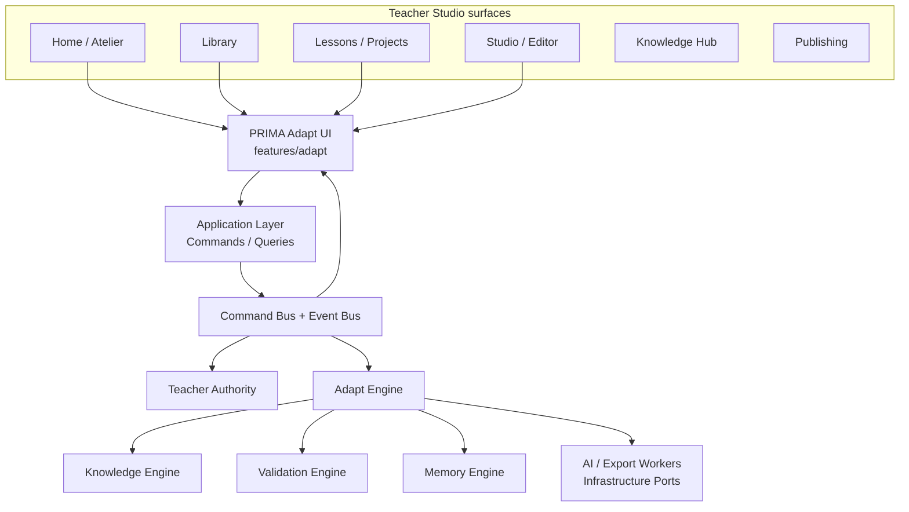
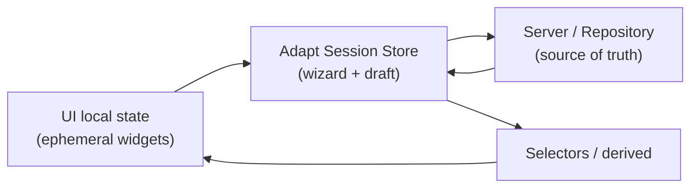
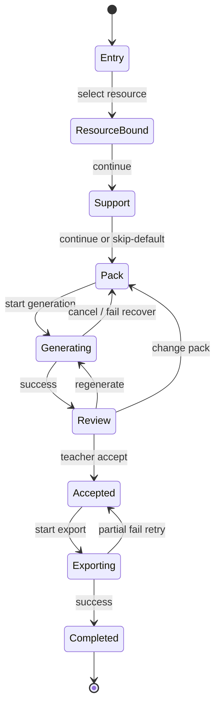
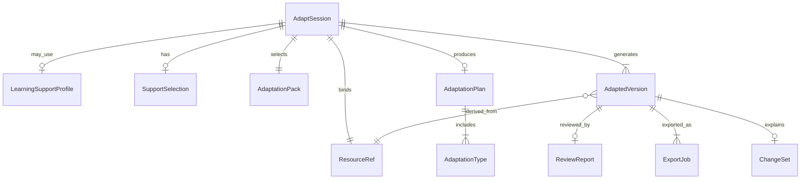
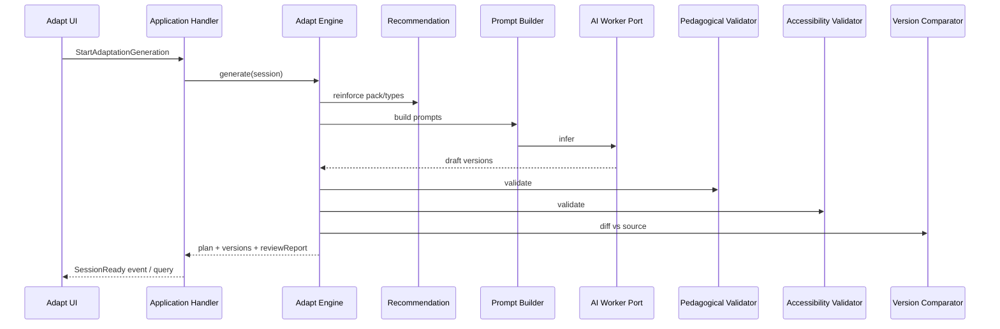
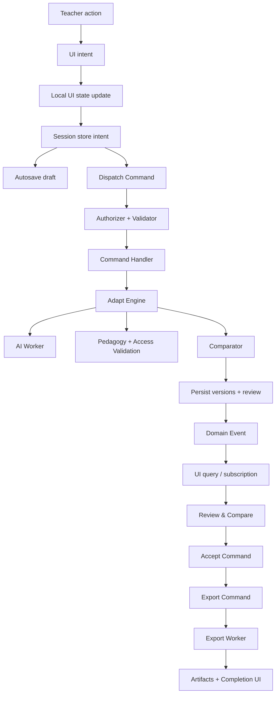

# PRIMA Adapt™  
# Software Architecture Document

**Module:** PRIMA Adapt™  
**Document type:** Software Architecture (SAD)  
**Companions:**  
- [PRODUCT-ADAPT-001 — Product Definition](../product/PRIMA_ADAPT_PRODUCT_DEFINITION.md)  
- [UX-ADAPT-001 — UX Specification](../design/PRIMA_ADAPT_UX_SPECIFICATION.md)  

**Non-goals of this document:** React/TS implementation, prompt text dumps, sprint tickets, vendor LLM contracts beyond ports.

---

## Document control

| Item | Value |
|------|--------|
| Integration style | First-class feature module + dedicated Adapt Engine behind EOS ports |
| UI beats (UX v0.2) | Start → Resource → Support (skip-default) → Pack → Planning → Review & Export |
| Hard invariants | Teacher Accept required · no medical records · adapt resources not children · PAIM silence |

---

# 1. High-Level Architecture

## 1.1 Placement in the PRIMA ecosystem

PRIMA Adapt™ is a **first-class product module** owned by the Teacher Studio surface family. It is not a plugin bolt-on and not a chat skill.

| Layer | Adapt ownership |
|-------|-----------------|
| **Presentation** | `src/features/adapt` — wizard UI, view-models, local UX state |
| **Application** | Adapt use-cases via **Commands / Queries** on the platform Command Bus |
| **Domain** | Adapt aggregates & value objects in `packages/domain` (or `packages/adapt-domain` if split) |
| **Engines** | `@prima/engine-adapt` — Differentiation / Adaptation orchestration |
| **Infrastructure** | Persistence, AI workers, export workers behind Ports |
| **Contracts** | Shared types/events in `@prima/contracts` |

## 1.2 Integration map



## 1.3 Dependencies

| Adapt depends on | Must not depend on |
|------------------|--------------------|
| Projects / Resources (canonical content) | Medical / clinical subsystems (none exist; forbid creation) |
| Library (store & reuse versions) | Direct LLM SDKs inside UI or Domain |
| Studio/Editor (open accepted drafts) | Ranking / learner surveillance |
| Knowledge Engine (UDL patterns, curriculum) | Chat product as required runtime |
| Validation Engine (pedagogical + access checks) | Silent mutation of approved lesson packages |
| Memory Engine (optional pattern reuse with consent) | |
| Authority / identity | |
| Design system primitives | |

## 1.4 Communication

| Path | Mechanism |
|------|-----------|
| UI → Application | Dispatch Commands / run Queries (never call engines from components) |
| Application → Engines | Command handlers invoke Adapt Engine ports |
| Engines → Infrastructure | Ports only (`AdaptationAiPort`, `ExportPort`, `AdaptRepository`) |
| Cross-module notify | Domain Events on platform Event Bus (`AdaptSessionStarted`, `AdaptationAccepted`, …) |
| Deep links in | Navigation intents with `resourceId`, optional `sessionId` |

## 1.5 Navigation ownership

| Entry | Owner | Route concept |
|-------|-------|----------------|
| Atelier create card | Home | `/adapt` or `/adapt/new` |
| Library “Adaptează” | Library | `/adapt/new?resourceId=` |
| Studio toolbar | Editor | `/adapt/new?objectId=` |
| Resume draft | Adapt | `/adapt/sessions/:sessionId` |
| Post-accept open | Adapt → Editor | `/editor/:objectId` or studio route |

**Route registration** lives with app shell; **flow ownership** lives entirely inside `features/adapt`.

## 1.6 Module ownership (RACI summary)

| Concern | Owner |
|---------|-------|
| UX flow & feature package | Adapt feature team |
| Domain model & invariants | Domain + Adapt Engine |
| AI prompts / pedagogical policies | Adapt Engine + Pedagogy |
| Persistence schema | Infrastructure with Domain ports |
| Export formats | Export workers + Adapt Application |
| Privacy of support profiles | Security + Adapt Domain policy |

---

# 2. Feature Modules

Align folders with **UX v0.2 beats**, not with an 8-step admin wizard.

```text
prima-adapt (logical module)
├── entry/              # Screen 1 — Start
├── resource-selection/ # Screen 2 — Resursă
├── support/            # Screen 3 — Sprijin (skip-default)
├── packs/              # Screen 4 — Pachet (+ optional refine)
├── planning/           # Screen 5 — Pregătire (generation progress)
├── review/             # Screen 6 — Review & Compare (merged)
├── export/             # Screen 7 — Export & Use
├── session/            # Cross-cutting session shell, step rail, draft resume
└── shared/             # Cross-feature Adapt UI atoms used only inside Adapt
```

### Responsibilities

| Feature slice | Single responsibility |
|---------------|----------------------|
| **entry** | Orient + start / resume |
| **resource-selection** | Bind source resource |
| **support** | Optional educational support chips / presets |
| **packs** | Select Adaptation Pack (+ refine types) |
| **planning** | Present generation progress / cancel |
| **review** | Compare, explain, Accept / Edit / Regenerate |
| **export** | Classroom-first destinations + job tracking |
| **session** | Wizard chrome, autosave coordination, deep-link hydrate |

**Out of module:** global Home chrome, Library CRUD UI, Editor canvas — Adapt **calls** them via navigation/events.

---

# 3. Component Hierarchy

Presentation components are **dumb to engines**. They speak view-models and intents.

## 3.1 Session shell

| Component | Responsibility |
|-----------|----------------|
| `AdaptSessionLayout` | Shell: header, step rail, footer, outlet |
| `AdaptStepRail` | 6-beat progress; `aria-current` |
| `AdaptSessionHeader` | Module name + bound resource title |
| `AdaptFooterActions` | Înapoi / primary CTA / Salvează draft |
| `AdaptDraftResumeList` | Unfinished sessions on Entry |

## 3.2 Entry

| Component | Responsibility |
|-----------|----------------|
| `AdaptEntryHero` | Dual-value headline + primary CTA |
| `AdaptHowItWorksDrawer` | Optional 3-line education (non-blocking) |

## 3.3 Resource selection

| Component | Responsibility |
|-----------|----------------|
| `ResourcePicker` | Search, type chips, grid |
| `ResourceTypeChips` | Lesson / Worksheet / Game / Presentation / Assessment |
| `ResourceCard` | Selectable resource summary |
| `ResourcePreviewPanel` | Thumbnail + objectives if known |
| `ResourceConfirmBar` | Sticky confirm |

## 3.4 Support (skip-default)

| Component | Responsibility |
|-----------|----------------|
| `SupportPathChooser` | Primary “standard inclusiv” vs “personalizează” |
| `SupportSuggestionChips` | Max 6 educational chips |
| `SupportPresetSelect` | Optional saved preset |
| `SupportEthicsNote` | One-line non-medical framing |

## 3.5 Packs

| Component | Responsibility |
|-----------|----------------|
| `AdaptationPackGrid` | 3 pack cards |
| `AdaptationPackCard` | Outcome, includes, recommended state |
| `AdaptationRefinePanel` | Collapsed fine-grain type toggles |
| `AdaptationTypeChip` | Single adaptation type |

## 3.6 Planning

| Component | Responsibility |
|-----------|----------------|
| `AdaptationPlannerStatus` | Pulse + mentor messages + progress |
| `AdaptationCancelControl` | Cancel generation |

## 3.7 Review & Compare

| Component | Responsibility |
|-----------|----------------|
| `PedagogyProofStrip` | Objectives preserved / supports / access |
| `ComparisonPanel` | Original \| Adapted panes |
| `ChangeHighlightLayer` | Visual diffs |
| `ChangeSummaryList` | Human “Ce s-a schimbat” |
| `VersionSwitcher` | Multiple adapted versions |
| `ReviewDecisionBar` | Accept / Edit / Change pack / Regenerate |
| `RiskNotice` | Amber fairness/coverage caution |

## 3.8 Export

| Component | Responsibility |
|-----------|----------------|
| `ExportDestinationGrid` | Classroom-first destinations |
| `ExportAdvancedFormats` | Collapsed secondary formats |
| `ExportJobStatus` | Per-destination progress |
| `AdaptCompletionPanel` | Done state + next actions |

## 3.9 Shared Adapt

| Component | Responsibility |
|-----------|----------------|
| `AdaptEmptyState` | Calm empties |
| `AdaptErrorPanel` | Recoverable errors |
| `ExplainabilityBlock` | Why / Benefit / Trade-off |
| `StatusChip` | Draft / Accepted / Recommended |

**Naming note:** Prefer UX language (`Pack`, `Support`) over internal engine names in UI components.

---

# 4. State Management

## 4.1 State layers



## 4.2 Global / module state (Adapt Session Store)

Owned by `features/adapt/session` — **one active session per tab**.

Holds:

- `sessionId`, `status` (`draft` \| `generating` \| `ready` \| `accepted` \| `failed` \| `cancelled`)  
- Bound `sourceResourceRef`  
- Support selections / preset id / `usedInclusiveDefaults`  
- Selected `packId` + refined `adaptationTypes[]`  
- `plan` snapshot (explainability)  
- `versions[]` (draft adapted resources)  
- `activeVersionId`  
- `reviewReport`  
- `exportJobs[]`  
- `step` (1–6)  
- `revision` / `updatedAt` for conflict detection  

**Not global app store pollution:** keep Adapt session isolated; publish events for cross-module needs.

## 4.3 Local UI state

- Search query, chip hover, drawer open, accordion expand  
- Scroll positions in comparison panes  
- Transient “refine panel open”

## 4.4 Derived state

- `canContinue` per step (validation rules)  
- `recommendedPackId` from resource type + support chips  
- `objectivesPreserved` boolean from review report  
- `primaryExportReady` when status = accepted  
- Dual-value captions for planning messages  

## 4.5 Temporary / generation state

- In-flight `generationRequestId`  
- Streaming partials (if used) kept out of durable draft until checkpoint  
- Cancel token / abort flag  

## 4.6 Wizard state machine



Illegal transitions (e.g. Export before Accept) are **enforced in Application**, not only UI.

## 4.7 History, undo, autosave

| Concern | Design |
|---------|--------|
| **Autosave** | Debounced persist of session draft after each meaningful intent (resource bind, support, pack, accept) |
| **Undo** | Soft undo window for Discard version, Detach preset, Cancel-adjacent destructive acts (toast 6–8s) |
| **History** | Append-only `AdaptSessionEvent` log (intent-level), not full DOM history |
| **Resume** | Hydrate store from repository by `sessionId` |
| **Concurrency** | Optimistic `revision` check; on conflict, reload + non-destructive merge policy (teacher keeps local edits where possible) |

---

# 5. Domain Models

Immutable-leaning entities; mutations via explicit domain operations / commands.

## 5.1 Core entities

| Entity | Meaning |
|--------|---------|
| **AdaptSession** | Teacher-owned adaptation workflow instance |
| **ResourceRef** | Pointer to canonical Project resource / editor object |
| **LearningSupportProfile** | Optional pedagogical support preset (non-medical) |
| **SupportSelection** | Ephemeral or persisted chip set for a session |
| **AdaptationPack** | Product pack catalog entry (`clarity`, `support_extension`, `accessible_assessment`) |
| **AdaptationType** | Atomic transformation kind (instruction chunking, visual support, …) |
| **AdaptationPlan** | Pre-generation plan with explainability per type |
| **AdaptedVersion** | Draft/accepted alternate resource content + lineage |
| **ReviewReport** | Pedagogy proof + risks + change summary |
| **ExportJob** | Destination + status + artifact refs |
| **ChangeSet** | Structured human-readable diff units |

## 5.2 Relationships



## 5.3 Critical invariants

1. `AdaptedVersion` always references a `sourceResourceRef`.  
2. No Accept ⇒ no Export job may complete as `succeeded` for classroom destinations.  
3. `LearningSupportProfile` forbids clinical fields at the type/policy layer.  
4. Pack selection implies a default type set; refine may only add/remove allowed types.  
5. Objectives preservation flag is computed — teacher override requires explicit acknowledgement if false.  
6. Version labels must be support-oriented (policy validation on name templates).

## 5.4 Catalog vs instance

| Catalog (read-mostly) | Instance (per session) |
|-----------------------|------------------------|
| AdaptationPack definitions | Selected packId |
| AdaptationType definitions | Refined type set |
| Export destination definitions | ExportJob records |

---

# 6. AI Architecture

## 6.1 Principle

AI runs **inside/behind the Adapt Engine** via Infrastructure Ports. UI never prompts models. Application never imports vendor SDKs.

## 6.2 Internal AI capabilities (logical services)

| Capability | Responsibility |
|------------|----------------|
| **Recommendation Engine** | Suggest pack + optional support chips from resource signals |
| **Prompt Builder** | Assemble constrained pedagogical prompts + context packs |
| **Adaptation Engine (core)** | Orchestrate plan → generate versions |
| **Differentiation Planner** | Map pack → type set → version strategy (1–N outputs) |
| **Pedagogical Validator** | Objectives alignment, non-dilution checks, dignity language |
| **Accessibility Validator** | Instruction clarity, structure, representation alternatives (educational access) |
| **Quality Checker** | Completeness, broken structure, empty sections |
| **Version Comparator** | Produce ChangeSet + highlight map |
| **Explainability Composer** | Why / Benefit / Trade-off per change |

## 6.3 Orchestration flow



## 6.4 PAIM constraints in architecture

- Suggestions are structured objects with explainability fields — not chat threads.  
- Silence: Recommendation Engine returns empty when confidence low.  
- No diagnostic inference tools permitted in the capability map.  
- Teacher Accept is an Application command, not an AI side effect.

## 6.5 Provider isolation

```text
Adapt Engine
  └── AdaptationAiPort
        ├── ProviderA Adapter
        ├── ProviderB Adapter
        └── Fake/Deterministic Adapter (tests)
```

Switching providers requires **no UI changes**.

---

# 7. Service Layer

Application-facing services (use-case façades / handlers). Names are logical.

| Service | Responsibility |
|---------|----------------|
| **AdaptSessionService** | Create, hydrate, autosave, transition steps, cancel |
| **ResourceQueryService** | List/search bindable resources from Projects/Library |
| **SupportProfileService** | CRUD educational presets; enforce field policy |
| **PackCatalogService** | Serve packs/types; resolve defaults |
| **AdaptationGenerationService** | Start/cancel generation; map engine results to session |
| **ReviewService** | Fetch/compare report; accept/reject version |
| **ExportService** | Enqueue jobs; track artifacts; retry |
| **ValidationService** | Surface engine validation to UI view-models |
| **AdaptAnalyticsService** | Dual-value & funnel metrics (privacy-safe) |
| **AdaptNotificationService** | Toasts / completion signals (no spam) |

**Rule:** UI hooks call these application APIs / commands — not engines.

---

# 8. Folder Structure

Enterprise feature-first layout consistent with existing `src/features/*` and platform packages.

```text
src/features/adapt/
  README.md
  index.ts                      # public feature exports
  routes.tsx                    # route objects only (wired by app shell)
  AdaptSessionPage.tsx          # session route container
  entry/
    components/
    hooks/
  resource-selection/
    components/
    hooks/
  support/
    components/
    hooks/
  packs/
    components/
    hooks/
  planning/
    components/
    hooks/
  review/
    components/
    hooks/
  export/
    components/
    hooks/
  session/
    components/                 # layout, step rail, footer
    store/                      # session store + selectors
    machine/                    # transition guards (desc/spec-driven)
    hooks/                      # useAdaptSession, useAutosave
  shared/
    components/
    constants/
  application/                  # feature-local adapters to command bus (thin)
  types/                        # view-models only (not domain source of truth)
  utils/
  assets/
  tests/

packages/contracts/src/
  adapt/                        # events, command names, shared DTOs

packages/domain/src/adapt/      # aggregates, invariants, policies

packages/engines/adapt/         # @prima/engine-adapt
  src/
    adapt-engine.ts
    recommendation/
    planning/
    validation/
    comparison/
    manifest.ts
    tests/

packages/application/src/adapt/ # command handlers, queries (if app package split)

infrastructure/
  persistence/adapt/
  workers/adapt-ai/
  workers/adapt-export/
```

**Composition Root** wires: repository · AI port · export port · engine · handlers · authorizer.

---

# 9. Design System Integration

Reuse PRIMA design-system / atelier primitives; Adapt adds composition, not a parallel kit.

| Primitive | Adapt usage |
|-----------|-------------|
| **Card** | Resource, pack, proof, export destinations |
| **Button** | Primary / secondary / ghost / danger soft |
| **Dialog / Drawer** | How-it-works, cancel confirm, advanced formats |
| **Wizard / StepRail** | 6-beat session chrome |
| **Progress** | Planning indeterminate; export determinate |
| **Panel** | Preview, change summary, ethics note |
| **Chip / Badge** | Type, recommended, accepted, objectives preserved |
| **Timeline** | Optional session history (secondary) |
| **Accordion** | Explainability expanders only |
| **Toast** | Undo, autosave failure, export partial |
| **EmptyState** | No resources / no drafts |
| **Skeleton** | Lists and panes |
| **Focus ring** | AA keyboard path |

**Forbidden:** inventing a second visual language inside Adapt.

---

# 10. Data Flow

End-to-end happy path (UX v0.2):



### Generation-specific path

1. Pack confirmed → `StartAdaptationGeneration`  
2. Session → `generating`  
3. Engine returns versions + reviewReport  
4. Session → `ready`  
5. UI navigates to Review  

### Accept path

1. `AcceptAdaptedVersion`  
2. Optionally materialize Library/Project resource clone  
3. Session → `accepted`  
4. Enable Export  

---

# 11. Error Handling

## 11.1 Error classes

| Class | Examples | UX / system response |
|-------|----------|----------------------|
| **Validation** | No resource bound; empty pack | Inline blocking on CTA; no toast spam |
| **Domain policy** | Export before accept; clinical field rejected | Hard fail command; explain |
| **AI failure** | Timeout, empty model output | Retry / change pack / cancel; keep draft |
| **Partial generation** | 1 of 2 versions OK | Show successful version; mark sibling failed |
| **Network** | Autosave fail | Banner + retry queue; local durable buffer |
| **Export failure** | PDF worker down | Retry job; keep Accepted version |
| **Conflict** | Revision mismatch | Reload with guidance |

## 11.2 Recovery architecture

- Commands are idempotent where possible (`generationRequestId`, `exportJobId`)  
- Cancel generation cooperative via abort port  
- Dead-letter for worker failures with teacher-visible retry  
- **Offline:** draft session writable to local persistence; generation/export require online; UI states this calmly  

## 11.3 Error boundary ownership

| Layer | Handles |
|-------|---------|
| UI | Render errors, empty, retry controls |
| Application | Maps domain/AI errors to stable error codes |
| Engine | Validation reports (non-exceptional pedagogical issues) |
| Infrastructure | Retries with backoff for transient network |

Pedagogical validator “risks” are **reports**, not thrown exceptions.

---

# 12. Performance

| Strategy | Application |
|----------|-------------|
| **Lazy loading** | Route-level code split `features/adapt`; defer refine panel, advanced export, comparator heavy views |
| **Caching** | Resource search pages; pack catalog; profile presets; immutable AI results keyed by content hash + pack + support fingerprint |
| **Memoization** | Derived selectors for `canContinue`, proof strip |
| **Optimistic updates** | Chip toggles, pack selection, step navigation; **not** Accept/Export |
| **Background generation** | Worker job; UI polls/subscribes; teacher may navigate within session shell |
| **Parallel AI** | Independent version streams for support+extension packs when safe; barrier before Review |
| **Resource reuse** | Pass `resourceId` by reference; do not deep-copy blobs in the store |
| **Diff cost** | Comparator runs server-side; UI receives ChangeSet, not raw token diffs |

**SLA intent (product):** interactive steps &lt; 100ms local; generation async with calm planning UX.

---

# 13. Security & Privacy

## 13.1 Classification

Learning Support Profiles = **educational operational data**, not special-category medical records. Architecture must still apply **minimization** and teacher control.

## 13.2 Controls

| Control | Design |
|---------|--------|
| **Permissions** | Only session owner (teacher) read/write; school roles deferred; fail-closed authorizer |
| **Data minimization** | Schema denylist for clinical fields; free-text scanned for policy warnings, not structured diagnosis extraction |
| **Purpose limitation** | Profile data used only for Adapt plan/generation |
| **Teacher control** | Create / attach / detach / archive / delete presets; skip-default path |
| **Encryption** | At rest via platform stores; in transit TLS |
| **Audit trail** | `AdaptSessionEvent` + accept/export audits (who/when/what resource) |
| **Deletion** | Cascade session drafts; hard-delete presets on request; accepted Library copies follow Library retention |
| **No learner ranking** | Analytics forbid comparative learner scoring |
| **Prompt privacy** | Workers receive minimized context packs; no full account dumps |

## 13.3 Threat notes

- Prevent prompt injection from resource content from escalating to data exfiltration (worker sandbox + output schema validation).  
- Prevent “helpful” model from emitting clinical labels into version titles (policy filter post-AI).

---

# 14. Extensibility

## 14.1 Extension points

| Extension | Hook |
|-----------|------|
| New Adaptation Pack | Pack catalog contribution + i18n + recommendation rules |
| New Adaptation Type | Type registry + planner mapping + prompt fragment |
| New AI provider | `AdaptationAiPort` adapter |
| New export format | `ExportPort` + destination catalog entry |
| New educational framework (UDL mapping packs) | Knowledge-backed rule packs consumed by planner |
| Third-party content connectors | `ResourceRef` resolver plugins (read-only bind) |
| Co-teaching comments (future) | Event listeners on plan/review — no core rewrite |
| Delivery-time variant switch (future) | Consume `AdaptedVersion` IDs — separate BC |

## 14.2 Plugin rules

- Extensions register via Composition Root / manifests — not by editing UI conditionals everywhere.  
- Capability flags gate destinations (“Learning App”) without removing core flow.  
- Versioned contracts in `@prima/contracts/adapt`.

---

# 15. Architecture Principles

| Principle | Adapt interpretation |
|-----------|----------------------|
| **Single Responsibility** | Feature slices & components map 1:1 to UX beats / jobs |
| **Composition over inheritance** | Pack = composition of types; UI = composition of primitives |
| **Feature-first organization** | `src/features/adapt/*` owns UX; packages own domain/engine |
| **Immutable domain models** | New version entities over in-place silent mutation |
| **Reusable UI** | Design system primitives; Adapt-specific composites only when needed |
| **Testability** | Fake AI port; pure planners; command handler tests; store transition tests |
| **Scalability** | Async workers for generation/export; cache by content fingerprint |
| **Loose coupling** | Ports + events; no UI→Engine imports |
| **High cohesion** | Everything about one session lives in session store + Adapt Engine |
| **Teacher authority** | Accept/Export are authorized commands |
| **PAIM compliance** | Explainability objects; silence; no chat runtime requirement |
| **Ethical schema** | Non-medical profile policy enforced in domain |
| **Dual Value fitness** | Architecture rejects features that add steps without workload↓ + learning↑ |

---

# 16. Testing architecture (implementation-ready)

| Level | Focus |
|-------|-------|
| Domain | Invariants, pack→type mapping, profile policy denylist |
| Engine | Planner determinism with fixtures; validator reports |
| Application | Command transitions; idempotent generation |
| UI | Step guards; skip-default path; accept before export |
| Contract | Event payloads version compatibility |
| Privacy | Fixtures attempting clinical fields must fail |

---

# 17. Implementation sequencing (guidance only)

1. Contracts + domain + session state machine  
2. Resource bind + pack catalog (no AI)  
3. Adapt Engine + fake AI port producing fixture versions  
4. Review & Accept  
5. Export PDF + attach-to-lesson  
6. Real AI port + validators + comparator  
7. Support presets + recommendation  
8. Hardening: autosave, offline draft, analytics  

---

# 18. Open architecture decisions (record at kickoff)

1. Persist adapted content as Library resource clone vs content-addressed blob store?  
2. Generation: sync request/response vs always async job (recommend **async**)?  
3. Shared `packages/domain/adapt` vs dedicated package boundary?  
4. Comparator: structural AST vs annotated markdown blocks for v1 worksheets?

---

# 19. Summary

PRIMA Adapt™ is architected as:

- a **feature-first UI module** for the 6-beat teacher journey,  
- an **Adapt Engine** behind EOS ports for pedagogical AI orchestration,  
- **Commands/Events** for authority and integration,  
- **ethical, minimal support profiles**,  
- and **extension-ready packs/types/exports** without rewriting the core.

This is sufficient for a professional engineering team to begin implementation without inventing module boundaries ad hoc.

---

**End of Software Architecture Document — PRIMA Adapt™ (ARCH-ADAPT-001)**
