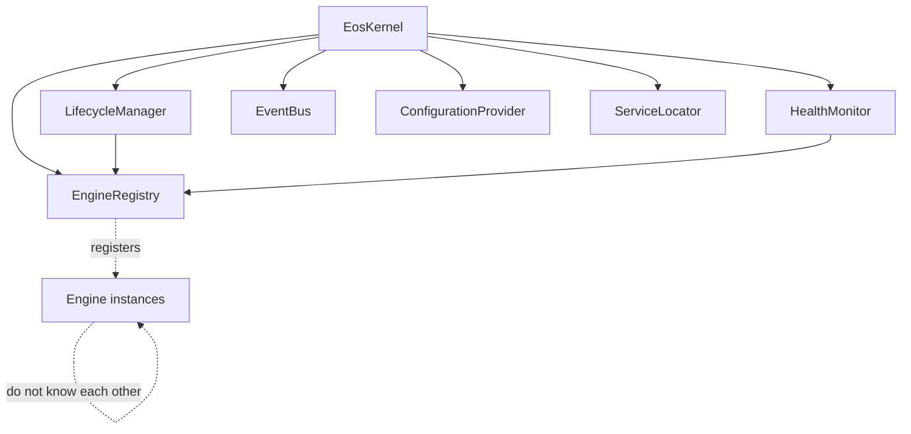
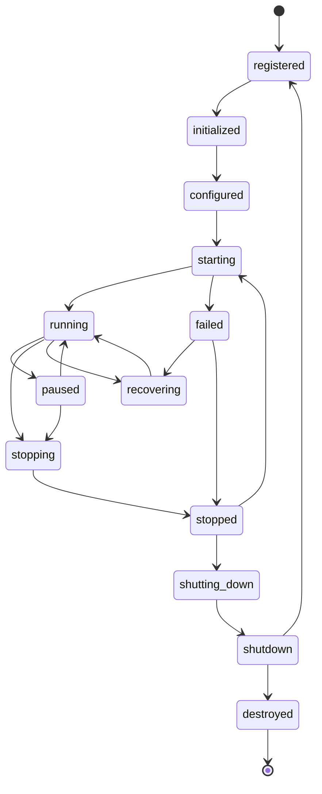
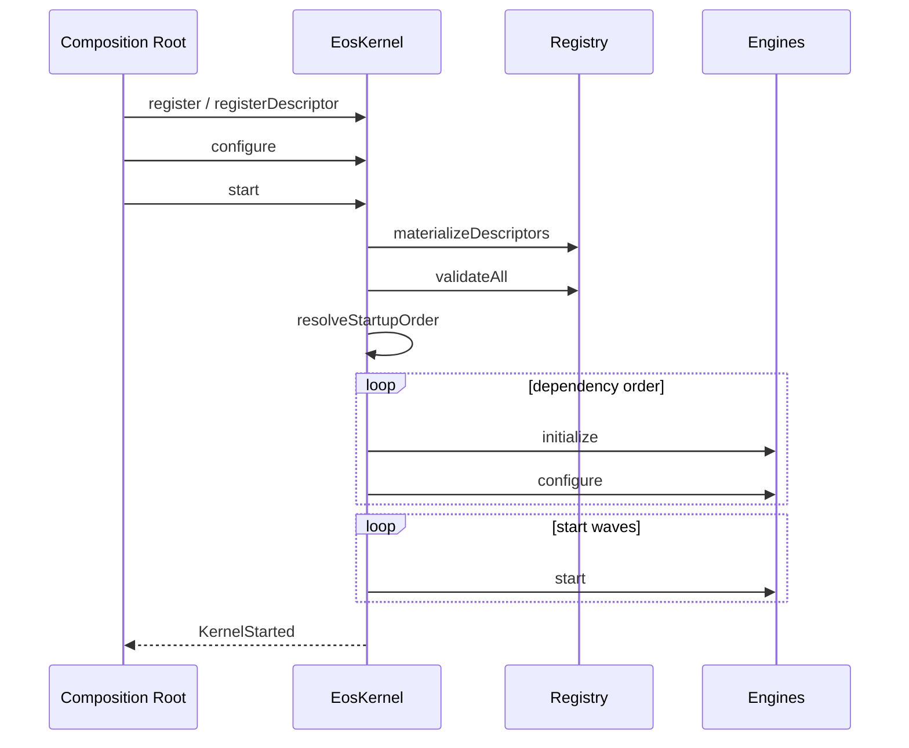
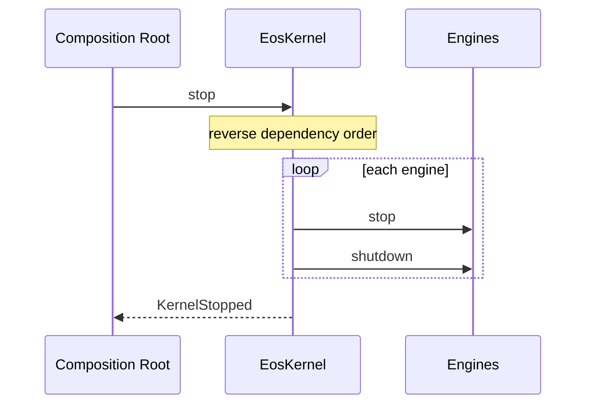
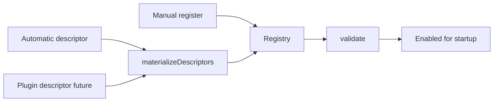
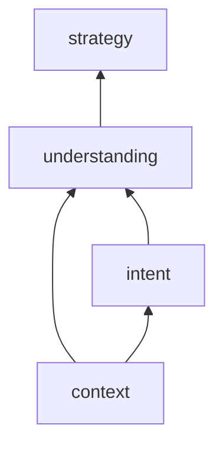

# ES-002 — EOS Kernel

**Version:** 1.0  
**Status:** Official — Permanent execution foundation  
**Package:** `@prima/eos`  
**Contracts:** `@prima/contracts`  

> The EOS Kernel is ENG-00 runtime.  
> It orchestrates Engines. It never performs educational decisions or generates resources.

**AGR-001 conditions addressed in this delivery:** B-02 (workspace packages), B-04 (module map), B-05 (composition root), B-16 (honest status); B-03 deferred to follow-up CI (import conventions documented).

---

# 1. EOS Kernel Design

| Field | Content |
|-------|---------|
| **Mission** | Supervise Engine lifecycle, discovery, health, and execution coordination under POSS/PAS Policies |
| **Responsibilities** | Registry; lifecycle; discovery; startup/shutdown ordering; health; kernel events; failure isolation |
| **Non-responsibilities** | Pedagogy; Strategy; Blueprint; Generation; Approval; Knowledge truth; UI; persistence schemas |
| **Lifecycle** | Created → Configured → Starting → Running → Stopping → Stopped → Destroyed |
| **Dependencies** | `@prima/contracts` only (no Domain business aggregates required for Kernel runtime) |
| **Extension points** | `Engine` contract; `EngineDescriptor` registration; future Plugin registrar; `ConfigurationProvider`; event subscribers |
| **Future evolution** | Saga coordination for long Generation runs; Plugin Host registration; distributed health — without changing Kernel mission |

---

# 2–11. Detailed design

Implemented in code and summarized below. Normative behaviour lives in `@prima/contracts` + `@prima/eos`.

## Engine Registry

Register / remove / enable / disable / discover / resolve / validate / health / metadata / version / capabilities.

## Lifecycle

States: `unregistered` → `registered` → `initialized` → `configured` → `starting` → `running` ↔ `paused` → `stopping` → `stopped` → `shutting_down` → `shutdown` → `destroyed`, plus `failed` / `recovering`.

## Discovery

Manual registration (default). Automatic via descriptor providers. Plugin registration reserved (`RegistrationSource.plugin`). Version compatibility + capability matching.

## Execution

Startup: validate → topological order by declared engine dependencies → initialize → configure → start.  
Shutdown: reverse order stop → shutdown → optional destroy.  
Parallel startup: engines with no mutual edges may start concurrently after dependencies are running.  
Timeouts configurable per phase.

## Health

Aggregates per-engine status: availability, version, deps, init/runtime/recovery.

## Contracts

`Engine`, `EngineRegistry`, `LifecycleManager`, `HealthMonitor`, `KernelContext`, `ExecutionContext`, `ConfigurationProvider`, `ServiceLocator`.

## Errors

`RecoverableKernelError` vs `FatalKernelError`; retry policy; escalation via events; isolation (one Engine fail does not auto-destroy Kernel unless fatal policy).

## Kernel Events

See `KernelEventType` in `@prima/contracts`.

## Testing

Unit + lifecycle + failure recovery tests in `packages/eos`.

## Validation

Kernel has single responsibility (orchestration). Engines remain ignorant of each other. No business logic in Kernel.

---

# Diagrams

## Kernel architecture

## Engine lifecycle

## Startup flow

## Shutdown flow

## Registration flow

## Dependency graph example

---

# Error management

| Class | Behaviour |
|-------|-----------|
| RecoverableKernelError | Retry per policy; Engine → failed → retry start from configured |
| FatalKernelError | Fail Kernel start when `failKernelOnFatalEngineError` (default) |
| Isolation | One Engine failure during stop does not skip remaining Engines |
| Escalation | `EngineFailed` / `KernelFailed` / `KernelDegraded` events |
| Graceful shutdown | reverse-order stop → shutdown |

---

# Testing strategy

| Layer | Location |
|-------|----------|
| Unit | dependency order, version compare, registry |
| Lifecycle / integration | `packages/eos/src/tests/kernel.test.ts` |
| Failure recovery | retry start test |
| Compatibility | SemVer discovery filter |
| Stress | deferred (later ES) — Kernel API stable for load harnesses |

Run: `npm run test:eos`

---

# Architecture validation

| Criterion | Result |
|-----------|--------|
| Single responsibility | Pass — orchestration only |
| Replaceability | Pass — `createEosKernel` + contracts |
| Engine isolation | Pass — no peer APIs |
| Plugin support | Pass — `RegistrationSource.plugin` + descriptors |
| Scalability | Pass — parallel start waves |
| Maintainability | Pass — small modules |
| Cloud readiness | Pass — no vendor coupling |
