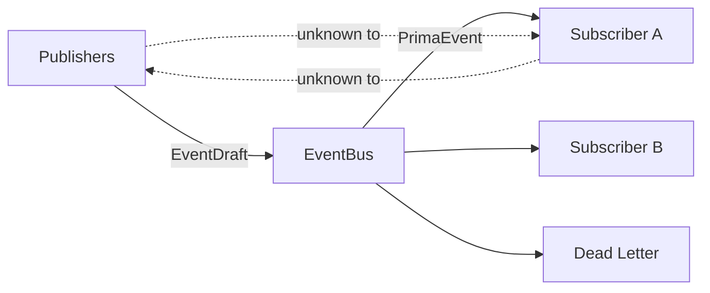
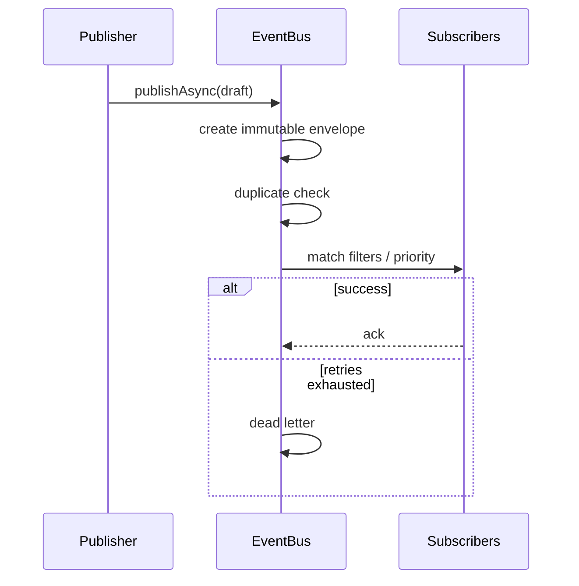
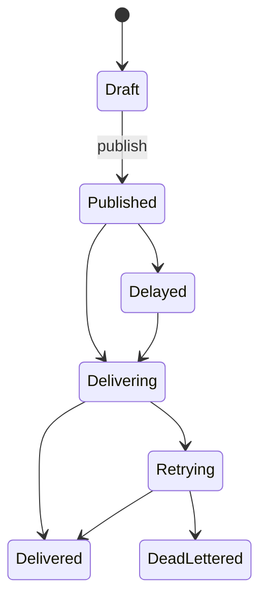

# ES-003 — Event Bus

**Version:** 1.0  
**Status:** Official — Permanent communication backbone  
**Packages:** `@prima/contracts` (envelope + bus contracts), `@prima/event-bus` (in-memory runtime)

> The Event Bus transports immutable facts.  
> It contains **no business logic**, no Engine pedagogy, and no Policy decisions.

---

# 1. Design

| Field | Content |
|-------|---------|
| **Mission** | Reliable, anonymous pub/sub for Domain, Kernel, Engine, System, Integration, Audit, and Telemetry events |
| **Responsibilities** | Create envelopes; publish; subscribe; route/filter; delivery attempts; duplicate detection; observability stats; dead-letter capture |
| **Non-responsibilities** | Interpreting payloads; Teacher Authority; orchestration decisions; persistence vendor choice |
| **Architecture** | Contracts in `@prima/contracts`; runtime in `@prima/event-bus`; distributed adapters later under `infrastructure/messaging` implementing the same `EventBus` interface |
| **Lifecycle** | `createEventBus` → `start` (delayed scheduler) → publish/subscribe → `flush`/`stop` |
| **Extension points** | Custom filters; remote subscriber adapters; DLQ processors; exactly-once stores |
| **Future evolution** | Swap in-memory for broker without changing publishers/subscribers |

---

# 2. Event model

| Category | Use |
|----------|-----|
| `domain` | Constitutional Domain Events (facts about Aggregates) |
| `kernel` | EOS Kernel lifecycle / coordination |
| `engine` | Engine lifecycle / health signals |
| `system` | Platform technical signals |
| `integration` | External / plugin boundary events |
| `audit` | Authority-sensitive audit trail facts |
| `telemetry` | Metrics-oriented signals (still immutable events) |

---

# 3. Metadata (mandatory envelope)

`eventId`, `eventType`, `category`, `aggregateId?`, `correlationId`, `causationId?`, `timestamp`, `source`, `version`, `tenantId?`, `userContext?`, `executionContext?`, `priority`, `payload`, `metadata` (includes `routingLane`).

Events are **frozen** after creation.

---

# 4. Publishing

| API | Behaviour |
|-----|-----------|
| `publishSync` | Same-turn delivery for sync handlers; delay/schedule supported |
| `publishAsync` | Async delivery (default) |
| Priority | Envelope + publish options; batch sorted by priority |
| Delayed / scheduled | `delayMs` / `scheduleAt` → internal delay queue |
| Batch | `publishBatch` |

---

# 5. Subscriptions

Single/multiple subscribers; wildcard `patterns` (`Kernel.*`, `*`); category/source/aggregate/engine filters; subscriber `priority`; delivery mode per subscription; remote subscribers = future adapter implementing same subscribe contract.

---

# 6. Delivery guarantees

| Mode | Support |
|------|---------|
| At-most-once | `delivery: 'at-most-once'` (no retry) + duplicate window |
| At-least-once | Default retries |
| Exactly-once | Future-ready enum; today = at-least-once + idempotent `eventId` window |
| DLQ | In-memory `deadLetters()` — replaceable sink later |
| Ordering | Per-`aggregateId` queue when `orderPerAggregate` |

---

# 7. Routing

Lane derived from category/source: domain · kernel · engine · plugin · external · system · audit · telemetry.  
Filtering is subscription-side; bus does not embed Engine-specific rules.

---

# 8. Observability

`stats()`, `health()`, latency average, queue lengths (`pendingAsync`, `pendingDelayed`), DLQ depth, history (bounded).

---

# 9. Error handling

Subscriber failures isolated by default; retry then DLQ; publisher normalize errors on batch; timeouts per handler; Kernel bridge does not throw into Kernel on subscriber failure.

---

# 10. Diagrams

---

# 11. Testing

`npm run test:event-bus` — unit, filter, duplicate, retry/DLQ, ordering, delay, batch, Kernel bridge.

Load/stress: deferred harness against `EventBus` interface (cloud-ready).

---

# 12. Architecture validation

| Criterion | Result |
|-----------|--------|
| Loose coupling | Pass — anonymous pub/sub |
| Scalability | Pass — interface ready for broker |
| Replaceability | Pass — `EventBus` contract |
| Reliability | Pass — retry + DLQ + duplicates |
| Performance | In-memory OK for single process; broker later |
| Maintainability | Pass — no business logic |
| Cloud readiness | Pass — no vendor lock-in |

---

## Kernel integration

`createKernelEventBusBridge(platformBus)` maps Kernel events onto the platform bus. Composition roots should construct one `EventBus` and share it (see COMPOSITION_ROOT.md).
