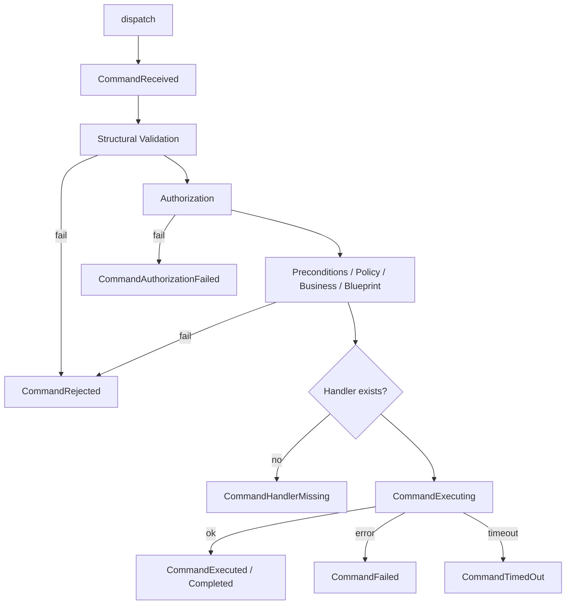
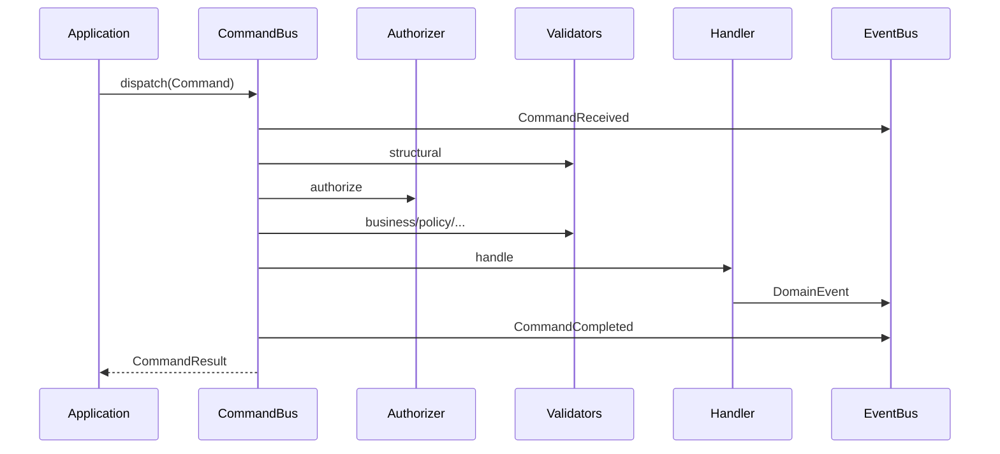
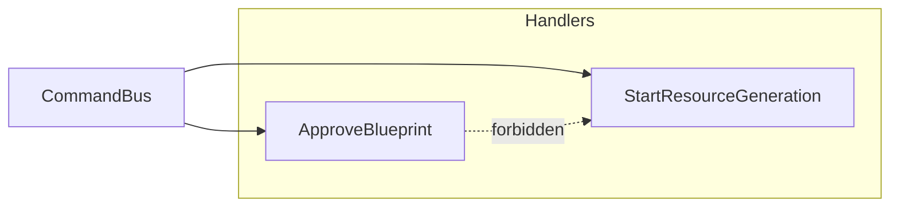

# ES-004 — Command Bus

**Version:** 1.0  
**Status:** Official — Permanent CQRS write pipeline  
**Packages:** `@prima/contracts` (command contracts), `@prima/command-bus` (runtime)

> Commands are **intentions**.  
> The Command Bus **coordinates** validation, authorization, and exactly-one handler execution.  
> It contains **no business logic**.

---

# 1. Design

| Field | Content |
|-------|---------|
| **Mission** | Execute state-changing intentions through a single observable pipeline |
| **Responsibilities** | Envelope creation; route to one handler; run validation/authorization stages; timeouts/cancellation; results; lifecycle events |
| **Non-responsibilities** | Pedagogy; Policy rule bodies; Teacher Authority decisions (delegated to `CommandAuthorizer`); Domain invariants (handlers/validators) |
| **Architecture** | Contracts + in-memory bus; future distributed dispatcher implements same `CommandBus` interface |
| **Lifecycle** | create → register handlers/validators/authorizers → dispatch → result |
| **Execution pipeline** | Received → Structural → Authorize → Preconditions → Policy → Business → Blueprint → Execute → Completed |
| **Future evolution** | Outbox, saga compensation hooks, remote handlers — without changing Command model |

---

# 2. Command model

`Command`: commandId, commandType, payload, metadata, priority, correlationId, causationId, timestamp, version, tenantId?, userContext?, executionContext?, aggregateId?, source.

Draft → frozen Command via `createCommand` / `dispatch`.

---

# 3. Dispatch pipeline

Exactly **one** `CommandHandler` per `commandType`. Handlers never call each other.

---

# 4. Validation model

Pluggable `CommandValidator` with stages:

- structuralValidation (built-in required fields)
- preconditions
- policyValidation
- businessValidation
- blueprintValidation

Bus only sequences stages; validators own rules.

---

# 5. Execution model

- Timeout via `timeoutMs` / AbortSignal  
- Cancellation via signal  
- Handler isolation  
- Domain Events published through `context.publishDomainEvent` → platform Event Bus  
- Transactions / rollback / compensation: **owned by handlers & infrastructure Unit of Work** — bus does not embed DB transactions (technology-independent)  
- Fail-closed: **no authorizer registered ⇒ authorization_failed**

---

# 6. Result model

Statuses: `success` | `validation_failed` | `authorization_failed` | `business_error` | `timeout` | `cancelled` | `handler_missing` | `failed`  

Includes issues, warnings, execution metadata (duration, stages, handler name).

---

# 7. Event catalog (lifecycle)

CommandReceived · CommandValidated · CommandRejected · CommandAuthorized · CommandAuthorizationFailed · CommandExecuting · CommandExecuted · CommandFailed · CommandCompleted · CommandTimedOut · CommandCancelled · CommandHandlerMissing  

Published as `category: system` on the Event Bus when enabled.

Successful handlers publish **Domain** events separately.

---

# 8. Diagrams

---

# 9. Testing

`npm run test:command-bus` — handler routing, authz fail-closed/deny, validation, business errors, timeout, lifecycle events, domain event publish.

---

# 10. Architecture validation

| Criterion | Result |
|-----------|--------|
| CQRS compliance | Pass — write side only; queries out of scope |
| Loose coupling | Pass — one handler; anonymous via types |
| Single responsibility | Pass — coordination only |
| Replaceability | Pass — `CommandBus` interface |
| Scalability | Pass — future remote dispatcher |
| Future readiness | Pass — stages, outbox-ready domain publish |

---

## Composition root

1. Create EventBus  
2. Create CommandBus `{ eventBus }`  
3. Register `CommandAuthorizer` (Teacher Authority / SVC-10 façade)  
4. Register domain validators  
5. Register one handler per constitutional Command  
6. Application Layer dispatches only — never calls handlers directly  
