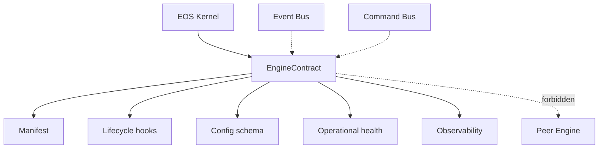
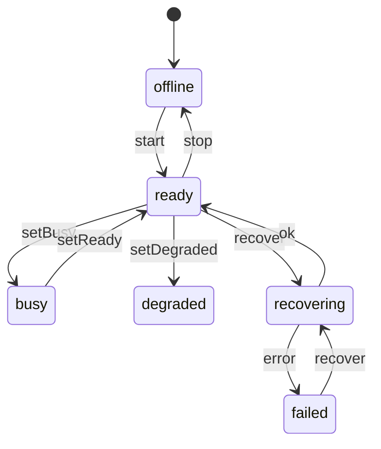
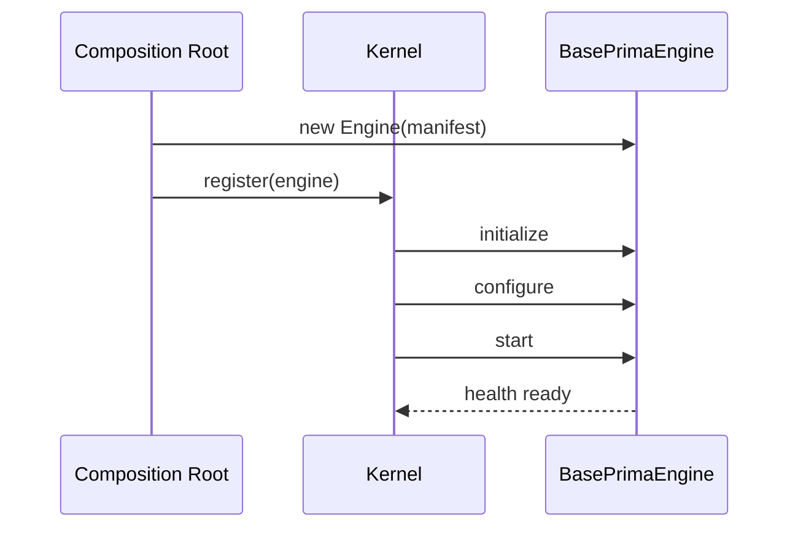

# ES-006 — Engine SDK & Engine Contract

**Version:** 1.0  
**Status:** Official — Constitutional contract for every PRIMA Engine  
**Packages:** `@prima/contracts` (`EngineContract`), `@prima/engine-sdk` (`BasePrimaEngine`)

> Every Engine is independent, replaceable, and talks only through platform infrastructure.  
> Engines **never** know peer Engines.  
> This SDK extends ES-002 `Engine` — it does not replace the Kernel.

---

# 1. Design

| Field | Content |
|-------|---------|
| **Mission** | Mandatory contract + base implementation for ENG-01…ENG-10 and future Engines |
| **Responsibilities** | Manifest, lifecycle hooks, config validation, operational health, observability ports, contract tests |
| **Lifecycle** | Same as EOS Kernel Engine lifecycle (initialize→…→destroy) |
| **Capabilities** | Declared in `EngineCapabilityManifest` |
| **Dependencies** | Declared EngineIds only — resolved by Kernel, never by direct imports |
| **Extension points** | Subclass `BasePrimaEngine`; override hooks; optional `onPlatformStart` |

---

# 2. Engine interface

- ES-002 `Engine` — Kernel-compatible lifecycle + `health()`
- ES-006 `EngineContract extends Engine` — `manifest`, `getConfigurationSchema`, `getOperationalState`, `diagnostics`

Identity/metadata come from the manifest via `metadataFromManifest`.

---

# 3. Lifecycle contract

Initialize · Configure · Start · Pause · Resume · Stop · Restart (Kernel) · Shutdown · Recover · Destroy  

Implemented by Kernel `LifecycleManager` + Engine hooks on `BasePrimaEngine`.

---

# 4. Capability declaration

Manifest fields: supportedCommands, publishedEvents, consumedEvents, configurationKeys, dependencies, features, version, compatibleKernelVersions, capabilities.

---

# 5. Execution context

`EngineExecutionEnvironment`: kernel, execution, user, security, project, educational, correlation.  
Engines must not construct peer Engine clients from this environment.

---

# 6. Health model

Operational: ready · busy · degraded · offline · recovering · failed  

Maps to Kernel `HealthStatus` via `operationalStateToHealthStatus`.

---

# 7. Configuration model

Schema keys with defaults/required/secret flags; `validateConfiguration` + `applyConfigDefaults`; runtime `configure(raw)`.

---

# 8. Observability

`EngineObservability`: logger · metrics · tracer (noop by default; composition root injects real sinks).

---

# 9. Diagrams







---

# 10. Testing

`npm run test:engine-sdk` — manifest validation, config, lifecycle/health, kernel compatibility, `runEngineContractSuite`.

Every Engine package SHOULD run `assertEngineContract` / contract suite in CI.

---

# 11. Architecture validation

| Criterion | Result |
|-----------|--------|
| Replaceability | Pass — subtype of Engine |
| Isolation | Pass — forbidden peer caps; dependency declaration only |
| Scalability | Pass — independent packages per Engine |
| Extensibility | Pass — BasePrimaEngine hooks |
| Maintainability | Pass — single SDK |
| Cloud readiness | Pass — observability ports |

---

## Usage

```ts
import { BasePrimaEngine } from '@prima/engine-sdk';

class ContextEngine extends BasePrimaEngine {
  getConfigurationSchema() { return { keys: [] }; }
  protected async onInitialize() {}
  protected async onConfigure() {}
  protected async onStart() {}
}
```
