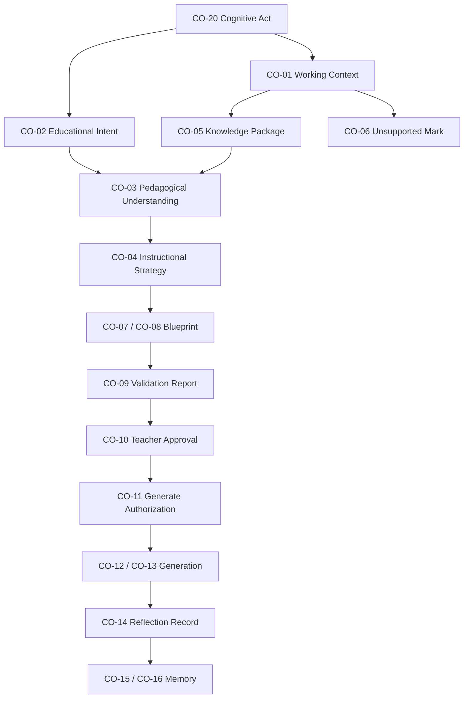
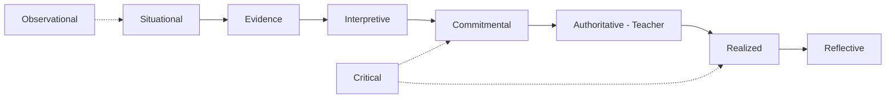
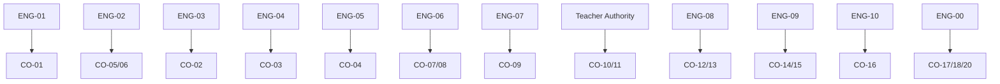

# ES-007 — Cognitive Objects Model

**Code:** ES-007  
**Version:** 1.0  
**Status:** FINAL  
**Typed form:** `@prima/contracts` → `prima-cognitive-objects.ts`  
**Non-goal:** This specification does **not** implement Engines. It defines the objects cognition exchanges.

> A **Cognitive Object** is a named, versioned, attributable unit of cognitive information that participates in the Educational Cognitive Pipeline.  
> Cognitive Objects carry **lineage, confidence, and authority class**.  
> They are the implementable form of PRIMA-CM-001 cognition — technology-independent, AI-model-independent.

**Precedence**

| Concern | Authority |
|---------|-----------|
| Catalog, identity, envelope, and cognitive contracts of Cognitive Objects | **This document (ES-007)** |
| How PRIMA thinks (functions, axioms, invariants) | [`PRIMA_COGNITIVE_MODEL.md`](../product/PRIMA_COGNITIVE_MODEL.md) (PRIMA-CM-001) |
| Working Context dimensions (detail of CO-01) | [`ES-007_CONTEXT_MODEL.md`](./ES-007_CONTEXT_MODEL.md) |
| Knowledge Pack / Object / Package units (detail of CO-05 & Knowledge corpus) | [`ES-008_KNOWLEDGE_MODEL.md`](./ES-008_KNOWLEDGE_MODEL.md) |
| Domain entity semantics | Constitutional Domain Model |
| Product artifact registry (broader exchange contracts) | Canonical Artifacts — align names to Constitutional Language; on cognitive identity conflict, **ES-007 prevails** |
| Engine behaviour | Constitutional Engine Architecture + Engine ES specs |

---

# 1. Definition

## 1.1 Cognitive Object

A Cognitive Object is information that:

1. participates in at least one Cognitive Function (PRIMA-CM-001 CF-01…CF-10),  
2. has a stable **constitutional name** (Constitutional Language),  
3. carries an **identity** and **schemaVersion**,  
4. declares **producer Engine** and **allowed consumers**,  
5. has an explicit **lifecycle**,  
6. participates in **lineage** (correlation / causation / prior object refs),  
7. never silently substitutes for Teacher Authority.

## 1.2 Hard separations

| Must not conflate | Why |
|-------------------|-----|
| Cognitive Object vs Domain Entity | Entity = what exists; Cognitive Object = what cognition exchanges in a pipeline act |
| Cognitive Object vs Canonical Artifact | Artifacts are product exchange contracts; Cognitive Objects are the EOS cognitive subset with confidence + cognitive state binding |
| Cognitive Object vs Knowledge Object | Knowledge Object (ES-008) is durable corpus substance; Cognitive Objects include ephemeral assemblies and design commitments |
| Cognitive Object vs AI message / prompt | Prompts are workers; Cognitive Objects are authority-bearing cognitive facts |
| Cognitive Object vs UI state | Screens may render objects; they do not redefine them |
| Working Context vs Knowledge Package | Situation ≠ doctrine |
| Memory Item vs Knowledge Pack | Personalization ≠ curriculum |
| Validation Report vs Teacher Approval | Critique ≠ authority |
| Generation Package vs Instructional Blueprint | Realization ≠ design |

## 1.3 Authority classes

| Class | Meaning | Binding |
|-------|---------|---------|
| **Situational** | True *here and now* for an act | Non-binding for Approval |
| **Evidence** | Attributable knowledge for an act | Non-binding; may block invention |
| **Interpretive** | Shared understanding / intent | Teacher-correctable; gates Strategy |
| **Commitmental** | Strategy / Blueprint design commitment | Teacher gates for binding advance |
| **Authoritative** | Teacher Approval / Authorize Generate / Export | **Teacher only** |
| **Critical** | Validation findings | Blocks advance; never Approves |
| **Realized** | Generated resources under authorization | Editable craft; not design authority |
| **Reflective** | Reflection and learning proposals | Advisory until accepted |
| **Observational** | Traces, confidence, pipeline position | Audit / explainability |

---

# 2. Common Envelope

Every Cognitive Object carries:

| Field | Meaning |
|-------|---------|
| `objectType` | Catalog code `CO-*` |
| `objectId` | Stable identity for this instance |
| `schemaVersion` | Object schema (e.g. `1.0.0`) |
| `correlationId` | Cognitive act / session correlation |
| `causationId` | Upstream command or event id (optional) |
| `producedBy` | Engine id (`ENG-*`) or `teacher` |
| `authorityClass` | From §1.3 |
| `lifecycleState` | Object-specific state |
| `confidence` | `high` \| `medium` \| `low` \| `unknown` — ceiling for downstream use |
| `lineage` | Refs to prior Cognitive Objects that authorized this one |
| `createdAt` | ISO timestamp |
| `unsupportedMarks` | Optional list when evidence gaps apply |

**Envelope invariants**

- `objectId` + `objectType` uniquely identify an instance within a Project/Session scope.  
- Downstream objects inherit a confidence ceiling ≤ upstream minimum material confidence.  
- Objects with `authorityClass = authoritative` may be produced only with `producedBy = teacher` (or teacher-bound authority service recording Teacher as actor).  
- Lineage must be reconstructable for every material Commitmental, Authoritative, Critical, and Realized object.

---

# 3. Catalog

| ID | Cognitive Object | Authority class | Maturity |
|----|------------------|-----------------|----------|
| **CO-01** | Working Context | Situational | MVP |
| **CO-02** | Educational Intent | Interpretive | MVP |
| **CO-03** | Pedagogical Understanding | Interpretive | MVP |
| **CO-04** | Instructional Strategy | Commitmental | MVP |
| **CO-05** | Knowledge Package | Evidence | MVP |
| **CO-06** | Unsupported Mark | Evidence | MVP |
| **CO-07** | Instructional Blueprint | Commitmental | MVP |
| **CO-08** | Blueprint Version | Commitmental | MVP |
| **CO-09** | Validation Report | Critical | MVP |
| **CO-10** | Teacher Approval | Authoritative | MVP |
| **CO-11** | Generate Authorization | Authoritative | MVP |
| **CO-12** | Generation Package | Realized | MVP |
| **CO-13** | Generated Resource | Realized | MVP |
| **CO-14** | Reflection Record | Reflective | MVP |
| **CO-15** | Memory Proposal | Reflective | MVP |
| **CO-16** | Memory Item | Reflective (accepted) | MVP |
| **CO-17** | Pipeline Position | Observational | MVP |
| **CO-18** | Reasoning Trace | Observational | MVP |
| **CO-19** | Confidence Record | Observational | MVP |
| **CO-20** | Cognitive Act | Observational | MVP |

Detail schemas for **CO-01** dimensions: [`ES-007_CONTEXT_MODEL.md`](./ES-007_CONTEXT_MODEL.md) (`PrimaContext`).  
Detail schemas for Knowledge corpus units feeding **CO-05**: [`ES-008_KNOWLEDGE_MODEL.md`](./ES-008_KNOWLEDGE_MODEL.md).

---

# 4. Object Specifications

---

## CO-01 — Working Context

| Field | Content |
|-------|---------|
| **Constitutional name** | Working Context |
| **Mission** | Situational truth for the cognitive act |
| **Typed root** | `PrimaContext` / WorkingContextSnapshot |
| **Producer** | ENG-01 Context |
| **Consumers** | ENG-03…ENG-07, ENG-00 |
| **Lifecycle** | assembling → sparse \| partial \| sufficient → superseded |
| **Success** | Unknowns declared; sufficiency explicit |
| **Failure** | Invented school/class facts; Student/Parent dimensions active in MVP |
| **CM-001** | Contextualization (CF-03) |
| **Detail** | ES-007 Context Model (dimensions CTX-*) |

**Invariants:** Immutable for one execution after freeze; Memory read is advisory only; never substitutes Knowledge Package.

---

## CO-02 — Educational Intent

| Field | Content |
|-------|---------|
| **Constitutional name** | Educational Intent |
| **Mission** | Structured educational purpose (goal before format) |
| **Producer** | ENG-03 Intent |
| **Consumers** | ENG-04, ENG-05, ENG-06, ENG-09 |
| **Lifecycle** | emerging → stable → superseded |
| **Payload (conceptual)** | goals; non-goals; format preferences (non-authoritative); constraints declared; Continuă linkage |
| **Success** | Meaningful intent; not format-only |
| **Failure** | Generation attempted from Intent alone |
| **CM-001** | Interpretation (CF-02) |

**Invariants:** Stable Intent required before Understanding Ready; Supersession preserves lineage.

---

## CO-03 — Pedagogical Understanding

| Field | Content |
|-------|---------|
| **Constitutional name** | Pedagogical Understanding |
| **Mission** | Shared understanding of goals, learners (aggregate), constraints, risks, success notion |
| **Producer** | ENG-04 Understanding |
| **Consumers** | ENG-05, ENG-06, ENG-07, ENG-09 |
| **Lifecycle** | forming → mirrored → ready → superseded |
| **Payload (conceptual)** | goals model; learner aggregate assumptions; constraints; risks; success criteria; open questions |
| **Success** | `ready` with teacher mirror not contradicted |
| **Failure** | Invented learner diagnoses as fact; Strategy without Ready |
| **CM-001** | Pedagogical Reasoning (CF-05) |

**Invariants:** Teacher may correct; Ready gates Strategy; confidence ≤ Knowledge Package / Context ceilings.

---

## CO-04 — Instructional Strategy

| Field | Content |
|-------|---------|
| **Constitutional name** | Instructional Strategy |
| **Mission** | Explicit how-learning-proceeds commitment before Blueprint composition |
| **Producer** | ENG-05 Strategy (propose); Teacher (select/confirm) |
| **Consumers** | ENG-06, ENG-07, ENG-09 |
| **Lifecycle** | proposed → confirmed → superseded |
| **Payload (conceptual)** | approach family; sequencing principle; activity-pattern stance; assessment stance; differentiation stance; time-boxing hypothesis; rationales; uncertainties |
| **Success** | Confirmed Strategy before Blueprint compose |
| **Failure** | Format-only strategy; Blueprint without confirmed Strategy |
| **CM-001** | Planning — Strategy (CF-06) |

**Invariants:** Confirm is Teacher authority for Select; proposals are non-binding.

---

## CO-05 — Knowledge Package

| Field | Content |
|-------|---------|
| **Constitutional name** | Knowledge Package |
| **Mission** | Ephemeral attributable evidence assembly for one cognitive act |
| **Producer** | ENG-02 Knowledge |
| **Consumers** | ENG-04…ENG-07 |
| **Lifecycle** | assembled → consumed → superseded |
| **Payload** | pinned Pack versions; object refs; provenanceComplete; domainScope (ES-008) |
| **Success** | Provenance complete for used claims |
| **Failure** | Silent invention; Memory used as curriculum |
| **CM-001** | Knowledge Activation (CF-04) |

**Invariants:** Pull-only; Pack ≠ Package; not durable design authority.

---

## CO-06 — Unsupported Mark

| Field | Content |
|-------|---------|
| **Constitutional name** | Unsupported Mark |
| **Mission** | Explicit absence of evidence for a requested claim scope |
| **Producer** | ENG-02 Knowledge |
| **Consumers** | ENG-04…ENG-07, ENG-00 |
| **Lifecycle** | raised → acknowledged → resolved \| retained |
| **Success** | Gap visible; advance narrowed or blocked per Policy |
| **Failure** | Gap filled by fluent invention |
| **CM-001** | AX-10 / INV-11 |

**Invariants:** May travel with or instead of CO-05; never cleared silently.

---

## CO-07 — Instructional Blueprint

| Field | Content |
|-------|---------|
| **Constitutional name** | Instructional Blueprint (Plan pedagogic) |
| **Mission** | Authoritative pedagogical design contract lineage |
| **Producer** | ENG-06 Blueprint |
| **Consumers** | ENG-07, ENG-08, Teacher, ENG-09 |
| **Lifecycle** | draft → self_validated → in_review → approved → superseded \| archived |
| **Success** | Coherent Learning Experience design under confirmed Strategy |
| **Failure** | Resource prose as design authority; compose without Strategy |
| **CM-001** | Planning — Blueprint (CF-06) |

**Invariants:** One authoritative iteration at a time per Learning Experience; mutations via versioning.

---

## CO-08 — Blueprint Version

| Field | Content |
|-------|---------|
| **Constitutional name** | Blueprint Version |
| **Mission** | Immutable snapshot identity for review, Approval, and Generation binding |
| **Producer** | ENG-06 Blueprint |
| **Consumers** | ENG-07, ENG-08, Teacher Authority recording |
| **Lifecycle** | minted → approved → superseded |
| **Success** | Stable identity for gates |
| **Failure** | In-place mutation of approved version |
| **CM-001** | Planning / Approval lineage |

**Invariants:** Approved versions immutable for a generation cycle; change ⇒ new Version.

---

## CO-09 — Validation Report

| Field | Content |
|-------|---------|
| **Constitutional name** | Validation Report |
| **Mission** | Structured critique for Self-Validation or Realization Validation |
| **Producer** | ENG-07 Validation |
| **Consumers** | ENG-00, ENG-06, ENG-08, Teacher, ENG-09 |
| **Lifecycle** | created → consumed → archived |
| **Outcomes** | succeeded \| warned \| blocked (self); realization_pass \| realization_fail |
| **Success** | Findings reference rules/sections; blockers prevent illegal advance |
| **Failure** | Report used as Teacher Approval |
| **CM-001** | Validation (CF-07) |

**Invariants:** Never grants Approve / Export; does not mutate Blueprint or Resources.

---

## CO-10 — Teacher Approval

| Field | Content |
|-------|---------|
| **Constitutional name** | Teacher Approval |
| **Mission** | Explicit authorization record for a Blueprint Version |
| **Producer** | Teacher (via Teacher Authority) |
| **Consumers** | ENG-00, ENG-08 |
| **Lifecycle** | granted → archived_on_supersession |
| **Success** | Teacher actor bound; Version pinned |
| **Failure** | AI-granted Approval |
| **CM-001** | INV-08, INV-09 |

**Invariants:** `producedBy` must be teacher-bound; required before Generate Authorization.

---

## CO-11 — Generate Authorization

| Field | Content |
|-------|---------|
| **Constitutional name** | Generate Authorization |
| **Mission** | Teacher confirmation to realize a scoped Approved Blueprint Version |
| **Producer** | Teacher (via Teacher Authority) |
| **Consumers** | ENG-00, ENG-08 |
| **Lifecycle** | granted → consumed → expired \| superseded |
| **Payload (conceptual)** | blueprintVersionId; resource scope; teacherId; grantedAt |
| **Success** | Distinct from Approval; scope explicit |
| **Failure** | Implicit generate after Approval alone without Authorize where Policy requires it |
| **CM-001** | Decision D7 |

**Invariants:** Separate from CO-10; AI never grants.

---

## CO-12 — Generation Package

| Field | Content |
|-------|---------|
| **Constitutional name** | Generation Package |
| **Mission** | Bounded realization run against an Approved Blueprint Version |
| **Producer** | ENG-08 Generation |
| **Consumers** | ENG-07, Teacher craft, ENG-09 |
| **Lifecycle** | initiated → produced → validated → superseded |
| **Success** | Traceability to Blueprint sections; no redesign |
| **Failure** | Generation without CO-10/CO-11; mutating Approved Blueprint mid-run |
| **CM-001** | Generation (CF-08) |

---

## CO-13 — Generated Resource

| Field | Content |
|-------|---------|
| **Constitutional name** | Generated Resource |
| **Mission** | Editable classroom craft unit produced under Generation Package |
| **Producer** | ENG-08 Generation |
| **Consumers** | Teacher; ENG-07; Export path |
| **Lifecycle** | draft → edited → realization_validated → exported \| discarded |
| **Success** | Section-level trace links |
| **Failure** | Treated as Instructional Blueprint authority |
| **CM-001** | Generation / Craft |

**Invariants:** Not Knowledge; not design contract; Export remains Teacher authority.

---

## CO-14 — Reflection Record

| Field | Content |
|-------|---------|
| **Constitutional name** | Reflection Record |
| **Mission** | Explainability bundle and improvement signals for a cognitive act or session |
| **Producer** | ENG-09 Reflection |
| **Consumers** | Teacher; ENG-10 (proposals); auditors |
| **Lifecycle** | recorded → presented → closed |
| **Success** | Recoverable why; proposals explicit |
| **Failure** | Silent preference lock; override of Approval |
| **CM-001** | Reflection (CF-09) |

---

## CO-15 — Memory Proposal

| Field | Content |
|-------|---------|
| **Constitutional name** | Memory Proposal |
| **Mission** | Candidate Memory delta from Reflection — not yet accepted |
| **Producer** | ENG-09 Reflection |
| **Consumers** | ENG-10; Teacher |
| **Lifecycle** | proposed → accepted \| rejected \| expired |
| **Success** | Reviewable; reversible under Policy |
| **Failure** | Auto-accept into binding pedagogy |
| **CM-001** | Learning (CF-10) / AX-07 |

---

## CO-16 — Memory Item

| Field | Content |
|-------|---------|
| **Constitutional name** | Memory Item |
| **Mission** | Accepted teacher-controlled personalization unit |
| **Producer** | ENG-10 Memory (on accept) |
| **Consumers** | ENG-01 (read); ENG-05 (advisory) |
| **Lifecycle** | active → superseded \| archived |
| **Success** | Advisory only to live design |
| **Failure** | Substitutes Knowledge Pack / curriculum |
| **CM-001** | Learning / Memory model |

---

## CO-17 — Pipeline Position

| Field | Content |
|-------|---------|
| **Constitutional name** | Pipeline Position |
| **Mission** | Legal position of the cognitive act in the Educational Cognitive Pipeline |
| **Producer** | ENG-00 Orchestrator |
| **Consumers** | All Engines; Teacher orientation queries |
| **Lifecycle** | advanced per legal transition |
| **Success** | Illegal skips blocked |
| **Failure** | Silent gate bypass |
| **CM-001** | Cognitive States / Orchestration |

---

## CO-18 — Reasoning Trace

| Field | Content |
|-------|---------|
| **Constitutional name** | Reasoning Trace |
| **Mission** | Ordered record of cognitive acts and object refs for explainability |
| **Producer** | ENG-00 / participating Engines |
| **Consumers** | ENG-09; auditors; Teacher explanation surfaces |
| **Lifecycle** | appending → sealed_on_approval_or_close |
| **Success** | Material lineage reconstructable |
| **Failure** | Material output without trace |
| **CM-001** | Cognitive Observability |

---

## CO-19 — Confidence Record

| Field | Content |
|-------|---------|
| **Constitutional name** | Confidence Record |
| **Mission** | Confidence ceiling evolution across the act |
| **Producer** | Producing Engine of the related object |
| **Consumers** | Downstream Engines; Teacher acknowledgment surfaces |
| **Lifecycle** | recorded → acknowledged \| superseded |
| **Success** | Downstream ceiling ≤ upstream |
| **Failure** | Low-evidence claim presented as high confidence |
| **CM-001** | Confidence propagation |

---

## CO-20 — Cognitive Act

| Field | Content |
|-------|---------|
| **Constitutional name** | Cognitive Act |
| **Mission** | Correlation root binding one pipeline traversal (or scoped sub-act) |
| **Producer** | ENG-00 Orchestrator |
| **Consumers** | All |
| **Lifecycle** | opened → active → closed \| aborted |
| **Payload (conceptual)** | correlationId; projectId; teacherId; entryPath; openedAt; closedAt |
| **Success** | All material objects share correlation |
| **Failure** | Orphan objects without act binding |
| **CM-001** | Pipeline / Working Memory scope |

---

# 5. Lifecycle Coupling

```
CO-20 Cognitive Act
  └─ CO-01 Working Context
  └─ CO-02 Educational Intent
  └─ CO-05 Knowledge Package  and/or  CO-06 Unsupported Mark
  └─ CO-03 Pedagogical Understanding (ready)
  └─ CO-04 Instructional Strategy (confirmed)
  └─ CO-07 Instructional Blueprint
       └─ CO-08 Blueprint Version
            └─ CO-09 Validation Report (self)
            └─ CO-10 Teacher Approval
                 └─ CO-11 Generate Authorization
                      └─ CO-12 Generation Package
                           └─ CO-13 Generated Resource
                           └─ CO-09 Validation Report (realization)
  └─ CO-14 Reflection Record
       └─ CO-15 Memory Proposal → CO-16 Memory Item
  └─ CO-17 Pipeline Position
  └─ CO-18 Reasoning Trace
  └─ CO-19 Confidence Record
```

Illegal couplings (normative):

- CO-12 without CO-10 and CO-11 (where Policy requires Authorize)  
- CO-07 compose without CO-04 confirmed  
- CO-04 confirm without CO-03 ready  
- CO-03 ready pretending complete knowledge while CO-06 unacknowledged when Policy requires acknowledgment  
- CO-10 or CO-11 with non-teacher producer  
- CO-09 acting as CO-10  
- CO-16 replacing CO-05  

---

# 6. Engine Ownership Matrix

| CO | Owner Engine | May write | May read |
|----|--------------|-----------|----------|
| CO-01 | ENG-01 | ENG-01 | ENG-00,03–07,09 |
| CO-02 | ENG-03 | ENG-03 | ENG-04–06,09 |
| CO-03 | ENG-04 | ENG-04 | ENG-05–07,09 |
| CO-04 | ENG-05 + Teacher select | ENG-05 (propose); Teacher (confirm) | ENG-06,07,09 |
| CO-05/06 | ENG-02 | ENG-02 | ENG-04–07 |
| CO-07/08 | ENG-06 | ENG-06 | ENG-07,08,09,Teacher |
| CO-09 | ENG-07 | ENG-07 | ENG-00,06,08,09,Teacher |
| CO-10/11 | Teacher Authority | Teacher-bound only | ENG-00,08 |
| CO-12/13 | ENG-08 | ENG-08 | ENG-07,09,Teacher |
| CO-14/15 | ENG-09 | ENG-09 | ENG-10,Teacher |
| CO-16 | ENG-10 | ENG-10 on accept | ENG-01,05 |
| CO-17/18/20 | ENG-00 | ENG-00 (+ appenders for Trace) | All |
| CO-19 | Producing Engine | Producer | Downstream |

Peer Engines do not write another Engine’s owned Cognitive Objects except Teacher confirm/accept paths and Orchestrator position/trace coordination.

---

# 7. Mapping to PRIMA-CM-001

| Cognitive Function | Primary Cognitive Objects |
|--------------------|---------------------------|
| Perception | CO-20, CO-17 |
| Interpretation | CO-02 |
| Contextualization | CO-01 |
| Knowledge Activation | CO-05, CO-06 |
| Pedagogical Reasoning | CO-03 |
| Planning | CO-04, CO-07, CO-08 |
| Validation | CO-09 |
| Generation | CO-11, CO-12, CO-13 |
| Reflection | CO-14, CO-15 |
| Learning | CO-16 |
| Observability | CO-18, CO-19 |

---

# 8. Glossary Bridge (Canonical Artifacts)

Where product Canonical Artifacts use legacy labels, Cognitive Objects use Constitutional Language:

| Cognitive Object | Canonical Artifacts label (legacy bridge) |
|------------------|-------------------------------------------|
| Educational Intent (CO-02) | Teacher Intent |
| Working Context (CO-01) | Conversation Context / Decision Context (partial overlap — do not merge identities) |
| Pedagogical Understanding (CO-03) | (often embedded historically — now first-class) |
| Instructional Strategy (CO-04) | (mandatory first-class; not optional narrative) |
| Reflection Record (CO-14) | Reflection Report |
| Memory Item (CO-16) | Memory Context (accepted items) |

**Rule:** New engineering surfaces use CO / Constitutional names. Bridges are transitional, not dual authority.

---

# 9. Validation Rules (MVP)

| Code | Rule |
|------|------|
| **COV-01** | Envelope fields present: objectType, objectId, schemaVersion, correlationId, producedBy, authorityClass, lifecycleState, confidence, createdAt |
| **COV-02** | CO-10 and CO-11: producedBy teacher-bound |
| **COV-03** | CO-12 requires lineage to CO-08 + CO-10 (+ CO-11 when required) |
| **COV-04** | CO-07 compose requires lineage to CO-04 confirmed |
| **COV-05** | CO-04 confirm requires lineage to CO-03 ready; confirm producedBy teacher |
| **COV-06** | CO-05 and CO-16 never share identity space as substitutes |
| **COV-07** | CO-09 cannot transition any object to approved |
| **COV-08** | Student/Parent personal Cognitive Objects forbidden in MVP (aligned with Context Model) |
| **COV-09** | Material CO-07/08/10/12/13 require CO-18 trace entries (lineage or companion) |
| **COV-10** | Confidence downstream ≤ min(upstream material confidences) |

Typed validators in `@prima/contracts` (`prima-cognitive-objects.ts`):

| Rule | Function |
|------|----------|
| COV-01, COV-02 | `validateCognitiveObjectEnvelopeMvp` |
| COV-03 | `validateGenerationPackageCouplingMvp` |
| COV-04 | `validateBlueprintComposeCouplingMvp` |
| COV-05 | `validateStrategyConfirmCouplingMvp` |
| COV-06 | `validateKnowledgeMemorySeparationMvp` |
| COV-07 | `validateValidationDoesNotApproveMvp` |
| COV-08 | `validatePrimaContextMvp` (Context Object detail) |
| COV-09 | `validateMaterialTraceCouplingMvp` |
| COV-10 | `validateConfidencePropagationMvp` |

Catalog constant: `COGNITIVE_OBJECT_CATALOG` (CO-01…CO-20).

---

# 10. Diagrams

## 10.1 Cognitive Object flow



## 10.2 Authority classes



## 10.3 Engine ownership



---

# 11. Implementation Map

| Concern | Location |
|---------|----------|
| This specification | `docs/engineering/ES-007_COGNITIVE_OBJECTS_MODEL.md` |
| Context Object detail | `docs/engineering/ES-007_CONTEXT_MODEL.md` |
| Knowledge units detail | `docs/engineering/ES-008_KNOWLEDGE_MODEL.md` |
| Typed Cognitive Objects | `packages/contracts/src/prima-cognitive-objects.ts` |
| Typed Context | `packages/contracts/src/prima-context.ts` |
| Typed Knowledge | `packages/contracts/src/prima-knowledge.ts` |

---

# 12. Architecture Validation

| Criterion | Status |
|-----------|--------|
| Technology independent | Pass |
| AI model independent | Pass |
| Aligned to PRIMA-CM-001 | Pass |
| Aligned to ENG-00…ENG-10 ownership | Pass |
| Teacher Authority preserved | Pass |
| Knowledge ≠ Memory ≠ Context | Pass |
| Generation consequence of reasoning | Pass |
| Explainability via CO-18/CO-19 | Pass |
| Enterprise / research ready | Pass |
| FINAL for v1.0 catalog | Pass |

---

## Document Control

| Item | Value |
|------|-------|
| **Code** | ES-007 |
| **Title** | Cognitive Objects Model |
| **Status** | FINAL |
| **Version** | 1.0 |
| **Amendment** | Constitutional engineering revision; catalog IDs stable once published |
