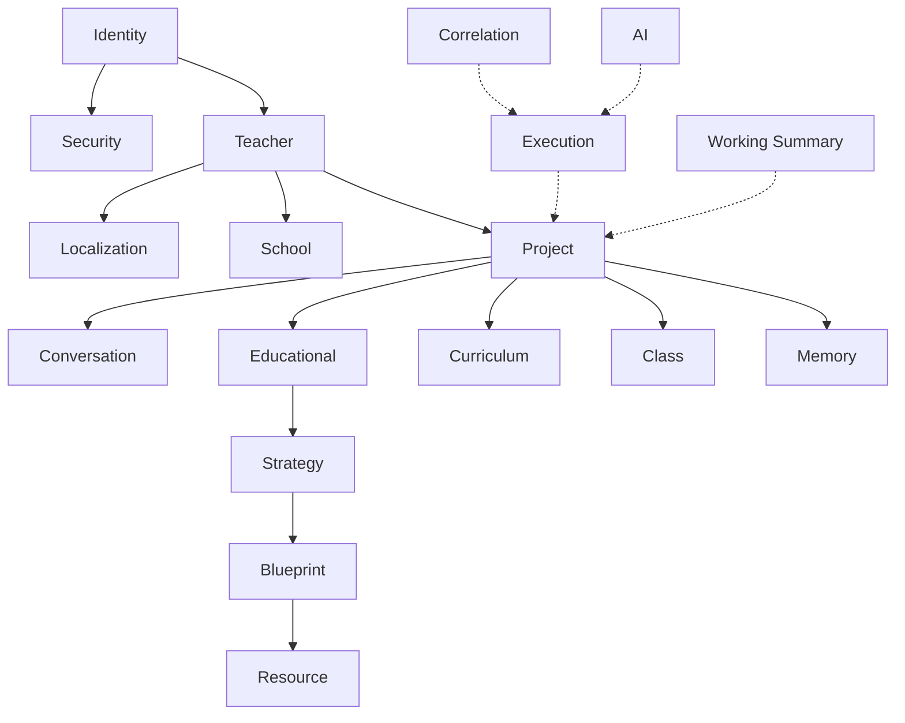
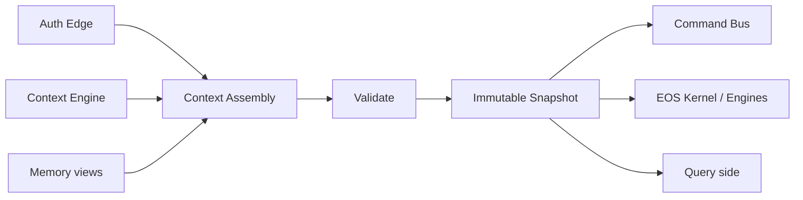
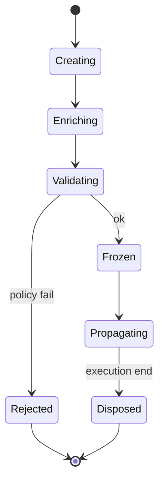

# ES-007 — Context Object Detail (Working Context / PrimaContext)

**Version:** 1.0  
**Status:** Official — Normative detail for Cognitive Object **CO-01 Working Context**  
**Parent specification:** [`ES-007_COGNITIVE_OBJECTS_MODEL.md`](./ES-007_COGNITIVE_OBJECTS_MODEL.md) (Cognitive Objects Model — FINAL)  
**Typed form:** `@prima/contracts` → `PrimaContext` / context dimensions  
**Non-goal:** This specification does **not** implement the Context Engine (ENG-01).

> Context is the single source of truth for *what is situationally true* for a given execution.  
> During one execution, Context is **immutable**.  
> Context is **composable**, **hierarchical**, **versioned**, **traceable**, **explainable**, and **privacy-aware**.  
> In the Cognitive Objects catalog this is **CO-01**.

**Precedence**

| Concern | Authority |
|---------|-----------|
| Cognitive Objects catalog and envelope | [`ES-007_COGNITIVE_OBJECTS_MODEL.md`](./ES-007_COGNITIVE_OBJECTS_MODEL.md) |
| EOS execution Context Object (dimensions below) | **This document** |
| Conceptual Context Stack / activation philosophy | Owned here. The enterprise `PRIMA_CONTEXT_MODEL.md` it prevailed over was removed in the August 2026 cleanup |
| Situational assembly behaviour | Context Engine (ENG-01) — implements this model later |

---

# 1. Canonical Context Model

## 1.1 Definition

The **PRIMA Context Object** (`PrimaContext`) is the immutable, versioned snapshot of all context dimensions in force for one **execution scope** (Command dispatch, Engine invocation, Query, Workflow step, or Event handler).

| Principle | Rule |
|-----------|------|
| **Immutability** | After validation/snapshot, fields are frozen for that execution |
| **Composition** | Dimensions assemble into one object; missing dimensions are explicit `absent` / `unknown`, never invented |
| **Hierarchy** | Broader dimensions constrain narrower ones |
| **Versioning** | Every snapshot has `contextVersion` + `schemaVersion` |
| **Traceability** | `contextId`, `correlationId`, provenance per dimension |
| **Explainability** | Each dimension records `source` and `sufficiency` |
| **Privacy** | Security classification + minimization; Student/Parent future-gated |
| **Tech independence** | No DB, vector, or LLM assumptions |

## 1.2 Root object

| Field | Meaning |
|-------|---------|
| `contextId` | Unique snapshot id |
| `schemaVersion` | Model schema (e.g. `1.0.0`) |
| `contextVersion` | Monotonic snapshot version within session/project |
| `createdAt` | Snapshot timestamp |
| `correlationId` | Links Commands/Events/Engines |
| `causationId` | Upstream command/event id |
| `sufficiency` | Overall: `Sparse` \| `Partial` \| `Sufficient` |
| `dimensions` | Map of Context Dimensions |
| `provenance` | Assembly audit (who contributed what) |

---

# 2. Context Catalog (dimensions)

IDs use `CTX-*`. Future dimensions are reserved without activating Student PII.

| ID | Dimension | Maturity |
|----|-----------|----------|
| **CTX-01** | Identity Context | MVP |
| **CTX-02** | Teacher Context | MVP |
| **CTX-03** | Project Context | MVP |
| **CTX-04** | Educational Context | MVP |
| **CTX-05** | Curriculum Context | MVP |
| **CTX-06** | School Context | Thin / Future-ready |
| **CTX-07** | Class Context | MVP (aggregate only) |
| **CTX-08** | Student Context | **Future — inactive** |
| **CTX-09** | Parent Context | **Future — inactive** |
| **CTX-10** | Resource Context | MVP |
| **CTX-11** | Blueprint Context | MVP |
| **CTX-12** | Strategy Context | MVP |
| **CTX-13** | Memory Context | MVP (advisory) |
| **CTX-14** | Conversation Context | MVP |
| **CTX-15** | Execution Context | MVP |
| **CTX-16** | AI Context | MVP (worker binding) |
| **CTX-17** | Security Context | MVP |
| **CTX-18** | Localization Context | MVP |
| **CTX-19** | Plugin Context | Future |
| **CTX-20** | Correlation / Trace Context | MVP |
| **CTX-21** | Working Context Summary | MVP (ENG-01 output view) |

---

# 3. Dimension specifications

Legend — **Visibility:** who may read · **Persistence:** Durable / Session / Transient · **Classification:** Public / Internal / Confidential / Restricted

---

### CTX-01 — Identity Context

| Field | Content |
|-------|---------|
| **Purpose** | Authenticated actor identity for this execution |
| **Owner** | Teacher Authority / Platform Identity |
| **Source** | AuthN adapter → Application edge |
| **Lifecycle** | Created at request entry; immutable for execution |
| **Visibility** | Services needing AuthZ; never to AI workers as raw secrets |
| **Persistence** | Session (ids durable; tokens never in Context) |
| **Validation** | `subjectId` required when authenticated; no anonymous Approve/Export |
| **Security Classification** | Confidential |

---

### CTX-02 — Teacher Context

| Field | Content |
|-------|---------|
| **Purpose** | Teacher authority, preferences in force, approval standing |
| **Owner** | Teacher Interaction / Authority Service |
| **Source** | Teacher aggregate; explicit statements; preferences |
| **Lifecycle** | Bound at session; refresh only via new snapshot |
| **Visibility** | Design Engines; never grants Approval by presence alone |
| **Persistence** | Durable profile refs + session overlay |
| **Validation** | TeacherId matches Identity; no invented preferences |
| **Security Classification** | Confidential |

---

### CTX-03 — Project Context

| Field | Content |
|-------|---------|
| **Purpose** | Durable design container Continuă binds to |
| **Owner** | Project Continuity (MOD-02) |
| **Source** | Project aggregate |
| **Lifecycle** | Selected/created before design pipeline advances |
| **Visibility** | All design/generation Engines |
| **Persistence** | Durable |
| **Validation** | ProjectId required for Continuă and Blueprint work |
| **Security Classification** | Internal |

---

### CTX-04 — Educational Context

| Field | Content |
|-------|---------|
| **Purpose** | Learning goals, learners-as-described, constraints, success notion |
| **Owner** | Understanding Engine (assembly); Teacher corrects |
| **Source** | Pedagogical Understanding; Intent |
| **Lifecycle** | Evolves across snapshots; frozen per execution |
| **Visibility** | Strategy, Blueprint, Validation |
| **Persistence** | Session + Project-linked Understanding |
| **Validation** | No invented learner diagnoses (POL-084) |
| **Security Classification** | Internal / Confidential if class-sensitive |

---

### CTX-05 — Curriculum Context

| Field | Content |
|-------|---------|
| **Purpose** | Active curriculum evidence scope (not full Knowledge corpus) |
| **Owner** | Knowledge Engine |
| **Source** | KnowledgePackage + pack version + provenance |
| **Lifecycle** | Retrieved per cognitive act; version pinned in snapshot |
| **Visibility** | Understanding, Strategy, Blueprint, Validation |
| **Persistence** | Transient slice; pack versions durable elsewhere |
| **Validation** | Provenance required; unsupported marked (POL-040) |
| **Security Classification** | Internal |

---

### CTX-06 — School Context

| Field | Content |
|-------|---------|
| **Purpose** | Institutional policy adjacency, school identity |
| **Owner** | Platform Governance |
| **Source** | Tenant/school configuration |
| **Lifecycle** | Bound at login/tenant resolve |
| **Visibility** | Governance, Localization defaults |
| **Persistence** | Durable config |
| **Validation** | Must not invent school facts (POL-041) |
| **Security Classification** | Internal |

---

### CTX-07 — Class Context

| Field | Content |
|-------|---------|
| **Purpose** | Aggregate classroom patterns (level, differentiation norms) |
| **Owner** | Teacher statements + Memory (advisory) |
| **Source** | Teacher; Memory views |
| **Lifecycle** | Session enrichment |
| **Visibility** | Strategy, Blueprint |
| **Persistence** | Session; Memory items if Teacher-accepted |
| **Validation** | **No individual student identities** |
| **Security Classification** | Confidential |

---

### CTX-08 — Student Context (Future)

| Field | Content |
|-------|---------|
| **Purpose** | Individual learner context — **inactive in MVP** |
| **Owner** | Future Student Workspace |
| **Source** | — |
| **Lifecycle** | Reserved |
| **Visibility** | Forbidden until constitutional amendment |
| **Persistence** | — |
| **Validation** | Must remain absent; presence is a Policy violation in MVP |
| **Security Classification** | Restricted |

---

### CTX-09 — Parent Context (Future)

| Field | Content |
|-------|---------|
| **Purpose** | Parent/guardian interaction scope — **inactive** |
| **Owner** | Future Parent Workspace |
| **Validation** | Must remain absent in MVP |
| **Security Classification** | Restricted |

---

### CTX-10 — Resource Context

| Field | Content |
|-------|---------|
| **Purpose** | Active Resource / GenerationPackage scope |
| **Owner** | Generation Engine / Delivery |
| **Source** | GenerationPackage, Resource aggregates |
| **Lifecycle** | Post-Authorize Generate |
| **Visibility** | Generation, Validation Fidelity, Delivery |
| **Persistence** | Durable Resources |
| **Validation** | Requires Approved Blueprint binding |
| **Security Classification** | Internal |

---

### CTX-11 — Blueprint Context

| Field | Content |
|-------|---------|
| **Purpose** | Active Instructional Blueprint version + approval state |
| **Owner** | Blueprint Engine |
| **Source** | BlueprintVersion, TeacherApproval |
| **Lifecycle** | After Strategy confirmed |
| **Visibility** | Validation, Generation eligibility |
| **Persistence** | Durable versions |
| **Validation** | Version id immutable; Approval only Teacher-granted |
| **Security Classification** | Internal |

---

### CTX-12 — Strategy Context

| Field | Content |
|-------|---------|
| **Purpose** | Confirmed or proposed Instructional Strategy |
| **Owner** | Strategy Engine |
| **Source** | InstructionalStrategy object |
| **Lifecycle** | After Understanding Ready |
| **Visibility** | Blueprint Engine |
| **Persistence** | Session / Project-linked |
| **Validation** | Select is Teacher-confirmed for binding |
| **Security Classification** | Internal |

---

### CTX-13 — Memory Context

| Field | Content |
|-------|---------|
| **Purpose** | Teacher-accepted personalization views (advisory) |
| **Owner** | Memory Engine |
| **Source** | MemoryProfile / accepted items |
| **Lifecycle** | Read at Context assembly; never auto-write |
| **Visibility** | Context, Strategy (advisory only) |
| **Persistence** | Durable under Teacher control |
| **Validation** | Memory ≠ Knowledge; sensitivity gated |
| **Security Classification** | Confidential |

---

### CTX-14 — Conversation Context

| Field | Content |
|-------|---------|
| **Purpose** | Design Session dialogue position and capture |
| **Owner** | Design Session Service |
| **Source** | ConversationSession aggregate |
| **Lifecycle** | Session-scoped |
| **Visibility** | Intent, Understanding |
| **Persistence** | Session (durable transcript policy TBD) |
| **Validation** | PipelinePosition lawful |
| **Security Classification** | Confidential |

---

### CTX-15 — Execution Context

| Field | Content |
|-------|---------|
| **Purpose** | Runtime deadlines, Kernel/Engine execution binding |
| **Owner** | EOS Kernel / Command Bus |
| **Source** | Kernel ExecutionContext; CommandContext |
| **Lifecycle** | Transient per invocation |
| **Visibility** | Engines, handlers |
| **Persistence** | Transient |
| **Validation** | correlationId required |
| **Security Classification** | Internal |

---

### CTX-16 — AI Context

| Field | Content |
|-------|---------|
| **Purpose** | Worker binding metadata (model slot, policy caps) — **not prompts as authority** |
| **Owner** | Infrastructure workers via Ports |
| **Source** | Composition root / config |
| **Lifecycle** | Transient per worker call |
| **Visibility** | Workers only; Engines see Ports not raw SDKs |
| **Persistence** | Transient |
| **Validation** | No Teacher Authority bypass; no auto-Approve |
| **Security Classification** | Internal (secrets never embedded) |

---

### CTX-17 — Security Context

| Field | Content |
|-------|---------|
| **Purpose** | Roles, permissions, tenant isolation |
| **Owner** | Security plane / Authority |
| **Source** | AuthZ |
| **Lifecycle** | Per execution |
| **Visibility** | Authorizers, Command Bus |
| **Persistence** | Transient (+ audit elsewhere) |
| **Validation** | Required for Exclusive Teacher acts |
| **Security Classification** | Confidential |

---

### CTX-18 — Localization Context

| Field | Content |
|-------|---------|
| **Purpose** | UI locale, content language, region defaults |
| **Owner** | Presentation + Governance |
| **Source** | Teacher prefs; School defaults |
| **Lifecycle** | Session |
| **Visibility** | UI; Generation language hints |
| **Persistence** | Preference durable |
| **Validation** | Locale tags well-formed |
| **Security Classification** | Public / Internal |

---

### CTX-19 — Plugin Context (Future)

| Field | Content |
|-------|---------|
| **Purpose** | Admitted plugin capabilities for this execution |
| **Owner** | Extension Host |
| **Validation** | Only Policy-approved plugins; no Aggregate write |
| **Security Classification** | Internal |

---

### CTX-20 — Correlation / Trace Context

| Field | Content |
|-------|---------|
| **Purpose** | correlationId, causationId, trace/span ids |
| **Owner** | Observability + buses |
| **Source** | Command/Event/Kernel |
| **Lifecycle** | Propagated everywhere |
| **Visibility** | All |
| **Persistence** | Audit/telemetry sinks |
| **Validation** | correlationId required on Commands/Events |
| **Security Classification** | Internal |

---

### CTX-21 — Working Context Summary

| Field | Content |
|-------|---------|
| **Purpose** | ENG-01 output: Sparse/Partial/Sufficient situational binding |
| **Owner** | Context Engine |
| **Source** | Assembly of Identity, Teacher, Project, Class, Memory views |
| **Lifecycle** | Produced before Intent/Understanding advance |
| **Visibility** | Orchestrator, Intent, Understanding |
| **Persistence** | Session snapshot |
| **Validation** | Unknowns declared; no invention (POL-041) |
| **Security Classification** | Confidential |

---

# 4. Hierarchy & relationships

```
Identity (CTX-01)
 └── Security (CTX-17)
 └── Teacher (CTX-02)
      └── Localization (CTX-18)
      └── School (CTX-06) [optional]
      └── Project (CTX-03)
           └── Conversation (CTX-14)
           └── Educational (CTX-04)
           └── Curriculum (CTX-05)
           └── Class (CTX-07)
           └── Memory (CTX-13) [advisory]
           └── Strategy (CTX-12)
                └── Blueprint (CTX-11)
                     └── Resource (CTX-10)
Student (CTX-08) / Parent (CTX-09) — reserved, inactive
Execution (CTX-15) + Correlation (CTX-20) + AI (CTX-16) — cross-cutting transient
Plugin (CTX-19) — future overlay
Working Summary (CTX-21) — derived view
```

| Kind | Dimensions |
|------|------------|
| **Persistent** | Project, Blueprint, Resource, Memory (accepted), School |
| **Session** | Conversation, Educational (in progress), Working Summary |
| **Transient** | Execution, AI, Correlation, Command-scoped Security overlay |
| **Derived** | Working Summary, Curriculum active slice |
| **Shared** | Correlation, Localization, Identity across Engines |
| **Inherited** | Narrower layers inherit constraints from Teacher/Project/Security |

---

# 5. Composition model

Before Command / Engine execution, Composition Root or Application assembles:

1. **Identity + Security + Correlation** (edge)  
2. **Teacher + Localization (+ School)**  
3. **Project** (Continuă or new)  
4. **Working Context Summary** (Context Engine — when implemented)  
5. **Conversation + Educational + Curriculum + Class + Memory** as available  
6. **Strategy / Blueprint / Resource** if pipeline position requires  
7. **Execution + AI** binding for this invocation  
8. **Validate** → **Freeze snapshot** → attach to CommandContext / Engine environment  

Engines receive **read-only** slices; they must not mutate `PrimaContext` in place.

---

# 6. Lifecycle

| Phase | Rule |
|-------|------|
| **Creation** | Allocate `contextId`, correlation |
| **Enrichment** | Dimension owners contribute; unknowns marked |
| **Validation** | Schema + Policy (no Student in MVP; no invention) |
| **Propagation** | Pass snapshot id/refs via Commands/Events/Kernel |
| **Snapshot** | Freeze; bump `contextVersion` |
| **Disposal** | Drop transient dims; durable dims remain in aggregates |
| **Versioning** | New execution ⇒ new snapshot; never mutate old |

---

# 7. Privacy & security

| Rule | Content |
|------|---------|
| **Minimization** | Only dimensions required for the act |
| **Sensitive** | Teacher prefs, Class patterns, Conversation, Memory |
| **Restricted** | Student/Parent — future only |
| **Access** | Authorizers gate Exclusive acts; AI Context never carries Approval |
| **Audit** | Correlation + contextId on Approve/Authorize/Export/Memory Accept |
| **GDPR readiness** | Data subject rights map to Teacher-controlled Memory + future Student; export/erase via Governance — Context snapshots retain ids not secret payloads |

---

# 8. Mermaid diagrams







---

# 9. Testing strategy

| Test | Intent |
|------|--------|
| Schema validation | Required dims per pipeline position |
| Integrity | Immutability after freeze; no Student dim in MVP |
| Propagation | correlationId/contextId preserved Command→Event→Engine |
| Compatibility | schemaVersion negotiation |
| Performance | Assembly cost budgets (later) |
| Privacy | Minimization fixtures; Restricted dims absent |

Typed contracts in `@prima/contracts` enable compile-time checks; Context Engine tests come with ENG-01 implementation.

---

# 10. Architecture validation

| Criterion | Result |
|-----------|--------|
| Consistency | Aligns EOS Engines + Command/Event buses |
| Scalability | Dimension owners independent |
| Privacy | Student/Parent gated; minimization |
| Extensibility | CTX-19 Plugin; future workspaces |
| Future readiness | GDPR hooks; multi-tenant School |

**Verdict:** ES-007 is the constitutional Context definition for PRIMA EOS execution.

---

# Deliverable index

1. Canonical Context Model — §1  
2. Context Catalog — §2–§3  
3. Hierarchy — §4  
4. Composition — §5  
5. Lifecycle — §6  
6. Privacy — §7  
7. Mermaid — §8  
8. Testing — §9  
9. Validation — §10  
