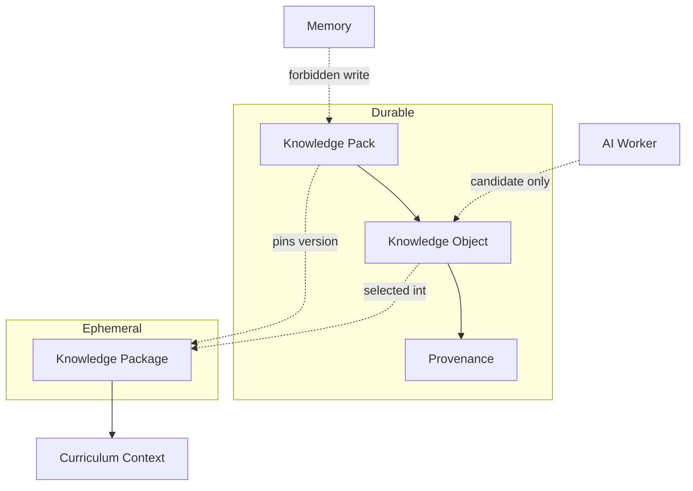
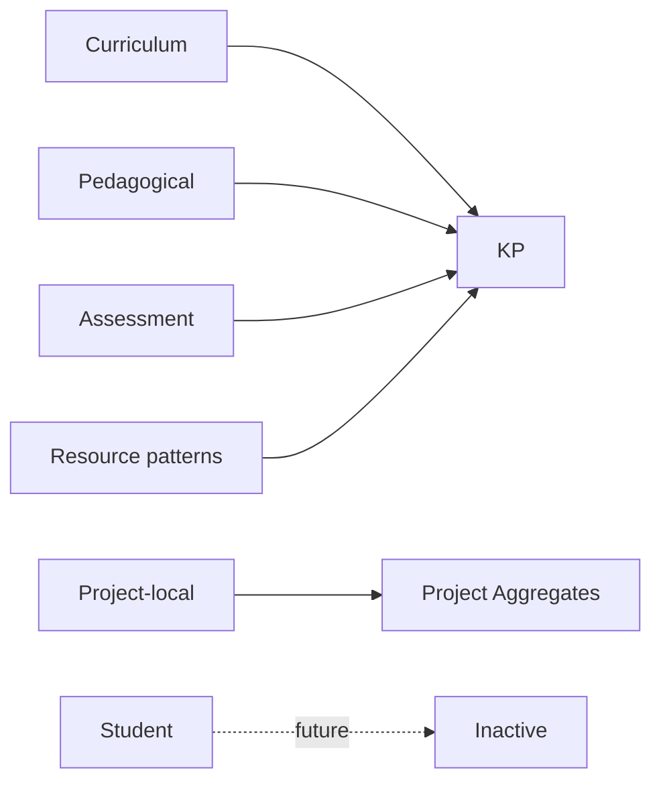
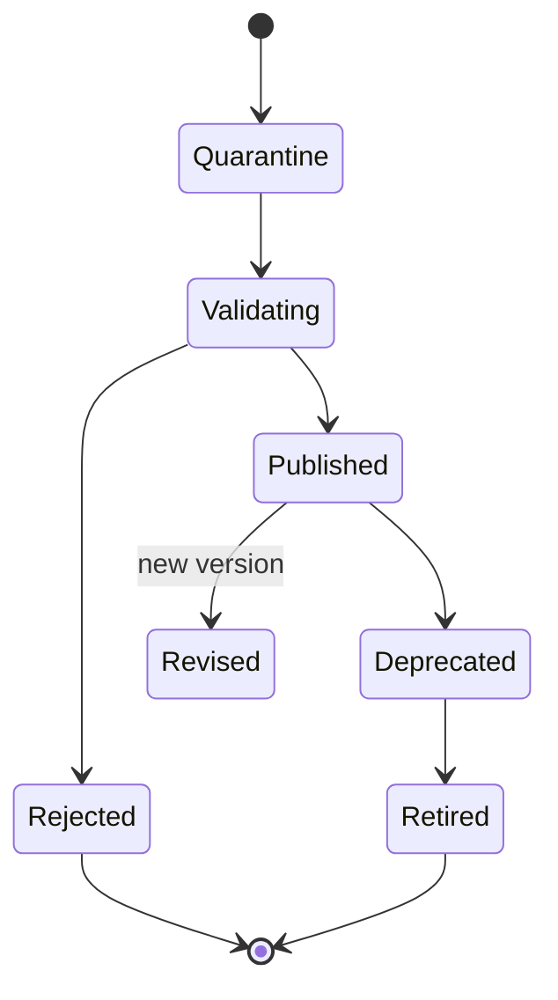

# ES-008 — Canonical Knowledge Model

**Version:** 1.0  
**Status:** Official — Constitutional Knowledge artifact for the Educational Operating System  
**Typed form:** `@prima/contracts` → `PrimaKnowledge*` types  
**Non-goal:** This specification does **not** implement the Knowledge Engine (ENG-02).

> Knowledge is **structured, versioned, explainable, traceable, reusable, and source-aware**.  
> Knowledge is **separated from AI models** — models are workers; Knowledge Packs are authority.  
> **Knowledge ≠ Memory ≠ Context ≠ Reasoning.**  
> **PAS family:** Platform Knowledge Architecture is consolidated in [`PAS-004_PRIMA_KNOWLEDGE_ARCHITECTURE.md`](./PAS-004_PRIMA_KNOWLEDGE_ARCHITECTURE.md) (**PAS-004**). This document remains the Canonical Knowledge Model (units, KD-*, typed contracts).

**Precedence**

| Concern | Authority |
|---------|-----------|
| EOS Knowledge domains, units, governance for execution | **This document (ES-008)** |
| Broader enterprise knowledge philosophy / quality essays | [`PRIMA_KNOWLEDGE_MODEL.md`](../product/PRIMA_KNOWLEDGE_MODEL.md) — align; on EOS unit/domain identity conflict, **ES-008 prevails** after Product confirmation |
| Runtime assembly behaviour | Knowledge Engine (ENG-02) — implements this model later |

---

# 1. Canonical Knowledge Model

## 1.1 Core units (constitutional)

| Unit | Kind | Meaning |
|------|------|---------|
| **Knowledge Object** | Durable entity | Atomic attributable claim or curriculum node with provenance |
| **Knowledge Pack** | Durable aggregate | Versioned curated release of Objects (publish/deprecate) |
| **Knowledge Package** | Ephemeral VO | Assembled evidence slice for one cognitive act (Context Curriculum dim) |
| **Provenance Record** | Value | Citation of Object/Pack version + source |
| **Unsupported Mark** | Value | Explicit “no evidence” — never silently invent |

## 1.2 Hard separations

| Must not conflate | Why |
|-------------------|-----|
| Knowledge vs Memory | Memory is Teacher-controlled advisory personalization |
| Knowledge vs Context | Context is situational binding *now* |
| Knowledge Pack vs Knowledge Package | Pack = corpus release; Package = act-scoped assembly |
| Knowledge vs AI parametric weights | Models never redefine curriculum authority |
| Knowledge vs Generated Resources | Resources are realizations under Approval, not Knowledge |

## 1.3 Trust levels

| Level | Meaning | Example |
|-------|---------|---------|
| **Authoritative** | Curated, published, provenance-complete | Official curriculum Pack |
| **Derived** | Computed from Authoritative with lineage | Competency graph projection |
| **Advisory** | Useful but non-binding | Methodological tips Pack |
| **Generated-candidate** | AI-proposed; **not** Knowledge until curated publish | Draft Object pending Governance |
| **Untrusted** | External import not yet validated | Raw upload quarantine |

---

# 2. Knowledge Catalog (domains)

IDs use `KD-*`.

| ID | Domain | Maturity |
|----|--------|----------|
| **KD-01** | Curriculum Knowledge | MVP |
| **KD-02** | Pedagogical Knowledge | MVP |
| **KD-03** | Assessment Knowledge | MVP (design stance; not Student scores) |
| **KD-04** | Methodological Knowledge | MVP / thin |
| **KD-05** | Institutional Knowledge | Thin / Future-ready |
| **KD-06** | Legal Knowledge | Thin (platform policies) |
| **KD-07** | Resource Knowledge | MVP (patterns, not instance Resources) |
| **KD-08** | Teacher Knowledge | **Not in Knowledge Packs** — lives as Memory/Teacher profile; domain reserved for *shared* teacher-craft patterns only if curated |
| **KD-09** | Project Knowledge | Project-local design facts — **not** Knowledge Pack authority; tracked as Project artifacts |
| **KD-10** | Student Knowledge | **Future — inactive** |
| **KD-11** | School Knowledge | Thin / Future |
| **KD-12** | AI Knowledge | Worker capability catalogs — **not** curriculum |
| **KD-13** | Operational Knowledge | Runbooks, Engine health playbooks |
| **KD-14** | Platform Knowledge | EOS/PAS constitutional docs as governed Packs (meta) |
| **KD-15** | Plugin Knowledge | Future Extension Host catalogs |

---

# 3. Domain specifications

Legend — **Trust:** default trust · **Update:** how changes enter

---

### KD-01 — Curriculum Knowledge

| Field | Content |
|-------|---------|
| **Purpose** | Subjects, competencies, objectives, standards alignments |
| **Owner** | Knowledge Domain / Curriculum stewards |
| **Source** | Official curriculum corpora; curated imports |
| **Validation** | Provenance mandatory; competency refs resolvable (POL-040) |
| **Versioning** | Knowledge Pack semver / immutable versions |
| **Lifecycle** | Import → Validate → Publish → Revise → Deprecate |
| **Trust Level** | Authoritative |
| **Update Strategy** | Governance publish only; no Engine silent mutation |

---

### KD-02 — Pedagogical Knowledge

| Field | Content |
|-------|---------|
| **Purpose** | Instructional approaches, activity pattern families, differentiation principles |
| **Owner** | Pedagogy stewards + Knowledge Domain |
| **Source** | Curated frameworks; methodological literature |
| **Validation** | Must not prescribe Teacher Approval |
| **Versioning** | Pack versions |
| **Lifecycle** | Same as Pack lifecycle |
| **Trust Level** | Authoritative or Advisory (declared per Pack) |
| **Update Strategy** | Curated revision; Strategy Engine consumes, does not write |

---

### KD-03 — Assessment Knowledge

| Field | Content |
|-------|---------|
| **Purpose** | Assessment *design* patterns, rubrics templates, formative/summative stances |
| **Owner** | Pedagogy / Assessment design stewards |
| **Source** | Curated Packs |
| **Validation** | No individual Student performance data |
| **Versioning** | Pack versions |
| **Lifecycle** | Pack lifecycle |
| **Trust Level** | Authoritative / Advisory |
| **Update Strategy** | Curated; Assessment Resource instances ∈ Generation, not Knowledge |

---

### KD-04 — Methodological Knowledge

| Field | Content |
|-------|---------|
| **Purpose** | How-to patterns for instructional design workflows |
| **Owner** | Product pedagogy + Knowledge |
| **Source** | Internal methodology Packs |
| **Validation** | Non-binding unless marked Authoritative |
| **Versioning** | Pack versions |
| **Lifecycle** | Pack lifecycle |
| **Trust Level** | Advisory (default) |
| **Update Strategy** | Product-led revision |

---

### KD-05 — Institutional Knowledge

| Field | Content |
|-------|---------|
| **Purpose** | School/district policy adjacency knowledge |
| **Owner** | Platform Governance + institution |
| **Source** | Tenant configuration; future integrations |
| **Validation** | No invention of school rules (align POL-041) |
| **Versioning** | Tenant-scoped Pack or config versions |
| **Lifecycle** | Import/validate/publish per tenant |
| **Trust Level** | Authoritative within tenant |
| **Update Strategy** | Admin publish |

---

### KD-06 — Legal Knowledge

| Field | Content |
|-------|---------|
| **Purpose** | Platform legal/compliance constraints relevant to design (e.g. data rules) |
| **Owner** | Governance / Legal |
| **Source** | Policy Packs |
| **Validation** | Legal review gate before Authoritative |
| **Versioning** | Strict Pack versions |
| **Lifecycle** | Controlled publish/retire |
| **Trust Level** | Authoritative |
| **Update Strategy** | Legal-approved only |

---

### KD-07 — Resource Knowledge

| Field | Content |
|-------|---------|
| **Purpose** | Reusable resource *patterns* and format constraints (not Teacher Resources) |
| **Owner** | Generation methodology + Knowledge |
| **Source** | Pattern Packs |
| **Validation** | Distinct from Resource aggregates |
| **Versioning** | Pack versions |
| **Lifecycle** | Pack lifecycle |
| **Trust Level** | Advisory / Authoritative patterns |
| **Update Strategy** | Curated |

---

### KD-08 — Teacher Knowledge

| Field | Content |
|-------|---------|
| **Purpose** | Shared, curated teacher-craft patterns (optional Packs) — **not** personal Memory |
| **Owner** | Knowledge stewards (if published); else **out of Knowledge** |
| **Source** | Opt-in curated contributions |
| **Validation** | Teacher personal prefs → Memory Engine, never Knowledge Pack |
| **Versioning** | Pack if curated |
| **Lifecycle** | Explicit publish only |
| **Trust Level** | Advisory |
| **Update Strategy** | Curated; personal → Memory |

---

### KD-09 — Project Knowledge

| Field | Content |
|-------|---------|
| **Purpose** | Facts true *inside a Project* (local design decisions) |
| **Owner** | Project Continuity / design aggregates |
| **Source** | Project, Blueprint, Understanding |
| **Validation** | **Not** a Knowledge Pack; not curriculum authority |
| **Versioning** | Aggregate versions |
| **Lifecycle** | Project lifecycle |
| **Trust Level** | Project-local authoritative |
| **Update Strategy** | Teacher + design pipeline |

---

### KD-10 — Student Knowledge (Future)

| Field | Content |
|-------|---------|
| **Purpose** | Individual learner knowledge — **inactive** |
| **Owner** | Future Student Workspace |
| **Validation** | Must not appear in MVP Packs or Packages |
| **Trust Level** | Restricted |
| **Update Strategy** | Constitutional amendment required |

---

### KD-11 — School Knowledge

| Field | Content |
|-------|---------|
| **Purpose** | School identity, calendars, structural facts |
| **Owner** | Governance / School admin |
| **Source** | Integrations |
| **Validation** | No invention |
| **Versioning** | Tenant versions |
| **Lifecycle** | Import/publish |
| **Trust Level** | Authoritative within school |
| **Update Strategy** | Admin |

---

### KD-12 — AI Knowledge

| Field | Content |
|-------|---------|
| **Purpose** | Model/worker capability catalogs, safety policy refs |
| **Owner** | Platform Engineering |
| **Source** | Config / worker manifests |
| **Validation** | Never overrides Curriculum Packs |
| **Versioning** | Config/worker versions |
| **Lifecycle** | Deploy-time |
| **Trust Level** | Operational |
| **Update Strategy** | Engineering release |

---

### KD-13 — Operational Knowledge

| Field | Content |
|-------|---------|
| **Purpose** | Runbooks, Engine recovery playbooks |
| **Owner** | Platform Ops |
| **Source** | Internal docs Packs |
| **Validation** | Ops review |
| **Versioning** | Doc/Pack versions |
| **Lifecycle** | Publish/retire |
| **Trust Level** | Advisory / Operational |
| **Update Strategy** | Ops |

---

### KD-14 — Platform Knowledge

| Field | Content |
|-------|---------|
| **Purpose** | Constitutional/PAS knowledge as governed reference Packs (meta-knowledge) |
| **Owner** | Architecture |
| **Source** | docs/product, docs/engineering |
| **Validation** | Architecture Change process |
| **Versioning** | Doc versions / Pack mirrors |
| **Lifecycle** | As constitutional docs |
| **Trust Level** | Authoritative (process) |
| **Update Strategy** | POSS/PAS/PDC change control |

---

### KD-15 — Plugin Knowledge

| Field | Content |
|-------|---------|
| **Purpose** | Plugin capability and constraint catalogs |
| **Owner** | Extension Host |
| **Source** | Plugin manifests |
| **Validation** | Policy admission |
| **Versioning** | Plugin semver |
| **Lifecycle** | Register/deprecate |
| **Trust Level** | Untrusted until admitted → Advisory |
| **Update Strategy** | Plugin publish + Governance |

---

# 4. Relationships (Knowledge Graph)

```
KnowledgePack --contains--> KnowledgeObject
KnowledgeObject --cites--> ProvenanceRecord
KnowledgeObject --relates--> KnowledgeObject (depends-on | specializes | references)
KnowledgePackage --selects--> KnowledgeObject (via Pack version)
KnowledgePackage --pins--> KnowledgePackVersion
CurriculumContext --binds--> KnowledgePackage
Strategy/Blueprint --references--> KnowledgePackage (by id)
Memory --must-not-write--> KnowledgePack
AI Worker --must-not-author--> KnowledgePack (only Generated-candidate)
```

| Relation | Meaning |
|----------|---------|
| **Composition** | Pack composed of Objects |
| **Inheritance/specialization** | Object specializes another (optional graph edge) |
| **Dependency** | Object requires another for validity |
| **Reference** | Soft cite without hard dependency |
| **Assembly** | Package selects Objects for one act |

---

# 5. Governance

| Concern | Rule |
|---------|------|
| **Ownership** | Every Pack has Steward + Domain (KD-*) |
| **Approval** | Publish requires Governance (SVC-11); Teachers do not publish curriculum |
| **Validation** | Provenance + schema + trust level gates |
| **Deprecation** | Pack `Deprecated` — still readable for old Blueprints; not for new assemblies |
| **Retirement** | `Retired` — no new reads except audit |
| **Evolution** | New immutable version; never mutate published version (POL-070 style) |

---

# 6. Lifecycle

```
Creation / Import → Quarantine (Untrusted)
  → Validation → (fail: Reject)
  → Publication (Authoritative/Advisory)
  → Revision (new version)
  → Deprecation
  → Archiving / Retirement
```

Generated-candidate Objects enter Quarantine until curated.

---

# 7. Classification taxonomy

| Axis | Values |
|------|--------|
| **Structure** | Structured · Semi-Structured · Unstructured |
| **Origin** | Imported · Curated · Generated-candidate · Derived |
| **Authority** | Authoritative · Advisory · Operational · Untrusted |
| **Scope** | Global · Tenant/School · Pack · Act (Package) · Project-local (KD-09) |

---

# 8. Mermaid diagrams







---

# 9. Testing strategy

| Test | Intent |
|------|--------|
| Integrity | Pack version immutability; provenance required |
| Consistency | Object ids resolve; no Memory→Pack writes |
| Governance | Unpublished Objects excluded from Package assembly |
| Versioning | Pin Pack version in Package |
| Compatibility | schemaVersion on Packs |
| Separation | Student Knowledge absent in MVP validators |

Typed helpers in `@prima/contracts` support unit tests without ENG-02.

---

# 10. Architecture validation

| Criterion | Result |
|-----------|--------|
| Scalability | Domains and Packs independently versioned |
| Maintainability | Clear Pack vs Package vs Project-local |
| Knowledge integrity | Provenance + trust levels + quarantine |
| Future readiness | Student/Plugin domains reserved |

**Verdict:** ES-008 is the constitutional Knowledge definition for PRIMA EOS.

---

# Deliverable index

1. Canonical Knowledge Model — §1  
2. Knowledge Catalog — §2–§3  
3. Taxonomy — §7  
4. Governance — §5  
5. Lifecycle — §6  
6. Mermaid — §8  
7. Testing — §9  
8. Validation — §10  
