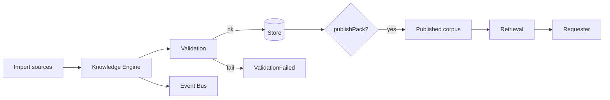
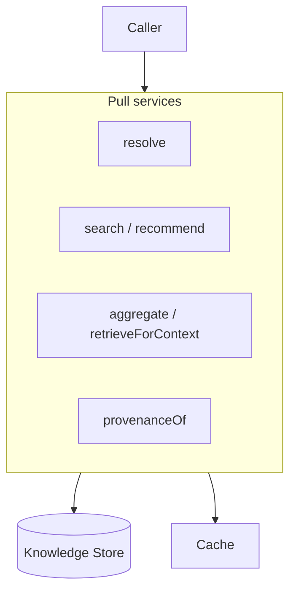
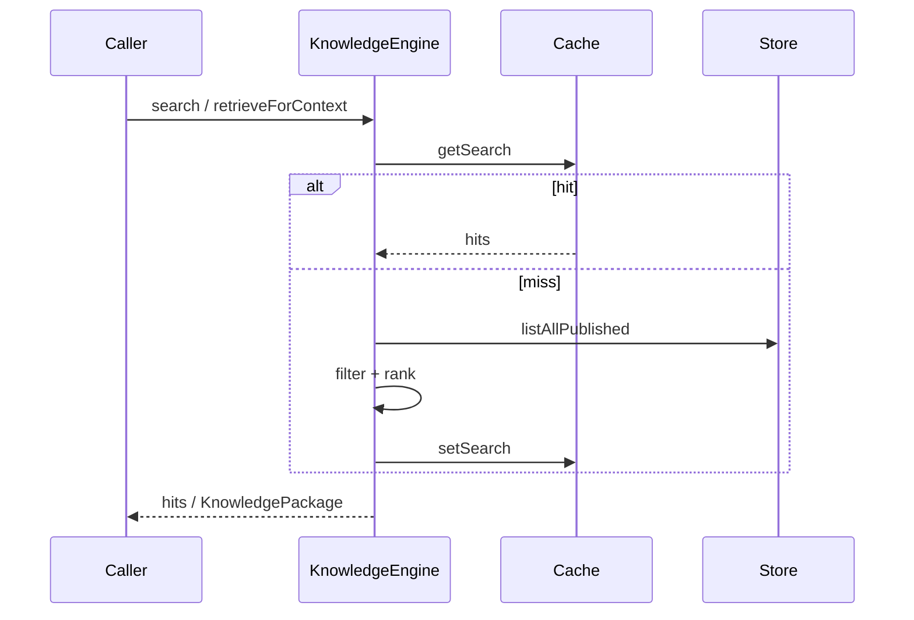
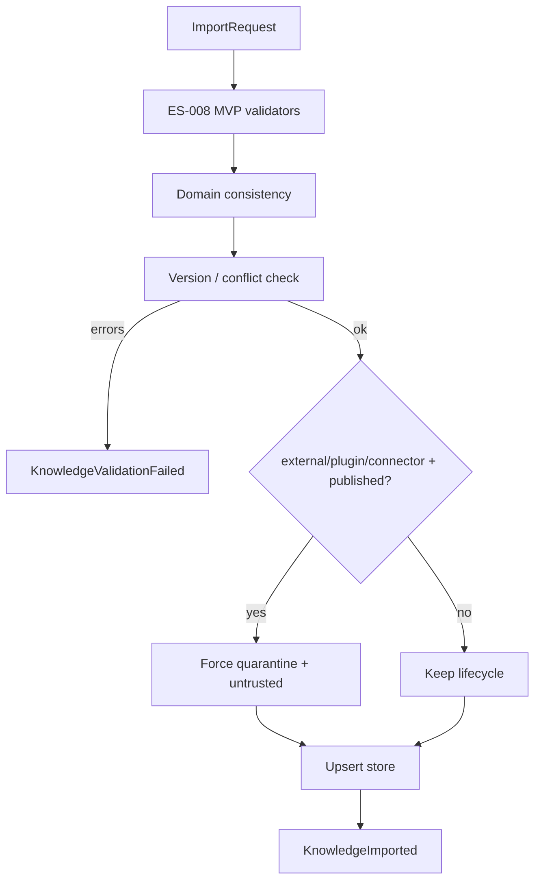

# ES-009 — Knowledge Engine (ENG-02)

**Package:** `@prima/engine-knowledge`  
**Constitutional code:** ENG-02  
**Implements:** Engine SDK (`BasePrimaEngine`) + ES-008 Knowledge Model  

> Knowledge is **requested** (pull). Knowledge is **never pushed**.  
> The Engine **never decides** pedagogy and **never generates** educational resources.  
> It validates sources and serves attributable evidence as a service.

---

# 1. Knowledge Engine Design

## 1.1 Mission

Acquire, organize, validate, and serve knowledge for PRIMA. Provide knowledge as a service to Orchestration and peer Engines via pull APIs and Events — never via proactive pedagogical push.

## 1.2 Responsibilities

| In scope | Out of scope |
|----------|--------------|
| Import (manual / automatic / plugin / external / connector) | Pedagogical reasoning |
| Source, version, consistency validation | Strategy / Blueprint / Generation |
| Conflict detection | Approval / Authorization / Export |
| Publish / deprecate / retire Pack lifecycle | Memory writes |
| Lookup, search, ranking, context-hint retrieval | Student personalization as knowledge |
| Resolve · Aggregate Packages · Provenance · Recommend (ranked hits only) | Peer Engine invocation |
| Hot/cold cache + invalidation | Deciding what the Teacher should do |

## 1.3 Capabilities

Declared on `KNOWLEDGE_ENGINE_MANIFEST`:

- `knowledge.import`
- `knowledge.validate`
- `knowledge.search`
- `knowledge.resolve`
- `knowledge.aggregate`
- `knowledge.provenance`

Features: lexical search · optional `SemanticSearchPort` · hot/cold cache.

## 1.4 Dependencies

| Dependency | Nature |
|------------|--------|
| `@prima/contracts` | Model + Engine API types |
| `@prima/engine-sdk` | `BasePrimaEngine` |
| `@prima/event-bus` (optional) | Publish Engine events |
| Peer Engines | **None** — isolation |
| Persistence | `InMemoryKnowledgeStore` today; Infrastructure Port later |
| Semantic search | Optional Port — not in-process |

---

# 2. Knowledge Acquisition

| Source | Contract `source` | Landing behaviour |
|--------|-------------------|-------------------|
| Manual Import | `manual` | Validate → store as declared lifecycle |
| Automatic Import | `automatic` | Same pipeline as manual |
| Plugin Import | `plugin` | If claimed `published` → remap to `quarantine` + `untrusted` |
| External Sources | `external` | Same quarantine remap |
| Future Connectors | `connector` | Same quarantine remap; steward must `publishPack` |

API: `importKnowledge(KnowledgeImportRequest) → KnowledgeImportResult`.

Quarantined packs are **not** searchable until `publishPack` succeeds after re-validation.

---

# 3. Knowledge Validation

## 3.1 Source Validation

- ES-008 MVP validators (`validateKnowledgePackMvp`, `validateKnowledgeObjectMvp`)
- Student domain forbidden
- Published + untrusted forbidden
- Pack `objectIds` must have payloads

## 3.2 Version Validation

- Pack identity is `(packId, version)`
- Same-version payload conflict → error `IMPORT_SAME_VERSION_CONFLICT`
- Cross-version payload change → conflict event (allowed; new version expected)

## 3.3 Consistency Validation

- Object domain must match pack domain (unless pack domain is `platform`)
- Provenance required on objects for complete Package assemblies

## 3.4 Conflict Resolution

- Engine **detects**; does not silently merge
- Emits `KnowledgeConflictDetected`
- Same-version conflicts fail closed
- Steward publishes a new version or corrects import

---

# 4. Retrieval Pipeline

```
Query
  → optional SemanticSearchPort (if enabled + injected)
  → Cache lookup (search key)
  → Corpora = published packs (or exact pack/version)
  → Filter (domain, trust, tags-via-payload, readability)
  → Lexical + context-hint scoring
  → Rank (desc) → Limit
  → Cache store → Hits
```

**Context-aware retrieval** uses `contextHints` (subject, gradeBand, projectId) as **ranking signals only** — never decisions.

`retrieveForContext` = `search` → `aggregate` → `KnowledgePackage` (or `unsupportedMarked: true`).

---

# 5. Knowledge Services

| Service | Method | Notes |
|---------|--------|-------|
| Resolution | `resolve` | By objectId (+ optional pack pin) |
| Aggregation | `aggregate` / `retrieveForContext` | Ephemeral Package; pins versions |
| Recommendations | `recommend` | Ranked advisory/authoritative hits — not decisions |
| Provenance | `provenanceOf` | Immutable records from ES-008 |

---

# 6. Caching

| Tier | Role |
|------|------|
| Hot | Short TTL; frequent search/package results |
| Cold | Longer TTL; demoted from hot on eviction |
| Distributed | Future Infrastructure Port — not in Engine |
| Invalidation | On import / publish / deprecate / retire / explicit `invalidateCache` |

`invalidatePack` clears pack-scoped keys and all `search:` / `pkg:` aggregates.

---

# 7. Event Catalog

| Event | When |
|-------|------|
| `KnowledgeImported` | Successful store after validation |
| `KnowledgeUpdated` | Lifecycle/content update (e.g. publish) |
| `KnowledgeValidated` | Import passed validation |
| `KnowledgeValidationFailed` | Import rejected |
| `KnowledgePublished` | Quarantine/draft → published |
| `KnowledgeDeprecated` | Marked deprecated |
| `KnowledgeRetired` | Marked retired |
| `KnowledgeResolved` | Object resolved for a caller |
| `KnowledgePackageAssembled` | Package built |
| `KnowledgeUnsupportedMarked` | Empty evidence for request |
| `KnowledgeCacheInvalidated` | Cache cleared |
| `KnowledgeConflictDetected` | Version/payload conflict observed |

Events are optional (no bus → silent). Delivery via platform Event Bus only.

---

# 8. Mermaid Diagrams

## 8.1 Knowledge Flow



## 8.2 Knowledge Services



## 8.3 Retrieval Pipeline



## 8.4 Validation Pipeline



---

# 9. Testing Strategy

| Area | Coverage |
|------|----------|
| Retrieval | Lexical search, context hints, empty → unsupported |
| Consistency | Student domain rejected; same-version conflict |
| Performance | Cache hit path; bounded limit |
| Caching | Hit after miss; invalidate after import/deprecate |
| Failure recovery | External quarantine until publish; Engine contract suite |

**Command:** `npm run test:knowledge`

---

# 10. Architecture Validation

| Criterion | Status |
|-----------|--------|
| Isolation | No peer Engine deps; no pedagogy |
| Scalability | Store/cache/semantic Ports replaceable |
| Replaceability | `InMemoryKnowledgeStore` / `KnowledgeCache` / `SemanticSearchPort` injectable |
| Performance | Hot/cold cache; ranked limit |
| Cloud readiness | Persistence + distributed cache as future Infrastructure Ports; Engine stays technology-independent |

---

# 11. Composition

Composition Root constructs `createKnowledgeEngine({ eventBus, store?, cache?, semanticSearch? })`, registers with EOS Kernel as ENG-02. Application Layer pulls knowledge via Commands/Queries — Engines never push knowledge into Teacher UX.

---

# 12. Implementation map

| Concern | Location |
|---------|----------|
| Engine | `packages/engines/knowledge/src/knowledge-engine.ts` |
| Store | `store.ts` |
| Validation | `validation.ts` |
| Retrieval | `retrieval.ts` |
| Cache | `cache.ts` |
| Manifest | `manifest.ts` |
| Contracts | `packages/contracts/src/knowledge-engine.ts` |
| Tests | `src/tests/knowledge-engine.test.ts` |
