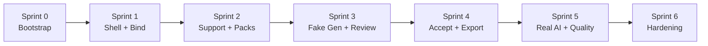

# PRIMA Adapt™  
# Engineering Implementation Blueprint

**Module:** PRIMA Adapt™  
**Document type:** Implementation Plan / Tech Lead Sprint Guide  
**Companions:**  
- [PRODUCT-ADAPT-001](../product/PRIMA_ADAPT_PRODUCT_DEFINITION.md)  
- [UX-ADAPT-001](../design/PRIMA_ADAPT_UX_SPECIFICATION.md)  
- [ARCH-ADAPT-001](./ARCH-ADAPT-001_PRIMA_ADAPT_SOFTWARE_ARCHITECTURE.md)  

**Stack constraints:** React · TypeScript · Vite · React Router · feature-first `src/features/*` · workspace packages (`@prima/*`)

**Lead rule:** Ship a **vertical slice** every sprint that a teacher can click through. Prefer Fake AI + fixtures over blocked “waiting on model” sprints.

---

## Document control

| Item | Value |
|------|--------|
| Sprint length assumption | 2 weeks (adjust locally; keep milestone order) |
| Definition of “production-ready from Sprint 1” | Routable module · wizard shell · dual-value Entry · resource bind · draft persist · no dead ends · a11y baseline · tests for session machine |
| Dual Value Test | Every milestone must reduce teacher workload **and** improve learning access (UX Absolute) |

---

# 1. Feature Breakdown (Milestones)

## 1.1 Roadmap overview



## 1.2 Sprint 0 — Bootstrap (3–5 days, parallelizable)

**Goal:** Empty module mounts without breaking the app.

| Deliverable | Notes |
|-------------|--------|
| Feature package skeleton `src/features/adapt` | Per §2 order |
| Contracts stubs `@prima/contracts` adapt namespace | Command/event names only |
| Routes registered lazy in app shell | `/adapt`, `/adapt/new`, `/adapt/sessions/:id` |
| Composition Root hooks placeholders | Fake ports registered |
| README linking PRODUCT / UX / ARCH / this IMPL | Onboarding |

**Exit:** Visiting `/adapt` shows Entry placeholder with design tokens — no console errors.

## 1.3 Sprint 1 — Core navigation, Entry, Wizard shell, Resource bind

**Production-ready slice:** Teacher opens Adapt → picks a resource → draft session saved → can leave and resume.

| Epic | Includes |
|------|----------|
| Session shell | `AdaptSessionLayout`, step rail (6 beats), footer |
| Entry | Dual-value hero, resume drafts list |
| Resource selection | Picker, chips, preview, confirm |
| Session store + machine | Steps 1–2 transitions only |
| Persistence v1 | Local draft store (IndexedDB/localStorage abstraction) |
| Deep link | `?resourceId=` preselect |
| Atelier entry point | Create/action card → `/adapt/new` |

**Explicitly out:** Real AI, export, support presets CRUD, pack refine.

**DoD:** §13 checklist for Entry + Resource + Shell.

## 1.4 Sprint 2 — Support (skip-default) + Adaptation Packs

**Slice:** Teacher continues with inclusive defaults **or** chips → selects one pack → ready to generate (button enabled, generation stubbed).

| Epic | Includes |
|------|----------|
| Support path chooser | Standard inclusiv primary; personalize secondary |
| Suggestion chips | Max 6; ≤2 recommended |
| Pack grid | 3 packs + recommended edge |
| Refine panel | Collapsed fine-grain types |
| Catalog services | Pack/type static catalog |
| Machine | Steps 3–4 |

**Out:** Generation, review, export.

## 1.5 Sprint 3 — Planning UX + Fake Adaptation Engine + Review & Compare

**Slice:** Teacher clicks prepare → calm planning → fixture-adapted versions → review/compare → can Accept (flag only).

| Epic | Includes |
|------|----------|
| Planning screen | Messages, cancel, progress |
| `@prima/engine-adapt` skeleton | Manifest + `generate()` with **FakeAiPort** |
| Fixture transformer | Deterministic adapted content from source |
| Comparator stub | ChangeSet from fixtures |
| Review UI | Proof strip, panes, change list, decisions |
| Commands | `StartAdaptationGeneration`, `CancelGeneration` |
| Machine | `generating` → `ready` |

**Out:** Live LLM; PDF export; Library materialization optional stub.

## 1.6 Sprint 4 — Accept, Export & Use, Library/Lesson attach

**Slice:** Accept version → classroom destinations → completion.

| Epic | Includes |
|------|----------|
| Accept command | Materialize adapted resource clone |
| Export service | PDF + attach-to-lesson + library save |
| Advanced formats | Collapsed stubs or “În curând” |
| Export jobs | Status, retry, partial failure |
| Analytics v1 | Funnel events (privacy-safe) |
| Entry points | Library “Adaptează”, Studio toolbar |

## 1.7 Sprint 5 — Real AI orchestration + Validators

**Slice:** Fake port swap → real AI worker; pedagogical + accessibility validators; richer diffs.

| Epic | Includes |
|------|----------|
| Prompt + Context builders | Engine-internal |
| Resource analyzer | Signals for recommendations |
| Real `AdaptationAiPort` adapter | Behind Composition Root |
| Pedagogical + Accessibility validators | Reports into ReviewReport |
| Quality checker | Structural sanity |
| Recommendation engine | Pack/chip suggestions |
| Streaming optional | If provider supports; UI already async |

## 1.8 Sprint 6 — Performance, resilience, polish, release candidate

| Epic | Includes |
|------|----------|
| Autosave conflict handling | Revision checks |
| Offline draft buffer | Online gate for gen/export |
| Caching | Content-hash + pack fingerprint |
| a11y audit | Full keyboard path |
| Load testing fixtures | Large worksheets |
| Docs + runbooks | On-call notes for AI/export failures |
| Regression suite | Golden session paths |

## 1.9 Mapping vs the example roadmap

| Example ask | This plan |
|-------------|-----------|
| Sprint 1 Dashboard/Wizard | Sprint 1 Entry + Shell + Resource (no fake “dashboard”) |
| Sprint 2 Profiles/Planner/Preview | Sprint 2 Support+Packs; Preview moves to Sprint 3 Review |
| Sprint 3 AI/Compare/Validation | Sprint 3 Fake; Sprint 5 Real AI + validators |
| Sprint 4 Export/Analytics/Perf/Test | Sprint 4 Export; Sprint 6 Perf/hardening; tests continuous |

---

# 2. Folder Creation Order

Create **contracts and feature spine first**, then domain/engine, then UI slices in UX order. Why: prevents UI importing ghosts and keeps Composition Root honest.

### Order (exact)

1. `packages/contracts/src/adapt/` — shared command/event names & DTO shapes  
2. `src/features/adapt/README.md` — links to PRODUCT/UX/ARCH/IMPL  
3. `src/features/adapt/types/` — view-models only  
4. `src/features/adapt/session/` — store, machine, layout components  
5. `src/features/adapt/routes` registration point  
6. `src/features/adapt/entry/`  
7. `src/features/adapt/resource-selection/`  
8. `src/features/adapt/support/`  
9. `src/features/adapt/packs/`  
10. `src/features/adapt/planning/`  
11. `src/features/adapt/review/`  
12. `src/features/adapt/export/`  
13. `src/features/adapt/shared/` — empties, errors, explainability  
14. `src/features/adapt/application/` — thin command dispatch adapters  
15. `packages/domain/.../adapt/` — aggregates & policies  
16. `packages/engines/adapt/` — engine package + tests  
17. `infrastructure/persistence/adapt/`  
18. `infrastructure/workers/adapt-ai/`  
19. `infrastructure/workers/adapt-export/`  
20. `src/features/adapt/assets/` — illustrations last (optional)

### Why this order

| Early | Late |
|-------|------|
| Types + session machine unblock all UI | Workers need stable ports |
| Entry/Resource prove routing & deep links | AI must not gate the first shippable slice |
| Domain before real engine logic | Assets never block logic |

**Do not** create a flat `components/` dumping ground at the feature root. Prefer slice-local `components/` per ARCH-ADAPT-001.

---

# 3. Component Build Order

Build **shell → bind → decide → generate → review → export**.

Legend: **R** reusable outside Adapt · **A** Adapt-only · Complexity **S/M/L** · Priority **P0–P2**

| # | Component | Purpose | Dependencies | R? | Cx | Pri |
|---|-----------|---------|--------------|----|----|-----|
| 1 | `AdaptSessionLayout` | Wizard chrome | Router outlet, design tokens | A | M | P0 |
| 2 | `AdaptStepRail` | 6-beat progress | Session step | A | S | P0 |
| 3 | `AdaptFooterActions` | Back / primary / draft | Session guards | A | S | P0 |
| 4 | `AdaptEntryHero` | Dual-value start | — | A | S | P0 |
| 5 | `AdaptDraftResumeList` | Resume drafts | Session query | A | S | P0 |
| 6 | `ResourceTypeChips` | Filter types | Catalog constants | A | S | P0 |
| 7 | `ResourceCard` | Select resource | Project/Library DTO | A | S | P0 |
| 8 | `ResourcePicker` | Grid + search | Cards, chips | A | M | P0 |
| 9 | `ResourcePreviewPanel` | Confirm understanding | Selected resource | A | M | P0 |
| 10 | `ResourceConfirmBar` | Bind CTA | Selection | A | S | P0 |
| 11 | `SupportPathChooser` | Skip-default vs personalize | — | A | S | P0 |
| 12 | `SupportSuggestionChips` | Optional supports | Recommendations optional | A | M | P0 |
| 13 | `AdaptationPackCard` | One pack outcome | Pack catalog | A | S | P0 |
| 14 | `AdaptationPackGrid` | Choose pack | Cards | A | S | P0 |
| 15 | `AdaptationRefinePanel` | Advanced types | Type catalog | A | M | P1 |
| 16 | `AdaptationPlannerStatus` | Calm waiting | Generation status | A | M | P0 |
| 17 | `PedagogyProofStrip` | Objectives/supports/access | ReviewReport | A | S | P0 |
| 18 | `ComparisonPanel` | Original vs Adapted | Versions | A | L | P0 |
| 19 | `ChangeSummaryList` | Human diffs | ChangeSet | A | M | P0 |
| 20 | `ReviewDecisionBar` | Accept/Edit/… | Session status | A | S | P0 |
| 21 | `ExportDestinationGrid` | Classroom-first export | Dest catalog | A | M | P0 |
| 22 | `ExportJobStatus` | Job progress | Export jobs | A | M | P1 |
| 23 | `AdaptCompletionPanel` | Done next steps | — | A | S | P0 |
| 24 | `ExplainabilityBlock` | Why/Benefit/Trade-off | Plan/changeset | A | S | P1 |
| 25 | `AdaptEmptyState` / `AdaptErrorPanel` | Recovery UX | — | A | S | P0 |
| 26 | Design-system Button/Card/Chip/Toast | Primitives | Existing DS | **R** | — | P0 |

**Rule:** Do not build Comparison before Fake generation exists (use fixtures if UI needs parallelization).

---

# 4. Routing Strategy

## 4.1 Route table

| Path | Screen / behavior |
|------|-------------------|
| `/adapt` | Entry (start + resume) |
| `/adapt/new` | Create session → redirect to `/adapt/sessions/:id` at step Resource (or Support if `resourceId` provided) |
| `/adapt/new?resourceId=` | Bind resource immediately |
| `/adapt/new?objectId=` | Studio object bind |
| `/adapt/sessions/:sessionId` | Session shell; step from store |
| `/adapt/sessions/:sessionId/resource` | Optional explicit step URLs (recommended for deep links/tests) |
| `.../support` | Step 3 |
| `.../pack` | Step 4 |
| `.../planning` | Step 5 (generating/ready splash) |
| `.../review` | Step 6 Review & Compare |
| `.../export` | Export & Use (only if accepted) |

**Avoid** orphan routes like `/adapt/profile` as a primary flow (support is a step, not a mini-app). Profile **management** (CRUD presets) may be `/adapt/presets` later — P2.

## 4.2 Navigation rules

1. Step URLs sync from session machine (source of truth = store, URL is projection).  
2. Guard: cannot open `/export` unless `status === accepted`.  
3. Guard: `/planning` while `generating`; if `ready`, bounce to `/review`.  
4. Back uses machine transition, not only `history.back()`, to avoid illegal states.  
5. Library/Studio entry uses `/adapt/new?...` then replace to session URL.

## 4.3 App shell integration

- Lazy `React.lazy` / dynamic import for `features/adapt`.  
- Atelier card + Library action + Studio menu register navigations only — no Adapt logic outside feature.

---

# 5. State Strategy

## 5.1 Layers

| Layer | Holds | Lifetime |
|-------|-------|----------|
| **Wizard / Session state** | step, status, pack, support, versions, report | Per `sessionId` |
| **Draft state** | Serializable session snapshot | Persisted |
| **UI local state** | search, drawers, refine open | Ephemeral |
| **Derived** | `canContinue`, recommended pack, proof flags | Selectors |
| **Server truth** | After Accept/Export artifacts | Backend/repo |

## 5.2 Autosave

- Debounce 300–500ms after: bind resource, support change, pack change, accept.  
- Save revision++ ; show quiet failure toast + retry queue.  
- Do **not** autosave partial streaming tokens as accepted content.

## 5.3 History / Undo / Reset

| Action | Behavior |
|--------|----------|
| Undo discard version | Restore previous `versions[]` snapshot (60–8s toast) |
| Undo detach preset | Restore support selection |
| Reset session | Confirm → new session; old draft archived |
| Step back | Keep data; clear only illegal futures (e.g. leaving pack after generate asks confirm) |

## 5.4 Persistence

| Phase | Store |
|-------|-------|
| Sprint 1–3 | Feature `AdaptDraftRepository` (local) + in-memory server fake |
| Sprint 4+ | Platform persistence port; migrate drafts |

## 5.5 Session status enum (canonical)

`draft` → `generating` → `ready` → `accepted` → `exporting` → `completed`  
(+ `failed`, `cancelled`)

---

# 6. AI Integration Plan

## 6.1 Capability build order (engine-internal)

| Order | Capability | Sprint |
|-------|------------|--------|
| 1 | Output schema / formatter contracts | 3 |
| 2 | Fake Adaptation Engine + fixtures | 3 |
| 3 | Version Comparator (fixture diffs) | 3 |
| 4 | Resource Analyzer (signals) | 5 |
| 5 | Recommendation Engine | 5 |
| 6 | Context Builder | 5 |
| 7 | Prompt Builder | 5 |
| 8 | Real AdaptationAiPort | 5 |
| 9 | Pedagogical Validator | 5 |
| 10 | Accessibility Validator | 5 |
| 11 | Quality Checker | 5 |
| 12 | Explainability Composer (full) | 5 |

## 6.2 Execution order at runtime (generation)

```text
Analyze resource (optional reinforce)
  → Resolve pack + types
  → Build context pack (minimized)
  → Build prompts
  → AI infer (worker)
  → Format outputs to AdaptedVersion[]
  → Pedagogical validate
  → Accessibility validate
  → Quality check
  → Compare vs source → ChangeSet + ReviewReport
  → Persist → emit SessionReady
```

## 6.3 Swap strategy

Composition Root binds `AdaptationAiPort`:

- Dev/test/Sprint 3–4: `FakeAdaptationAi`  
- Staging/Prod Sprint 5+: real adapter  

**No UI changes** when swapping.

## 6.4 Prompt consistency controls

- Versioned prompt templates in engine package  
- Golden fixture tests for Fake + snapshot tests for validator inputs  
- Post-filter: ban clinical labels in titles  

---

# 7. Error Recovery

| Scenario | UX + system |
|----------|-------------|
| **Loading** | Skeletons on lists/panes; planning screen for generation |
| **Retry** | Generation & export jobs idempotent by request/job id |
| **Cancel** | Abort port; return to Pack with selections kept |
| **Resume** | Entry drafts → hydrate session |
| **Recover** | Failed generation keeps prior `ready` versions if any |
| **Rollback** | Accept is transactional; failed materialization does not mark accepted |
| **Autosave fail** | Local buffer + banner |
| **Partial export** | Retry failed destinations only |
| **Illegal route** | Redirect to legal step with calm message |

Error codes stable in contracts (`ADAPT_GENERATION_FAILED`, `ADAPT_EXPORT_FAILED`, `ADAPT_VALIDATION_BLOCKED`, …).

---

# 8. Progressive Enhancement

| Mode | What works |
|------|------------|
| **Without AI** | Full wizard through Pack; Fake fixtures generate; Review/Accept/Export with fixture content |
| **With AI** | Same UX; richer versions + recommendations + validators |
| **Offline** | Open drafts, edit support/pack, read last review; **block** generate/export with calm reason |
| **Online** | Full path |
| **Degraded AI** | Auto-fallback to Fake/last-known template pack with disclosure chip `Mod limitat` |

**Never** make the module unusable because the model is down — degrade gracefully.

---

# 9. Testing Strategy

| Layer | What to test | When |
|-------|--------------|------|
| **Unit** | Pack→types mapping, profile field denylist, step guards, selectors | From Sprint 1 |
| **Component** | Entry CTA, Resource confirm, Pack selection, Skip support | Sprint 1–2 |
| **Integration** | Command → Fake engine → store `ready` → Review | Sprint 3 |
| **Accessibility** | Keyboard full path, SR step rail, focus rings, reduced motion | Each UI sprint |
| **UX / Dual Value** | Checklist: no extra obligatory forms; skip-default works | Sprint 2 review |
| **AI validation** | Validator reports; clinical title filter; schema parse | Sprint 5 |
| **Export** | Accept gate; PDF job retry; attach-to-lesson | Sprint 4 |
| **Regression** | Golden paths: skip support + clarity pack + accept + PDF | Sprint 3+ continuous |
| **Contract** | Event/command payload versions | When contracts change |

**Minimum CI for Adapt:** unit + session machine + one Playwright/Cypress happy path (when E2E harness exists); until then, feature acceptance tests via `tsx --test` matching repo norms.

---

# 10. Performance Plan

| Technique | Application |
|-----------|-------------|
| **Lazy loading / code splitting** | Entire `features/adapt` route; defer refine + advanced export |
| **Virtualization** | Resource grid if lists &gt; ~100 |
| **Memoization** | Selectors for `canContinue`, proof strip |
| **Caching** | Generation cache key: `hash(source)+packId+supportFingerprint+engineVersion` |
| **Streaming AI** | Optional; UI already async — do not block Sprint 5 on streaming |
| **Optimistic updates** | Chips/pack/step only |
| **Background generation** | Worker job; planning UI subscribes |
| **Parallel AI** | Support+extension versions when pack requires; barrier before Review |
| **Asset hygiene** | No large illustrations on critical path |

Budgets: local step transitions &lt; 100ms; TTI for `/adapt` comparable to other lazy features.

---

# 11. Code Standards

| Area | Standard |
|------|----------|
| **Naming** | `Adapt` prefix for feature-specific components; packs/types use catalog ids `clarity`, `support_extension`, … |
| **Files** | One component per file; slice-local folders; no giant `components/index` barrels that circular-import |
| **Hooks** | `useAdaptSession`, `useAdaptStepGuard`, `useResourcePicker` — hooks do not call engines |
| **Services** | Application adapters dispatch commands; no fetch inside components |
| **Types** | View-models in feature `types/`; domain types in packages; never duplicate enums |
| **Constants** | Pack catalog & copy keys centralized; RO strings via i18n pattern used by Teacher Desk |
| **Utilities** | Pure helpers only; no hidden I/O |
| **Comments** | Why/invariants only; no narrating code |
| **Documentation** | Update feature README + SPEC_INDEX link when shipping milestones |
| **Imports** | Feature → contracts/design-system OK; feature → infrastructure **forbidden** |
| **PAIM** | No chat UI; explainability fields required on suggestions |

---

# 12. Git Strategy

| Practice | Convention |
|----------|------------|
| **Branches** | `feature/adapt-sprint1-shell`, `feature/adapt-resource-picker`, `fix/adapt-export-retry` |
| **Commits** | Imperative, focused: `feat(adapt): add session step rail` · `test(adapt): guard export before accept` |
| **PRs** | Small vertical slices; link IMPL milestone; include Dual Value note; screenshots for UI |
| **Reviews** | Require ARCH invariants (Accept before Export; no clinical fields; no UI→AI) |
| **Merges** | Prefer merge queue / squash per team norm; protect `main` |
| **Release** | Feature flag `adapt.enabled` until Sprint 4 classroom path stable; then default on for internal, staged external |
| **Hotfix** | `hotfix/adapt-*` from release tag if needed |

---

# 13. Definition of Done (per feature)

A feature is **Done** only when all apply:

| Gate | Criteria |
|------|----------|
| **UI complete** | Matches UX-ADAPT-001 for that beat; empty/loading/error/success covered |
| **Logic complete** | Machine transitions + commands; no illegal skips |
| **Responsive** | Desktop / laptop / tablet behaviors verified |
| **Accessible** | Keyboard, focus, SR labels, reduced motion, AA contrast |
| **Dual Value** | Workload ↓ and learning ↑ stated in PR |
| **Tested** | Unit + relevant component/integration tests green |
| **Documented** | README/changelog note; contracts updated if public |
| **Reviewed** | At least one engineer review; pedagogy/copy check for teacher-facing strings |
| **Production ready** | No TODO blockers; flag-safe; errors recoverable; no secrets in client |

---

# 14. Technical Risks & Mitigations

| Risk | Impact | Mitigation |
|------|--------|------------|
| **AI latency** | Teachers abandon planning | Async jobs + calm UX; Fake path; timeout + retry; cache |
| **Large resources** | Browser jank / prompt overflow | Truncated context packs; server-side analyze; virtualize lists; reject oversize with guidance |
| **State complexity** | Illegal steps / lost drafts | Explicit state machine; URL projection; autosave revision; integration tests |
| **Performance** | Slow Atelier entry | Route-level split; defer heavy review |
| **Prompt consistency** | Uneven pedagogy | Versioned templates; golden fixtures; validators; title policy filter |
| **Scalability** | Worker backlog | Queue + idempotent jobs; parallel only when safe |
| **Partial versions** | Confusing review | Explicit failed sibling state; allow accept of successful version |
| **Privacy leak via notes** | Ethical breach | Denylist fields; warn on free text; no structured diagnosis extraction |
| **Scope creep (chat)** | Architecture breach | PR review gate; ARCH checklist |
| **Export format sprawl** | Delay classroom value | Classroom-first only in Sprint 4; others flagged “În curând” |

---

# 15. Final Engineering Checklist (pre-merge to production)

### Architecture & boundaries

- [ ] No UI import of infrastructure AI SDKs  
- [ ] Commands authorized; Accept required before successful classroom export  
- [ ] Learning support schema has no clinical fields  
- [ ] Feature flag documented  

### UX / product

- [ ] Dual Value Test passed for every shipped screen  
- [ ] Skip-default support path works without friction  
- [ ] Pack selection is one primary decision  
- [ ] Review shows objectives preserved + changes before Accept  
- [ ] Romanian teacher-facing copy reviewed  

### Reliability

- [ ] Generation cancel works  
- [ ] Resume draft works after reload  
- [ ] Export failure does not destroy Accepted version  
- [ ] Offline behavior explained in UI when gen/export blocked  

### Quality

- [ ] Unit + session machine tests green  
- [ ] Happy-path integration (Fake AI) green  
- [ ] a11y keyboard path verified  
- [ ] Reduced motion verified on planning/entry  
- [ ] No critical console errors on `/adapt` flow  

### Ops

- [ ] Error codes documented  
- [ ] Fake vs Real AI port switch documented in Composition Root  
- [ ] Analytics events privacy-reviewed  
- [ ] SPEC_INDEX / feature README updated  
- [ ] Rollback plan: disable `adapt.enabled`  

### Release

- [ ] Sprint DoD met for included milestones  
- [ ] Known limitations listed (e.g. advanced formats)  
- [ ] On-call notes for AI worker + export worker  

---

# 16. First week task board (actionable)

**Day 1–2:** Contracts + folders + lazy route + Entry hero  
**Day 3–4:** Session layout + step rail + store machine (steps 1–2)  
**Day 5–6:** Resource picker + bind + local draft persist + deep link  
**Day 7–8:** Atelier entry wiring + a11y pass + tests  
**Day 9–10:** Buffer, PR polish, Sprint 1 demo (resource bound + resume)

---

# 17. Summary for the team

Implement Adapt as **thin UI over a strict session machine**, with **Fake AI first** so Sprint 1–4 are demoable and shippable. Swap in real intelligence in Sprint 5 without rewriting the journey.

If a task does not advance a teacher-visible vertical slice or a hard invariant (Accept, privacy, PAIM), it is not Sprint priority.

---

**End of Implementation Blueprint — PRIMA Adapt™ (IMPL-ADAPT-001)**
