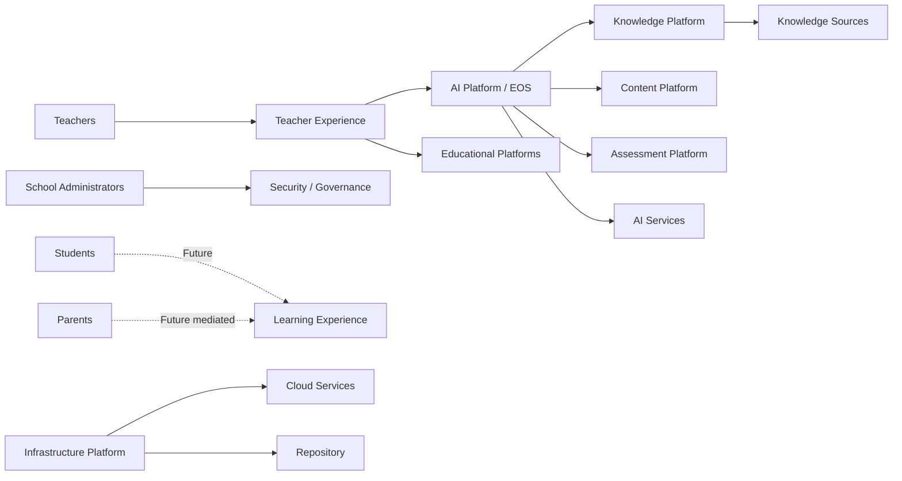
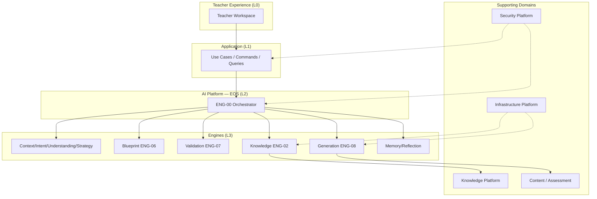

# PAS-001 — PRIMA System Architecture (PSA)

# 1. Document Metadata

| Field | Value |
|-------|-------|
| **Title** | PRIMA System Architecture (PSA) |
| **Code** | PAS-001 |
| **Version** | 1.0 |
| **Status** | Official — Constitutional architecture document of the PRIMA platform |
| **Owner** | LUDI ON Chief System Architect |
| **Repository Location** | `docs/engineering/PAS-001_PRIMA_SYSTEM_ARCHITECTURE.md` |
| **Purpose** | Define what PRIMA is, why it exists, immutable architectural principles, system boundaries, major platform domains, and relationships among them |
| **Scope** | Platform-level system architecture for LUDI ON / PRIMA; primary reference for all subsequent PAS-xxx specifications |
| **Out of scope** | Technology stack choices; LLM prompts; UI kits; redesign of POSS Engine identities (ENG-00…ENG-10); PPEF prompt internals |

> PAS-001 is the **constitutional System Architecture** of the PRIMA platform.  
> All future PAS-xxx specifications SHALL reference and conform to PAS-001.  
> POSS remains the Educational Operating System constitution; Reference Technical Architecture (RTA) and Constitutional Engine Architecture (CEA) remain the technology-independent technical/engine detail under the PAS family.  
> PAS-001 MUST NOT invent parallel Engines, Layers, or Domains that contradict POSS / Constitutional Domain Model.

---

# 2. Vision

## 2.1 Mission

Enable every teacher to design pedagogically sound, classroom-ready learning experiences with PRIMA as a governed instructional-design partner — not as an autonomous content generator.

## 2.2 Vision

PRIMA becomes the enduring architectural backbone of LUDI ON: an Educational Operating System (EOS) in which AI acts as replaceable workers under Teacher Authority, and every educational artifact is designed, authorized, traced, and improvable.

## 2.3 Educational Purpose

- Raise instructional quality through evidence-based design.  
- Preserve teacher professional judgment at every binding decision.  
- Align learning design with curriculum reality (Romanian schools first).  
- Separate discovery and reasoning from generation and delivery.

## 2.4 Target Users

| Actor | Role in PAS-001 |
|-------|-----------------|
| **Teachers** | Primary users and exclusive holders of Teacher Approval |
| **Students** | Beneficiaries of teacher-authorized Learning Experiences (direct product surfaces Future) |
| **Parents** | Informed stakeholders via school-mediated channels (Future integration) |
| **School Administrators** | Configuration, adoption, governance — never Teacher Approval substitutes |
| **Curriculum / instructional specialists** | Knowledge and pedagogy contributors (human knowledge sources) |

## 2.5 Long-term Objectives

1. Stable platform domains that outlive vendors and model generations.  
2. Full EOS execution with lawful Engine collaboration.  
3. Traceable educational artifacts from Intent → Blueprint → Resource.  
4. Extensible Learning Experience, Collaboration, and Analytics domains without eroding Teacher Authority.  
5. Offline-resilient teacher workflows where classroom continuity requires it.

---

# 3. Architectural Principles

Immutable principles governing PRIMA. Each includes Purpose, Rationale, and Architectural Consequences.

### PSA-P01 — Pedagogy First

| Field | Content |
|-------|---------|
| **Purpose** | Ensure educational integrity precedes technical convenience |
| **Rationale** | LUDI ON’s category is AI-assisted instructional design; collapsing design into generation destroys trust |
| **Architectural Consequences** | Understanding and Instructional Strategy precede Blueprint; Generation is downstream of Teacher Approval |

### PSA-P02 — AI as an Assistant

| Field | Content |
|-------|---------|
| **Purpose** | Bound AI to worker/executor roles under EOS law |
| **Rationale** | Models optimize fluency; PRIMA optimizes pedagogical integrity |
| **Architectural Consequences** | AI workers implement Engines behind Ports; AI MUST NOT redefine Engines, Policies, or Authority |

### PSA-P03 — Human-in-the-Loop

| Field | Content |
|-------|---------|
| **Purpose** | Keep Teachers as binding decision-makers |
| **Rationale** | Classroom responsibility remains human; automation without authority is unsafe |
| **Architectural Consequences** | Teacher Approval is mandatory before Generation of classroom materials; Continuă never bypasses gates |

### PSA-P04 — Explainability

| Field | Content |
|-------|---------|
| **Purpose** | Make significant outputs intelligible to Teachers |
| **Rationale** | Trust requires evidence, not opaque generation |
| **Architectural Consequences** | Decisions and resources SHALL cite Knowledge/Context evidence; Failures are fail-visible |

### PSA-P05 — Modularity

| Field | Content |
|-------|---------|
| **Purpose** | Isolate change and ownership |
| **Rationale** | Monoliths absorb responsibilities and skip gates under pressure |
| **Architectural Consequences** | One Engine / one service owner / one domain ownership; collaboration via Contracts, Commands, Events |

### PSA-P06 — Extensibility

| Field | Content |
|-------|---------|
| **Purpose** | Allow new capabilities without renegotiating constitution |
| **Rationale** | Domains such as Learner Experience and Collaboration will open over time |
| **Architectural Consequences** | New subsystems SHALL map to exactly one Platform Domain and respect PAS constraints; Future domains register under System Governance until split |

### PSA-P07 — Privacy by Design

| Field | Content |
|-------|---------|
| **Purpose** | Protect learner and teacher data by default |
| **Rationale** | Education platforms process sensitive personal and pedagogical data |
| **Architectural Consequences** | Minimal collection; purpose limitation; Security Platform controls AuthN/AuthZ/Audit; Memory is Teacher-controlled |

### PSA-P08 — Evidence-based Decision Making

| Field | Content |
|-------|---------|
| **Purpose** | Ground design in Knowledge and captured Intent |
| **Rationale** | Invention without provenance is pedagogical risk |
| **Architectural Consequences** | Knowledge SHALL be versioned and attributable; Strategies and Blueprints reference evidence |

### PSA-P09 — Offline Resilience

| Field | Content |
|-------|---------|
| **Purpose** | Preserve teacher continuity when connectivity is limited |
| **Rationale** | Classroom reality includes intermittent networks |
| **Architectural Consequences** | Authoritative online sync remains Source of Truth; local drafts MAY exist with conflict-visible merge; binding Approvals SHALL reconcile to authoritative store before Generation publish |

### PSA-P10 — Separation of Design and Execution

| Field | Content |
|-------|---------|
| **Purpose** | Keep Instructional Blueprint as the contract between reasoning and generation |
| **Rationale** | Mixing chat fluency with classroom materials erodes reviewability |
| **Architectural Consequences** | Design objects never gain Generation authority; Resources bind to approved Blueprint Versions |

### PSA-P11 — Technology Independence

| Field | Content |
|-------|---------|
| **Purpose** | Keep architecture valid across stacks and vendors |
| **Rationale** | Frameworks change; educational law must not |
| **Architectural Consequences** | PAS-001 / POSS / RTA describe roles and dependencies — not languages, clouds, or LLM brands |

### PSA-P12 — Single Ownership

| Field | Content |
|-------|---------|
| **Purpose** | Eliminate ambiguous responsibility |
| **Rationale** | Shared ownership produces duplicated rules and silent skips |
| **Architectural Consequences** | Every service, aggregate, and Platform Domain has exactly one owner; cross-domain use is via published contracts only |

---

# 4. System Scope

## 4.1 Included Capabilities

- Teacher Workspace for instructional design (orientation, Continuă, Project, Blueprint review, Resource craft, Library).  
- EOS Orchestration and constitutional Engines (ENG-00…ENG-10).  
- Knowledge acquisition, versioning, and provenance.  
- Instructional Blueprint lifecycle and Teacher Approval.  
- Generation of educational Resources under Approval.  
- Validation (self + realization) distinct from Approval.  
- Memory and Reflection under Teacher control.  
- Platform governance, audit, and configuration.  
- PPEF / architectural prompt governance as engineering subsystem (does not replace pedagogical Validation Engine).

## 4.2 Excluded Capabilities

- Replacing Teachers in the classroom.  
- Auto-publishing student-facing content without Teacher Approval.  
- Autonomous instructional agents without Human-in-the-Loop gates.  
- Generic LMS replacement (attendance, grading books as core PAS-001 MVP identity).  
- Social network / marketplace as core architecture.  
- Inventing Engines outside POSS without constitutional revision.

## 4.3 External Systems

| External system | Relationship |
|-----------------|--------------|
| LLM / AI providers | Workers behind Integration Ports |
| Cloud identity / storage / messaging | Infrastructure adapters (L6) |
| Curriculum / textbook / standards sources | Knowledge ingestion inputs |
| School SIS / LMS (optional) | Future integration via Integration Ports |
| Export targets (PDF, PPTX, print) | Generation / Infrastructure adapters |

## 4.4 Integration Boundaries

- External systems SHALL NOT call Engines directly; they enter via Application Commands/Queries or Integration Ports.  
- UI SHALL depend only on Application (L1), never Domain/Engines/Infrastructure directly.  
- Knowledge imports SHALL pass provenance and versioning rules before Active use.

## 4.5 System Responsibilities

| Responsibility | Owner plane |
|----------------|-------------|
| Educational law & Engine identity | POSS / CEA |
| Platform domains & boundaries | **PAS-001** |
| Technical layers & dependency direction | RTA |
| Development rules & imports | PDC |
| Repository layout | ES-001 |
| Runtime pedagogical execution | EOS Orchestrator + Engines |

---

# 5. System Context

### Teachers

Interact with Teacher Experience to design, review, approve, edit, and export. Exclusive authority for Teacher Approval.

### Students

Consume authorized Learning Experiences; no binding design authority. Direct product surfaces are Future under Learning Experience Domain.

### Parents

Receive school-mediated information; no Teacher Approval rights; integrations Future.

### School Administrators

Configure platform preferences, observe audit/adoption metrics; MUST NOT forge Teacher Approval.

### AI Services

Provide inference/generation as Infrastructure workers implementing Engine Ports; MUST remain replaceable.

### Educational Platforms

Optional SIS/LMS/export partners; Anti-Corruption at Integration Ports; MUST NOT redefine Blueprint or Approval semantics.

### Cloud Services

Host compute, storage, identity, messaging adapters under Infrastructure Platform.

### Repository

Source of truth for specifications, contracts, code, and (where applicable) Knowledge packages under version control / release discipline.

### Knowledge Sources

Curriculum standards, textbooks, teacher materials, institutional packs — ingested into Knowledge Platform with provenance.

---

# 6. Domain Architecture

Platform Domains are **architectural ownership zones**. They map onto Constitutional Bounded Contexts and Engines; they do **not** create parallel Engine catalogs.

## 6.1 Teacher Experience

| Field | Content |
|-------|---------|
| **Mission** | Enable Teachers to orient, design, decide, approve, craft, and manage portfolios |
| **Responsibilities** | Teacher Workspace UX; Continuă; Project views; Approval/refusal acts; Library presentation |
| **Owned Data** | Presentation state; Teacher interaction signals (not Domain truth) |
| **Primary Services** | SVC-01 Teacher Interaction façades; L0 Presentation; L1 Application use cases |
| **Dependencies** | AI Platform (EOS), Content, Knowledge (read), Security |

## 6.2 Learning Experience

| Field | Content |
|-------|---------|
| **Mission** | Represent and (Future) deliver learner-facing experiences derived from approved designs |
| **Responsibilities** | Learning Experience as design object today; delivery surfaces Future |
| **Owned Data** | Learning Experience definitions bound to Blueprint Versions |
| **Primary Services** | Instructional Design context (Blueprint Engine ENG-06); Future learner delivery services |
| **Dependencies** | Content, Assessment, Teacher Experience (authorization), Knowledge |

## 6.3 Knowledge Platform

| Field | Content |
|-------|---------|
| **Mission** | Provide attributable, versioned educational substance |
| **Responsibilities** | Knowledge Packs/Objects/Packages; provenance; retrieval for design |
| **Owned Data** | Knowledge aggregates and versions |
| **Primary Services** | ENG-02 Knowledge Engine; SVC-04 |
| **Dependencies** | External Knowledge Sources; Security; Infrastructure |

## 6.4 AI Platform

| Field | Content |
|-------|---------|
| **Mission** | Execute governed educational intelligence (EOS) |
| **Responsibilities** | Orchestration; Context; Intent; Understanding; Strategy; Validation; Memory; Reflection; Decision gates |
| **Owned Data** | Session/Working Context; Decision records; Validation reports; Memory (teacher-controlled) |
| **Primary Services** | ENG-00…ENG-05, ENG-07, ENG-09, ENG-10; L2 Orchestration |
| **Dependencies** | Knowledge, Content (downstream), Security, Infrastructure (AI workers) |

## 6.5 Content Platform

| Field | Content |
|-------|---------|
| **Mission** | Produce and manage educational Resources under Approval |
| **Responsibilities** | Generation Package; Resources; Export Packages |
| **Owned Data** | Generation artifacts; Resource versions; lineage to Blueprint |
| **Primary Services** | ENG-08 Generation Engine; SVC-06 |
| **Dependencies** | AI Platform (gates), Knowledge, Assessment (resource subtypes), Infrastructure |

## 6.6 Assessment Platform

| Field | Content |
|-------|---------|
| **Mission** | Own assessment *design* and assessment *resources* without a separate Assessment Engine |
| **Responsibilities** | Assessment Design as Blueprint concern; Assessment Resources as Generation subtypes |
| **Owned Data** | Assessment Design value objects; Assessment Resource entities |
| **Primary Services** | ENG-06 (design); ENG-08 (resources); Validation ENG-07 |
| **Dependencies** | AI Platform, Content, Knowledge, Teacher Experience |

## 6.7 Collaboration Platform

| Field | Content |
|-------|---------|
| **Mission** | Enable multi-teacher / institutional collaboration (Future core) |
| **Responsibilities** | Sharing, co-authoring policies, institutional libraries |
| **Owned Data** | Collaboration memberships; share grants (Future aggregates) |
| **Primary Services** | Future Collaboration services; until then System Governance registry |
| **Dependencies** | Teacher Experience, Security, Knowledge, Content |

## 6.8 Analytics Platform

| Field | Content |
|-------|---------|
| **Mission** | Provide pedagogical and operational insight without bypassing Authority |
| **Responsibilities** | Reflection aggregates; adoption metrics; quality trends |
| **Owned Data** | Analytics read models; Reflection signals |
| **Primary Services** | ENG-09 Reflection; Future Analytics services |
| **Dependencies** | AI Platform events; Teacher Experience; Security (privacy) |

## 6.9 Infrastructure Platform

| Field | Content |
|-------|---------|
| **Mission** | Implement technical adapters for persistence, messaging, identity, workers, files |
| **Responsibilities** | L6 Infrastructure; Integration Port implementations; CI/runtime ops |
| **Owned Data** | Technical stores implementing Domain ports (not Domain meaning) |
| **Primary Services** | Persistence, messaging, identity, AI/export workers |
| **Dependencies** | Cloud Services; Repository tooling |

## 6.10 Security Platform

| Field | Content |
|-------|---------|
| **Mission** | Protect identities, authorize acts, ensure auditability and privacy |
| **Responsibilities** | AuthN/AuthZ; audit append; secrets; policy enforcement at edges |
| **Owned Data** | Identities, roles, audit stream, platform configuration (governance) |
| **Primary Services** | SVC-10 / SVC-11 governance & authority checks; Security cross-cutting plane |
| **Dependencies** | Infrastructure; all domains for AuthZ at command edge |

### Domain ↔ Constitutional mapping (normative)

| Platform Domain | Primary Bounded Context(s) / Engines |
|-----------------|--------------------------------------|
| Teacher Experience | Teacher Interaction; L0/L1 |
| Learning Experience | Instructional Design (Learning Experience object); Future learner delivery |
| Knowledge Platform | Knowledge; ENG-02 |
| AI Platform | Orchestration; ENG-00…05, 07, 09, 10 |
| Content Platform | Generation; ENG-08 |
| Assessment Platform | Instructional Design + Generation (split Assessment Design / Resource) |
| Collaboration Platform | Future; System Governance until opened |
| Analytics Platform | Reflection + Future analytics |
| Infrastructure Platform | L6 |
| Security Platform | System Governance + Security plane |

---

# 7. High-Level System Architecture

## 7.1 How domains collaborate

Teacher Experience issues Commands/Queries → Application → EOS Orchestration sequences AI Platform Engines → Knowledge Platform supplies evidence → Content/Assessment produce Resources after Teacher Approval → Security and Infrastructure cut across all paths → Analytics/Collaboration consume events without writing Authority.

## 7.2 Communication Principles

- Collaborate via **constitutional Contracts, Commands, Events, Queries**.  
- No synchronous peer-Engine pedagogy orchestration (Orchestrator owns sequencing).  
- Read Models for UI; write models behind aggregate boundaries.

## 7.3 Service Boundaries

- Business Services (SVC-*) are façades; Engines are specialized executors (CEA).  
- Presentation never owns Domain rules.  
- Infrastructure never owns pedagogical meaning.

## 7.4 Ownership

- Exactly one Platform Domain owner per subsystem.  
- Exactly one Engine owner per pedagogical responsibility (POSS/CEA).  
- Shared libraries under `packages/` follow PAS/ES-001 ownership maps.

## 7.5 Integration Rules

1. Cross-domain calls SHALL use published contracts only.  
2. Direct Domain-to-Domain persistence joins are forbidden.  
3. External systems enter only through Integration Ports / Application.  
4. AI workers are Infrastructure; they MUST NOT become Domain owners.

## 7.6 Cross-cutting Concerns

Security · Observability · Configuration · Localization · Accessibility · Audit · PPEF (engineering prompt quality).

## 7.7 High-level architectural diagram

---

# 8. Architectural Constraints

Immutable constraints (PSA-X):

| ID | Constraint |
|----|------------|
| **PSA-X01** | No direct cross-domain coupling — only published contracts |
| **PSA-X02** | Every service SHALL have a single owner Domain |
| **PSA-X03** | All AI decisions affecting Teachers SHALL be explainable with Evidence |
| **PSA-X04** | Knowledge SHALL be versioned and provenance-bearing |
| **PSA-X05** | Every generated educational artifact SHALL be traceable to Blueprint Version + Teacher Approval (when classroom-bound) |
| **PSA-X06** | Teacher Approval SHALL NOT be forged by AI, Admin, or automation |
| **PSA-X07** | Validation ≠ Approval |
| **PSA-X08** | Design objects SHALL NOT gain Generation authority |
| **PSA-X09** | Dependencies point inward toward Domain (RTA) |
| **PSA-X10** | Engines remain AI-model and vendor replaceable |
| **PSA-X11** | No new Engine without POSS/CEA constitutional revision |
| **PSA-X12** | Learning Experience delivery MUST NOT bypass Teacher Authorization chain |
| **PSA-X13** | PAS-xxx specs SHALL reference PAS-001 |
| **PSA-X14** | Offline drafts MUST NOT silently overwrite authoritative online Approvals |

---

# 9. Quality Attributes

| Attribute | Architectural goal |
|-----------|--------------------|
| **Performance** | Interactive Teacher flows remain responsive; Engine work MAY be async with visible progress |
| **Scalability** | Scale Infrastructure and workers horizontally without changing Domain meaning |
| **Availability** | Authoring continuity with graceful degradation; fail-visible when EOS gates block |
| **Maintainability** | Clear Domain/Engine ownership; contracts over shared mutable state |
| **Testability** | Domain and Engines testable without UI/cloud; contract tests for Commands/Events |
| **Observability** | Correlation ids across Orchestrator; audit for Authority acts |
| **Security** | Least privilege; encrypted secrets; audited Approvals |
| **Usability** | Calm Teacher Experience; Continuă respects cognitive load |
| **Accessibility** | Teacher Workspace meets accessibility baselines for Romanian school use |
| **Explainability** | Evidence links on Strategies, Blueprints, Resources, Failures |

---

# 10. Evolution Strategy

## 10.1 Architectural governance

PAS-001 + POSS + Architectural Principles govern change. ADRs follow ADL-001. AGR gates bind major foundation work.

## 10.2 Domain evolution

New Domains SHALL be opened explicitly (catalog + owner + contracts). Until opened, Future capabilities register under System Governance.

## 10.3 Service evolution

Services evolve by contract versioning; breaking changes require MAJOR and migration notes.

## 10.4 Backward compatibility

Active constitutional identifiers (Engines, Policies, Commands) SHALL remain stable or provide explicit deprecation paths.

## 10.5 Deprecation policy

Deprecated elements: mark Deprecated → provide successor → retain for compatibility window → Archive. Ids not reused.

## 10.6 Architecture reviews

Material PAS changes REQUIRE Architecture Review (ATP / AGR as applicable) before Official status.

---

# 11. Repository Mapping

| Area | Maps to |
|------|---------|
| **docs/** | Product (POSS, constitutional models), Engineering (PAS-001, PDC, ES-*, PPEF), design, technical maps |
| **src/** | Transitional Teacher UI → migrate to `apps/teacher-workspace` (Teacher Experience L0) |
| **packages/** | Domain (L4), contracts, application (L1), eos (L2), engines/* (L3), ui, testing, config |
| **services/** | Deployable service hosts when extracted (Application/API); until then Application packages + apps |
| **knowledge/** | Knowledge packages / packs under Knowledge Platform versioning (when materialized) |
| **assets/** | Static design/export assets — no Domain rules |
| **tests/** | Cross-package contract, integration, e2e tests |
| **infrastructure/** | Infrastructure Platform (L6) adapters |
| **apps/** | Deployable Teacher Experience shells |

Authoritative tree: ES-001. PAS-001 Domain ownership MUST align with `PAS_MODULE_PACKAGE_MAP.md`.

---

# 12. Dependencies

| Relation | Targets |
|----------|---------|
| **Requires** | POSS; PRIMA Architectural Principles; Constitutional Domain Model; Constitutional Language; Product Vision / Project Bible |
| **Required By** | All PAS-xxx; **PAS-002**; RTA/CEA conformance interpretations; PDC/ES-* platform mapping; AGR platform reviews |
| **Supersedes** | Informal “system architecture” claims that redefine platform domains without PAS-001; does **not** supersede POSS, RTA, or CEA |
| **Superseded By** | None |

**PAS family relationship**

| Document | Role |
|----------|------|
| **PAS-001 (this)** | Constitutional System Architecture (PSA) — primary PAS reference |
| **RTA** | Technology-independent technical layers & modules |
| **CEA** | Constitutional Engine Architecture |
| **Future PAS-xxx** | Domain/system deep specs conforming to PAS-001 |

---

# 13. Compliance Rules

| ID | Rule |
|----|------|
| **PSA-C01** | Every architectural decision SHALL align with the Architectural Principles in §3. |
| **PSA-C02** | Every new subsystem SHALL belong to exactly one Platform Domain (§6). |
| **PSA-C03** | Every architectural specification in the PAS-xxx series SHALL reference PAS-001. |
| **PSA-C04** | Every cross-domain dependency SHALL be explicitly justified and contract-mediated. |
| **PSA-C05** | PAS-001 SHALL NOT invent Engines, Layers, or Bounded Contexts that contradict POSS/CEA/Domain Model. |
| **PSA-C06** | AI SHALL act as Assistant/worker; AI MUST NOT hold Teacher Approval. |
| **PSA-C07** | Pedagogy First SHALL govern prioritization over delivery speed shortcuts that skip gates. |
| **PSA-C08** | Human-in-the-Loop SHALL apply to all classroom-bound Generation. |
| **PSA-C09** | Explainability SHALL be required for Teacher-facing significant decisions and artifacts. |
| **PSA-C10** | Knowledge SHALL be versioned before Active educational use. |
| **PSA-C11** | Generated educational artifacts SHALL be traceable (§8 PSA-X05). |
| **PSA-C12** | Validation MUST NOT be treated as Approval. |
| **PSA-C13** | School Administrators MUST NOT substitute for Teacher Approval. |
| **PSA-C14** | Presentation MUST NOT depend directly on Engines or Infrastructure. |
| **PSA-C15** | Infrastructure MUST NOT own pedagogical Domain meaning. |
| **PSA-C16** | Learning Experience delivery (when Active) MUST honor Authorization chain. |
| **PSA-C17** | Collaboration and Analytics MUST NOT bypass Authority or Privacy constraints. |
| **PSA-C18** | Security controls SHALL apply at Application command edges and audit Authority acts. |
| **PSA-C19** | Repository structure SHALL map to Domains per §11 and ES-001. |
| **PSA-C20** | Evolution of Domains/Services SHALL follow §10 governance. |
| **PSA-C21** | Offline resilience MUST NOT silently override authoritative Approvals. |
| **PSA-C22** | External Educational Platforms SHALL integrate only via Integration Ports. |
| **PSA-C23** | Assessment Design and Assessment Resources SHALL remain split as constitutionally defined. |
| **PSA-C24** | Quality attributes in §9 SHALL guide trade-off decisions recorded in ADRs when conflicted. |
| **PSA-C25** | On conflict between a PAS-xxx detail and PAS-001, PAS-001 wins until deliberately revised. |

---

# 14. Quality Checklist

| Check | Status |
|-------|--------|
| Vision defined | ✓ |
| Principles complete | ✓ |
| Scope complete | ✓ |
| Domains identified | ✓ |
| System context defined | ✓ |
| High-level architecture complete | ✓ |
| Constraints documented | ✓ |
| Quality attributes defined | ✓ |
| Repository mapping complete | ✓ |
| Compliance rules complete (PSA-C01…C25) | ✓ |

---

## Document Control

| Item | Value |
|------|-------|
| **Code** | PAS-001 |
| **Title** | PRIMA System Architecture (PSA) |
| **Version** | 1.0 |
| **Status** | Official — Constitutional |
| **Location** | `docs/engineering/PAS-001_PRIMA_SYSTEM_ARCHITECTURE.md` |
| **Authority** | Primary reference for PAS-xxx; platform System Architecture constitution |
