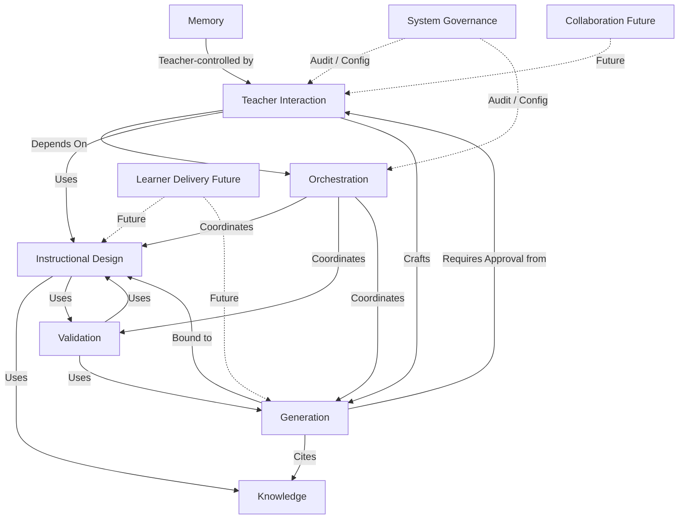

# PAS-002 — PRIMA Domain Architecture (PDA)

# 1. Document Metadata

| Field | Value |
|-------|-------|
| **Title** | PRIMA Domain Architecture (PDA) |
| **Code** | PAS-002 |
| **Version** | 1.0 |
| **Status** | Official — Canonical business domain architecture of PRIMA |
| **Owner** | LUDI ON Chief System Architect |
| **Repository Location** | `docs/engineering/PAS-002_PRIMA_DOMAIN_ARCHITECTURE.md` |
| **Purpose** | Define PRIMA business domain architecture using Domain-Driven Design: Bounded Contexts, ownership, capabilities, data, dependencies, and integration rules |
| **Scope** | All business Bounded Contexts of LUDI ON / PRIMA; capability and business-object ownership; domain events and integration |
| **Out of scope** | Engine internals (CEA); technical layers (RTA); UI composition; LLM prompts; inventing parallel domains that contradict Constitutional Domain Model |

> PAS-002 **extends** PAS-001.  
> PAS-002 is the **canonical** definition of PRIMA **business domains** (Bounded Contexts).  
> Platform Domains in PAS-001 §6 are architectural ownership zones; Bounded Contexts in PAS-002 are **business meaning ownership**. Mapping is normative (§3.3).  
> Constitutional Domain Model / Capability Model / Event Model remain the detailed entity/capability/event catalogs; PAS-002 consolidates domain architecture and ownership rules for the PAS series.  
> Ubiquitous Language SHALL use Official Names from Constitutional Language (e.g. Instructional Blueprint — not “Scenario”; Learning Experience — not unqualified “Lesson” as aggregate identity).

---

# 2. Domain Architecture Principles

| Principle | Statement | Architectural consequence |
|-----------|-----------|---------------------------|
| **Business-first architecture** | Domains express teacher/platform business meaning, not packages or screens | Decomposition starts from Capabilities and Aggregates, not folders |
| **Bounded Contexts** | Each Domain is a Bounded Context with explicit boundary | Models inside a context MUST NOT leak as shared mutable state |
| **Single Ownership** | Exactly one Domain owns each Capability and Aggregate | Dual “primary owners” are forbidden; dual *concerns* MAY be documented |
| **High Cohesion** | Concepts that change together live together | Intent→Strategy→Blueprint stay in Instructional Design |
| **Low Coupling** | Domains depend on published contracts only | No direct aggregate mutation across contexts |
| **Explicit Dependencies** | Every Depends On / Consumes edge is declared | Undeclared coupling is non-compliant |
| **Independent Evolution** | Domains version contracts independently | Breaking changes require MAJOR + migration |
| **Ubiquitous Language** | Each Domain defines Official Names for its model | Banned aliases (e.g. Scenario, unqualified Approval) MUST NOT appear as domain identities |

---

# 3. Domain Identification

## 3.1 Candidate evaluation (mandatory)

| Candidate | Verdict | Business responsibility | Business value | Architectural necessity |
|-----------|---------|-------------------------|----------------|-------------------------|
| **Teaching Domain** | **Keep as Teacher Interaction** | Authority, orientation, review, craft, library, reflection intake | Encodes Teacher Authority and daily workspace meaning | Without it, Approval and craft dissolve into UI or AI |
| **Learning Domain** | **Keep as Instructional Design** (+ Future Learner Delivery) | Intent→Understanding→Strategy→Blueprint→Learning Experience design | Category-defining instructional design | Without it, PRIMA collapses to content generation |
| **Assessment Domain** | **Reject as separate BC** | Assessment Design ∈ Instructional Design; Assessment Resource ∈ Generation | Preserves design/execution split | Separate Assessment Engine/BC was constitutionally rejected (CEA) |
| **Knowledge Domain** | **Keep as Knowledge** | Provenance-bearing educational substance | Evidence-based design | Without it, Strategies invent without attribution |
| **Collaboration Domain** | **Future** (CAP-F01 under Teacher Interaction until opened) | Multi-teacher sharing / co-authoring | Institutional scale | Not required for category integrity today; register, do not invent |
| **Administration Domain** | **Keep as System Governance** | Configuration, audit, lineage, school integrations registry | Integrity and operability | Without it, Authority and lineage lack platform control |

Additional **core** Bounded Contexts required by constitution (not optional):

| Domain (Bounded Context) | Necessity |
|--------------------------|-----------|
| **Orchestration** | Lawful session/project continuity and gates |
| **Validation** | Self- and Realization validation ≠ Approval |
| **Generation** | Resources under Teacher Approval |
| **Memory** | Teacher-controlled personalization |

## 3.2 Official Bounded Context catalog

| ID | Domain (Bounded Context) | Lifecycle | PAS-001 Platform Domain map |
|----|--------------------------|-----------|----------------------------|
| **BC-TI** | Teacher Interaction | Active | Teacher Experience (+ Security authority acts) |
| **BC-OR** | Orchestration | Active | AI Platform (EOS coordination) |
| **BC-ID** | Instructional Design | Active | Learning Experience (design) + Assessment Design |
| **BC-KN** | Knowledge | Active | Knowledge Platform |
| **BC-VA** | Validation | Active | AI Platform (ENG-07) |
| **BC-GE** | Generation | Active | Content Platform + Assessment Resources |
| **BC-ME** | Memory | Active | AI Platform (ENG-10) |
| **BC-SG** | System Governance | Active | Security Platform + Administration + Analytics registry |
| **BC-CO** | Collaboration | Future | Collaboration Platform |
| **BC-LX** | Learner Experience Delivery | Future | Learning Experience (delivery) |

## 3.3 PAS-001 ↔ PAS-002 mapping rule

Platform Domains (PAS-001) MAY span technical planes; each Capability/Aggregate SHALL resolve to exactly one Bounded Context (PAS-002). When conflict arises, **PAS-002 ownership wins for business meaning**; PAS-001 wins for platform-plane placement.

---

# 4. Domain Specification

## 4.1 Teacher Interaction (BC-TI)

| Field | Content |
|-------|---------|
| **Mission** | Own Teacher Authority acts and teacher-facing instructional interaction meaning |
| **Responsibilities** | Orient; review; grant/refuse Teacher Approval; craft Resources; manage Library portfolio view; reflection intake; Future collaboration entry |
| **Owned Capabilities** | CAP-S02, CAP-C02, CAP-C09, CAP-C12, CAP-C14, CAP-C16, CAP-C19; Future CAP-F01, CAP-F09 |
| **Owned Business Objects** | Teacher; TeacherApproval (act); LibraryEntry (read model); Craft edits; Reflection intake records |
| **Owned Data** | Authority decisions; review outcomes; portfolio indexes; craft deltas |
| **Business Services** | SVC-01 Teacher Interaction; Authority façade |
| **Business Events** | BlueprintApproved; BlueprintRevisionRequested; ResourceEdited; ResourceMarkedReady; PriorCraftSelectedForReuse; MemoryItemAccepted/Rejected/Deleted (authority side) |
| **External Interfaces** | Commands/Queries from Application; Events to Orchestration/Generation/Governance |
| **Dependencies** | Orchestration (enforcement); Instructional Design (Blueprint identity); Generation (Resource identity); Validation (reports, read) |
| **Consumers** | Teacher Experience UI; Analytics (Future) |
| **Providers** | Application layer for Teacher Commands |
| **Lifecycle** | Active |

## 4.2 Orchestration (BC-OR)

| Field | Content |
|-------|---------|
| **Mission** | Enforce lawful continuity of Projects, Sessions, Context, and pipeline gates |
| **Responsibilities** | Manage Projects; Continuă; assemble Working Context; enforce Decision Authority; recover failures; archive |
| **Owned Capabilities** | CAP-S04, CAP-C01, CAP-C04, CAP-P01, CAP-P02, CAP-P05, CAP-P06 |
| **Owned Business Objects** | Project; ConversationSession; Working Context assembly records |
| **Owned Data** | Session state; pipeline position; continuity projections |
| **Business Services** | EOS Orchestrator coordination (ENG-00); Project continuity services |
| **Business Events** | Project lifecycle events; Session start/pause; PipelinePositionAdvanced; DomainFailureRecorded (coord) |
| **External Interfaces** | Sequences Engine invocations via contracts; never pedagogically authors Blueprint content |
| **Dependencies** | All pedagogical BCs as coordinatees; System Governance (audit) |
| **Consumers** | Teacher Interaction; Instructional Design; Generation |
| **Providers** | Application Commands entering EOS |
| **Lifecycle** | Active |

## 4.3 Instructional Design (BC-ID)

| Field | Content |
|-------|---------|
| **Mission** | Own design-time pedagogical meaning from Intent through Blueprint and Learning Experience |
| **Responsibilities** | Capture Intent; Understanding; Strategy; compose Blueprint; Assessment Design; improve designs; explain recommendations |
| **Owned Capabilities** | CAP-S01, CAP-C03, CAP-C05, CAP-C06, CAP-C07, CAP-C18, CAP-P08; Future CAP-F06, CAP-F08 |
| **Owned Business Objects** | EducationalIntent; PedagogicalUnderstanding; InstructionalStrategy; InstructionalBlueprint (+ Versions); LearningExperience (design); Assessment Design (VO) |
| **Owned Data** | Design aggregates and versions; strategy rationale |
| **Business Services** | Design session services; Blueprint composition |
| **Business Events** | IntentCaptured; UnderstandingBuilt; StrategySelected; BlueprintDrafted/Revised; LearningExperienceDefined |
| **External Interfaces** | Consumes Knowledge Packages; emits design Events; never emits classroom Resources |
| **Dependencies** | Knowledge; Orchestration; Validation (self-validate); Teacher Interaction (Approval consumer of Blueprint) |
| **Consumers** | Generation (after Approval); Teacher Interaction |
| **Providers** | Knowledge evidence; Teacher Intent signals |
| **Lifecycle** | Active |

## 4.4 Knowledge (BC-KN)

| Field | Content |
|-------|---------|
| **Mission** | Own attributable, versioned educational substance |
| **Responsibilities** | Ingest/curate Knowledge; retrieve evidence packages; preserve provenance |
| **Owned Capabilities** | CAP-S03, CAP-C15 |
| **Owned Business Objects** | KnowledgePack; KnowledgeObject; KnowledgePackage (retrieval VO) |
| **Owned Data** | Versioned knowledge corpus; provenance metadata |
| **Business Services** | KnowledgeRetrievalService; Knowledge curation |
| **Business Events** | KnowledgePackCreated; KnowledgeUpdated; KnowledgePackageAssembled |
| **External Interfaces** | Query ports for design; ingestion from external sources via Integration |
| **Dependencies** | System Governance (lineage policy); Infrastructure adapters |
| **Consumers** | Instructional Design; Validation; Generation (citation) |
| **Providers** | External Knowledge Sources |
| **Lifecycle** | Active |

## 4.5 Validation (BC-VA)

| Field | Content |
|-------|---------|
| **Mission** | Measure design/resource conformance — never grant Approval |
| **Responsibilities** | Self-Validate Designs; Validate Resource Fidelity |
| **Owned Capabilities** | CAP-C08, CAP-C11 |
| **Owned Business Objects** | ValidationReport (self / realization) |
| **Owned Data** | Findings; severity; pass/fail evidence |
| **Business Services** | Design validation; Realization validation |
| **Business Events** | DesignSelfValidated; ResourceFidelityValidated |
| **External Interfaces** | Consumes Blueprint/Resource identities; publishes Reports |
| **Dependencies** | Instructional Design; Generation; Knowledge (evidence checks) |
| **Consumers** | Orchestration gates; Teacher Interaction (review) |
| **Providers** | Design/Generation aggregates |
| **Lifecycle** | Active |

## 4.6 Generation (BC-GE)

| Field | Content |
|-------|---------|
| **Mission** | Produce Resources and Export Packages only under Teacher Approval |
| **Responsibilities** | Generate Resources; Export Deliverables; Assessment Resources; Future import materials |
| **Owned Capabilities** | CAP-C10, CAP-C13; Future CAP-F07 |
| **Owned Business Objects** | GenerationPackage; Resource; Assessment Resource; Export Package |
| **Owned Data** | Generated artifacts; lineage to Blueprint Version + Approval |
| **Business Services** | Generation execution; Export |
| **Business Events** | ResourceGenerationAuthorized; ResourcesGenerated; DeliverableExported |
| **External Interfaces** | Requires Approval evidence; workers via Infrastructure Ports |
| **Dependencies** | Teacher Interaction (Approval); Instructional Design (Blueprint); Validation; Knowledge |
| **Consumers** | Teacher Interaction (craft); Library |
| **Providers** | Orchestration after gate |
| **Lifecycle** | Active |

## 4.7 Memory (BC-ME)

| Field | Content |
|-------|---------|
| **Mission** | Teacher-controlled durable personalization |
| **Responsibilities** | Remember preferences; accept/reject memory items |
| **Owned Capabilities** | CAP-C17 |
| **Owned Business Objects** | MemoryProfile; MemoryItem |
| **Owned Data** | Preference profiles; memory items |
| **Business Services** | Memory persistence under Teacher control |
| **Business Events** | MemoryItemProposed; MemoryItemAccepted; MemoryItemRejected; MemoryItemDeleted |
| **External Interfaces** | Advisory to Orchestration/Design — never overrides Approval |
| **Dependencies** | Teacher Interaction (authority over items) |
| **Consumers** | Orchestration Continuă; Instructional Design (advisory) |
| **Providers** | Reflection / interaction signals |
| **Lifecycle** | Active |

## 4.8 System Governance (BC-SG)

| Field | Content |
|-------|---------|
| **Mission** | Platform configuration, audit, lineage, and Future ecosystem registry |
| **Responsibilities** | Configure preferences; audit material events; maintain version lineage policy; register Future domains/capabilities until split |
| **Owned Capabilities** | CAP-P03, CAP-P04, CAP-P07; Future CAP-F02 (registry), CAP-F03, CAP-F04, CAP-F05 |
| **Owned Business Objects** | PlatformConfiguration; Audit stream; lineage policy records |
| **Owned Data** | Config; audit; registry of Future capabilities/domains |
| **Business Services** | SVC-11 Platform Governance; audit append |
| **Business Events** | PlatformConfigurationChanged; DomainFailureRecorded (visibility); AuditRecorded |
| **External Interfaces** | Admin Commands; integration registry |
| **Dependencies** | Security plane; Infrastructure |
| **Consumers** | All Domains (policy/audit) |
| **Providers** | Administrators; system |
| **Lifecycle** | Active |

## 4.9 Collaboration (BC-CO) — Future

| Field | Content |
|-------|---------|
| **Mission** | Multi-teacher / institutional collaboration |
| **Responsibilities** | Share grants; co-authoring policies; institutional libraries |
| **Owned Capabilities** | CAP-F01 (moves here when domain opened) |
| **Owned Business Objects** | CollaborationSpace; ShareGrant (Future) |
| **Owned Data** | Membership; grants |
| **Business Services** | Future Collaboration services |
| **Business Events** | ProjectShared; CoAuthorInvited (Future Official Names via Event Model revision) |
| **External Interfaces** | TBD at domain opening |
| **Dependencies** | Teacher Interaction; System Governance; Security |
| **Consumers** | Institutional Teachers |
| **Providers** | Teacher Interaction until split |
| **Lifecycle** | Future — registered under BC-SG until opened |

## 4.10 Learner Experience Delivery (BC-LX) — Future

| Field | Content |
|-------|---------|
| **Mission** | Deliver learner-facing experiences derived from authorized designs |
| **Responsibilities** | Student runtime Learning Experiences; progress signals |
| **Owned Capabilities** | CAP-F02 (moves here when opened) |
| **Owned Business Objects** | StudentProfile (Future); LearningActivity runtime; Feedback (learner) |
| **Owned Data** | Delivery sessions; completion records |
| **Business Services** | Future learner delivery |
| **Business Events** | LearningActivityCompleted; LearnerFeedbackSubmitted (Future Official Names) |
| **External Interfaces** | Student/Parent mediated channels |
| **Dependencies** | Instructional Design (definition); Generation (materials); Teacher Interaction (authorization chain) |
| **Consumers** | Students; Parents (mediated) |
| **Providers** | System Governance registry until split |
| **Lifecycle** | Future |

---

# 5. Domain Relationships

## 5.1 Permitted relationship types

| Relation | Meaning |
|----------|---------|
| **Owns** | Exclusive Aggregate/Capability ownership |
| **Publishes** | Emits Domain Events |
| **Consumes** | Subscribes to Events / reads published contracts |
| **Collaborates** | Bidirectional contract without shared write model |
| **Depends On** | Hard runtime/business dependency |
| **Uses** | Read-only use of another Domain’s published model |
| **Shares** | Shared kernel ONLY if explicitly declared (default: none) |

## 5.2 Permitted dependency edges (normative summary)

```
Teacher Interaction → Orchestration, Instructional Design, Generation, Validation, Memory
Orchestration → (coordinates) Instructional Design, Knowledge, Validation, Generation, Memory, Teacher Interaction
Instructional Design → Knowledge, Validation, Orchestration
Validation → Instructional Design, Generation, Knowledge
Generation → Instructional Design, Teacher Interaction, Validation, Knowledge
Memory → Teacher Interaction
System Governance → (policy/audit) all; no pedagogical ownership
Collaboration (Future) → Teacher Interaction, System Governance
Learner Delivery (Future) → Instructional Design, Generation, Teacher Interaction
```

## 5.3 Forbidden dependencies

| Forbidden | Reason |
|-----------|--------|
| Generation → invent Blueprint without Instructional Design | Design/execution split |
| AI/Generation → TeacherApproval grant | Authority integrity |
| Validation → TeacherApproval | Validation ≠ Approval |
| Instructional Design → mutate Resource aggregates | Design objects lack Generation authority |
| Knowledge → grant Approval or publish classroom Resources | Evidence ≠ authorization |
| System Governance → TeacherApproval | Admin ≠ Teacher |
| Cyclic write dependencies among BC-TI / BC-ID / BC-GE / BC-KN | Deterministic ownership |
| Shared database tables across Domains without Anti-Corruption | Boundary erosion |
| UI packages owning Domain Aggregates | PAS-001 / RTA |

## 5.4 Domain dependency diagram



---

# 6. Capability Mapping

**Rule:** Every Capability SHALL belong to exactly one Domain (primary owner).

| Capability | Owner Domain |
|------------|--------------|
| CAP-S01 Design Learning Experiences | Instructional Design |
| CAP-S02 Authorize Instructional Blueprints | Teacher Interaction |
| CAP-S03 Ground Design in Knowledge | Knowledge |
| CAP-S04 Continue Educational Work | Orchestration |
| CAP-C01 Manage Projects | Orchestration |
| CAP-C02 Orient Teacher Work | Teacher Interaction |
| CAP-C03 Capture Educational Intent | Instructional Design |
| CAP-C04 Assemble Working Context | Orchestration |
| CAP-C05 Build Pedagogical Understanding | Instructional Design |
| CAP-C06 Formulate Instructional Strategy | Instructional Design |
| CAP-C07 Compose Instructional Blueprint | Instructional Design |
| CAP-C08 Self-Validate Designs | Validation |
| CAP-C09 Conduct Teacher Review | Teacher Interaction |
| CAP-C10 Generate Resources | Generation |
| CAP-C11 Validate Resource Fidelity | Validation |
| CAP-C12 Craft Resources | Teacher Interaction |
| CAP-C13 Export Deliverables | Generation |
| CAP-C14 Manage Library | Teacher Interaction |
| CAP-C15 Retrieve Knowledge Evidence | Knowledge |
| CAP-C16 Reflect on Design Experience | Teacher Interaction |
| CAP-C17 Remember Teacher Preferences | Memory |
| CAP-C18 Improve Existing Resources | Instructional Design |
| CAP-C19 Reuse Prior Craft | Teacher Interaction |
| CAP-P01 Govern Conversation Sessions | Orchestration |
| CAP-P02 Enforce Decision Authority | Orchestration |
| CAP-P03 Maintain Version Lineage | System Governance |
| CAP-P04 Audit Material Events | System Governance |
| CAP-P05 Recover from Failure | Orchestration |
| CAP-P06 Archive Projects | Orchestration |
| CAP-P07 Configure Platform Preferences | System Governance |
| CAP-P08 Explain Design Recommendations | Instructional Design |
| CAP-F01 Collaborate on Projects | Teacher Interaction *(until BC-CO opened)* |
| CAP-F02 Deliver Learner Experience | System Governance *(registry until BC-LX opened)* |
| CAP-F03 Integrate School Systems | System Governance |
| CAP-F04 Operate Resource Marketplace | System Governance |
| CAP-F05 Analyze Teaching Patterns | System Governance |
| CAP-F06 Adapt Learning Paths | Instructional Design |
| CAP-F07 Import External Materials | Generation |
| CAP-F08 Multi-Phase Learning Programs | Instructional Design |
| CAP-F09 Observe Classroom Practice | Teacher Interaction |

Detailed capability definitions remain in the Constitutional Capability Model; PAS-002 owns the **ownership matrix**.

---

# 7. Business Object Ownership

## 7.1 Ownership rules

1. Every business object (Aggregate/Entity of record) SHALL have exactly one owner Domain.  
2. Value Objects MAY be owned by the Aggregate that embeds them.  
3. Read Models are not write Aggregates; LibraryEntry is owned as a read model by Teacher Interaction.  
4. Dual *concern* (e.g. Approval act vs record) SHALL document primary owner without dual primary Aggregate ownership.  
5. Informal names map to Official Names before ownership assignment.

## 7.2 Example mapping (prompt vocabulary → Official ownership)

| Example term | Official Name | Owner Domain | Notes |
|--------------|---------------|--------------|-------|
| Lesson | Learning Experience (design) / lesson-focused maturity of CAP-S01 | Instructional Design | “Lesson” is maturity scope, not a parallel Aggregate identity |
| Scenario | **Forbidden** → Instructional Blueprint | Instructional Design | Constitutional Language |
| Assessment | Assessment Design (VO) / Assessment Resource (Entity) | Instructional Design / Generation | Split mandatory |
| Knowledge Object | KnowledgeObject / KnowledgePack | Knowledge | |
| Teacher Profile | Teacher (+ MemoryProfile for preferences) | Teacher Interaction / Memory | Profile facts vs preferences |
| Student Profile | StudentProfile | Learner Experience Delivery (Future) | Not Active core |
| Learning Path | Learning Path / multi-phase program (Future CAP-F06/F08) | Instructional Design | |
| Feedback | Teacher reflection intake / Learner Feedback (Future) | Teacher Interaction / BC-LX | Split by actor |
| Competency | Competency references inside Knowledge / Strategy | Knowledge (substance) / Instructional Design (use in strategy) | Substance vs use |
| Artifact | Resource / Export Package / educational artifact | Generation (create) / Teacher Interaction (craft authority) | |

## 7.3 Core owned Aggregates (summary)

| Object | Owner |
|--------|-------|
| Project, ConversationSession | Orchestration |
| EducationalIntent, Understanding, Strategy, InstructionalBlueprint, LearningExperience (design) | Instructional Design |
| TeacherApproval (act) | Teacher Interaction |
| KnowledgePack / KnowledgeObject | Knowledge |
| ValidationReport | Validation |
| GenerationPackage, Resource, Export Package | Generation |
| MemoryProfile, MemoryItem | Memory |
| PlatformConfiguration, Audit | System Governance |

---

# 8. Domain Events

Official event vocabulary is the Constitutional Event Model. PAS-002 defines **ownership of publication** and required subscriptions for architecture.

## 8.1 Prompt examples → Official Events

| Informal example | Official Event(s) | Publisher | Typical subscribers |
|------------------|-------------------|-----------|---------------------|
| Lesson Created | LearningExperienceDefined / BlueprintDrafted (design start) | Instructional Design | Orchestration; Teacher Interaction |
| Assessment Published | Assessment Resource published via ResourcesGenerated + ResourceMarkedReady | Generation / Teacher Interaction | Library; Orchestration |
| Knowledge Updated | KnowledgeUpdated / KnowledgePackCreated | Knowledge | Instructional Design; Validation |
| Learning Activity Completed | LearningActivityCompleted (Future Official) | BC-LX (Future) | Analytics; Teacher Interaction |
| Teacher Feedback Submitted | Reflection / review Events (e.g. design reflection intake) | Teacher Interaction | Memory; Orchestration |
| Scenario Generated | **Forbidden name** → ResourcesGenerated bound to approved BlueprintVersion | Generation | Teacher Interaction; Validation |

## 8.2 Critical Authority Events

| Event | Publisher | MUST NOT be attributed to |
|-------|-----------|---------------------------|
| BlueprintApproved | Teacher Interaction | AI / Admin / Generation |
| ResourceGenerationAuthorized | Teacher Interaction / Orchestration gate | AI as grantor |
| DeliverableExported | Teacher Interaction | AI as grantor |

## 8.3 Publication rules

- Events are past-tense facts from Aggregates.  
- Cross-domain integration SHOULD prefer Events for state change notification.  
- Commands MUST NOT be disguised as Events.

---

# 9. Integration Rules

## 9.1 Allowed interactions

- Domain A **Uses** Domain B via published IDs, Read Models, or Event payloads.  
- Orchestration **Coordinates** Engines/services implementing Domains.  
- Application layer translates Teacher intent → Commands entering Orchestration/Domains.  
- Anti-Corruption Layers at external Educational Platform boundaries.

## 9.2 Forbidden interactions

- Direct aggregate write from foreign Domain.  
- Shared mutable tables across Bounded Contexts.  
- UI → Engine / Infrastructure bypass of Application.  
- Generation without Approval evidence for classroom-bound Resources.  
- Silent event drops for Authority Events.

## 9.3 Cross-domain communication

| Mode | When |
|------|------|
| **Event-driven** | State changed; multiple consumers; replay-safe integration |
| **API / Command** | Explicit intent to change state inside owner Domain |
| **Query** | Read Model access without side effects |

## 9.4 Repository integration

- Domain specs and ownership live under PAS-002 + constitutional models.  
- Code packages map per ES-001 / PAS Module Package Map — Domain meaning in `packages/domain` and engine packages, not in UI.  
- Knowledge packages versioned under Knowledge Domain rules.

---

# 10. Evolution Strategy

| Change | Rule |
|--------|------|
| **Adding new domains** | Justify business value; assign ID; register Capabilities; update PAS-001 map; ADR; open Lifecycle Active |
| **Splitting domains** | Preserve Capability single ownership; migrate Aggregates with lineage; no dual Active owners during cutover |
| **Merging domains** | Allowed only with ADR proving cohesion gain; retire one ID; update matrix |
| **Deprecating domains** | Deprecated → successor → compatibility window → Archived; IDs not reused |
| **Ownership transfer** | Explicit transfer record; Capability matrix update; Event publishers reassigned; MAJOR note |

Future Domains (BC-CO, BC-LX) open only via this process; until then Capabilities remain with registry/interim owners in §6.

---

# 11. Repository Mapping

Requested domain layout maps onto ES-001 production foundation:

| Requested path | Authoritative mapping |
|----------------|----------------------|
| **src/domains/** | **Do not** place Domain Aggregates in transitional `src/` UI. Domain code → `packages/domain/` (+ engine packages). Transitional UI remains Teacher Experience only |
| **docs/domains/** | Domain architecture authority: this file + `docs/product/PRIMA_CONSTITUTIONAL_DOMAIN_MODEL.md`. Optional per-domain notes MAY live under `docs/engineering/domains/` without forking ownership |
| **tests/domains/** | Domain/contract tests under `packages/*/tests` and `tests/` cross-package suites |
| **knowledge/domains/** | Knowledge packs/corpus under Knowledge Domain versioning (`knowledge/` when materialized) — not Instructional Design ownership |

| Bounded Context | Primary code home (indicative) |
|-----------------|--------------------------------|
| Teacher Interaction | `packages/application`, `packages/authority`, `apps/teacher-workspace` |
| Orchestration | `packages/eos` |
| Instructional Design | `packages/engines/{intent,understanding,strategy,blueprint}` + domain types |
| Knowledge | `packages/engines/knowledge` |
| Validation | `packages/engines/validation` |
| Generation | `packages/engines/generation` |
| Memory | `packages/engines/memory` |
| System Governance | `packages/governance` |

---

# 12. Compliance Rules

| ID | Rule |
|----|------|
| **PDA-C01** | Every Capability SHALL belong to exactly one Domain. |
| **PDA-C02** | Every Domain SHALL own its business objects (Aggregates of record). |
| **PDA-C03** | Cross-domain dependencies SHALL be explicitly documented. |
| **PDA-C04** | Every Domain SHALL define / conform to Ubiquitous Language (Constitutional Language). |
| **PDA-C05** | No cyclic write dependencies SHALL exist between Domains. |
| **PDA-C06** | PAS-002 SHALL extend and conform to PAS-001. |
| **PDA-C07** | Assessment SHALL NOT exist as a separate Bounded Context. |
| **PDA-C08** | Validation MUST NOT grant Teacher Approval. |
| **PDA-C09** | Generation MUST NOT invent Blueprint meaning. |
| **PDA-C10** | System Governance MUST NOT forge Teacher Approval. |
| **PDA-C11** | “Scenario” MUST NOT be used as Official Domain object identity. |
| **PDA-C12** | Future Domains SHALL be registered before implementation. |
| **PDA-C13** | Event publishers SHALL match Aggregate owners unless explicitly coordinated by Orchestration. |
| **PDA-C14** | BlueprintApproved and DeliverableExported MUST NOT be AI-attributed as grantor. |
| **PDA-C15** | Shared Kernel is forbidden by default. |
| **PDA-C16** | Foreign Domains SHALL reference Aggregates by ID only. |
| **PDA-C17** | Capability ownership changes REQUIRE ADR + matrix update. |
| **PDA-C18** | Domain code SHALL NOT live under transitional UI `src/` as System of Record. |
| **PDA-C19** | Collaboration and Learner Delivery remain Future until formally opened. |
| **PDA-C20** | PAS-003+ specs that define domain behavior SHALL reference PAS-002. |
| **PDA-C21** | Informal object names SHALL map to Official Names before ownership claims. |
| **PDA-C22** | Read Models SHALL NOT be treated as write Aggregates. |
| **PDA-C23** | Cross-domain communication SHALL use Commands, Queries, or Events — not shared mutable state. |
| **PDA-C24** | On conflict with informal domain lists, Official Bounded Context catalog (§3.2) wins. |
| **PDA-C25** | On entity identity conflict with legacy docs, Constitutional Domain Model + PAS-002 ownership win together; PAS-002 owns the architecture consolidation for PAS series. |

---

# 13. Dependencies

| Relation | Targets |
|----------|---------|
| **Requires** | PAS-001; POSS; Constitutional Domain Model; Constitutional Capability Model; Constitutional Language; Constitutional Event Model |
| **Required By** | PAS-003; PAS-004; PAS-005; PAS-006; subsequent PAS-xxx domain/system specs |
| **Supersedes** | Informal domain lists that invent Assessment/Collaboration as Active core BCs without constitutional opening |
| **Superseded By** | None |
| **Extends** | PAS-001 |

---

# 14. Quality Checklist

| Check | Status |
|-------|--------|
| Domains identified | ✓ |
| Responsibilities defined | ✓ |
| Ownership complete | ✓ |
| Capability mapping complete | ✓ |
| Business objects owned | ✓ |
| Events defined | ✓ |
| Integration rules complete | ✓ |
| Evolution strategy defined | ✓ |
| Compliance rules complete (PDA-C01…C25) | ✓ |

---

## Document Control

| Item | Value |
|------|-------|
| **Code** | PAS-002 |
| **Title** | PRIMA Domain Architecture (PDA) |
| **Version** | 1.0 |
| **Status** | Official — Canonical |
| **Location** | `docs/engineering/PAS-002_PRIMA_DOMAIN_ARCHITECTURE.md` |
| **Authority** | Canonical business domain architecture for PRIMA; extends PAS-001 |
