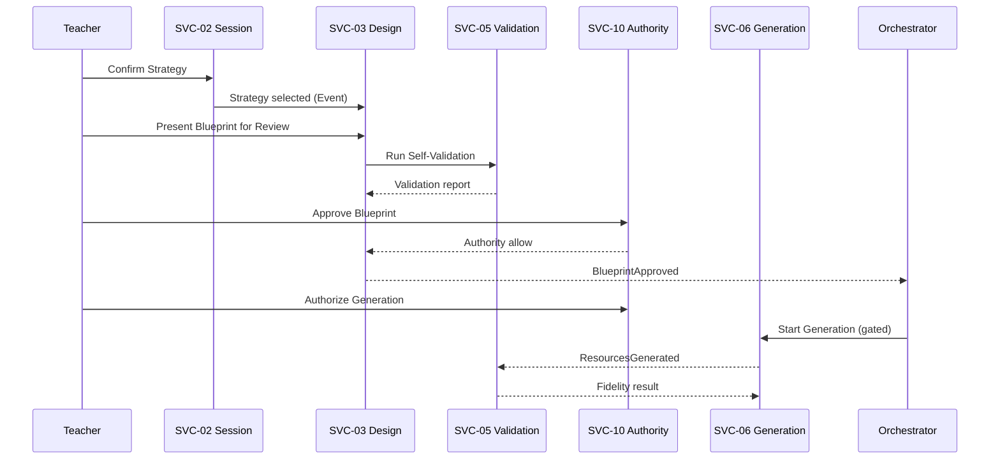
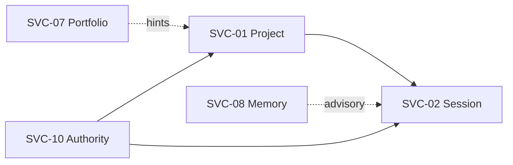

# PAS-003 — PRIMA Service Architecture

# 1. Document Metadata

| Field | Value |
|-------|-------|
| **Title** | PRIMA Service Architecture |
| **Code** | PAS-003 |
| **Version** | 1.0 |
| **Status** | Official — Canonical logical service architecture of the PRIMA platform |
| **Owner** | LUDI ON Chief Software Architect |
| **Purpose** | Define the technology-independent logical business services required by PAS-002 Domains: responsibilities, ownership, interfaces, contracts, dependencies, collaboration, and evolution |
| **Repository Location** | `docs/engineering/PAS-003_PRIMA_SERVICE_ARCHITECTURE.md` |
| **Scope** | Logical business services (SVC-*); contract model; collaboration patterns; cross-cutting services; repository mapping for service artefacts |
| **Out of scope** | Programming languages, frameworks, databases, deployment, HTTP shapes, message brokers, LLM vendors, UI kits |

> PAS-003 **extends** PAS-001 and PAS-002.  
> PAS-003 is the **canonical logical Service Architecture**.  
> Constitutional Service Contract Model remains the detailed SVC/CTR catalog; PAS-003 consolidates service architecture for the PAS series and binds services to PAS-002 Bounded Contexts.  
> **Acronym note:** PAS-001 is System Architecture; PAS-003 is Service Architecture. Prefer codes **PAS-001** / **PAS-003** in citations.  
> EOS Orchestrator is **coordination policy**, not a pedagogical business service.  
> Technology independence is mandatory: no stack, schema, or transport prescriptions.

---

# 2. Service Architecture Principles

### SAP-01 — Single Responsibility

| Field | Content |
|-------|---------|
| **Purpose** | Each service owns one coherent business collaboration responsibility |
| **Rationale** | Mixed responsibilities recreate monoliths and skip gates |
| **Architectural Consequences** | Assessment Design stays in Design Service; Assessment Resources in Generation — no combined “Assessment Service” |

### SAP-02 — Domain Ownership

| Field | Content |
|-------|---------|
| **Purpose** | Every service belongs to exactly one primary Bounded Context (PAS-002) |
| **Rationale** | Dual domain ownership dissolves accountability |
| **Architectural Consequences** | SVC IDs map to one primary BC; dual *concerns* documented without dual primary owners |

### SAP-03 — Loose Coupling

| Field | Content |
|-------|---------|
| **Purpose** | Services interact without shared mutable internals |
| **Rationale** | Shared databases create accidental architecture |
| **Architectural Consequences** | Contracts, Commands, Queries, Events only; no foreign persistence access |

### SAP-04 — High Cohesion

| Field | Content |
|-------|---------|
| **Purpose** | Keep changing-together behaviors inside one service |
| **Rationale** | Splitting Intent/Strategy/Session incorrectly multiplies chatty failures |
| **Architectural Consequences** | Design Session Service owns session cognition intake; Learning Experience Design owns Blueprint composition |

### SAP-05 — Contract First

| Field | Content |
|-------|---------|
| **Purpose** | Collaboration agreements precede implementation |
| **Rationale** | Transport-first APIs invent parallel vocabularies |
| **Architectural Consequences** | CTR-* / Command / Event / Query identities exist before workers |

### SAP-06 — Explicit Interfaces

| Field | Content |
|-------|---------|
| **Purpose** | Every service exposes named Commands, Queries, and Events |
| **Rationale** | Implicit coupling cannot be reviewed or versioned |
| **Architectural Consequences** | Undocumented interfaces are non-compliant |

### SAP-07 — Technology Independence

| Field | Content |
|-------|---------|
| **Purpose** | Service architecture outlives stacks |
| **Rationale** | Frameworks change; educational law must not |
| **Architectural Consequences** | PAS-003 forbids languages, DBs, clouds, HTTP verbs as normative content |

### SAP-08 — Service Autonomy

| Field | Content |
|-------|---------|
| **Purpose** | Services evolve and fail within their boundary |
| **Rationale** | Cascading internal knowledge of peers creates brittle systems |
| **Architectural Consequences** | Consumers tolerate provider versioning; Orchestrator coordinates lawful sequences |

### SAP-09 — Stateless Communication (where applicable)

| Field | Content |
|-------|---------|
| **Purpose** | Prefer message meaning over conversational transport session as System of Record |
| **Rationale** | Transport sessions are not business Aggregates |
| **Architectural Consequences** | ConversationSession is a Domain Aggregate; transport connections are Infrastructure and non-normative here |

### SAP-10 — Backward Compatibility

| Field | Content |
|-------|---------|
| **Purpose** | Protect Active consumers when contracts evolve |
| **Rationale** | Breaking silent changes destroy Teacher workflows |
| **Architectural Consequences** | Additive MINOR preferred; breaking changes MAJOR with deprecation window |

---

# 3. Service Identification

Services are identified per **PAS-002 Bounded Context**, not per informal “Teaching/Learning/Assessment” labels. Candidate services from legacy lists are evaluated below.

## 3.1 Candidate evaluation

| Candidate | Verdict | Justification |
|-----------|---------|---------------|
| Lesson Service | **Reject name** → subsumed by **SVC-03 Learning Experience Design Service** | “Lesson” is maturity scope of Learning Experience design, not a separate service identity |
| Scenario Service | **Reject** | “Scenario” forbidden; Blueprint ownership ∈ SVC-03 |
| Planning Service | **Reject as separate** → **SVC-02 Design Session** + **SVC-03** | Planning is Intent/Strategy/Blueprint collaboration, not a third owner |
| Learning Activity Service | **Future** (BC-LX) | Learner runtime not Active core |
| Learning Path Service | **Future / Design** → CAP-F06/F08 under Instructional Design | No separate Active service until opened |
| Progress Service | **Future** (BC-LX / Analytics) | Not pedagogical MVP core |
| Assessment Service | **Reject** | Assessment Design ∈ SVC-03; Assessment Resource ∈ SVC-06 |
| Evaluation Service | **Reject as core** → Validation (SVC-05) measures; Teacher Review ∈ Authority/Design flow | Avoids Approval confusion |
| Feedback Service | **Split** → Reflection (SVC-09) teacher side; learner feedback Future BC-LX | |
| Resource Service (as Knowledge) | **Reject name collision** → Generated **Resource** ∈ SVC-06; Knowledge substance ∈ SVC-04 | Constitutional Language |
| Knowledge Object Service | **Keep inside SVC-04** | One Knowledge Service owns packs/objects |
| Search Service | **Cross-cutting / Knowledge query facet** | Search of Knowledge is SVC-04 Query capability; global search Future under Governance |
| Communication Service | **Future** with Collaboration | |
| Notification Service | **SVC-13 Future** | Peripheral; must not gate design |
| Community Service | **Future** | Not core |
| User Management Service | **Keep as SVC-10 Teacher Authority** (+ Future org users under Governance) | Teachers are primary actors |
| Organization Service | **Future under SVC-11 / school integration** | CAP-F03 |
| Configuration Service | **Keep as SVC-11 Platform Governance** | |

## 3.2 Official service catalog

| ID | Service | Primary Domain (PAS-002) | Lifecycle | Existence justification |
|----|---------|--------------------------|-----------|-------------------------|
| **SVC-01** | Project Continuity Service | Orchestration | Active (MVP) | Projects are the unit of Continuă and archive |
| **SVC-02** | Design Session Service | Orchestration (+ Instructional Design intake) | Active (MVP) | Owns Session, Context, Intent, Understanding, Strategy propose/select |
| **SVC-03** | Learning Experience Design Service | Instructional Design | Active (MVP) | Sole design authority for Blueprint / Learning Experience |
| **SVC-04** | Knowledge Service | Knowledge | Active (MVP) | Provenance-bearing evidence for design |
| **SVC-05** | Validation Service | Validation | Active (MVP) | Measures conformance; never Approves |
| **SVC-06** | Generation Service | Generation | Active (MVP) | Produces Resources under Approval |
| **SVC-07** | Delivery & Portfolio Service | Generation + Teacher Interaction (portfolio concern) | Active (MVP) | Export + Library indexing without Authority dilution |
| **SVC-08** | Memory Service | Memory | Active (thin MVP) | Teacher-controlled personalization |
| **SVC-09** | Reflection Service | Teacher Interaction | Active (optional MVP) | Non-blocking reflection facts |
| **SVC-10** | Teacher Authority Service | Teacher Interaction | Active (MVP) | Binding authorization façade |
| **SVC-11** | Platform Governance Service | System Governance | Active (MVP) | Config, audit, Future registry |
| **SVC-12** | Collaboration Service | Teacher Interaction → BC-CO when opened | Future | Multi-teacher collaboration |
| **SVC-13** | Notification Service | System Governance (peripheral) | Future | Alerts; non-core |

**Coordination (not SVC):** EOS Orchestrator — sequences lawful service/engine collaboration; does not own pedagogy.

---

# 4. Service Specification

## 4.1 SVC-01 — Project Continuity Service

| Field | Content |
|-------|---------|
| **Mission** | Manage Projects as continuity units of Teacher work |
| **Responsibilities** | Create/rename/pause/resume/complete/archive/duplicate Projects; notes; Continuă eligibility inputs; prior-craft selection hooks |
| **Owned Business Capabilities** | CAP-C01, CAP-S04 (continuity facet), CAP-P06 |
| **Owned Business Objects** | Project |
| **Service Interfaces** | Commands: Project lifecycle, TeacherNote*, SelectPriorCraftForReuse; Queries: Project status / Continuă candidates |
| **Published Events** | Project*; TeacherNote*; PriorCraftSelectedForReuse |
| **Consumed Events** | TeacherSuspended; DeliverableExported (projection hints) |
| **Dependencies** | SVC-10 (mandatory); SVC-07/SVC-11 optional |
| **Consumers** | SVC-02; Teacher Workspace use cases |
| **Providers** | Teacher via Application Commands |
| **Lifecycle** | Active |
| **Versioning Strategy** | SemVer on contract surface; archived Projects reject new Sessions |

## 4.2 SVC-02 — Design Session Service

| Field | Content |
|-------|---------|
| **Mission** | Govern ConversationSession and design cognition intake through Strategy confirmation |
| **Responsibilities** | Session lifecycle; Working Context; Intent; Understanding; Strategy propose/select; Knowledge retrieve requests; pipeline position; reflection intake correlation |
| **Owned Business Capabilities** | CAP-C03–C06 (intake), CAP-C04, CAP-P01, CAP-P02 (with Orchestrator), CAP-P05 |
| **Owned Business Objects** | ConversationSession; EducationalIntent; InstructionalStrategy (session-scoped) |
| **Service Interfaces** | Session*, Context, Intent*, Understanding*, Strategy*, RetrieveKnowledgeEvidence, AdvancePipelinePosition |
| **Published Events** | Session*; WorkingContextAssembled; Intent*; Understanding*; Strategy*; PipelinePositionAdvanced; KnowledgeEvidenceRetrieved (corr) |
| **Consumed Events** | Blueprint*; Resource* (pipeline sync); ProjectArchived |
| **Dependencies** | SVC-01, SVC-03, SVC-04, SVC-10 mandatory; Validation/Generation/Memory/Reflection optional |
| **Consumers** | Orchestrator; SVC-03; Teacher |
| **Providers** | Teacher; Knowledge evidence |
| **Lifecycle** | Active |
| **Versioning Strategy** | Cannot Approve or Generate via this service |

## 4.3 SVC-03 — Learning Experience Design Service

| Field | Content |
|-------|---------|
| **Mission** | Compose and version Instructional Blueprints and Learning Experiences |
| **Responsibilities** | Draft/revise Blueprint; mint versions; present for review; hold Approval records; Assessment Design as design VO |
| **Owned Business Capabilities** | CAP-S01, CAP-C07, CAP-C18, CAP-P08; Assessment Design facet |
| **Owned Business Objects** | LearningExperience; InstructionalBlueprint; BlueprintVersion; TeacherApproval (record) |
| **Service Interfaces** | CreateBlueprintDraft; ReviseBlueprintStructure; MintBlueprintVersion; PresentBlueprintForReview; RequestBlueprintRevision; ApproveBlueprint (Teacher-only via SVC-10) |
| **Published Events** | LearningExperienceInitiated; Blueprint*; BlueprintApproved; ApprovalSuperseded |
| **Consumed Events** | InstructionalStrategySelected; BlueprintSelfValidation*; SessionAbandoned |
| **Dependencies** | SVC-01, SVC-02, SVC-05, SVC-10 mandatory; Knowledge optional |
| **Consumers** | SVC-05; SVC-06 (post-Approval); Teacher Review |
| **Providers** | SVC-02 Strategy confirmation |
| **Lifecycle** | Active |
| **Versioning Strategy** | BlueprintVersion identity immutable once minted; supersession explicit |

## 4.4 SVC-04 — Knowledge Service

| Field | Content |
|-------|---------|
| **Mission** | Curate and retrieve attributable Knowledge |
| **Responsibilities** | Publish/deprecate KnowledgePacks; assemble Knowledge Packages for cognitive acts; KnowledgeObject integrity |
| **Owned Business Capabilities** | CAP-S03, CAP-C15 |
| **Owned Business Objects** | KnowledgePack; KnowledgeObject |
| **Service Interfaces** | Publish/DeprecateKnowledgePack; RetrieveKnowledgeEvidence (fulfillment); Knowledge search Queries |
| **Published Events** | KnowledgePackPublished/Deprecated; KnowledgeEvidenceRetrieved |
| **Consumed Events** | — (primarily query-driven) |
| **Dependencies** | SVC-11 (lineage/governance) |
| **Consumers** | SVC-02; SVC-03; SVC-05 |
| **Providers** | Curators; external Knowledge Sources via Integration Ports |
| **Lifecycle** | Active |
| **Versioning Strategy** | Pack versions provenance-bearing; Memory ≠ Knowledge |

## 4.5 SVC-05 — Validation Service

| Field | Content |
|-------|---------|
| **Mission** | Validate designs and resource fidelity without granting Authority |
| **Responsibilities** | Blueprint Self-Validation; Resource Realization fidelity |
| **Owned Business Capabilities** | CAP-C08, CAP-C11 |
| **Owned Business Objects** | ValidationReport; ValidationRule catalog |
| **Service Interfaces** | RunBlueprintSelfValidation; RunResourceFidelityValidation; Query reports |
| **Published Events** | BlueprintSelfValidation*; ResourceFidelityValidation* |
| **Consumed Events** | BlueprintDraftCreated/StructureRevised; ResourcesGenerated |
| **Dependencies** | SVC-03, SVC-06; Knowledge optional |
| **Consumers** | Orchestrator gates; Teacher Review |
| **Providers** | Design/Generation aggregates by ID |
| **Lifecycle** | Active |
| **Versioning Strategy** | Never mutates Blueprint/Resources; never Approves |

## 4.6 SVC-06 — Generation Service

| Field | Content |
|-------|---------|
| **Mission** | Produce Resources under Teacher Authorization |
| **Responsibilities** | Authorize/start generation; produce drafts; regenerate; persist craft edits; Assessment Resources |
| **Owned Business Capabilities** | CAP-C10; Future CAP-F07 |
| **Owned Business Objects** | GenerationPackage; Resource |
| **Service Interfaces** | AuthorizeResourceGeneration; StartResourceGeneration; RegenerateResource; RecordResourceEdit; MarkResourceReady |
| **Published Events** | ResourceGeneration*; ResourcesGenerated; ResourceEdited; ResourceMarkedReady; Regeneration* |
| **Consumed Events** | BlueprintApproved; Fidelity*; TeacherSuspended |
| **Dependencies** | SVC-01, SVC-03, SVC-05, SVC-10 mandatory |
| **Consumers** | SVC-07; Teacher craft |
| **Providers** | Orchestrator after Approval gate |
| **Lifecycle** | Active |
| **Versioning Strategy** | No design authority; no auto-start on Approve alone |

## 4.7 SVC-07 — Delivery & Portfolio Service

| Field | Content |
|-------|---------|
| **Mission** | Export deliverables and maintain Library portfolio indexes |
| **Responsibilities** | ExportPackage assembly; LibraryEntry visibility |
| **Owned Business Capabilities** | CAP-C13, CAP-C14 (portfolio facet) |
| **Owned Business Objects** | ExportPackage; LibraryEntry |
| **Service Interfaces** | ExportDeliverable; HideLibraryEntry; Library Queries |
| **Published Events** | DeliverableExported; LibraryEntryIndexed/Hidden |
| **Consumed Events** | ResourceMarkedReady; ProjectArchived |
| **Dependencies** | SVC-01, SVC-06, SVC-10 mandatory |
| **Consumers** | Teacher Workspace; Continuă projections |
| **Providers** | Generation Ready resources |
| **Lifecycle** | Active |
| **Versioning Strategy** | Teacher-only Export; Library is non-Authority |

## 4.8 SVC-08 — Memory Service

| Field | Content |
|-------|---------|
| **Mission** | Teacher-controlled durable preferences |
| **Responsibilities** | Propose/accept/reject/delete MemoryItems; maintain MemoryProfile |
| **Owned Business Capabilities** | CAP-C17 |
| **Owned Business Objects** | MemoryProfile; MemoryItem |
| **Service Interfaces** | Propose/Accept/Reject/DeleteMemoryItem; Memory Queries |
| **Published Events** | MemoryItem* |
| **Consumed Events** | ReflectionCaptured; read views of WorkingContext |
| **Dependencies** | SVC-09, SVC-10; **forbid Knowledge writes** |
| **Consumers** | SVC-02 Continuă (advisory) |
| **Providers** | Reflection; Teacher |
| **Lifecycle** | Active (thin) |
| **Versioning Strategy** | No sensitive auto-learn without Teacher Accept |

## 4.9 SVC-09 — Reflection Service

| Field | Content |
|-------|---------|
| **Mission** | Capture non-blocking reflection facts |
| **Responsibilities** | Capture ReflectionRecords; signal Memory proposals |
| **Owned Business Capabilities** | CAP-C16 |
| **Owned Business Objects** | ReflectionRecord |
| **Service Interfaces** | CaptureReflection |
| **Published Events** | ReflectionCaptured |
| **Consumed Events** | SessionCompleted; BlueprintApproved; DeliverableExported (optional triggers) |
| **Dependencies** | SVC-02; SVC-08 |
| **Consumers** | Memory; Analytics (Future) |
| **Providers** | Teacher |
| **Lifecycle** | Active (optional MVP) |
| **Versioning Strategy** | Never blocks exit paths |

## 4.10 SVC-10 — Teacher Authority Service

| Field | Content |
|-------|---------|
| **Mission** | Assert Teacher identity and binding authorization |
| **Responsibilities** | Register/suspend Teacher; authorize Approve / AuthorizeGenerate / Export / SelectStrategy |
| **Owned Business Capabilities** | CAP-S02 (authority), CAP-C09 (authorization facet), CAP-C12 authority checks |
| **Owned Business Objects** | Teacher |
| **Service Interfaces** | RegisterTeacher; SuspendTeacher; Authorization checks for binding Commands |
| **Published Events** | TeacherRegistered; TeacherSuspended |
| **Consumed Events** | — |
| **Dependencies** | SVC-11 optional |
| **Consumers** | All services performing binding acts |
| **Providers** | Identity plane (cross-cutting AuthN feeds this service’s business view) |
| **Lifecycle** | Active |
| **Versioning Strategy** | AI never passes as Teacher for binding Commands |

## 4.11 SVC-11 — Platform Governance Service

| Field | Content |
|-------|---------|
| **Mission** | Configuration, audit, and Future capability/domain registry |
| **Responsibilities** | PlatformConfiguration; audit append; failure visibility; register Future services/domains |
| **Owned Business Capabilities** | CAP-P03, CAP-P04, CAP-P07; Future CAP-F02–F05 registry |
| **Owned Business Objects** | PlatformConfiguration; Audit stream |
| **Service Interfaces** | ChangePlatformConfiguration; Audit append; Registry Queries |
| **Published Events** | PlatformConfigurationChanged; DomainFailureRecorded |
| **Consumed Events** | Material Approvals/Exports/Failures |
| **Dependencies** | Soft to all (audit); never owns pedagogy |
| **Consumers** | Administrators; all services (config/audit) |
| **Providers** | System; Admin |
| **Lifecycle** | Active |
| **Versioning Strategy** | Config never replaces Instructional Strategy |

## 4.12 SVC-12 — Collaboration Service (Future)

| Field | Content |
|-------|---------|
| **Mission** | Multi-teacher Project collaboration without default Approve rights |
| **Responsibilities** | Membership; share grants; co-author policies |
| **Owned Business Capabilities** | CAP-F01 (when opened) |
| **Owned Business Objects** | CollaborationSpace; ShareGrant (Future) |
| **Service Interfaces** | TBD at opening |
| **Published Events** | Future Official collaboration Events |
| **Consumed Events** | Project* |
| **Dependencies** | SVC-01, SVC-10, SVC-11 |
| **Consumers** | Institutional Teachers |
| **Providers** | Teacher invites |
| **Lifecycle** | Future |
| **Versioning Strategy** | Must not grant Teacher Approval by membership alone |

## 4.13 SVC-13 — Notification Service (Future)

| Field | Content |
|-------|---------|
| **Mission** | Optional Teacher alerts |
| **Responsibilities** | Notify on selected Events (e.g. GenerationFailed) |
| **Owned Business Capabilities** | Peripheral supporting |
| **Owned Business Objects** | NotificationPreference (Future) |
| **Service Interfaces** | Subscribe/Notify |
| **Published Events** | NotificationDispatched (Future) |
| **Consumed Events** | Selected failure/completion Events |
| **Dependencies** | MUST NOT become mandatory for design happy path |
| **Consumers** | Teachers |
| **Providers** | Event bus consumers |
| **Lifecycle** | Future |
| **Versioning Strategy** | Fail-open relative to pedagogy |

---

# 5. Service Contracts

## 5.1 Logical contract model

A **Service Contract** is a stable business collaboration agreement (CTR-* in Constitutional Service Contract Model). It is not an API route.

| Element | Definition |
|---------|------------|
| **Commands** | Imperative requests to change state inside the owning service |
| **Queries** | Side-effect-free reads returning Read Models / VOs |
| **Events** | Immutable past facts published after successful state change |
| **Responses** | Business outcomes: Accepted / Rejected / Completed with result identities |
| **Error Conditions** | Domain failures (policy deny, invariant break, not found, conflict) — fail-visible |
| **Idempotency** | Commands with business idempotency keys SHALL be safely retriable |
| **Consistency Expectations** | Aggregate write consistency inside owner; cross-service eventual consistency via Events unless Orchestrator saga specifies otherwise |
| **Versioning Rules** | Additive fields MINOR; removing/renaming meaning MAJOR; deprecated contracts retained for compatibility window |

## 5.2 Contract rules

1. Commands enter **one** owning service.  
2. Events exit for others to Consume.  
3. No contract Approves Blueprints or Exports except via Teacher Authority.  
4. Contract vocabulary SHALL use Constitutional Language only.  
5. Detailed CTR-* catalog lives in Constitutional Service Contract Model; PAS-003 owns architecture rules for contracts.

## 5.3 Error condition classes (logical)

| Class | Meaning |
|-------|---------|
| **AuthorityDenied** | SVC-10 rejected binding act |
| **InvariantViolation** | Aggregate rule broken |
| **PrerequisiteMissing** | Upstream Event/state absent (e.g. no Approval) |
| **ValidationBlocked** | SVC-05 blocked progression |
| **Conflict** | Concurrent version conflict |
| **NotFound** | Unknown identity |

---

# 6. Service Collaboration

## 6.1 Allowed communication patterns

| Pattern | Use |
|---------|-----|
| **Request / Response** | Commands and Queries to owning service |
| **Event Driven** | Cross-service state notification |
| **Asynchronous Messaging** | Logical async delivery of Commands/Events (transport non-normative) |
| **Workflow Orchestration** | EOS Orchestrator sequences lawful multi-service flows |
| **Saga** | Long-running Generation/Export compensations coordinated by Orchestrator without shared DB transactions |

## 6.2 Design → Approve → Generate collaboration

## 6.3 Continuă collaboration (simplified)

---

# 7. Dependency Rules

| ID | Rule |
|----|------|
| **SDR-01** | Services SHALL communicate through contracts only |
| **SDR-02** | Services SHALL NOT access another service’s internal data or persistence model |
| **SDR-03** | Business ownership SHALL remain inside the owning Domain/service |
| **SDR-04** | No cyclic **mandatory** write dependencies SHALL exist among SVC-01…11 |
| **SDR-05** | Design SHALL NOT Command Generation directly — only Events/eligibility via Orchestrator |
| **SDR-06** | Memory SHALL NOT write Knowledge |
| **SDR-07** | Generation SHALL NOT own Blueprint meaning |
| **SDR-08** | Validation SHALL NOT Approve |
| **SDR-09** | Notification/Collaboration Future services MUST NOT become mandatory for MVP happy path |
| **SDR-10** | Dependency matrix in Constitutional Service Contract Model is normative detail; PAS-003 owns the rules |

---

# 8. Cross-Cutting Services

Cross-cutting concerns are **platform planes** (PAS-001) that interact with business services but are not pedagogical SVC owners unless listed.

| Concern | Ownership | Interaction |
|---------|-----------|-------------|
| **Authentication** | Security Platform / Identity adapters | Feeds identity into SVC-10 business Teacher view |
| **Authorization** | SVC-10 for binding pedagogical acts; Security plane for technical AuthZ | Binding Commands MUST pass SVC-10 |
| **Logging** | Observability plane | Correlation ids across Orchestrator; no Domain ownership |
| **Monitoring** | Observability plane | Health/latency; MUST NOT redefine business Outcomes |
| **Notification** | SVC-13 Future | Optional Event consumer |
| **Search** | Knowledge search Queries on SVC-04; global search Future under SVC-11 | Must not invent Knowledge |
| **Audit** | SVC-11 | Consumes material Authority/Export/Failure Events |
| **Configuration** | SVC-11 | PlatformConfiguration only |
| **Scheduling** | Infrastructure / Orchestrator timers | Triggers Commands; does not own Aggregates |

---

# 9. Service Evolution

| Change | Rule |
|--------|------|
| **Adding services** | Justify via PAS-002 Domain; assign SVC-ID; define contracts; ADR; update catalogs |
| **Splitting services** | Preserve single Aggregate ownership; migrate contracts with dual-run window |
| **Merging services** | ADR proving cohesion; retire ID; no silent rename of Authority boundaries |
| **Deprecating services** | Deprecated → successor → compatibility window → Archived; IDs not reused |
| **Contract evolution** | Additive MINOR; semantic break MAJOR; publish migration notes |
| **Compatibility strategy** | Active consumers supported through deprecation window; Orchestrator feature-flags MUST NOT bypass Authority |

---

# 10. Repository Mapping

Logical service artefacts map to ES-001 foundation (technology-independent paths):

| Requested path | Authoritative mapping |
|----------------|----------------------|
| **src/services/** | **Do not** place business services inside transitional UI `src/`. Service application façades → `packages/application` / future service hosts; Engines implement specialized execution |
| **docs/services/** | This specification + Constitutional Service Contract Model; optional notes under `docs/engineering/services/` |
| **contracts/** | `packages/contracts` (Commands, Events, Ports, CTR identities) |
| **events/** | Event definitions in contracts + Constitutional Event Model |
| **interfaces/** | Ports/interfaces in `packages/contracts` (not framework controllers) |
| **tests/services/** | Contract/service tests under package tests and `tests/` |

| Service | Indicative package home |
|---------|-------------------------|
| SVC-01 | `packages/project` / eos continuity |
| SVC-02 | `packages/application` + session engines |
| SVC-03 | `packages/engines/blueprint` + domain |
| SVC-04 | `packages/engines/knowledge` |
| SVC-05 | `packages/engines/validation` |
| SVC-06 | `packages/engines/generation` |
| SVC-07 | `packages/delivery` |
| SVC-08 | `packages/engines/memory` |
| SVC-09 | reflection in application/engines |
| SVC-10 | `packages/authority` |
| SVC-11 | `packages/governance` |

---

# 11. Compliance Rules

| ID | Rule |
|----|------|
| **PSA-S01** | Every service SHALL belong to exactly one primary Domain (PAS-002). |
| **PSA-S02** | Every service SHALL expose an explicit contract (Commands/Queries/Events). |
| **PSA-S03** | Every service SHALL own its business logic within its boundary. |
| **PSA-S04** | Services SHALL NOT share persistence models. |
| **PSA-S05** | Cross-domain communication SHALL occur only through published contracts. |
| **PSA-S06** | Service interfaces SHALL remain backward compatible whenever feasible. |
| **PSA-S07** | PAS-003 SHALL remain technology-independent. |
| **PSA-S08** | PAS-003 SHALL extend and conform to PAS-001 and PAS-002. |
| **PSA-S09** | Assessment SHALL NOT exist as a separate core business service. |
| **PSA-S10** | Scenario/Lesson SHALL NOT be Official service identities. |
| **PSA-S11** | Validation Service MUST NOT Approve Blueprints or Exports. |
| **PSA-S12** | Generation Service MUST NOT own Instructional Design meaning. |
| **PSA-S13** | Teacher Authority checks SHALL gate binding Commands. |
| **PSA-S14** | AI MUST NOT satisfy SVC-10 as Teacher for binding acts. |
| **PSA-S15** | EOS Orchestrator SHALL NOT replace service contracts. |
| **PSA-S16** | Memory Service SHALL NOT write Knowledge. |
| **PSA-S17** | Notification Service MUST NOT be a mandatory dependency of design flows. |
| **PSA-S18** | Future services SHALL be registered before implementation. |
| **PSA-S19** | No cyclic mandatory write dependencies among Active services. |
| **PSA-S20** | Commands SHALL enter exactly one owning service. |
| **PSA-S21** | Events SHALL be past-tense business facts. |
| **PSA-S22** | Idempotent Command semantics SHALL be defined for retriable acts. |
| **PSA-S23** | Contract breaking changes REQUIRE MAJOR versioning and deprecation. |
| **PSA-S24** | Cross-cutting AuthN/Logging/Monitoring SHALL NOT own pedagogical Aggregates. |
| **PSA-S25** | Business service code SHALL NOT live under transitional UI `src/` as System of Record. |
| **PSA-S26** | SVC identifiers SHALL NOT be reused after Archive. |
| **PSA-S27** | Delivery & Portfolio MUST NOT grant Teacher Approval. |
| **PSA-S28** | Collaboration membership MUST NOT imply Approve rights by default. |
| **PSA-S29** | PAS-004+ specs touching services SHALL reference PAS-003. |
| **PSA-S30** | On conflict with informal service lists, Official catalog (§3.2) wins. |

---

# 12. Dependencies

| Relation | Targets |
|----------|---------|
| **Requires** | PAS-001; PAS-002; Constitutional Service Contract Model; Command/Event/Query/Capability/Language models |
| **Required By** | PAS-004; PAS-005; PAS-006; subsequent PAS-xxx service/system specs |
| **Supersedes** | Informal service lists inventing Assessment/Scenario/Lesson services as core |
| **Superseded By** | None |
| **Extends** | PAS-001; PAS-002 |

---

# 13. Quality Checklist

| Check | Status |
|-------|--------|
| Service architecture complete | ✓ |
| Services identified | ✓ |
| Responsibilities defined | ✓ |
| Ownership complete | ✓ |
| Contracts specified | ✓ |
| Dependencies documented | ✓ |
| Collaboration defined | ✓ |
| Evolution strategy complete | ✓ |
| Repository mapping complete | ✓ |
| Compliance rules complete (PSA-S01…S30) | ✓ |

---

## Document Control

| Item | Value |
|------|-------|
| **Code** | PAS-003 |
| **Title** | PRIMA Service Architecture |
| **Version** | 1.0 |
| **Status** | Official — Canonical |
| **Location** | `docs/engineering/PAS-003_PRIMA_SERVICE_ARCHITECTURE.md` |
| **Authority** | Canonical logical service architecture; extends PAS-001 and PAS-002 |
