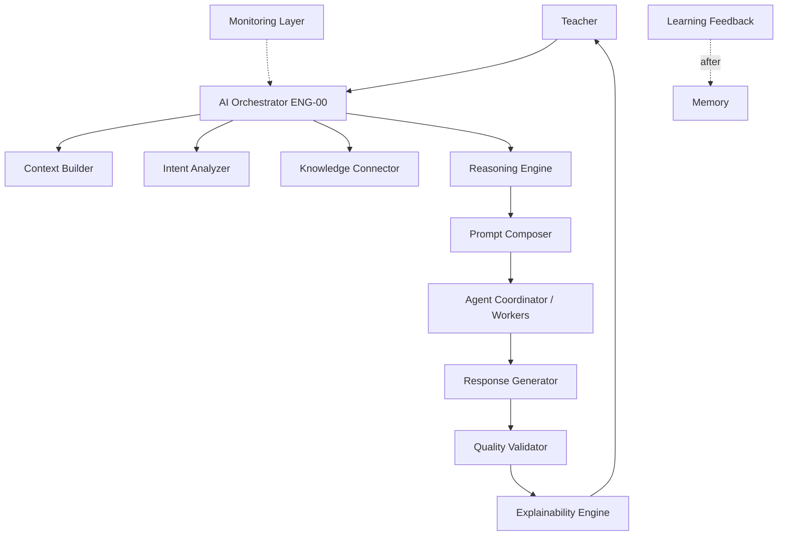

# PAS-005 — PRIMA AI Architecture (PAIA)

# 1. Document Metadata

| Field | Value |
|-------|-------|
| **Title** | PRIMA AI Architecture (PAIA) |
| **Code** | PAS-005 |
| **Version** | 1.0 |
| **Status** | Official — Canonical / constitutional AI architecture of PRIMA |
| **Owner** | LUDI ON Chief AI Architect |
| **Purpose** | Define how AI is orchestrated, governed, validated, explained, monitored, and integrated — model- and vendor-agnostic |
| **Repository Location** | `docs/engineering/PAS-005_PRIMA_AI_ARCHITECTURE.md` |
| **Scope** | Conceptual AI Layer; agent/worker roles; reasoning lifecycle; Knowledge integration; prompt orchestration (PPEF); governance; safety; observability |
| **Out of scope** | Specific LLM vendors, model names, API SDKs, GPU clouds, prompt text corpora, UI chat widgets |

> PAS-005 **extends** PAS-001…PAS-004.  
> PAS-005 is the **constitutional AI Architecture**.  
> **POSS/CEA rule:** PRIMA is an Educational Operating System; **AI are workers** implementing Engines behind Integration Ports. Workers MUST NOT redefine Engines, Policies, or Teacher Authority.  
> AI Layer components (§4) are **conceptual roles** mapped to EOS Orchestrator, Engines (ENG-00…10), Services (SVC-*), and Ports — not a parallel pipeline that replaces EOS.  
> Legacy `docs/AI_ARCHITECTURE.md` (Draft) SHALL align to PAS-005; on conflict, **PAS-005 + POSS/CEA win**.  
> Model-agnostic: any compliant worker MAY implement an Engine Port.

---

# 2. AI Vision

## 2.1 AI Mission

Assist Teachers in instructional design through governed, explainable, knowledge-grounded intelligence under Human-in-the-Loop Authority.

## 2.2 Educational Purpose

Raise pedagogical quality and speed of design without transferring classroom responsibility from Teachers to models.

## 2.3 Human-Centered AI

Teachers orient, correct, select Strategy, Approve Blueprints, authorize Generation, craft, and Export. AI proposes and drafts; humans bind.

## 2.4 Responsible AI

Fail-visible errors; no silent invention of Knowledge; no forged Approvals; privacy and educational safety by design; audit of material AI-influenced acts.

## 2.5 Long-term AI Strategy

- Keep Engines stable; replace workers/models freely.  
- Deepen Knowledge grounding (PAS-004).  
- Expand worker specialization without inventing parallel Engine catalogs.  
- Maintain PPEF discipline for architectural and runtime prompts.  
- Open Future learner-facing AI only under Authorization chain (PAS-002 BC-LX).

## 2.6 AI Success Criteria

| Criterion | Signal |
|-----------|--------|
| Authority intact | Zero AI-attributed BlueprintApproved / DeliverableExported |
| Knowledge-first | Design/Generation runs cite Packages or Unsupported Marks |
| Explainability | Teacher-visible rationale for significant proposals |
| Replaceability | Worker swap without Engine Mission change |
| Safety | Injection/leakage incidents fail closed with audit |
| Pedagogy | Validation ≠ Approval; Design precedes Generation |

---

# 3. AI Architecture Principles

### AIP-01 — AI Assists Humans

| Field | Content |
|-------|---------|
| **Purpose** | Preserve Teacher Authority |
| **Architectural Consequences** | Binding Commands require SVC-10; AI never Approves/Exports |

### AIP-02 — Knowledge Before Generation

| Field | Content |
|-------|---------|
| **Purpose** | Ground outputs in PAS-004 evidence |
| **Architectural Consequences** | Knowledge retrieval before Generation; Unsupported Mark when absent |

### AIP-03 — Explainability by Default

| Field | Content |
|-------|---------|
| **Purpose** | Teachers understand why |
| **Architectural Consequences** | Significant proposals carry citations and rationale VOs |

### AIP-04 — Human Validation

| Field | Content |
|-------|---------|
| **Purpose** | Keep Humans in the Loop at gates |
| **Architectural Consequences** | Strategy select, Blueprint Approve, Generation authorize, Export are Teacher acts |

### AIP-05 — AI Independence (from Domain write models)

| Field | Content |
|-------|---------|
| **Purpose** | Workers do not own Aggregates |
| **Architectural Consequences** | AI accesses Domains only via Services/Ports; no direct persistence |

### AIP-06 — Model Agnostic

| Field | Content |
|-------|---------|
| **Purpose** | Architecture outlives vendors |
| **Architectural Consequences** | No normative model/provider; Ports abstract workers |

### AIP-07 — Reproducibility

| Field | Content |
|-------|---------|
| **Purpose** | Comparable outcomes under pinned inputs |
| **Architectural Consequences** | Pin Knowledge Versions, Prompt Versions, worker capability declarations; record seeds/params when available |

### AIP-08 — Safety by Design

| Field | Content |
|-------|---------|
| **Purpose** | Prevent harm and abuse |
| **Architectural Consequences** | Role isolation, injection defenses, content safety checks before Teacher delivery of drafts |

### AIP-09 — Educational Alignment

| Field | Content |
|-------|---------|
| **Purpose** | Optimize for pedagogical integrity |
| **Architectural Consequences** | EOS Policies and Validation gate fluency-optimized shortcuts |

### AIP-10 — Traceability

| Field | Content |
|-------|---------|
| **Purpose** | Reconstruct AI-influenced decisions |
| **Architectural Consequences** | Decision history, Knowledge usage, Prompt Version, worker id on material Events |

### AIP-11 — Design Before Execution

| Field | Content |
|-------|---------|
| **Purpose** | Preserve Blueprint contract |
| **Architectural Consequences** | No Resource Generation without approved Blueprint Version |

### AIP-12 — Validates ≠ Approves

| Field | Content |
|-------|---------|
| **Purpose** | Separate measurement from Authority |
| **Architectural Consequences** | Quality Validator / ENG-07 never grants Teacher Approval |

---

# 4. AI Layer Architecture

Conceptual AI Layer. Each component maps to EOS/PAS owners.

| Component | Responsibility | Maps to |
|-----------|----------------|---------|
| **Intent Analyzer** | Structure Teacher educational intent signals | ENG-03 Intent Engine + SVC-02 |
| **AI Orchestrator** | Lawful sequencing, gates, correlation — **not** pedagogy author | ENG-00 EOS Orchestrator |
| **Reasoning Engine** | Understanding, Strategy proposal, design reasoning under Policies | ENG-04, ENG-05 (+ Cognitive Model) |
| **Knowledge Connector** | Pull Knowledge Packages; never push pedagogy | ENG-02 / SVC-04 · PAS-004 |
| **Context Builder** | Assemble Working Context for the act | ENG-01 Context Engine + SVC-02 |
| **Prompt Composer** | Compose versioned prompts from PPEF templates + Context/Knowledge injections | PPEF runtime composer behind worker Ports |
| **AI Agent Coordinator** | Dispatch specialized **workers** for Engine Ports; enforce role isolation | Orchestrator + worker registry (Infra Port) |
| **Response Generator** | Produce draft design fragments or Resource drafts when authorized | ENG-06 design assist / ENG-08 Generation workers |
| **Quality Validator** | Self- and Realization validation; fail-visible | ENG-07 / SVC-05 |
| **Explainability Engine** | Assemble citations, rationales, decision traces for Teacher surfaces | Cross-cutting; consumes Events + Provenance |
| **Learning Feedback Engine** | Reflection intake → Memory proposals (Teacher-controlled) | ENG-09 / ENG-10 · SVC-08/09 |
| **Monitoring Layer** | Observability of AI runs: latency, failures, safety signals | Observability plane + SVC-11 audit |



**Rule:** Components do not invent Engines. New AI capabilities extend workers or Future registered services — not shadow Engines.

---

# 5. AI Agent Architecture

**Definition:** An **AI Agent** in PAIA is a **specialized worker role** implementing one or more Engine/Service Ports under Orchestrator dispatch. Agents are **not** Bounded Contexts and **not** substitute Engines.

## 5.1 Candidate evaluation

| Candidate | Verdict | Official mapping |
|-----------|---------|------------------|
| Lesson Design Agent | **Keep as worker role** | Assists ENG-04/05/06 — Learning Experience design drafts |
| Assessment Agent | **Split** | Assessment **design** assist ∈ Design workers; Assessment **resource** draft ∈ Generation workers — no Assessment Engine |
| Resource Recommendation Agent | **Keep thin** | Ranked Knowledge/Library hints only — not auto-Apply |
| Scenario Builder Agent | **Reject name** | Scenario forbidden → Blueprint/Design workers |
| Learning Analytics Agent | **Future** | Analytics Domain / Reflection signals |
| Pedagogical Advisor Agent | **Keep** | Strategy/Understanding proposal workers (Teacher Select) |
| Curriculum Alignment Agent | **Keep** | Knowledge Connector + Validation assist (KD-01) |
| Research Assistant Agent | **Keep advisory** | Knowledge discovery assist — quarantine external claims |
| Content Review Agent | **Keep** | Pre-delivery draft review assist + ENG-07 |
| Quality Assurance Agent | **Keep** | Supports Validation Service — never Approves |

## 5.2 Official agent roles (Active / Future)

### AGA-01 — Design Assist Agent

| Field | Content |
|-------|---------|
| **Mission** | Draft Understanding/Strategy/Blueprint fragments for Teacher review |
| **Capabilities** | Propose structures; revise on feedback; cite Knowledge |
| **Knowledge Required** | KD-01/02 Packages |
| **Inputs** | Intent, Context, Knowledge Package, Teacher edits |
| **Outputs** | Draft design artifacts + rationale |
| **Dependencies** | Context, Knowledge Connector, Prompt Composer, SVC-02/03 |
| **Constraints** | Cannot Approve; cannot Generate Resources |
| **Lifecycle** | Active |

### AGA-02 — Pedagogical Advisor Agent

| Field | Content |
|-------|---------|
| **Mission** | Propose Instructional Strategies with explanations |
| **Capabilities** | Strategy candidates; differentiation hints |
| **Knowledge Required** | KD-02/04 |
| **Inputs** | Understanding, Context, Knowledge |
| **Outputs** | Strategy proposals |
| **Dependencies** | ENG-05 Port; Teacher Select mandatory |
| **Constraints** | Teacher selects; AI does not auto-confirm |
| **Lifecycle** | Active |

### AGA-03 — Curriculum Alignment Agent

| Field | Content |
|-------|---------|
| **Mission** | Align drafts to curriculum/competency Knowledge |
| **Capabilities** | Gap flags; alignment citations |
| **Knowledge Required** | KD-01 Authoritative |
| **Inputs** | Draft Blueprint/Intent; Packages |
| **Outputs** | Alignment report fragments |
| **Dependencies** | Knowledge Connector; Validation |
| **Constraints** | Unsupported Mark if curriculum missing |
| **Lifecycle** | Active |

### AGA-04 — Assessment Design Assist Agent

| Field | Content |
|-------|---------|
| **Mission** | Assist Assessment Design inside Blueprint (not scoring students) |
| **Capabilities** | Rubric/pattern suggestions from KD-03 |
| **Knowledge Required** | KD-03 |
| **Inputs** | Blueprint draft; competencies |
| **Outputs** | Assessment Design VO suggestions |
| **Dependencies** | Design Service SVC-03 |
| **Constraints** | No student gradebook; no separate Assessment Engine |
| **Lifecycle** | Active |

### AGA-05 — Generation Worker Agent

| Field | Content |
|-------|---------|
| **Mission** | Draft Resources after Authorization |
| **Capabilities** | Resource drafts; regen under Policy |
| **Knowledge Required** | Citations from approved Blueprint/Packages |
| **Inputs** | Approved Blueprint Version; Authorization; Context |
| **Outputs** | Resource drafts in GenerationPackage |
| **Dependencies** | ENG-08; SVC-06; SVC-10 |
| **Constraints** | No start without Authorization; fidelity Validation follows |
| **Lifecycle** | Active |

### AGA-06 — Content Review / QA Assist Agent

| Field | Content |
|-------|---------|
| **Mission** | Flag draft issues before Teacher delivery |
| **Capabilities** | Heuristic/pedagogical checks feeding ENG-07 |
| **Knowledge Required** | Rules + relevant Packages |
| **Inputs** | Drafts; Validation context |
| **Outputs** | Findings candidates |
| **Dependencies** | SVC-05 |
| **Constraints** | Does not Approve or mute Failures |
| **Lifecycle** | Active |

### AGA-07 — Research Assistant Agent

| Field | Content |
|-------|---------|
| **Mission** | Help discover/quarantine external knowledge candidates |
| **Capabilities** | Candidate proposals → Generated-candidate Objects |
| **Knowledge Required** | Existing Packs for dedup |
| **Inputs** | Research query; steward scope |
| **Outputs** | Quarantine candidates |
| **Dependencies** | PAS-004 governance; SVC-04 |
| **Constraints** | Never auto-Publish Authoritative |
| **Lifecycle** | Active (steward tooling) |

### AGA-08 — Resource Recommendation Agent

| Field | Content |
|-------|---------|
| **Mission** | Rank Library/Knowledge pattern suggestions |
| **Capabilities** | Ranked lists |
| **Knowledge Required** | KD-07 patterns; Library read models |
| **Inputs** | Context; Project hints |
| **Outputs** | Recommendations |
| **Dependencies** | SVC-07 read; Knowledge search |
| **Constraints** | Non-binding; Continuă may hint only |
| **Lifecycle** | Active thin |

### AGA-09 — Learning Analytics Agent

| Field | Content |
|-------|---------|
| **Mission** | Analyze teaching/design patterns |
| **Capabilities** | Aggregated insights |
| **Knowledge Required** | Operational/Reflection signals — not student PII by default |
| **Inputs** | Events; Reflection |
| **Outputs** | Analytics read models |
| **Dependencies** | Future Analytics; SVC-11 |
| **Constraints** | Privacy by Design; no Authority bypass |
| **Lifecycle** | Future |

---

# 6. AI Reasoning Pipeline

Aligned to EOS educational cognition — Orchestrator-gated.

| Stage | Purpose | Inputs | Outputs | Decision Rules | Failure Conditions |
|-------|---------|--------|---------|----------------|-------------------|
| **Intent Detection** | Capture Educational Intent | Teacher signals; Session | EducationalIntent | Teacher is source of intent meaning | Ambiguous/empty → request clarification; no silent invent |
| **Context Construction** | Bind situation | Project; Session; Memory advisory | Working Context | Context Engine owns assembly | Incomplete Context → block advance per Policy |
| **Knowledge Retrieval** | Pull evidence | Context seeds; Intent | Knowledge Package or Unsupported Mark | Pull-only; pin Versions | Knowledge unavailable → Fail visible / Unsupported |
| **Reasoning** | Understanding + Strategy proposal | Intent; Context; Package | Understanding; Strategy candidates | Teacher SelectStrategy | Policy deny; insufficient Understanding |
| **Generation** *(design or resources)* | Draft Blueprint fragments **or** Resources | Prior stage outputs; Authorization for Resources | Drafts | Design before Resource Generation; Resource requires Approval+Authorize | Unauthorized Generation attempt → Deny |
| **Validation** | Measure conformance | Drafts; Rules | ValidationReport | ENG-07; never Approve | Validator unavailable → no fake Pass |
| **Educational Verification** | Teacher review / Authority gates | Reports; drafts | Teacher edits; Approve/Refuse | SVC-10 binding | Teacher Suspended; Refuse |
| **Explainability** | Cite and justify | Provenance; decision trace | Rationale for UI | Mandatory for significant proposals | Missing citations on Authoritative claims → Fail quality gate |
| **Delivery** | Present drafts/exports | Authorized artifacts | Teacher-visible results; Export when commanded | Teacher-only Export | Export without Ready/Authority → Deny |

```
Intent Detection → Context Construction → Knowledge Retrieval → Reasoning
→ Generation → Validation → Educational Verification → Explainability → Delivery
```

Learning Feedback runs **after** material outcomes (non-blocking) into Reflection/Memory proposals.

---

# 7. Knowledge Integration

AI SHALL interact with Knowledge **only** through PAS-004 / SVC-04 / ENG-02.

| Concern | Rule |
|---------|------|
| **Knowledge Retrieval** | Pull Packages for cognitive acts; never push pedagogy |
| **Knowledge Validation** | Respect trust levels; Untrusted not Authoritative |
| **Knowledge Citation** | Outputs that claim curriculum/pedagogy MUST cite Object/Pack Versions |
| **Knowledge Versioning** | Pin Versions in run traces |
| **Knowledge Provenance** | Preserve Provenance in Explainability payloads |
| **Knowledge Graph Traversal** | Via Knowledge Connector policies — workers MUST NOT open raw stores |
| **Reasoning over Knowledge Objects** | Use Object statements + Relationships as evidence inputs |

**PAIA-K0:** AI SHALL never bypass the Knowledge Layer for educational substance claims.

---

# 8. Prompt Orchestration

Prompts are Engineering Artifacts under **PPEF** (PPS-001…006, PVC-001).

| Topic | Rule |
|-------|------|
| **Prompt Templates** | Registered PPEF templates; Official Names |
| **Prompt Strategies** | APPL patterns where architectural; runtime strategies versioned |
| **Prompt Composition** | Prompt Composer layers system/instruction/context/knowledge/tool sections |
| **Context Injection** | Working Context + act scope only — minimize PII |
| **Instruction Layering** | Policies and Authority constraints outermost; never instruct AI to Approve |
| **Memory Usage** | Teacher-accepted Memory only; advisory; never override Knowledge |
| **Tool Invocation** | Tools = declared Ports (search, validate); no undeclared domain writes |
| **Prompt Versioning** | SemVer; pin on material runs |
| **Prompt Traceability** | Run records store PromptId@version |
| **Prompt Validation** | PVC-001 profiles before Official/Release use of architectural prompts |

PPS-003 Absent ⇒ no grammar-Pass claims (PVC-001).

---

# 9. AI Governance

| Topic | Rule |
|-------|------|
| **Approval Rules** | Teacher Approval / Export Authorization only via SVC-10; AI ineligible as grantor |
| **Human Oversight** | Mandatory at Strategy select, Blueprint Approve, Generation authorize, Export |
| **Confidence Thresholds** | Low confidence ⇒ escalate to Teacher review; never auto-bind |
| **Fallback Strategies** | Worker failure → alternate worker or Fail visible; no silent degrade to uncited invention |
| **Escalation** | Safety/policy violations → Orchestrator block + audit |
| **Audit** | Material AI-influenced Events audited (SVC-11) |
| **Policy Enforcement** | POSS Policies + Orchestrator gates |
| **Risk Management** | Risk classes: Authority bypass, Knowledge invent, PII leak, educational harm — fail closed |

---

# 10. AI Quality

| Attribute | Measure (logical) |
|-----------|-------------------|
| **Correctness** | Agreement with cited Knowledge / Teacher corrections |
| **Pedagogical Accuracy** | Validation pass rates; Teacher refuse reasons |
| **Hallucination Rate** | Uncited educational claims / total claims |
| **Consistency** | Stable structure under pinned Versions |
| **Explainability** | % significant outputs with rationale+citations |
| **Traceability** | % material runs with complete decision history |
| **Fairness** | Bias review on corpora/prompts per Governance |
| **Robustness** | Behavior under incomplete Context / Unsupported Marks |
| **Reliability** | Successful lawful completions / attempts |

Metrics MUST NOT override Authority or Validation Failures.

---

# 11. AI Safety

| Control | Rule |
|---------|------|
| **Content Safety** | Block harmful/inappropriate educational drafts before Teacher delivery when detected |
| **Prompt Injection Protection** | Treat Teacher/user content as data; separate instruction layers; sanitize tool args |
| **Data Leakage Prevention** | Minimize PII in prompts; no cross-tenant Context bleed |
| **Role Isolation** | Agents/workers only declared Ports; no cross-Agent Aggregate writes |
| **Permission Boundaries** | Orchestrator enforces Command eligibility; workers cannot self-elevate |
| **Model Abuse Detection** | Anomalous tool use / exfiltration patterns → block + audit |
| **Educational Safety** | Age-appropriateness and curriculum harm checks via Validation/Knowledge policies |

---

# 12. AI Observability

| Concern | Specification |
|---------|---------------|
| **Logging** | Structured logs with correlation id (non-secret) |
| **Tracing** | End-to-end Orchestrator → Engine → worker spans |
| **Decision History** | Recorded Decisions/DEC outcomes material to gates |
| **Agent Activity** | Worker role, Prompt Version, duration, outcome |
| **Knowledge Usage** | Package/Object Versions cited per run |
| **Performance Metrics** | Latency, token/cost proxies (non-normative vendors), error rates |
| **Failure Analysis** | Fail-visible codes; link to DomainFailureRecorded |
| **Continuous Improvement** | Aggregate metrics feed Governance — not silent Prompt mutation without PPEF process |

---

# 13. Repository Mapping

| Path | Role |
|------|------|
| **ai/** | AI Architecture notes / worker capability catalogs (KD-12) — not Domain Aggregates |
| **agents/** | Agent role definitions / manifests mapping to Engine Ports |
| **reasoning/** | Reasoning pipeline docs; Cognitive Model links |
| **prompts/** | PPEF prompts (`docs/engineering/ppef/`) — authoritative for prompt artefacts |
| **orchestration/** | Orchestrator policies / gate docs (`packages/eos`) |
| **governance/** | AI governance policies; audit schemas |
| **observability/** | Trace/log conventions; dashboards configs (non-normative tools) |

Code workers live behind `infrastructure/workers` Ports; Engines under `packages/engines/*`.

---

# 14. Compliance Rules

| ID | Rule |
|----|------|
| **PAIA-C01** | AI SHALL remain model agnostic. |
| **PAIA-C02** | Every AI decision material to gates SHALL be traceable. |
| **PAIA-C03** | Every generated educational artifact SHALL include provenance metadata when claiming Knowledge. |
| **PAIA-C04** | AI SHALL retrieve Knowledge before Generation of educational substance. |
| **PAIA-C05** | AI SHALL support human review when confidence thresholds are not met. |
| **PAIA-C06** | Every AI agent SHALL define explicit responsibilities. |
| **PAIA-C07** | AI SHALL never access another Domain directly without defined service contracts. |
| **PAIA-C08** | AI SHALL never grant Teacher Approval or Export authority. |
| **PAIA-C09** | AI workers SHALL NOT redefine Engines or Policies. |
| **PAIA-C10** | AI SHALL never bypass the Knowledge Layer (PAS-004). |
| **PAIA-C11** | Unsupported Marks SHALL be used when evidence is missing. |
| **PAIA-C12** | Design SHALL precede Resource Generation. |
| **PAIA-C13** | Validation MUST NOT Approve. |
| **PAIA-C14** | Scenario Builder MUST NOT exist as Official agent identity. |
| **PAIA-C15** | Assessment SHALL NOT exist as a separate Engine/Agent owner of both design and resources. |
| **PAIA-C16** | Prompt artefacts SHALL conform to PPEF / PVC-001 when Official. |
| **PAIA-C17** | Prompt Versions SHALL be pinned on material runs. |
| **PAIA-C18** | Memory SHALL remain Teacher-controlled and advisory. |
| **PAIA-C19** | Orchestrator SHALL own lawful sequencing — peer workers MUST NOT orchestrate pedagogy. |
| **PAIA-C20** | Worker failures SHALL fail visible — no fake Pass. |
| **PAIA-C21** | Injection defenses SHALL treat user content as untrusted data. |
| **PAIA-C22** | PII minimization SHALL apply to prompt Context injection. |
| **PAIA-C23** | Role isolation SHALL prevent undeclared tool/domain writes. |
| **PAIA-C24** | Explainability SHALL accompany significant Teacher-facing proposals. |
| **PAIA-C25** | Audit SHALL record material AI-influenced Authority-adjacent Events. |
| **PAIA-C26** | Quality metrics MUST NOT override Fail Outcomes. |
| **PAIA-C27** | Future Analytics agents MUST NOT bypass Privacy or Authority. |
| **PAIA-C28** | Research Assistant MUST NOT auto-Publish Authoritative Knowledge. |
| **PAIA-C29** | Recommendations SHALL be non-binding. |
| **PAIA-C30** | PAS-005 SHALL extend PAS-001…004. |
| **PAIA-C31** | Legacy AI docs SHALL align to PAS-005 or be marked Historical. |
| **PAIA-C32** | New Engines REQUIRE CEA/POSS revision — agents alone are insufficient. |
| **PAIA-C33** | Generation workers MUST require Authorization evidence. |
| **PAIA-C34** | Fallback workers MUST preserve Knowledge citation obligations. |
| **PAIA-C35** | Observability MUST exclude secrets and raw credentials. |
| **PAIA-C36** | Continuous improvement MUST NOT silently mutate Official Prompts. |
| **PAIA-C37** | AI Independence: workers own no Domain Aggregates. |
| **PAIA-C38** | Educational Verification stages MUST remain Human-gated where constitution requires. |
| **PAIA-C39** | PAS-006+ specs involving AI SHALL reference PAS-005. |
| **PAIA-C40** | On conflict with informal AI module lists, Official Layer mapping (§4) and Agent verdicts (§5) win. |

---

# 15. Dependencies

| Relation | Targets |
|----------|---------|
| **Requires** | PAS-001; PAS-002; PAS-003; PAS-004; POSS; CEA; PPEF (PPS-001, PVC-001); ES-008/ES-009 |
| **Required By** | PAS-006; PAS-007; PAS-008; AI worker implementations; Infrastructure AI Ports |
| **Supersedes** | Informal AI architectures that treat chat pipelines as EOS or grant AI Approval |
| **Superseded By** | None |
| **Extends** | PAS-001; PAS-002; PAS-003; PAS-004 |

---

# 16. Quality Checklist

| Check | Status |
|-------|--------|
| AI vision defined | ✓ |
| AI principles complete | ✓ |
| AI layer architecture complete | ✓ |
| Agent architecture defined | ✓ |
| Reasoning pipeline specified | ✓ |
| Knowledge integration complete | ✓ |
| Prompt orchestration defined | ✓ |
| Governance complete | ✓ |
| Safety complete | ✓ |
| Observability complete | ✓ |
| Repository mapping complete | ✓ |
| Compliance rules complete (PAIA-C01…C40) | ✓ |

---

## Document Control

| Item | Value |
|------|-------|
| **Code** | PAS-005 |
| **Title** | PRIMA AI Architecture (PAIA) |
| **Version** | 1.0 |
| **Status** | Official — Constitutional |
| **Location** | `docs/engineering/PAS-005_PRIMA_AI_ARCHITECTURE.md` |
| **Authority** | Canonical AI Architecture; AI as workers under EOS; extends PAS-001…004 |
