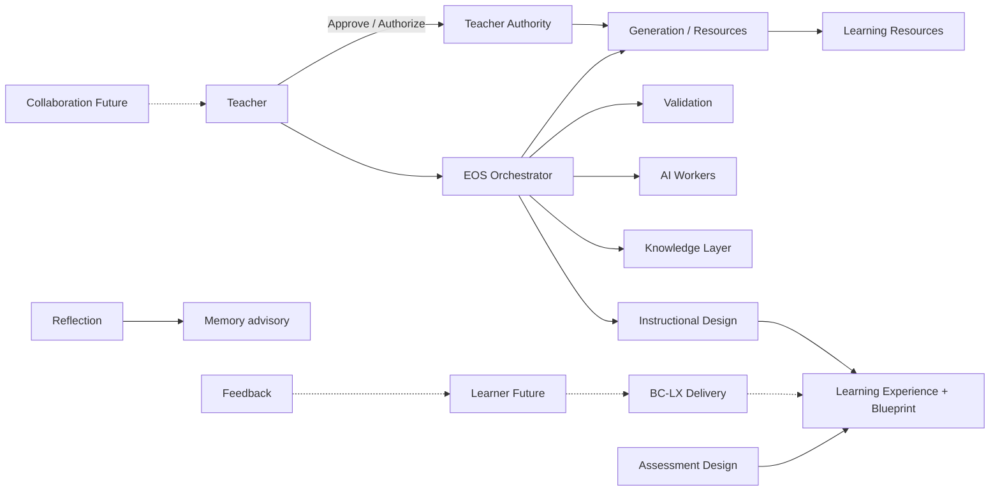

# PAS-006 — PRIMA Learning Architecture (PLA)

# 1. Document Metadata

| Field | Value |
|-------|-------|
| **Title** | PRIMA Learning Architecture (PLA) |
| **Code** | PAS-006 |
| **Version** | 1.0 |
| **Status** | Official — Constitutional Learning Architecture of PRIMA |
| **Owner** | LUDI ON Chief Learning Architect |
| **Purpose** | Define how Learning Experiences are designed, orchestrated, personalized, monitored, evaluated, and continuously improved — integrating instructional design, competency-based learning, and AI-supported pedagogy |
| **Repository Location** | `docs/engineering/PAS-006_PRIMA_LEARNING_ARCHITECTURE.md` |
| **Scope** | Pedagogical Learning Model; Learning Experience lifecycle; competency architecture; adaptive mechanisms; analytics; assessment integration; personalization; quality |
| **Out of scope** | LMS replacement as core identity; student SIS schemas; inventing Assessment Bounded Context; “Scenario” as Official design identity; AI replacing Teacher judgment |

> PAS-006 **extends** PAS-001…PAS-005.  
> PAS-006 is the **constitutional Learning Architecture**.  
> **Two maturity planes:**  
> • **Design-time (Active / MVP):** Teachers design Learning Experiences with PRIMA (Instructional Design, Blueprint, Knowledge, AI workers, Teacher Authority).  
> • **Delivery-time (Future / BC-LX):** Learner runtime adaptation, progress, mastery tracking — registered until Learner Experience Delivery Domain opens (PAS-002).  
> Official Name: **Learning Experience** (CL-044). “Lesson” is a Resource subtype qualifier — never the whole design. **Learning Scenario** is **forbidden** as Official identity → use Learning Experience + Instructional Blueprint / Phases.  
> Assessment Design ∈ Instructional Design; Assessment Resources ∈ Generation — **no Assessment Domain BC**.

---

# 2. Learning Vision

## 2.1 Educational Mission

Enable Teachers to design coherent, competency-aligned Learning Experiences that Learners can enact with integrity — with PRIMA as instructional-design partner.

## 2.2 Learning Philosophy

Learning is **intentional change in capability**, not content volume. Design precedes materials; evidence precedes claims of mastery; reflection strengthens transfer.

## 2.3 Pedagogical Principles (vision-level)

- Understanding before Strategy; Strategy before Blueprint; Approval before Generation.  
- Active, differentiated, age-appropriate design grounded in Knowledge.  
- Formative checks woven into Phases — not bolted on as afterthought only.

## 2.4 Competency-Based Learning

Competencies and learning outcomes from Knowledge (KD-01) anchor goals, activities, and assessment design. Mastery criteria are explicit; activities serve competencies — not the reverse.

## 2.5 AI-Augmented Learning

AI (PAS-005) proposes Strategies, drafts designs/resources, and recommends — always under Teacher control and Knowledge citation. AI never grants Approval or certifies Learner mastery by itself.

## 2.6 Human-Centered Learning

Teachers retain pedagogical control; Learners are beneficiaries; Parents/Admins are mediated stakeholders. Personalization respects dignity, accessibility, and privacy.

## 2.7 Learning Success Criteria

| Criterion | Signal |
|-----------|--------|
| Objectives explicit | Every Learning Experience declares measurable objectives |
| Competency alignment | Activities map to ≥1 competency/outcome |
| Evidence designed | Blueprint specifies what evidence will be collected |
| Authority intact | Classroom materials only after Teacher Approval |
| Explainable pedagogy | Strategies and adaptations carry rationale |
| Improvement loop | Reflection/feedback inform next design (Continuă) |

---

# 3. Learning Architecture Principles

### LAP-01 — Learning Before Content

| Field | Content |
|-------|---------|
| **Purpose** | Protect instructional design from generation-first collapse |
| **Educational Rationale** | Materials without goals produce activity theater, not learning |
| **Architectural Consequences** | CAP-S01 Design before CAP-C10 Generation; Blueprint gates Resources |

### LAP-02 — Competencies Before Activities

| Field | Content |
|-------|---------|
| **Purpose** | Anchor activities in intended capability change |
| **Educational Rationale** | Activities chosen for engagement alone drift from outcomes |
| **Architectural Consequences** | Competency Mapping precedes Activity Design in lifecycle |

### LAP-03 — Personalization by Design

| Field | Content |
|-------|---------|
| **Purpose** | Differentiation is designed, not accidental |
| **Educational Rationale** | Diverse Learners need planned supports and paths |
| **Architectural Consequences** | Blueprint captures differentiation; runtime adaptation is Future under Teacher Override |

### LAP-04 — Active Learning

| Field | Content |
|-------|---------|
| **Purpose** | Prefer Learner cognitive engagement over passive reception |
| **Educational Rationale** | Durable learning requires practice, inquiry, application |
| **Architectural Consequences** | Strategy Engine / Advisors bias toward active patterns from KD-02 |

### LAP-05 — Evidence-Based Learning

| Field | Content |
|-------|---------|
| **Purpose** | Ground design and claims in evidence |
| **Educational Rationale** | Without evidence, mastery and improvement are opinions |
| **Architectural Consequences** | Knowledge Packages for design; Evidence objects for evaluation plans; Unsupported Marks when missing |

### LAP-06 — Reflection Before Assessment (summative)

| Field | Content |
|-------|---------|
| **Purpose** | Use reflection to consolidate before high-stakes judgment |
| **Educational Rationale** | Reflection improves metacognition and transfer |
| **Architectural Consequences** | Phases SHOULD include reflection; Teacher Reflection (SVC-09) informs redesign; Learner reflection Future |

### LAP-07 — Continuous Feedback

| Field | Content |
|-------|---------|
| **Purpose** | Prefer formative loops over single endpoint grading |
| **Educational Rationale** | Feedback during learning improves achievement |
| **Architectural Consequences** | Formative Assessment Design in Blueprint Phases; Feedback Loop §10 |

### LAP-08 — Adaptive Learning

| Field | Content |
|-------|---------|
| **Purpose** | Adjust challenge and support to Learner need |
| **Educational Rationale** | One-size paths under-serve and over-stress |
| **Architectural Consequences** | Design-time alternatives in Blueprint; runtime adaptation Future BC-LX with Teacher Override |

### LAP-09 — Teacher-Centered Support

| Field | Content |
|-------|---------|
| **Purpose** | Architecture serves Teacher professional judgment |
| **Educational Rationale** | Classroom responsibility remains with Teachers |
| **Architectural Consequences** | SVC-10 gates; AI advisory; Continuă never bypasses Approval |

### LAP-10 — Explainable Pedagogy

| Field | Content |
|-------|---------|
| **Purpose** | Make pedagogical choices intelligible |
| **Educational Rationale** | Trust and professional growth require “why” |
| **Architectural Consequences** | Strategy/Blueprint rationales; PAS-005 Explainability; Knowledge citations |

---

# 4. Learning Model

## 4.1 Formal definitions

| Concept | Formal definition | Maturity |
|---------|-------------------|----------|
| **Competency** | Enduring capability a Learner should demonstrate; Knowledge Object (KD-01) with measurable criteria | Active (Knowledge) |
| **Learning Goal** | Broad intended educational aim for a Learning Experience | Active (Design) |
| **Learning Objective** | Specific, observable intended outcome within a Goal | Active (Blueprint) |
| **Learning Path** | Ordered progression across competencies/experiences | Design hints Active; runtime paths Future |
| **Learning Activity** | Designed cognitive/participatory unit inside a Phase | Active (Blueprint) |
| **Learning Experience** | Designed instructional outcome for Learners (CL-044) — pedagogical object of design | Active |
| **Learning Session** | Time-bound enactment instance of a Learning Experience | Future (BC-LX); ≠ ConversationSession |
| **Learning Scenario** | **Forbidden Official Name** — use Learning Experience + Blueprint Phases/Activities | Rejected |
| **Learning Strategy** | Instructional Strategy selected for the Experience (CL Strategy) | Active |
| **Learning Resource** | Generated/crafted material realizing design (Resource Aggregate) | Active (post-Approval) |
| **Reflection** | Metacognitive review by Teacher (design) or Learner (Future) | Active Teacher / Future Learner |
| **Feedback** | Information returned to Learner/Teacher to guide next action | Design planned Active; delivery Future |
| **Evidence** | Observable artifacts/behaviors indicating progress toward objectives | Planned in Blueprint Active; collected Future |
| **Mastery** | Criterion-referenced achievement of competency/objective | Criteria Active; certification Future |
| **Transfer** | Application of learning in novel contexts | Designed for Active; measured Future |
| **Retention** | Persistence of learning over time | Designed for Active; measured Future |

## 4.2 Relationships (core)

```
Competency ←supports— Learning Objective ←realized_by— Learning Activity
Learning Experience —contains→ Phases —contain→ Activities
Instructional Strategy —guides→ Learning Experience
Learning Resource —realizes→ Activity/Phase (after Approval)
Evidence —indicates→ Objective/Competency (Mastery)
```

---

# 5. Learning Experience Architecture

Lifecycle of a Learning Experience (design-time Active; delivery stages Future where noted).

| Stage | Purpose | Inputs | Outputs | Ownership |
|-------|---------|--------|---------|-----------|
| **Need Identification** | Clarify why learning is needed | Teacher Intent signals; Project; Continuă | Educational Intent draft | Teacher + SVC-02 / ENG-03 |
| **Learning Goal** | Set broad aim | Intent; Context | Learning Goal | Instructional Design |
| **Competency Mapping** | Align to KD-01 competencies/outcomes | Goal; Knowledge Package | Competency map on Experience | Knowledge pull + Design |
| **Strategy Selection** | Choose instructional approach | Understanding; KD-02/04 | Instructional Strategy (Teacher Select) | ENG-05 + Teacher |
| **Activity Design** | Structure Phases/Activities/Objectives | Strategy; Competencies | Blueprint structure | SVC-03 / ENG-06 |
| **Resource Selection** | Choose patterns / plan resources | KD-07; Library hints | Resource plan in Blueprint | Design (+ recommendations) |
| **AI Adaptation** | Propose differentiation / alternatives | Context; Memory advisory; Packages | Adaptation suggestions | PAS-005 agents — Teacher accepts |
| **Delivery** | Enact with Learners | Approved Resources; Session | Learning Session runtime | **Future BC-LX** |
| **Evidence Collection** | Gather progress signals | Planned Evidence design | Evidence records | **Future**; plan owned by Design |
| **Reflection** | Metacognition | Outcomes; prompts | Reflection records | Teacher SVC-09 Active; Learner Future |
| **Assessment** | Judge against criteria | Rubrics; Evidence | Formative/summative results | Design of assessment Active; scoring Future |
| **Improvement** | Redesign next cycle | Reflection; Analytics | Revised Intent/Blueprint / Continuă | Teacher + Orchestration |

```
Need → Goal → Competency Mapping → Strategy → Activity Design → Resource Selection
→ AI Adaptation → [Delivery → Evidence → Reflection → Assessment] → Improvement
         Active design ↑                    Future delivery ↑
```

---

# 6. Adaptive Learning

Adaptive mechanisms — **design-time** Active; **runtime** Future unless noted.

| Mechanism | Design-time (Active) | Runtime (Future BC-LX) |
|-----------|----------------------|-------------------------|
| **Learner Profile** | Class/context descriptors in Working Context; not full StudentProfile | StudentProfile under BC-LX |
| **Competency Gap** | Planned from curriculum Knowledge | Measured gap from Evidence |
| **Learning Pace** | Suggested Phase timing in Blueprint | Pace adjustment rules |
| **Difficulty Adjustment** | Differentiation tiers in design | Dynamic difficulty |
| **Resource Recommendation** | AGA-08 ranked hints | Runtime next-resource hints |
| **Alternative Path Selection** | Alternative Activities/Phases in Blueprint | Path switching |
| **Intervention Rules** | Designed teacher prompts / checkpoints | Triggered interventions |
| **Support Strategies** | Scaffolding in Strategy/Blueprint | Applied scaffolds |
| **Teacher Override** | Always — Teacher edits/Approves | Always — Teacher may freeze/adapt overrides |

**Rule:** Runtime adaptation MUST NOT silently alter approved pedagogical meaning without Teacher-visible policy; Authority chain preserved.

---

# 7. Competency Architecture

| Topic | Specification |
|-------|---------------|
| **Competency Model** | Competencies are Knowledge Objects (PAS-004 / ES-008 KD-01) with statements, criteria, and Provenance |
| **Competency Taxonomy** | Curriculum-aligned hierarchy (subject → domain → competency → indicators) per Pack |
| **Competency Relationships** | Requires (prerequisites), Supports, Related To, Equivalent To (PAS-004) |
| **Prerequisites** | Requires edges validated at Publish; design warns on missing prerequisites |
| **Mastery Levels** | Declared ordinal/criterion levels per competency (e.g. introduced → developing → mastered) |
| **Competency Progression** | Learning Paths as ordered Requires/Supports projections — Advisory until elevated |
| **Curriculum Alignment** | Curriculum Alignment Agent + Packages cite standards codes |
| **Learning Outcomes** | Objectives on Blueprint map to competencies; measurable verbs/criteria required |

Competency write ownership = **Knowledge Domain**; use in design = **Instructional Design**.

---

# 8. Learning Analytics

| Concern | Design-time / Teacher analytics (Active thin) | Learner analytics (Future) |
|---------|-----------------------------------------------|----------------------------|
| **Progress Tracking** | Project/Blueprint pipeline progress | Learning Session progress |
| **Evidence Collection** | Planned evidence schemas on Blueprint | Captured Evidence store |
| **Learning Indicators** | Design quality indicators (validation, alignment) | Engagement/mastery indicators |
| **Mastery Metrics** | Criteria completeness in design | Criterion attainment rates |
| **Engagement Metrics** | Teacher Continuă/usage (platform) | Learner engagement |
| **Intervention Triggers** | Validation Blocked; Teacher refuse patterns | Gap/pace triggers |
| **Prediction** | Advisory only; never auto-Approve | Future risk predictions |
| **Recommendations** | Continuă / Resource hints — explainable | Next-step recommendations |
| **Dashboard Integration** | Teacher Workspace read models | Future learner/teacher dashboards |

Analytics MUST NOT forge mastery certificates or Teacher Approval. Privacy by Design (PAS-001).

---

# 9. Learning Orchestration



| Actor/Layer | Role in learning orchestration |
|-------------|--------------------------------|
| **Teacher** | Intent, Select Strategy, Approve, Authorize, Craft, Export, Override |
| **Learner** | Beneficiary; runtime actor Future |
| **AI** | Propose, draft, recommend, cite — PAS-005 |
| **Knowledge Layer** | Competencies, pedagogy, assessment knowledge — PAS-004 |
| **Assessment** | Design stance in Blueprint; Resources via Generation |
| **Resources** | Realize Activities after Approval |
| **Feedback** | Planned formative loops; delivery Future |
| **Reflection** | Teacher design reflection Active; Learner Future |
| **Collaboration** | Multi-teacher Future SVC-12 |

---

# 10. Assessment Integration

**No Assessment Bounded Context.** Integration with Assessment **Design** (Instructional Design) and Assessment **Resources** (Generation).

| Mode | Role in PLA | Ownership |
|------|-------------|-----------|
| **Formative Assessment** | Checks during Phases; feedback-oriented | Blueprint Assessment Design |
| **Summative Assessment** | End-of-experience judgment design | Blueprint; Resources after Approval |
| **Diagnostic Assessment** | Pre-assessment design for gap finding | Blueprint + KD-03 patterns |
| **Self Assessment** | Learner metacognitive prompts | Designed Active; enacted Future |
| **Peer Assessment** | Structured peer protocols | Designed Active; enacted Future / Collaboration |
| **Rubrics** | Criteria Knowledge + Blueprint binding | KD-03 + Design |
| **Evidence Validation** | Plan validation via ENG-07; runtime validation Future | Validation Service |
| **Feedback Loop** | Formative results → next Activity/Phase / redesign Improvement | Teacher-mediated Active; automated Future with Override |

Assessment scoring of students is **not** MVP Knowledge and **not** Teacher Approval.

---

# 11. Personalization

| Topic | Specification |
|-------|---------------|
| **Personal Learning Profiles** | Teacher MemoryProfile (preferences) Active; Learner StudentProfile Future BC-LX |
| **Adaptive Learning Paths** | Alternative paths in Blueprint Active; runtime switching Future |
| **Recommendations** | Explainable; non-binding (PAS-005) |
| **Accessibility** | Accessibility requirements captured in Context/Blueprint; UI meets PAS-001 quality attributes |
| **Learning Preferences** | Teacher-accepted Memory advisory; Learner preferences Future |
| **Support Needs** | Differentiation / IEP-like constraints as Context facts when provided — privacy-sensitive |
| **Teacher Controls** | Accept/reject AI adaptations; freeze paths; Approve versions; Override runtime Future |

---

# 12. Learning Quality

| Attribute | Measure (logical) |
|-----------|-------------------|
| **Learning Effectiveness** | Objective coverage + Teacher-reported classroom outcomes (when captured) |
| **Competency Achievement** | % objectives with mastery criteria + (Future) attainment |
| **Knowledge Retention** | Design includes spaced/practice elements; (Future) retention measures |
| **Transferability** | Transfer tasks present in Blueprint Phases |
| **Engagement** | Active-learning pattern usage; (Future) engagement metrics |
| **Personalization Quality** | Differentiation fields completed; Override availability |
| **Teacher Satisfaction** | Refuse rates, Continuă reuse, craft edits |
| **Student Satisfaction** | Future surveys |
| **Educational Alignment** | Curriculum citation completeness; Validation alignment findings |

---

# 13. Repository Mapping

| Path | Role |
|------|------|
| **learning/** | Learning Architecture notes; Experience templates (non-Domain UI) |
| **competencies/** | Competency Packs under Knowledge (`knowledge/` / KD-01) |
| **learning-paths/** | Path projections / Packs (Advisory) |
| **strategies/** | Pedagogical strategy patterns (KD-02/04) + Strategy records in Domain |
| **activities/** | Activity pattern knowledge; Blueprint Activity structures in Design aggregates |
| **analytics/** | Analytics read-model specs; Future learner metrics |
| **reflection/** | Reflection schemas; SVC-09 artefacts |

Code: Instructional Design engines (`blueprint`, `strategy`, …); Knowledge engine; Future `packages/delivery` for BC-LX.

---

# 14. Compliance Rules

| ID | Rule |
|----|------|
| **PLA-C01** | Every Learning Experience SHALL have explicit Learning Objectives. |
| **PLA-C02** | Every Learning Activity SHALL support one or more competencies or objectives. |
| **PLA-C03** | Every competency SHALL define measurable mastery criteria. |
| **PLA-C04** | Learning design SHALL generate an Evidence plan. |
| **PLA-C05** | Learning recommendations SHALL remain explainable. |
| **PLA-C06** | Teachers SHALL retain pedagogical control. |
| **PLA-C07** | AI SHALL support—but never replace—Teacher judgment. |
| **PLA-C08** | Learning Experience SHALL be the Official design object — not “Lesson” as whole design. |
| **PLA-C09** | Learning Scenario SHALL NOT be an Official identity. |
| **PLA-C10** | Design SHALL precede Resource Generation. |
| **PLA-C11** | Classroom Learning Resources SHALL require Teacher Approval. |
| **PLA-C12** | Competency write ownership SHALL remain in Knowledge Domain. |
| **PLA-C13** | Assessment SHALL NOT exist as a separate Bounded Context. |
| **PLA-C14** | Formative Assessment SHOULD be designed into Phases. |
| **PLA-C15** | Runtime Learning Sessions are Future until BC-LX opens. |
| **PLA-C16** | Adaptive runtime changes SHALL honor Teacher Override. |
| **PLA-C17** | Analytics MUST NOT forge mastery or Approval. |
| **PLA-C18** | Personalization SHALL respect Privacy by Design. |
| **PLA-C19** | Knowledge citations SHALL back curriculum/competency claims. |
| **PLA-C20** | Unsupported Marks SHALL appear when competency evidence is missing. |
| **PLA-C21** | Strategy Selection SHALL require Teacher Select for binding confirmation. |
| **PLA-C22** | Reflection SHALL NOT block mandatory exit paths (Teacher Reflection). |
| **PLA-C23** | Improvement loops SHALL feed Continuă without skipping gates. |
| **PLA-C24** | Learning Path projections are Advisory unless constitutionally elevated. |
| **PLA-C25** | Accessibility requirements SHALL be capturable in design Context. |
| **PLA-C26** | Peer/Self assessment protocols MAY be designed Active; enactment Future as applicable. |
| **PLA-C27** | Rubrics used for judgment SHALL be version-traceable. |
| **PLA-C28** | Delivery-time Evidence collection MUST map to designed Evidence plans. |
| **PLA-C29** | PAS-006 SHALL extend PAS-001…005. |
| **PLA-C30** | ConversationSession MUST NOT be confused with Learning Session. |
| **PLA-C31** | Memory personalization for Teachers MUST NOT be treated as Learner mastery data. |
| **PLA-C32** | Collaboration MUST NOT grant Approve rights by membership alone. |
| **PLA-C33** | Quality metrics MUST NOT override Authority or Validation Failures. |
| **PLA-C34** | AI Adaptation suggestions SHALL be accept/reject by Teacher. |
| **PLA-C35** | Curriculum Alignment SHALL use PAS-004 Knowledge — not model invention. |
| **PLA-C36** | Transfer and Retention SHOULD be designed for explicitly when Goals require. |
| **PLA-C37** | Future BC-LX opening REQUIRES PAS-002 evolution process. |
| **PLA-C38** | Learning Resources MUST remain traceable to Blueprint Version. |
| **PLA-C39** | PAS-007+ specs involving Learning SHALL reference PAS-006. |
| **PLA-C40** | On conflict with informal learning glossaries, Official Model (§4) wins. |

---

# 15. Dependencies

| Relation | Targets |
|----------|---------|
| **Requires** | PAS-001; PAS-002; PAS-003; PAS-004; PAS-005; POSS; Constitutional Language; Domain & Capability Models; ES-008 |
| **Required By** | PAS-007; PAS-008; PAS-009; BC-LX opening specs; instructional design ES work |
| **Supersedes** | Informal learning architectures that equate chat generation with Learning Experience design |
| **Superseded By** | None |
| **Extends** | PAS-001; PAS-002; PAS-003; PAS-004; PAS-005 |

---

# 16. Quality Checklist

| Check | Status |
|-------|--------|
| Learning vision defined | ✓ |
| Learning model complete | ✓ |
| Experience lifecycle defined | ✓ |
| Competency architecture complete | ✓ |
| Adaptive learning defined | ✓ |
| Analytics complete | ✓ |
| Assessment integration complete | ✓ |
| Personalization complete | ✓ |
| Quality attributes complete | ✓ |
| Repository mapping complete | ✓ |
| Compliance rules complete (PLA-C01…C40) | ✓ |

---

## Document Control

| Item | Value |
|------|-------|
| **Code** | PAS-006 |
| **Title** | PRIMA Learning Architecture (PLA) |
| **Version** | 1.0 |
| **Status** | Official — Constitutional |
| **Location** | `docs/engineering/PAS-006_PRIMA_LEARNING_ARCHITECTURE.md` |
| **Authority** | Canonical Learning Architecture; Design-time Active; Delivery-time Future BC-LX |
