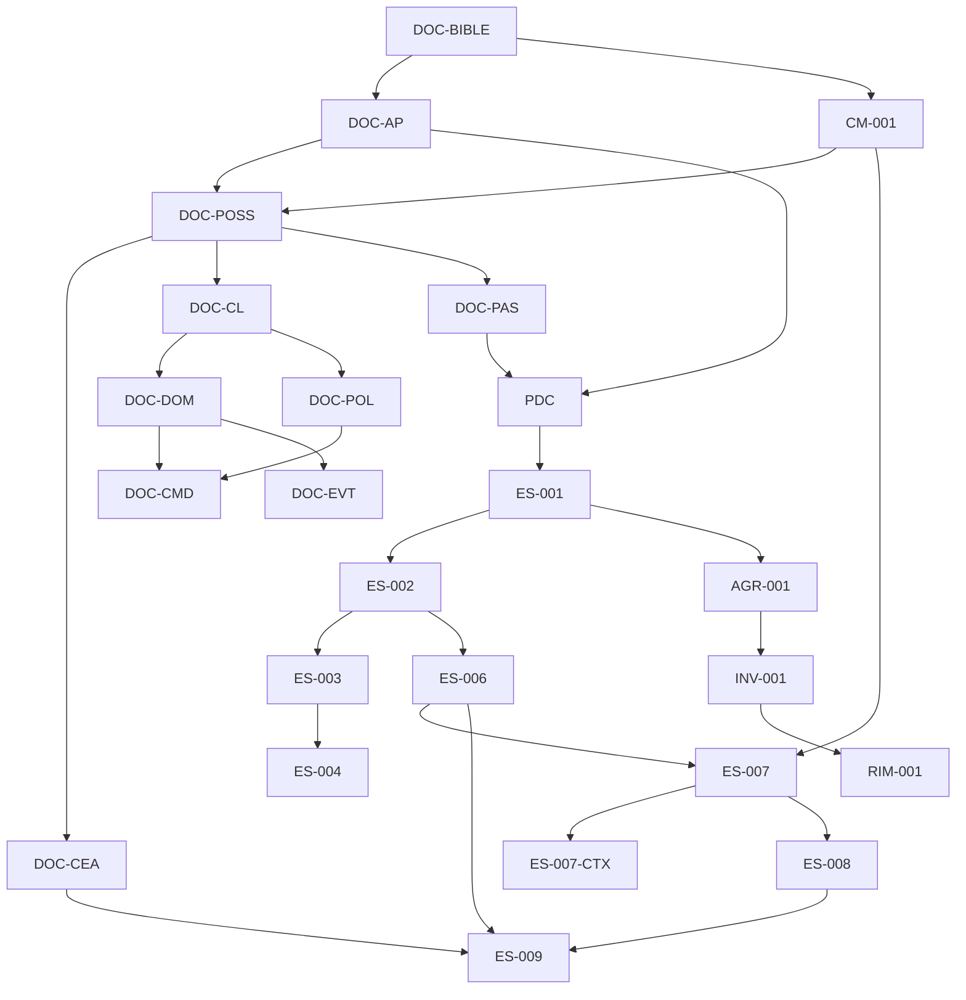
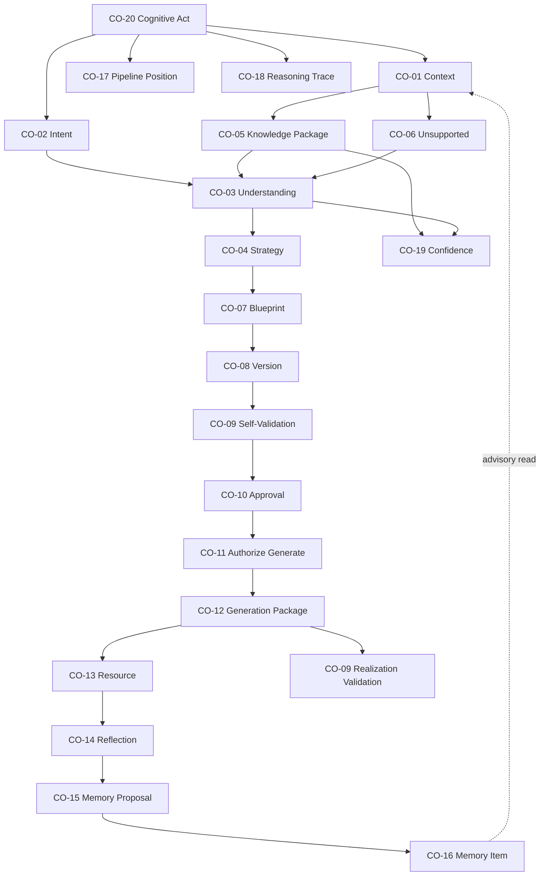
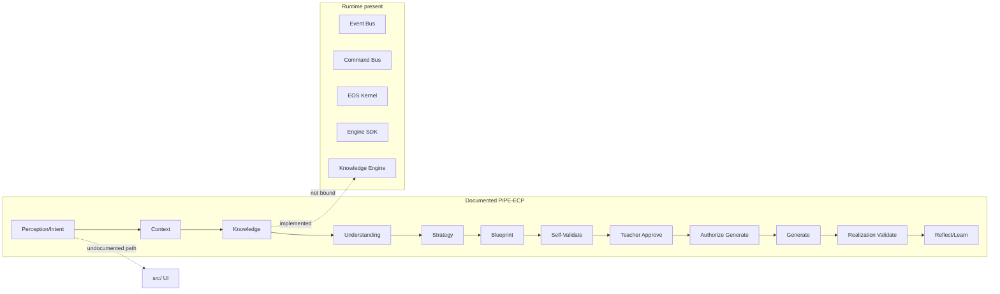
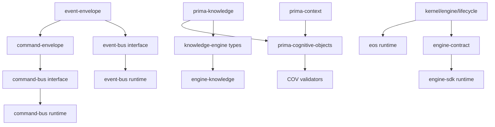

# PRIMA Repository Intelligence Map

**Title:** PRIMA Repository Intelligence Map  
**Version:** 1.0  
**Status:** Official  
**Code:** RIM-001  
**Companion:** [`PRIMA_ARCHITECTURE_INVENTORY.md`](./PRIMA_ARCHITECTURE_INVENTORY.md) (INV-001)

**Legend**

| Field | Scale |
|-------|-------|
| **Artifact type** | Spec · Contract · Runtime · Cognitive · Engine · App · Infra · Test · Scaffold · Transitional |
| **Architectural criticality** | C1 Platform-critical · C2 Pipeline-critical · C3 Enabling · C4 Supporting |
| **Stability** | S1 Stable · S2 Evolving · S3 Unstable · S4 Scaffold |
| **Runtime usage** | Active · Partial · Dormant · None |
| **Test coverage** | Covered · Partial · None |

---

# 1. Artifact Registry

## 1.1 Constitutional & cognitive specifications

| ID | Location | Type | Owner subsystem | Dependencies | Consumers | Upstream | Downstream | Runtime | Tests | Crit | Stab |
|----|----------|------|-----------------|--------------|-----------|----------|------------|---------|-------|------|------|
| DOC-BIBLE | `docs/product/LUDI_ON_PROJECT_BIBLE.md` | Spec | Product | — | All product/eng docs | — | AP, POSS, CM-001 | None | None | C1 | S1 |
| DOC-AP | `docs/product/PRIMA_ARCHITECTURAL_PRINCIPLES.md` | Spec | Architecture | Bible | POSS, CEA, ES-\* | Bible | PDC, Engines | None | None | C1 | S1 |
| CM-001 | `docs/product/PRIMA_COGNITIVE_MODEL.md` | Cognitive | Cognition | Bible, AP | ES-007, POSS, Engines | Bible, AP | CO-\*, PIPE-ECP | Partial (via CO) | Partial | C1 | S1 |
| DOC-POSS | `docs/product/PRIMA_EDUCATIONAL_OPERATING_SYSTEM.md` | Spec | EOS | Bible, AP, CM-001 | CEA, ES-\*, Engines | CM-001 | PIPE-ECP, ENG-\* | Partial | None | C1 | S1 |
| DOC-CEA | `docs/product/PRIMA_CONSTITUTIONAL_ENGINE_ARCHITECTURE.md` | Spec | EOS Engines | POSS | ES-006…009, engine pkgs | POSS | ENG-00…10 | Partial | Partial | C1 | S1 |
| DOC-CL | `docs/product/PRIMA_CONSTITUTIONAL_LANGUAGE.md` | Spec | Language | POSS | DOM, CMD, EVT, CO names | POSS | All constitutional | None | None | C1 | S1 |
| DOC-DOM | `docs/product/PRIMA_CONSTITUTIONAL_DOMAIN_MODEL.md` | Spec | Domain | CL | CMD, EVT, SM, contracts (future) | CL | Aggregates | None | None | C1 | S2 |
| DOC-CMD | `docs/product/PRIMA_CONSTITUTIONAL_COMMAND_MODEL.md` | Spec | Application write | CL, DOM, POL | Command Bus handlers (future) | DOM | API-CMD | Dormant | None | C1 | S2 |
| DOC-EVT | `docs/product/PRIMA_CONSTITUTIONAL_EVENT_MODEL.md` | Spec | Messaging domain | CL, DOM | Event Bus payloads (future) | DOM | API-EVT | Partial | Partial | C1 | S2 |
| DOC-POL | `docs/product/PRIMA_CONSTITUTIONAL_POLICIES.md` | Spec | Governance | CL | Authority, Command Bus | CL | CO-10/11 | None | None | C1 | S2 |
| DOC-SM | `docs/product/PRIMA_CONSTITUTIONAL_STATE_MACHINE_MODEL.md` | Spec | EOS state | DOM, POSS | Pipeline runtime (future) | POSS | PIPE-ECP | None | None | C2 | S2 |
| DOC-QRY | `docs/product/PRIMA_CONSTITUTIONAL_QUERY_MODEL.md` | Spec | Query | DOM | `packages/query` | DOM | Continuă views | None | None | C2 | S2 |
| DOC-SVC | `docs/product/PRIMA_CONSTITUTIONAL_SERVICE_CONTRACT_MODEL.md` | Spec | Services | Engines | Application façades | CEA | SVC-\* | None | None | C2 | S2 |
| DOC-CA | `docs/product/PRIMA_CANONICAL_ARTIFACTS.md` | Spec | Artifacts | AP, DOM | Product exchange | AP | Bridges to CO | None | None | C2 | S2 |
| DOC-IB | `docs/product/INSTRUCTIONAL_BLUEPRINT_SPECIFICATION.md` | Spec | Blueprint | Bible, AP | ENG-06, CO-07/08 | Bible | Generation | None | None | C2 | S2 |
| DOC-PAS | `docs/product/PRIMA_REFERENCE_TECHNICAL_ARCHITECTURE.md` | Spec | PAS layers | POSS, CEA | ES-001, packages | POSS | L0–L6 map | Partial | None | C1 | S1 |
| DOC-CC | `docs/product/PRIMA_COGNITIVE_CORE.md` | Cognitive | Cognition | CM-001 | Elaborations | CM-001 | Legacy module map | None | None | C3 | S2 |
| DOC-CTX-P | `docs/product/PRIMA_CONTEXT_MODEL.md` | Cognitive | Context philosophy | ES-007-CTX | Product readers | ES-007 | — | None | None | C3 | S2 |
| DOC-KN-P | `docs/product/PRIMA_KNOWLEDGE_MODEL.md` | Cognitive | Knowledge philosophy | ES-008 | Product readers | ES-008 | — | None | None | C3 | S2 |

## 1.2 Engineering specifications

| ID | Location | Type | Owner subsystem | Dependencies | Consumers | Upstream | Downstream | Runtime | Tests | Crit | Stab |
|----|----------|------|-----------------|--------------|-----------|----------|------------|---------|-------|------|------|
| PDC | `docs/engineering/PRIMA_DEVELOPMENT_CONSTITUTION.md` | Spec | Engineering gov | PAS, POSS | All ES, CI | PAS | ES-001… | None | None | C1 | S1 |
| ES-001 | `docs/engineering/ES-001_REPOSITORY_FOUNDATION.md` | Spec | Repository | PDC, PAS | All packages | PDC | Workspaces | Partial | None | C1 | S2 |
| ES-002 | `docs/engineering/ES-002_EOS_KERNEL.md` | Spec | ENG-00 Kernel | ES-001 | `@prima/eos` | ES-001 | Kernel runtime | Active | Covered | C1 | S1 |
| ES-003 | `docs/engineering/ES-003_EVENT_BUS.md` | Spec | Messaging | ES-002 | `@prima/event-bus` | ES-002 | Event runtime | Active | Covered | C1 | S1 |
| ES-004 | `docs/engineering/ES-004_COMMAND_BUS.md` | Spec | CQRS write | ES-003 | `@prima/command-bus` | ES-003 | Command runtime | Active | Covered | C1 | S1 |
| ES-006 | `docs/engineering/ES-006_ENGINE_SDK.md` | Spec | Engine contract | ES-002 | `@prima/engine-sdk`, Engines | ES-002 | All Engines | Active | Covered | C1 | S1 |
| ES-007 | `docs/engineering/ES-007_COGNITIVE_OBJECTS_MODEL.md` | Cognitive | Cognition contracts | CM-001, ES-006 | `prima-cognitive-objects.ts`, Engines | CM-001 | CO-01…20 | Partial | Covered | C1 | S1 |
| ES-007-CTX | `docs/engineering/ES-007_CONTEXT_MODEL.md` | Cognitive | CO-01 detail | ES-007 | `prima-context.ts`, ENG-01 | ES-007 | ENG-01 | Partial | Covered | C1 | S1 |
| ES-008 | `docs/engineering/ES-008_KNOWLEDGE_MODEL.md` | Cognitive | Knowledge units | ES-007 | `prima-knowledge.ts`, ENG-02 | ES-007 | ENG-02 | Partial | Covered | C1 | S1 |
| ES-009 | `docs/engineering/ES-009_KNOWLEDGE_ENGINE.md` | Spec | ENG-02 | ES-006, ES-008 | `@prima/engine-knowledge` | ES-008 | Knowledge runtime | Active | Covered | C1 | S1 |
| AGR-001 | `docs/engineering/AGR-001_REPOSITORY_FOUNDATION_REVIEW.md` | Spec | Architecture gate | ES-001 | Roadmap, RIM, INV | ES-001 | B-01…B-16 | None | None | C1 | S1 |
| INV-001 | `docs/engineering/PRIMA_ARCHITECTURE_INVENTORY.md` | Spec | Navigation | SPEC_INDEX | RIM-001, roadmap | All | Gaps | None | None | C2 | S2 |
| SUP-CR | `docs/engineering/COMPOSITION_ROOT.md` | Spec | Wiring | ES-002, AGR B-05 | Apps bootstrap | ES-002 | Composition | Dormant | None | C1 | S2 |
| SUP-MAP | `docs/engineering/PAS_MODULE_PACKAGE_MAP.md` | Spec | Module map | PAS, AGR B-04 | packages/\* | PAS | Package ownership | Partial | None | C2 | S2 |
| SPEC-IDX | `docs/engineering/SPEC_INDEX.md` | Spec | Index | — | Humans, agents | — | All ES | None | None | C3 | S2 |

## 1.3 Contracts (typed)

| ID | Location | Type | Owner subsystem | Dependencies | Consumers | Upstream | Downstream | Runtime | Tests | Crit | Stab |
|----|----------|------|-----------------|--------------|-----------|----------|------------|---------|-------|------|------|
| CTR-PKG | `packages/contracts/` | Contract | Contracts | — | All runtime pkgs | ES-\* | All | Active | Covered | C1 | S1 |
| CTR-KERNEL | `packages/contracts/src/kernel.ts` (+ engine, lifecycle, health, config) | Contract | ENG-00 | — | eos, sdk | ES-002 | Kernel | Active | Covered | C1 | S1 |
| CTR-EVENT | `packages/contracts/src/event-envelope.ts`, `event-bus.ts` | Contract | Messaging | — | event-bus, command-bus, engines | ES-003 | Events | Active | Covered | C1 | S1 |
| CTR-COMMAND | `packages/contracts/src/command-envelope.ts`, `command-bus.ts` | Contract | CQRS write | event types | command-bus | ES-004 | Commands | Active | Covered | C1 | S1 |
| CTR-ENGINE | `packages/contracts/src/engine-contract.ts` | Contract | Engine SDK | kernel types | engine-sdk, engines | ES-006 | Engines | Active | Covered | C1 | S1 |
| CTR-CO | `packages/contracts/src/prima-cognitive-objects.ts` | Contract | Cognition | — | Engines (future), tests | ES-007 | COV-\* | Partial | Covered | C1 | S1 |
| CTR-CTX | `packages/contracts/src/prima-context.ts` | Contract | Context | — | ENG-01 (future), tests | ES-007-CTX | CO-01 | Partial | Covered | C1 | S1 |
| CTR-KN | `packages/contracts/src/prima-knowledge.ts` | Contract | Knowledge | — | ENG-02, tests | ES-008 | CO-05 | Active | Covered | C1 | S1 |
| CTR-KE-API | `packages/contracts/src/knowledge-engine.ts` | Contract | ENG-02 API | CTR-KN | engine-knowledge | ES-009 | KE methods | Active | Covered | C1 | S1 |

## 1.4 Runtime packages (live workspaces)

| ID | Location | Type | Owner subsystem | Dependencies | Consumers | Upstream | Downstream | Runtime | Tests | Crit | Stab |
|----|----------|------|-----------------|--------------|-----------|----------|------------|---------|-------|------|------|
| RT-EOS | `packages/eos/` (`@prima/eos`) | Runtime | ENG-00 | contracts | Composition Root (future), tests | ES-002 | Engine registry | Active | Covered | C1 | S1 |
| RT-EB | `packages/event-bus/` (`@prima/event-bus`) | Runtime | Messaging | contracts | command-bus, engine-knowledge, eos bridge | ES-003 | Publish/subscribe | Active | Covered | C1 | S1 |
| RT-CB | `packages/command-bus/` (`@prima/command-bus`) | Runtime | CQRS write | contracts, event-bus | Application (future) | ES-004 | Handlers (absent) | Active | Covered | C1 | S2 |
| RT-SDK | `packages/engine-sdk/` (`@prima/engine-sdk`) | Runtime | Engine base | contracts | engine-knowledge, future engines | ES-006 | BasePrimaEngine | Active | Covered | C1 | S1 |
| RT-KE | `packages/engines/knowledge/` (`@prima/engine-knowledge`) | Engine | ENG-02 | contracts, sdk, event-bus | Composition Root (future) | ES-009 | Knowledge pull API | Active | Covered | C1 | S1 |

## 1.5 Engine scaffolds

| ID | Location | Type | Owner subsystem | Dependencies | Consumers | Upstream | Downstream | Runtime | Tests | Crit | Stab |
|----|----------|------|-----------------|--------------|-----------|----------|------------|---------|-------|------|------|
| ENG-01-S | `packages/engines/context/` | Scaffold | ENG-01 | sdk (declared) | — | CEA, ES-007-CTX | CO-01 | None | None | C2 | S4 |
| ENG-03-S | `packages/engines/intent/` | Scaffold | ENG-03 | sdk | — | CEA, ES-007 | CO-02 | None | None | C2 | S4 |
| ENG-04-S | `packages/engines/understanding/` | Scaffold | ENG-04 | sdk | — | CEA | CO-03 | None | None | C2 | S4 |
| ENG-05-S | `packages/engines/strategy/` | Scaffold | ENG-05 | sdk | — | CEA | CO-04 | None | None | C2 | S4 |
| ENG-06-S | `packages/engines/blueprint/` | Scaffold | ENG-06 | sdk | — | CEA, DOC-IB | CO-07/08 | None | None | C2 | S4 |
| ENG-07-S | `packages/engines/validation/` | Scaffold | ENG-07 | sdk | — | CEA | CO-09 | None | None | C2 | S4 |
| ENG-08-S | `packages/engines/generation/` | Scaffold | ENG-08 | sdk | — | CEA | CO-12/13 | None | None | C2 | S4 |
| ENG-09-S | `packages/engines/reflection/` | Scaffold | ENG-09 | sdk | — | CEA | CO-14/15 | None | None | C3 | S4 |
| ENG-10-S | `packages/engines/memory/` | Scaffold | ENG-10 | sdk | — | CEA | CO-16 | None | None | C2 | S4 |

## 1.6 Supporting packages, apps, infra

| ID | Location | Type | Owner subsystem | Dependencies | Consumers | Upstream | Downstream | Runtime | Tests | Crit | Stab |
|----|----------|------|-----------------|--------------|-----------|----------|------------|---------|-------|------|------|
| PKG-DOM | `packages/domain/` | Scaffold | L4 Domain | — | — | DOC-DOM | — | None | None | C2 | S4 |
| PKG-APP | `packages/application/` | Scaffold | L1 Application | — | — | DOC-UC | Commands | None | None | C2 | S4 |
| PKG-QRY | `packages/query/` | Scaffold | CQRS read | — | — | DOC-QRY | Continuă | None | None | C2 | S4 |
| PKG-AUTH | `packages/authority/` | Scaffold | MOD-11 Authority | — | Command Bus authorizer | DOC-POL | CO-10/11 | None | None | C1 | S4 |
| PKG-PROJ | `packages/project/` | Scaffold | MOD-02 | — | Continuă | POSS | Project | None | None | C2 | S4 |
| PKG-DEL | `packages/delivery/` | Scaffold | MOD-08 | — | Export | CA Export | — | None | None | C3 | S4 |
| PKG-GOV | `packages/governance/` | Scaffold | MOD-12 | — | Admin | POL | — | None | None | C3 | S4 |
| PKG-UI | `packages/ui/` | Scaffold | L0 UI | — | Apps | — | — | None | None | C4 | S4 |
| APP-TW | `apps/teacher-workspace/` | Scaffold | MOD-01 | — | Teachers | PAS | UI | None | None | C2 | S4 |
| APP-SRC | `src/` | Transitional | Teacher UI | Vite/React | End users (current) | Product UI | — | Active (UI only) | None | C2 | S3 |
| INF-\* | `infrastructure/*` | Infra | L6 | — | Composition Root | PAS | Ports | None | None | C2 | S4 |

## 1.7 Cognitive Objects (logical artifacts)

| ID | Location (normative) | Type | Owner subsystem | Dependencies | Consumers | Upstream | Downstream | Runtime | Tests | Crit | Stab |
|----|----------------------|------|-----------------|--------------|-----------|----------|------------|---------|-------|------|------|
| CO-01 | ES-007 + `prima-context.ts` | Cognitive | ENG-01 | CO-20, Memory read | ENG-03…07,00 | CTX dims | Intent/Understanding | Partial (types) | Covered | C1 | S1 |
| CO-02 | ES-007 | Cognitive | ENG-03 | CO-01, CO-20 | ENG-04…06,09 | Intent | Understanding | None | Envelope only | C1 | S2 |
| CO-03 | ES-007 | Cognitive | ENG-04 | CO-02, CO-05/06 | ENG-05…07,09 | Understanding | Strategy | None | Envelope only | C1 | S2 |
| CO-04 | ES-007 | Cognitive | ENG-05+Teacher | CO-03 | ENG-06,07,09 | Strategy | Blueprint | None | COV-05 | C1 | S2 |
| CO-05 | ES-007 + ES-008 + KE | Cognitive | ENG-02 | CO-01 query | ENG-04…07 | Knowledge | Reasoning/Planning | Active | Covered | C1 | S1 |
| CO-06 | ES-007 + KE | Cognitive | ENG-02 | query miss | ENG-04…07,00 | Unsupported | Gates | Active | Covered | C1 | S1 |
| CO-07 | ES-007 + DOC-IB | Cognitive | ENG-06 | CO-04 | ENG-07,08,Teacher,09 | Blueprint | Version/Validation | None | COV-04 | C1 | S2 |
| CO-08 | ES-007 | Cognitive | ENG-06 | CO-07 | ENG-07,08,Authority | Version | Approval/Gen | None | COV-09 | C1 | S2 |
| CO-09 | ES-007 | Cognitive | ENG-07 | CO-07/08 or CO-12/13 | ENG-00,06,08,Teacher,09 | Validation | Gates | None | COV-07 | C1 | S2 |
| CO-10 | ES-007 + POL | Cognitive | Teacher Authority | CO-08 | ENG-00,08 | Approval | Generate | None | COV-02 | C1 | S2 |
| CO-11 | ES-007 + POL | Cognitive | Teacher Authority | CO-10 | ENG-00,08 | Authorize | Generation | None | COV-02 | C1 | S2 |
| CO-12 | ES-007 | Cognitive | ENG-08 | CO-08,10,11 | ENG-07,Teacher,09 | Generation | Resources | None | COV-03 | C1 | S2 |
| CO-13 | ES-007 | Cognitive | ENG-08 | CO-12 | Teacher, ENG-07, Export | Resource | Craft | None | COV-09 | C2 | S2 |
| CO-14 | ES-007 | Cognitive | ENG-09 | session | Teacher, ENG-10 | Reflection | Memory prop | None | Envelope | C2 | S2 |
| CO-15 | ES-007 | Cognitive | ENG-09 | CO-14 | ENG-10, Teacher | Proposal | Accept | None | Envelope | C2 | S2 |
| CO-16 | ES-007 | Cognitive | ENG-10 | CO-15 accept | ENG-01,05 | Memory | Advisory | None | COV-06 | C2 | S2 |
| CO-17 | ES-007 | Cognitive | ENG-00 | CO-20 | All Engines | Position | Gates | None | None | C1 | S2 |
| CO-18 | ES-007 | Cognitive | ENG-00+Engines | material COs | ENG-09, audit | Trace | Explainability | None | COV-09 | C1 | S2 |
| CO-19 | ES-007 | Cognitive | Producing Engine | upstream CO | Downstream | Confidence | COV-10 | None | COV-10 | C2 | S2 |
| CO-20 | ES-007 | Cognitive | ENG-00 | Teacher entry | All COs | Act root | Correlation | None | None | C1 | S2 |

## 1.8 Tests

| ID | Location | Type | Owner subsystem | Dependencies | Consumers | Upstream | Downstream | Runtime | Tests | Crit | Stab |
|----|----------|------|-----------------|--------------|-----------|----------|------------|---------|-------|------|------|
| TST-CTR | `packages/contracts/tests/*.test.ts` | Test | Contracts | CTR-\* | CI `test:contracts` | ES-007/008 | — | Active | Covered | C1 | S1 |
| TST-EOS | `packages/eos/src/tests/` | Test | Kernel | RT-EOS | `test:eos` | ES-002 | — | Active | Covered | C1 | S1 |
| TST-EB | `packages/event-bus/src/tests/` | Test | Messaging | RT-EB | `test:event-bus` | ES-003 | — | Active | Covered | C1 | S1 |
| TST-CB | `packages/command-bus/src/tests/` | Test | Commands | RT-CB | `test:command-bus` | ES-004 | — | Active | Covered | C1 | S1 |
| TST-SDK | `packages/engine-sdk/src/tests/` | Test | SDK | RT-SDK | `test:engine-sdk` | ES-006 | — | Active | Covered | C1 | S1 |
| TST-KE | `packages/engines/knowledge/src/tests/` | Test | ENG-02 | RT-KE | `test:knowledge` | ES-009 | — | Active | Covered | C1 | S1 |

---

# 2. Specification Dependency Graph



**Edges mean:** normative depends-on (consumer requires authority of producer).

---

# 3. Runtime Dependency Graph

```mermaid
flowchart TB
  CTR[@prima/contracts]
  CTR --> EOS[@prima/eos]
  CTR --> EB[@prima/event-bus]
  CTR --> SDK[@prima/engine-sdk]
  EB --> CB[@prima/command-bus]
  CTR --> CB
  SDK --> KE[@prima/engine-knowledge]
  CTR --> KE
  EB --> KE
  EOS -.optional bridge.-> EB
  CB -.handlers missing.-> X[No Application handlers]
  KE -.not wired.-> CR[Composition Root absent]
  EOS -.not wired.-> CR
  SRC[src/ Vite UI] -.no import.-> CTR
```

**Observed npm dependency direction (acyclic):**  
`contracts` ← `eos` | `event-bus` | `engine-sdk`  
`event-bus` ← `command-bus` | `engine-knowledge`  
`engine-sdk` ← `engine-knowledge`

---

# 4. Cognitive Object Dependency Graph



**Cycles:** None in normative forward lineage. **Feedback only:** CO-16 → CO-01 (advisory read); CO-09 → CO-07 (revise loop) — control loops, not package import cycles.

---

# 5. Pipeline Dependency Graph



---

# 6. Contract Dependency Graph



---

# 7. Repository Layer Map

```mermaid
flowchart TB
  subgraph L0 [L0 Presentation]
    SRC[src/ transitional]
    APPTW[apps/teacher-workspace scaffold]
    UI[packages/ui scaffold]
  end
  subgraph L1 [L1 Application]
    APP[packages/application scaffold]
  end
  subgraph L2 [L2 EOS]
    EOS[@prima/eos LIVE]
    CB[@prima/command-bus LIVE]
  end
  subgraph L3 [L3 Engines]
    KE[@prima/engine-knowledge LIVE]
    ESCAF[engines/* scaffolds]
    SDK[@prima/engine-sdk LIVE]
  end
  subgraph L4 [L4 Domain]
    DOM[packages/domain scaffold]
  end
  subgraph Ports [Contracts / Ports]
    CTR[@prima/contracts LIVE]
    EB[@prima/event-bus LIVE]
  end
  subgraph L6 [L6 Infrastructure]
    INF[infrastructure/* scaffold]
  end
  L0 --> L1
  L1 --> L2
  L2 --> L3
  L3 --> Ports
  L2 --> Ports
  L3 -.-> L4
  L6 -.-> Ports
```

**PAS alignment:** Live code concentrates in Ports + L2 + L3(ENG-02). L0 runnable path bypasses L1/L2 (`src/`).

---

# 8. Structural Findings

## 8.1 Isolated artifacts

| Artifact | Isolation form |
|----------|----------------|
| `src/` Teacher UI | Active runtime with **no** dependency on `@prima/*` |
| `packages/domain`, `application`, `query`, `ui`, `project`, `delivery`, `authority`, `governance` | Scaffold READMEs; no workspace membership |
| Engine scaffolds ENG-01,03–10 | No package.json workspace; no code |
| `apps/teacher-workspace` | README only |
| `infrastructure/*` | README only |
| DOC-CA vs CO catalog | Parallel registries; bridge table in ES-007 only |
| Product engine narratives (`PRIMA_*_ENGINE.md`) | Partial overlap with CEA/ES; not wired to packages |
| ADR log | Absent (AGR B-08) |

## 8.2 Cyclic dependencies

| Scope | Result |
|-------|--------|
| npm package graph | **No cycles** detected |
| Specification depends-on graph | **No cycles**; linear POSS→ES chain |
| Cognitive Object forward lineage | **No cycles**; revise/advisory feedback loops only |
| UI↔packages | No cycle (no link) |

## 8.3 Duplicated responsibilities

| Topic | Artifacts | Risk |
|-------|-----------|------|
| Engine catalog | DOC-CEA vs DOC-ENG-LEG (`PRIMA_ENGINE.md`) | Naming drift |
| Context | DOC-CTX-P vs ES-007-CTX vs CO-01 | Mitigated by precedence notes |
| Knowledge | DOC-KN-P vs ES-008 vs ES-009 | Mitigated by ES precedence |
| Cognition modules | CM-001 vs DOC-CC nine-module map vs ENG-\* | Dual module vocabularies |
| Artifacts | DOC-CA vs ES-007 CO-\* | Dual exchange vocabularies |
| Orchestrator | DOC-ORCH-P vs ES-002 / ENG-00 | Dual specs |
| Decision Engine | DOC-DE-P vs CEA reject/dissolve | Stale responsibility claim |

## 8.4 Missing ownership

| Area | Missing owner runtime |
|------|------------------------|
| Teacher Authority (CO-10/11) | `packages/authority` scaffold; no live authorizer beyond bus helpers |
| Command handlers | No Application package implementation |
| Pipeline Position (CO-17) | ENG-00 Kernel exists; position object not produced |
| Reasoning Trace (CO-18) | No runtime writer |
| Query / Continuă | `packages/query` scaffold |
| Composition Root executable | Standard only; no app bootstrap module |
| CODEOWNERS / teams | Absent |

## 8.5 Architectural bottlenecks

| Bottleneck | Why |
|------------|-----|
| **CTR-PKG `@prima/contracts`** | Every live runtime depends on it — change blast radius C1 |
| **RT-EB Event Bus** | Shared by command-bus and knowledge engine; future all engines |
| **RT-SDK BasePrimaEngine** | Gate for every Engine implementation |
| **Missing Authority + Handlers** | Blocks PIPE-ECP advancement past bus plumbing |
| **ENG-02 only live Engine** | Knowledge available; no Intent→Blueprint producers to consume it in pipeline |
| **Composition Root absent** | Live packages uncomposed into a running EOS process for Teachers |

## 8.6 Undocumented runtime paths

| Path | Observation |
|------|-------------|
| `src/` Vite app → user | Documented as transitional; **not** mapped to Commands/Events/CO |
| Optional EOS↔EventBus bridge | Exists in code; Composition Root usage undocumented in app |
| Knowledge Engine without Kernel registration | Usable standalone in tests; production registration path unspecified in app code |
| `npm run build` (tsc+vite) vs `build:packages` | Two build worlds; relationship under-documented for release |
| In-memory Knowledge store | Runtime persistence path undocumented beyond ES-009 Ports note |

---

# 9. Architectural Hotspots

Ordered by **implementation risk** (descending).

| Rank | Hotspot ID | Artifact(s) | Risk | Failure mode if mishandled |
|------|------------|-------------|------|----------------------------|
| 1 | HS-01 | APP-SRC `src/` dual-tree | Critical | Features land outside EOS; PAS/PDC violation becomes irreversible |
| 2 | HS-02 | PKG-AUTH + POL + CO-10/11 | Critical | Approvals forged or bypassed; Teacher Authority broken |
| 3 | HS-03 | CTR-PKG contracts hub | Critical | Breaking change cascades to all live packages |
| 4 | HS-04 | PIPE-ECP unbound to runtime | Critical | Engines ship without legal sequencing; illegal skips |
| 5 | HS-05 | RT-CB without handlers / DOC-CMD untyped | High | Command Bus becomes dead infrastructure |
| 6 | HS-06 | ENG scaffolds ≠ workspaces | High | False sense of Engine readiness; import chaos on first impl |
| 7 | HS-07 | DOC-CA ∥ ES-007 CO dual registries | High | Implementers pick wrong exchange model |
| 8 | HS-08 | CM-001 ∥ DOC-CC module vocabulary | High | Engine mapping ambiguity |
| 9 | HS-09 | Composition Root dormant | High | Packages never form a system |
| 10 | HS-10 | RT-KE only consumer of knowledge model | Medium | Knowledge island; no Understanding/Strategy consumers |
| 11 | HS-11 | Missing ADR log | Medium | Decisions only in AGR/ES prose; weak change control |
| 12 | HS-12 | Query/Project Continuă absent | Medium | Continuă product promise unmet |
| 13 | HS-13 | Infrastructure Ports unwired | Medium | Persistence/AI invented inside Engines |
| 14 | HS-14 | DOC-DE-P Decision Engine narrative | Medium | Reintroduction of dissolved Engine |
| 15 | HS-15 | Test surface limited to platform spine | Medium | Pipeline regressions undetected |

---

# 10. Navigation Index (quick paths)

| Question | Start here |
|----------|------------|
| What exists / what is missing? | INV-001 Architecture Inventory |
| How do artifacts connect? | **This document (RIM-001)** |
| How does PRIMA think? | CM-001 |
| What are legal Engines? | DOC-CEA |
| What objects move in cognition? | ES-007 |
| What is situational truth? | ES-007-CTX |
| What is knowledge? | ES-008 → ES-009 |
| How do packages depend? | §3 Runtime Dependency Graph |
| Where is risk? | §9 Architectural Hotspots |
| Spec order? | SPEC_INDEX.md |

---

## Document Control

| Item | Value |
|------|-------|
| **Code** | RIM-001 |
| **Title** | PRIMA Repository Intelligence Map |
| **Version** | 1.0 |
| **Status** | Official |
| **Location** | `docs/engineering/PRIMA_REPOSITORY_INTELLIGENCE_MAP.md` |
| **Update rule** | Amend on workspace change, new ES merge, Engine activation, or AGR decision |
