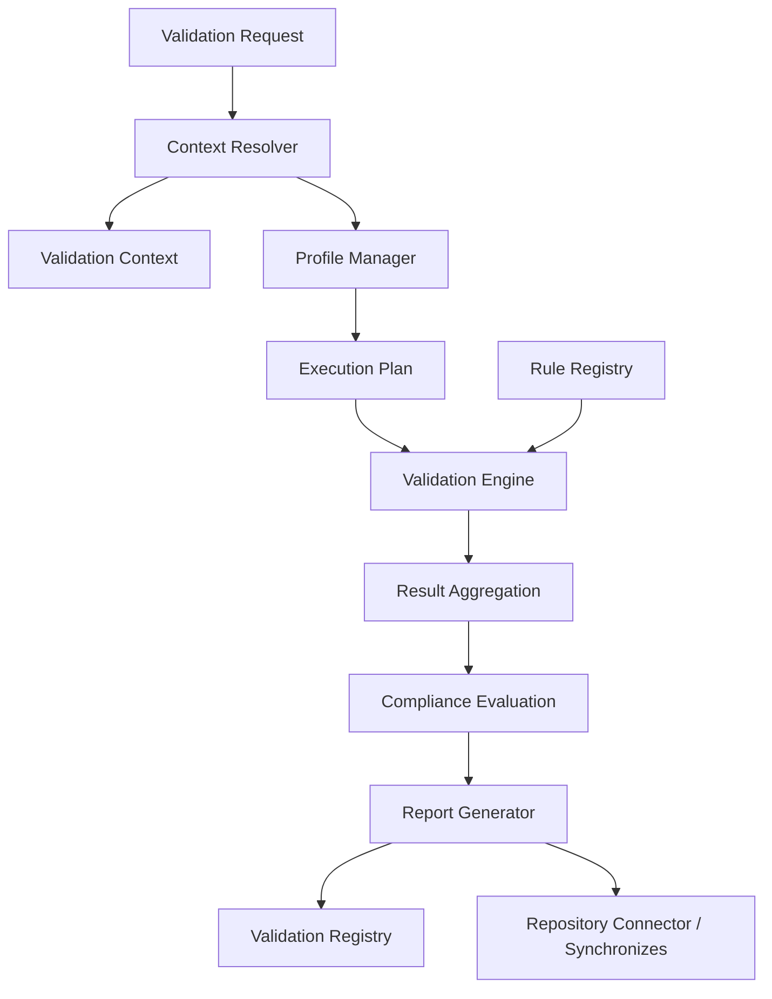

# PVC-001 — Prompt Validation Framework (PVF)

# 1. Document Metadata

| Field | Value |
|-------|-------|
| **Title** | Prompt Validation Framework (PVF) |
| **Code** | PVC-001 |
| **Version** | 2.0 |
| **Status** | Official — Single authoritative Validation subsystem definition for PPEF |
| **Owner** | LUDI ON Chief System Architect / PPEF |
| **Purpose** | Define the complete validation architecture, lifecycle, execution model, rules, profiles, contexts, reports, registry, metrics, and repository integration for PPEF |
| **Scope** | All Prompts, Prompt Families, Patterns, Standards, Deliverables, Executions, and related repository artefacts under PPEF validation |
| **Repository Location** | `docs/engineering/PVC-001_PROMPT_VALIDATION_FRAMEWORK.md` |
| **Operational catalogs** | `docs/engineering/ppef/validation/` |
| **Out of scope** | ECOS ENG-07 pedagogical Validation Engine; Teacher Approval; redesign of PRIMA ECOS architecture |

**Mandatory references:** PPS-001 · PPS-004 · PPS-005 · PPS-006  
**Declared Absent:** PPS-003 — Architectural Prompt Grammar  
**Related:** PPS-002 APPL · PAP-004 ATP · ADL-001  

> PVC-001 v2.0 is the **single authoritative** Validation subsystem specification.  
> Prior PVC-002…PVC-005 documents are **superseded** and retained only as historical records.  
> Validates ≠ Approves. PVF does **not** grant Teacher Approval.

---

# 2. Validation Mission

## 2.1 Purpose

Ensure every PPEF Prompt and related artefact is structurally sound, meta-model compliant, ontologically legal, semantically coherent, repository-consistent, and governance-safe before Official use.

## 2.2 Objectives

1. Deterministic, reproducible Validation Outcomes.  
2. Traceable Evidence from Request → Report → Registry.  
3. Fail-closed behaviour on Critical/High Findings.  
4. Context-aware Profile selection without ambiguity.  
5. Continuous validation on repository and model change events.

## 2.3 Design Principles

| Principle | Statement |
|-----------|-----------|
| **Determinism** | Same Snapshot + Plan ⇒ same Outcome |
| **Fail closed** | Evaluator errors are Fail, never silent Pass |
| **Single context** | Exactly one active Validation Context per Resolution |
| **Separation of authority** | Validation ≠ Approval ≠ Certification grant without Pass evidence |
| **No parallel models** | PVF MUST NOT invent alternate PPEF/ECOS architectures |
| **Catalog-driven** | Rules/Profiles/Contexts live in registries |

## 2.4 Validation Philosophy

Validation is **measurement and gating**, not creation of architectural meaning. Meaning originates in PPS-004/005/006 and approved specs; PVF verifies conformance.

## 2.5 Architectural Principles

- PVL-1…PVL-6 remain the mandatory validation levels.  
- Execution Plan precedes Engine run.  
- Official/Release/Certification gates require Full Profile strength.  
- Grammar-specific Pass is forbidden while PPS-003 is Absent.

---

# 3. Validation Architecture

## 3.1 Subsystem components

| Component | Responsibility |
|-----------|----------------|
| **Validation Framework (PVF)** | This specification — normative architecture and compliance |
| **Validation Engine (PVE)** | Orchestrates lifecycle stages; loads Plan; executes Rules; aggregates; emits Report |
| **Rule Registry** | Stores versioned Validation Rules (`validation/rules/`) |
| **Profile Manager** | Defines/composes Profiles (`validation/profiles/`) |
| **Context Resolver (VCPR)** | Detects Context; selects/inherits Profiles; resolves conflicts; emits Execution Plan |
| **Execution Planner** | Materializes ordered Rule groups, blocking set, termination conditions |
| **Validation Report Generator** | Writes canonical Reports (`validation/reports/`) |
| **Validation Registry** | Indexes Executions and Resolutions (`validation/registry/`, `resolutions/`) |
| **Repository Connector** | Reads catalogs; writes reports/registry; emits Synchronizes checklist for SPEC_INDEX / ppef/registry |

## 3.2 Interaction diagram



---

# 4. Validation Execution Lifecycle

```
Validation Request
→ Context Detection
→ Profile Resolution
→ Rule Discovery
→ Dependency Resolution
→ Execution Planning
→ Validation Engine
→ Result Aggregation
→ Compliance Evaluation
→ Validation Report
→ Repository Synchronization
```

| Stage | Purpose | Inputs | Outputs | Preconditions | Postconditions | Blocking |
|-------|---------|--------|---------|---------------|----------------|----------|
| **Validation Request** | Authorize a run | Target, optional VCTX/Profile, executor | Request object | Target identifiable | Request accepted | Malformed request |
| **Context Detection** | Fix single VCTX | Request, repo/workflow signals | Active Context | Context catalog available | One VCTX | Ambiguity / invalid Explicit |
| **Profile Resolution** | Select Profiles | Context, request | Candidate Profiles | Profiles Active | ≥1 Profile | Empty set / Conflicts |
| **Rule Discovery** | Expand Effective RuleSet | Profiles | Candidate Rules | Rule catalog | Candidates listed | Conflicts With load Fail |
| **Dependency Resolution** | Order Requires/Extends | Candidates | DAG / order | Acyclic | Schedule fixed | Cycle |
| **Execution Planning** | Emit Plan | Order + policies | PLAN-id | Resolution Pass | Plan pinned | Missing pin for Certification |
| **Validation Engine** | Evaluate PVL-1…6 | Plan, Snapshot, target | Findings | Plan present | Rules terminal or short-circuit | Evaluator crash (Fail) |
| **Result Aggregation** | Score | Findings | Counts, % | Findings complete | Aggregate ready | — |
| **Compliance Evaluation** | Pass/Fail gate | Aggregate, Blocking Policy | Overall Outcome | Aggregate ready | Gate decision | Critical/High(/Medium) per Profile |
| **Validation Report** | Persist evidence | All prior | Report file | Trace fields | Report stored | Write failure |
| **Repository Synchronization** | Registry + checklist | Report | Registry row; sync list | Report finalized | History appended | Registry write failure |

### Validation Levels (PVL) inside Engine

| Level | Purpose | Primary sources |
|-------|---------|-----------------|
| **PVL-1 Structural** | PPS-001 structure/metadata | PPS-001; grammar deferred if PPS-003 Absent |
| **PVL-2 Meta Model** | PPS-004 PMM | PMM-I\* |
| **PVL-3 Ontology** | PPS-005 vocabulary/edges | PO-I\*, glossary |
| **PVL-4 Semantic** | PPS-006 behaviour | PSM-I\*, PAP-004 when architectural |
| **PVL-5 Repository** | Paths, registry, indexes | PVC-R009/R010 |
| **PVL-6 Governance** | ADR/APPL/authority split | ADL, PPS-002, PVC-R008/R011… |

---

# 5. Validation Rules

## 5.1 Rule Concept

A **Validation Rule** is a deterministic, versioned, owned Engineering Artifact evaluating a target predicate and emitting Pass/Fail with Severity.

## 5.2 Taxonomy / Categories

Structural · Metadata · Ontology · Semantic · Repository · Governance · Performance · Quality · Security · Compatibility (`VRC-*`).

## 5.3 Lifecycle

Draft → Approved → Active → Deprecated → Archived.

## 5.4 Metadata (mandatory)

Rule Identifier, Canonical Name, Description, Purpose, Category, Severity, Priority, Scope, Preconditions, Validation Logic, Expected Result, Failure Conditions, Resolution Guidance, Dependencies, References, Owner, Lifecycle, Version.

## 5.5 Severity Model

| Severity | Behaviour |
|----------|-----------|
| **Critical** | Block immediately; Official commit forbidden |
| **High** | Fail; block Active/Execution/Certification |
| **Medium** | Fail Release unless CSA waiver recorded |
| **Low** | Record; SHOULD fix before Release |
| **Advisory** | Record only; never alone blocks |

## 5.6 Dependencies

Requires · Conflicts With · Supersedes · Extends · Related — resolution deterministic (topology → Priority → RuleId).

## 5.7 Registration & Versioning

Catalog: `ppef/validation/rules/CATALOG.md`. SemVer: MAJOR for predicate/severity breaks. Ids never reused after Archive.

**Core native rules PVC-R001…R015** remain as defined in the Rules Catalog (Structure Complete … Certification Evidence), including **PVC-R013 Grammar Deferred**.

---

# 6. Validation Profiles

## 6.1 Concept

A **Validation Profile** binds RuleSets and execution parameters for a PVE run.

## 6.2 Taxonomy

| Id | Name | Blocking |
|----|------|----------|
| PVP-FOUNDATION | Foundation | Critical, High |
| PVP-ENGINEERING | Engineering | Critical, High |
| PVP-GOVERNANCE | Governance | Critical, High |
| PVP-REPOSITORY | Repository | Critical, High |
| PVP-RELEASE | Release | Critical, High, Medium |
| PVP-CERTIFICATION | Certification | Any Fail |
| PVP-DEVELOPMENT | Development | Critical |
| PVP-EXPERIMENTAL | Experimental | None (non-Official) |
| PVP-CUSTOM-* | Custom | Declared; Parent required |

## 6.3 Composition

Include → Exclude (wins) → Conditional → Shared sets → Overrides; Parent inheritance acyclic; Conflicts With ⇒ load Fail. Deterministic.

## 6.4 Execution Semantics

PVE interprets Effective RuleSet; no mid-flight Profile switch; Development/Experimental MUST NOT authorize Official alone.

## 6.5 Lifecycle

Draft → Review → Approved → Active → Deprecated → Archived.

## 6.6 Selection

Via Context Resolution (§7); Certification Context mandates PVP-CERTIFICATION; Production Release forbids Experimental/Development as sole Profile.

Catalog: `ppef/validation/profiles/CATALOG.md`.

---

# 7. Validation Context

## 7.1 Concept

A **Validation Context** (`VCTX-*`) is the situational frame for Profile Resolution — distinct from Prompt Context component.

## 7.2 Taxonomy

Development · Authoring · Review · Engineering · Governance · Repository Audit · Release Candidate · Production Release · Certification · Maintenance · Migration · Emergency.

Catalog: `ppef/validation/contexts/CATALOG.md`.

## 7.3 Context Detection Precedence

1. Explicit VCTX (unless unauthorized vs Official automation)  
2. Automation Trigger (CI/Release)  
3. Workflow Stage  
4. Artifact Type + Lifecycle  
5. Repository State  
6. User Role  
7. Default `VCTX-DEVELOPMENT`  

Ambiguity ⇒ Fail Resolution.

## 7.4 Resolution Algorithm

Detect Context → Discover Profiles → Resolve dependencies/inheritance → Conflict resolution (Context > Profile > Rule > Dependency priorities) → Execution Plan (`PLAN-*`) → record `RES-*`.

## 7.5 Conflict Resolution

Deterministic drop of lower-priority Profiles; remaining Rule Conflicts With ⇒ Fail; Manual Overrides CSA-recorded only.

## 7.6 Execution Plan Generation

PVL order; dependency-aware rule order; parallel independent groups; blocking set; termination/short-circuit policy; Certification pins Rule Versions.

---

# 8. Validation Reports

Mandatory structure:

| Section | Content |
|---------|---------|
| **Metadata** | ValidationId, PromptId, Version, Profile(s), Context, PlanId, FrameworkVersion (PVC-001 2.0), Timestamp, Validator, Snapshot |
| **Rule evaluation** | RuleId@version, PVL, Severity, Outcome, Evidence |
| **Compliance Score** | Passed/Evaluated %; CriticalFailureCount |
| **Detected Issues** | Finding list |
| **Severity Summary** | Counts by severity |
| **Repository Impact** | Paths verified; orphans; index gaps |
| **Recommended Actions** | Resolution Guidance ordered by Severity |
| **Overall Result** | Pass \| Fail |
| **Traceability Metadata** | RES id, Executed Rules order |

Store: `ppef/validation/reports/`.

---

# 9. Validation Registry

| Aspect | Specification |
|--------|---------------|
| **Purpose** | Append-only history of Resolutions and Validations |
| **Stored Objects** | RES records, VAL rows, links to Reports, Plan ids |
| **Indexing** | By ValidationId, PromptId, Context, Profile, Timestamp |
| **Naming** | `VAL-YYYYMMDD-NNN`, `RES-…`, `PLAN-…` |
| **Versioning** | Framework Version + pinned Rule Versions on Certification |
| **Synchronization** | Every Completion appends registry row; Synchronizes checklist for SPEC_INDEX/ppef/registry when Impact requires |

Paths: `validation/registry/`, `validation/resolutions/`.

---

# 10. Validation Metrics

| Metric | Calculation |
|--------|-------------|
| **Prompt Quality Index** | Weighted Compliance% − penalty(Critical×5 + High×2), normalized 0–100 |
| **Validation Success Rate** | Pass / Total |
| **Failure Rate** | Fail / Total |
| **Coverage** | Rules hit / Rules in Plan |
| **Execution Time** | Mean duration |
| **Compliance Percentage** | PassedRules / EvaluatedRules × 100 |
| **Trend Analysis** | Metric series over windows |

Metrics MUST NOT override Fail Outcomes.

---

# 11. Continuous Validation

Triggers (minimum Profile guidance):

| Event | Minimum strength |
|-------|------------------|
| Prompt modification | Foundation / Development |
| Repository changes (ppef, SPEC_INDEX, registries) | Repository |
| Grammar updates (when PPS-003 Active) | Foundation + grammar rules |
| Ontology updates (PPS-005) | Governance |
| Semantic model updates (PPS-006) | Governance |
| Dependency changes | Engineering |
| Pre-merge Official | Release |
| Certification request | Certification |

---

# 12. Repository Integration

| Integration point | Role |
|-------------------|------|
| **SPEC_INDEX** | Lists PVC-001 v2.0 as authoritative; marks superseded PVC-002…005 |
| **ppef/registry.md** | Registers PVC-001; Active Prompts |
| **validation/** | rules/, profiles/, contexts/, registry/, resolutions/, reports/ |
| **Repository metadata** | Front matter Version pins on Reports |
| **Dependency graph** | Rule/Profile/Context edges; RIM/INV updated via Synchronizes when validation architecture changes |

Compatibility stubs (`validation/rules.md`, `profiles.md`, `registry.md`) MAY remain as redirects.

---

# 13. Extensibility

| Extension | Rule |
|-----------|------|
| Rules | New PVC-R\* via catalog; SemVer; no id reuse |
| Profiles | New PVP-* / CUSTOM with Parent |
| Contexts | New VCTX-* in contexts/CATALOG |
| Metrics | Additive MINOR |
| Reports | Additive fields MINOR; removing mandatory fields MAJOR |
| Registry | Additive indexes MINOR |
| Future modules | Plug after Compliance Evaluation / before Report only; PVL order immutable without MAJOR |

Backward compatibility SHALL be preserved for Active identifiers.

---

# 14. Compliance Rules

| ID | Rule |
|----|------|
| **PVF-C01** | PVC-001 v2.0 SHALL be the single authoritative Validation subsystem specification. |
| **PVF-C02** | Every Official Validation SHALL follow the lifecycle in §4. |
| **PVF-C03** | Exactly one Validation Context SHALL be active per Resolution. |
| **PVF-C04** | Every Context SHALL resolve to ≥1 Profile. |
| **PVF-C05** | An Execution Plan SHALL precede Engine evaluation for gated runs. |
| **PVF-C06** | PVL-1…PVL-6 SHALL execute in order unless short-circuited by blocking Fail. |
| **PVF-C07** | Outcomes SHALL be deterministic for pinned Rules + Snapshot. |
| **PVF-C08** | Critical/High Findings SHALL Fail blocking Profiles as defined. |
| **PVF-C09** | Validates MUST NOT be treated as Approves. |
| **PVF-C10** | PVF MUST NOT redesign ECOS architecture or invent parallel models. |
| **PVF-C11** | Rules SHALL conform to §5 and be registered. |
| **PVF-C12** | Profiles SHALL conform to §6 and be registered. |
| **PVF-C13** | Contexts SHALL conform to §7 and be registered. |
| **PVF-C14** | Conflicts With among Effective Rules MUST Fail Resolution/load. |
| **PVF-C15** | Development/Experimental MUST NOT sole-authorize Production Release. |
| **PVF-C16** | Certification MUST pin Rule Versions and require Pass evidence (PVC-R015). |
| **PVF-C17** | Reports SHALL include mandatory fields (§8). |
| **PVF-C18** | Registry rows SHALL be appended on Completion (§9). |
| **PVF-C19** | Continuous triggers (§11) SHALL initiate Validation. |
| **PVF-C20** | Grammar Pass MUST NOT be claimed while PPS-003 Absent. |
| **PVF-C21** | Evaluator errors MUST Fail closed. |
| **PVF-C22** | Caching MUST NOT reuse Outcomes across Snapshots. |
| **PVF-C23** | Incremental validation MUST NOT replace Full strength for Release/Certification. |
| **PVF-C24** | Metrics MUST NOT override Fail Outcomes. |
| **PVF-C25** | Manual Overrides MUST be recorded on Resolution records. |
| **PVF-C26** | Architectural targets SHALL satisfy Reasoning-before-Execution (PVC-R007 / PAP-004). |
| **PVF-C27** | Active Prompts SHALL be registered (PVC-R009). |
| **PVF-C28** | Synchronizes MUST address declared index impacts (PVC-R010). |
| **PVF-C29** | Extensibility MUST preserve compatibility (§13) or require MAJOR. |
| **PVF-C30** | Superseded PVC-002…005 MUST NOT be cited as normative authority after PVC-001 v2.0. |

---

# 15. Dependencies

| Relation | Targets |
|----------|---------|
| **Requires** | PPS-001, PPS-004, PPS-005, PPS-006 |
| **Requires (Absent)** | PPS-003 |
| **Required By** | All PPEF Official Validations; Release; Certification; continuous validation |
| **Supersedes** | PVC-001 v1.0; PVC-002 v1.0; PVC-003 v1.0; PVC-004 v1.0; PVC-005 v1.0 |
| **Superseded By** | None |

---

# 16. Quality Checklist

| Check | Status |
|-------|--------|
| Validation architecture complete | ✓ |
| Engine specified | ✓ |
| Rules defined | ✓ |
| Profiles defined | ✓ |
| Context resolution defined | ✓ |
| Registry defined | ✓ |
| Reports defined | ✓ |
| Metrics defined | ✓ |
| Continuous validation defined | ✓ |
| Repository integration complete | ✓ |
| Dependencies declared | ✓ |
| Compliance rules PVF-C01…C30 complete | ✓ |

---

## Document Control

| Item | Value |
|------|-------|
| **Code** | PVC-001 |
| **Title** | Prompt Validation Framework (PVF) |
| **Version** | 2.0 |
| **Status** | Official — Authoritative |
| **Location** | `docs/engineering/PVC-001_PROMPT_VALIDATION_FRAMEWORK.md` |
| **Migration** | Cite PVC-001 v2.0 only; retain PVC-002…005 files as Historical/Superseded |
