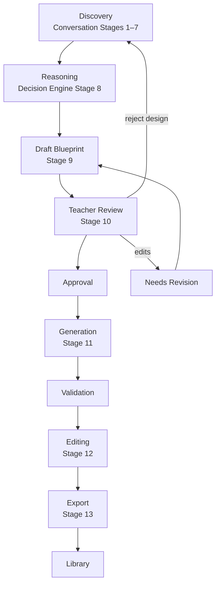
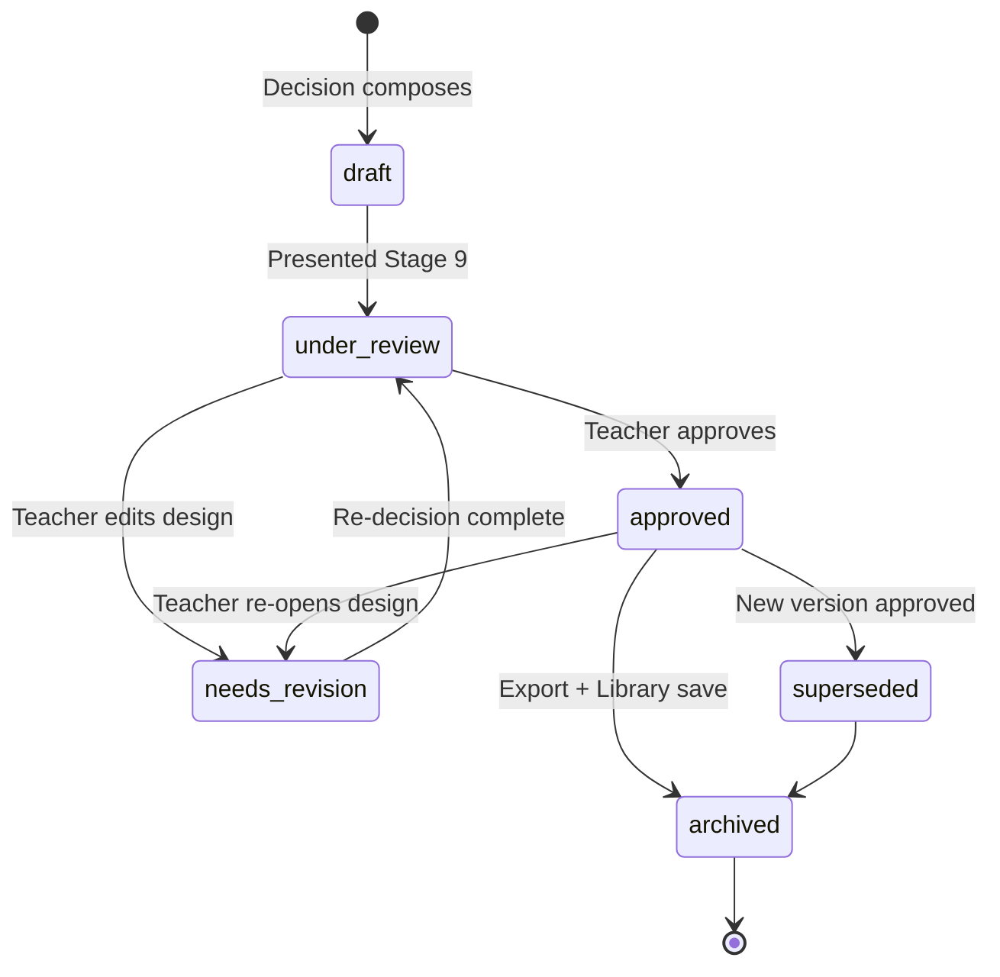
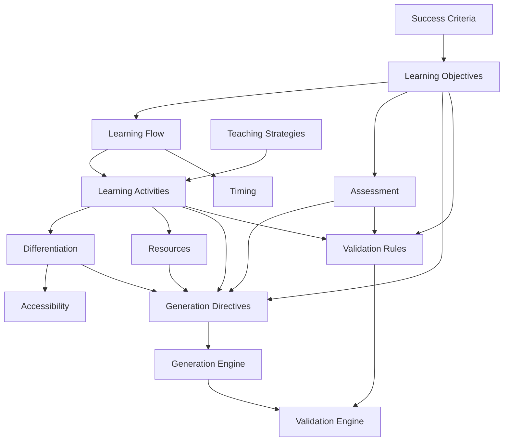
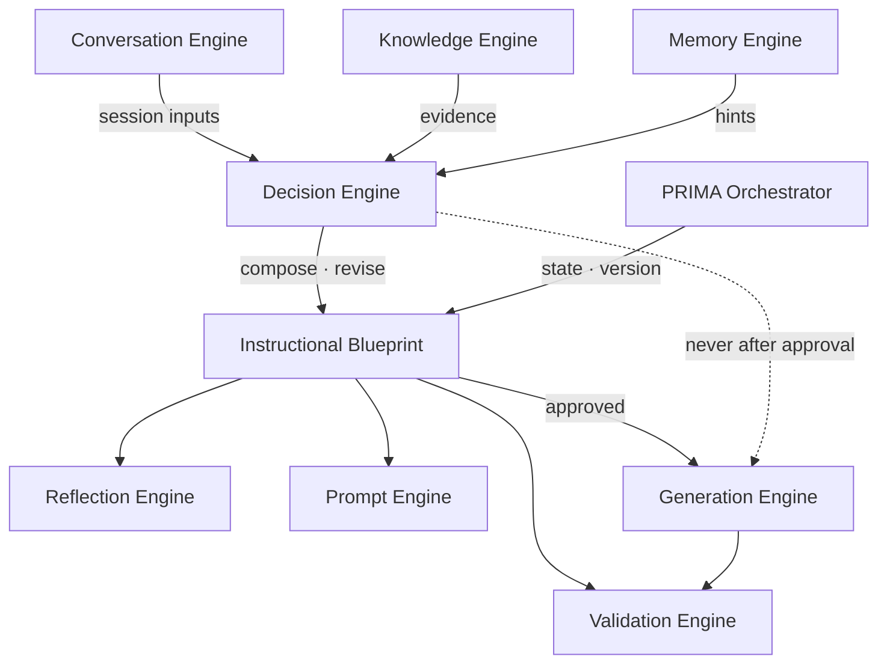

# Instructional Blueprint — Canonical Specification

---

## Purpose

This document defines the **Instructional Blueprint** — the central pedagogical object of the LUDI ON platform and the PRIMA ecosystem.

The Instructional Blueprint is **not** an engine, an implementation, a database schema, or an API contract. It is the **canonical definition** of how a Learning Experience is designed before any classroom material exists.

Every PRIMA engine must interpret the Blueprint exactly as defined here. No engine may redefine Blueprint concepts independently.

| Engine | Uses Blueprint for |
|--------|------------------|
| Conversation Engine | Captures inputs that populate Blueprint sections during discovery |
| Decision Engine | Composes, revises, and validates Blueprint structure |
| Reflection Engine | Presents reasoning linked to Blueprint sections |
| Knowledge Engine | Supplies evidence encoded into Blueprint curriculum fields |
| Memory Engine | Indirect — preferences resolved into Blueprint before approval |
| Generation Engine | Executes approved Blueprint into editable resources |
| Validation Engine | Validates generated output against Blueprint constraints |
| Prompt Engine | Presents Blueprint sections in teacher-friendly language |
| PRIMA Orchestrator | Enforces lifecycle, states, and approval gate |

This specification answers one product question:

> *What is an Instructional Blueprint?*

It does **not** answer how the Blueprint is stored, generated, rendered, or transmitted.

---

### Why the Blueprint Exists

LUDI ON separates **instructional design** from **content production**. The Instructional Blueprint is the artifact that makes this separation enforceable.

| Requirement | How Blueprint satisfies it |
|-------------|---------------------------|
| **Single authoritative design** | Every Learning Experience has exactly one Blueprint per design iteration |
| **Contract between reasoning and execution** | Decision Engine writes design; Generation Engine reads design — no overlap |
| **Teacher ownership** | Teacher reviews, revises, and approves before execution |
| **Platform-wide consistency** | All engines share one conceptual model |

Without the Blueprint, PRIMA would collapse design and generation into an opaque content stream — breaking trust, traceability, and the Project Bible principle: **Blueprint Before Generation**.

---

## Blueprint Philosophy

These principles are immutable across all PRIMA engines and platform versions.

### Blueprint before generation

No classroom content is produced until the Blueprint reaches `approved` state. Generation executes design — it does not create it.

### Blueprint before validation

Validation of generated materials measures fidelity **to the Blueprint** — not independent quality guesses.

### Blueprint is teacher-owned

The teacher approves the Blueprint. The teacher may edit any section. The teacher decides when design is complete enough to generate.

### Blueprint is editable

Every section is revisable through the Decision revision loop without restarting discovery — unless critical information is missing.

### Blueprint is versioned

Every change produces identifiable version lineage. Approved Blueprints are immutable for generation runs unless explicitly re-opened for revision.

### Blueprint is explainable

Every major section traces to discovery evidence, knowledge provenance, or stated pedagogical rationale.

### Blueprint is auditable

Version history, approval record, and section-level rationale support review: *why was this designed this way?*

### Blueprint is reusable

Approved Blueprints may be saved to Library, duplicated, and adapted for future Learning Experiences.

### Blueprint is technology independent

The Blueprint describes **pedagogical design** — not slides, PDFs, prompts, or database records. It survives changes in AI models, export formats, and UI implementations.

---

## Why Instructional Blueprint Exists

The Blueprint solves structural problems that raw conversation, templates, or direct AI generation cannot.

| Problem | Blueprint solution |
|---------|-------------------|
| **Consistency** | One design drives lesson, worksheet, presentation, and assessment — no contradictory resources |
| **Traceability** | Every generated block links to a Blueprint section |
| **Explainability** | Teachers see *what* was designed and *why* before content appears |
| **Regeneration** | Partial regen scopes to Blueprint sections — pedagogy stays fixed |
| **Validation** | Quality gates compare output against explicit design constraints |
| **Collaboration** | Shared design artifact for future co-design features |
| **Quality assurance** | Backward-design checks encoded as Blueprint validation rules |
| **Trust** | Teacher approves design before AI writes classroom text |

---

## Blueprint Lifecycle

The Blueprint evolves from discovery capture through library archival.

### Lifecycle Stages

| Stage | Actor | Blueprint role |
|-------|-------|----------------|
| **Discovery** | Conversation Engine | Session model feeds Blueprint inputs |
| **Reasoning** | Decision Engine | Draft Blueprint composed |
| **Draft Blueprint** | Decision Engine | State: `draft` |
| **Teacher Review** | Teacher + Reflection | State: `under_review` |
| **Revision** | Teacher + Decision Engine | Incremental re-decision; state: `needs_revision` |
| **Approval** | Teacher | State: `approved` — generation gate opens |
| **Generation** | Generation Engine | Reads approved Blueprint; produces drafts |
| **Validation** | Validation Engine | Output vs Blueprint constraints |
| **Editing** | Teacher | Content edits — Blueprint unchanged unless re-opened |
| **Export** | Platform export | Finalized resources delivered |
| **Library** | Platform | Blueprint archived with activity; state: `archived` |

### Lifecycle Diagram



### Re-open Rules

| Trigger | Result |
|---------|--------|
| Teacher edits Blueprint section after approval | State returns to `needs_revision`; Generation blocked until re-approval |
| Teacher edits generated content only | Blueprint unchanged; no re-approval required |
| Pedagogy must change post-generation | Blueprint revision via Decision Engine — not silent override |

---

## Blueprint States

Every Blueprint exists in exactly one state at any time. State transitions are governed by PRIMA Orchestrator.

| State | Definition | Generation allowed | Editable by |
|-------|------------|-------------------|-------------|
| **`draft`** | Initial Decision Engine output; not yet presented for review | No | Decision Engine; teacher preview read-only optional |
| **`under_review`** | Presented to teacher (Stages 9–10); awaiting decision | No | Teacher (inline edits trigger revision) |
| **`needs_revision`** | Teacher edited design sections; Decision re-decision in progress | No | Teacher + Decision Engine |
| **`approved`** | Teacher explicit approval; design locked for generation | **Yes** | Teacher re-open only via revision flow |
| **`superseded`** | Replaced by newer approved version; retained for lineage | No | Read-only |
| **`archived`** | Activity exported and saved to Library; historical record | No | Read-only; duplicate to create new |

### State Transition Diagram



---

## Blueprint Structure

The Instructional Blueprint is organized into **conceptual sections**. Each section has a defined purpose, owner during composition, and consumers during generation and validation.

Sections are listed in **dependency order** — the order in which composition proceeds. Engine ownership is defined in [`PRIMA_CONSTITUTIONAL_ENGINE_ARCHITECTURE.md`](./PRIMA_CONSTITUTIONAL_ENGINE_ARCHITECTURE.md).

---

### Identity

**Purpose:** Uniquely identify this Blueprint and its Learning Experience within the platform.

**Contains:** Blueprint identifier, activity type (Lecție, Joc, Fișă, etc.), title, locale, creator reference, creation timestamp.

**Populated by:** PRIMA Orchestrator + Decision Engine.

**Used by:** All engines for scoping; Library; Project Memory.

---

### Learning Context

**Purpose:** Situational frame for the Learning Experience.

**Contains:** Grade band, subject, topic, duration, class setting, language of instruction.

**Populated by:** Conversation Engine capture; Decision Engine normalization.

**Used by:** Knowledge alignment; Generation vocabulary ceiling; Validation age checks.

---

### Curriculum

**Purpose:** Curriculum alignment metadata — not full Knowledge Engine content.

**Contains:** Curriculum unit reference, school year, knowledge pack version, alignment notes.

**Populated by:** Decision Engine from Knowledge Engine retrieval during reasoning.

**Used by:** Explainability; Validation curriculum checks; teacher opt-in formal view.

---

### Competencies

**Purpose:** Curriculum-aligned capability statements the Learning Experience addresses.

**Contains:** Competency descriptors (teacher-friendly default), optional formal codes (opt-in), provenance links.

**Populated by:** Decision Engine from Knowledge Engine candidates.

**Used by:** Objectives section; Validation alignment; explainability chain.

---

### Learning Objectives

**Purpose:** Measurable outcomes students will achieve — anchor of backward design.

**Contains:** Objective statements, cognitive level, linked competencies, priority ranking.

**Populated by:** Decision Engine Layer 1 from discovery success criteria.

**Used by:** Activities, Assessment, Differentiation, Generation, Validation — all downstream sections.

---

### Success Criteria

**Purpose:** How the teacher defines success for this Learning Experience.

**Contains:** Observable student behaviours, acceptance conditions, anti-goals (what success is not).

**Populated by:** Conversation discovery; Decision Engine formalization.

**Used by:** Assessment design; Validation; explainability.

---

### Learning Flow

**Purpose:** Phased sequence of the Learning Experience.

**Contains:** Ordered learning phases, phase purposes, transitions, total timing.

**Populated by:** Decision Engine Layer 3.

**Used by:** Activities, Timing, Generation resource structure, Presentation flow.

---

### Teaching Strategies

**Purpose:** Instructional methods selected for this design.

**Contains:** Named strategies, rationale metadata, applicability context, knowledge provenance.

**Populated by:** Decision Engine Layer 2.

**Used by:** Activities; explainability; Generation tone and structure hints.

---

### Learning Activities

**Purpose:** What students and teachers **do** in each phase.

**Contains:** Activity descriptions per phase, grouping, student roles, teacher roles, materials class.

**Populated by:** Decision Engine Layer 3 detail.

**Used by:** Generation Instruction Blocks and Student Tasks; Differentiation; Assessment alignment.

---

### Differentiation

**Purpose:** Adaptations for learner variance.

**Contains:** Support tier, core tier, extension tier; SEN accommodations; UDL checkpoints referenced.

**Populated by:** Decision Engine Layer 4 from learner model.

**Used by:** Generation tier variants; Validation differentiation checks.

---

### Assessment

**Purpose:** How learning will be checked against objectives and success criteria.

**Contains:** Assessment approach, format patterns, cognitive levels targeted, timing within flow.

**Populated by:** Decision Engine Layer 5 backward-design pass.

**Used by:** Generation Assessment Blocks; Validation objective alignment.

---

### Resources

**Purpose:** Materials and tools required to deliver the design.

**Contains:** Resource classes, digital/offline requirements, substitution options, preparation burden.

**Populated by:** Conversation Stages 6–7; Decision Engine resource patterns.

**Used by:** Generation resource planning; constraint validation.

---

### Teacher Notes

**Purpose:** Implementation guidance, trade-offs, flags, and rationale summary for the teacher.

**Contains:** Setup tips, pedagogical flags, trade-off records, optional adjustments, Decision reasoning summary links.

**Populated by:** Decision Engine; Reflection Engine presentation support.

**Used by:** Generation Teacher Notes; teacher preview; explainability.

---

### Timing

**Purpose:** Explicit time allocation across phases and activities.

**Contains:** Duration per phase, buffer time, total lesson duration, cognitive load notes.

**Populated by:** Decision Engine Layer 3 with developmental rules.

**Used by:** Validation timing checks; Generation pacing; teacher implementation.

---

### Accessibility

**Purpose:** Design-level accessibility commitments.

**Contains:** UDL representation options, language simplification flags, physical access notes, assessment accommodations.

**Populated by:** Decision Engine Layer 4 + Knowledge UDL patterns.

**Used by:** Generation accessibility variants; Validation.

---

### Digital Integration

**Purpose:** Role of digital tools in delivery — when applicable.

**Contains:** Digital resource requirements, offline alternatives, projector/tablet usage level.

**Populated by:** Conversation resources stage; Decision constraint resolution.

**Used by:** Generation digital vs print planning.

---

### Reflection Hooks

**Purpose:** Optional post-lesson reflection prompts for teacher professional growth.

**Contains:** Reflection questions, success indicators, future adjustment prompts.

**Populated by:** Decision Engine optional section; Reflection Engine post-session.

**Used by:** Memory Engine async capture (future); teacher professional reflection.

---

### Generation Directives

**Purpose:** Execution constraints passed to Generation Engine at approval.

**Contains:** Output type list, vocabulary ceiling, revision directives, terminology anchors, tier generation flags.

**Populated by:** Decision Engine at approval; encodes Knowledge and resolved Memory preferences.

**Used by:** Generation Engine exclusively at execution.

---

### Validation Rules

**Purpose:** Blueprint-encoded constraints for Validation Engine.

**Contains:** Required section checklist, alignment rules, vocabulary ceiling reference, differentiation requirements.

**Populated by:** Decision Engine Layer 5 validation pass.

**Used by:** Validation Engine post-generation.

---

### Metadata

**Purpose:** Operational and lineage information.

**Contains:** State, confidence map snapshot, pedagogical flags, session reference, orchestrator context.

**Populated by:** PRIMA Orchestrator + Decision Engine.

**Used by:** All engines for lifecycle control.

---

### Version History

**Purpose:** Audit trail of Blueprint evolution.

**Contains:** Version numbers, state transitions, approval timestamps, change summaries, supersession links.

**Populated by:** PRIMA Orchestrator on every revision and approval.

**Used by:** Explainability; Library; duplicate/adapt workflows.

---

## Blueprint Objects

Within sections, the Blueprint contains **conceptual objects** — reusable structural units. These are product definitions, not data schemas.

---

### Learning Phase

**Definition:** A bounded segment of the Learning Flow with a distinct pedagogical purpose.

**Attributes:** Phase name, purpose, sequence order, linked objectives, transition note.

**Parent section:** Learning Flow → Learning Activities.

---

### Objective

**Definition:** A measurable learning outcome statement.

**Attributes:** Statement text, cognitive level, competency links, priority.

**Parent section:** Learning Objectives.

**Relationships:** Must be supported by ≥1 Activity; assessed by ≥1 Assessment Item.

---

### Activity

**Definition:** A concrete learning action within a phase.

**Attributes:** Description, phase link, grouping, student task summary, teacher role, materials class.

**Parent section:** Learning Activities.

**Relationships:** Supports ≥1 Objective; may have Differentiation Layers.

---

### Assessment Item

**Definition:** A check of learning aligned to objectives.

**Attributes:** Format pattern, objective links, cognitive level, timing placement.

**Parent section:** Assessment.

**Relationships:** Maps to ≥1 Objective; aligns with Activities that teach those objectives.

---

### Differentiation Layer

**Definition:** A tier or adaptation applied to an activity or assessment.

**Attributes:** Tier type (support / core / extension), target activity reference, adaptation description.

**Parent section:** Differentiation.

**Relationships:** References specific Activities; never orphaned.

---

### Timing Block

**Definition:** Time allocation for a phase or activity.

**Attributes:** Duration, phase reference, cognitive load note.

**Parent section:** Timing.

**Relationships:** Sums to total Learning Context duration.

---

### Resource Reference

**Definition:** A required or optional material class for delivery.

**Attributes:** Resource class, quantity hint, digital/offline, substitution option.

**Parent section:** Resources.

**Relationships:** Linked to Activities that require it.

---

### Teacher Guidance

**Definition:** Implementation note for the teacher — not student-facing.

**Attributes:** Guidance text, phase reference, flag type (tip / warning / trade-off).

**Parent section:** Teacher Notes.

---

### Student Task

**Definition:** Learner-facing action description at design level — not generated worksheet text.

**Attributes:** Task summary, phase reference, grouping, differentiation variant reference.

**Parent section:** Learning Activities.

**Consumed by:** Generation Engine as instruction for Student Activity blocks.

---

### Visual Intent

**Definition:** Design-level description of visual support needed.

**Attributes:** Concept to visualize, placement phase, visual type (diagram / illustration / slide).

**Parent section:** Learning Activities or Resources.

**Consumed by:** Generation as Visual Placeholder intent — not rendered asset.

---

### Generation Directive

**Definition:** A machine-oriented execution constraint for Generation Engine.

**Attributes:** Directive type, target section, constraint value.

**Parent section:** Generation Directives.

**Examples:** `vocabulary_ceiling: grade_4`, `output_types: [lesson, presentation, worksheet, assessment]`.

---

### Validation Constraint

**Definition:** A rule Validation Engine applies against generated output.

**Attributes:** Rule type, source section, threshold or requirement.

**Parent section:** Validation Rules.

**Examples:** Every objective has ≥1 activity; assessment cognitive level matches objective.

---

## Blueprint Relationships

Sections depend on each other in a directed structure. Downstream sections must align with upstream anchors.

### Dependency Chain

```
Learning Objectives
        ↓
Learning Flow
        ↓
Teaching Strategies
        ↓
Learning Activities
        ↓
Assessment
        ↓
Differentiation
        ↓
Resources · Timing · Accessibility
        ↓
Generation Directives
        ↓
Validation Rules
```

### Relationship Diagram



### Cross-Section Rules

| Rule | Description |
|------|-------------|
| **Objectives anchor all** | No activity without objective link |
| **Flow contains activities** | Every activity belongs to a phase |
| **Assessment tests objectives** | No assessment item without objective mapping |
| **Differentiation attaches to activities** | No orphan differentiation tier |
| **Directives encode approved design** | Generation reads directives — not raw session |
| **Validation rules mirror design** | Validation Rules generated from same pass as directives |

---

## Blueprint Quality Model

A Blueprint must satisfy quality dimensions before approval gate opens.

| Dimension | Definition | Blocking if failed |
|-----------|------------|-------------------|
| **Completeness** | All required sections populated for activity type | Yes — cannot approve |
| **Pedagogical Consistency** | Objectives ↔ activities ↔ assessment aligned | Yes |
| **Curriculum Alignment** | Competencies and objectives match grade/subject when known | Flag if low knowledge confidence |
| **Objective Traceability** | Every objective traces to discovery or knowledge evidence | Yes for explainability |
| **Assessment Alignment** | Assessment measures stated success criteria | Yes |
| **Differentiation** | Learner model addressed when variance captured | Flag if learner model present but empty differentiation |
| **Accessibility** | UDL commitments present when SEN flagged in discovery | Flag |
| **Generation Readiness** | Generation Directives complete for selected output types | Yes — cannot generate |
| **Validation Readiness** | Validation Rules populated | Yes — cannot validate post-gen |

### Approval Gate Requirements

Teacher approval control is disabled until:

- State is not blocked by Completeness or Pedagogical Consistency failures
- Very-low-confidence fields resolved or acknowledged
- Generation Directives and Validation Rules present

---

## Blueprint Validation Rules

These rules apply to **Blueprint structure** before approval (Decision Engine Layer 5) and guide **output validation** after generation.

| Rule ID | Rule | Enforced by |
|---------|------|-------------|
| **BV-01** | Every objective has ≥1 supporting activity | Decision + Validation |
| **BV-02** | Every activity supports ≥1 objective | Decision + Validation |
| **BV-03** | Every assessment item maps to ≥1 objective | Decision + Validation |
| **BV-04** | Assessment cognitive level ≤ objective cognitive level ceiling | Decision |
| **BV-05** | Every differentiation layer references a specific activity or assessment | Decision |
| **BV-06** | Timing blocks cover all learning phases | Decision |
| **BV-07** | Total timing ≤ Learning Context duration | Decision |
| **BV-08** | No orphan sections — all objects linked | Decision |
| **BV-09** | Resources required by activities appear in Resources section | Decision |
| **BV-10** | Generation Directives reference approved section versions | Orchestrator |
| **BV-11** | Success criteria addressed by ≥1 assessment approach | Decision |
| **BV-12** | Teaching strategy compatible with stated resource constraints | Decision |

### Orphan Section Definition

A section or object is **orphan** if it has no upstream dependency link — e.g., an activity with no objective, an assessment item with no objective, a differentiation tier with no activity reference.

Orphan sections block approval until resolved or removed.

---

## Blueprint Versioning

Every Blueprint maintains version lineage from first draft through library archival.

### Version Types

| Type | Trigger | Version bump | Example |
|------|---------|--------------|---------|
| **Minor revision** | Teacher edits single section; scoped re-decision | Patch: v1.0 → v1.1 | Activity text in Phase 2 changed |
| **Major revision** | Objectives or Learning Flow restructured | Minor: v1.x → v2.0 | New objective added; phases reordered |
| **Teacher revision** | Any teacher-initiated design edit | Increment + `needs_revision` state | Inline blueprint edit Stage 10 |
| **Generation revision** | Content regen only | **No blueprint version change** | Worksheet block regen Stage 12 |
| **Approval event** | Teacher explicit approval | State → `approved`; approval record appended | v1.2 approved 2026-07-20 |

### Lineage Model

```
Blueprint v1.0 (draft)
    → v1.1 (needs_revision — teacher edit)
    → v1.1 (approved)
    → [generation run G1 from v1.1]
    → v2.0 (major — objectives changed)
    → v2.0 (approved — supersedes v1.1)
    → v1.1 (superseded — read-only)
    → [generation run G2 from v2.0]
    → archived (Library)
```

### Approval History

Each approval record contains: version, timestamp, teacher reference, generation runs authorized, optional approval note.

---

## Blueprint Explainability

Every Blueprint section must support answers to teacher questions — delivered via Reflection and Prompt engines, not raw Blueprint exposure.

| Question | Trace path |
|----------|------------|
| **Why is this activity here?** | Activity → Phase purpose → Objective → Discovery quote or knowledge evidence |
| **Why this assessment?** | Assessment → Success criteria → Objective cognitive level |
| **Why this strategy?** | Teaching Strategies → Knowledge strategy pattern provenance → Learner model |
| **Why this timing?** | Timing Block → Development rule → Learning Flow phase complexity |

### Explainability Chain

```
Discovery evidence · Knowledge provenance · Decision rationale
                    ↓
            Blueprint section
                    ↓
         reasoning_summary (Stage 8)
                    ↓
         Teacher-friendly explanation
                    ↓
         Blueprint viewer (Stage 9–10)
```

Unexplainable sections must not reach `approved` state without teacher explicit acknowledgment.

---

## Blueprint Ownership

| Actor | Owns | May modify | May not modify |
|-------|------|------------|----------------|
| **Teacher** | Final approval; all section content via edit | Any section during review; re-open after approval | Generation Directives directly (via Decision only) |
| **Decision Engine** | Composition of all design sections; Validation Rules; Generation Directives | Draft and needs_revision states | Approved state without teacher trigger |
| **Generation Engine** | Nothing in Blueprint | Nothing | Any pedagogical section |
| **Validation Engine** | Nothing in Blueprint | Nothing | Any section |
| **Knowledge Engine** | Nothing in Blueprint | Nothing | Blueprint — supplies evidence pre-composition only |
| **Memory Engine** | Nothing in Blueprint | Nothing | Blueprint — preferences encoded by Decision at approval |
| **PRIMA Orchestrator** | State, version history, approval gate | Metadata, state transitions | Design content |

**Canonical rule:** The teacher owns the approved Blueprint. The platform holds it on the teacher's behalf.

---

## Blueprint Boundaries

The Blueprint describes **pedagogical design**. It never contains execution artifacts or engine internals.

| Blueprint never contains | Belongs in |
|--------------------------|------------|
| Generated lesson text | Generation Draft |
| Slide content or layouts | Presentation Resource Block |
| Worksheet body text | Worksheet Resource Block |
| Rendered images | Visual Placeholder → Generation output |
| Presentation formatting | Resource Engine / export |
| Temporary prompts | Prompt Engine (never in Blueprint) |
| Conversation history | Session Memory / Conversation Engine |
| Raw Memory objects | Memory Engine — encoded in directives only |
| Raw Knowledge objects | Knowledge Engine — encoded in Curriculum/Competencies only |
| LLM instructions | Implementation layer — forbidden in Blueprint |
| Student PII | Forbidden platform-wide |
| Validation pass/fail logs | Validation Engine output metadata — not Blueprint |

If content appears in the Blueprint, it is **design intent** — not **generated artifact**.

---

## Relationship with Every Engine

### Complete Interaction Matrix

| Engine | Reads Blueprint | Writes Blueprint | Phase |
|--------|-----------------|------------------|-------|
| **Conversation Engine** | No (writes session model) | Indirect — feeds Decision inputs | Discovery |
| **Decision Engine** | Yes — draft for revision | Yes — all design sections, directives, rules | Reasoning → Approval |
| **Reflection Engine** | Yes — for presentation | No | Review |
| **Knowledge Engine** | No | No — evidence consumed by Decision during composition | Pre-composition |
| **Memory Engine** | No | No — preferences encoded by Decision | Pre-composition |
| **Prompt Engine** | Yes — for display copy | No | Review → Generation UI |
| **Generation Engine** | Yes — approved only | **No** | Generation |
| **Validation Engine** | Yes — Validation Rules + design sections | No | Post-generation |
| **PRIMA Orchestrator** | Yes — state, metadata | State, version history | All phases |

### Engine Diagram



---

## Future Evolution

The following capabilities extend the Blueprint model — **future product scope**, not Version 1.0 commitments.

| Capability | Description |
|------------|-------------|
| **Adaptive Blueprint** | Blueprint sections expand/contract based on activity complexity — structure unchanged |
| **Collaborative Blueprint** | Multiple teachers co-edit design sections with merge governance |
| **Institution Blueprint** | School-level template Blueprints — teacher adapts before approval |
| **Blueprint Marketplace** | Community-shared approved Blueprints — moderated, versioned |
| **Reusable Blueprint Components** | Objective packs, phase templates, differentiation patterns as attachable modules |
| **Blueprint Analytics** | Aggregate patterns on Blueprint quality dimensions — anonymized |

All future capabilities preserve: teacher ownership, approval gate, technology independence, and separation from generated content.

---

## Architectural Principles

Permanent rules governing the Instructional Blueprint across all PRIMA engines and platform versions.

| # | Principle |
|---|-----------|
| 1 | **Blueprint is authoritative** — approved design is the contract for generation |
| 2 | **Blueprint precedes generation** — no execution without approval |
| 3 | **Blueprint is technology independent** — pedagogical design only |
| 4 | **Blueprint is explainable** — every section traces to evidence |
| 5 | **Blueprint is versioned** — full lineage from draft to archive |
| 6 | **Blueprint is reusable** — Library, duplicate, adapt |
| 7 | **Blueprint is teacher-owned** — teacher approves and may re-open |
| 8 | **Blueprint separates reasoning from execution** — Decision writes; Generation reads |
| 9 | **Blueprint survives technology changes** — models and formats change; design endures |
| 10 | **No engine redefines Blueprint** — this document is canonical |
| 11 | **Generated content never lives in Blueprint** — design vs artifact boundary |
| 12 | **One authoritative Blueprint per design iteration** — no parallel design sources |

---

## Document Authority

On conflict between this specification and any other PRIMA document regarding Blueprint definition:

**`INSTRUCTIONAL_BLUEPRINT_SPECIFICATION.md` prevails** until officially revised by the LUDI ON Product Team.

Subordinate documents — including legacy `docs/LUDI_ON_BLUEPRINT/INSTRUCTIONAL_BLUEPRINT.md` — must align with this specification.

---

## Next Recommended Document

→ [`PRIMA_CONSTITUTIONAL_DECISION_MODEL.md`](./PRIMA_CONSTITUTIONAL_DECISION_MODEL.md) — How decisions compose, validate, and revise Blueprint sections.
