# PRIMA Blueprint

**Version:** 1.0  
**Status:** Official — Constitutional Educational Object Specification

> **The Blueprint is the single source of educational truth inside PRIMA.**

Every educational resource — lesson plan, worksheet, game, assessment, story, presentation, learning scenario, project, or activity — **must first exist as a Blueprint**. Generation is only one possible **transformation** of a Blueprint. Nothing educational should exist outside the Blueprint.

This document defines the **conceptual educational object** that every intelligent capability inside PRIMA will create, enrich, validate, transform, and use. It is **not** software, a database, JSON, or an API. It is timeless, technology-independent, and implementation-independent.

Formal artifact identity: **Instructional Blueprint** ([`PRIMA_CANONICAL_ARTIFACTS.md`](./PRIMA_CANONICAL_ARTIFACTS.md)). Structural section detail: [`INSTRUCTIONAL_BLUEPRINT_SPECIFICATION.md`](./INSTRUCTIONAL_BLUEPRINT_SPECIFICATION.md). This document defines **what must be known educationally** — the specification instantiates **how sections encode it**.

---

## 1. Purpose

PRIMA is an **Educational Intelligence Operating System**. Its intelligence ([`PRIMA_INTELLIGENCE_KERNEL.md`](./PRIMA_INTELLIGENCE_KERNEL.md)) exists to improve educational thinking. The **Blueprint** is where that thinking becomes **durable, reviewable, approvable educational design**.

The Blueprint is the **educational DNA** of every resource. Regardless of final output format, the pedagogical identity of a Learning Experience lives in the Blueprint alone.

| Authority | Document | Role |
|-----------|----------|------|
| **Blueprint (this document)** | Canonical educational object — domains, lifecycle, governance | **Constitutional — supreme for design** |
| **Blueprint Specification** | [`INSTRUCTIONAL_BLUEPRINT_SPECIFICATION.md`](./INSTRUCTIONAL_BLUEPRINT_SPECIFICATION.md) | Section schema and engine interpretation |
| **Domain Model** | [`PRIMA_DOMAIN_MODEL.md`](./PRIMA_DOMAIN_MODEL.md) | Entity ownership and boundaries |
| **Canonical Artifacts** | [`PRIMA_CANONICAL_ARTIFACTS.md`](./PRIMA_CANONICAL_ARTIFACTS.md) | Artifact registry and invariants |
| **Intelligence Kernel** | [`PRIMA_INTELLIGENCE_KERNEL.md`](./PRIMA_INTELLIGENCE_KERNEL.md) | How intelligence creates and validates Blueprint |

Every intelligent capability, educational workflow, AI assistant, and generation process **must consume, enrich, or validate** the Blueprint.

---

## 2. Scope

| In scope | Out of scope |
|----------|--------------|
| Educational domains and their information requirements | Database schemas, file formats |
| Blueprint lifecycle and transformations | UI wireframes, export templates |
| Validation, completeness, and governance | LLM prompts, model behavior |
| Teacher and AI responsibilities | Engine implementation code |
| Relationships between educational domains | API contracts |

**Twenty-year rule:** The Blueprint must remain the central educational object regardless of AI paradigm, output medium, or platform technology.

---

## 3. The Fundamental Question

Every domain, field, and rule in the Blueprint must contribute to answering one question:

> **What information must exist before any educational resource can be designed responsibly?**

**Exclusion rule:** Information that does not contribute to responsible educational design **shall not** appear in the Blueprint. Implementation metadata, generation parameters, and presentation formatting belong elsewhere — never as substitutes for pedagogical design.

---

## 4. Design Principles

The Blueprint must be:

| Principle | Meaning |
|-----------|---------|
| **Educational** | Every element serves learning — not technology or formatting |
| **Minimal** | No field without clear pedagogical purpose |
| **Complete** | Sufficient for responsible design approval before generation |
| **Reusable** | Approved Blueprints adaptable across contexts and outputs |
| **Extensible** | New Activity Types and domains add without breaking core identity |
| **Explainable** | Every major design choice traceable to evidence or teacher intent |
| **Human-readable** | Teachers review design in pedagogical language |
| **AI-readable** | Intelligence capabilities interpret domains consistently |
| **Pedagogically coherent** | Objectives, activities, assessment, and flow align |
| **Curriculum-aware** | Alignment claims grounded in knowledge provenance |
| **Transformation-ready** | One Blueprint → many output types without identity change |
| **Validation-ready** | Explicit criteria for structural and output fidelity checks |
| **Future-proof** | Survives model, medium, and platform evolution |

**Constitutional alignment:** Blueprint existence enforces **CP-04 Planning Precedes Generation** and **AP-04 Design Before Execution** from the Intelligence Kernel and Architectural Principles.

---

## 5. Blueprint Architecture

The Blueprint is organized as a **hierarchy of nine educational domains**. Domains are **conceptual** — not files, tables, or UI panels. The Blueprint Specification maps domains to concrete sections.

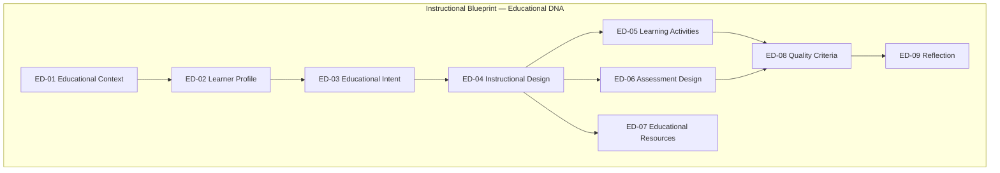

### Domain template

Each domain defines:

| Attribute | Description |
|-----------|-------------|
| **Purpose** | Why this domain exists educationally |
| **Educational value** | What design quality it enables |
| **Relationships** | Upstream and downstream domain links |
| **Mandatory information** | Required before approval |
| **Optional information** | Enriches design when available |
| **Validation rules** | Structural integrity constraints |
| **Dependencies** | Domains that must precede this domain |

---

## 6. Educational Domains

---

### ED-01 — Educational Context

#### Purpose

Establish **why this learning experience exists** and the situational frame within which design decisions are made.

#### Educational value

Prevents generic or decontextualized design. Ensures curriculum scope, timing, and environment constraints shape every downstream domain.

#### Relationships

| Direction | Domain | Relationship |
|-----------|--------|--------------|
| Upstream | Teacher Intent (pre-Blueprint artifact) | Normalizes into context fields |
| Downstream | ED-02 Learner Profile, ED-03 Educational Intent | Context scopes learner and intent |
| Cross-reference | ED-08 Quality Criteria | Duration and environment inform validation |

**Specification mapping:** Identity, Learning Context, Curriculum sections.

#### Mandatory information

| Information | Description |
|-------------|-------------|
| **Educational stage** | School level or lifelong-learning band |
| **Grade** | Target grade or age band |
| **Subject** | Discipline domain |
| **Learning unit** | Topic or curricular unit addressed |
| **Duration** | Expected time for the experience |
| **Learning environment** | Classroom, lab, remote, hybrid, outdoor |

#### Optional information

| Information | Description |
|-------------|-------------|
| **Curriculum references** | Formal program codes, unit identifiers |
| **Knowledge pack version** | Corpus release for alignment provenance |
| **Constraints** | Schedule, resource, policy, or institutional limits |
| **Activity type scope** | Lecție, Joc, Fișă, etc. — builder entry point |
| **Language of instruction** | Delivery language |

#### Validation rules

| Rule | Requirement |
|------|-------------|
| **ED1-V01** | Subject and grade (or equivalent band) present before intent formalization |
| **ED1-V02** | Duration > 0 and compatible with total activity timing (ED-05, ED-04) |
| **ED1-V03** | Curriculum references, when present, trace to Knowledge Package provenance |
| **ED1-V04** | Constraints explicitly listed or marked *none declared* — never assumed absent |

#### Dependencies

None within Blueprint — first domain populated from discovery. Requires complete Teacher Intent (IK-G01).

---

### ED-02 — Learner Profile

#### Purpose

Describe **who the learners are** — the audience for whom the experience is designed.

#### Educational value

Enables differentiation, accessibility, pacing, and method selection grounded in real learner variance — not generic defaults.

#### Relationships

| Direction | Domain | Relationship |
|-----------|--------|--------------|
| Upstream | ED-01 Educational Context | Grade and environment frame profile |
| Downstream | ED-04 Instructional Design, ED-05 Learning Activities, ED-06 Assessment | Profile drives scaffolding and tiers |
| Cross-reference | ED-08 Quality Criteria | Accessibility and differentiation validation |

**Specification mapping:** Learning Context (learner facets), Differentiation, Accessibility sections.

#### Mandatory information

| Information | Description |
|-------------|-------------|
| **Age / developmental band** | Derived from grade or explicit declaration |
| **Prior knowledge** | What learners are assumed to know — or explicit *unknown* flag |

#### Optional information

| Information | Description |
|-------------|-------------|
| **Learning characteristics** | Cognitive profile, language proficiency, engagement patterns |
| **Learning needs** | SEN, gifted, multilingual, remedial |
| **Differentiation requirements** | Required tier strategy |
| **Accessibility** | UDL commitments, accommodations |
| **Motivation** | Interests, relevance hooks, engagement risks |

#### Validation rules

| Rule | Requirement |
|------|-------------|
| **ED2-V01** | Prior knowledge declared or flagged *to be confirmed with teacher* |
| **ED2-V02** | If SEN or accessibility needs flagged in discovery, ED-04 must address them (ED8-V03) |
| **ED2-V03** | Learner profile never inferred silently from stereotypes — teacher confirmation required for material claims |

#### Dependencies

ED-01 Educational Context.

---

### ED-03 — Educational Intent

#### Purpose

Define **what learners should achieve** — the measurable purpose of the Learning Experience.

#### Educational value

Anchors backward design. Every activity, assessment, and resource must trace to stated intent.

#### Relationships

| Direction | Domain | Relationship |
|-----------|--------|--------------|
| Upstream | ED-01, ED-02 | Context and profile scope intent |
| Downstream | ED-04, ED-05, ED-06, ED-08 | Intent drives design, activities, assessment, quality |
| Cross-reference | Knowledge Package | Competency candidates with provenance |

**Specification mapping:** Competencies, Learning Objectives, Success Criteria sections.

#### Mandatory information

| Information | Description |
|-------------|-------------|
| **General purpose** | Teacher-stated learning goal in pedagogical language |
| **Learning outcomes / objectives** | ≥1 measurable objective |
| **Success criteria** | How the teacher will recognize success |

#### Optional information

| Information | Description |
|-------------|-------------|
| **Competencies** | Curriculum-aligned capability statements with provenance |
| **Expected evidence** | Observable learner products or performances |
| **Anti-goals** | What success explicitly is not |
| **Priority ranking** | Primary vs secondary objectives |

#### Validation rules

| Rule | Requirement |
|------|-------------|
| **ED3-V01** | ≥1 objective with cognitive level declared |
| **ED3-V02** | Every objective traces to discovery evidence or knowledge provenance (BV-08 explainability) |
| **ED3-V03** | Success criteria addressable by ≥1 assessment approach (BV-11) |
| **ED3-V04** | Competency claims require knowledge provenance or teacher explicit confirmation |

#### Dependencies

ED-01 Educational Context; ED-02 Learner Profile (recommended before objective finalization).

---

### ED-04 — Instructional Design

#### Purpose

Describe **how learning will happen** — the pedagogical architecture of the experience.

#### Educational value

Transforms intent into a coherent instructional plan before any content exists. Separates design from production.

#### Relationships

| Direction | Domain | Relationship |
|-----------|--------|--------------|
| Upstream | ED-03 Educational Intent | Design realizes intent |
| Downstream | ED-05 Learning Activities, ED-06 Assessment, ED-07 Resources | Design decomposes into concrete elements |
| Cross-reference | ED-08 Quality Criteria | Coherence validation |

**Specification mapping:** Learning Flow, Teaching Strategies, Differentiation, Digital Integration, Timing, Reflection Hooks sections.

#### Mandatory information

| Information | Description |
|-------------|-------------|
| **Learning sequence** | Ordered phases with purposes and transitions |
| **Teaching methods / strategies** | Named approaches with rationale |
| **Scaffolding** | How support is introduced and withdrawn |
| **Timing** | Phase-level duration within total context duration |

#### Optional information

| Information | Description |
|-------------|-------------|
| **Learning strategies** | Student-facing cognitive strategies |
| **Grouping** | Individual, pair, group, whole class |
| **Interaction** | Teacher–student, student–student, student–material |
| **Differentiation** | Support, core, extension tiers |
| **Digital integration** | Technology role — design intent only |
| **Reflection** | Built-in reflection moments in flow |

#### Validation rules

| Rule | Requirement |
|------|-------------|
| **ED4-V01** | Every phase links to ≥1 objective (BV-01 chain) |
| **ED4-V02** | Timing blocks cover all phases; total ≤ ED-01 duration (BV-06, BV-07) |
| **ED4-V03** | Teaching strategies compatible with ED-07 resource constraints (BV-12) |
| **ED4-V04** | Differentiation present when ED-02 signals learner variance |

#### Dependencies

ED-03 Educational Intent (mandatory). ED-02 Learner Profile (for differentiation).

---

### ED-05 — Learning Activities

#### Purpose

Describe **every learning activity conceptually** — what happens in each phase of the experience.

#### Educational value

Bridges abstract instructional design to concrete classroom action. Generation maps activities to output blocks — it does not invent activities.

#### Relationships

| Direction | Domain | Relationship |
|-----------|--------|--------------|
| Upstream | ED-04 Instructional Design | Activities instantiate phases |
| Downstream | ED-06 Assessment, ED-07 Resources, ED-08 Quality | Activities require assessment alignment and resources |
| Transformation | Output types | Activities are the primary generation mapping unit |

**Specification mapping:** Learning Activities section; Activity objects.

#### Mandatory information (per activity)

| Information | Description |
|-------------|-------------|
| **Purpose** | Pedagogical reason for the activity |
| **Timing** | Placement within learning sequence |
| **Interaction mode** | Social and material interaction pattern |
| **Expected learner actions** | What students do |
| **Expected teacher actions** | What teacher facilitates |
| **Linked objectives** | ≥1 objective reference |
| **Learning evidence** | What indicates learning occurred |

#### Optional information

| Information | Description |
|-------------|-------------|
| **Resources required** | Materials referenced — detailed in ED-07 |
| **Differentiation variants** | Tier-specific activity adaptations |
| **Digital affordances** | Intended tool roles |

#### Validation rules

| Rule | Requirement |
|------|-------------|
| **ED5-V01** | Every activity supports ≥1 objective (BV-02) |
| **ED5-V02** | Every objective has ≥1 supporting activity (BV-01) |
| **ED5-V03** | No activity without phase placement |
| **ED5-V04** | Activities contain design intent only — never generated classroom text |

#### Dependencies

ED-03 Educational Intent; ED-04 Instructional Design.

---

### ED-06 — Assessment Design

#### Purpose

Define **how learning will be evaluated** against intent — formatively and summatively.

#### Educational value

Closes the backward-design loop. Ensures assessment measures what was taught and intended — not incidental content.

#### Relationships

| Direction | Domain | Relationship |
|-----------|--------|--------------|
| Upstream | ED-03 Educational Intent, ED-05 Learning Activities | Assessment measures objectives and activity evidence |
| Downstream | ED-08 Quality Criteria | Assessment alignment dimension |
| Transformation | Assessment outputs, worksheets, rubrics | Assessment design drives generated evaluation materials |

**Specification mapping:** Assessment section; Assessment Item objects.

#### Mandatory information

| Information | Description |
|-------------|-------------|
| **Assessment strategy** | Formative and/or summative approach |
| **Success indicators** | Link to ED-03 success criteria |
| **Objective mapping** | Each assessment element → ≥1 objective |

#### Optional information

| Information | Description |
|-------------|-------------|
| **Formative assessment** | In-flow checks, observation prompts |
| **Summative assessment** | End-of-experience evaluation |
| **Observation** | Teacher observation protocols |
| **Rubrics** | Criteria descriptors — design level |
| **Feedback** | Planned feedback mechanisms |
| **Self-assessment** | Learner reflection on progress |
| **Peer assessment** | Structured peer review when applicable |

#### Validation rules

| Rule | Requirement |
|------|-------------|
| **ED6-V01** | Every assessment item maps to ≥1 objective (BV-03) |
| **ED6-V02** | Assessment cognitive level ≤ objective ceiling (BV-04) |
| **ED6-V03** | Success criteria addressed by ≥1 assessment approach (BV-11) |
| **ED6-V04** | Assessment design present before approval — never deferred to generation |

#### Dependencies

ED-03 Educational Intent; ED-05 Learning Activities (recommended).

---

### ED-07 — Educational Resources

#### Purpose

Identify **what materials and tools** are required to deliver the designed experience.

#### Educational value

Surfaces resource gaps before generation. Prevents activities that assume unavailable materials.

#### Relationships

| Direction | Domain | Relationship |
|-----------|--------|--------------|
| Upstream | ED-05 Learning Activities, ED-04 Instructional Design | Resources serve activities and strategies |
| Downstream | Generation transformations | Resource classes map to output material types |
| Cross-reference | ED-01 Constraints | Resource availability vs constraints |

**Specification mapping:** Resources section; Resource Reference objects.

#### Mandatory information

| Information | Description |
|-------------|-------------|
| **Required materials** | Minimum set to run the design — or explicit *teacher-provided* declaration |

#### Optional information

| Information | Description |
|-------------|-------------|
| **Digital resources** | Apps, simulations, platforms — roles only |
| **Physical resources** | Manipulatives, printables, lab equipment |
| **Teacher resources** | Guides, answer keys, facilitation notes — design level |
| **Student resources** | Handouts, workbooks — **design references**, not generated text |
| **External resources** | Third-party content with usage constraints |

#### Validation rules

| Rule | Requirement |
|------|-------------|
| **ED7-V01** | Resources required by ED-05 activities appear in resource list (BV-09) |
| **ED7-V02** | External resources declare licensing or access constraints when known |
| **ED7-V03** | Resource section describes **need** — not final formatted materials |

#### Dependencies

ED-05 Learning Activities (mandatory for completeness).

---

### ED-08 — Quality Criteria

#### Purpose

Define **how the quality of this learning experience should be evaluated** — before and after generation.

#### Educational value

Makes quality explicit and measurable. Enables Quality Cognition and teacher review against stated standards — not hidden heuristics.

#### Relationships

| Direction | Domain | Relationship |
|-----------|--------|--------------|
| Upstream | All design domains ED-01–ED-07 | Criteria evaluate complete design |
| Downstream | Validation Reports, approval gate | Criteria drive IK-G07 Quality Gate |
| Cross-reference | Intelligence Kernel CP-05, CP-09 | Quality before productivity; explainability |

**Specification mapping:** Validation Rules section; Blueprint Quality Model.

#### Mandatory information

| Information | Description |
|-------------|-------------|
| **Curriculum alignment** | Alignment claim status and confidence |
| **Pedagogical coherence** | Objectives ↔ activities ↔ assessment chain integrity |
| **Assessment alignment** | Assessment measures success criteria |

#### Optional information

| Information | Description |
|-------------|-------------|
| **Difficulty** | Expected challenge level vs learner profile |
| **Timing feasibility** | Phase durations realistic for context |
| **Accessibility** | UDL and accommodation coverage |
| **Differentiation** | Tier completeness when learner variance present |
| **Engagement** | Motivation and interaction quality indicators |
| **Generation readiness** | Output-type directives for transformation |
| **Validation readiness** | Post-generation fidelity rules |

#### Validation rules

| Rule | Requirement |
|------|-------------|
| **ED8-V01** | Completeness and pedagogical consistency pass before approval gate |
| **ED8-V02** | Validation Rules populated before generation authorization |
| **ED8-V03** | Accessibility flagged when ED-02 signals needs but ED-04 empty |
| **ED8-V04** | Quality Criteria measure design — Quality Cognition measures; teacher approves |

#### Dependencies

ED-03 through ED-07 substantially complete.

---

### ED-09 — Reflection

#### Purpose

Capture **how this learning experience can improve** — design-time hooks and post-implementation learning.

#### Educational value

Connects single design to continuous improvement. Supports CP-07 Reflection Completes Intelligence and CP-08 Continuous Learning.

#### Relationships

| Direction | Domain | Relationship |
|-----------|--------|--------------|
| Upstream | Complete Blueprint design | Reflection interprets design choices |
| Downstream | Memory Cognition, Library reuse, improved Blueprint versions | Lessons feed future designs |
| Cross-reference | Reflective Cognition (CCAP-08) | Packages rationale for teacher |

**Specification mapping:** Reflection Hooks section; post-session Reflection Report (separate artifact — not Blueprint mutation).

#### Mandatory information

| Information | Description |
|-------------|-------------|
| **Design rationale summary** | Why major choices were made — explainability minimum |

#### Optional information

| Information | Description |
|-------------|-------------|
| **Teacher reflection prompts** | Questions for post-lesson review |
| **Student reflection prompts** | Built into flow where designed |
| **Improvement opportunities** | Known design risks or open questions |
| **Reusable practices** | Patterns worth saving to Library |
| **Lessons learned** | Post-implementation capture — external to approved Blueprint |

#### Validation rules

| Rule | Requirement |
|------|-------------|
| **ED9-V01** | Unexplainable major sections require teacher acknowledgment before approval |
| **ED9-V02** | Post-implementation reflection never mutates approved Blueprint without revision flow |
| **ED9-V03** | Reflection domain supports explainability (CP-09) — not optional for material recommendations |

#### Dependencies

Substantially complete ED-01–ED-08 for approval presentation.

---

## 7. Blueprint Lifecycle

The Blueprint evolves from initial idea to improved design through governed states. This lifecycle is **conceptual** — state names align with [`PRIMA_CANONICAL_ARTIFACTS.md`](./PRIMA_CANONICAL_ARTIFACTS.md) and [`INSTRUCTIONAL_BLUEPRINT_SPECIFICATION.md`](./INSTRUCTIONAL_BLUEPRINT_SPECIFICATION.md).

```
Idea
    ↓
Draft Blueprint
    ↓
Enriched Blueprint
    ↓
Validated Blueprint
    ↓
Approved Blueprint
    ↓
Generated Resources
    ↓
Implementation
    ↓
Reflection
    ↓
Improved Blueprint
```

### Lifecycle stages

| Stage | Description | Actor | Gate |
|-------|-------------|-------|------|
| **Idea** | Teacher expresses learning goal; Teacher Intent forming | Teacher + Intent Cognition | IK-G01 |
| **Draft Blueprint** | Initial domain population from reasoning | Instructional Cognition | — |
| **Enriched Blueprint** | Knowledge evidence, differentiation, resources added | Knowledge + Instructional Cognition | IK-G04–G06 |
| **Validated Blueprint** | Structural and quality rules pass | Quality Cognition | IK-G07 |
| **Approved Blueprint** | Teacher explicit approval; design locked | **Teacher** | IK-G09 |
| **Generated Resources** | Transformations produce Learning Resources | Generation (post-kernel) | Approved version binding |
| **Implementation** | Classroom delivery; teacher may edit resources | Teacher | Blueprint unchanged unless re-opened |
| **Reflection** | Post-implementation insights captured | Reflective Cognition + Teacher | Async |
| **Improved Blueprint** | Revision creates new version; cycle repeats | Teacher + Instructional Cognition | Re-approval required |

### State alignment

| Conceptual stage | Blueprint state (artifact) |
|------------------|---------------------------|
| Draft / Enriched | `draft`, `under_review`, `needs_revision` |
| Validated | Pre-approval quality pass |
| Approved | `approved` |
| Generated Resources | `generation_bound` |
| Improved Blueprint | New version; prior `superseded` |
| Archived | `archived` (Library) |

**Invariant:** Generation never occurs before **Approved Blueprint** (CP-04, BP-01, TP-02).

---

## 8. Blueprint Transformations

A single approved Blueprint may produce **many output types** without changing its **educational identity**. Transformations **render** design — they do not **redesign** it.

| Output type | Primary domain sources | Identity preserved |
|-------------|------------------------|-------------------|
| **Lesson Plan** | ED-04 flow, ED-05 activities, ED-07 resources | Objectives, sequence, timing |
| **Worksheet** | ED-05 activities, ED-06 assessment | Objective alignment, difficulty |
| **Presentation** | ED-04 flow, ED-05 activities | Phase sequence, key concepts |
| **Educational Game** | ED-05 activities, ED-03 objectives | Learning goals, rules-as-design |
| **Escape Room** | ED-05 activities, ED-04 scaffolding | Puzzle chain → objective map |
| **Assessment** | ED-06 assessment design | Rubrics, criteria, objective map |
| **Story** | ED-05 narrative activity, ED-03 intent | Thematic objective embedding |
| **Project** | ED-04 extended sequence, ED-05 multi-activity | Success criteria, milestones |
| **Learning Scenario** | ED-04, ED-02 profile | Role, decision points, evidence |
| **Interactive Activity** | ED-05 digital activity, ED-04 integration | Interaction design intent |
| **Digital Resource** | ED-07 digital, ED-05 activity | Affordance roles — not platform lock-in |

### Transformation principles

| ID | Principle |
|----|-------------|
| **BT-01** | One Blueprint version binds each generation run |
| **BT-02** | Transformations read Blueprint — never write design |
| **BT-03** | Adding output type does not require Blueprint restructure — only Generation Directives extension |
| **BT-04** | Partial regeneration scopes to domain sections — full identity unchanged |
| **BT-05** | Validation measures output fidelity to **same** Blueprint version |

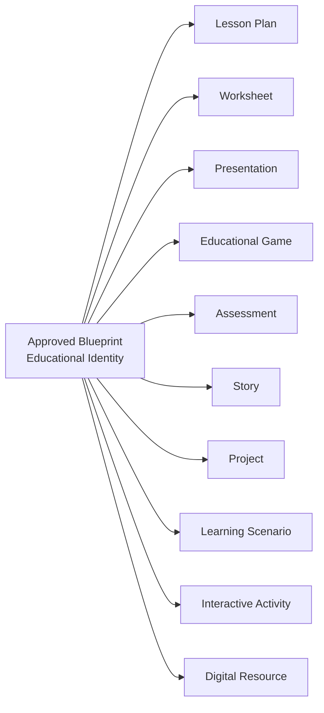

---

## 9. Validation

### What makes a Blueprint complete?

A Blueprint is **complete** when all mandatory domain information is present, validation rules pass, and the teacher can responsibly approve design before any generation.

| Completeness dimension | Requirement |
|------------------------|-------------|
| **Contextual** | ED-01 mandatory fields present |
| **Intent** | ED-03 ≥1 objective + success criteria |
| **Instructional** | ED-04 sequence + strategies + timing |
| **Activity** | ED-05 covers all phases with objective links |
| **Assessment** | ED-06 strategy with objective mapping |
| **Resource** | ED-07 satisfies activity requirements |
| **Quality** | ED-08 coherence checks pass |
| **Explainability** | ED-09 rationale minimum met |

### What can be inferred?

| Information | Inference rule |
|-------------|----------------|
| Developmental band from grade | Allowed — flagged for teacher confirmation |
| Default timing splits from activity type patterns | Allowed — teacher may override |
| Competency candidates from Knowledge Pack | Allowed — provenance required; teacher confirms |
| Strategy suggestions from knowledge patterns | Advisory only — teacher confirms in design |

### What requires teacher confirmation?

| Information | Rule |
|-------------|------|
| Learning objectives and success criteria | **Never auto-approved** |
| Learner profile material claims (SEN, prior knowledge) | **Teacher confirms** |
| Competency alignment when confidence low | **Teacher acknowledges** |
| Blueprint approval | **Teacher explicit gate — IK-G09** |
| Unexplainable design sections | **Teacher acknowledgment required** |

### What can never be assumed?

| Prohibition | Rationale |
|-------------|-----------|
| Teacher intent when ambiguous | CP-01 Understanding Precedes Action |
| Learner needs from demographics alone | ED2-V03 |
| Assessment adequacy without design | ED6-V04 |
| Resource availability | ED7-V01 |
| Curriculum alignment without provenance | ED3-V04 |
| Generation readiness without approved Blueprint | CP-04, BT-01 |
| Pedagogical changes from generated output | Generation never writes Blueprint |

---

## 10. Governance

### Ownership

| Actor | Owns | Authority |
|-------|------|-----------|
| **Teacher** | Learning Experience outcome; approval; final design judgment | **Supreme** — CP-10 |
| **PRIMA (Instructional Cognition)** | Draft and revision composition | Proposes — never approves |
| **PRIMA (Quality Cognition)** | Validation findings | Measures — never mutates |
| **PRIMA (Reflective Cognition)** | Explainability packaging | Interprets — never gates alone |
| **Platform (Orchestration)** | State transitions, version binding | Enforces — never overrides teacher |

### Teacher responsibilities

- Express intent during discovery  
- Review all educational domains  
- Correct or reject proposed design  
- **Approve** Blueprint before generation  
- Edit generated resources without necessarily changing Blueprint  
- Re-open Blueprint when pedagogy must change  

### AI responsibilities

- Populate domains from evidence and reasoning  
- Flag gaps, conflicts, and low-confidence fields  
- Never approve or bind generation autonomously  
- Never silently infer mandatory pedagogical decisions  
- Preserve provenance and explainability chains  

### Approval points

| Point | Requirement |
|-------|-------------|
| **Discovery complete** | Teacher Intent complete — IK-G01 |
| **Design presentation** | All domains presented for review — IK-G08 |
| **Blueprint approval** | Teacher explicit approval — IK-G09 |
| **Re-approval** | Required after any material design change post-approval |

### Versioning principles

| Principle | Rule |
|-----------|------|
| **Immutability** | Approved Blueprint Version is immutable for bound generation runs |
| **Lineage** | Every material change creates new Blueprint Version |
| **Separation** | Content regeneration ≠ Blueprint version change |
| **Traceability** | Generation Package binds to exact Blueprint Version |
| **Supersession** | New approval supersedes prior approved version — read-only retention |

### Quality responsibilities

| Phase | Responsible capability | Teacher role |
|-------|------------------------|--------------|
| Structural validation | Quality Cognition (ED-08 rules) | Reviews findings |
| Approval gate | Teacher + EPC | Decides |
| Output validation | Validation (post-generation) | Reviews against same Blueprint |
| Continuous improvement | Reflective + Memory Cognition | Provides feedback |

---

## 11. Domain Relationship Summary

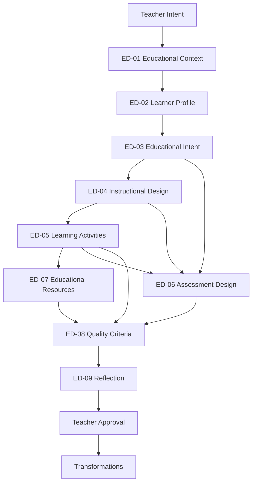

---

## 12. Compliance Rules

| ID | Rule |
|----|------|
| **BP-CR-01** | No educational resource without prior approved Blueprint |
| **BP-CR-02** | Blueprint contains design only — never generated classroom content |
| **BP-CR-03** | Exactly one authoritative Blueprint per Learning Experience design iteration |
| **BP-CR-04** | All domains ED-01–ED-09 conform to Fundamental Question |
| **BP-CR-05** | Generation is transformation — not design |
| **BP-CR-06** | Teacher approval required before generation — immutable |
| **BP-CR-07** | Blueprint educational identity unchanged across output transformations |
| **BP-CR-08** | Mandatory domain information cannot be assumed — see §9 |
| **BP-CR-09** | Intelligence capabilities consume or enrich Blueprint — none bypass it |
| **BP-CR-10** | This document prevails on educational object conflicts until officially revised |

---

## 13. Summary

The **Blueprint** is the **canonical educational object** of PRIMA — the educational DNA from which every resource derives.

| Question | Answer |
|----------|--------|
| *What must exist before responsible design?* | Nine educational domains ED-01–ED-09 |
| *What is the single source of educational truth?* | **Instructional Blueprint** |
| *When may generation occur?* | Only after **Approved Blueprint** |
| *Can one Blueprint produce many outputs?* | Yes — transformations preserve identity |
| *Who approves?* | **Teacher** — always |

Designed to remain the central educational object for **twenty years**: technology-independent, pedagogically complete, minimal, explainable, and bound to teacher authority.

---

## Mermaid Diagrams

### Diagram 1 — Blueprint Structure

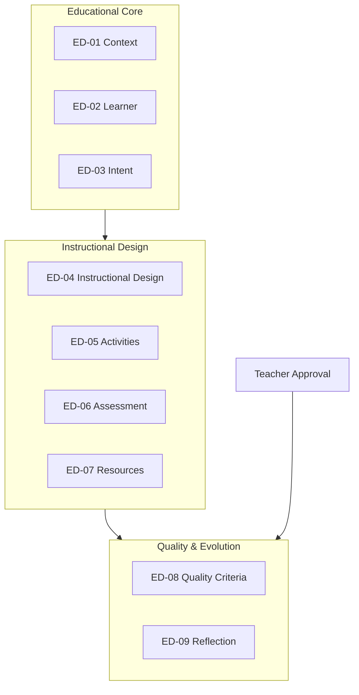

---

### Diagram 2 — Educational Domains

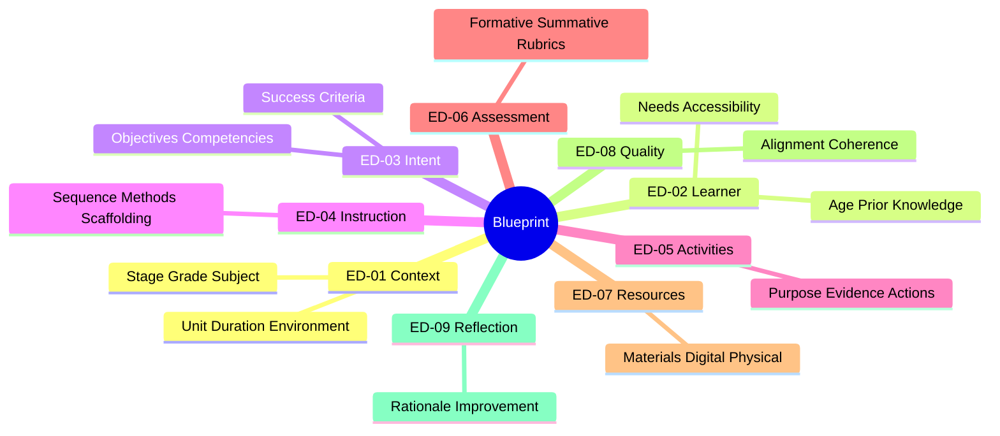

---

### Diagram 3 — Blueprint Lifecycle

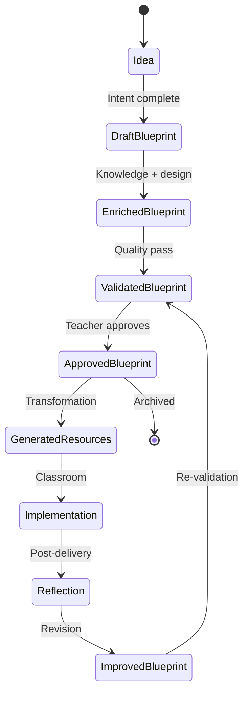

---

### Diagram 4 — Blueprint Transformations

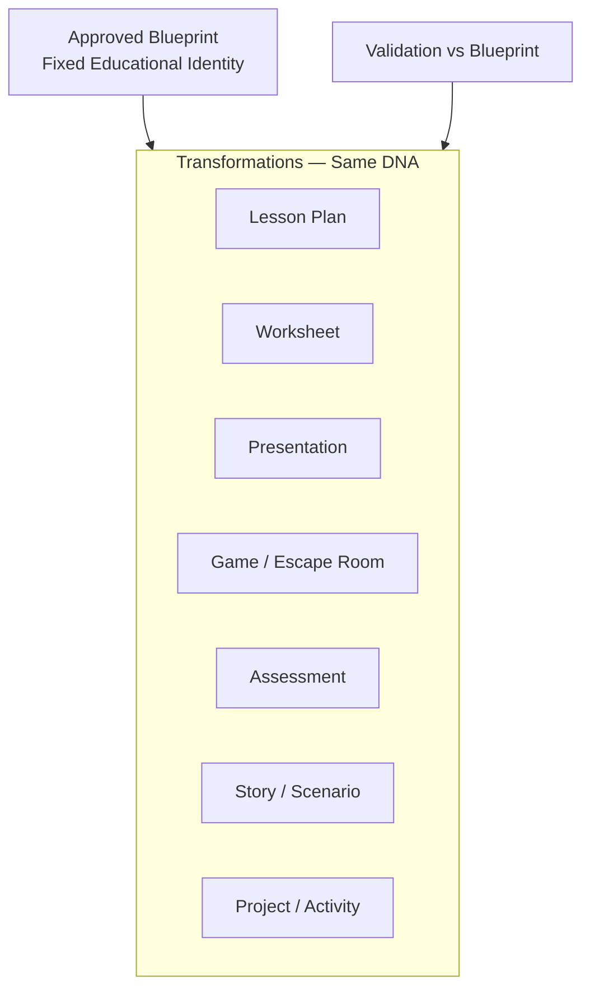

---

### Diagram 5 — Educational Relationships

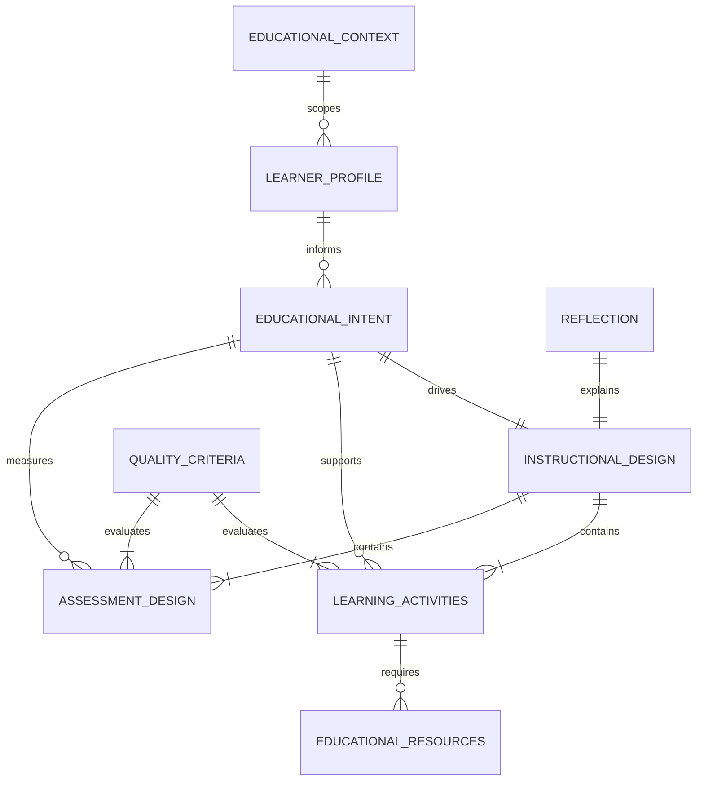

---

### Diagram 6 — Validation Flow

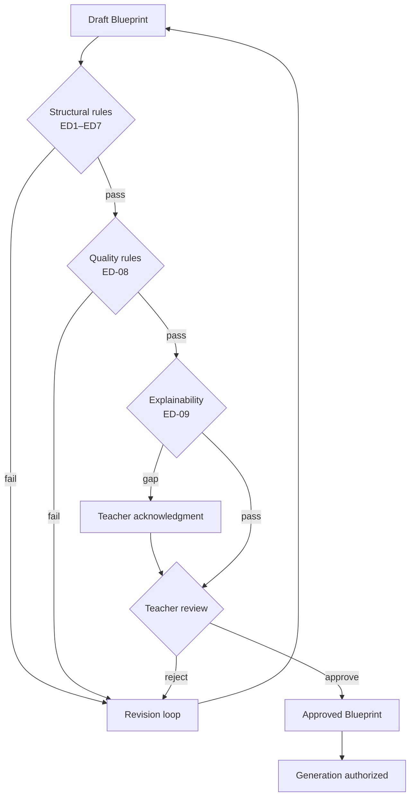

---

### Diagram 7 — Teacher–Blueprint Interaction

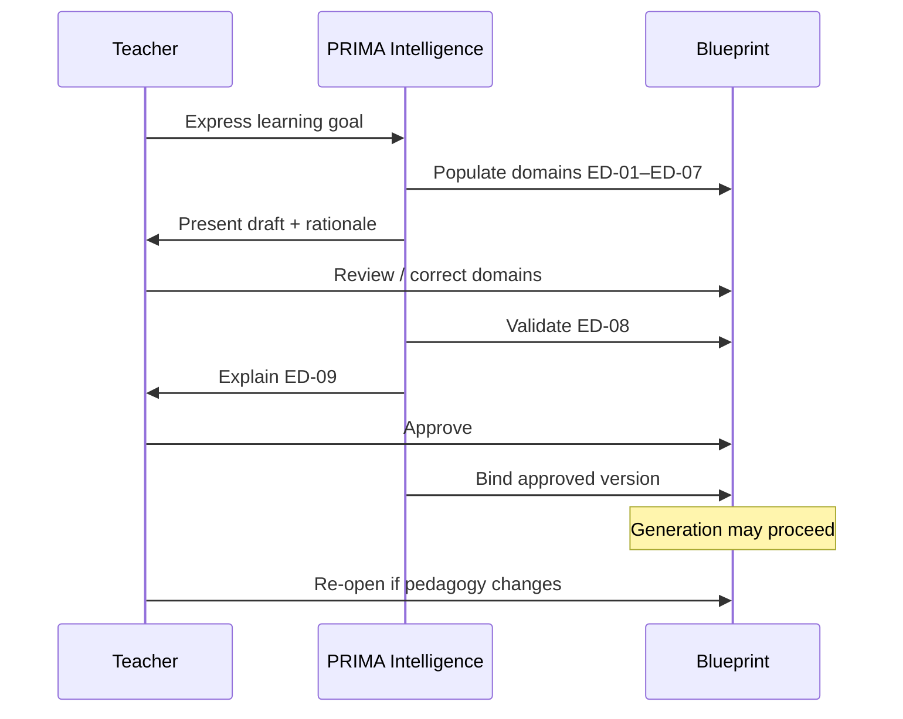

---

### Diagram 8 — Blueprint Evolution

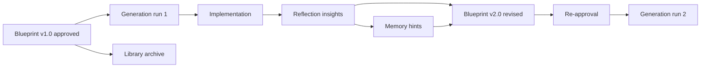

---

## Architecture Hierarchy

```
PRIMA_INTELLIGENCE_KERNEL.md .......... How PRIMA thinks
    │
    └── PRIMA_BLUEPRINT.md .............. What PRIMA designs (THIS)
            │
            ├── INSTRUCTIONAL_BLUEPRINT_SPECIFICATION.md ... Section schema
            ├── PRIMA_CANONICAL_ARTIFACTS.md ............... Artifact registry
            ├── PRIMA_DOMAIN_MODEL.md ...................... Entity ownership
            └── PRIMA_ENGINE.md ............................ Implementation
```

---

## Document Authority

| Document | Relationship |
|----------|--------------|
| **This document** | **Supreme authority for the educational object** |
| [`INSTRUCTIONAL_BLUEPRINT_SPECIFICATION.md`](./INSTRUCTIONAL_BLUEPRINT_SPECIFICATION.md) | Operationalizes domains as engine sections — subordinate |
| [`PRIMA_CANONICAL_ARTIFACTS.md`](./PRIMA_CANONICAL_ARTIFACTS.md) | Registers Instructional Blueprint artifact — aligned |
| [`PRIMA_INTELLIGENCE_KERNEL.md`](./PRIMA_INTELLIGENCE_KERNEL.md) | Governs cognition that produces Blueprint — peer constitutional layer |

---

## Next Recommended Document

→ [`INSTRUCTIONAL_BLUEPRINT_SPECIFICATION.md`](./INSTRUCTIONAL_BLUEPRINT_SPECIFICATION.md) — Section-level schema mapping ED-* domains to engine-consumable structure.
