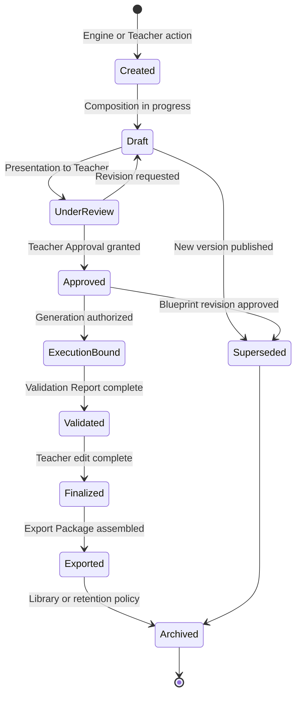
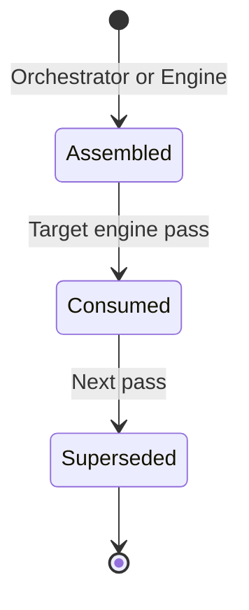
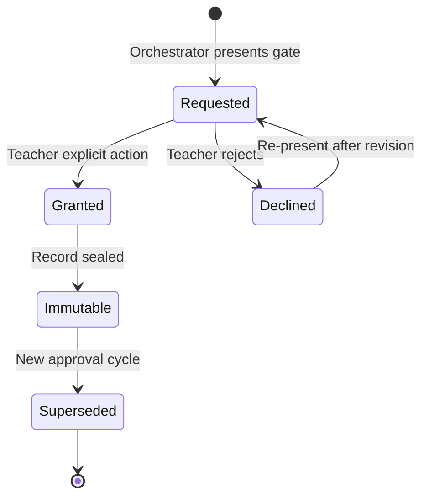
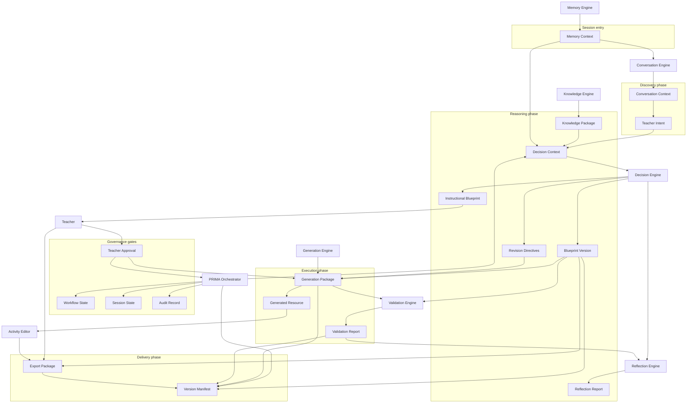

# PRIMA Canonical Artifacts

> **Cleanup note (August 2026).** This document references specifications that were removed when the
> repository moved to a monorepo: PRIMA_DOMAIN_MODEL.md, the G1 engine specifications (PRIMA_ENGINE, PRIMA_DECISION_ENGINE, PRIMA_GENERATION_ENGINE, PRIMA_KNOWLEDGE_ENGINE, PRIMA_MEMORY_ENGINE, PRIMA_VALIDATION_ENGINE, PRIMA_ORCHESTRATOR), PRIMA_CONVERSATION_BLUEPRINT.md, LUDI_ON_SOLUTION_ARCHITECTURE.md and the `solution/` models.
> Those names now appear as plain text, not links. Where an authority replaced them it is noted below;
> otherwise treat the reference as historical. Current authority map: [`../README.md`](../README.md).

**Version:** 1.0  
**Status:** Official — Enterprise Product Architecture Specification

---

## Purpose

This document defines every **architectural artifact** exchanged, owned, transformed, and governed inside the PRIMA ecosystem.

It answers one question:

> *What information moves through the PRIMA architecture?*

Every engine produces or consumes artifacts. Every workflow transforms artifacts. Every artifact carries explicit ownership, lifecycle, invariants, and governance rules.

This document defines **architectural contracts** — not software objects, serialization formats, APIs, or persistence mechanisms. Implementation may change; artifact identity and authority rules defined here remain stable.

---

## Scope

| In scope | Out of scope |
|----------|--------------|
| Canonical artifact identity, ownership, and authority | Domain entity semantics (see Domain Model) |
| Artifact lifecycle, versioning, and invariants | Engine behavioural logic (see engine specifications) |
| Inter-artifact relationships and traceability | Blueprint section schema (see Blueprint Specification) |
| Governance rules for artifact evolution | Implementation schemas, APIs, databases, code |
| Artifact flow between engines (conceptual) | UI composition, prompts, model selection |

---

## Relationship with Other Specifications

| Document | Relationship |
|----------|--------------|
| [`LUDI_ON_PROJECT_BIBLE.md`](./LUDI_ON_PROJECT_BIBLE.md) | Defines product intent and baseline terminology. This document formalizes the **information contracts** that implement that intent across engines. |
| [`PRIMA_ARCHITECTURAL_PRINCIPLES.md`](./PRIMA_ARCHITECTURAL_PRINCIPLES.md) | Establishes **AP-03** (artifact-based communication), **BP-05** (canonical Blueprint definition), and **EV-03** (contract versioning). This document instantiates those principles as named artifacts. |
| `PRIMA_DOMAIN_MODEL.md` | Defines **entities** — what exists in the domain. This document defines **artifacts** — the structured information those entities take when crossing engine boundaries. |
| [`INSTRUCTIONAL_BLUEPRINT_SPECIFICATION.md`](./INSTRUCTIONAL_BLUEPRINT_SPECIFICATION.md) | Structural authority for the Instructional Blueprint artifact. This registry defines artifact role and governance; the Blueprint Specification defines section content. |
| Engine specifications | Define how engines produce and consume artifacts listed here. On artifact identity or authority conflict, **this document prevails**. On behavioural detail, engine specs prevail. |

**Precedence:** Artifact identity, authority, routing, and governance — this document. Constitutional beliefs — Architectural Principles. Domain terminology — Domain Model.

---

## Why Canonical Artifacts Exist

PRIMA decomposes into independent engines coordinated by a single Orchestrator. Independence requires **explicit contracts** at every boundary.

### Why engines communicate through artifacts

Shared mutable internal state produces untraceable behaviour, race conditions, and gate bypass. Principle **AP-03 — Artifact-Based Communication** requires that engines exchange **named, structured artifacts** — not implicit shared memory. When Conversation completes discovery, Decision receives **Teacher Intent** and **Decision Context**, not an undocumented internal buffer.

### Why artifacts are contracts

An artifact declares: what information crosses the boundary, who may create or modify it, what lifecycle states are valid, and whether it carries workflow authority. Without a registry, engines invent parallel contracts — `session` vs `context`, `package` vs `bundle` — and specifications diverge within one platform generation.

### Why artifacts stabilize architecture

Models, storage, UI frameworks, and export formats change. Artifact contracts survive those changes because they describe **information and authority**, not technology. A Generation Package binds to an approved Blueprint Version whether the platform runs on today's stack or a stack fifteen years from now.

---

## Artifact Design Principles

| Principle | Architectural meaning |
|-----------|----------------------|
| **Artifact ownership** | Every artifact has exactly one domain owner responsible for lifecycle authority. |
| **Immutability** | Published artifact versions are immutable. Change produces a new version — never silent overwrite. |
| **Versioning** | All long-lived artifacts carry explicit version identity. Contract changes require version bumps and migration paths (**EV-03**). |
| **Traceability** | Every execution artifact traces to an approved design artifact. End-to-end lineage is reconstructable. |
| **Explicit contracts** | If information crosses an engine boundary, it is a registered artifact with defined producer and consumers. |
| **Single source of truth** | One authoritative artifact per concern. No shadow design state parallel to Instructional Blueprint (**FP-03**). |
| **Technology independence** | Artifacts describe pedagogical and platform information — never vendors, models, or storage formats. |
| **Lifecycle governance** | Creation, publication, supersession, and archival follow declared state machines — not ad hoc engine behaviour. |
| **Human understandability** | Artifact names and roles are comprehensible to product architects and instructional designers — not implementation jargon. |
| **Governed evolution** | New artifacts and authority changes require registry amendment — not sprint-level invention. |

---

## Artifact Categories

Artifacts group into ten families aligned with PRIMA bounded contexts. Category determines typical persistence, authority level, and governance owner.

| Category | Artifacts | Primary concern |
|----------|-----------|-----------------|
| **Conversation** | Conversation Context, Teacher Intent | Capturing instructional intent through dialogue |
| **Decision** | Decision Context, Revision Directives | Reasoning inputs and execution constraints |
| **Knowledge** | Knowledge Package | Curriculum and pedagogical evidence |
| **Memory** | Memory Context | Personalization hints — non-authoritative |
| **Blueprint** | Instructional Blueprint, Blueprint Version, Teacher Approval | Authoritative instructional design |
| **Generation** | Generation Package, Generated Resource | Classroom material execution |
| **Validation** | Validation Report | Quality and fidelity measurement |
| **Reflection** | Reflection Report | Teacher-facing interpretive layer |
| **Export** | Export Package | Finalized deliverable bundle |
| **Governance** | Session State, Workflow State, Audit Record, Version Manifest, Artifact Metadata | Coordination, lineage, and compliance |

---

## Canonical Artifact Specifications

---

### Conversation Artifacts

---

## Conversation Context

**Purpose**  
Capture evolving instructional dialogue and structured session fields as PRIMA discovers teacher intent.

**Description**  
Conversation Context is the progressive record of a PRIMA interaction during discovery — topic signals, classroom constraints, learner characteristics, mirrors, confirmations, and field-level confidence. It is written incrementally by the Conversation Engine and read by Reflection and Orchestrator. It is capture truth — not design authority.

**Owner**  
Orchestration Domain (Conversation Session lifecycle).

**Produced By**  
Conversation Engine.

**Consumed By**  
Reflection Engine, PRIMA Orchestrator, Decision Engine (via Teacher Intent normalization).

**Modified By**  
Conversation Engine (incremental capture); Teacher (via conversational corrections reflected in capture).

**Lifecycle**  
`initializing` → `discovering` → `discovery_complete` → `superseded` (new session) → `archived`.

**Relationships**  
Contributes to Session State. Normalizes into Teacher Intent at discovery completion. Feeds Decision Context assembly. Does not replace Instructional Blueprint.

**Versioning**  
Session-scoped. No independent major version. Checkpointed with Session State on pause or resume.

**Invariants**  
- One active Conversation Context per Conversation Session.  
- Discovery-complete flag required before Decision reasoning.  
- Never contains generated classroom content or Blueprint sections.  
- Teacher explicit statements preserved with provenance — not overwritten by inference.

**Architectural Constraints**  
- Conversation Engine owns capture; Decision Engine never writes Conversation Context.  
- Confirmation in Conversation Context does not authorize Generation.

**Notes**  
Field-level structure deferred to future Session Model specification. This registry defines artifact role only. See `PRIMA_CONVERSATION_BLUEPRINT.md` for stage behaviour.

---

## Teacher Intent

**Purpose**  
Represent normalized, structured instructional intent ready for pedagogical reasoning.

**Description**  
Teacher Intent is the consolidated output of completed discovery — explicit goals, context, constraints, and learner model expressed in a form the Decision Engine can reason over. It distils Conversation Context; it is not yet an Instructional Blueprint.

**Owner**  
Instructional Design Domain (intent capture phase).

**Produced By**  
Conversation Engine (normalization at discovery completion); refined by Decision Engine during intent reconciliation.

**Consumed By**  
Decision Engine, Reflection Engine, PRIMA Orchestrator.

**Modified By**  
Conversation Engine (pre-reasoning corrections); Decision Engine (normalization pass only — not blueprint composition).

**Lifecycle**  
`forming` → `complete` → `revised` (scoped re-entry) → `consumed` → `archived`.

**Relationships**  
Derived from Conversation Context. Primary input to Decision Context. Precedes Instructional Blueprint composition. References Memory Context hints — hints never override explicit intent.

**Versioning**  
Intent revision increments a minor revision counter within the session. Major intent change may trigger scoped conversation re-entry.

**Invariants**  
- Explicit teacher statements prevail over Memory Context hints (**MP-01**).  
- Teacher Intent alone never authorizes Generation.  
- Must be complete before first Blueprint composition.

**Architectural Constraints**  
- Decision Engine consumes Teacher Intent; Generation Engine never receives Teacher Intent directly.  
- Knowledge and Memory inform intent resolution — they do not replace it.

**Notes**  
Domain entity alignment: contributes to Decision Context assembly. See Domain Model — Decision Context.

---

### Decision Artifacts

---

## Decision Context

**Purpose**  
Assemble all inputs required for one Decision Engine reasoning pass.

**Description**  
Decision Context is an ephemeral artifact bundling Teacher Intent, Knowledge Package evidence, Memory Context hints, activity-type constraints, and optional revision scope from Blueprint edits. It exists for one reasoning invocation — not as longitudinal design authority.

**Owner**  
Instructional Design Domain (reasoning input).

**Produced By**  
PRIMA Orchestrator (assembly from sibling artifacts).

**Consumed By**  
Decision Engine.

**Modified By**  
Not modified after assembly — superseded by next reasoning pass assembly.

**Lifecycle**  
`assembled` → `consumed` → `superseded`.

**Relationships**  
Draws from Teacher Intent, Knowledge Package, Memory Context, Session State. Produces Instructional Blueprint (draft or revision) and Revision Directives. Never persisted as substitute for Blueprint.

**Versioning**  
Ephemeral — no standalone version lineage. Assembly timestamp and reasoning pass identifier recorded in Audit Record.

**Invariants**  
- One Decision Context per Decision Engine invocation.  
- Teacher explicit intent prevails over Memory Context within assembly.  
- Knowledge Package contents are evidence — not decisions (**KP-02**).  
- Never gates Generation directly.

**Architectural Constraints**  
- Orchestrator assembles; Decision Engine does not fetch Knowledge or Memory directly across boundaries.  
- Decision Context is consumed, not stored as authoritative design.

**Notes**  
See `PRIMA_DECISION_ENGINE.md` for reasoning pipeline behaviour.

---

## Revision Directives

**Purpose**  
Communicate section-level execution constraints from Decision Engine to Generation Engine after Blueprint approval.

**Description**  
Revision Directives supplement the approved Instructional Blueprint with scoped constraints for generation — emphasis flags, format preferences encoded at approval, and revision-run scope markers. They constrain execution; they do not alter pedagogical design authority.

**Owner**  
Instructional Design Domain (execution handoff).

**Produced By**  
Decision Engine (at approval and scoped re-decision).

**Consumed By**  
Generation Engine, PRIMA Orchestrator, Version Manifest.

**Modified By**  
Decision Engine only — via scoped re-decision after teacher Blueprint edit before re-approval.

**Lifecycle**  
`draft` → `bound_to_approval` → `superseded` (new approval or regen scope) → `archived`.

**Relationships**  
Bound to a specific Blueprint Version and Teacher Approval record. Referenced by Generation Package and Version Manifest.

**Versioning**  
Version tied to Blueprint Version identity. New approval produces new directive binding.

**Invariants**  
- Never contradict approved Instructional Blueprint pedagogical intent.  
- Generation consumes directives with Blueprint — not instead of Blueprint.  
- Directives alone do not authorize Generation without approved Blueprint.

**Architectural Constraints**  
- Generation Engine reads directives; never writes them.  
- Validation references Blueprint — directives affect execution scope only.

**Notes**  
Architecturally justified extension beyond minimum list — required for faithful execution handoff per Decision Engine specification.

---

### Knowledge Artifacts

---

## Knowledge Package

**Purpose**  
Deliver structured, read-only pedagogical and curriculum evidence for a scoped reasoning query.

**Description**  
Knowledge Package is the response artifact from the Knowledge Engine — competency candidates, strategy options, developmental norms, and provenance references drawn from a fixed Knowledge Pack release. It supplies evidence to Decision; it never supplies decisions.

**Owner**  
Knowledge Domain.

**Produced By**  
Knowledge Engine.

**Consumed By**  
Decision Engine (via Decision Context); Instructional Blueprint Curriculum section (provenance references only).

**Modified By**  
Not modified — immutable for the query-response pair. New query produces new Knowledge Package.

**Lifecycle**  
`requested` → `delivered` → `embedded` (in Decision Context) → `archived` (provenance retained in Blueprint).

**Relationships**  
Sourced from Knowledge Pack (domain entity — corpus release). Embedded in Decision Context. Provenance may appear in Instructional Blueprint. Never reaches Generation Engine live (**GP-05**).

**Versioning**  
Bound to Knowledge Pack version active for the reasoning pass. Pack version fixed for duration of Decision Context assembly.

**Invariants**  
- Read-only — no engine modifies Knowledge Package content.  
- Knowledge responds; Decision decides (**KP-02**).  
- No direct Knowledge → Generation or Knowledge → Blueprint write path.  
- Multiple valid mappings surfaced as ambiguity — not silently resolved.

**Architectural Constraints**  
- Knowledge Engine produces; only Decision consumes for reasoning.  
- Generation encodes knowledge indirectly through approved Blueprint only.

**Notes**  
Distinct from Knowledge Pack (curated corpus entity). Knowledge Package is the **exchange artifact** for one query. See `PRIMA_KNOWLEDGE_ENGINE.md`.

---

### Memory Artifacts

---

## Memory Context

**Purpose**  
Supply selective personalization hints at session start without conferring design authority.

**Description**  
Memory Context is the retrieval artifact built by the Memory Engine when a teacher enters or resumes PRIMA — preferences, class patterns, project continuity signals, and teaching fingerprint hints. It accelerates discovery and reasoning; it never overrides explicit teacher statements.

**Owner**  
Memory Domain.

**Produced By**  
Memory Engine.

**Consumed By**  
Conversation Engine, Decision Engine (via Decision Context), PRIMA Orchestrator.

**Modified By**  
Not modified during session consumption. Post-session learning signals write back to Memory Profile — not to the consumed Memory Context artifact.

**Lifecycle**  
`building` → `delivered` → `consumed` → `discarded` (session-scoped delivery).

**Relationships**  
Sourced from Memory Profile and Project checkpoint. Embedded in Decision Context and Conversation Context personalization. Never embedded in Instructional Blueprint as authority.

**Versioning**  
Delivery identifier per session start. No migration — rebuilt on each session entry.

**Invariants**  
- Selective retrieval — not a full memory dump (**MP-04**).  
- Explicit teacher preferences override inferred hints (**MP-01**).  
- Never reaches Generation Engine live (**GP-05**).  
- Never modifies Instructional Blueprint.

**Architectural Constraints**  
- Memory Engine produces; Decision and Conversation consume hints only.  
- Memory Context never substitutes for Teacher Intent or Blueprint.

**Notes**  
See `PRIMA_MEMORY_ENGINE.md` — Retrieval Lifecycle.

---

### Blueprint Artifacts

---

## Instructional Blueprint

**Purpose**  
Serve as the canonical, versioned contract between instructional design and execution.

**Description**  
The Instructional Blueprint encodes complete Learning Experience design — objectives, flow, activities, assessment, differentiation, resources — before any classroom material exists. It is the sole authoritative design artifact. Structural detail resides in [`INSTRUCTIONAL_BLUEPRINT_SPECIFICATION.md`](./INSTRUCTIONAL_BLUEPRINT_SPECIFICATION.md).

**Owner**  
Instructional Design Domain (structure); Teacher Interaction Domain (approval authority).

**Produced By**  
Decision Engine (composition).

**Consumed By**  
Generation Engine, Validation Engine, PRIMA Orchestrator, Teacher (review), Reflection Engine (interpretation), Library (lineage reference).

**Modified By**  
Decision Engine (draft and revision composition); Teacher (review triggers scoped re-decision — not direct structural write by Generation).

**Lifecycle**  
`draft` → `under_review` → `approved` → `generation_bound` → `superseded` → `archived`.

**Relationships**  
Realizes Learning Experience (domain entity). Parent of Blueprint Version records. Referenced by Generation Package, Validation Report, Export Package, Version Manifest. Produced from Decision Context; never produced from Generation.

**Versioning**  
Explicit Blueprint Version identity on every material change. Draft increments minor; approval publishes immutable approved version. See Blueprint Version artifact.

**Invariants**  
- Exactly one authoritative Blueprint per Learning Experience design iteration (**FP-03**).  
- Pedagogical design only — never generated text or slides (**BP-02**).  
- No Generation without `approved` state (**BP-01**, **TP-02**).  
- All engines interpret structure per Blueprint Specification (**BP-05**).  
- Generation never writes Blueprint.

**Architectural Constraints**  
- Design–execution separation (**AP-04**).  
- Teacher Approval required for transition to `approved`.  
- Blueprint before Generation — non-negotiable gate.

**Notes**  
Central artifact of PRIMA. Domain entity: Instructional Blueprint. Schema authority: Blueprint Specification.

---

## Blueprint Version

**Purpose**  
Record immutable identity and lineage for each Instructional Blueprint revision and approval.

**Description**  
Blueprint Version is the governance artifact that binds a specific Blueprint snapshot — draft or approved — to a unique version identity, parent version, change scope, and approval status. Generation and Validation runs bind to Blueprint Version — not to mutable draft handles.

**Owner**  
Instructional Design Domain (lineage); Orchestration Domain (binding enforcement).

**Produced By**  
Decision Engine (version creation); PRIMA Orchestrator (approval binding).

**Consumed By**  
Generation Engine, Validation Engine, Version Manifest, Export Package, Audit Record, Library.

**Modified By**  
Immutable once published for a given version identity. New edit creates new Blueprint Version — never in-place mutation of approved version.

**Lifecycle**  
`draft` → `under_review` → `approved` → `superseded` → `archived`.

**Relationships**  
Child of Instructional Blueprint aggregate. Referenced by Teacher Approval, Generation Package, Validation Report, Version Manifest. Each approved version links to exactly one Teacher Approval record.

**Versioning**  
Self-describing — each record is a version. Major increment on approval; minor increment on draft revision. Schema version of Blueprint structure tracked via Artifact Metadata.

**Invariants**  
- Approved Blueprint Version is immutable.  
- Generation binds to exactly one approved Blueprint Version per run.  
- Superseded versions remain addressable for Library lineage.  
- Validation Report references same Blueprint Version as its Generation Package.

**Architectural Constraints**  
- Orchestrator enforces version synchronization (**OP-12** equivalent).  
- Export Package preserves Blueprint Version reference permanently.

**Notes**  
Separates **version identity** from **Blueprint content** for traceability and immutable approval binding.

---

## Teacher Approval

**Purpose**  
Record immutable teacher authorization for workflow gates — Blueprint approval and Export initiation.

**Description**  
Teacher Approval is a governance artifact capturing explicit teacher consent at mandatory gates. Blueprint approval authorizes Generation. Export approval authorizes deliverable assembly. The record is append-only — never rewritten or revoked silently.

**Owner**  
Teacher Interaction Domain.

**Produced By**  
Teacher action recorded by PRIMA Orchestrator.

**Consumed By**  
PRIMA Orchestrator (gate enforcement), Generation Engine (authorization check), Audit Record, Version Manifest.

**Modified By**  
Not modified — new gate requires new Teacher Approval record. Teacher may later edit Blueprint — requiring new approval cycle.

**Lifecycle**  
`requested` → `granted` | `declined` → `superseded` (new approval cycle) → `archived`.

**Relationships**  
Binds to Blueprint Version on design approval. Binds to Export Package on export initiation. Referenced in Audit Record and Workflow State transitions.

**Versioning**  
Each record carries unique approval identifier, timestamp, gate type, and artifact version reference. Immutable after `granted`.

**Invariants**  
- Generation requires Blueprint Teacher Approval — no engine bypass (**TP-02**).  
- Export requires Teacher initiation — Validation pass alone insufficient.  
- Reflection Report confirmation ≠ Teacher Approval.  
- Approval record immutable once granted.

**Architectural Constraints**  
- Only Teacher grants approval — engines request, never self-authorize.  
- Orchestrator validates approval presence before phase transition.

**Notes**  
Encodes **TP-01** and **TP-02** as auditable artifacts — not implicit UI state.

---

### Generation Artifacts

---

## Generation Package

**Purpose**  
Bundle the structured output of one generation run for validation and teacher preview.

**Description**  
Generation Package contains draft Generated Resources, blueprint traceability mapping, generation run metadata, and binding references to approved Blueprint Version and Revision Directives. It is execution output — not design authority.

**Owner**  
Generation Domain.

**Produced By**  
Generation Engine.

**Consumed By**  
Validation Engine, Activity Editor, PRIMA Orchestrator, Version Manifest.

**Modified By**  
Generation Engine (scoped regeneration replaces segments); Teacher edits resources outside package composition via Activity Editor.

**Lifecycle**  
`planned` → `generating` → `draft_complete` → `validated` → `superseded` (regen) → `archived`.

**Relationships**  
Derived from approved Blueprint Version. Contains Generated Resources. Validated by Validation Report. Precedes Export Package after teacher finalization.

**Versioning**  
Generation run version tied to Blueprint Version and run identifier. Regeneration supersedes prior package — lineage preserved in Version Manifest.

**Invariants**  
- Produced only from approved Blueprint Version.  
- No live Memory Context or Knowledge Package during composition (**GP-05**).  
- Every resource block traces to Blueprint section (**GP-02**).  
- Teacher preview blocked until Validation Report complete (**VP-02**).

**Architectural Constraints**  
- Generation executes — never redesigns (**GP-01**).  
- Package does not modify Instructional Blueprint.

**Notes**  
See `PRIMA_GENERATION_ENGINE.md`.

---

## Generated Resource

**Purpose**  
Represent one generated, teacher-editable classroom material unit.

**Description**  
A Generated Resource is a draft or finalized material — worksheet, presentation, quiz, lesson plan document — produced from approved Instructional Blueprint design. It is an execution artifact. Domain entity: Learning Resource.

**Owner**  
Generation Domain (production); Teacher Interaction Domain (final ownership).

**Produced By**  
Generation Engine.

**Consumed By**  
Validation Engine, Activity Editor, Teacher, Export Package assembly.

**Modified By**  
Teacher (Activity Editor — primary); Generation Engine (scoped regeneration only).

**Lifecycle**  
`draft` → `validated` → `edited` → `finalized` → `exported` → `archived`.

**Relationships**  
Member of Generation Package. Maps to Instructional Blueprint sections and Activities. Contributes to Export Package when finalized.

**Versioning**  
Resource version increments on edit and regen. Lineage to Blueprint Version and generation run preserved via Artifact Metadata.

**Invariants**  
- Draft until teacher finalization — Generation never marks final (**GP-03**).  
- Must trace to Blueprint section — untraceable content invalid.  
- Regeneration scoped to resource or block — not full Blueprint revision.

**Architectural Constraints**  
- Validation measures; never modifies resource content (**VP-03**).  
- Export Package includes finalized resources only.

**Notes**  
Ubiquitous language: **Generated Resource** (artifact) realizes **Activity** (design entity).

---

### Validation Artifacts

---

## Validation Report

**Purpose**  
Communicate quality and blueprint-fidelity findings for a Generation Package.

**Description**  
Validation Report aggregates pass/fail status, severity-classified findings, quality dimensions, and recommended teacher actions. It is a measurement artifact — not design, not content.

**Owner**  
Validation Domain.

**Produced By**  
Validation Engine.

**Consumed By**  
Teacher, PRIMA Orchestrator, Reflection Engine, Audit Record.

**Modified By**  
Validation Engine (re-validation after scoped regen); Teacher (acknowledgment and override records appended — not finding mutation).

**Lifecycle**  
`pending` → `completed` → `superseded` (new generation run) → `archived`.

**Relationships**  
References Blueprint Version and Generation Package. Feeds Reflection Report narrative. Influences Orchestrator routing — never auto-authorizes Export.

**Versioning**  
Tied to Generation Package run. Re-validation produces new report — prior report superseded.

**Invariants**  
- Never modifies Blueprint or Generated Resource content (**VP-03**).  
- Findings trace to Validation Rules or Blueprint sections.  
- Teacher retains proceed authority per severity policy (**VP-05**).  
- Critical findings may block preview — not bypass Validation.

**Architectural Constraints**  
- Validation independent from Generation (**VP-01**).  
- Blueprint Version is fidelity reference (**VP-04**).

**Notes**  
See `PRIMA_VALIDATION_ENGINE.md`.

---

### Reflection Artifacts

---

## Reflection Report

**Purpose**  
Provide teacher-facing interpretive summaries of understanding, reasoning, and validation outcomes.

**Description**  
Reflection Report packages mirrors, confirmations, reasoning narratives, and validation summaries for teacher comprehension. It is expressive and partnership-oriented — non-authoritative for workflow gates.

**Owner**  
Teacher Interaction Domain.

**Produced By**  
Reflection Engine.

**Consumed By**  
Teacher, Prompt Engine.

**Modified By**  
Superseded by newer reports in session — not edited as structured data by Teacher (Teacher responds conversationally).

**Lifecycle**  
`draft` → `presented` → `confirmed` | `corrected` → `superseded` → `archived`.

**Relationships**  
Interprets Conversation Context, Decision reasoning outputs, Instructional Blueprint, Validation Report. Does not replace any authoritative artifact.

**Versioning**  
Session-scoped report sequence. Major revision on Blueprint or Validation change.

**Invariants**  
- Never authorizes Generation or Export.  
- Confirmation ≠ Blueprint approval.  
- Must distinguish inference from teacher explicit statements.  
- Non-authoritative for design and export gates (**AC-10** Domain Model).

**Architectural Constraints**  
- Reflection Engine produces interpretive layer; Prompt Engine expresses.  
- Decision Engine never speaks directly to teacher (**DP-03**).

**Notes**  
Distinct from Validation Report: Reflection emphasizes comprehension; Validation emphasizes compliance measurement.

---

### Export Artifacts

---

## Export Package

**Purpose**  
Represent the finalized, teacher-owned deliverable bundle for classroom use and Library archival.

**Description**  
Export Package combines finalized Generated Resources, immutable Blueprint Version reference, export metadata, and library lineage. It is the delivery artifact — not a design or draft container.

**Owner**  
Teacher Interaction Domain (authority); Orchestration Domain (assembly lifecycle).

**Produced By**  
Teacher-initiated export — Orchestrator coordinates assembly.

**Consumed By**  
Library, external classroom use (out of platform scope).

**Modified By**  
Teacher (re-export after edits); not modified by engines autonomously.

**Lifecycle**  
`preparing` → `ready` → `downloaded` | `library_saved` → `archived`.

**Relationships**  
Derived from finalized Generated Resources. References Blueprint Version and Teacher Approval (export gate). Preserved in Library with Version Manifest lineage.

**Versioning**  
Export version increments on re-export. Blueprint Version reference immutable within export record.

**Invariants**  
- Teacher initiates — no autonomous export (**AC-11** Domain Model).  
- Finalized resources only — not Generation Package drafts.  
- Does not retroactively modify Instructional Blueprint.  
- Preserves Blueprint lineage for Library assets.

**Architectural Constraints**  
- Export gate separate from Validation pass.  
- Orchestrator coordinates; Teacher authorizes.

**Notes**  
Export formats are implementation concerns; Export Package is the domain delivery artifact.

---

### Governance Artifacts

---

## Session State

**Purpose**  
Maintain the authoritative coordination snapshot for one Conversation Session.

**Description**  
Session State aggregates session metadata, workflow phase pointer, artifact references (current Blueprint Version, Generation Package, Validation Report), and checkpoint data for pause/resume. It is coordination truth — not a substitute for Blueprint content or Conversation Context capture detail.

**Owner**  
Orchestration Domain.

**Produced By**  
PRIMA Orchestrator (synthesis from engine statuses and artifacts).

**Consumed By**  
All PRIMA engines (read scope via Orchestrator routing), Dashboard (continue working), Memory Engine (Project checkpoint).

**Modified By**  
PRIMA Orchestrator only — on state transitions and checkpoints.

**Lifecycle**  
`active` → `paused` → `active` (resume) → `completed` → `archived`.

**Relationships**  
Scopes Conversation Context, Teacher Intent, and artifact references within one Conversation Session. Parent checkpoint under Project. Distinct from Workflow State (position) — Session State is the **snapshot**.

**Versioning**  
Checkpoint version increments on pause/resume. Schema version via Artifact Metadata.

**Invariants**  
- One authoritative Session State per active Conversation Session.  
- Resuming restores checkpoint — not approved design unless Blueprint Version is `approved`.  
- Session State never substitutes for Instructional Blueprint.

**Architectural Constraints**  
- Orchestrator owns writes; engines update status — Orchestrator synthesizes.  
- Project Memory checkpoint subordinate to Session State integrity.

**Notes**  
Aligns with Conversation Session domain entity. Field detail deferred to Session Model specification.

---

## Workflow State

**Purpose**  
Represent the Orchestrator's current workflow phase and valid transition context.

**Description**  
Workflow State is the operational position within the PRIMA workflow state machine — discovery, reasoning, blueprint review, approval gate, generation, validation, editing, export. It enables deterministic engine activation: same state plus same event yields same next action.

**Owner**  
Orchestration Domain.

**Produced By**  
PRIMA Orchestrator.

**Consumed By**  
PRIMA Orchestrator (internal transitions), Prompt Engine (progress presentation), Audit Record.

**Modified By**  
PRIMA Orchestrator exclusively — on events and gate outcomes.

**Lifecycle**  
Follows PRIMA workflow phases from session start through Library return. Terminal states: `completed`, `cancelled`, `failed_recoverable`, `failed_terminal`.

**Relationships**  
Drives engine activation sequence. References gate artifacts (Teacher Approval). Recorded in Audit Record. Paired with Session State snapshot on checkpoint.

**Versioning**  
Workflow profile version per activity type (e.g., Lecție). State enum evolves via governance — not silent change.

**Invariants**  
- Workflow State belongs only to Orchestrator (**OP-01**).  
- Invalid transitions rejected — no engine self-activation.  
- Generation phase unreachable without Blueprint approval Workflow State precondition.

**Architectural Constraints**  
- Star topology — Orchestrator sole coordinator (**AP-02**).  
- State before action (**OP-02**).

**Notes**  
See `PRIMA_ORCHESTRATOR.md` for phase definitions.

---

## Audit Record

**Purpose**  
Provide append-only trace of workflow transitions, gate events, engine activations, and teacher overrides.

**Description**  
Audit Record is the compliance and explainability artifact — answering why Generation started, why preview was blocked, and which Blueprint Version was bound. Append-only; corrections add entries rather than erase history.

**Owner**  
Orchestration Domain.

**Produced By**  
PRIMA Orchestrator.

**Consumed By**  
Session resume diagnostics, anonymized analytics, compliance review, support escalation.

**Modified By**  
Append-only — no mutation or deletion of prior entries.

**Lifecycle**  
`recording` → `session_complete` → `archived` (retention policy).

**Relationships**  
References Workflow State transitions, Teacher Approval records, Blueprint Version bindings, engine activation events, Validation Report outcomes.

**Versioning**  
Audit schema version via Artifact Metadata. Entries immutable once written.

**Invariants**  
- Append-only during and after session.  
- Every gate transition produces an entry.  
- Teacher overrides recorded with severity context.

**Architectural Constraints**  
- Observable workflows (**OP-04**).  
- End-to-end traceability support (**EP-04**).

**Notes**  
Not teacher-facing by default. Supports Orchestrator explainability mandate.

---

## Version Manifest

**Purpose**  
Bind related artifact versions across a design–execution chain into one lineage record.

**Description**  
Version Manifest links Blueprint Version, Revision Directives, Generation Package run, Validation Report, and Export Package into a reconstructable lineage graph. It answers: *which approved design produced which materials*.

**Owner**  
Orchestration Domain.

**Produced By**  
PRIMA Orchestrator (on generation binding, validation completion, export).

**Consumed By**  
Library, Audit Record, compliance review, future Blueprint diff features.

**Modified By**  
Extended on supersession — prior manifest entries immutable.

**Lifecycle**  
`initiated` (approval binding) → `generation_bound` → `validated` → `exported` → `archived`.

**Relationships**  
References Blueprint Version (root), Generation Package, Validation Report, Export Package, Teacher Approval. Attached to Project and Library record.

**Versioning**  
Manifest identity per design–execution cycle. Supersession creates new manifest — prior preserved.

**Invariants**  
- Complete chain reconstructable from manifest.  
- Blueprint Version reference immutable in manifest entry.  
- Export Package lineage matches manifest.

**Architectural Constraints**  
- Orchestrator maintains cross-artifact version synchronization.  
- Library assets must remain openable across platform versions (**EV-03**).

**Notes**  
Governance artifact enabling long-horizon traceability and migration.

---

## Artifact Metadata

**Purpose**  
Provide a standard envelope for identity, schema version, provenance, and timestamps on published artifacts.

**Description**  
Artifact Metadata is the cross-cutting governance envelope attached to long-lived and published artifacts — Blueprint Version, Generation Package, Validation Report, Export Package, Version Manifest. It enables contract evolution detection and migration without redefining each artifact's core purpose.

**Owner**  
System Governance Domain (schema policy); Orchestration Domain (attachment enforcement).

**Produced By**  
Originating engine or Orchestrator at artifact publication.

**Consumed By**  
Orchestrator (version compatibility check), Library, future migration tooling.

**Modified By**  
Immutable after publication — new artifact carries new metadata.

**Lifecycle**  
Created at artifact publication — persists with artifact.

**Relationships**  
Wraps all versioned long-lived artifacts. Referenced by Audit Record on publication events.

**Versioning**  
Metadata schema version independent of artifact content version. Schema bump follows **EV-03** governance.

**Invariants**  
- Every published long-lived artifact carries Artifact Metadata.  
- Schema version enables rejection of incompatible artifacts.  
- Provenance fields identify producer engine and Orchestrator session.

**Architectural Constraints**  
- Silent breaking contract changes forbidden (**EV-03**).  
- Unknown schema version triggers governance path — not silent acceptance.

**Notes**  
Conceptual envelope — not a serialization specification.

---

## Artifact Lifecycle

Artifacts follow governed lifecycles from creation through archival. Ephemeral artifacts (Decision Context, Memory Context delivery, Knowledge Package query response) compress into `assembled` → `consumed` → `superseded` without long-term archival as authority.

### Master Lifecycle Flow



### Ephemeral Artifact Lifecycle



### Gate Lifecycle (Teacher Approval)



---

## Artifact Flow

Conceptual movement of artifacts between PRIMA engines. All cross-engine routing flows through PRIMA Orchestrator (**AP-02**). Diagram shows information flow — not invocation APIs.



### Phase Gate Summary

| Phase | Required artifacts | Gate artifact |
|-------|-------------------|---------------|
| Discovery | Memory Context, Conversation Context | Workflow State: discovery complete |
| Reasoning | Teacher Intent, Decision Context, Knowledge Package | Instructional Blueprint draft produced |
| Blueprint review | Instructional Blueprint, Reflection Report | Teacher review |
| Generation | Blueprint Version (`approved`), Teacher Approval, Revision Directives | Teacher Approval |
| Validation | Generation Package, Blueprint Version | Validation Report before preview |
| Editing | Generated Resource (validated) | Teacher edit ownership |
| Export | Generated Resource (finalized), Blueprint Version | Teacher Approval (export) |

---

## Artifact Ownership Matrix

| Artifact | Owner | Producer | Consumers | Lifecycle Authority |
|----------|-------|----------|-----------|---------------------|
| Conversation Context | Orchestration Domain | Conversation Engine | Reflection, Orchestrator, Decision (via Teacher Intent) | Orchestrator |
| Teacher Intent | Instructional Design Domain | Conversation Engine | Decision, Reflection, Orchestrator | Conversation Engine + Orchestrator |
| Decision Context | Instructional Design Domain | PRIMA Orchestrator | Decision Engine | Orchestrator |
| Revision Directives | Instructional Design Domain | Decision Engine | Generation, Orchestrator, Version Manifest | Decision Engine |
| Knowledge Package | Knowledge Domain | Knowledge Engine | Decision (via Decision Context) | Knowledge Domain |
| Memory Context | Memory Domain | Memory Engine | Conversation, Decision (via Decision Context), Orchestrator | Memory Engine |
| Instructional Blueprint | Instructional Design Domain | Decision Engine | Generation, Validation, Orchestrator, Teacher, Reflection, Library | Decision Engine + Teacher approval |
| Blueprint Version | Instructional Design Domain | Decision Engine, Orchestrator | Generation, Validation, Version Manifest, Export, Library | Orchestrator (binding) |
| Teacher Approval | Teacher Interaction Domain | Teacher via Orchestrator | Orchestrator, Generation, Audit Record, Version Manifest | Teacher |
| Generation Package | Generation Domain | Generation Engine | Validation, Activity Editor, Orchestrator, Version Manifest | Generation Engine |
| Generated Resource | Generation Domain / Teacher | Generation Engine | Validation, Activity Editor, Teacher, Export | Teacher (finalization) |
| Validation Report | Validation Domain | Validation Engine | Teacher, Orchestrator, Reflection, Audit Record | Validation Engine |
| Reflection Report | Teacher Interaction Domain | Reflection Engine | Teacher, Prompt Engine | Reflection Engine |
| Export Package | Teacher Interaction Domain | Teacher via Orchestrator | Library, external use | Teacher |
| Session State | Orchestration Domain | PRIMA Orchestrator | All engines (via Orchestrator), Dashboard, Memory | Orchestrator |
| Workflow State | Orchestration Domain | PRIMA Orchestrator | Orchestrator, Prompt, Audit Record | Orchestrator |
| Audit Record | Orchestration Domain | PRIMA Orchestrator | Analytics, compliance, resume diagnostics | Orchestrator |
| Version Manifest | Orchestration Domain | PRIMA Orchestrator | Library, compliance, Audit Record | Orchestrator |
| Artifact Metadata | System Governance Domain | Originating engine / Orchestrator | Orchestrator, Library, migration governance | System Governance |

---

## Traceability

PRIMA traceability is artifact-to-artifact — reconstructable without implementation internals. Each link preserves version identity.

### Primary Traceability Chain

```
Conversation Context
        ↓ normalization
Teacher Intent
        ↓ assembly with Knowledge Package + Memory Context
Decision Context
        ↓ reasoning
Instructional Blueprint → Blueprint Version
        ↓ Teacher Approval
Revision Directives + Version Manifest (initiated)
        ↓ generation binding
Generation Package → Generated Resource
        ↓ measurement
Validation Report
        ↓ teacher edit + finalization
Export Package
        ↓ lineage sealed
Version Manifest (complete)
```

### Cross-Cutting Traceability

| From | To | Trace mechanism |
|------|-----|-----------------|
| Generated Resource block | Instructional Blueprint section | Traceability map in Generation Package |
| Validation finding | Blueprint section or Validation Rule | Finding reference in Validation Report |
| Export Package | Blueprint Version | Immutable version reference |
| Audit Record | Any gate artifact | Event entry with artifact identifiers |
| Reflection Report | Decision reasoning | Interpretive link — non-authoritative |
| Knowledge Package | Blueprint Curriculum | Provenance reference |

Traceability satisfies **EP-04 — End-to-End Traceability**. Teachers and auditors can answer: *why does this material exist, from which approved design, with which validation outcome*.

---

## Versioning Strategy

### Version dimensions

| Dimension | Applies to | Meaning |
|-----------|------------|---------|
| **Major version** | Instructional Blueprint, Blueprint Version | Approval-bound design identity change |
| **Minor version** | Draft Blueprint revisions, Generated Resource edits | Incremental change before or after approval |
| **Schema version** | All long-lived artifacts via Artifact Metadata | Contract structure evolution |
| **Run identifier** | Generation Package, Validation Report | Single execution pass identity |

### Lifecycle states and mutability

| State | Mutability | Applies to |
|-------|------------|------------|
| **Draft** | Mutable — new minor version on save | Instructional Blueprint, Blueprint Version |
| **Approved** | Immutable — supersession only via new version | Blueprint Version, Teacher Approval |
| **Published** | Immutable — Artifact Metadata sealed | Generation Package, Validation Report |
| **Finalized** | Teacher-owned — editable with new export version | Generated Resource |
| **Archived** | Read-only — retained for Library and compliance | All long-lived artifacts |

### Immutable artifacts

Once granted or published, these artifacts are never mutated in place:

- Blueprint Version in `approved` state  
- Teacher Approval record in `granted` state  
- Validation Report in `completed` state  
- Version Manifest entries (extended, not rewritten)  
- Audit Record entries  

Change produces **supersession** — a new artifact with lineage to the prior version.

### Derived artifacts

Derived artifacts always reference their source version:

| Derived artifact | Source authority |
|-----------------|------------------|
| Generation Package | Approved Blueprint Version |
| Generated Resource | Generation Package + Blueprint section |
| Validation Report | Generation Package + Blueprint Version |
| Export Package | Finalized Generated Resources + Blueprint Version |
| Version Manifest | Full chain root: approved Blueprint Version |

---

## Architectural Constraints

Permanent rules governing artifact interaction. Align with [`PRIMA_ARCHITECTURAL_PRINCIPLES.md`](./PRIMA_ARCHITECTURAL_PRINCIPLES.md); stated here in artifact terms.

| ID | Constraint |
|----|------------|
| **ACR-01** | Instructional Blueprint cannot be modified by Generation Engine. |
| **ACR-02** | Validation Engine cannot alter Blueprint or Generated Resource content — measurement only. |
| **ACR-03** | Knowledge Package is read-only at consumption — no engine modifies returned evidence. |
| **ACR-04** | Memory Context never modifies Instructional Blueprint and never overrides Teacher Intent. |
| **ACR-05** | Teacher Approval is immutable once recorded — new gate requires new approval. |
| **ACR-06** | Workflow State is written exclusively by PRIMA Orchestrator. |
| **ACR-07** | Session State checkpoint never substitutes for approved Blueprint Version. |
| **ACR-08** | Reflection Report never authorizes Generation or Export. |
| **ACR-09** | Decision Context never persists as design authority. |
| **ACR-10** | Generation Package binds to exactly one approved Blueprint Version. |
| **ACR-11** | Validation Report references the same Blueprint Version as its Generation Package. |
| **ACR-12** | Export Package contains finalized Generated Resources only — not drafts. |
| **ACR-13** | Memory Context and Knowledge Package never reach Generation Engine live. |
| **ACR-14** | All cross-engine artifact routing flows through Orchestrator — no mesh exchange. |
| **ACR-15** | Unregistered cross-engine payloads are forbidden — registry amendment required first. |

---

## Artifact Dependency Matrix

Rows depend on columns being present and valid before the row artifact can be produced.

| Artifact | Conversation Context | Teacher Intent | Memory Context | Knowledge Package | Decision Context | Instructional Blueprint | Blueprint Version | Teacher Approval | Revision Directives | Generation Package | Generated Resource | Validation Report |
|----------|:---:|:---:|:---:|:---:|:---:|:---:|:---:|:---:|:---:|:---:|:---:|:---:|
| Teacher Intent | ● | | ○ | | | | | | | | | |
| Decision Context | ○ | ● | ○ | ○ | | | | | | | | |
| Instructional Blueprint | | ● | | | ● | | | | | | | |
| Blueprint Version | | | | | | ● | | | | | | |
| Teacher Approval | | | | | | ● | ● | | | | | |
| Revision Directives | | | | | | ● | ● | ● | | | | |
| Generation Package | | | | | | ○ | ● | ● | ● | | | |
| Generated Resource | | | | | | ○ | ● | ● | ○ | ● | | |
| Validation Report | | | | | | ○ | ● | ○ | | ● | ● | |
| Reflection Report | ● | ○ | | ○ | ○ | ○ | ○ | | | | ○ | ○ |
| Export Package | | | | | | ○ | ● | ● | | | ● | ○ |
| Version Manifest | | | | | | ○ | ● | ● | ○ | ● | ○ | ○ |

**Legend:** ● required dependency · ○ optional or interpretive dependency

---

## Compliance Rules

Future architectural documents and engine specifications must comply with this registry.

| Rule | Requirement |
|------|-------------|
| **CR-01** | Every cross-engine information exchange must reference a canonical artifact defined here. |
| **CR-02** | New artifacts require registry amendment before engine specification or implementation references them. |
| **CR-03** | Engine specifications declare produced and consumed artifacts — not undocumented payloads. |
| **CR-04** | Domain Model entities mapped to artifacts must use names and ownership from this registry. |
| **CR-05** | Blueprint structural detail remains in Blueprint Specification — not redefined here or in engine specs. |
| **CR-06** | Implementation documents serialize artifacts — they do not redefine artifact identity or authority. |
| **CR-07** | Interpretive artifacts (Reflection Report) must never be documented as workflow gates. |
| **CR-08** | Versioning and migration rules (**EV-03**) apply before any artifact contract change ships. |
| **CR-09** | Session logs record registry amendments with version bump rationale. |
| **CR-10** | On artifact identity conflict, this document prevails until officially revised. |

---

## Future Evolution

### What may evolve freely

- Artifact Metadata schema extensions (backward-compatible)  
- Reflection Report expressive richness  
- Validation Report quality dimensions  
- Version Manifest optional fields for analytics  
- Knowledge Package candidate types as Knowledge Pack content grows  

### What evolves deliberately

- New canonical artifacts — registry amendment + governance review  
- Workflow State phase model extensions — Orchestrator specification revision  
- Blueprint Version binding rules — Architectural Principles + this registry  
- Schema major versions — migration path required (**EV-03**)  

### What must remain stable

- Instructional Blueprint as sole design authority artifact  
- Teacher Approval as mandatory Generation gate  
- Design–execution artifact separation  
- Orchestrator as sole cross-engine artifact router  
- Immutability of approved Blueprint Version and granted Teacher Approval  
- Traceability chain from Conversation Context to Export Package  

Amendment process: session log proposal → Product Team review → this document version bump → dependent specification alignment → implementation migration path.

### Expected downstream documents

| Document | Relationship |
|----------|--------------|
| `LUDI_ON_SOLUTION_ARCHITECTURE.md` | Maps artifact exchange to solution building blocks and end-to-end flows |
| `solution/PRIMA_SYSTEM_CONTEXT.md` | System boundary and context zones |
| `solution/PRIMA_INTERACTION_MODEL.md` | Component interaction and artifact handoffs |
| `solution/PRIMA_STATE_MODEL.md` | Workflow and session state machines |
| `solution/PRIMA_ERROR_MODEL.md` | Failure classification and recovery |
| `PRIMA_SESSION_MODEL.md` | Field-level contract for Conversation Context and Session State — subordinate to this registry |
| PRIMA Reflection Engine specification | Reflection Report structure detail |
| Future API / contract specifications | Must implement artifacts defined here without redefining authority |

---

## Document Authority

On conflict regarding **artifact identity, ownership, lifecycle authority, or routing**:

**`PRIMA_CANONICAL_ARTIFACTS.md` prevails** until officially revised by the LUDI ON Product Team.

| Topic | Authority document |
|-------|-------------------|
| Blueprint section structure | INSTRUCTIONAL_BLUEPRINT_SPECIFICATION.md |
| Domain entity semantics | PRIMA_DOMAIN_MODEL.md |
| Constitutional principles | PRIMA_ARCHITECTURAL_PRINCIPLES.md |
| Engine behaviour | Respective PRIMA_*_ENGINE.md |

---

## Summary

This document defines the **canonical contracts** exchanged throughout the PRIMA platform — eighteen registered artifacts across ten categories, each with explicit ownership, lifecycle, invariants, and governance rules.

It complements the Domain Model by specifying **what information moves** between engines, while the Domain Model specifies **what exists** in the pedagogical platform. Together with the Architectural Principles, they form the structural foundation: principles govern beliefs, the domain model governs entities, and this registry governs the artifacts that connect all engines into one coherent, traceable, teacher-governed instructional design architecture.

Every workflow transforms artifacts. Every gate is recorded in artifacts. Every classroom material traces to an approved design artifact. **Artifacts are architecture.**

---

## Next Recommended Document

→ [`PRIMA_CONSTITUTIONAL_ENGINE_ARCHITECTURE.md`](./PRIMA_CONSTITUTIONAL_ENGINE_ARCHITECTURE.md) — Engine ownership and boundaries. Implemented structure: [`../../ARCHITECTURE.md`](../../ARCHITECTURE.md).
