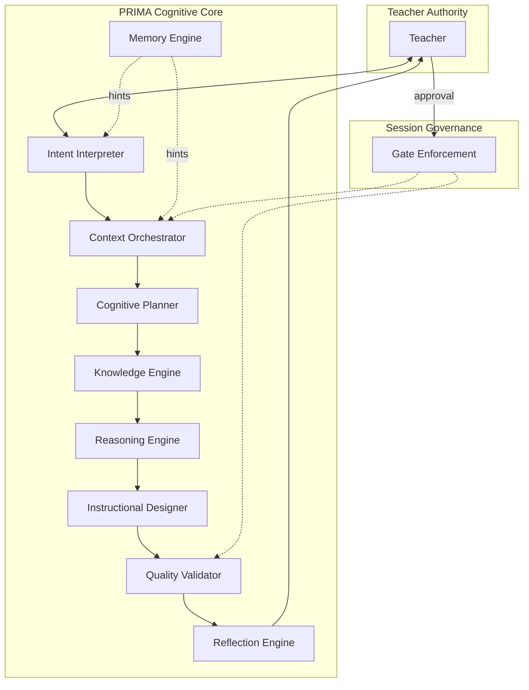
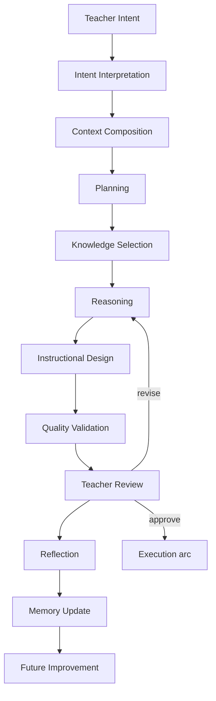
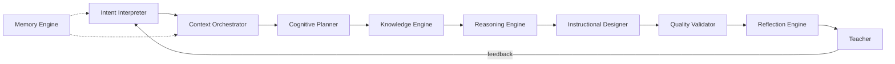
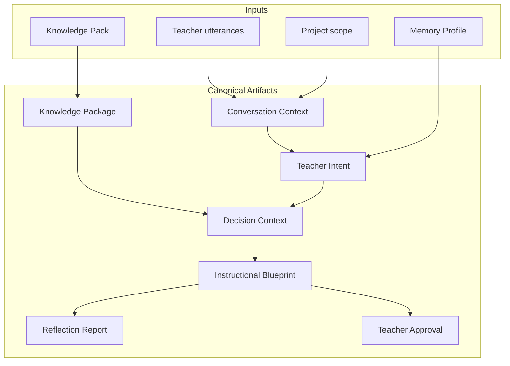
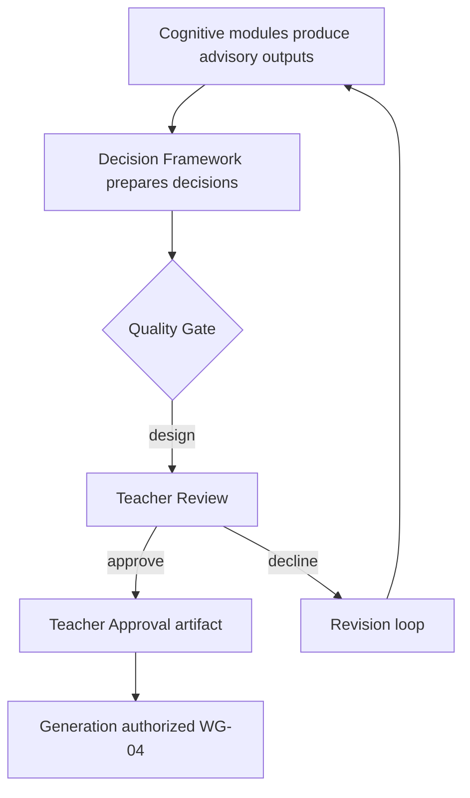
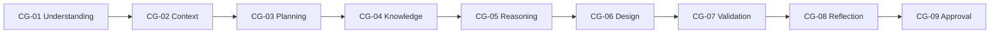
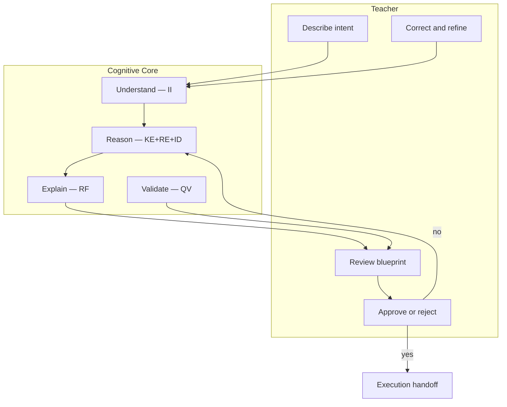
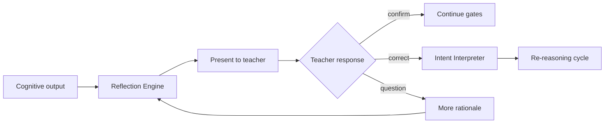
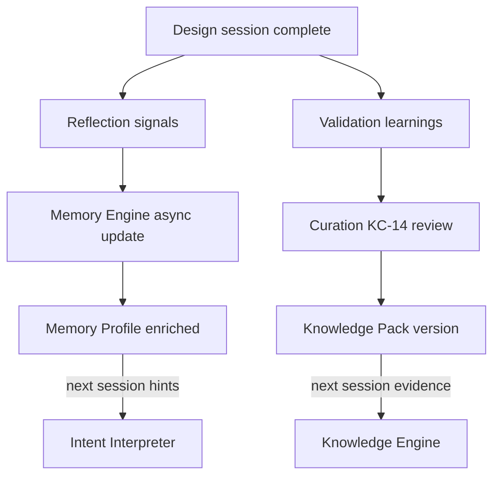

# PRIMA Cognitive Core

**Version:** 1.0  
**Status:** Official — Enterprise Cognitive Architecture Specification (elaborates under CM-001)

> **Precedence:** [`PRIMA_COGNITIVE_MODEL.md`](./PRIMA_COGNITIVE_MODEL.md) (**PRIMA-CM-001**) is the **highest conceptual layer** for how PRIMA thinks.  
> This Cognitive Core **elaborates** the operating model and module collaboration.  
> Where this document conflicts with CM-001 on cognition, **CM-001 prevails**.  
> Engine identity and boundaries remain owned by [`PRIMA_CONSTITUTIONAL_ENGINE_ARCHITECTURE.md`](./PRIMA_CONSTITUTIONAL_ENGINE_ARCHITECTURE.md) (ENG-00…ENG-10).

---

## 1. Purpose

This document defines the **conceptual cognitive core** of the PRIMA platform — the unified operating model governing how PRIMA **thinks, plans, reasons, collaborates, validates, reflects, learns, and supports teachers** as a complete cognitive system.

It answers one architectural question:

> **How does PRIMA think as a complete cognitive system?**

This is **not** software architecture, component architecture, or an implementation guide. It is the **constitutional definition** of PRIMA intelligence — valid regardless of AI model, programming language, framework, cloud provider, infrastructure, or future technology.

The Cognitive Core **integrates** without replacing:

| Document | Role in Cognitive Core |
|----------|------------------------|
| [`PRIMA_INTELLIGENCE_MODEL.md`](./PRIMA_INTELLIGENCE_MODEL.md) | Intelligence layers and cognitive functions |
| [`PRIMA_REASONING_FRAMEWORK.md`](./PRIMA_REASONING_FRAMEWORK.md) | Reasoning strategies and evidence model |
| [`PRIMA_CONTEXT_MODEL.md`](./PRIMA_CONTEXT_MODEL.md) | Context stack and activation |
| [`PRIMA_KNOWLEDGE_MODEL.md`](./PRIMA_KNOWLEDGE_MODEL.md) | Knowledge corpus and governance |
| [`PRIMA_DECISION_FRAMEWORK.md`](./PRIMA_DECISION_FRAMEWORK.md) | Authority and binding decisions |
| [`PRIMA_FAILURE_MODEL.md`](./PRIMA_FAILURE_MODEL.md) | Cognitive integrity under failure |

Product engine specifications ([`PRIMA_ENGINE.md`](./PRIMA_ENGINE.md)) **implement** cognitive modules; they do not supersede this document.

---

## 2. Scope

| In scope | Out of scope |
|----------|--------------|
| Cognitive modules and processing cycle | APIs, classes, microservices |
| Module collaboration and cognitive contracts | LLM prompts, model selection |
| Quality gates and explainability | Infrastructure, databases |
| Human-AI collaboration model | UI copy and visual design |
| Governance of cognitive behaviour | Deployment topology |

**Audience:** Chief architects, cognitive architects, product leaders, and engineering teams building any future PRIMA intelligent capability.

---

## 3. Cognitive Philosophy

PRIMA operates as an **Intelligent Pedagogical Design Partner** — a governed cognitive system, not an autonomous agent.

| Commitment | Meaning |
|------------|---------|
| **Never generates before understanding** | Intent Interpretation and Context Composition precede design output |
| **Never reasons without context** | Context Orchestrator activates governed scope before Reasoning Engine |
| **Never recommends without evidence** | Knowledge Engine supplies provenance-bound evidence |
| **Never validates own output without explicit criteria** | Quality Validator applies registered rules — measurement, not self-approval |
| **Never replaces teacher authority** | Approval Gate is human — DEC-BP-02 / WG-04 |
| **Collaborates** | Teacher leads; modules assist through dialogue and review |
| **Explains** | Reflection Engine and reasoning summaries satisfy EP-01 |
| **Reflects** | Self-review loops improve understanding — non-gating |
| **Continuously improves** | Memory Engine and curation evolution — advisory and async |

---

## 4. Core Cognitive Principles

| ID | Principle | Guarantee |
|----|-----------|-----------|
| **CCP-01** | Teacher-First Design | Teacher authority supreme at Approval Gate |
| **CCP-02** | Pedagogical Integrity | Instructional Designer optimizes coherence — not volume |
| **CCP-03** | Evidence-Based Recommendations | Knowledge Engine + Reasoning Engine trace evidence |
| **CCP-04** | Curriculum Compliance | Knowledge domain alignment mandatory when scoped |
| **CCP-05** | Explainability | Seven-question bundle for material outputs |
| **CCP-06** | Modularity | Nine modules — single responsibility each |
| **CCP-07** | Extensibility | New capabilities register against modules — not parallel cognition |
| **CCP-08** | Technology Independence | AP-05 — structure outlives models |
| **CCP-09** | Human Control | No binding artifact without teacher gate where required |
| **CCP-10** | Continuous Learning | Post-session memory and corpus evolution — never live corpus mutation |
| **CCP-11** | Fail Visible | Cognitive failure routes to Failure Model — no silent degradation |
| **CCP-12** | Artifact-Mediated Cognition | AP-03 — modules exchange canonical artifacts |

---

## 5. Cognitive Processing Cycle

The complete reasoning loop governing PRIMA cognition:

```
Teacher Intent
        ↓
Intent Interpretation          [Intent Interpreter]
        ↓
Context Composition            [Context Orchestrator]
        ↓
Planning                       [Cognitive Planner]
        ↓
Knowledge Selection            [Knowledge Engine]
        ↓
Reasoning                      [Reasoning Engine]
        ↓
Instructional Design           [Instructional Designer]
        ↓
Quality Validation             [Quality Validator]
        ↓
Teacher Review                 [Human Authority]
        ↓
Reflection                     [Reflection Engine]
        ↓
Memory Update                  [Memory Engine — async advisory]
        ↓
Future Improvement             [Corpus evolution + next session]
```

| Phase | Cognitive module | Primary artifact output |
|-------|------------------|------------------------|
| Intent Interpretation | Intent Interpreter | Teacher Intent |
| Context Composition | Context Orchestrator | Decision Context (forming) |
| Planning | Cognitive Planner | Reasoning plan scope |
| Knowledge Selection | Knowledge Engine | Knowledge Package |
| Reasoning | Reasoning Engine | Candidate designs, trade-offs |
| Instructional Design | Instructional Designer | Instructional Blueprint draft |
| Quality Validation | Quality Validator | Coherence status; later Validation Report |
| Teacher Review | **Teacher** | Teacher Approval or revision |
| Reflection | Reflection Engine | Reflection Report |
| Memory Update | Memory Engine | Memory Profile update (async) |

**Execution arc** (post-approval): Generation and platform validation extend the cycle — Quality Validator measures execution; Reflection interprets findings — under separate context rules ([`GP-05`](./PRIMA_ARCHITECTURAL_PRINCIPLES.md)).

---

## 6. Cognitive Modules

Nine conceptual modules compose the Cognitive Core. Each module has **cognitive responsibility** — not deployment identity. Cross-cutting **Session Governance** (Orchestrator) sequences modules and enforces gates without pedagogical logic.

---

### CM-01 — Intent Interpreter

| Field | Content |
|-------|---------|
| **Purpose** | Transform teacher dialogue and actions into normalized, structured instructional intent |
| **Responsibilities** | Capture utterances; classify intent class; resolve ambiguity; normalize Teacher Intent; flag gaps |
| **Inputs** | Conversation Context; teacher utterances; Activity Type; Memory Context hints |
| **Outputs** | Teacher Intent; ambiguity flags; discovery-complete signal |
| **Questions answered** | *What does the teacher want students to learn?* *What constraints apply?* *Is intent complete?* |
| **Success criteria** | Teacher Intent `complete`; WG-01 preconditions satisfied |
| **Failure conditions** | FAIL-INT-01 ambiguity; FAIL-CON-01 conflicting instructions |
| **Business value** | Faithful understanding before design investment |

**Maps to:** IL-02 Contextual Intelligence; capabilities ID-01, ID-02; [`PRIMA_CONTEXT_MODEL.md`](./PRIMA_CONTEXT_MODEL.md) CL-10.

---

### CM-02 — Context Orchestrator

| Field | Content |
|-------|---------|
| **Purpose** | Select, prioritize, activate, and retire contextual information for the current cognitive phase |
| **Responsibilities** | Context selection; prioritization; activation; retirement; conflict handling; phase-bound scoping |
| **Context selection** | Only layers registered for workflow phase ([`CP-07`](./PRIMA_CONTEXT_MODEL.md)) |
| **Context prioritization** | Authority precedence: teacher > approval > intent > knowledge > memory |
| **Context activation** | Compose Decision Context; enforce GP-05 at generation phase |
| **Context retirement** | Deactivate on phase exit; prevent inactive influence |
| **Conflict handling** | Surface conflicts — never silent merge ([`PRIMA_REASONING_FRAMEWORK.md`](./PRIMA_REASONING_FRAMEWORK.md)) |
| **Business value** | PRIMA uses exactly what the moment requires — nothing more |

**Maps to:** [`PRIMA_CONTEXT_MODEL.md`](./PRIMA_CONTEXT_MODEL.md) full stack; Session Governance coordination.

---

### CM-03 — Cognitive Planner

| Field | Content |
|-------|---------|
| **Purpose** | Decompose design goals into orchestrated cognitive tasks and blueprint composition order |
| **Planning strategy** | Backward design: objectives → activities → assessment → phases |
| **Goal decomposition** | Learning Experience → Instructional Objectives → Activities → Assessment |
| **Task orchestration** | Sequence reasoning passes; identify clarification needs; route revision vs evolution |
| **Blueprint creation** | Section dependency order for Instructional Designer |
| **Dependency management** | Objectives before activities; design before execution handoff |
| **Business value** | Structured path from intent to reviewable blueprint — not ad hoc generation |

**Maps to:** Reasoning lifecycle Planning phase; WF-PR-01 phases; RF-01 backward design.

---

### CM-04 — Knowledge Engine (Cognitive)

| Field | Content |
|-------|---------|
| **Purpose** | Select, validate, and deliver authoritative knowledge evidence for reasoning |
| **Knowledge selection** | Scoped query against active Knowledge Pack version |
| **Knowledge validation** | Provenance, quality tier, pack integrity |
| **Knowledge synthesis** | Package competency candidates, strategies, norms into Knowledge Package |
| **Knowledge authority** | KP-01 authoritative; KP-04 retrieved not invented |
| **Knowledge dependencies** | KD-02 Curriculum constrains KD-01 Pedagogical ([`PRIMA_KNOWLEDGE_MODEL.md`](./PRIMA_KNOWLEDGE_MODEL.md)) |
| **Business value** | Curriculum-aligned evidence — not parametric invention |

**Maps to:** IL-03 Knowledge Intelligence; [`PRIMA_KNOWLEDGE_MODEL.md`](./PRIMA_KNOWLEDGE_MODEL.md); product [`PRIMA_KNOWLEDGE_ENGINE.md`](./PRIMA_KNOWLEDGE_ENGINE.md).

**Distinction:** Cognitive module = conceptual role. Product Knowledge Engine = implementation.

---

### CM-05 — Reasoning Engine (Cognitive)

| Field | Content |
|-------|---------|
| **Purpose** | Evaluate evidence, analyze alternatives, apply constraints, synthesize advisory recommendations |
| **Evidence evaluation** | RS-06 Evidence-Based Reasoning; evidence priority hierarchy |
| **Alternative analysis** | RS-11 Comparative; RS-15 Trade-Off Resolution |
| **Decision support** | Prepare DEC-BP-01 inputs — **not** binding authority |
| **Constraint reasoning** | RS-05 Constraint-Based; RS-01 Deductive |
| **Recommendation synthesis** | SYN-01 through SYN-07 rules |
| **Business value** | Justified design proposals teachers can trust and challenge |

**Maps to:** [`PRIMA_REASONING_FRAMEWORK.md`](./PRIMA_REASONING_FRAMEWORK.md); IL-04, IL-05, IL-06.

---

### CM-06 — Instructional Designer (Cognitive)

| Field | Content |
|-------|---------|
| **Purpose** | Compose coherent Instructional Blueprint — pedagogical plan, not classroom material text |
| **Pedagogical planning** | RS-07 Pedagogical Reasoning; learning flow structure |
| **Learning sequence design** | Phase ordering; activity sequencing |
| **Assessment alignment** | Objectives ↔ assessment evidence chain |
| **Differentiation** | Grouping, support, extension from class context |
| **Digital integration** | Activity Type and resource class — design intent only |
| **Curriculum alignment** | RS-08; Blueprint Curriculum provenance |
| **Business value** | Core PRIMA value — structured Learning Experience design |

**Maps to:** ID-03, ID-04 capabilities; Instructional Design Domain; product Decision Engine design composition.

---

### CM-07 — Quality Validator (Cognitive)

| Field | Content |
|-------|---------|
| **Purpose** | Measure quality against explicit criteria — never self-approve design or mutate content |
| **Curriculum validation** | Alignment claims vs Knowledge provenance |
| **Pedagogical validation** | Coherence, appropriateness, QA-02 rules |
| **Structural validation** | Blueprint schema completeness |
| **Consistency validation** | Internal section alignment |
| **Accessibility validation** | Age appropriateness; ethical bounds RS-13 |
| **Quality scoring** | Severity classification — advisory vs blocking |
| **Business value** | Transparent quality assurance — teacher resolves findings |

**Maps to:** IL-07 Validation Intelligence; QA-01, QA-02; VP-03 measurement-only.

**Two phases:** (1) Pre-presentation coherence during design; (2) Post-generation Validation Report.

---

### CM-08 — Reflection Engine (Cognitive)

| Field | Content |
|-------|---------|
| **Purpose** | Mirror understanding; interpret reasoning and findings for teacher comprehension |
| **Self-review** | Evaluate whether reasoning matches captured intent |
| **Pattern discovery** | Identify ambiguity, trade-offs, uncertainty for presentation |
| **Improvement recommendations** | Non-prescriptive refinement hints at review |
| **Knowledge enrichment** | Signals for future curation — **not** live corpus write |
| **Reflection reports** | Reflection Report artifact |
| **Business value** | Explainability and partnership trust |

**Maps to:** IL-08 Reflective Intelligence; RF-01, RF-02, RF-03; ACR-08 non-gating.

---

### CM-09 — Memory Engine (Cognitive)

| Field | Content |
|-------|---------|
| **Purpose** | Provide continuity and personalization hints across sessions — advisory only |
| **Experience continuity** | Project resume; reduced repetition |
| **Knowledge preservation** | **Not** corpus storage — Memory Profile for teacher patterns |
| **Reusable patterns** | Preference hints — not authoritative knowledge |
| **Long-term learning support** | Async post-session update; WF-SU-02 |
| **Business value** | Returning teachers feel recognized — without surveillance |

**Maps to:** Memory Domain; Memory Context delivery; IP-06, CP-04; product [`PRIMA_MEMORY_ENGINE.md`](./PRIMA_MEMORY_ENGINE.md).

**Distinction:** Memory ≠ Knowledge ([`PRIMA_KNOWLEDGE_MODEL.md`](./PRIMA_KNOWLEDGE_MODEL.md) vs Memory Profile).

---

## 7. Collaboration Between Modules

No module operates in isolation. **Session Governance** (conceptual coordinator — product Orchestrator) sequences module collaboration and enforces gates.

### Collaboration rules

| Rule | Description |
|------|-------------|
| **CCOL-01** | Every recommendation passes Intent → Context → Knowledge → Reasoning → Design → Validation → Reflection before teacher review |
| **CCOL-02** | Knowledge Engine never writes Blueprint — Instructional Designer composes |
| **CCOL-03** | Reasoning Engine never authorizes — Decision Framework + Teacher decide |
| **CCOL-04** | Quality Validator never redesigns — reports only |
| **CCOL-05** | Reflection Engine never gates — interprets only |
| **CCOL-06** | Memory Engine never overrides Intent Interpreter output |
| **CCOL-07** | Context Orchestrator blocks illegal cross-phase context (GP-05) |
| **CCOL-08** | Failure in any module routes to Failure Model — DEC-REC-01 |

### Typical design-arc collaboration

```
Teacher → Intent Interpreter → Context Orchestrator
              ↓                        ↓
         Memory Engine (hints)    Cognitive Planner
              ↓                        ↓
         Knowledge Engine ──→ Reasoning Engine
              ↓                        ↓
         Instructional Designer ←───┘
              ↓
         Quality Validator (coherence)
              ↓
         Reflection Engine → Teacher Review
              ↓
         [Approval] → Context Orchestrator (generation scope)
              ↓
         Quality Validator (measurement) → Reflection Engine
              ↓
         Memory Engine (async)
```

---

## 8. Cognitive Contracts

Standard contract template for every module:

| Contract field | Description |
|----------------|-------------|
| **Responsibilities** | Exclusive cognitive duties |
| **Inputs** | Canonical artifacts and context accepted |
| **Outputs** | Artifacts produced |
| **Dependencies** | Upstream modules required |
| **Consumers** | Downstream modules and teacher |
| **Constraints** | Architectural rules module must obey |
| **Authority** | What module may **not** decide |
| **Quality Expectations** | Output quality dimensions |
| **Failure Behaviour** | Failure Model routing |

### Contract summary matrix

| Module | Primary outputs | Must not | Authority | Failure |
|--------|-----------------|----------|-----------|---------|
| **Intent Interpreter** | Teacher Intent | Approve design | Advisory | FAIL-INT-01, FAIL-CON-01 |
| **Context Orchestrator** | Active context bundle | Pedagogical content | Deterministic scope | FAIL-GOV-01 |
| **Cognitive Planner** | Plan scope | Compose blueprint | Advisory | FAIL-BP-03 |
| **Knowledge Engine** | Knowledge Package | Decide design | Evidence only | FAIL-KN-01 |
| **Reasoning Engine** | Recommendations | Bind authority | Advisory | FAIL-BP-03 |
| **Instructional Designer** | Blueprint draft | Generate materials | Advisory | FAIL-BP-02 |
| **Quality Validator** | Findings / coherence | Mutate content | Measurement | FAIL-VAL-* |
| **Reflection Engine** | Reflection Report | Gate workflow | Interpretive | N/A — non-fatal |
| **Memory Engine** | Memory Context | Override teacher | Hints only | FAIL-MEM-01 |

---

## 9. Quality Gates

Mandatory cognitive gates. **No artifact bypasses a mandatory gate.** Architectural gates WG-* implement binding enforcement ([`PRIMA_WORKFLOW_MODEL.md`](./solution/PRIMA_WORKFLOW_MODEL.md)).

| Gate ID | Gate name | Cognitive criterion | Architectural gate | Module owner |
|---------|-----------|---------------------|-------------------|--------------|
| **CG-01** | Understanding Gate | Teacher Intent complete; ambiguity resolved | WG-01 | Intent Interpreter |
| **CG-02** | Context Gate | Decision Context legally composed; conflicts resolved | Pre-reasoning | Context Orchestrator |
| **CG-03** | Planning Gate | Backward design plan scoped; dependencies ordered | Pre-reasoning | Cognitive Planner |
| **CG-04** | Knowledge Gate | Knowledge Package delivered or gap flagged | Pre-reasoning | Knowledge Engine |
| **CG-05** | Reasoning Gate | Recommendations synthesized with evidence trace | Pre-composition | Reasoning Engine |
| **CG-06** | Instructional Design Gate | Blueprint draft coherent and complete | WG-02 | Instructional Designer |
| **CG-07** | Validation Gate | Coherence pass (design); measurement pass (execution) | WG-05, WG-06 | Quality Validator |
| **CG-08** | Reflection Gate | Rationale presented before approval decision | WG-03 | Reflection Engine |
| **CG-09** | Approval Gate | Teacher Approval recorded | WG-04 | **Teacher** |

```mermaid
flowchart LR
  CG01[CG-01 Understanding] --> CG02[CG-02 Context]
  CG02 --> CG03[CG-03 Planning]
  CG03 --> CG04[CG-04 Knowledge]
  CG04 --> CG05[CG-05 Reasoning]
  CG05 --> CG06[CG-06 Design]
  CG06 --> CG07[CG-07 Validation]
  CG07 --> CG08[CG-08 Reflection]
  CG08 --> CG09[CG-09 Approval]
  CG09 --> EXEC[Execution arc]
```



**Rule:** CG-09 is **human**. No cognitive module may substitute.

---

## 10. Human-AI Collaboration

| Role | Actor | Cognitive function |
|------|-------|-------------------|
| **Express intent** | Teacher | Intent Interpreter partner |
| **Correct understanding** | Teacher | Collaborative reasoning RS-12 |
| **Review design** | Teacher | Instructional Designer output consumer |
| **Approve or reject** | Teacher | CG-09 — sole binding authority |
| **Edit materials** | Teacher | Post-generation — outside design cognition |
| **Override findings** | Teacher | DEC-VAL-02 non-critical |
| **Pause or cancel** | Teacher | Failure recovery partner |

PRIMA modules **assist** at every stage before approval. Teacher **decides** at approval, finalization, and export.

Expression of PRIMA voice (Prompt Engine at product level) serves collaboration — it is **not** a cognitive authority module.

---

## 11. Explainability

Every important cognitive output must answer:

| Question | Answering module(s) | Artifact |
|----------|---------------------|----------|
| **Why?** | Reasoning Engine, Instructional Designer | Reasoning summary |
| **Based on what?** | Intent Interpreter | Teacher Intent |
| **Which knowledge?** | Knowledge Engine | Knowledge Package provenance |
| **Which context?** | Context Orchestrator | Decision Context scope |
| **Which reasoning?** | Reasoning Engine | Strategy trace RS-* |
| **Which evidence?** | Knowledge Engine, Reasoning Engine | Citation refs |
| **Which educational objective?** | Instructional Designer | Instructional Objectives |

Reflection Engine **packages** answers for teacher review ([`EP-01`](./PRIMA_ARCHITECTURAL_PRINCIPLES.md)).

---

## 12. Governance

### Module ownership

| Module | Owning domain (conceptual) | Product implementation reference |
|--------|---------------------------|----------------------------------|
| Intent Interpreter | Instructional Design + Teacher Interaction | Conversation Engine |
| Context Orchestrator | Orchestration | Orchestrator + artifact coordination |
| Cognitive Planner | Instructional Design | Decision Engine (planning stages) |
| Knowledge Engine | Knowledge | Knowledge Engine |
| Reasoning Engine | Instructional Design | Decision Engine (reasoning stages) |
| Instructional Designer | Instructional Design | Decision Engine (composition) |
| Quality Validator | Validation | Validation Engine / Gate |
| Reflection Engine | Teacher Interaction | Reflection Engine |
| Memory Engine | Memory | Memory Engine |

### Decision authority

| Decision type | Authority |
|---------------|-----------|
| Design approval | Teacher — DEC-BP-02 |
| Context activation scope | Session Governance — deterministic |
| Knowledge retrieval scope | Knowledge Engine — policy-bound |
| Quality finding resolution | Teacher — DEC-VAL-02 |
| Recovery path | Teacher — DEC-REC-01 |

### Interaction rules

- Artifact-mediated exchange only (CCP-12)  
- Star topology through Session Governance (AP-02)  
- No module bypasses Quality Gates  

### Escalation

Repeated cognitive failure → FAIL-SES-03; governance violation → FAIL-GOV-02.

### Auditability

Audit Record captures gate passage, module handoffs, teacher decisions.

### Continuous improvement

| Loop | Mechanism | Guardrail |
|------|-----------|-----------|
| **Session** | Reflection → teacher correction → re-reasoning | Teacher authority |
| **Cross-session** | Memory Engine async update | Advisory only |
| **Corpus** | KC-14 Lessons Learned → curation | KM-02 no live mutation |

---

## 13. Future Evolution

| Area | Evolution | Constraint |
|------|-----------|------------|
| New cognitive module | Architecture review + register here | CCP-06 modularity |
| FE-07 adaptive hints | Memory Engine extension | CCP-09 human control |
| Multi-teacher cognition | CL-16 Collaboration | CG-09 unchanged |
| New AI technology | Reimplement modules | CCP-08 — contracts unchanged |
| Stronger validation | Quality Validator rules | VP-03 measurement-only |

---

## 14. Summary

The **PRIMA Cognitive Core** is the constitutional definition of how PRIMA operates as a **complete cognitive system** — nine modules, one processing cycle, nine quality gates, and teacher authority at the center.

| Guarantee | Mechanism |
|-----------|-----------|
| Teacher-first design | CG-09 Approval Gate |
| Pedagogical integrity | Instructional Designer + CCP-02 |
| Evidence-based recommendations | Knowledge Engine + Reasoning Engine |
| Curriculum compliance | Knowledge Gate CG-04 |
| Explainability | Reflection Engine + seven-question bundle |
| Modularity | Nine modules with cognitive contracts |
| Extensibility | CCP-07 registration |
| Technology independence | CCP-08 |
| Human control | CCP-09 |
| Continuous learning | Memory Engine + corpus evolution — governed |

The Cognitive Core **integrates** Intelligence, Reasoning, Context, Knowledge, Decision, and Failure architectures into one operating model. It governs **every intelligent capability** developed for PRIMA in the future — regardless of AI model or implementation technology.

---

## Architectural Principles (Cognitive Core Guarantees)

The Cognitive Core guarantees the ten principles in §4 (CCP-01 through CCP-12) and the cognitive philosophy in §3. Violations require architectural governance exception — not silent implementation workaround.

---

## Mermaid Diagrams

### Diagram 1 — Overall Cognitive Core



---

### Diagram 2 — Cognitive Processing Cycle



---

### Diagram 3 — Module Collaboration



---

### Diagram 4 — Information Flow



---

### Diagram 5 — Decision Flow



---

### Diagram 6 — Quality Gates



---

### Diagram 7 — Teacher–PRIMA Collaboration



---

### Diagram 8 — Reflection Loop



---

### Diagram 9 — Continuous Learning Loop



---

## Cognitive Architecture Stack

```
PRIMA_COGNITIVE_MODEL.md (PRIMA-CM-001) ... constitutional cognition — HOW PRIMA THINKS
    └── PRIMA_COGNITIVE_CORE.md ........... THIS DOCUMENT — elaborating operating model
            ├── PRIMA_INTELLIGENCE_MODEL.md
            ├── PRIMA_REASONING_FRAMEWORK.md
            ├── PRIMA_CONTEXT_MODEL.md
            ├── PRIMA_KNOWLEDGE_MODEL.md
            ├── PRIMA_DECISION_FRAMEWORK.md
            └── PRIMA_FAILURE_MODEL.md
                    └── ENG-00…ENG-10 (Constitutional Engine Architecture)
```

---

## Document Authority

| Document | Relationship |
|----------|--------------|
| [`PRIMA_COGNITIVE_MODEL.md`](./PRIMA_COGNITIVE_MODEL.md) (**PRIMA-CM-001**) | **Supreme cognitive specification** — how PRIMA thinks |
| [`LUDI_ON_PROJECT_BIBLE.md`](./LUDI_ON_PROJECT_BIBLE.md) | Product intent and PRIMA mission |
| [`PRIMA_ARCHITECTURAL_PRINCIPLES.md`](./PRIMA_ARCHITECTURAL_PRINCIPLES.md) | Constitutional structural constraints |
| All cognitive architecture siblings | Foundations — elaborations under CM-001 |
| [`PRIMA_CONSTITUTIONAL_ENGINE_ARCHITECTURE.md`](./PRIMA_CONSTITUTIONAL_ENGINE_ARCHITECTURE.md) | Engine ownership of cognitive functions |
| [`PRIMA_ENGINE.md`](./PRIMA_ENGINE.md) | Legacy product engine narrative — align to ENG catalog |
| [`PRIMA_ORCHESTRATOR.md`](./PRIMA_ORCHESTRATOR.md) | Implements Session Governance |

---

## Next Recommended Document

→ [`PRIMA_ARCHITECTURE_CONSISTENCY_REVIEW.md`](./PRIMA_ARCHITECTURE_CONSISTENCY_REVIEW.md) — Holistic consistency audit across the full cognitive and solution architecture stack.
