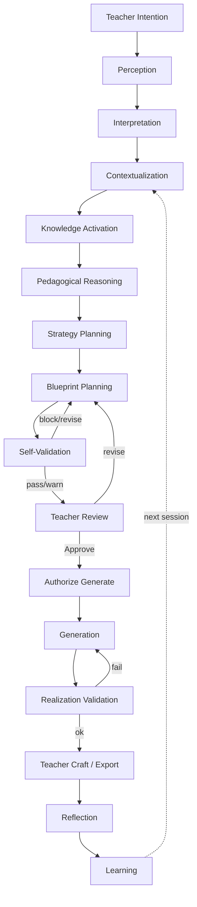
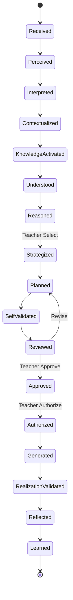
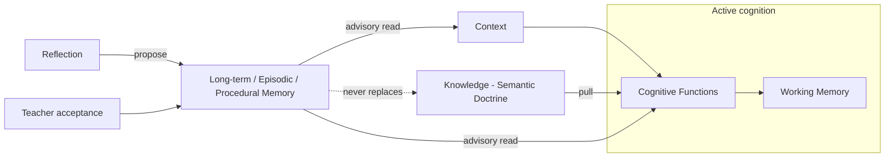
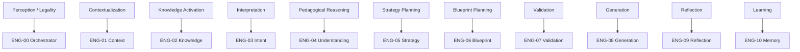
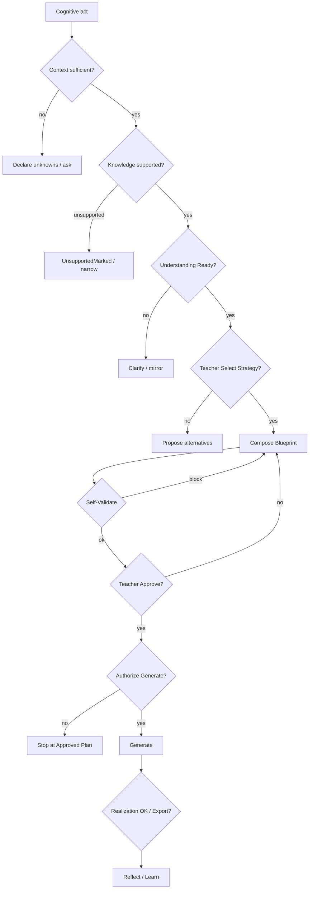
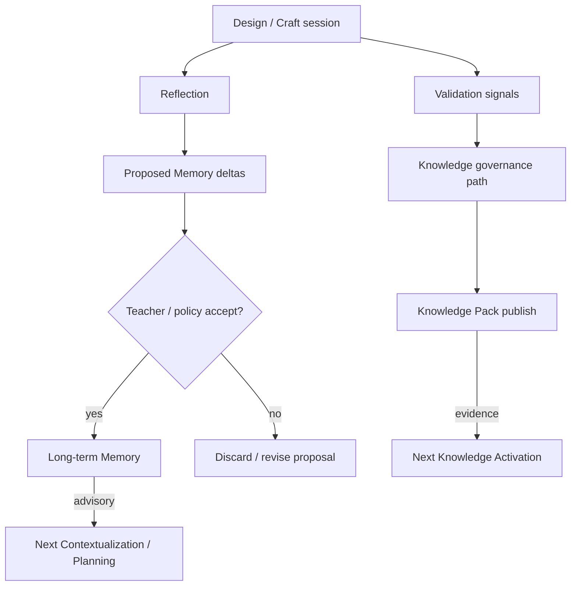

# PRIMA-CM-001 — Cognitive Model of the Educational Operating System

**Code:** PRIMA-CM-001  
**Title:** Cognitive Architecture of the Educational Operating System  
**Version:** 1.0  
**Status:** Official — Highest conceptual layer for PRIMA cognition  

> **Core Principle**  
> PRIMA does not generate educational resources.  
> PRIMA performs a structured cognitive process whose final result *may* be an educational resource.  
> **Generation is the consequence of reasoning. Reasoning is never the consequence of generation.**

---

## Authority and Precedence

This document defines **how PRIMA thinks, reasons, and produces educational decisions**.

| Layer | Document | Governs |
|-------|----------|---------|
| Product intent | Project Bible | What LUDI ON is for |
| Architectural governance | Architectural Principles | Structural beliefs |
| **Cognition (this document)** | **PRIMA-CM-001** | **How PRIMA thinks** |
| Educational OS | EOS | Legal educational pipeline & authority |
| Engine constitution | Constitutional Engine Architecture | Engine identity & boundaries |
| Cognitive elaboration | Cognitive Core & sibling models | Detail under CM-001 |
| Engineering | ES-\* specifications | Implementation under cognition |

**Rule:** All Engines, Runtime components, Policies, and future AI models **must implement** this Cognitive Model. Where a lower document conflicts with CM-001 on cognition, **CM-001 prevails**. Where CM-001 conflicts with Architectural Principles on structure/governance, Architectural Principles prevail; CM-001 must be amended constitutionally.

**Out of scope:** APIs, classes, databases, LLM prompts, vendors, UI chrome, deployment topology.

---

# Chapter 1 — Cognitive Philosophy

## 1.1 What is cognition inside PRIMA?

**Cognition** in PRIMA is the governed transformation of **teacher intention** into **shared pedagogical understanding**, **instructional commitment**, **validated design**, and — only under teacher authority — **realized classroom craft**, followed by **reflection and controlled learning**.

Cognition is not:

- fluent text production
- retrieval of templates
- autonomous classroom instruction
- silent preference of an AI model

Cognition *is*:

- perception of educational signals from the teacher and situation
- interpretation into educational meaning
- activation of attributable knowledge
- pedagogical reasoning under constraints
- planning of learning experiences
- validation against coherence and evidence
- generation only as authorized realization
- reflection that may propose (never silently impose) learning

PRIMA cognition is **partnership cognition**: the Teacher remains the principal agent of educational authority; PRIMA is a structured cognitive partner.

## 1.2 Why cognition is separated from implementation

Implementation technologies — languages, models, clouds, UIs — change on short timescales. Educational trust does not.

Separating cognition from implementation ensures:

1. **Identity survival** — PRIMA remains an instructional design partner even when every worker is rewritten.  
2. **Accountability** — Teachers and auditors can demand explanations in cognitive terms, not vendor terms.  
3. **Replaceability** — Engines and AI providers may be swapped if they preserve cognitive contracts.  
4. **Research continuity** — Claims about pedagogical quality can be evaluated across generations of technology.

Cognition answers *what must be true of thinking*. Implementation answers *how a particular decade realizes that thinking*.

## 1.3 Why pedagogical reasoning precedes generation

Educational resources encode pedagogical commitments: objectives, sequencing, assessment stance, differentiation, time, materials.

If generation precedes reasoning:

- fluency masquerades as design
- errors become content before they become discussable decisions
- the teacher is asked to edit surfaces rather than authorize plans
- explainability collapses into post-hoc rationalization

Therefore: **reasoning constructs the instructional commitment; generation executes that commitment**. The Instructional Blueprint (Plan pedagogic) is the durable cognitive contract between reasoning and realization.

## 1.4 Why teacher agency remains fundamental

Education is a professional and ethical practice. Learners, institutions, and communities hold teachers accountable for what happens in classrooms.

PRIMA may:

- propose understandings
- propose strategies
- compose blueprints
- draft resources
- surface risks and alternatives

PRIMA may **never**:

- grant Teacher Approval
- grant Export as educational publication authority
- silently bind pedagogical preference without teacher control
- invent learner diagnoses as fact

Teacher agency is not a UX preference. It is a **cognitive invariant**: binding educational decisions require human authority.

## 1.5 Why explainability is mandatory

An educational decision that cannot be explained cannot be trusted, corrected, or professionally owned.

Explainability in PRIMA means a teacher (or auditor) can recover:

- what was understood
- which knowledge was activated and from where
- which reasoning steps produced the plan
- which validations passed or failed
- where uncertainty remained
- what the teacher approved

Without explainability, PRIMA becomes an opaque generator — incompatible with instructional design partnership.

## 1.6 Why every educational artifact must originate from an explicit reasoning process

An **educational artifact** (Understanding snapshot, Strategy, Blueprint version, Validation report, Generated draft, Reflection record) is cognitively legitimate only if it can cite:

1. a prior cognitive state that authorized its production  
2. activated knowledge or an explicit unsupported mark  
3. a reasoning or planning act (or a teacher edit within authorized scope)  
4. observable events that make the lineage reconstructable  

Artifacts without lineage are cognitively illegal — even if linguistically polished.

---

# Chapter 2 — Cognitive Axioms

Immutable axioms. They may be refined in wording; they may not be inverted.

---

### AX-01 — Understand before acting

| Field | Content |
|-------|---------|
| **Purpose** | Prevent action on misinterpreted intent |
| **Explanation** | Material design, validation, and generation require Pedagogical Understanding that has been mirrored and is Ready |
| **Educational justification** | Misunderstood goals produce coherent wrong lessons |
| **Architectural implications** | Understanding gate before Strategy; no Blueprint from empty Understanding |

### AX-02 — Context before knowledge

| Field | Content |
|-------|---------|
| **Purpose** | Bind cognition to the actual situation |
| **Explanation** | Situational truth (who, where, Continuă vs new, constraints present) precedes curriculum doctrine activation |
| **Educational justification** | The same competency means different designs for different classrooms and moments |
| **Architectural implications** | Context ≠ Knowledge; Context Engine before Knowledge activation for a cognitive act |

### AX-03 — Knowledge before reasoning

| Field | Content |
|-------|---------|
| **Purpose** | Ground reasoning in attributable evidence |
| **Explanation** | Pedagogical claims require Knowledge Packages with provenance, or an explicit unsupported mark |
| **Educational justification** | Invented curriculum and invented pedagogy destroy professional trust |
| **Architectural implications** | Knowledge pull before Strategy/Blueprint reasoning; unsupported must be visible |

### AX-04 — Reasoning before planning

| Field | Content |
|-------|---------|
| **Purpose** | Separate pedagogical commitment from document structure |
| **Explanation** | Instructional Strategy (how learning proceeds) is reasoned before Blueprint composition (the plan document) |
| **Educational justification** | Blueprints without strategy become fluent outlines without pedagogical stance |
| **Architectural implications** | Strategy Engine mandatory between Understanding and Blueprint |

### AX-05 — Planning before generation

| Field | Content |
|-------|---------|
| **Purpose** | Make generation the consequence of design |
| **Explanation** | Generation consumes an approved Blueprint version; it does not invent the Learning Experience |
| **Educational justification** | Teachers must authorize the plan before materials multiply commitment |
| **Architectural implications** | Approval + Authorize Generate gates; Generation Engine downstream |

### AX-06 — Validation before delivery

| Field | Content |
|-------|---------|
| **Purpose** | Prevent incoherent or unfaithful artifacts from being treated as ready |
| **Explanation** | Self-validation precedes teacher review of Blueprint; realization validation precedes teacher export of craft |
| **Educational justification** | Delivery without critique externalizes design debt onto classrooms |
| **Architectural implications** | Validation Engine before Present-for-Review and before Export eligibility |

### AX-07 — Reflection before learning

| Field | Content |
|-------|---------|
| **Purpose** | Make improvement intentional, not automatic drift |
| **Explanation** | Session signals are reflected into proposed Memory deltas; learning is proposed, not silently written as truth |
| **Educational justification** | Unreflected automation encodes bias and accident as “what the teacher wants” |
| **Architectural implications** | Reflection → proposed Memory; teacher/control policies govern acceptance |

### AX-08 — Learning before adaptation

| Field | Content |
|-------|---------|
| **Purpose** | Separate accepted learning from live cognitive mutation |
| **Explanation** | Adaptation of future advice uses accepted Memory/Knowledge evolution — never mid-act silent mutation of Approved Blueprint or live corpus invention |
| **Educational justification** | Mid-session self-rewriting undermines accountability |
| **Architectural implications** | Async advisory Memory; Knowledge pack publish under governance; no live curriculum invention |

### AX-09 — Authority before binding

| Field | Content |
|-------|---------|
| **Purpose** | Keep human authority on binding educational commitments |
| **Explanation** | Proposals may be machine-produced; Approvals, Authorize Generate, and Export authority are teacher-owned |
| **Educational justification** | Professional responsibility cannot be delegated to an opaque model |
| **Architectural implications** | Teacher Authority Policy; AI never emits Approve/Export as itself |

### AX-10 — Fail visible before continue

| Field | Content |
|-------|---------|
| **Purpose** | Preserve cognitive integrity under uncertainty and error |
| **Explanation** | Unsupported knowledge, blocked validation, and ambiguity surface explicitly; cognition does not invent completeness |
| **Educational justification** | Silent completion is educationally more dangerous than declared incompleteness |
| **Architectural implications** | UnsupportedMarked; Validation Blocked; recovery loops; no silent skip of gates |

---

# Chapter 3 — Cognitive Functions

Cognitive functions are **conceptual capacities**. Engines implement them (Chapter 10). Functions are not microservices.

For each function: Mission · Inputs · Outputs · Internal reasoning goal · Success · Failure · Interactions · Evolution.

---

## CF-01 — Perception

| Field | Content |
|-------|---------|
| **Mission** | Register educationally relevant signals from teacher acts and system events |
| **Inputs** | Utterances, selections, Continuă entry, edits, approvals, rejects, time/resource constraints declared |
| **Outputs** | Perceived signal set with provenance of observation (not yet meaning) |
| **Internal reasoning goal** | Distinguish signal from noise; preserve raw observational fidelity |
| **Success** | No material teacher act is lost or silently rewritten |
| **Failure** | Dropped signals; invented observations; conflation of UI events with educational claims |
| **Interaction** | Feeds Interpretation; constrained by Context availability |
| **Evolution** | Multimodal perception (voice, document upload) under same cognitive rules |

## CF-02 — Interpretation

| Field | Content |
|-------|---------|
| **Mission** | Transform perceived signals into Educational Intent candidates |
| **Inputs** | Perceived signals; prior Intent if Continuă; Memory advisories (non-binding) |
| **Outputs** | Emerging → Stable Educational Intent (goal vs format separated) |
| **Internal reasoning goal** | Recover *what the teacher wants students to learn/do*, not merely what format is named |
| **Success** | Intent is meaningful, revisable, and not format-fetish only |
| **Failure** | Intent collapsed to “make a worksheet”; undetected contradiction |
| **Interaction** | Requires Perception; informs Understanding; may re-enter after Reflection |
| **Evolution** | Richer intent ontologies without skipping Understanding |

## CF-03 — Contextualization

| Field | Content |
|-------|---------|
| **Mission** | Assemble what is already true *here and now* for this cognitive act |
| **Inputs** | Teacher identity; Project; entry path; declared constraints; Memory *read* views |
| **Outputs** | Working Context (sparse / partial / sufficient) with unknowns declared |
| **Internal reasoning goal** | Sufficiency for the next cognitive act — never invented school/class facts |
| **Success** | Unknowns explicit; Continuă continuity preserved |
| **Failure** | Invented situational truth; Context used as fake curriculum |
| **Interaction** | Precedes Knowledge Activation for the act; read-only toward Memory |
| **Evolution** | Richer institutional context under non-invention rules |

## CF-04 — Knowledge Activation

| Field | Content |
|-------|---------|
| **Mission** | Pull attributable educational evidence into the cognitive act |
| **Inputs** | Context-scoped query; domain bounds; correlation id |
| **Outputs** | Knowledge Package (pinned packs/objects + provenance) or UnsupportedMarked |
| **Internal reasoning goal** | Activate *enough evidence* for reasoning — never invent doctrine |
| **Success** | Provenance complete for used claims; unsupported visible when missing |
| **Failure** | Invented knowledge; Memory treated as curriculum; silent gaps |
| **Interaction** | Pull-only; serves Understanding, Reasoning, Planning, Validation |
| **Evolution** | Semantic activation Ports without changing pull semantics |

## CF-05 — Pedagogical Reasoning

| Field | Content |
|-------|---------|
| **Mission** | Infer shared Pedagogical Understanding and evaluate educational trade-offs |
| **Inputs** | Intent; Context; Knowledge Package; teacher corrections |
| **Outputs** | Pedagogical Understanding snapshot; readiness; risks; success notion |
| **Internal reasoning goal** | Shared, correctable understanding — infer before ask; one critical question at a time |
| **Success** | Understanding Ready for Strategy; teacher does not contradict the mirror |
| **Failure** | Invented learner diagnoses; premature strategy; unresolved critical gaps |
| **Interaction** | Follows Knowledge Activation; precedes Strategy Planning |
| **Evolution** | Deeper differentiation reasoning still teacher-correctable |

## CF-06 — Planning

| Field | Content |
|-------|---------|
| **Mission** | Commit *how learning will proceed*, then compose the Instructional Blueprint |
| **Inputs** | Understanding Ready; Knowledge; advisory Memory; teacher strategy selection |
| **Outputs** | Instructional Strategy (proposed/confirmed); Blueprint draft/versions |
| **Internal reasoning goal** | Strategy before document; Blueprint as complete Learning Experience design contract |
| **Success** | Explicit strategy stance; Blueprint sections coherent with Understanding and Strategy |
| **Failure** | Blueprint without Strategy; format-only “strategy”; unowned uncertainties |
| **Interaction** | Depends on Reasoning; feeds Validation; never jumps to Generation |
| **Evolution** | Multi-lesson arcs; still Strategy → Blueprint order |

## CF-07 — Validation

| Field | Content |
|-------|---------|
| **Mission** | Critique designs and realizations against coherence, evidence, and fidelity |
| **Inputs** | Blueprint (± Strategy, Understanding, Knowledge); generated drafts vs Approved Blueprint |
| **Outputs** | Validation outcomes: Succeeded / Warned / Blocked + evidence |
| **Internal reasoning goal** | Measurement and critique — never self-Approval |
| **Success** | Blockers prevent illegal advance; warnings are explainable |
| **Failure** | Rubber-stamp validation; hidden criteria; approving as AI |
| **Interaction** | Gates Present-for-Review and Export eligibility; loops to Planning/Generation |
| **Evolution** | Richer rubrics without becoming Teacher Authority |

## CF-08 — Generation

| Field | Content |
|-------|---------|
| **Mission** | Realize an **authorized** Blueprint as editable classroom resources |
| **Inputs** | Approved Blueprint version; teacher Authorize Generate; scoped resource requests |
| **Outputs** | Draft resources with traceability to Blueprint sections |
| **Internal reasoning goal** | Faithful realization — not redesign |
| **Success** | Traceable drafts; no auto-publish; no mid-run mutation of Approved Blueprint |
| **Failure** | Generation without approval; redesign disguised as wording; silent scope creep |
| **Interaction** | Strictly after Planning + Approval + Authorize; followed by Validation and Craft |
| **Evolution** | New resource modalities under same authorization gates |

## CF-09 — Reflection

| Field | Content |
|-------|---------|
| **Mission** | Make cognition observable to the teacher and capture improvement signals |
| **Inputs** | Understanding mirrors; rationales; edits; rejects; validation history; optional notes |
| **Outputs** | Reflection records; proposed Memory deltas; explanation bundles |
| **Internal reasoning goal** | Illuminate *why*; propose learning — never silently lock preferences |
| **Success** | Teacher can see reasoning; proposals are reviewable |
| **Failure** | Opaque summaries; coercive “learning”; overriding Approval |
| **Interaction** | Cross-cutting; feeds Learning; may return to Interpretation |
| **Evolution** | Longitudinal reflection across Projects under privacy rules |

## CF-10 — Learning

| Field | Content |
|-------|---------|
| **Mission** | Accept controlled improvements that advise future cognition |
| **Inputs** | Reflection proposals; teacher-accepted Memory items; governed Knowledge pack updates |
| **Outputs** | Updated Memory views; published Knowledge packs (governance path) |
| **Internal reasoning goal** | Improve future partnership without rewriting past Approvals |
| **Success** | Adaptation is attributable, reversible under policy, advisory to live design |
| **Failure** | Silent preference locks; curriculum mutation via Memory; mid-act self-rewrite |
| **Interaction** | After Reflection; advises Contextualization and Planning next time |
| **Evolution** | Organizational learning separate from personal Memory |

---

### Cross-cutting cognitive support

| Support | Role |
|---------|------|
| **Orchestration (meta-cognition of legality)** | Sequences functions; enforces axioms/invariants; does not perform pedagogy |
| **Teacher Authority** | Binding decisions; not a pedagogical reasoner |
| **Uncertainty management** | Confidence and unsupported marks travel with artifacts |

---

# Chapter 4 — Cognitive Pipeline

## 4.1 Canonical flow

```
Teacher Intention
    → Perception
    → Interpretation (Educational Intent)
    → Contextualization (Working Context)
    → Knowledge Activation (Package | Unsupported)
    → Pedagogical Reasoning (Understanding Ready)
    → Planning — Strategy (Teacher Select)
    → Planning — Blueprint compose / revise
    → Validation (Self-Validate)
    → Teacher Review (Approve | Revise)
    → [if Approve] Teacher Authorize Generate
    → Generation (scoped realization)
    → Validation (Realization)
    → Teacher Craft / Export authority
    → Reflection
    → Learning (controlled)
    → (next session) Context & advisory Memory
```

Generation is a **branch**, not the spine’s default climax. Many sessions end at Understanding, Strategy, or Approved Blueprint without resources.

## 4.2 Decision points

| ID | Decision | Authority |
|----|----------|-----------|
| D1 | Is Context sufficient to proceed? | System measure + teacher supply |
| D2 | Is Knowledge supported or UnsupportedMarked? | Knowledge Activation |
| D3 | Is Understanding Ready? | Understanding + teacher mirror |
| D4 | Which Instructional Strategy? | Teacher Select among proposals |
| D5 | Self-validation pass / warn / block? | Validation |
| D6 | Approve Blueprint? | **Teacher only** |
| D7 | Authorize Generate? | **Teacher only** |
| D8 | Realization validation / Export? | Validation + **Teacher Export** |
| D9 | Accept Memory proposals? | Teacher / policy |

## 4.3 Feedback loops

| Loop | Trigger | Return to |
|------|---------|-----------|
| Clarification | Critical gap | Interpretation / Reasoning |
| Strategy rethink | Teacher supersede | Strategy Planning |
| Blueprint revision | Teacher request / validation block | Blueprint Planning |
| Knowledge miss | UnsupportedMarked | Knowledge Activation or goal narrowing |
| Realization fix | Validation fail on drafts | Generation (same Approved Blueprint) or Blueprint revision if design fault |
| Continuă | New session | Contextualization with Memory advisories |

## 4.4 Iteration

Iteration is **first-class**. Cognitive quality often increases through revise cycles. Iteration must preserve lineage (versions) and never erase Approval history.

## 4.5 Recovery

| Condition | Recovery |
|-----------|----------|
| Ambiguous intent | Interpret + one clarifying question |
| Insufficient context | Declare unknowns; ask only design-critical facts |
| Unsupported knowledge | Mark unsupported; narrow claim or abort advance |
| Validation blocked | Return with evidence; do not invent pass |
| Teacher reject | Supersede Intent/Strategy/Blueprint as indicated |
| Engine/cognitive failure | Fail visible; Orchestration holds gate |

## 4.6 Confidence propagation

Confidence is a **cognitive attribute**, not a UI badge.

- Downstream functions inherit upstream confidence ceilings.  
- Low-confidence Knowledge cannot become high-confidence Blueprint claims without teacher acknowledgment.  
- Approval does not rewrite historical confidence; it records teacher acceptance under known uncertainty.

## 4.7 Uncertainty management

Uncertainty is represented explicitly:

- unknowns in Context  
- UnsupportedMarked in Knowledge  
- open questions in Understanding  
- alternative Strategies  
- Validation warnings  

Uncertainty is resolved by **evidence, teacher input, or scoped narrowing** — never by fluent invention.

## 4.8 Human intervention

Human intervention is mandatory at binding gates (Approve, Authorize Generate, Export) and available at every mirror/propose step. Teachers may interrupt, correct, supersede, or stop without cognitive penalty.

---

# Chapter 5 — Cognitive Memory

Memory in PRIMA is **not** Knowledge and **not** Context. Confusing them is a cognitive integrity failure.

| Memory type | Cognitive role | Interaction with cognition |
|-------------|----------------|----------------------------|
| **Working Memory** | Transient contents of the active cognitive act (intent, context snapshot, active package, draft plan) | Holds CF-01…CF-08 state for the session; cleared or pinned by Orchestration rules |
| **Semantic Memory** | Durable meaning structures — but **curriculum/doctrine live in Knowledge**, not Memory | Memory may hold teacher-preferred *interpretive patterns*; never replaces Knowledge packs |
| **Procedural Memory** | How PRIMA tends to partner with *this* teacher (pacing of questions, reuse habits) | Advises Interpretation and Planning; never auto-selects Strategy |
| **Episodic Memory** | What happened in prior design episodes (edits, rejects, approvals) | Fuels Reflection and Continuă; teacher-controllable |
| **Organizational Memory** | Institution-level patterns (future) | Advises under governance; never invents local classroom facts |
| **Long-term Memory** | Accepted Memory items that persist across sessions | Read by Contextualization; written only via Reflection → acceptance |
| **Temporary Memory** | Scratch buffers, speculative alternatives, uncommitted drafts | Must not leak into Approval lineage as if committed |

**Rules**

1. Knowledge Activation pulls Knowledge — not Memory-as-curriculum.  
2. Contextualization may *read* Memory views; it does not invent.  
3. Learning writes Memory only through Reflection and acceptance policies.  
4. Approved Blueprint content is not “remembered into truth” that overrides Knowledge.

---

# Chapter 6 — Cognitive States

Cognitive states describe the **state of the educational cognitive process** for a Project/Session. They are conceptual; EOS state machines realize them.

| State | Purpose | Entry | Exit | Observable events (conceptual) |
|-------|---------|-------|------|--------------------------------|
| **Received** | Intention seed present | Teacher opens/continues act | Perception complete | IntentionReceived |
| **Perceived** | Signals registered | Perception success | Interpretation begins | SignalsPerceived |
| **Interpreted** | Educational Intent Emerging/Stable | Interpretation success | Contextualization | IntentCaptured / Stabilized |
| **Contextualized** | Working Context assembled | Context sufficiency decided | Knowledge Activation | ContextAssembled |
| **Knowledge Activated** | Package present or UnsupportedMarked | Activation complete | Reasoning | KnowledgeActivated / UnsupportedMarked |
| **Understood** | Pedagogical Understanding Ready | Mirror + Ready gate | Strategy Planning | UnderstandingCompleted |
| **Reasoned** | Strategy proposed with rationales | Strategy proposals ready | Teacher Select | StrategyProposed |
| **Strategized** | Strategy confirmed | Teacher Select | Blueprint Planning | StrategySelected |
| **Planned** | Blueprint draft/version exists | Compose/revise | Self-Validation | BlueprintDrafted / VersionMinted |
| **Self-Validated** | Validation outcome recorded | Validation run | Present or Revise | SelfValidationSucceeded/Warned/Blocked |
| **Reviewed** | Teacher reviewing | Presented for review | Approve or Revise | PresentedForReview |
| **Approved** | Teacher Approval on version | ApproveBlueprint | Authorize Generate or stop | BlueprintApproved |
| **Authorized** | Teacher Authorize Generate | Authorize | Generation | GenerateAuthorized |
| **Generated** | Draft resources exist | Generation complete | Realization Validation | ResourcesGenerated |
| **Realization-Validated** | Craft checked vs Blueprint | Validation run | Craft/Export or fix | RealizationValidated |
| **Reflected** | Reflection record produced | Reflection | Learning proposals | ReflectionRecorded |
| **Learned** | Accepted Memory/Knowledge evolution | Acceptance | Future sessions | MemoryAccepted / PackPublished |

**Transitions** must obey Chapter 7 invariants. Illegal skips are cognitively void even if an implementation allows them.

---

# Chapter 7 — Cognitive Invariants

Rules that **can never be violated**.

| ID | Invariant | Reason | Educational impact | Architectural impact |
|----|-----------|--------|--------------------|----------------------|
| **INV-01** | Generation never precedes planning | Realization without design | Materials without pedagogical contract | Generation gated by Approved Blueprint |
| **INV-02** | Planning (Blueprint) never precedes reasoning (Strategy) | Document before stance | Fluent emptiness | Strategy mandatory before Blueprint |
| **INV-03** | Strategy reasoning never precedes Understanding Ready | Approach before shared understanding | Wrong approach, confident tone | Understanding gate |
| **INV-04** | Knowledge activation never precedes contextualization for the act | Doctrine before situation | Generic designs for wrong classroom | Context before Knowledge pull |
| **INV-05** | Contextualization never precedes interpretation of intent | Situation before purpose | Context shopping | Intent before Context sufficiency for design |
| **INV-06** | Interpretation never precedes perception | Meaning before signal | Hallucinated intent | Perception fidelity |
| **INV-07** | Validation never pretends to be Teacher Approval | Critique ≠ authority | False closure | Validation outcomes ≠ Approve events |
| **INV-08** | Teacher Approval overrides autonomous execution | Human authority | Professional ownership | Policies bind Approvals |
| **INV-09** | AI never grants Approve, Authorize Generate, or Export | Non-delegable authority | Accountability | Command/Event forbids AI as authorizer |
| **INV-10** | Memory never substitutes for Knowledge | Personalization ≠ curriculum | Silent curriculum drift | Separate Engines and models |
| **INV-11** | Unsupported knowledge never becomes silent certainty | Honesty under gap | Dangerous invented content | UnsupportedMarked required |
| **INV-12** | Every material artifact carries reasoning lineage | Explainability | Unauditable classrooms | Provenance + decision/event traces |
| **INV-13** | Fail visible — no silent gate skip | Integrity | Hidden failure | Orchestration enforcement |
| **INV-14** | Reflection never silently rewrites Approved design | Learning ≠ mutation | Undermined approvals | Async advisory only |

---

# Chapter 8 — Cognitive Quality Attributes

| Attribute | Meaning | Measurement | Indicators | Acceptance |
|-----------|---------|-------------|------------|------------|
| **Explainability** | Teacher can recover why | Trace completeness scores; seven-question coverage | Rationales, knowledge sources, validation evidence present | No material output without recoverable lineage |
| **Consistency** | Same cognitive inputs → structurally coherent commitments | Strategy↔Blueprint alignment checks | Contradiction rate; section drift | Self-validation catches material inconsistency |
| **Pedagogical Validity** | Design respects Understanding, Strategy, evidence | Expert/teacher review + validation rubrics | Objective–activity–assessment coherence | Blockers for material pedagogical breaks |
| **Transparency** | State and uncertainty visible | % unknowns declared; warning visibility | Context unknowns; UnsupportedMarked; confidence ceilings | No hidden “complete” when incomplete |
| **Robustness** | Cognition degrades safely | Recovery success; fail-visible rate | Blocked vs silent passes | Zero silent gate skips in audits |
| **Adaptability** | Improves across sessions under control | Accepted Memory utility; reuse quality | Continuă success; teacher-accepted proposals | Adaptation advisory; reversible under policy |
| **Traceability** | Artifact → reasoning → knowledge → intent | Lineage graph completeness | Pack pins; version ids; correlation | Exportable audit trail for Approvals |
| **Reliability** | Cognitive contracts hold across runs | Gate violation count | Illegal transition attempts blocked | Invariants held in production audits |
| **Teacher Control** | Binding acts remain human | Authority event authorship | Approve/Export actor = Teacher | 100% binding acts teacher-authored |
| **Evidence Awareness** | Claims cite knowledge or unsupported | Provenance completeness | Package provenanceComplete flag | No unsupported claim presented as fact |

---

# Chapter 9 — Cognitive Observability

Cognition must be **observable** without exposing implementation internals.

| Observability surface | Contents |
|-----------------------|----------|
| **Reasoning Trace** | Ordered cognitive acts: Intent → Context → Knowledge → Understanding → Strategy → Blueprint → Validation → (Generation) → Reflection |
| **Decision Log** | D1–D9 outcomes; actor (Teacher/System); timestamps; correlation |
| **Confidence Evolution** | Confidence ceilings across states; teacher acknowledgments of uncertainty |
| **Knowledge Sources** | Pack ids/versions; object ids; provenance records; UnsupportedMarked |
| **Validation Evidence** | Criteria evaluated; Succeeded/Warned/Blocked; links to sections |
| **Reflection History** | Mirrors shown; teacher corrections; explanation bundles |
| **Learning History** | Proposed vs accepted Memory; Knowledge pack publishes; reversals |

Observability serves teachers first, then auditors and researchers. It must not become surveillance of learners beyond declared educational need.

---

# Chapter 10 — Engine Mapping

Cognitive functions map to constitutional Engines. Mapping explains **ownership**, not deployment.

| Cognitive Function | Primary Engine | Why | Owns | Allowed dependencies (cognitive) |
|--------------------|----------------|-----|------|----------------------------------|
| Perception + Orchestrated legality | **ENG-00 Orchestrator** (+ session ingress) | Sequences & gates; registers process position | Session integrity; legal transitions | All Engines as coordinator only |
| Contextualization | **ENG-01 Context** | Situational truth | Working Context | Memory read; Project continuity |
| Knowledge Activation | **ENG-02 Knowledge** | Attributable evidence | Knowledge Packages / Unsupported | None pedagogical; pull API |
| Interpretation (Intent) | **ENG-03 Intent** | Educational purpose object | Educational Intent | Context; Memory advisory |
| Pedagogical Reasoning (Understanding) | **ENG-04 Understanding** | Shared understanding | Understanding Ready | Intent, Context, Knowledge |
| Planning — Strategy | **ENG-05 Strategy** | How learning proceeds | Instructional Strategy | Understanding, Knowledge; Memory advisory |
| Planning — Blueprint | **ENG-06 Blueprint** | Design contract | Blueprint versions | Strategy (mandatory), Understanding, Knowledge |
| Validation | **ENG-07 Validation** | Critique without Approval | Validation reports | Blueprint, Strategy, Knowledge; Generation drafts |
| Generation | **ENG-08 Generation** | Authorized realization | Resource drafts + traceability | Approved Blueprint only |
| Reflection | **ENG-09 Reflection** | Explain & propose learning | Reflection records; Memory proposals | Reads session history; proposes to Memory |
| Learning (Memory acceptance path) | **ENG-10 Memory** | Controlled personalization | Memory views / accepted items | Accepts Reflection proposals under policy |

**Teacher Authority** is Policy + authority services invoked by Orchestrator — not a pedagogical Engine.

**Forbidden:** Peer Engines calling each other to “finish the thought”; Generation calling Strategy; Memory writing Knowledge; Validation emitting Approve.

---

# Chapter 11 — Mermaid Diagrams

## 11.1 Complete Cognitive Pipeline



## 11.2 Cognitive State Machine



## 11.3 Memory Interaction Diagram



## 11.4 Engine Mapping Diagram



## 11.5 Decision Flow



## 11.6 Learning Loop



---

# Chapter 12 — Architectural Validation

| Criterion | Validation |
|-----------|------------|
| **Technology Independent** | No language, framework, or vendor appears as a cognitive requirement |
| **AI Model Independent** | Cognition is defined as functions, axioms, states — not prompts or model families |
| **Implementation Independent** | Engines realize functions; workers may change without amending CM-001 |
| **Pedagogically Sound** | Understanding → Strategy → Blueprint → Approval → Generation matches instructional design practice |
| **Explainable** | Lineage, traces, and teacher-facing reflection are mandatory |
| **Extensible** | New modalities/functions must register against axioms/invariants; cannot invent parallel cognition |
| **Enterprise Ready** | Authority, auditability, fail-visible recovery, and quality attributes are specified |
| **Research Ready** | Constructs are named for empirical study (states, gates, confidence, evidence completeness) |

### Final constitutional statement

PRIMA is an **Educational Operating System** whose intelligence is a **Cognitive Model**: a disciplined transformation of teacher intention into validated educational commitment — and only then, optionally, into classroom resources.

As long as AX-01…AX-10 and INV-01…INV-14 hold, PRIMA remains itself — regardless of which technologies implement it in any decade.

---

## Document Control

| Item | Value |
|------|-------|
| **Code** | PRIMA-CM-001 |
| **Supersedes on cognition** | Informal cognitive descriptions; Cognitive Core elaborates under this document |
| **Must be implemented by** | ENG-00…ENG-10, EOS Policies, future AI workers |
| **Amendment rule** | Constitutional revision; cannot be bypassed by delivery pressure |

---

## Related Reading

- [`PRIMA_EDUCATIONAL_OPERATING_SYSTEM.md`](./PRIMA_EDUCATIONAL_OPERATING_SYSTEM.md) — legal educational pipeline  
- [`PRIMA_CONSTITUTIONAL_ENGINE_ARCHITECTURE.md`](./PRIMA_CONSTITUTIONAL_ENGINE_ARCHITECTURE.md) — Engine ownership  
- [`PRIMA_COGNITIVE_CORE.md`](./PRIMA_COGNITIVE_CORE.md) — elaborating operating model (defers to CM-001)  
- [`PRIMA_ARCHITECTURAL_PRINCIPLES.md`](./PRIMA_ARCHITECTURAL_PRINCIPLES.md) — structural governance  
- [`LUDI_ON_PROJECT_BIBLE.md`](./LUDI_ON_PROJECT_BIBLE.md) — product intent  
