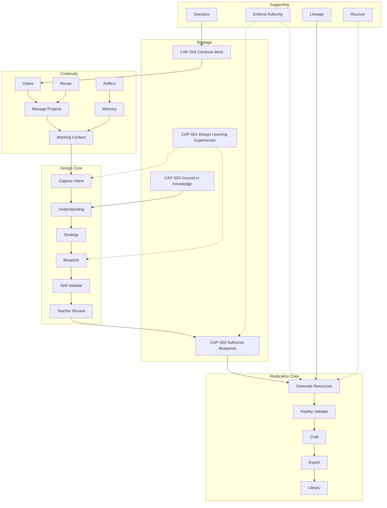

# PRIMA Constitutional Capability Model

**Version:** 1.0  
**Status:** Official — Business Capability Constitution  
**Validity horizon:** ≥ 10 years  

> Capabilities are **what PRIMA can do** as a business.  
> They are not screens, APIs, engines, or components.

**Precedence:** On capability identity, ownership, or maturity conflict with [`solution/PRIMA_CAPABILITY_MODEL.md`](./solution/PRIMA_CAPABILITY_MODEL.md), **this document wins**. The solution capability model elaborates allocation to components; it must not invent parallel capability identities.

**Vocabulary:** Official Names from [`PRIMA_CONSTITUTIONAL_LANGUAGE.md`](./PRIMA_CONSTITUTIONAL_LANGUAGE.md).

**Design principles**

| ID | Principle |
|----|-----------|
| **CBP-01** | Business-first — teacher/platform outcomes, not technical tasks |
| **CBP-02** | Technology-independent — no vendors, frameworks, UI widgets |
| **CBP-03** | One capability, one coherent ability |
| **CBP-04** | Exactly one owner Domain |
| **CBP-05** | Collaborate through declared inputs/outputs (concepts/artifacts), not shared implicit state |
| **CBP-06** | Preserve Teacher authority at Design Authorization |
| **CBP-07** | Design capabilities complete before Generation capabilities activate |
| **CBP-08** | Stable for a decade — version maturity, not rename identity |

---

# 1. Complete Capability Map

## 1.1 Classification

| Class | Meaning | Why |
|-------|---------|-----|
| **Strategic** | Abilities that define PRIMA’s category and differentiation | Without them, PRIMA is a generic generator |
| **Core** | Abilities required for the daily Teacher journey | Without them, the Learning Experience loop fails |
| **Supporting** | Abilities that enable integrity, continuity ops, and configuration | Necessary plumbing — not the product promise |
| **Future** | Registered abilities not required for category integrity today | Prevents silent invention; controls scope |

## 1.2 Capability inventory (Level 2)

### Strategic

| ID | Capability | Owner Domain |
|----|------------|--------------|
| **CAP-S01** | Design Learning Experiences | Instructional Design |
| **CAP-S02** | Authorize Instructional Blueprints | Teacher Interaction *(authority)* / Orchestration *(enforcement)* — **primary owner: Teacher Interaction** |
| **CAP-S03** | Ground Design in Knowledge | Knowledge |
| **CAP-S04** | Continue Educational Work | Orchestration |

*Note on CAP-S02:* Business ownership of *authority* is Teacher Interaction; Orchestration enforces the gate. Primary owner for the capability catalog = **Teacher Interaction** (who decides). Orchestration is a hard dependency, not a second owner.

### Core

| ID | Capability | Owner Domain |
|----|------------|--------------|
| **CAP-C01** | Manage Projects | Orchestration |
| **CAP-C02** | Orient Teacher Work | Teacher Interaction |
| **CAP-C03** | Capture Educational Intent | Instructional Design |
| **CAP-C04** | Assemble Working Context | Orchestration |
| **CAP-C05** | Build Pedagogical Understanding | Instructional Design |
| **CAP-C06** | Formulate Instructional Strategy | Instructional Design |
| **CAP-C07** | Compose Instructional Blueprint | Instructional Design |
| **CAP-C08** | Self-Validate Designs | Validation |
| **CAP-C09** | Conduct Teacher Review | Teacher Interaction |
| **CAP-C10** | Generate Resources | Generation |
| **CAP-C11** | Validate Resource Fidelity | Validation |
| **CAP-C12** | Craft Resources | Teacher Interaction |
| **CAP-C13** | Export Deliverables | Generation |
| **CAP-C14** | Manage Library | Teacher Interaction |
| **CAP-C15** | Retrieve Knowledge Evidence | Knowledge |
| **CAP-C16** | Reflect on Design Experience | Teacher Interaction |
| **CAP-C17** | Remember Teacher Preferences | Memory |
| **CAP-C18** | Improve Existing Resources | Instructional Design |
| **CAP-C19** | Reuse Prior Craft | Teacher Interaction |

### Supporting

| ID | Capability | Owner Domain |
|----|------------|--------------|
| **CAP-P01** | Govern Conversation Sessions | Orchestration |
| **CAP-P02** | Enforce Decision Authority | Orchestration |
| **CAP-P03** | Maintain Version Lineage | System Governance |
| **CAP-P04** | Audit Material Events | System Governance |
| **CAP-P05** | Recover from Failure | Orchestration |
| **CAP-P06** | Archive Projects | Orchestration |
| **CAP-P07** | Configure Platform Preferences | System Governance |
| **CAP-P08** | Explain Design Recommendations | Instructional Design |

### Future

| ID | Capability | Owner Domain |
|----|------------|--------------|
| **CAP-F01** | Collaborate on Projects | Teacher Interaction |
| **CAP-F02** | Deliver Learner Experience | Future / Learner-facing *(register under Teacher Interaction until Learner domain exists)* → **Future Ecosystem** held by **System Governance** as registry owner until domain split |
| **CAP-F03** | Integrate School Systems | System Governance |
| **CAP-F04** | Operate Resource Marketplace | System Governance |
| **CAP-F05** | Analyze Teaching Patterns | System Governance |
| **CAP-F06** | Adapt Learning Paths | Instructional Design |
| **CAP-F07** | Import External Materials | Generation |
| **CAP-F08** | Multi-Phase Learning Programs | Instructional Design |
| **CAP-F09** | Observe Classroom Practice | Teacher Interaction |

*CAP-F02 owner clarified:* Registry owner **System Governance** until a Learner Experience domain is constitutionally opened.

---

# 2. Capability Catalog

Template fields: Purpose · Inputs · Outputs · Preconditions · Postconditions · Business Rules · Failure Conditions · Future Evolution · Class · Maturity.

---

## 2.1 Strategic

### CAP-S01 — Design Learning Experiences

| Field | Content |
|-------|---------|
| **Class** | Strategic |
| **Owner Domain** | Instructional Design |
| **Purpose** | Enable Teachers to design coherent Learning Experiences with PRIMA as partner — Intent through Strategy through Blueprint — before materials exist. |
| **Inputs** | Educational Intent; Working Context; Knowledge Packages; Conversation |
| **Outputs** | Pedagogical Understanding; Instructional Strategy; Instructional Blueprint (draft) |
| **Preconditions** | Teacher identity; Project bound |
| **Postconditions** | Draft Blueprint exists or explicit abandon; no Resources required yet |
| **Business Rules** | Strategy before Blueprint; no Generation inside this capability; Teacher may edit design |
| **Failure Conditions** | Insufficient Understanding; Knowledge miss; Teacher abandons |
| **Future Evolution** | Richer multi-week Learning Experiences without changing capability identity |
| **Maturity** | MVP (lesson-focused) → V1 depth |

### CAP-S02 — Authorize Instructional Blueprints

| Field | Content |
|-------|---------|
| **Class** | Strategic |
| **Owner Domain** | Teacher Interaction |
| **Purpose** | Ensure binding Teacher Approval of a Blueprint Version before any Generation. |
| **Inputs** | Blueprint after Self-Validation and Teacher Review; Teacher decision |
| **Outputs** | Teacher Approval bound to Blueprint Version — or refusal |
| **Preconditions** | Blueprint not BlockedFromReview; Teacher present |
| **Postconditions** | Approved Version immutable for cycle; or returned to design |
| **Business Rules** | Never implicit; never AI-granted; Authorize-level Decision Authority only |
| **Failure Conditions** | Attempted auto-approve; approve on blocked draft |
| **Future Evolution** | Multi-signer institutional approval — still Teacher-originated |
| **Maturity** | MVP |

### CAP-S03 — Ground Design in Knowledge

| Field | Content |
|-------|---------|
| **Class** | Strategic |
| **Owner Domain** | Knowledge |
| **Purpose** | Supply attributable curriculum and pedagogical evidence so design is not free invention. |
| **Inputs** | Scoped queries (grade, subject, topic, Competency hints) |
| **Outputs** | Knowledge Packages with provenance |
| **Preconditions** | Published Knowledge Pack available for scope — or explicit “unsupported” |
| **Postconditions** | Claims either evidenced or marked unsupported |
| **Business Rules** | No invented curriculum; Memory ≠ Knowledge |
| **Failure Conditions** | Pack miss; conflicting packs |
| **Future Evolution** | Broader packs, more subjects — same capability |
| **Maturity** | MVP (thin packs) → V1/V2 richness |

### CAP-S04 — Continue Educational Work

| Field | Content |
|-------|---------|
| **Class** | Strategic |
| **Owner Domain** | Orchestration |
| **Purpose** | Let Teachers resume Projects at the last meaningful cognitive state without restarting Intent. |
| **Inputs** | Project reference; Conversation Session checkpoint |
| **Outputs** | Restored session position; intact approvals and drafts |
| **Preconditions** | Saved Project state exists |
| **Postconditions** | Gates remain enforced (no skip Authorization) |
| **Business Rules** | Continuă never bypasses Teacher Approval for Generation |
| **Failure Conditions** | Corrupt checkpoint; conflicting concurrent sessions |
| **Future Evolution** | Cross-device continuity — same capability |
| **Maturity** | MVP |

---

## 2.2 Core

### CAP-C01 — Manage Projects

| Field | Content |
|-------|---------|
| **Class / Owner / Maturity** | Core · Orchestration · MVP |
| **Purpose** | Create, name, organize, and lifecycle Projects as the unit of work. |
| **Inputs** | Teacher; Intention or Continuă; metadata (subject/grade inferred or stated) |
| **Outputs** | Project aggregate |
| **Preconditions** | Authenticated Teacher |
| **Postconditions** | Project exists and is addressable |
| **Business Rules** | Resources belong to Projects; one educational effort → one Project lineage |
| **Failure Conditions** | Orphan create without Intent path |
| **Future Evolution** | Portfolios of Projects; school collections |

### CAP-C02 — Orient Teacher Work

| Field | Content |
|-------|---------|
| **Class / Owner / Maturity** | Core · Teacher Interaction · MVP |
| **Purpose** | Help Teachers know where they are and what to do next (Continuă vs new Intention) without module pickers. |
| **Inputs** | Teacher; in-progress Projects; soft suggestions |
| **Outputs** | Chosen Continuă or Intention entry |
| **Preconditions** | Teacher can access Home |
| **Postconditions** | Work directed into a Project |
| **Business Rules** | No builder grids as primary orientation; Blueprint jargon hidden |
| **Failure Conditions** | Empty noise; competing equal actions |
| **Future Evolution** | Smarter ranking — same capability |

### CAP-C03 — Capture Educational Intent

| Field | Content |
|-------|---------|
| **Class / Owner / Maturity** | Core · Instructional Design · MVP |
| **Purpose** | Form Educational Intent from Teacher Intention or resume. |
| **Inputs** | Utterance/selection; Working Context |
| **Outputs** | Educational Intent (Emerging→Stable) |
| **Preconditions** | Project bound |
| **Postconditions** | Intent usable for Understanding |
| **Business Rules** | Goal before format; format-only requests promote to goal clarification |
| **Failure Conditions** | Empty/off-domain intent |
| **Future Evolution** | Multi-intent Projects with clear primary Intent |

### CAP-C04 — Assemble Working Context

| Field | Content |
|-------|---------|
| **Class / Owner / Maturity** | Core · Orchestration · MVP |
| **Purpose** | Assemble situational truth for the run (sufficiency levels). |
| **Inputs** | Teacher; Project; Memory views; entry path |
| **Outputs** | Working Context |
| **Preconditions** | Session starting or refreshing |
| **Postconditions** | Declared sufficiency; unknowns explicit when Sparse |
| **Business Rules** | Never invent Context; Context ≠ Knowledge |
| **Failure Conditions** | Conflicting profile data |
| **Future Evolution** | Richer classroom Context under Teacher control |

### CAP-C05 — Build Pedagogical Understanding

| Field | Content |
|-------|---------|
| **Class / Owner / Maturity** | Core · Instructional Design · MVP |
| **Purpose** | Achieve shared Pedagogical Understanding sufficient for Strategy. |
| **Inputs** | Intent; Working Context; Knowledge Packages; Conversation |
| **Outputs** | Pedagogical Understanding (Understanding Ready) |
| **Preconditions** | Stable-enough Intent |
| **Postconditions** | Understanding Ready or explicit continue-clarify |
| **Business Rules** | Infer before ask; one question at a time; mirror |
| **Failure Conditions** | Persistent contradiction |
| **Future Evolution** | Deeper differentiation Understanding |

### CAP-C06 — Formulate Instructional Strategy

| Field | Content |
|-------|---------|
| **Class / Owner / Maturity** | Core · Instructional Design · MVP |
| **Purpose** | Choose Instructional Strategy before Blueprint composition. |
| **Inputs** | Understanding; Knowledge Packages; constraints; Memory advisories |
| **Outputs** | Instructional Strategy |
| **Preconditions** | Understanding Ready |
| **Postconditions** | Strategy accepted/confirmed or revise Understanding |
| **Business Rules** | No Blueprint without Strategy; Recommend/Confirm authority |
| **Failure Conditions** | No viable strategy |
| **Future Evolution** | Alternative strategy comparison UX — same capability |

### CAP-C07 — Compose Instructional Blueprint

| Field | Content |
|-------|---------|
| **Class / Owner / Maturity** | Core · Instructional Design · MVP |
| **Purpose** | Compose Instructional Blueprint (objectives, phases, activities, assessment/differentiation design, resource requirements). |
| **Inputs** | Strategy; Understanding; Knowledge Packages; Teacher edits |
| **Outputs** | Blueprint Draft (+ Blueprint Version identity) |
| **Preconditions** | Strategy present |
| **Postconditions** | Draft ready for Self-Validation |
| **Business Rules** | Design only — no Resource prose as authority; one authoritative Blueprint per iteration |
| **Failure Conditions** | Incomplete compose |
| **Future Evolution** | Richer Blueprint sections — same capability |

### CAP-C08 — Self-Validate Designs

| Field | Content |
|-------|---------|
| **Class / Owner / Maturity** | Core · Validation · MVP |
| **Purpose** | Critique Blueprint before presenting as ready for Teacher Review. |
| **Inputs** | Blueprint Draft; Strategy; Understanding; Knowledge Packages |
| **Outputs** | Validation Report; ReadyForReview / ReadyWithWarnings / BlockedFromReview |
| **Preconditions** | Blueprint Draft exists |
| **Postconditions** | Blocked drafts not presented as ready |
| **Business Rules** | Cannot grant Teacher Approval; fail visible |
| **Failure Conditions** | Validator unavailable → fail visible, do not fake pass |
| **Future Evolution** | Stronger deterministic rule packs |

### CAP-C09 — Conduct Teacher Review

| Field | Content |
|-------|---------|
| **Class / Owner / Maturity** | Core · Teacher Interaction · MVP |
| **Purpose** | Enable Teacher to examine and edit the plan and warnings before Authorization. |
| **Inputs** | Blueprint; Validation Report |
| **Outputs** | Revised Blueprint or proceed-to-authorize intent |
| **Preconditions** | Not BlockedFromReview (or Teacher explicitly opens blocked with warnings — product policy: prefer block) |
| **Postconditions** | Teacher informed; edits recorded |
| **Business Rules** | Exclusive Teacher edits; *De ce?* available |
| **Failure Conditions** | Review without Validation Report when Self-Validation skipped (illegal) |
| **Future Evolution** | Section-level review aids |

### CAP-C10 — Generate Resources

| Field | Content |
|-------|---------|
| **Class / Owner / Maturity** | Core · Generation · MVP (Lesson Resource) |
| **Purpose** | Produce Resource drafts from Approved Blueprint Version after generate confirmation. |
| **Inputs** | Approved Blueprint Version; resource scope; Teacher confirm |
| **Outputs** | Generation Package; Resource drafts |
| **Preconditions** | Teacher Approval; Authorize + Confirm generate |
| **Postconditions** | Drafts trace to Blueprint sections; Blueprint unchanged |
| **Business Rules** | No design authority in Generation; no auto-publish |
| **Failure Conditions** | Runtime fail; empty package |
| **Future Evolution** | More Resource subtypes — same capability |

### CAP-C11 — Validate Resource Fidelity

| Field | Content |
|-------|---------|
| **Class / Owner / Maturity** | Core · Validation · MVP |
| **Purpose** | Validate generated drafts against Approved Blueprint. |
| **Inputs** | Generation Package; Approved Blueprint Version |
| **Outputs** | Validation Report (realization) |
| **Preconditions** | Generation completed or partial |
| **Postconditions** | Issues visible; no silent accept |
| **Business Rules** | Validation does not mutate Blueprint or Resource content stealthily |
| **Failure Conditions** | Validation crash → fail visible |
| **Future Evolution** | Deeper pedagogical quality metrics |

### CAP-C12 — Craft Resources

| Field | Content |
|-------|---------|
| **Class / Owner / Maturity** | Core · Teacher Interaction · MVP |
| **Purpose** | Let Teachers edit Resource drafts until professionally ready. |
| **Inputs** | Resource drafts; Teacher edits |
| **Outputs** | Ready Resources |
| **Preconditions** | Resource exists in Project |
| **Postconditions** | Teacher-owned wording |
| **Business Rules** | PRIMA silent while crafting unless invited; Exclusive Teacher on final classroom use |
| **Failure Conditions** | Save loss → fail visible |
| **Future Evolution** | Collaborative craft (see CAP-F01) |

### CAP-C13 — Export Deliverables

| Field | Content |
|-------|---------|
| **Class / Owner / Maturity** | Core · Generation · MVP |
| **Purpose** | Produce Export Package under Teacher act for classroom use. |
| **Inputs** | Ready Resources; Teacher export act |
| **Outputs** | Export Package |
| **Preconditions** | Teacher Exclusive authority act |
| **Postconditions** | Export recorded; lineage preserved |
| **Business Rules** | No auto-export |
| **Failure Conditions** | Export fail → fail visible |
| **Future Evolution** | More formats — same capability |

### CAP-C14 — Manage Library

| Field | Content |
|-------|---------|
| **Class / Owner / Maturity** | Core · Teacher Interaction · MVP |
| **Purpose** | Index, reopen, and organize reusable craft from Projects/Exports. |
| **Inputs** | Export/save events; Teacher browse/select |
| **Outputs** | Library views; reopen into Project flows |
| **Preconditions** | Saved items exist (or empty state) |
| **Postconditions** | Reuse path available |
| **Business Rules** | Library is not design authority; reuse may spawn/adapt Project work under design rules |
| **Failure Conditions** | Broken links to Projects |
| **Future Evolution** | Collections, tags — same capability |

### CAP-C15 — Retrieve Knowledge Evidence

| Field | Content |
|-------|---------|
| **Class / Owner / Maturity** | Core · Knowledge · MVP |
| **Purpose** | Perform Knowledge Assembly for a cognitive act. |
| **Inputs** | Query scope |
| **Outputs** | Knowledge Package |
| **Preconditions** | Pack published or unsupported marked |
| **Postconditions** | Provenance attached |
| **Business Rules** | Same as CAP-S03 specialization — *composition:* CAP-S03 is strategic umbrella; CAP-C15 is the operational retrieve ability. Both owned by Knowledge; C15 implements day-to-day retrieval under S03. |
| **Failure Conditions** | Empty unsupported without marking |
| **Future Evolution** | Cross-pack search |

### CAP-C16 — Reflect on Design Experience

| Field | Content |
|-------|---------|
| **Class / Owner / Maturity** | Core · Teacher Interaction · V1 (light MVP optional) |
| **Purpose** | Capture Reflection Records and propose Memory deltas without blocking exit. |
| **Inputs** | Session signals; optional Teacher notes |
| **Outputs** | Reflection Record; proposed Memory updates |
| **Preconditions** | Meaningful session events |
| **Postconditions** | Exit never blocked |
| **Business Rules** | Consequential Memory writes need allowed Decision Authority |
| **Failure Conditions** | Forced reflection UX |
| **Future Evolution** | Richer professional reflection |

### CAP-C17 — Remember Teacher Preferences

| Field | Content |
|-------|---------|
| **Class / Owner / Maturity** | Core · Memory · V1 (MVP thin) |
| **Purpose** | Persist and apply Memory Profile to reduce repetition and improve Strategy advisories. |
| **Inputs** | Approved Reflection proposals; explicit Settings |
| **Outputs** | Memory views for Working Context / Strategy |
| **Preconditions** | Teacher control available |
| **Postconditions** | Teacher can view/edit/delete |
| **Business Rules** | No sensitive auto-learn; Memory ≠ Knowledge |
| **Failure Conditions** | Silent preference lock-in |
| **Future Evolution** | Longer-horizon patterns |

### CAP-C18 — Improve Existing Resources

| Field | Content |
|-------|---------|
| **Class / Owner / Maturity** | Core · Instructional Design · V2 |
| **Purpose** | Scoped improvement of Resources with design integrity (may revise Strategy/Blueprint under rules). |
| **Inputs** | Existing Resource/Project; improvement Intent |
| **Outputs** | Revised drafts; possibly new Blueprint Version + Approval if design changes |
| **Preconditions** | Prior Resource exists |
| **Postconditions** | Lineage preserved |
| **Business Rules** | Design-affecting changes require Authorization again |
| **Failure Conditions** | Silent redesign without Approval |
| **Future Evolution** | Batch improve across class sections |

### CAP-C19 — Reuse Prior Craft

| Field | Content |
|-------|---------|
| **Class / Owner / Maturity** | Core · Teacher Interaction · V1 |
| **Purpose** | Duplicate/adapt prior Blueprint or Resources into new/continued Project work. |
| **Inputs** | Library/Project selection; adaptation Intent |
| **Outputs** | New Project workstream with inherited design where allowed |
| **Preconditions** | Prior craft exists |
| **Postconditions** | Reuse-before-create honored |
| **Business Rules** | Adapted design still subject to Understanding/Strategy/Approval when materially changed |
| **Failure Conditions** | Blind copy presented as newly approved without gate |
| **Future Evolution** | Template-from-success patterns |

---

## 2.3 Supporting

### CAP-P01 — Govern Conversation Sessions
**Owner:** Orchestration · **Maturity:** MVP  
**Purpose:** Start, pause, resume, complete Conversation Sessions with single authoritative state.  
**Rules:** No parallel conflicting mutations of same Blueprint without governance.  
**Failures:** Split-brain sessions.

### CAP-P02 — Enforce Decision Authority
**Owner:** Orchestration · **Maturity:** MVP  
**Purpose:** Map acts to Automatic→…→Exclusive Teacher; block illegal skips.  
**Rules:** Cannot skip Authorization for Generation.  
**Failures:** Authority downgrade under performance pressure (forbidden).

### CAP-P03 — Maintain Version Lineage
**Owner:** System Governance · **Maturity:** MVP  
**Purpose:** Preserve Blueprint Version and Resource lineage.  
**Rules:** Approved versions immutable for cycle.

### CAP-P04 — Audit Material Events
**Owner:** System Governance · **Maturity:** MVP  
**Purpose:** Append-only record of approvals, generations, exports, failures.  
**Rules:** No silent history mutation.

### CAP-P05 — Recover from Failure
**Owner:** Orchestration · **Maturity:** MVP  
**Purpose:** Fail visible; preserve work; scoped retry.  
**Rules:** Failure does not invent Approval.

### CAP-P06 — Archive Projects
**Owner:** Orchestration · **Maturity:** V1  
**Purpose:** Retire Projects from active Continuă without destroying lineage.  
**Rules:** Archive ≠ delete Approval history.

### CAP-P07 — Configure Platform Preferences
**Owner:** System Governance · **Maturity:** MVP (minimal)  
**Purpose:** Language and non-creative Settings.  
**Rules:** Settings never replace Instructional Strategy.

### CAP-P08 — Explain Design Recommendations
**Owner:** Instructional Design · **Maturity:** MVP  
**Purpose:** Provide rationales (*De ce?*) for Strategy/Blueprint recommendations.  
**Rules:** Explain before major Recommend commitment.

---

## 2.4 Future

| ID | Purpose (one line) | Owner | Maturity |
|----|--------------------|-------|----------|
| CAP-F01 | Multi-teacher collaboration on a Project | Teacher Interaction | Long-term |
| CAP-F02 | Learner-facing delivery of experiences | System Governance (registry) | Long-term |
| CAP-F03 | SIS/LMS school integration | System Governance | Long-term |
| CAP-F04 | Marketplace of shareable craft | System Governance | Long-term |
| CAP-F05 | Analytics of teaching patterns (non-surveillance) | System Governance | Long-term |
| CAP-F06 | Adaptive paths within approved design | Instructional Design | Long-term |
| CAP-F07 | Import external materials into Project under design rules | Generation | V2+ |
| CAP-F08 | Multi-phase programs as first-class Learning Experiences | Instructional Design | V2 |
| CAP-F09 | Observation protocols as Resources | Teacher Interaction | V2+ |

Future capabilities **must not** bypass CAP-S02 or CAP-C10 preconditions.

---

# 3. Capability Ownership Matrix

| Domain | Capabilities |
|--------|--------------|
| **Teacher Interaction** | CAP-S02, CAP-C02, CAP-C09, CAP-C12, CAP-C14, CAP-C16, CAP-C19, CAP-F01, CAP-F09 |
| **Instructional Design** | CAP-S01, CAP-C03, CAP-C05, CAP-C06, CAP-C07, CAP-C18, CAP-P08, CAP-F06, CAP-F08 |
| **Knowledge** | CAP-S03, CAP-C15 |
| **Generation** | CAP-C10, CAP-C13, CAP-F07 |
| **Validation** | CAP-C08, CAP-C11 |
| **Memory** | CAP-C17 |
| **Orchestration** | CAP-S04, CAP-C01, CAP-C04, CAP-P01, CAP-P02, CAP-P05, CAP-P06 |
| **System Governance** | CAP-P03, CAP-P04, CAP-P07, CAP-F02*, CAP-F03, CAP-F04, CAP-F05 |

\*Registry owner until Learner domain opened.

**Rule:** No capability has two primary owners. Dependencies are declared separately.

---

# 4. Capability Hierarchy

```
PRIMA Business Capabilities
├── Strategic
│   ├── CAP-S01 Design Learning Experiences
│   │     ├── CAP-C03 Capture Educational Intent
│   │     ├── CAP-C05 Build Pedagogical Understanding
│   │     ├── CAP-C06 Formulate Instructional Strategy
│   │     └── CAP-C07 Compose Instructional Blueprint
│   ├── CAP-S02 Authorize Instructional Blueprints
│   │     ├── CAP-C08 Self-Validate Designs
│   │     └── CAP-C09 Conduct Teacher Review
│   ├── CAP-S03 Ground Design in Knowledge
│   │     └── CAP-C15 Retrieve Knowledge Evidence
│   └── CAP-S04 Continue Educational Work
│         ├── CAP-C01 Manage Projects
│         └── CAP-C02 Orient Teacher Work
├── Core Realization & Craft
│   ├── CAP-C10 Generate Resources
│   ├── CAP-C11 Validate Resource Fidelity
│   ├── CAP-C12 Craft Resources
│   ├── CAP-C13 Export Deliverables
│   ├── CAP-C14 Manage Library
│   ├── CAP-C18 Improve Existing Resources
│   └── CAP-C19 Reuse Prior Craft
├── Core Continuity Intelligence
│   ├── CAP-C04 Assemble Working Context
│   ├── CAP-C16 Reflect on Design Experience
│   └── CAP-C17 Remember Teacher Preferences
├── Supporting
│   ├── CAP-P01…P08
└── Future
    └── CAP-F01…F09
```

**Composition notes**

- CAP-S01 **composes** C03–C07 (design spine).  
- CAP-S02 **requires** C08 then C09 before Approval.  
- CAP-S03 **specializes** via C15.  
- CAP-S04 **enabled by** C01 + C02 + P01.

---

# 5. Capability Relationships

## 5.1 Critical dependency chain (happy path)

```
C02 Orient → C01 Project → C04 Context → C03 Intent
  → C15 Knowledge → C05 Understanding → C06 Strategy → C07 Blueprint
  → C08 Self-Validate → C09 Review → S02 Authorize
  → C10 Generate → C11 Fidelity → C12 Craft → C13 Export → C14 Library
```

Parallel/supporting: C17 Memory → C04; C16 Reflect → C17; P02 enforces gates throughout; P03/P04 lineage/audit; P05 on failures; P08 explains at Recommend moments.

## 5.2 Shared behaviors (not separate capabilities)

| Shared behavior | Expressed through |
|-----------------|-------------------|
| Teacher authority | CAP-S02, CAP-C12, CAP-C13, CAP-P02 |
| Fail visible | CAP-P05 + every Core failure condition |
| Traceability | CAP-P03 + CAP-C10/C11 outputs |
| Reuse-before-create | CAP-C19, CAP-C14, CAP-S04 |

## 5.3 Hidden coupling to avoid

| Bad coupling | Correct separation |
|--------------|-------------------|
| Generation owning design | CAP-C10 depends on CAP-S02; never composes Blueprint |
| Memory writing Knowledge | CAP-C17 ↛ CAP-S03 |
| Library approving design | CAP-C14 ↛ CAP-S02 |
| Orientation = builders | CAP-C02 ≠ activity-type catalog |

---

# 6. Capability Map (Mermaid)



---

# 7. Capability Roadmap (maturity)

| Maturity | Meaning | Capabilities |
|----------|---------|--------------|
| **MVP** (0.1–0.5) | Minimum coherent PRIMA | S01–S04; C01–C13 (C10 Lesson Resource only); C14; C15; P01–P05; P07–P08; C16 optional light |
| **Version 1** | Daily habit | + C17 real Memory; C19 Reuse; C14 polish; P06 Archive; Worksheet via C10 scope |
| **Version 2** | Depth without new mental model | + C18 Improve; Assessment/Presentation/Game via C10 subtypes; F07/F08 early; F09 optional |
| **Long-term Vision** | Ecosystem | F01–F06; expanded F02 Learner domain |

Aligned with [`PRIMA_MVP_ROADMAP.md`](./PRIMA_MVP_ROADMAP.md): Intention→Approve→Generate→Export→Library→Continuă is MVP; builders remain **non-capabilities** (explicitly rejected).

---

# 8. Architecture Validation

## 8.1 Duplicates resolved

| Apparent duplicate | Resolution |
|--------------------|------------|
| CAP-S03 vs CAP-C15 | Strategic umbrella vs operational retrieve — keep both; C15 under S03 |
| CAP-S04 vs CAP-C01/C02 | Strategic continuity vs project manage / orient — compose |
| CAP-C14 vs CAP-C19 | Library manage vs reuse behavior — C19 consumes C14 |
| Solution TE-01 “activity types” | **Rejected** — replaced by CAP-C02 Orient (Constitutional Language) |

## 8.2 Missing capabilities added (vs early lists)

| Gap | Added |
|-----|-------|
| Instructional Strategy | CAP-C06 |
| Self-Validation | CAP-C08 |
| Working Context assembly | CAP-C04 |
| Decision Authority enforcement | CAP-P02 |
| Improve / Reuse explicit | CAP-C18, CAP-C19 |

## 8.3 Wrong-domain risks checked

| Capability | Risk | Status |
|------------|------|--------|
| Authorize | Placing in Generation | **Fixed** — Teacher Interaction |
| Memory | Placing in Knowledge | **Fixed** — Memory Domain |
| Export | Placing in Teacher Interaction only | Generation owns package production; Teacher grants act via Exclusive Teacher — **Generation owner** with Teacher Interaction dependency |

## 8.4 Hidden coupling / scalability risks

| Risk | Mitigation |
|------|------------|
| UI modules invent capabilities | Capability IDs required before features |
| New Resource types spawn new L1 domains | Extend CAP-C10 scope only |
| Collaboration (F01) bypasses Approval | F01 must compose S02 |
| Analytics (F05) becomes surveillance | Explicit non-goal; Teacher-visible |
| Solution Capability Model drift | This constitution prevails; sync solution doc |

## 8.5 Validation verdict

The capability set is **sufficient** for EOS + Teacher Journey + Constitutional Language.  
It **rejects** builder-portal, chatbot-only, and auto-approve “abilities” as non-capabilities.

---

# 9. Deliverable Index

| # | Deliverable | Section |
|---|-------------|---------|
| 1 | Complete Capability Map | §1 |
| 2 | Capability Catalog | §2 |
| 3 | Capability Ownership Matrix | §3 |
| 4 | Capability Hierarchy | §4 |
| 5 | Capability Relationships | §5 |
| 6 | Capability Roadmap | §7 |
| 7 | Architecture Validation | §8 |

---

## Closing

> PRIMA’s business is not “calling a model.”  
> PRIMA’s business is **designing Learning Experiences, authorizing plans, realizing Resources, and continuing work** — under Teacher authority, grounded in Knowledge.

Capabilities name that business so it survives every UI, API, and model generation.
