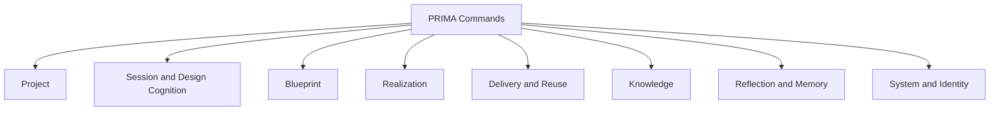
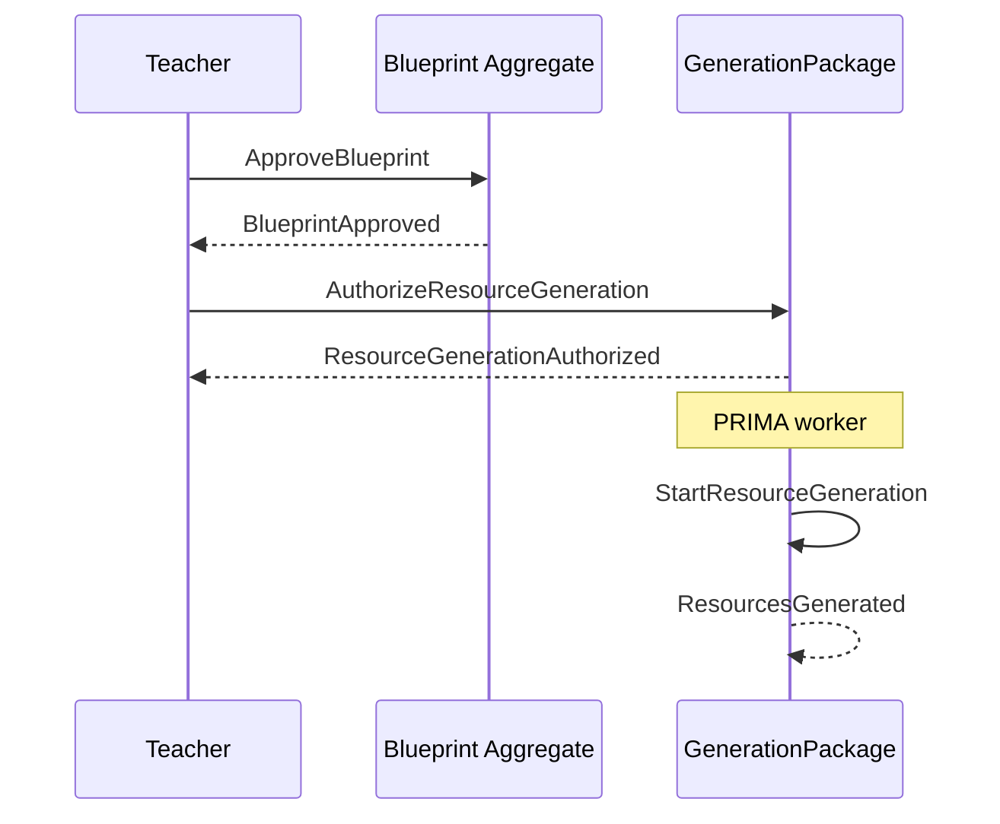
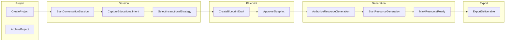

# PRIMA Constitutional Command Model

**Version:** 1.0  
**Status:** Official — Constitutional Command Architecture (CQRS Write Side)  
**Validity horizon:** ≥ 10 years  

> Commands express **business intentions**.  
> Events record **business facts**.  
> Commands are not APIs, UI clicks, or events.

**Principles**

| ID | Principle |
|----|-----------|
| **CCM-01** | A command asks the system to attempt an action |
| **CCM-02** | A command targets **exactly one Aggregate** |
| **CCM-03** | A command may succeed or fail |
| **CCM-04** | A command never mutates state by itself — handlers + aggregate invariants do |
| **CCM-05** | A command is validated before execution |
| **CCM-06** | A **successful** command produces one or more Domain Events |
| **CCM-07** | Authorization is part of validation (Decision Authority / TeacherAuthorityPolicy) |
| **CCM-08** | AI may *propose* or *assist* execution of some commands; AI never issues Teacher-only commands |

**Precedence:** Constitutional command vocabulary for write-side intent. Transport (HTTP, queue, in-process) is irrelevant.

**Pairs with:** [`PRIMA_CONSTITUTIONAL_EVENT_MODEL.md`](./PRIMA_CONSTITUTIONAL_EVENT_MODEL.md)

---

# 1. Aggregates & command inventory

| Aggregate | Commands (Official Names) |
|-----------|---------------------------|
| **Project** | CreateProject, RenameProject, PauseProject, ResumeProject, CompleteProject, ArchiveProject, DuplicateProject, AddTeacherNote, UpdateTeacherNote, SelectPriorCraftForReuse |
| **ConversationSession** | StartConversationSession, PauseConversationSession, CompleteConversationSession, AbandonConversationSession, AssembleWorkingContext, CaptureEducationalIntent, StabilizeEducationalIntent, SupersedeEducationalIntent, UpdatePedagogicalUnderstanding, CompletePedagogicalUnderstanding, ProposeInstructionalStrategy, SelectInstructionalStrategy, SupersedeInstructionalStrategy, RetrieveKnowledgeEvidence, CaptureReflection, AdvancePipelinePosition |
| **InstructionalBlueprint** | InitiateLearningExperience, CreateBlueprintDraft, ReviseBlueprintStructure, MintBlueprintVersion, RunBlueprintSelfValidation, PresentBlueprintForReview, RequestBlueprintRevision, ApproveBlueprint, *(no AI Approve)* |
| **GenerationPackage** | AuthorizeResourceGeneration, StartResourceGeneration, RegenerateResource, RecordResourceEdit, MarkResourceReady |
| **ExportPackage** | ExportDeliverable |
| **ValidationReport** | *(issued by validation commands on other aggregates — no external “CreateReport”)* — see Run*Validation commands |
| **KnowledgePack** | PublishKnowledgePack, DeprecateKnowledgePack |
| **MemoryProfile** | ProposeMemoryItem, AcceptMemoryItem, RejectMemoryItem, DeleteMemoryItem |
| **LibraryEntry** | HideLibraryEntry *(Index is usually reaction; optional EnsureLibraryEntryIndexed system)* |
| **Teacher** | RegisterTeacher, SuspendTeacher |

**Rejected / renamed from examples**

| Proposed | Verdict |
|----------|---------|
| DeleteProject | Prefer **ArchiveProject** (preserve lineage); hard delete = System Governance exception, not Teacher command |
| PublishResource | Prefer **ExportDeliverable** + Exclusive Teacher — “publish” implies marketplace |
| ValidateBlueprint | Prefer **RunBlueprintSelfValidation** |
| RejectBlueprint | Prefer **RequestBlueprintRevision** (revision path) |
| RestoreBlueprintVersion | Prefer **MintBlueprintVersion** from prior content via Revise — explicit restore may be V2 |
| Start Design / Summarize Conversation | Too UI/vague — map to Intent/Understanding/Strategy commands |
| Request Resource Generation | Prefer **AuthorizeResourceGeneration** (Teacher intent to allow run) then **StartResourceGeneration** |
| Accept Resource | Prefer **MarkResourceReady** |
| Start Conversation | Prefer **StartConversationSession** |
| Save Teaching Preference | Prefer MemoryItem Accept/Propose path |

---

# 2. Command Catalog

Template: Purpose · Target · Initiator · Preconditions · Validation · Expected Events · Failures · Business Meaning

Initiator codes: **T** Teacher · **A** Administrator · **P** PRIMA/EOS worker · **S** System · **X** Plugin (future, constrained)

---

## 2.1 Project Commands

### CreateProject
| Field | Content |
|-------|---------|
| **Purpose** | Create a new Project as unit of work |
| **Target** | Project |
| **Initiator** | T (P may suggest title) |
| **Preconditions** | Authenticated Teacher |
| **Validation** | Teacher active; optional IntentionSeed present |
| **Expected Events** | ProjectCreated; often LearningExperienceInitiated (if design cycle starts) |
| **Failures** | TeacherSuspended; invalid identity |
| **Business Meaning** | Continuity container exists |

### RenameProject / PauseProject / ResumeProject / CompleteProject / ArchiveProject
| Field | Content |
|-------|---------|
| **Purpose** | Lifecycle & label management |
| **Target** | Project |
| **Initiator** | T |
| **Preconditions** | Project owned by Teacher |
| **Expected Events** | ProjectRenamed / ProjectPaused / ProjectResumed / ProjectCompleted / ProjectArchived |
| **Failures** | Not found; not owner; illegal transition |
| **Meaning** | Continuă eligibility & visibility |

### DuplicateProject
| Field | Content |
|-------|---------|
| **Purpose** | Create a new Project lineage from an existing one (reuse shell) |
| **Target** | Project *(new aggregate instance)* |
| **Initiator** | T |
| **Preconditions** | Source Project readable by Teacher |
| **Validation** | Does not copy TeacherApproval; design must re-authorize if reused as new LE |
| **Expected Events** | ProjectCreated; PriorCraftSelectedForReuse (correlation) |
| **Failures** | Source inaccessible |
| **Meaning** | Reuse-before-create at Project level |

### AddTeacherNote / UpdateTeacherNote
| Field | Content |
|-------|---------|
| **Target** | Project |
| **Initiator** | T |
| **Expected Events** | TeacherNoteAdded / TeacherNoteUpdated |
| **Meaning** | Non-Blueprint annotation |

### SelectPriorCraftForReuse
| Field | Content |
|-------|---------|
| **Purpose** | Bind prior Library/Export craft into this/new Project work |
| **Target** | Project |
| **Initiator** | T |
| **Expected Events** | PriorCraftSelectedForReuse |
| **Meaning** | CAP-C19 |

---

## 2.2 ConversationSession Commands

### StartConversationSession
| Field | Content |
|-------|---------|
| **Purpose** | Open cognitive thread on a Project |
| **Target** | ConversationSession |
| **Initiator** | T |
| **Preconditions** | Project exists |
| **Expected Events** | ConversationSessionStarted; often AssembleWorkingContext follows |
| **Failures** | Project archived |
| **Meaning** | Design partnership session open |

### PauseConversationSession / CompleteConversationSession / AbandonConversationSession
| Field | Content |
|-------|---------|
| **Initiator** | T (S may pause on timeout policy) |
| **Expected Events** | ConversationSessionPaused / Completed / Abandoned |
| **Meaning** | Continuă checkpoint |

### AssembleWorkingContext
| Field | Content |
|-------|---------|
| **Purpose** | Assemble WorkingContextSnapshot |
| **Target** | ConversationSession |
| **Initiator** | P (on start/resume); T may force refresh |
| **Preconditions** | Session active |
| **Expected Events** | WorkingContextAssembled |
| **Failures** | Conflicting profile data → DomainFailureRecorded path |
| **Meaning** | CAP-C04 |

### CaptureEducationalIntent
| Field | Content |
|-------|---------|
| **Purpose** | Record Educational Intent from Intention |
| **Target** | ConversationSession |
| **Initiator** | T + P structuring |
| **Validation** | Must yield educational purpose; format-only → require goal clarification (may fail soft) |
| **Expected Events** | EducationalIntentCaptured |
| **Meaning** | CAP-C03 |

### StabilizeEducationalIntent / SupersedeEducationalIntent
| Field | Content |
|-------|---------|
| **Initiator** | P with T confirmation when ambiguous; T can supersede |
| **Expected Events** | EducationalIntentStabilized / Superseded |
| **Meaning** | Intent lifecycle |

### UpdatePedagogicalUnderstanding / CompletePedagogicalUnderstanding
| Field | Content |
|-------|---------|
| **Purpose** | Progress or gate Understanding Ready |
| **Target** | ConversationSession |
| **Initiator** | P inference; T corrections via Update |
| **Preconditions** | Intent present |
| **Expected Events** | PedagogicalUnderstandingUpdated / Completed |
| **Failures** | Contradiction unresolved → cannot Complete |
| **Meaning** | CAP-C05 |

### ProposeInstructionalStrategy
| Field | Content |
|-------|---------|
| **Purpose** | Propose Strategy candidate |
| **Target** | ConversationSession |
| **Initiator** | **P only** (Teacher selects via Select) |
| **Preconditions** | PedagogicalUnderstandingCompleted |
| **Expected Events** | InstructionalStrategyProposed |
| **Meaning** | CAP-C06 propose |

### SelectInstructionalStrategy / SupersedeInstructionalStrategy
| Field | Content |
|-------|---------|
| **Purpose** | Confirm or replace Strategy |
| **Target** | ConversationSession |
| **Initiator** | **T** (Confirm-level) |
| **Preconditions** | Strategy proposed (for Select) |
| **Expected Events** | InstructionalStrategySelected / Superseded |
| **Failures** | AI attempting Select as sole initiator → **Forbidden** |
| **Meaning** | Strategy authorized for Blueprint compose |

### RetrieveKnowledgeEvidence
| Field | Content |
|-------|---------|
| **Purpose** | Assemble KnowledgePackage for current act |
| **Target** | ConversationSession |
| **Initiator** | P |
| **Expected Events** | KnowledgeEvidenceRetrieved |
| **Meaning** | CAP-C15 |

### CaptureReflection
| Field | Content |
|-------|---------|
| **Purpose** | Capture ReflectionRecord (optional) |
| **Target** | ConversationSession |
| **Initiator** | P and/or T |
| **Validation** | Never required for CompleteSession |
| **Expected Events** | ReflectionCaptured; may lead to ProposeMemoryItem |
| **Meaning** | CAP-C16 |

### AdvancePipelinePosition
| Field | Content |
|-------|---------|
| **Purpose** | Record residual EOS stage move when no richer command applies |
| **Target** | ConversationSession |
| **Initiator** | P (Orchestrator) |
| **Validation** | Must obey EOS invariants (no skip Authorization) |
| **Expected Events** | PipelinePositionAdvanced |
| **Meaning** | Orchestration bookkeeping — prefer specific commands |

---

## 2.3 InstructionalBlueprint Commands

### InitiateLearningExperience
| Field | Content |
|-------|---------|
| **Purpose** | Create Learning Experience identity for design cycle |
| **Target** | InstructionalBlueprint *(or Project correlation — constitutional target: Blueprint family start)* |
| **Initiator** | T/P on design start |
| **Expected Events** | LearningExperienceInitiated |
| **Meaning** | Pedagogical object exists |

*Note:* If LE is not the Blueprint root, command still results in LE event correlated to Project; write lands through Blueprint aggregate start or Project — **constitutional choice:** issue against **Project** when only LE id is created, against **Blueprint** when draft begins. Prefer: **CreateBlueprintDraft** emits LearningExperienceInitiated if missing.

### CreateBlueprintDraft
| Field | Content |
|-------|---------|
| **Purpose** | Compose draft Blueprint from confirmed Strategy |
| **Target** | InstructionalBlueprint |
| **Initiator** | P (compose); T requested via session |
| **Preconditions** | InstructionalStrategySelected |
| **Expected Events** | BlueprintDraftCreated; BlueprintVersionMinted; LearningExperienceInitiated (if needed) |
| **Failures** | No Strategy → reject |
| **Meaning** | CAP-C07 |

### ReviseBlueprintStructure
| Field | Content |
|-------|---------|
| **Purpose** | Edit objectives/phases/activities/assessment design pre-approval |
| **Target** | InstructionalBlueprint |
| **Initiator** | T; P may assist |
| **Preconditions** | Not locked approved version for this cycle |
| **Expected Events** | BlueprintStructureRevised; often BlueprintVersionMinted |
| **Failures** | Attempt mutate Approved Version in place → reject |
| **Meaning** | Teacher craft on plan |

### MintBlueprintVersion
| Field | Content |
|-------|---------|
| **Purpose** | Explicitly mint Version identity |
| **Target** | InstructionalBlueprint |
| **Initiator** | P/T |
| **Expected Events** | BlueprintVersionMinted |
| **Meaning** | Lineage |

### RunBlueprintSelfValidation
| Field | Content |
|-------|---------|
| **Purpose** | Critique draft before ready review |
| **Target** | InstructionalBlueprint *(emits ValidationReport stream)* |
| **Initiator** | P (automatic after draft/revise); T may re-run |
| **Preconditions** | Draft Version exists |
| **Expected Events** | BlueprintSelfValidationSucceeded \| Warned \| Blocked |
| **Failures** | Validator unavailable → fail visible (command fails) |
| **Meaning** | CAP-C08 |

### PresentBlueprintForReview
| Field | Content |
|-------|---------|
| **Purpose** | Present plan to Teacher |
| **Target** | InstructionalBlueprint |
| **Initiator** | P (Orchestrator) |
| **Preconditions** | Not BlockedFromReview |
| **Expected Events** | BlueprintPresentedForReview |
| **Failures** | Blocked outcome still active |
| **Meaning** | CAP-C09 entry |

### RequestBlueprintRevision
| Field | Content |
|-------|---------|
| **Purpose** | Teacher declines approval and requests changes |
| **Target** | InstructionalBlueprint |
| **Initiator** | **T only** |
| **Expected Events** | BlueprintRevisionRequested |
| **Meaning** | Design loop continues |

### ApproveBlueprint
| Field | Content |
|-------|---------|
| **Purpose** | Grant Teacher Approval on BlueprintVersion |
| **Target** | InstructionalBlueprint |
| **Initiator** | **T only** |
| **Preconditions** | Presented for review; not blocked; Teacher owns Project |
| **Validation** | TeacherAuthorityPolicy; BlueprintApprovalPolicy |
| **Expected Events** | BlueprintApproved |
| **Failures** | AI initiator; blocked draft; wrong Teacher |
| **Meaning** | CAP-S02 — Generation becomes eligible |

---

## 2.4 GenerationPackage Commands

### AuthorizeResourceGeneration
| Field | Content |
|-------|---------|
| **Purpose** | Teacher confirms generation from Approved Blueprint |
| **Target** | GenerationPackage *(creates pending run authorization)* |
| **Initiator** | **T only** |
| **Preconditions** | BlueprintApproved for Version; scope valid |
| **Expected Events** | ResourceGenerationAuthorized |
| **Failures** | No approval; AI initiator |
| **Meaning** | Approve ≠ Generate — second commitment |

### StartResourceGeneration
| Field | Content |
|-------|---------|
| **Purpose** | Begin generation run |
| **Target** | GenerationPackage |
| **Initiator** | P after Authorized |
| **Preconditions** | ResourceGenerationAuthorized |
| **Expected Events** | ResourceGenerationStarted; then ResourcesGenerated or ResourceGenerationFailed |
| **Meaning** | CAP-C10 execute |

### RegenerateResource
| Field | Content |
|-------|---------|
| **Purpose** | Scoped regenerate of a Resource |
| **Target** | GenerationPackage |
| **Initiator** | T authorizes; P executes |
| **Preconditions** | Prior package; Approval still valid for Version |
| **Expected Events** | ResourceGenerationStarted; ResourceRegenerationCompleted / Failed |
| **Meaning** | Scoped regen |

### RecordResourceEdit
| Field | Content |
|-------|---------|
| **Purpose** | Persist Teacher craft edit |
| **Target** | GenerationPackage |
| **Initiator** | T |
| **Expected Events** | ResourceEdited |
| **Meaning** | CAP-C12 |

### MarkResourceReady
| Field | Content |
|-------|---------|
| **Purpose** | Teacher marks Resource ready for export |
| **Target** | GenerationPackage |
| **Initiator** | **T only** |
| **Expected Events** | ResourceMarkedReady |
| **Meaning** | Craft acceptance |

### RunResourceFidelityValidation
| Field | Content |
|-------|---------|
| **Purpose** | Validate drafts against Approved Blueprint |
| **Target** | GenerationPackage |
| **Initiator** | P (after generate); T may re-run |
| **Expected Events** | ResourceFidelityValidationSucceeded \| Failed |
| **Meaning** | CAP-C11 |

---

## 2.5 ExportPackage Commands

### ExportDeliverable
| Field | Content |
|-------|---------|
| **Purpose** | Assemble ExportPackage for classroom use |
| **Target** | ExportPackage |
| **Initiator** | **T only** (Exclusive Teacher) |
| **Preconditions** | Resource(s) ready (policy may allow draft export with warning — MVP: ready preferred) |
| **Expected Events** | DeliverableExported; LibraryEntryIndexed (consumer) |
| **Failures** | AI initiator; empty resources |
| **Meaning** | CAP-C13 — not “PublishResource” |

---

## 2.6 KnowledgePack Commands

### PublishKnowledgePack / DeprecateKnowledgePack
| Field | Content |
|-------|---------|
| **Target** | KnowledgePack |
| **Initiator** | **A** |
| **Expected Events** | KnowledgePackPublished / Deprecated |
| **Meaning** | CAP-S03 supply side |
| **Forbidden** | Teacher/AI publishing curriculum packs in MVP |

---

## 2.7 MemoryProfile Commands

### ProposeMemoryItem
| Field | Content |
|-------|---------|
| **Initiator** | P (from Reflection) |
| **Expected Events** | MemoryItemProposed |
| **Meaning** | Candidate learning |

### AcceptMemoryItem / RejectMemoryItem / DeleteMemoryItem
| Field | Content |
|-------|---------|
| **Initiator** | **T only** |
| **Expected Events** | MemoryItemAccepted / Rejected / Deleted |
| **Meaning** | CAP-C17 Teacher control |

---

## 2.8 LibraryEntry & Teacher Commands

### HideLibraryEntry
| Field | Content |
|-------|---------|
| **Initiator** | T |
| **Expected Events** | LibraryEntryHidden |

### RegisterTeacher / SuspendTeacher
| Field | Content |
|-------|---------|
| **Initiator** | S / A |
| **Expected Events** | TeacherRegistered / TeacherSuspended |

### ChangePlatformConfiguration
| Field | Content |
|-------|---------|
| **Target** | System (PlatformConfiguration) |
| **Initiator** | A |
| **Expected Events** | PlatformConfigurationChanged |
| **Meaning** | CAP-P07 |

---

## 2.9 Future Commands (registered)

InviteProjectCollaborator, JoinProjectAsCollaborator — **must not** imply ApproveBlueprint rights by default.

---

# 3. Command Categories (challenged)

| Proposed | Verdict | Official category |
|----------|---------|-------------------|
| Project Commands | Keep | **Project** |
| Blueprint Commands | Keep | **Blueprint** |
| Design Commands | Merge cognition | **Session & Design Cognition** |
| Generation Commands | Keep | **Realization** |
| Reflection Commands | Keep under Session/Memory | **Reflection & Memory** |
| Knowledge Commands | Keep | **Knowledge** |
| System Commands | Keep | **System & Identity** |
| Conversation Commands | Rename | Fold into **Session & Design Cognition** |
| Library | Add | **Delivery & Reuse** |

---

# 4. Aggregate Command Matrix

| Aggregate | Commands |
|-----------|----------|
| Project | Create, Rename, Pause, Resume, Complete, Archive, Duplicate, Add/UpdateTeacherNote, SelectPriorCraftForReuse |
| ConversationSession | Start/Pause/Complete/Abandon, AssembleWorkingContext, Intent*, Understanding*, Strategy*, RetrieveKnowledgeEvidence, CaptureReflection, AdvancePipelinePosition |
| InstructionalBlueprint | CreateBlueprintDraft, ReviseBlueprintStructure, MintBlueprintVersion, RunBlueprintSelfValidation, PresentBlueprintForReview, RequestBlueprintRevision, ApproveBlueprint |
| GenerationPackage | AuthorizeResourceGeneration, StartResourceGeneration, RegenerateResource, RunResourceFidelityValidation, RecordResourceEdit, MarkResourceReady |
| ExportPackage | ExportDeliverable |
| KnowledgePack | Publish, Deprecate |
| MemoryProfile | Propose, Accept, Reject, Delete MemoryItem |
| LibraryEntry | HideLibraryEntry |
| Teacher | Register, Suspend |
| System | ChangePlatformConfiguration |

---

# 5. Command Authorization Matrix

| Command | T | A | P (AI/EOS) | S | Plugin |
|---------|---|---|------------|---|--------|
| CreateProject, Rename, Pause/Resume/Complete/Archive, Duplicate, Notes, SelectPriorCraft | ✓ | — | assist title only | — | — |
| Start/Pause/Complete/Abandon Session | ✓ | — | pause on policy | timeout pause | — |
| AssembleWorkingContext | refresh | — | ✓ | — | — |
| Capture/Stabilize Intent | ✓ | — | structure ✓ | — | — |
| Update Understanding | correct ✓ | — | infer ✓ | — | — |
| Complete Understanding | confirm ✓ | — | may signal ready | — | — |
| ProposeInstructionalStrategy | — | — | ✓ | — | — |
| Select/Supersede Strategy | ✓ | — | **forbidden sole** | — | — |
| RetrieveKnowledgeEvidence | — | — | ✓ | — | — |
| CaptureReflection | optional ✓ | — | ✓ | — | — |
| CreateBlueprintDraft / Revise / Mint / RunSelfValidation / Present | revise ✓ | — | compose/validate ✓ | — | — |
| RequestBlueprintRevision | ✓ | — | — | — | — |
| **ApproveBlueprint** | **✓ only** | ✗ | ✗ | ✗ | ✗ |
| **AuthorizeResourceGeneration** | **✓ only** | ✗ | ✗ | ✗ | ✗ |
| StartResourceGeneration / FidelityValidation | — | — | ✓ | — | — |
| RegenerateResource | authorize ✓ | — | execute ✓ | — | — |
| RecordResourceEdit / MarkResourceReady | ✓ | — | — | — | — |
| **ExportDeliverable** | **✓ only** | ✗ | ✗ | ✗ | ✗ |
| Publish/Deprecate KnowledgePack | — | ✓ | ✗ | — | — |
| ProposeMemoryItem | — | — | ✓ | — | — |
| Accept/Reject/Delete MemoryItem | ✓ | — | ✗ | — | — |
| HideLibraryEntry | ✓ | — | — | — | — |
| Register/Suspend Teacher | — | ✓ | — | ✓ | — |
| ChangePlatformConfiguration | — | ✓ | ✗ | — | — |

---

# 6. Command Lifecycle

### Proposed naive lifecycle
Requested → Validated → Accepted → Executed → Completed → Events Published

### Improved constitutional lifecycle

```
Received
  → Authorized (Decision Authority / actor matrix)
  → Validated (preconditions + business rules)
  → Rejected  (failure; optional DomainFailureRecorded)
  OR
  → Accepted (command id reserved; idempotency key)
  → Executed (aggregate apply)
  → Committed (new aggregate state)
  → EventsRecorded (1..n Domain Events)
  → Acknowledged (caller success)
```

**Improvements**

| Change | Why |
|--------|-----|
| Split **Authorized** from Validated | Teacher-only commands fail early |
| **Rejected** is first-class | Commands fail; they don’t emit success events |
| **EventsRecorded** not “Published” as transport | Constitution ≠ broker |
| Idempotent **Accepted** | Safe retries |
| No “command modifies state” step | State change is aggregate execution result |

Failed commands produce **no** success domain events (may record DomainFailureRecorded via System).

---

# 7. Command → Event Mapping

| Command | Expected Events (success) |
|---------|---------------------------|
| CreateProject | ProjectCreated |
| RenameProject | ProjectRenamed |
| Pause/Resume/Complete/ArchiveProject | ProjectPaused / Resumed / Completed / Archived |
| DuplicateProject | ProjectCreated (+ reuse correlation) |
| Add/UpdateTeacherNote | TeacherNoteAdded / Updated |
| SelectPriorCraftForReuse | PriorCraftSelectedForReuse |
| StartConversationSession | ConversationSessionStarted |
| Pause/Complete/Abandon Session | matching Session* events |
| AssembleWorkingContext | WorkingContextAssembled |
| CaptureEducationalIntent | EducationalIntentCaptured |
| Stabilize/SupersedeEducationalIntent | Stabilized / Superseded |
| Update/CompletePedagogicalUnderstanding | Updated / Completed |
| ProposeInstructionalStrategy | InstructionalStrategyProposed |
| Select/SupersedeInstructionalStrategy | Selected / Superseded |
| RetrieveKnowledgeEvidence | KnowledgeEvidenceRetrieved |
| CaptureReflection | ReflectionCaptured |
| AdvancePipelinePosition | PipelinePositionAdvanced |
| CreateBlueprintDraft | BlueprintDraftCreated, BlueprintVersionMinted, (± LearningExperienceInitiated) |
| ReviseBlueprintStructure | BlueprintStructureRevised, (± BlueprintVersionMinted) |
| MintBlueprintVersion | BlueprintVersionMinted |
| RunBlueprintSelfValidation | SelfValidation Succeeded \| Warned \| Blocked |
| PresentBlueprintForReview | BlueprintPresentedForReview |
| RequestBlueprintRevision | BlueprintRevisionRequested |
| ApproveBlueprint | BlueprintApproved |
| AuthorizeResourceGeneration | ResourceGenerationAuthorized |
| StartResourceGeneration | ResourceGenerationStarted → ResourcesGenerated \| ResourceGenerationFailed |
| RunResourceFidelityValidation | Fidelity Succeeded \| Failed |
| RegenerateResource | Started → ResourceRegenerationCompleted \| Failed |
| RecordResourceEdit | ResourceEdited |
| MarkResourceReady | ResourceMarkedReady |
| ExportDeliverable | DeliverableExported (→ LibraryEntryIndexed via consumer) |
| Publish/DeprecateKnowledgePack | Published / Deprecated |
| Propose/Accept/Reject/Delete MemoryItem | matching MemoryItem* |
| HideLibraryEntry | LibraryEntryHidden |
| Register/SuspendTeacher | TeacherRegistered / Suspended |
| ChangePlatformConfiguration | PlatformConfigurationChanged |

### Critical multi-step business mapping

```
ApproveBlueprint
  → BlueprintApproved
  (eligibility only)

AuthorizeResourceGeneration
  → ResourceGenerationAuthorized

StartResourceGeneration
  → ResourceGenerationStarted
  → ResourcesGenerated | ResourceGenerationFailed
```

**Challenge:** Do not collapse Approve into GenerationAuthorized — two Teacher commitments.

---

# 8. Naming Rules

| ID | Rule |
|----|------|
| **CNR-01** | Imperative verb phrases in business language (`ApproveBlueprint`) |
| **CNR-02** | Target Aggregate obvious from name or catalog |
| **CNR-03** | No UI verbs (`ClickApprove`, `OpenModal`) |
| **CNR-04** | No implementation (`CallOpenAI`, `WritePostgresRow`) |
| **CNR-05** | One Aggregate per command |
| **CNR-06** | Prefer precise verbs (`MarkResourceReady` not `AcceptResource`) |
| **CNR-07** | Teacher-only authority encoded in authorization matrix, not only docs prose |
| **CNR-08** | Do not name commands after Events or vice versa (`ApproveBlueprint` ≠ `BlueprintApproved`) |
| **CNR-09** | Future commands registered before use |

**Challenge:** “Always one word verb” — rejected; multi-word business names are clearer.

---

# 9. Mermaid Diagrams

## 9.1 Command hierarchy



## 9.2 Command → Event flow (authorization spine)



## 9.3 Aggregate command map



---

# 10. Architecture Validation

## 10.1 Missing commands (addressed)
Strategy propose/select; Self-Validation run; Present for review; Authorize generate ≠ Approve; Fidelity validation; Memory accept/reject; Reuse select; Archive vs Delete.

## 10.2 Duplicates avoided
ValidateBlueprint vs RunBlueprintSelfValidation; AcceptResource vs MarkResourceReady; RequestGeneration vs Authorize+Start.

## 10.3 Conflicts
ApproveBlueprint vs automatic Present — Present does not approve.  
SelectStrategy vs ProposeStrategy — different initiators.

## 10.4 Authorization problems guarded
AI forbidden on ApproveBlueprint, AuthorizeResourceGeneration, ExportDeliverable, Memory Accept/Reject/Delete, SelectStrategy as sole actor.

## 10.5 Hidden coupling
UI must not issue StartResourceGeneration without Authorize.  
Plugins cannot mint ApproveBlueprint.

## 10.6 Scalability
Commands remain stable under ES/CQRS; new Resource kinds extend payload of generation commands, not new Approve semantics.

## 10.7 Verdict
Command Model is **complete** for MVP–V1 write side, **aligned** to Events and Aggregates, and **Teacher-authority safe**.

---

# 11. Deliverable Index

| # | Deliverable | Section |
|---|-------------|---------|
| 1 | Complete Command Catalog | §2 |
| 2 | Aggregate Command Matrix | §4 |
| 3 | Command Categories | §3 |
| 4 | Command Authorization Matrix | §5 |
| 5 | Command Lifecycle | §6 |
| 6 | Command → Event Mapping | §7 |
| 7 | Naming Rules | §8 |
| 8 | Mermaid Diagrams | §9 |
| 9 | Architecture Validation | §10 |

---

## Closing

> **Commands ask. Events tell. Aggregates decide.**  

PRIMA’s write side is a governed set of business intentions — especially the Teacher-only spine:

**SelectInstructionalStrategy → ApproveBlueprint → AuthorizeResourceGeneration → ExportDeliverable**
