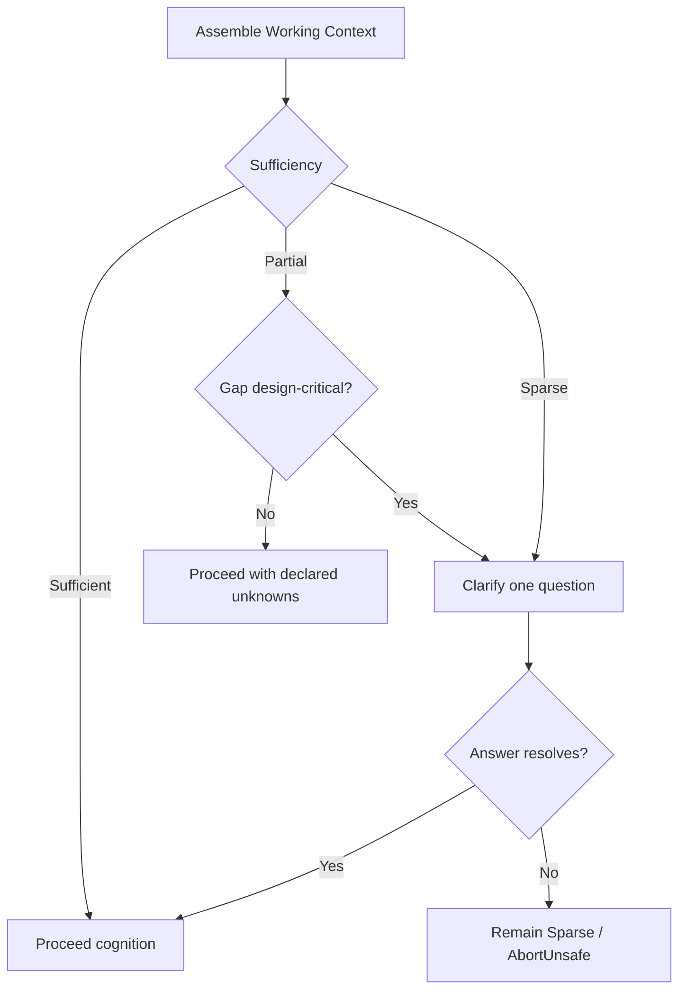
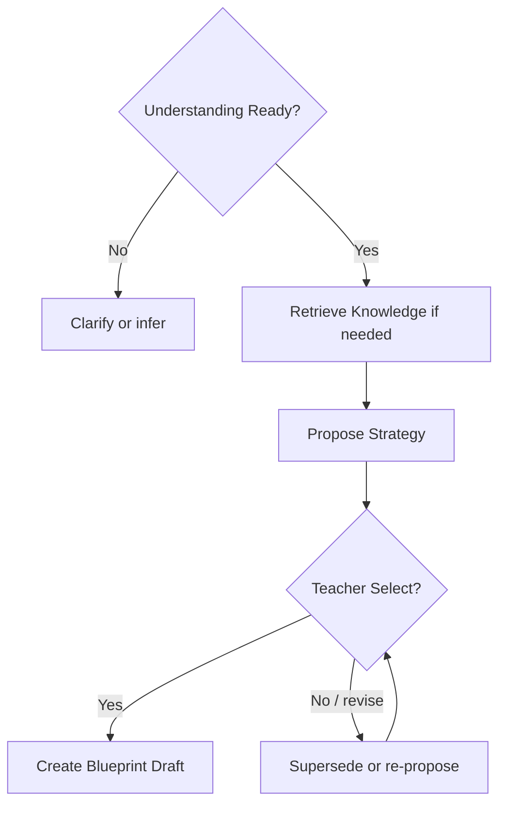
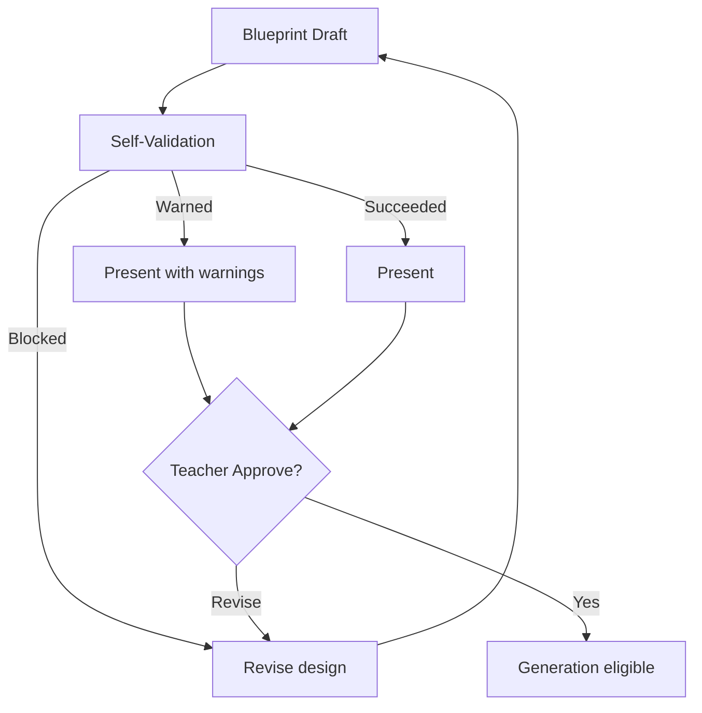
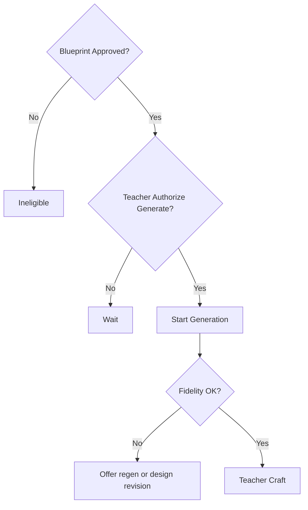
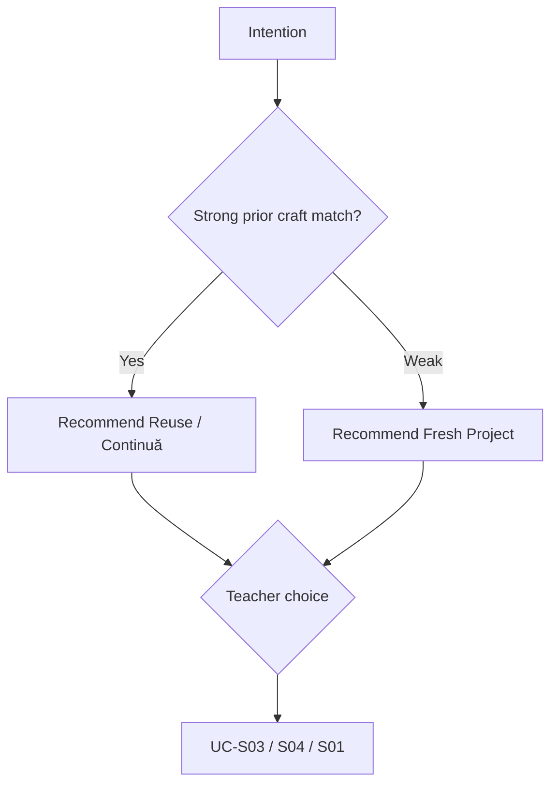

# PRIMA Constitutional Decision Model

**Version:** 1.0  
**Status:** Official — Constitutional Business Decision Architecture  
**Validity horizon:** ≥ 10 years  

> Commands **request**.  
> Events **report**.  
> Use Cases **orchestrate**.  
> Decisions **choose**.

This document defines **how PRIMA makes business decisions** — permanent educational and platform reasoning.  
Not prompts. Not ML. Not implementation algorithms.

**Fundamental question (inherited):**  
*What is the next best action for the Teacher — with minimum cognitive load and maximum pedagogical integrity?*

**Precedence**

| Concern | Authority |
|---------|-----------|
| Decision **identity catalog** & ownership | **This document** |
| Decision **hierarchy** H-01…H-12 | Owned here. The behavioural `PRIMA_DECISION_MODEL.md` it was aligned with was removed in the August 2026 cleanup |
| Decision **Authority levels** | EOS (Automatic→…→Exclusive Teacher) |
| Engine behaviour detail | Engine specs — must comply |

Every future reasoning engine must comply with this Decision Model.

---

## Binding Decision Authority levels (EOS)

| Level | Meaning |
|-------|---------|
| **Automatic** | EOS may choose and continue without Teacher confirmation |
| **Recommend** | EOS proposes; Teacher may ignore |
| **Confirm** | Teacher must accept a specific proposal |
| **Authorize** | Teacher grants contractual power (Approve Blueprint; authorize generate) |
| **Exclusive Teacher** | Only Teacher; EOS informs only |

---

# 1. Decision Principles

## 1.1 Challenge to example principles

| Proposed | Verdict | Constitutional form |
|----------|---------|---------------------|
| Prefer inference over questioning | **Keep** | CDP-01 |
| Prefer reuse over creation | **Keep** | CDP-02 |
| Prefer explanation over automation | **Refine** | Prefer explanation **before binding Recommend/Confirm** — silent Automatic OK for Context assembly |
| Prefer teacher authority over AI certainty | **Keep** | CDP-03 — *PRIMA certainty never outranks Teacher* |

## 1.2 Official Decision Principles

| ID | Principle | Meaning |
|----|-----------|---------|
| **CDP-01** | Infer before ask | Questions only for design-critical gaps |
| **CDP-02** | Reuse before create | Continuă / Library before blank Project when fit is good |
| **CDP-03** | Teacher authority over model certainty | Binding acts remain Teacher-only regardless of confidence |
| **CDP-04** | Understand before strategize | No Strategy without Understanding Ready |
| **CDP-05** | Strategize before Blueprint | No Blueprint compose without Strategy |
| **CDP-06** | Self-validate before ready review | Blocked designs are not “ready” |
| **CDP-07** | Authorize before realize | No Generation without Approval + generate authorize |
| **CDP-08** | Explain before major Recommend | Rationale available (*De ce?*) |
| **CDP-09** | Warn before fail | Surface risk before dead ends |
| **CDP-10** | Wait while Teacher crafts | No chatter during exclusive edit |
| **CDP-11** | Fail visible | No silent pedagogical degradation |
| **CDP-12** | Prefer scoped improve over restart | When prior craft/design exists |
| **CDP-13** | One primary next action | Avoid equal-weight decision spam |
| **CDP-14** | Never invent Context or Knowledge | Unsupported → declare, don’t fabricate |
| **CDP-15** | Hierarchy H-01…H-12 binds all decisions | From Decision Model |

When principles conflict, **higher H-rule and higher Authority level win** (Teacher Authority first).

---

# 2. Decision Categories (challenged)

| Proposed | Verdict | Official category |
|----------|---------|-------------------|
| Context Decisions | Keep | **Orientation & Context** |
| Knowledge Decisions | Keep | **Knowledge** |
| Understanding Decisions | Keep | **Cognition** (Intent + Understanding) |
| Strategy Decisions | Keep | **Strategy** |
| Validation Decisions | Keep | **Validation** |
| Generation Decisions | Keep | **Realization** |
| Memory / Reflection | Merge adjacent | **Reflection & Memory** |
| Missing | Add | **Authorization** (Approve / Export) |
| Missing | Add | **Reuse & Continuity** |
| Missing | Add | **Next-Best-Action** (meta) |

---

# 3. Decision Catalog

IDs: `DEC-xxx`.  
**Confidence:** qualitative bands `High` \| `Medium` \| `Low` — never override Teacher Authority.

---

## 3.1 Orientation & Context

### DEC-001 — DecideWhetherToOfferContinuă
| Field | Content |
|-------|---------|
| **Purpose** | Choose whether Continuă is the primary next action |
| **Meaning** | Reduce cognitive load for returning Teachers |
| **Inputs** | In-progress Projects; recency; pipeline position |
| **Criteria** | Unfinished Session/Project exists → prefer Continuă |
| **Outcomes** | OfferContinuăPrimary \| OfferNewIntentionPrimary \| OfferBothSoft |
| **Rules** | CDP-02, CDP-13; never hide Continuă when work exists |
| **Dependencies** | Project/Session read models |
| **Confidence** | High if clear unfinished; else BothSoft |
| **Failure** | Empty/corrupt list → Intention path + fail visible if needed |
| **Authority** | Automatic (ranking); Teacher chooses |

### DEC-002 — DecideWhetherContextIsSufficient
| Field | Content |
|-------|---------|
| **Purpose** | Classify Working Context sufficiency |
| **Inputs** | Profile, Project, Memory views, entry path |
| **Criteria** | Known grade/subject/Project bind → Sufficient/Partial; missing critical → Sparse |
| **Outcomes** | Sufficient \| Partial \| Sparse |
| **Rules** | CDP-14 — never invent |
| **Authority** | Automatic |
| **Failure** | Conflict → Sparse + clarify |

### DEC-003 — DecideWhetherToClarifyContext
| Field | Content |
|-------|---------|
| **Purpose** | Ask vs proceed with declared unknowns |
| **Inputs** | DEC-002 outcome; design-critical gap list |
| **Criteria** | Gap changes Strategy/Blueprint materially → Clarify; else proceed |
| **Outcomes** | ClarifyOneQuestion \| ProceedWithUnknowns \| AbortUnsafe |
| **Rules** | CDP-01 — one question at a time |
| **Authority** | Automatic choose; Teacher answers |
| **Failure** | Repeated conflict → AbortUnsafe / wait |

---

## 3.2 Knowledge

### DEC-010 — DecideWhetherToRetrieveKnowledge
| Field | Content |
|-------|---------|
| **Purpose** | Retrieve evidence for current cognitive act |
| **Inputs** | Intent/Understanding/Strategy stage; CurriculumScope |
| **Criteria** | Claims needed or alignment check upcoming → Retrieve |
| **Outcomes** | Retrieve \| Skip (already have package) \| MarkUnsupportedPath |
| **Authority** | Automatic |
| **Failure** | Pack miss → MarkUnsupported; do not invent |

### DEC-011 — DecideWhetherKnowledgeSupportsClaim
| Field | Content |
|-------|---------|
| **Purpose** | Accept, weaken, or reject a pedagogical claim |
| **Inputs** | KnowledgePackage; proposed claim |
| **Outcomes** | Supported \| UnsupportedMarked \| ConflictFlagged |
| **Rules** | CDP-14 |
| **Authority** | Automatic (Validation/Knowledge); Teacher may override classroom reality in Understanding |

---

## 3.3 Cognition (Intent & Understanding)

### DEC-020 — DecideWhetherIntentIsEducationallyMeaningful
| Field | Content |
|-------|---------|
| **Purpose** | Accept Intent vs demand learner outcome |
| **Inputs** | IntentionSeed / utterance |
| **Criteria** | Has learner-oriented purpose → Capture; format-only → ClarifyGoal |
| **Outcomes** | CaptureIntent \| ClarifyGoal \| RejectOffDomain |
| **Authority** | Automatic classify; Teacher provides goal |
| **Failure** | Off-domain → reject Generation path |

### DEC-021 — DecideWhetherIntentIsStable
| Field | Content |
|-------|---------|
| **Purpose** | Emerging vs Stable |
| **Criteria** | Enough to strategize without critical ambiguity |
| **Outcomes** | Stabilize \| KeepEmerging \| Supersede |
| **Authority** | Recommend stabilize; Confirm if ambiguous |

### DEC-022 — DecideWhetherToAskClarifyingQuestion
| Field | Content |
|-------|---------|
| **Purpose** | Ask vs infer for Understanding |
| **Inputs** | Understanding gaps; criticality |
| **Criteria** | Design-critical unknown → Ask; else InferAndMirror |
| **Outcomes** | AskOne \| InferMirror \| Wait |
| **Rules** | CDP-01, H-03 for critical ambiguity |
| **Authority** | Automatic |

### DEC-023 — DecideWhetherUnderstandingIsReady
| Field | Content |
|-------|---------|
| **Purpose** | Gate Strategy |
| **Criteria** | Goals, audience, constraints sufficient; no hard contradiction |
| **Outcomes** | UnderstandingReady \| ContinueClarifying \| Impossible |
| **Authority** | Automatic signal; Teacher can force continue clarify |
| **Failure** | Impossible → explain; no Strategy |

---

## 3.4 Strategy

### DEC-030 — DecideWhetherToRecommendStrategy
| Field | Content |
|-------|---------|
| **Purpose** | Propose Instructional Strategy |
| **Preconditions** | UnderstandingReady |
| **Criteria** | Viable approaches exist under constraints + Knowledge |
| **Outcomes** | ProposePrimary \| ProposePrimaryWithAlternative \| CannotPropose |
| **Rules** | CDP-05, CDP-08 |
| **Authority** | Recommend |
| **Failure** | CannotPropose → return to Understanding |

### DEC-031 — DecideStrategyFit
| Field | Content |
|-------|---------|
| **Purpose** | Rank approach families |
| **Inputs** | Understanding; TimeConstraint; Knowledge; Memory advisories |
| **Outcomes** | RankedStrategies + Rationales |
| **Authority** | Recommend only — Teacher Select confirms |
| **Confidence** | High → soft Confirm; Low → require explicit Confirm |

---

## 3.5 Design & Reuse

### DEC-040 — DecideWhetherToReusePriorBlueprintOrCraft
| Field | Content |
|-------|---------|
| **Purpose** | Reuse-before-create |
| **Inputs** | Library/Project similarity; Teacher Intention |
| **Outcomes** | RecommendReuse \| RecommendFresh \| RecommendContinuă |
| **Rules** | CDP-02, CDP-12 |
| **Authority** | Recommend; Teacher decides via UC-S03/S04 |
| **Failure** | Bad match → Fresh |

### DEC-041 — DecideWhetherDesignChangeRequiresNewApproval
| Field | Content |
|-------|---------|
| **Purpose** | Protect Authorization integrity on improve/reuse |
| **Inputs** | Delta vs Approved BlueprintVersion |
| **Outcomes** | SameVersionValid \| RequireNewApprovalCycle |
| **Rules** | Material pedagogy change → new Approval |
| **Authority** | Automatic gate; Teacher Approves if required |

---

## 3.6 Validation

### DEC-050 — DecideSelfValidationOutcome
| Field | Content |
|-------|---------|
| **Purpose** | ReadyForReview / Warned / Blocked |
| **Inputs** | Blueprint Draft; Strategy; Knowledge; check dimensions |
| **Criteria** | Critical incoherence/time/alignment fail → Blocked; minor → Warned; else Succeeded |
| **Outcomes** | Succeeded \| Warned \| Blocked |
| **Authority** | Automatic (Validation Engine under EOS) |
| **Failure** | Validator down → fail visible; do not fake Succeeded |

### DEC-051 — DecideWhetherToPresentBlueprintDespiteWarnings
| Field | Content |
|-------|---------|
| **Purpose** | Present with warnings vs force revise |
| **Criteria** | Warned → Present allowed; Blocked → never Present as ready |
| **Outcomes** | Present \| HoldForRevision |
| **Authority** | Automatic policy |

### DEC-052 — DecideResourceFidelityOutcome
| Field | Content |
|-------|---------|
| **Purpose** | Pass/fail realization vs Approved Blueprint |
| **Outcomes** | Succeeded \| Failed |
| **Authority** | Automatic |
| **Rules** | Failed → no silent accept as Ready |

---

## 3.7 Authorization (Teacher binding)

### DEC-060 — DecideWhetherBlueprintMayBeApproved
| Field | Content |
|-------|---------|
| **Purpose** | Eligibility for ApproveBlueprint command |
| **Inputs** | Presentation state; not Blocked; Teacher ownership |
| **Outcomes** | Eligible \| Ineligible |
| **Authority** | Automatic eligibility; **Authorize decision is Teacher** |
| **Rules** | CDP-03 — EOS never Approves |

### DEC-061 — DecideWhetherGenerationMayStart
| Field | Content |
|-------|---------|
| **Purpose** | Eligibility after Approval |
| **Inputs** | TeacherApproval; AuthorizeResourceGeneration |
| **Outcomes** | MayStart \| MustAuthorizeGenerate \| MissingApproval |
| **Authority** | Automatic check; Teacher Authorize generate |
| **Rules** | CDP-07 |

### DEC-062 — DecideWhetherExportIsAllowed
| Field | Content |
|-------|---------|
| **Purpose** | Exclusive Teacher export eligibility |
| **Outcomes** | Allowed \| Blocked (no resources / policy) |
| **Authority** | Automatic eligibility; **Export is Exclusive Teacher** |

---

## 3.8 Realization

### DEC-070 — DecideResourceScopeDefault
| Field | Content |
|-------|---------|
| **Purpose** | Default Resource kind for generation (e.g. Lesson first) |
| **Inputs** | Intent; Blueprint ResourceRequirements; MVP policy |
| **Outcomes** | DefaultScope \| AskTeacherScope |
| **Authority** | Recommend / Confirm if ambiguous |
| **Rules** | MVP prefers Lesson Resource |

### DEC-071 — DecideWhetherToOfferRegeneration
| Field | Content |
|-------|---------|
| **Purpose** | After fidelity fail or Teacher dissatisfaction |
| **Outcomes** | OfferRegen \| OfferEditOnly \| OfferDesignRevision |
| **Authority** | Recommend |

### DEC-072 — DecideWhetherToStaySilentDuringCraft
| Field | Content |
|-------|---------|
| **Purpose** | Wait vs suggest while editing |
| **Criteria** | Active craft → Wait (CDP-10); explicit ask → Respond |
| **Outcomes** | Wait \| SoftSuggest \| AnswerQuestion |
| **Authority** | Automatic |

---

## 3.9 Reflection & Memory

### DEC-080 — DecideWhetherToCaptureReflection
| Field | Content |
|-------|---------|
| **Purpose** | Optional reflection |
| **Criteria** | Meaningful session signals; never block exit |
| **Outcomes** | Capture \| Skip |
| **Authority** | Automatic; Teacher may dismiss |

### DEC-081 — DecideWhetherToProposeMemoryUpdate
| Field | Content |
|-------|---------|
| **Purpose** | Propose MemoryItem from Reflection |
| **Criteria** | Non-sensitive; high utility; not duplicative |
| **Outcomes** | Propose \| DoNotPropose |
| **Authority** | Recommend |
| **Rules** | Never auto-accept consequential Memory |

### DEC-082 — DecideMemoryWriteSensitivity
| Field | Content |
|-------|---------|
| **Purpose** | Gate what may even be proposed |
| **Outcomes** | AllowPropose \| Forbid (sensitive/learner private) |
| **Authority** | Automatic hard policy |

---

## 3.10 Next-Best-Action (meta)

### DEC-090 — DecideNextBestAction
| Field | Content |
|-------|---------|
| **Purpose** | Choose single primary next action for Teacher |
| **Inputs** | Pipeline position; open Approvals; Continuă; validation state |
| **Criteria** | Apply H-01…H-12; CDP-13 |
| **Outcomes** | One of: Continuă, Clarify, SelectStrategy, ReviewPlan, Approve, AuthorizeGenerate, Craft, Export, Reuse, Wait |
| **Authority** | Automatic ranking; Teacher acts |
| **Failure** | Conflict → Wait + explain options briefly |

---

# 4. Decision Trees

## 4.1 Context sufficiency (challenged & improved)

Naive: Context? YES→Continue NO→Clarify  

**Improved:** sufficiency bands + criticality

## 4.2 Strategy gate

## 4.3 Self-Validation → Approval eligibility

## 4.4 Generation authorization

## 4.5 Reuse vs create

**Challenge:** Trees must not auto-Approve or auto-Export at any node.

---

# 5. Decision Ownership Matrix

| Decision | Recommends | Decides (binding) | Authorizes |
|----------|------------|-------------------|------------|
| DEC-001 Continuă offer | EOS | Teacher picks | — |
| DEC-002 Context sufficiency | EOS Automatic | EOS | — |
| DEC-003 Clarify context | EOS | Teacher answers | — |
| DEC-010 Retrieve knowledge | EOS Automatic | EOS | — |
| DEC-011 Claim support | Knowledge/Validation | EOS marks; Teacher may correct classroom facts | — |
| DEC-020–023 Intent/Understanding | EOS | Teacher confirms mirrors/goals | — |
| DEC-030–031 Strategy | EOS Recommend | **Teacher Confirm Select** | — |
| DEC-040 Reuse | EOS Recommend | Teacher | — |
| DEC-041 New Approval needed | EOS Automatic | — | **Teacher Approve** if required |
| DEC-050–052 Validation | Validation Engine | EOS outcome | — |
| DEC-060 Approve eligibility | EOS | — | **Teacher ApproveBlueprint** |
| DEC-061 Generate start | EOS check | — | **Teacher AuthorizeResourceGeneration** |
| DEC-062 Export | EOS check | — | **Teacher ExportDeliverable** |
| DEC-070 Scope default | EOS Recommend | Teacher Confirm if asked | — |
| DEC-072 Silence in craft | EOS Automatic | — | — |
| DEC-080–082 Reflection/Memory | EOS Propose | **Teacher Accept/Reject Memory** | — |
| DEC-090 Next best action | EOS Automatic rank | Teacher acts | per target decision |

**AI** is never a decision owner — only a worker implementing EOS recommendations.  
**System** may trigger Continuă ranking refresh and failure recording — not Approval.

---

# 6. Decision Traceability Model

Every important decision record (conceptual) must answer:

| Trace field | Question |
|-------------|----------|
| **DecisionId** | Which DEC-* |
| **Why** | Business rationale (principle + criteria hit) |
| **BasedOn** | Inputs: Context fingerprint, IntentId, StrategyId, KnowledgePackage refs, BlueprintVersionId |
| **Alternatives** | What else was considered |
| **RejectedWhy** | Why alternatives lost |
| **AuthorityLevel** | Automatic…Exclusive Teacher |
| **Actor** | Who bound the outcome |
| **Confidence** | High/Medium/Low |
| **Correlation** | CommandId / EventIds produced |

**Minimum Teacher-facing explainability:** Strategy, major Blueprint recommendations, Self-Validation Blocked/Warned, Generation scope — via Rationale / *De ce?*.

**Audit-grade:** ApproveBlueprint, AuthorizeResourceGeneration, ExportDeliverable, MemoryItemAccepted — always traceable.

Hidden Automatic decisions (e.g. Context sufficiency) must still be reconstructable for support/debug without showing noise in UI.

---

# 7. Mapping to Commands & Events (sample)

| Decision outcome | Typical Command | Typical Event |
|------------------|-----------------|---------------|
| ClarifyOneQuestion | (conversation update) | PedagogicalUnderstandingUpdated |
| ProposePrimary Strategy | ProposeInstructionalStrategy | InstructionalStrategyProposed |
| Teacher selects | SelectInstructionalStrategy | InstructionalStrategySelected |
| Blocked validation | RunBlueprintSelfValidation | BlueprintSelfValidationBlocked |
| Eligible + Teacher approves | ApproveBlueprint | BlueprintApproved |
| Teacher authorize generate | AuthorizeResourceGeneration | ResourceGenerationAuthorized |
| Propose memory | ProposeMemoryItem | MemoryItemProposed |
| Teacher accepts memory | AcceptMemoryItem | MemoryItemAccepted |

---

# 8. Architecture Validation

## 8.1 Hidden decisions made explicit
Continuă ranking; Context sufficiency; Knowledge retrieve; Intent meaningfulness; Understanding ready; Strategy fit; Reuse vs fresh; Approval-required-on-delta; Self-Validation tri-state; Generate authorize vs Approve; Silence in craft; Memory sensitivity.

## 8.2 Duplicates avoided
“Should we validate?” folded into pipeline obligation (always Self-Validate before ready Present) — not an optional product whim.  
“Should we generate?” split into eligibility (DEC-061) vs Teacher Authorize command.

## 8.3 Conflicting rules
Resolved by H-01 Teacher Authority and CDP-03 over confidence.  
Reuse (CDP-02) never bypasses Approval when design changes (DEC-041).

## 8.4 Circular reasoning guards
Understanding↔Clarify bounded by attempt budget → Impossible outcome.  
Validation Blocked→Revise→Validate must progress or Teacher abandons (Session Abandoned).

## 8.5 Missing authority
None on binding spine: Select Strategy, Approve, Authorize Generate, Export, Memory Accept — Teacher.

## 8.6 Scalability risks
| Risk | Mitigation |
|------|------------|
| Model-specific heuristics become “the decision” | Criteria stay business-level; models only score inputs |
| Decision explosion in UI | DEC-090 enforces one primary next action |
| Plugins inject Approve | Ownership matrix forbids |

## 8.7 Verdict
Constitutional Decision Model is **complete** for EOS business reasoning, **model-independent**, and **aligned** to Commands, Events, Use Cases, and Teacher authority.

---

# 9. Deliverable Index

| # | Deliverable | Section |
|---|-------------|---------|
| 1 | Decision Catalog | §3 |
| 2 | Decision Categories | §2 |
| 3 | Decision Trees | §4 |
| 4 | Decision Ownership Matrix | §5 |
| 5 | Decision Principles | §1 |
| 6 | Decision Traceability Model | §6 |
| 7 | Architecture Validation | §8 |

---

## Closing

> **PRIMA does not “know” in the Teacher’s place.**  
> It **decides what to propose, ask, validate, wait for, or refuse** — under a constitution where **Teacher authority outranks model certainty**.

That is the permanent business decision architecture of PRIMA.
