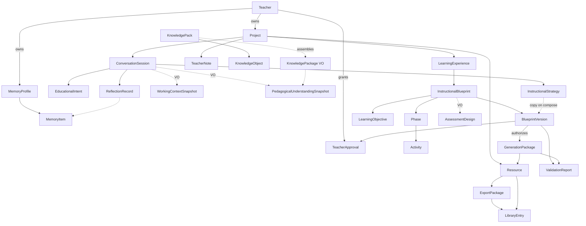

# PRIMA Constitutional Domain Model

**Version:** 1.0  
**Status:** Official — Conceptual Business Domain Model  
**Validity horizon:** ≥ 10 years  

> This model is **executable as business meaning** — not as a database schema.  
> It must remain valid under Event Sourcing, CQRS, and distributed services.

**Precedence:** On entity identity, aggregate boundaries, or ownership conflict with [`PRIMA_DOMAIN_MODEL.md`](./PRIMA_DOMAIN_MODEL.md), **this document wins**. The legacy Domain Model shall align to Constitutional Language and this constitution.

**Non-goals:** tables, APIs, ORMs, engine class diagrams, UI components.

**Supports capabilities:** every Core/Strategic capability in [`PRIMA_CONSTITUTIONAL_CAPABILITY_MODEL.md`](./PRIMA_CONSTITUTIONAL_CAPABILITY_MODEL.md) maps to objects below.

---

## Domain modeling principles

| ID | Principle |
|----|-----------|
| **DMP-01** | Prefer Constitutional Language Official Names |
| **DMP-02** | Entities have identity and lifecycle; Value Objects are immutable equality-by-value |
| **DMP-03** | Aggregates define consistency boundaries — external references by ID only |
| **DMP-04** | Experience places (Home, Project Workspace) are **not** domain entities |
| **DMP-05** | Design objects never gain Generation authority |
| **DMP-06** | Teacher Approval is never a Value Object without recorded identity |
| **DMP-07** | Read models (Library Catalog) are not write aggregates |
| **DMP-08** | Model must admit event streams per aggregate without renaming concepts |

---

# 1. Bounded Contexts (owner domains)

| Bounded Context | Business meaning |
|-----------------|------------------|
| **Teacher Interaction** | Authority, review, craft, orientation signals, reflection intake |
| **Orchestration** | Project, Conversation Session, Working Context assembly, gates |
| **Instructional Design** | Intent→Understanding→Strategy→Blueprint→Learning Experience |
| **Knowledge** | Knowledge Packs / Objects / Packages |
| **Validation** | Self-Validation & Realization Validation reports |
| **Generation** | Generation Package, Resources, Export Package production |
| **Memory** | Memory Profile & Items |
| **System Governance** | Configuration, audit, lineage policy, admin |

---

# 2. Entity Catalog

*Challenge notes inline where candidates were rejected or split.*

### Rejected as entities

| Candidate | Verdict | Why |
|-----------|---------|-----|
| Home / Project Workspace / Settings | **Not entities** | Experience places |
| Library (as bag) | **Read model** | Portfolio index — see Library Entry |
| Chat | **Rejected name** | Use Conversation (behavior) + Conversation Session (entity) |
| Assessment (unqualified) | **Split** | Assessment Design (VO) vs Assessment Resource (Entity subtype) |
| Scenario | **Rejected** | Use Instructional Blueprint |
| Decision Context | **VO / ephemeral** | Not longitudinal entity |
| EOS / Pipeline / Engine | **Architecture** | Not business entities |

---

## 2.1 Actor & portfolio

### Teacher

| Field | Content |
|-------|---------|
| **Purpose** | Human instructional designer; final authority on approval, craft, export |
| **Identity** | Stable TeacherId |
| **Lifecycle** | registered → active → suspended → closed |
| **State** | active \| suspended |
| **Owner Domain** | Teacher Interaction |
| **Business Rules** | Cannot be impersonated for Teacher Approval; owns Memory Profile |
| **Relationships** | Owns many Projects; one Memory Profile; grants Teacher Approvals |

### LearnerProfile *(optional MVP-light)*

| Field | Content |
|-------|---------|
| **Purpose** | Teacher-described Learner/class traits used in Understanding — not a product user |
| **Identity** | LearnerProfileId (when persisted) or embedded description |
| **Lifecycle** | described → updated → archived |
| **State** | current \| archived |
| **Owner Domain** | Instructional Design |
| **Business Rules** | No invented diagnoses; Teacher-sourced only |
| **Relationships** | Referenced by Pedagogical Understanding; never grants Approval |

*Challenge:* Full Student aggregate rejected for MVP — use LearnerProfile or VO `LearnerDescription`.

### Administrator

| Field | Content |
|-------|---------|
| **Purpose** | Institutional/config actor — not pedagogical approver |
| **Identity** | AdministratorId |
| **Lifecycle** | registered → active |
| **Owner Domain** | System Governance |
| **Business Rules** | Cannot grant Teacher Approval |
| **Relationships** | Manages Platform Configuration, Knowledge Pack publication (ops) |

### LibraryEntry

| Field | Content |
|-------|---------|
| **Purpose** | Indexed reusable craft pointer for Library Catalog |
| **Identity** | LibraryEntryId |
| **Lifecycle** | indexed → updated → removed |
| **State** | visible \| hidden |
| **Owner Domain** | Teacher Interaction |
| **Business Rules** | Not design authority; points to Export Package and/or Resource + Project |
| **Relationships** | Teacher; Project; Export Package; Resource |

---

## 2.2 Work & session

### Project

| Field | Content |
|-------|---------|
| **Purpose** | Unit of educational work / continuity |
| **Identity** | ProjectId |
| **Lifecycle** | created → active → paused → completed → archived |
| **State** | active \| paused \| completed \| archived |
| **Owner Domain** | Orchestration |
| **Business Rules** | Resources belong to a Project; Continuă restores via Project |
| **Relationships** | Teacher; Conversation Sessions; Blueprint Version refs; Resources; Teacher Notes |

### ConversationSession

| Field | Content |
|-------|---------|
| **Purpose** | Bounded dialogue + pipeline position for a stretch of work |
| **Identity** | ConversationSessionId |
| **Lifecycle** | started → active → paused → completed \| abandoned |
| **State** | pipeline stage enum (IntentActive…ResourcesReady) per EOS |
| **Owner Domain** | Orchestration |
| **Business Rules** | One authoritative mutating session per Blueprint draft thread; resume must not skip Authorization |
| **Relationships** | Project; holds current Intent/Understanding/Strategy references; Audit hooks |

### TeacherNote

| Field | Content |
|-------|---------|
| **Purpose** | Free-text note inside Project (non-Blueprint) |
| **Identity** | TeacherNoteId |
| **Lifecycle** | created → edited → archived |
| **Owner Domain** | Teacher Interaction |
| **Business Rules** | Never substitutes for Blueprint |
| **Relationships** | Project |

### LearningExperience

| Field | Content |
|-------|---------|
| **Purpose** | Designed instructional outcome identity for Learners |
| **Identity** | LearningExperienceId |
| **Lifecycle** | initiated → designing → authorized → realized → refined |
| **State** | designing \| authorized \| realized |
| **Owner Domain** | Instructional Design |
| **Business Rules** | Exactly one authoritative Blueprint iteration at a time; Resources realize it |
| **Relationships** | Project (1 Project may host one active LE, historically many); Instructional Blueprint |

*Challenge:* Some teams collapse LE into Project. **Keep separate** — Project is continuity container; Learning Experience is pedagogical object of design.

### EducationalIntent

| Field | Content |
|-------|---------|
| **Purpose** | Structured educational purpose for a cycle |
| **Identity** | EducationalIntentId |
| **Lifecycle** | Emerging → Stable → Superseded |
| **State** | emerging \| stable \| superseded |
| **Owner Domain** | Instructional Design |
| **Business Rules** | Goal before format; Generation forbidden from Intent alone |
| **Relationships** | Project; ConversationSession; feeds Understanding |

### InstructionalStrategy

| Field | Content |
|-------|---------|
| **Purpose** | Explicit approach before Blueprint composition |
| **Identity** | InstructionalStrategyId |
| **Lifecycle** | proposed → confirmed → superseded |
| **State** | proposed \| confirmed \| superseded |
| **Owner Domain** | Instructional Design |
| **Business Rules** | Required before Blueprint compose; Confirm/Recommend authority |
| **Relationships** | ConversationSession; referenced by Blueprint Version (immutable copy) |

---

## 2.3 Design contract

### InstructionalBlueprint

| Field | Content |
|-------|---------|
| **Purpose** | Authoritative pedagogical design contract (design only) |
| **Identity** | InstructionalBlueprintId *(lineage family)* |
| **Lifecycle** | draft → self_validated → in_review → approved → superseded \| archived |
| **State** | as lifecycle |
| **Owner Domain** | Instructional Design |
| **Business Rules** | No Resource prose as authority; mutations via aggregate; approval via Teacher Approval on Version |
| **Relationships** | LearningExperience; contains Objectives, Phases, Activities; Versions; Approvals |

### BlueprintVersion

| Field | Content |
|-------|---------|
| **Purpose** | Immutable snapshot identity for a Blueprint revision / approval binding |
| **Identity** | BlueprintVersionId |
| **Lifecycle** | minted → (optional) approved → superseded |
| **State** | draft_snapshot \| approved \| superseded |
| **Owner Domain** | Instructional Design |
| **Business Rules** | Approved versions immutable for generation cycle; change ⇒ new Version |
| **Relationships** | InstructionalBlueprint; TeacherApproval; GenerationPackage |

### LearningObjective

| Field | Content |
|-------|---------|
| **Purpose** | Measurable intended Learner outcome unit |
| **Identity** | LearningObjectiveId |
| **Lifecycle** | added → revised → frozen_on_approval |
| **Owner Domain** | Instructional Design |
| **Business Rules** | Must live inside Blueprint aggregate |
| **Relationships** | Blueprint; may reference CompetencyRef VO; aligns Activities |

### Phase

| Field | Content |
|-------|---------|
| **Purpose** | Ordered segment of the Learning Experience |
| **Identity** | PhaseId |
| **Lifecycle** | added → ordered → frozen_on_approval |
| **Owner Domain** | Instructional Design |
| **Business Rules** | Time realism subject to Self-Validation |
| **Relationships** | Blueprint; contains Activities |

### Activity

| Field | Content |
|-------|---------|
| **Purpose** | Designed Learner/Teacher action within a Phase |
| **Identity** | ActivityId |
| **Lifecycle** | added → revised → frozen_on_approval |
| **Owner Domain** | Instructional Design |
| **Business Rules** | Must serve Learning Objectives; not a Resource; not an entry “builder type” |
| **Relationships** | Phase; Objective refs |

### TeacherApproval

| Field | Content |
|-------|---------|
| **Purpose** | Explicit authorization record for a BlueprintVersion |
| **Identity** | TeacherApprovalId |
| **Lifecycle** | granted → archived_on_supersession |
| **State** | granted \| revoked_by_supersession *(revocation only via new cycle — never silent)* |
| **Owner Domain** | Teacher Interaction *(authority)* / recorded in Blueprint aggregate |
| **Business Rules** | Never implicit; never AI-granted; required before Generation |
| **Relationships** | Teacher; BlueprintVersion |

---

## 2.4 Validation & reflection

### ValidationReport

| Field | Content |
|-------|---------|
| **Purpose** | Structured findings for Self-Validation or Realization Validation |
| **Identity** | ValidationReportId |
| **Lifecycle** | created → consumed → archived |
| **State** | ReadyForReview \| ReadyWithWarnings \| BlockedFromReview \| realization_pass \| realization_fail |
| **Owner Domain** | Validation |
| **Business Rules** | Does not mutate Blueprint/Resources; findings reference rules/sections |
| **Relationships** | BlueprintVersion and/or GenerationPackage |

### ValidationRule

| Field | Content |
|-------|---------|
| **Purpose** | Named compliance criterion in the validation catalog |
| **Identity** | ValidationRuleId |
| **Lifecycle** | published → deprecated |
| **Owner Domain** | Validation / System Governance |
| **Business Rules** | Findings must cite rules where applicable |
| **Relationships** | Referenced by ValidationReport |

### ReflectionRecord

| Field | Content |
|-------|---------|
| **Purpose** | Structured reflection outcome; candidate Memory deltas |
| **Identity** | ReflectionRecordId |
| **Lifecycle** | captured → acknowledged \| dismissed → archived |
| **Owner Domain** | Teacher Interaction |
| **Business Rules** | Never blocks exit; not design authority |
| **Relationships** | ConversationSession / Project; may propose MemoryItem updates |

---

## 2.5 Knowledge & memory

### KnowledgePack

| Field | Content |
|-------|---------|
| **Purpose** | Versioned curated educational knowledge release |
| **Identity** | KnowledgePackId + pack version |
| **Lifecycle** | draft → published → deprecated |
| **Owner Domain** | Knowledge |
| **Business Rules** | Immutable published content; supersede via new version |
| **Relationships** | Contains KnowledgeObjects |

### KnowledgeObject

| Field | Content |
|-------|---------|
| **Purpose** | Atomic curated knowledge unit with provenance |
| **Identity** | KnowledgeObjectId |
| **Lifecycle** | included → deprecated_with_pack |
| **Owner Domain** | Knowledge |
| **Business Rules** | Never invented by Generation |
| **Relationships** | KnowledgePack |

### MemoryProfile

| Field | Content |
|-------|---------|
| **Purpose** | Teacher-owned personalization boundary |
| **Identity** | MemoryProfileId (= Teacher-scoped) |
| **Lifecycle** | created → active → purged |
| **Owner Domain** | Memory |
| **Business Rules** | Teacher can view/edit/delete; no sensitive auto-learn |
| **Relationships** | Teacher; MemoryItems |

### MemoryItem

| Field | Content |
|-------|---------|
| **Purpose** | Single preference or advisory pattern |
| **Identity** | MemoryItemId |
| **Lifecycle** | proposed → accepted → active → deleted |
| **Owner Domain** | Memory |
| **Business Rules** | Consequential writes need Decision Authority level; ≠ Knowledge |
| **Relationships** | MemoryProfile |

---

## 2.6 Generation & delivery

### GenerationPackage

| Field | Content |
|-------|---------|
| **Purpose** | Bundle for one generation run |
| **Identity** | GenerationPackageId / run id |
| **Lifecycle** | requested → running → completed \| failed → superseded_by_rerun |
| **Owner Domain** | Generation |
| **Business Rules** | Bound to exactly one Approved BlueprintVersion; no Blueprint mutation |
| **Relationships** | BlueprintVersion; Resources; ValidationReports |

### Resource

| Field | Content |
|-------|---------|
| **Purpose** | Editable classroom material derived from Approved Blueprint |
| **Identity** | ResourceId |
| **Lifecycle** | draft → ready → exported \| archived |
| **State** | draft \| ready \| archived |
| **Owner Domain** | Generation *(create)* / Teacher Interaction *(craft authority)* |
| **Business Rules** | Must trace to Blueprint sections; subtypes via ResourceKind |
| **Relationships** | Project; GenerationPackage; ExportPackage; LibraryEntry |

**Resource kinds (not separate aggregates):** LessonResource, WorksheetResource, AssessmentResource, PresentationResource, StoryResource, GameResource — same Entity type discriminated by kind.

### Rubric

| Field | Content |
|-------|---------|
| **Purpose** | Scoring guide often accompanying Assessment Resource |
| **Identity** | RubricId |
| **Lifecycle** | draft → ready |
| **Owner Domain** | Generation / Instructional Design linkage |
| **Business Rules** | If generated, traces to Assessment Design / Objectives |
| **Relationships** | Resource (Assessment) or Blueprint reference |

### ObservationProtocol

| Field | Content |
|-------|---------|
| **Purpose** | Structured classroom observation aid |
| **Identity** | ObservationProtocolId |
| **Lifecycle** | draft → ready |
| **Owner Domain** | Generation / Teacher Interaction |
| **Business Rules** | Future-leaning; still Resource-like craft under Approval rules when generated |
| **Relationships** | Project; optional Resource link |

### ExportPackage

| Field | Content |
|-------|---------|
| **Purpose** | Teacher-finalized deliverable bundle |
| **Identity** | ExportPackageId |
| **Lifecycle** | assembled → delivered → superseded |
| **Owner Domain** | Generation |
| **Business Rules** | Requires Exclusive Teacher act; no auto-export |
| **Relationships** | Resources; BlueprintVersion lineage; LibraryEntry |

### PlatformConfiguration

| Field | Content |
|-------|---------|
| **Purpose** | Non-creative platform defaults and policies |
| **Identity** | ConfigurationId / key set |
| **Lifecycle** | published → superseded |
| **Owner Domain** | System Governance |
| **Business Rules** | Never replaces Instructional Strategy |
| **Relationships** | Referenced by all contexts |

---

# 3. Value Object Catalog

Value Objects are **immutable**, compared by value, and have **no independent lifecycle**. New meaning ⇒ new instance.

| VO | Purpose | Typical home |
|----|---------|--------------|
| **WorkingContextSnapshot** | Situational truth for a run (sufficiency Sparse/Partial/Sufficient) | ConversationSession / Orchestration |
| **PedagogicalUnderstandingSnapshot** | Shared understanding at a point in time | ConversationSession |
| **SuccessCriteria** | What “good enough learning” means for this cycle | Intent / Understanding |
| **TimeConstraint** | Available duration, period, deadline | Understanding / Strategy |
| **LearnerDescription** | Grade, class size, traits as stated | Understanding |
| **CompetencyRef** | Reference to curriculum Competency in a Knowledge Pack | Objective / KnowledgePackage |
| **CurriculumScope** | Subject, grade band, pack version scope | Knowledge query |
| **KnowledgePackage** | Assembled evidenced knowledge for one act *(ephemeral VO bundle)* | Knowledge retrieval result |
| **ProvenanceRecord** | Citation of KnowledgeObject/pack version | inside KnowledgePackage |
| **AssessmentDesign** | How learning will be evidenced (approach, not items) | InstructionalBlueprint |
| **DifferentiationDesign** | How Learner variance is addressed | InstructionalBlueprint |
| **AssessmentCriteria** | Criteria statements within Assessment Design | AssessmentDesign |
| **StrategyApproach** | Approach family, sequencing, stances | InstructionalStrategy entity fields *or* VO payload |
| **ResourceRequirement** | Declared needed Resource kinds in Blueprint | InstructionalBlueprint |
| **ValidationFinding** | Single finding with severity + rule/section ref | ValidationReport |
| **TraceLink** | Resource section ↔ Blueprint section link | GenerationPackage / Resource |
| **DecisionAuthorityLevel** | Automatic…ExclusiveTeacher | Orchestration policies |
| **PipelinePosition** | EOS stage identifier | ConversationSession |
| **Rationale** | Explainability text for a recommendation | Strategy / Blueprint |
| **ExportFormat** | PDF/DOCX/… as value | ExportPackage |
| **ResourceKind** | lesson \| worksheet \| assessment \| … | Resource |
| **IntentionSeed** | UI entry text/chip before Intent entity stabilizes | ephemeral |

### Classification challenges

| Candidate | Entity vs VO | Decision |
|-----------|--------------|----------|
| Educational Intent | Has identity + lifecycle | **Entity** |
| Instructional Strategy | Has identity + lifecycle | **Entity** (VO copy embedded in BlueprintVersion) |
| Pedagogical Understanding | Snapshots evolve | **VO snapshots** (history optional as list of VOs) |
| Working Context | Per-run | **VO snapshot** |
| Knowledge Package | Ephemeral assembly | **VO** (not KnowledgePack entity) |
| Teacher Approval | Must be auditable identity | **Entity** |
| Library | View | **Read model** of LibraryEntry entities |

---

# 4. Aggregate Definitions

External references: **IDs only**. Consistency enforced inside the root.

### AGG-01 — Project

| Field | Content |
|-------|---------|
| **Root** | Project |
| **Contained Entities** | TeacherNote; references to ConversationSessionIds, BlueprintVersionIds, ResourceIds, LearningExperienceIds |
| **Contained VOs** | title metadata, subject/grade labels |
| **Consistency Rules** | Project membership of Resources; archive does not delete Approval history elsewhere |
| **Transaction Boundary** | Project metadata & notes; **not** Blueprint section edits |
| **Capabilities** | CAP-C01, CAP-S04 |

### AGG-02 — ConversationSession

| Field | Content |
|-------|---------|
| **Root** | ConversationSession |
| **Contained Entities** | EducationalIntent (active); InstructionalStrategy (active); optional ReflectionRecord refs |
| **Contained VOs** | WorkingContextSnapshot; PedagogicalUnderstandingSnapshot; PipelinePosition; IntentionSeed |
| **Consistency Rules** | Single active Intent/Strategy thread; stage transitions obey EOS invariants |
| **Transaction Boundary** | Session cognitive state updates |
| **Capabilities** | CAP-C03–C06, CAP-C04, CAP-P01 |

### AGG-03 — InstructionalBlueprint

| Field | Content |
|-------|---------|
| **Root** | InstructionalBlueprint |
| **Contained Entities** | BlueprintVersion; LearningObjective; Phase; Activity; TeacherApproval |
| **Contained VOs** | AssessmentDesign; DifferentiationDesign; ResourceRequirement; StrategyApproach copy; Rationale |
| **Consistency Rules** | Objectives↔Activities alignment invariants; one Approved Version binding per cycle; no Resource prose as authority |
| **Transaction Boundary** | All design mutations and approval records for this Blueprint family |
| **Capabilities** | CAP-C07, CAP-S02, CAP-C09 |

### AGG-04 — KnowledgePack

| Field | Content |
|-------|---------|
| **Root** | KnowledgePack |
| **Contained Entities** | KnowledgeObject |
| **Contained VOs** | CurriculumScope; ProvenanceRecord templates |
| **Consistency Rules** | Published pack immutability |
| **Transaction Boundary** | Pack curation releases |
| **Capabilities** | CAP-S03, CAP-C15 |

### AGG-05 — MemoryProfile

| Field | Content |
|-------|---------|
| **Root** | MemoryProfile |
| **Contained Entities** | MemoryItem |
| **Contained VOs** | preference payloads |
| **Consistency Rules** | Teacher-scoped isolation; delete cascades to items |
| **Transaction Boundary** | Memory writes |
| **Capabilities** | CAP-C17 |

### AGG-06 — GenerationPackage

| Field | Content |
|-------|---------|
| **Root** | GenerationPackage |
| **Contained Entities** | Resource (draft set for run); Rubric/ObservationProtocol if produced in-run |
| **Contained VOs** | TraceLink; ResourceKind; run metadata |
| **Consistency Rules** | Single Approved BlueprintVersionId; Resources in package share run identity |
| **Transaction Boundary** | One generation run |
| **Capabilities** | CAP-C10, CAP-C11 |

### AGG-07 — ExportPackage

| Field | Content |
|-------|---------|
| **Root** | ExportPackage |
| **Contained Entities** | — (references ResourceIds) |
| **Contained VOs** | ExportFormat; delivery metadata |
| **Consistency Rules** | Assembled only after Teacher Exclusive act; partial export disallowed as “complete” |
| **Transaction Boundary** | One export assembly |
| **Capabilities** | CAP-C13 |

### AGG-08 — ValidationReport *(local aggregate / write model)*

| Field | Content |
|-------|---------|
| **Root** | ValidationReport |
| **Contained VOs** | ValidationFinding set |
| **Consistency Rules** | Immutable once issued; new run ⇒ new report |
| **Transaction Boundary** | One validation pass |
| **Capabilities** | CAP-C08, CAP-C11 |

### Non-aggregates

| Object | Why |
|--------|-----|
| Teacher | Identity BC / actor — referenced widely; not design TX root |
| Library Catalog | CQRS read model over LibraryEntry |
| LearningExperience | May be root-lite **or** identity held on Project with Blueprint as authority — **Constitutional choice:** LE is entity referenced by Project & Blueprint, mutations of design go through Blueprint aggregate |

---

# 5. Domain Services

Domain Services hold **operations that don’t naturally belong to a single entity** yet express domain rules.

| Service | Responsibility | Challenge outcome |
|---------|----------------|-------------------|
| **WorkingContextAssemblyService** | Build WorkingContextSnapshot from Teacher, Project, Memory views | **Keep** |
| **KnowledgeRetrievalService** | Assemble KnowledgePackage VO from KnowledgePack | **Keep** (= CAP-C15) |
| **BlueprintSelfValidationService** | Run Self-Validation → ValidationReport | **Keep** |
| **ResourceFidelityValidationService** | Validate GenerationPackage vs BlueprintVersion | **Keep** |
| **GenerationCoordinationService** | Start generation under Approval policy; produce GenerationPackage | **Keep** (not “invent content policy”) |
| **DesignAuthorizationService** | Enforce grant/refuse TeacherApproval against policies | **Keep** — thin; policy-heavy |
| **ReflectionProcessingService** | Build ReflectionRecord; propose MemoryItem changes | **Keep** |
| **ReuseEvaluationService** | Determine reuse-before-create options from Library/Project | **Keep** (optional MVP) |
| **RecommendationService** *(proposed)* | Generic recommendations | **Reject as named service** — too vague; use Strategy formulation inside Instructional Design entities/services + Explain (Rationale VO) |
| **AuthorizationService** *(ambiguous name)* | Collides with security | **Rename** → DesignAuthorizationService |

Engines **implement** services; services are domain meaning, not deployable units.

---

# 6. Domain Policies

Policies are **always-on business rules** evaluated by services/aggregates.

| Policy | Statement |
|--------|-----------|
| **TeacherAuthorityPolicy** | Binding educational commitments require Teacher; AI never grants TeacherApproval or Export |
| **BlueprintApprovalPolicy** | Generation requires TeacherApproval on BlueprintVersion; approval never implicit |
| **SelfValidationPresentationPolicy** | BlockedFromReview Blueprints must not present as ready |
| **GenerationPolicy** | GenerationPackage only from Approved BlueprintVersion; cannot mutate Blueprint; drafts only |
| **DesignBeforeGenerationPolicy** | Strategy required before Blueprint compose; Blueprint before Generation |
| **KnowledgeProvenancePolicy** | Knowledge claims need provenance or marked unsupported; Memory ≠ Knowledge |
| **MemoryUpdatePolicy** | Consequential MemoryItem writes need allowed Decision Authority; Teacher control mandatory |
| **ReflectionNonBlockingPolicy** | Reflection must not block session exit |
| **ReuseBeforeCreatePolicy** | Prefer Continuă/Reuse evaluation before blank Project when prior craft fits |
| **ContextNonInventionPolicy** | WorkingContextSnapshot must not invent school/class facts |
| **AggregateReferencePolicy** | Cross-aggregate references by ID only |
| **ImmutabilityPolicy** | Approved BlueprintVersion and issued ValidationReport are immutable |
| **FailureVisibilityPolicy** | Domain failures are visible; no silent pedagogical degradation |
| **LibraryNonAuthorityPolicy** | LibraryEntry never replaces Blueprint Approval |

---

# 7. Relationship Diagram

---

# 8. Capability → Domain object map (sample)

| Capability | Primary aggregates / entities |
|------------|-------------------------------|
| CAP-S01 Design Learning Experiences | ConversationSession, EducationalIntent, InstructionalStrategy, InstructionalBlueprint, LearningExperience |
| CAP-S02 Authorize | TeacherApproval, BlueprintVersion |
| CAP-S03 Ground in Knowledge | KnowledgePack, KnowledgeRetrievalService |
| CAP-S04 Continue | Project, ConversationSession |
| CAP-C10 Generate | GenerationPackage, Resource |
| CAP-C14 Library | LibraryEntry (read model) |
| CAP-C17 Memory | MemoryProfile |

---

# 9. Architecture Validation

## 9.1 Entity boundaries

| Check | Result |
|-------|--------|
| Experience places modeled as entities | **Avoided** |
| Assessment split Design vs Resource | **Done** |
| Intent/Strategy as Entities with lifecycle | **Done** (not lost as prompt text) |
| Resource subtypes as separate aggregates | **Avoided** — kind discriminator |

## 9.2 Aggregate consistency

| Check | Result |
|-------|--------|
| Blueprint sections outside Blueprint aggregate | **Forbidden** |
| Generation mutating Blueprint | **Forbidden** by GenerationPolicy |
| Memory writing KnowledgePack | **Forbidden** |
| ConversationSession editing Approved BlueprintVersion in place | **Forbidden** — new Version |

## 9.3 Ownership

Aligned to Constitutional Language / Capabilities. Teacher Approval authority in Teacher Interaction; record inside Blueprint aggregate — **documented dual concern** without dual primary owner for the Entity (record owned with Blueprint; act owned by Teacher).

## 9.4 Missing objects added

InstructionalStrategy, EducationalIntent, WorkingContextSnapshot, LibraryEntry, TeacherApproval, ValidationRule, ReflectionRecord, ResourceKind, TraceLink.

## 9.5 Overloaded entities guarded

| Risk | Guard |
|------|-------|
| Project becomes god-object | Design mutations in Blueprint aggregate; cognitive state in Session |
| Blueprint stores generated prose | Business rule: design only |
| Resource stores Objectives | Objectives remain in Blueprint |

## 9.6 Future scalability (ES / CQRS / distribution)

| Concern | How model supports it |
|---------|------------------------|
| **Event Sourcing** | Aggregates have clear commands (approve, mint version, complete generation) and immutable versions/reports as natural events |
| **CQRS** | Library Catalog, Home Continuă lists as read models; write models = aggregates |
| **Distributed services** | Bounded contexts + ID references; Knowledge/Memory/Generation deployable separately |
| **New Resource kinds** | Extend ResourceKind — no new aggregate required |
| **Collaboration later** | Project membership expansion without renaming Project |

## 9.7 Residual risks

| Risk | Mitigation |
|------|------------|
| LearningExperience vs Project confusion | Keep both; educate via Constitutional Language |
| KnowledgePackage VO vs Pack naming | Strict glossary; code names `KnowledgePackage` vs `KnowledgePack` |
| Dual storage of Strategy (entity + VO copy) | Copy-on-compose; Session Strategy supersedes don’t rewrite Approved Version |

## 9.8 Verdict

The Constitutional Domain Model is **sufficient** to support EOS, Capabilities, and Teacher Journey; **implementation-independent**; and **ready** for event-sourced aggregates and CQRS read models without renaming core concepts.

---

# 10. Deliverable Index

| # | Deliverable | Section |
|---|-------------|---------|
| 1 | Entity Catalog | §2 |
| 2 | Value Object Catalog | §3 |
| 3 | Aggregate Definitions | §4 |
| 4 | Domain Services | §5 |
| 5 | Policies | §6 |
| 6 | Relationship Diagram | §7 |
| 7 | Architecture Validation | §9 |

---

## Closing

> **Projects hold work.  
> Sessions hold thinking.  
> Blueprints hold design authority.  
> Approvals hold commitment.  
> Packages hold realization runs.  
> Resources hold craft.  
> Memory holds preference — never curriculum truth.**

That separation is the Constitutional Domain Model. Databases may change; these boundaries should not.
