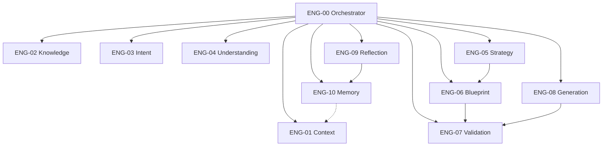
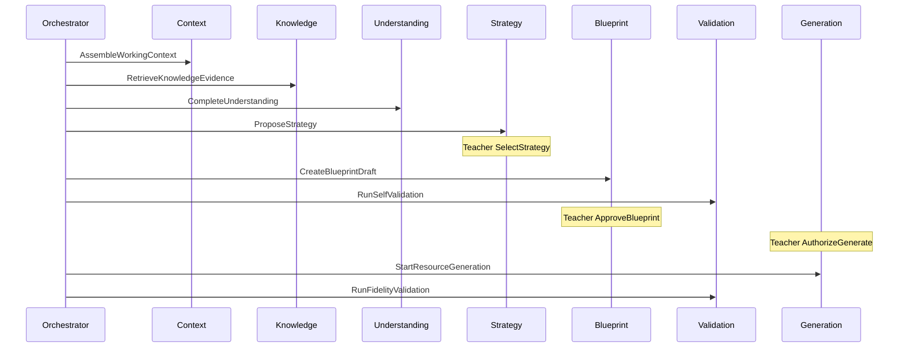
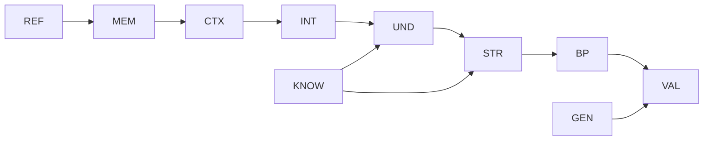
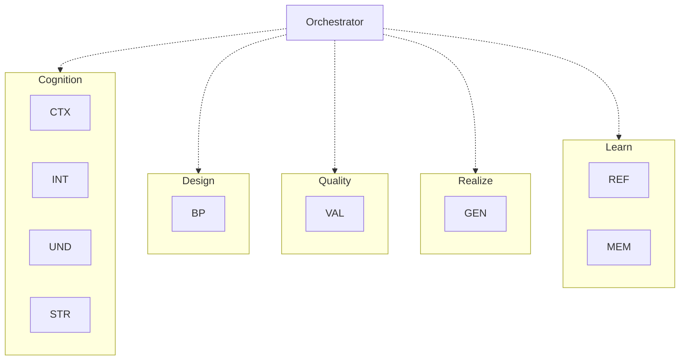

# PRIMA Constitutional Engine Architecture

**Version:** 1.0  
**Status:** Official — Constitutional Execution Model of EOS  
**Validity horizon:** ≥ 10 years  

> PRIMA is an **Educational Operating System (EOS)**.  
> EOS executes through **specialized Engines** — each with **exactly one constitutional responsibility**.  
> Engines are **technology-independent** and **AI-model-independent**. Workers implement Engines; they do not redefine them.

**Principles**

| ID | Principle |
|----|-----------|
| **CEA-01** | One Engine → one business responsibility (max cohesion) |
| **CEA-02** | Engines collaborate via constitutional Contracts, Commands, Events |
| **CEA-03** | No duplicated responsibilities across Engines |
| **CEA-04** | Engines are independently replaceable |
| **CEA-05** | Business orchestration belongs to **Orchestrator / EOS**, not to peer Engines |
| **CEA-06** | Engines never bypass Policies (especially Teacher Authority) |
| **CEA-07** | Engines do not own UI, HTTP, or storage technology |

**Relationship to Services:** Business Services (SVC-*) are collaboration façades; **Engines** are the specialized executors inside EOS. Mapping is explicit in §2.

**Precedence:** This document owns Engine identity and boundaries. Legacy `PRIMA_ENGINE.md` / per-engine specs must align. EOS remains the parent constitution.

---

# 1. Engine Catalog (challenged)

| Candidate | Verdict | Reason |
|-----------|---------|--------|
| Context Engine | **Keep** | Situational truth ≠ Knowledge |
| Knowledge Engine | **Keep** | Provenance-bearing substance |
| Intent Engine | **Keep** | Educational Intent lifecycle |
| Understanding Engine | **Keep** | Shared pedagogical understanding |
| Instructional Strategy Engine | **Keep** | Mandatory bridge to Blueprint |
| Blueprint Engine | **Keep** | Design contract |
| Validation Engine | **Keep** | Self + Realization validation |
| Generation Engine | **Keep** | Resources under Approval |
| Reflection Engine | **Keep** | Cross-cutting learning signals |
| Memory Engine | **Keep** | Teacher-controlled personalization |
| **Orchestrator** | **Keep** (kernel, not peer pedagogy) | Gates & sequencing |
| Assessment Engine | **Reject** | Assessment Design ∈ Blueprint; Assessment Resource ∈ Generation |
| Recommendation Engine | **Reject** | Vague duplicate of Strategy + Decision Authority |
| Analytics Engine | **Future optional** | Not core EOS pedagogy |
| Collaboration Engine | **Future** | Extensibility |
| Plugin Engine | **Future gateway** | Not a pedagogical Engine |
| Prompt / Voice Engine | **Exclude from core** | Product voice layer |
| Monolithic Decision Engine | **Reject** | Dissolved into Policies + Decisions + Orchestrator |

## Official Engine set

| ID | Official Name | Maps primarily to Service |
|----|---------------|---------------------------|
| **ENG-00** | Orchestrator | EOS kernel (cross-SVC) |
| **ENG-01** | Context Engine | SVC-02 (Context assembly) |
| **ENG-02** | Knowledge Engine | SVC-04 |
| **ENG-03** | Intent Engine | SVC-02 |
| **ENG-04** | Understanding Engine | SVC-02 |
| **ENG-05** | Instructional Strategy Engine | SVC-02 |
| **ENG-06** | Blueprint Engine | SVC-03 |
| **ENG-07** | Validation Engine | SVC-05 |
| **ENG-08** | Generation Engine | SVC-06 |
| **ENG-09** | Reflection Engine | SVC-09 |
| **ENG-10** | Memory Engine | SVC-08 |

Teacher Authority checks are **Policy + SVC-10**, invoked by Orchestrator — not a separate pedagogical Engine.

---

# 2. Engine Specifications

---

## ENG-00 — Orchestrator

| Field | Content |
|-------|---------|
| **Mission** | Enforce lawful EOS execution |
| **Responsibility** | Sequence Engines; enforce Policies/gates; bind Session integrity; route failures; authorize stage advances |
| **Inputs** | Teacher/System Commands; Engine results; Aggregate states; Decision outcomes |
| **Outputs** | Legal next Engine invocations; denied illegal skips; correlation ids |
| **Consumed Commands** | All — as router/gate (does not pedagogically execute them) |
| **Published Events** | PipelinePositionAdvanced; DomainFailureRecorded (coord); may correlate others |
| **Consumed Events** | All material success/failure Events for sync |
| **Supported Decisions** | DEC-090 NextBestAction; eligibility gates DEC-060/061 |
| **Owned Policies** | Enforces POL-001, 002, 010, 011, 072, 092 (does not author pedagogy) |
| **Owned Read Models** | Contributes to RM-01 Orientation / Session Status projections |
| **Dependencies** | All Engines (coordinator) |
| **MUST** | Block illegal transitions; require Teacher Authority for binding Commands |
| **MUST NEVER** | Compose Blueprint; invent Knowledge; Approve; Generate Resources; Select Strategy for Teacher |

---

## ENG-01 — Context Engine

| Field | Content |
|-------|---------|
| **Mission** | Know what is already true *here and now* |
| **Responsibility** | Assemble WorkingContextSnapshot sufficiency |
| **Inputs** | TeacherId; ProjectId; entryPath; Memory views (read) |
| **Outputs** | Working Context Sparse/Partial/Sufficient |
| **Consumed Commands** | AssembleWorkingContext |
| **Published Events** | WorkingContextAssembled |
| **Consumed Events** | MemoryItemAccepted (invalidate views); Project*/Session start |
| **Supported Decisions** | DEC-002, DEC-003 |
| **Owned Policies** | POL-041 Context Non-Invention |
| **Owned Read Models** | Feeds QRY-013 Working Context Snapshot |
| **Dependencies** | Memory Engine (read); Project Continuity data |
| **MUST** | Declare unknowns; never invent school/class facts |
| **MUST NEVER** | Supply curriculum doctrine; Approve; Generate |

---

## ENG-02 — Knowledge Engine

| Field | Content |
|-------|---------|
| **Mission** | Provide attributable educational evidence |
| **Responsibility** | Knowledge Assembly; pack lifecycle support |
| **Inputs** | CurriculumScope; cognitive act correlation |
| **Outputs** | KnowledgePackage VO or UnsupportedMarked |
| **Consumed Commands** | RetrieveKnowledgeEvidence; Publish/DeprecateKnowledgePack |
| **Published Events** | KnowledgeEvidenceRetrieved; KnowledgePackPublished/Deprecated |
| **Consumed Events** | — |
| **Supported Decisions** | DEC-010, DEC-011 |
| **Owned Policies** | POL-040 Knowledge Provenance |
| **Owned Read Models** | RM-14 Knowledge Explorer |
| **Dependencies** | KnowledgePack aggregates; Governance for admin publish |
| **MUST** | Attach provenance; mark unsupported |
| **MUST NEVER** | Invent curriculum; write Memory; mutate Blueprint; Approve |

---

## ENG-03 — Intent Engine

| Field | Content |
|-------|---------|
| **Mission** | Capture educational purpose |
| **Responsibility** | Educational Intent Emerging→Stable→Superseded |
| **Inputs** | IntentionSeed; Working Context; reuse cues |
| **Outputs** | EducationalIntent |
| **Consumed Commands** | Capture/Stabilize/SupersedeEducationalIntent |
| **Published Events** | EducationalIntentCaptured/Stabilized/Superseded |
| **Consumed Events** | PriorCraftSelectedForReuse; WorkingContextAssembled |
| **Supported Decisions** | DEC-020, DEC-021 |
| **Owned Policies** | Supports POL-003 (meaningful intent) |
| **Owned Read Models** | Feeds QRY-020 |
| **Dependencies** | Context Engine; optional Memory read |
| **MUST** | Separate goal from format fetish |
| **MUST NEVER** | Confirm Strategy; Approve Blueprint; Generate |

---

## ENG-04 — Understanding Engine

| Field | Content |
|-------|---------|
| **Mission** | Build shared Pedagogical Understanding |
| **Responsibility** | Infer, mirror, clarify minimally; gate Understanding Ready |
| **Inputs** | Intent; Context; KnowledgePackage; Teacher corrections |
| **Outputs** | PedagogicalUnderstandingSnapshot; Ready flag |
| **Consumed Commands** | Update/CompletePedagogicalUnderstanding |
| **Published Events** | PedagogicalUnderstandingUpdated/Completed |
| **Consumed Events** | EducationalIntent*; KnowledgeEvidenceRetrieved |
| **Supported Decisions** | DEC-022, DEC-023 |
| **Owned Policies** | POL-084 (no invented diagnoses); POL-001 (Teacher corrects) |
| **Owned Read Models** | Feeds QRY-021, QRY-014 |
| **Dependencies** | Intent, Context, Knowledge |
| **MUST** | Infer before ask; one question at a time |
| **MUST NEVER** | Select Strategy binding; Generate; invent Learner diagnoses |

---

## ENG-05 — Instructional Strategy Engine

| Field | Content |
|-------|---------|
| **Mission** | Choose how learning will proceed |
| **Responsibility** | Propose Strategy; await Teacher Select |
| **Inputs** | Understanding Ready; Knowledge; Memory advisories; TimeConstraint |
| **Outputs** | InstructionalStrategy Proposed/Confirmed |
| **Consumed Commands** | ProposeInstructionalStrategy; Select/SupersedeInstructionalStrategy |
| **Published Events** | InstructionalStrategyProposed/Selected/Superseded |
| **Consumed Events** | PedagogicalUnderstandingCompleted |
| **Supported Decisions** | DEC-030, DEC-031 |
| **Owned Policies** | POL-010 (strategy before blueprint); POL-001 (Teacher Select) |
| **Owned Read Models** | Feeds QRY-022 |
| **Dependencies** | Understanding, Knowledge; Memory read |
| **MUST** | Attach rationales; require Teacher Confirm for Select |
| **MUST NEVER** | Auto-Confirm Strategy; Compose final Resource text; Approve |

---

## ENG-06 — Blueprint Engine

| Field | Content |
|-------|---------|
| **Mission** | Own the Instructional Blueprint design contract |
| **Responsibility** | Compose, revise, version, present; record TeacherApproval |
| **Inputs** | Confirmed Strategy; Understanding; Knowledge; Teacher edits; Approval Command |
| **Outputs** | Blueprint Draft/Versions; LearningExperience linkage; TeacherApproval records |
| **Consumed Commands** | CreateBlueprintDraft, ReviseBlueprintStructure, MintBlueprintVersion, PresentBlueprintForReview, RequestBlueprintRevision, ApproveBlueprint |
| **Published Events** | Blueprint*; LearningExperienceInitiated; BlueprintApproved; ApprovalSuperseded |
| **Consumed Events** | InstructionalStrategySelected; BlueprintSelfValidation* |
| **Supported Decisions** | DEC-041, 051, 060 |
| **Owned Policies** | POL-011, POL-012, POL-070 (versions) |
| **Owned Read Models** | RM-07–09 Blueprint / LE views |
| **Dependencies** | Strategy Eng.; Validation Eng. (critique); Orchestrator Authority check |
| **MUST** | Design-only content; version lineage; Teacher-only Approve path |
| **MUST NEVER** | Generate Resource bodies as Blueprint authority; fake Approval; ignore Blocked Present rules |

---

## ENG-07 — Validation Engine

| Field | Content |
|-------|---------|
| **Mission** | Critique designs and realizations |
| **Responsibility** | Self-Validation; Realization Fidelity; ValidationReports |
| **Inputs** | BlueprintVersion drafts; GenerationPackages; Knowledge for alignment checks |
| **Outputs** | ValidationReport Issued (Succeeded/Warned/Blocked/pass/fail) |
| **Consumed Commands** | RunBlueprintSelfValidation; RunResourceFidelityValidation |
| **Published Events** | BlueprintSelfValidation*; ResourceFidelityValidation* |
| **Consumed Events** | BlueprintDraftCreated/StructureRevised; ResourcesGenerated |
| **Supported Decisions** | DEC-050–052 |
| **Owned Policies** | POL-020, POL-021 |
| **Owned Read Models** | RM-10 Validation Report View |
| **Dependencies** | Blueprint & Generation aggregates (read); Knowledge optional |
| **MUST** | Fail visible; cite findings; block ready Present when Blocked |
| **MUST NEVER** | Approve; mutate Blueprint/Resource content; invent pass |

---

## ENG-08 — Generation Engine

| Field | Content |
|-------|---------|
| **Mission** | Realize Approved design as editable Resources |
| **Responsibility** | GenerationPackage runs; Resource drafts; regen; persist Teacher edits/ready |
| **Inputs** | Approved BlueprintVersion; Authorize+Start; scope; Teacher edits |
| **Outputs** | Resources Draft/Ready; run Completed/Failed |
| **Consumed Commands** | AuthorizeResourceGeneration, StartResourceGeneration, RegenerateResource, RecordResourceEdit, MarkResourceReady |
| **Published Events** | ResourceGeneration*; ResourcesGenerated; ResourceEdited; ResourceMarkedReady; Regeneration* |
| **Consumed Events** | BlueprintApproved; Fidelity* |
| **Supported Decisions** | DEC-061, 070–072 |
| **Owned Policies** | POL-030; supports POL-031 via Delivery service |
| **Owned Read Models** | RM-11–12 Resource views |
| **Dependencies** | Blueprint eligibility; Validation Fidelity; Teacher Authority |
| **MUST** | Require Approval+Authorize; drafts only until Ready; no Blueprint mutation |
| **MUST NEVER** | Auto-generate on Approve alone; grant Export; redesign Blueprint silently |

---

## ENG-09 — Reflection Engine

| Field | Content |
|-------|---------|
| **Mission** | Turn experience into candidate learning |
| **Responsibility** | Capture ReflectionRecords; signal Memory proposals |
| **Inputs** | Session/Project outcome signals; optional Teacher notes |
| **Outputs** | ReflectionRecord; propose Memory |
| **Consumed Commands** | CaptureReflection |
| **Published Events** | ReflectionCaptured |
| **Consumed Events** | SessionCompleted; BlueprintApproved; DeliverableExported (optional triggers) |
| **Supported Decisions** | DEC-080 |
| **Owned Policies** | POL-051 |
| **Owned Read Models** | RM-16 Reflection Timeline |
| **Dependencies** | Memory Engine (Propose) |
| **MUST** | Remain non-blocking |
| **MUST NEVER** | Block Session Complete; Accept Memory; Approve/Generate |

---

## ENG-10 — Memory Engine

| Field | Content |
|-------|---------|
| **Mission** | Teacher-controlled durable personalization |
| **Responsibility** | MemoryProfile/Items; views for Context |
| **Inputs** | Proposals; Teacher Accept/Reject/Delete |
| **Outputs** | Active Memory views |
| **Consumed Commands** | Propose/Accept/Reject/DeleteMemoryItem |
| **Published Events** | MemoryItem* |
| **Consumed Events** | ReflectionCaptured |
| **Supported Decisions** | DEC-081, 082 |
| **Owned Policies** | POL-050, POL-084 |
| **Owned Read Models** | RM-15 Memory Summary |
| **Dependencies** | Teacher Authority for Accept |
| **MUST** | Teacher control writes; sensitivity gate |
| **MUST NEVER** | Write KnowledgePacks; auto-Accept; invent Context facts |

---

# 3. Responsibility Matrix

| Responsibility | Engine |
|----------------|--------|
| Gate & sequence | Orchestrator |
| Situational context | Context |
| Curriculum evidence | Knowledge |
| Educational Intent | Intent |
| Pedagogical Understanding | Understanding |
| Instructional Strategy | Strategy |
| Instructional Blueprint | Blueprint |
| Design & fidelity critique | Validation |
| Resource realization | Generation |
| Reflection capture | Reflection |
| Personalization memory | Memory |
| Teacher Approval grant | **Teacher via Blueprint Engine record + Authority Policy** — not an Engine “Approve” |

---

# 4. Engine Collaboration Model

| Collaboration | Requester | Responder | Outcome owner | Authorizer |
|---------------|-----------|-----------|---------------|------------|
| Assemble context | Orchestrator / Session | Context | Context Engine | Automatic |
| Retrieve knowledge | Understanding/Strategy/Validation/Orchestrator | Knowledge | Knowledge Engine | Automatic |
| Capture intent | Orchestrator | Intent | Intent Engine | Teacher source + Engine structure |
| Build understanding | Orchestrator | Understanding | Understanding Engine | Teacher corrects |
| Propose strategy | Orchestrator | Strategy | Strategy Engine (proposal) | **Teacher Select** |
| Compose blueprint | Orchestrator | Blueprint | Blueprint Engine | Teacher edits; **Teacher Approve** |
| Self-validate | Blueprint/Orchestrator | Validation | Validation Engine | Automatic outcome |
| Generate resources | Orchestrator after Teacher Authorize | Generation | Generation Engine | **Teacher Authorize** |
| Fidelity validate | Generation/Orchestrator | Validation | Validation Engine | Automatic |
| Reflect → Memory | Reflection | Memory | Memory (proposal) | **Teacher Accept** |

**Pattern:** Orchestrator requests → Engine executes within Policies → Events published → Orchestrator advances state.

---

# 5. Engine Boundaries (MUST / MUST NEVER summary)

Already per Engine in §2. Cross-cutting **overlap eliminations**:

| Ambiguity | Resolution |
|-----------|------------|
| Who “decides” next action? | Orchestrator + DEC-090 — not Recommendation Engine |
| Who “assesses”? | Blueprint (design) + Generation (instrument Resource) + Validation (critique) |
| Who “remembers curriculum”? | Knowledge — never Memory |
| Who “approves”? | Teacher — Blueprint Engine stores record |
| Who “talks”? | Product voice layer — not a core Engine |

---

# 6. Engine Lifecycle Model

Applies to every Engine (conceptual):

| Phase | Meaning |
|-------|---------|
| **Initialization** | Bind to EOS; load Policy versions; health = Ready |
| **Idle** | Awaiting Orchestrator invocation |
| **Execution** | Process Command / collaboration request |
| **Success** | Emit Events; return outputs |
| **Failure** | Fail visible; no fake success; Orchestrator applies POL-072 |
| **Recovery** | Retry scoped where Policy allows (e.g. Generation Failed→retry); never auto-Approve |
| **Shutdown** | Drain in-flight; no silent commits |
| **Health Monitoring** | Ready / Degraded / Unavailable — Orchestrator may refuse Present-as-ready if Validation Unavailable (no fake pass) |
| **Evolution** | Replace worker/model behind Engine without changing Mission/Contracts |

---

# 7. Orchestration Model

## 7.1 EOS coordination styles

| Style | When | Example |
|-------|------|---------|
| **Synchronous** | Teacher waits on gate | Self-Validation before Present; Authority check before Approve |
| **Asynchronous** | Long realization | Generation Running → Completed/Failed Events |
| **Parallel** | Non-conflicting reads | Knowledge retrieve ∥ Context refresh (careful consistency) |
| **Fallback** | Engine Unavailable | Fail visible; degrade to clarify/wait — **never** skip Approval |
| **Escalation** | Repeated Blocked/Failed | Surface to Teacher with options (revise/regen/abandon) |
| **Human intervention** | All Authorize/Confirm/Exclusive acts | Teacher Commands |

## 7.2 Canonical execution flow

```
Orchestrator
  → Context → Intent → Knowledge → Understanding
  → Strategy (Propose) → Teacher Select
  → Blueprint Compose → Validation Self
  → Teacher Present/Approve
  → Teacher Authorize Generate → Generation
  → Validation Fidelity → Teacher Craft/Ready
  → Delivery (Export) [service]
  → Reflection ⇢ Memory (optional)
```

---

# 8. Dependency Matrix

| Engine | Depends on (runtime) |
|--------|----------------------|
| Orchestrator | All (coord) |
| Context | Memory (read) |
| Knowledge | — (packs) |
| Intent | Context |
| Understanding | Intent, Context, Knowledge |
| Strategy | Understanding, Knowledge, Memory (read) |
| Blueprint | Strategy, Understanding, Knowledge (opt), Validation |
| Validation | Blueprint/Generation inputs; Knowledge (opt) |
| Generation | Blueprint eligibility; Validation; Authority |
| Reflection | Session signals; Memory |
| Memory | Authority (Accept) |

**No cycle** among peer Engines; Orchestrator is the hub.

---

# 9. Mermaid Diagrams

## 9.1 Engine landscape



## 9.2 Collaboration map



## 9.3 Dependency graph



## 9.4 Responsibility matrix view



---

# 10. Architecture Validation

## 10.1 Overlaps eliminated
No Assessment/Recommendation Engines. Decision monolith rejected. Prompt Engine excluded from core.

## 10.2 Hidden coupling risks
Forbidden shared mutable Blueprint across Generation. Memory↛Knowledge. Generation↛auto on Approve.

## 10.3 Missing engines
None for MVP spine. Analytics/Collaboration/Plugin are Future — not required for educational OS core.

## 10.4 Replaceability
Each Engine swappable behind Contracts/Events; Mission stable under model change.

## 10.5 AI model independence
Workers implement Intent/Understanding/Strategy/Blueprint/Generation inference; Policies and Orchestrator gates remain.

## 10.6 Scalability
Parallel Knowledge+Context reads OK; Generation async; Validation availability gates Present.

## 10.7 Verdict
Engine Architecture is **cohesive**, **minimally coupled**, **policy-compliant**, and **constitutionally complete** for EOS execution.

---

# 11. Deliverable Index

| # | Deliverable | Section |
|---|-------------|---------|
| 1 | Engine Catalog | §1 |
| 2 | Responsibility Matrix | §3 |
| 3 | Engine Collaboration Model | §4 |
| 4 | Dependency Matrix | §8 |
| 5 | Engine Lifecycle Model | §6 |
| 6 | Orchestration Model | §7 |
| 7 | Mermaid Diagrams | §9 |
| 8 | Architecture Validation | §10 |

---

## Closing

> **EOS decides what is lawful.  
> Engines do one job well.  
> Teachers authorize what matters.**  

Constitutional execution spine:

**Context → Intent → Knowledge → Understanding → Strategy → Blueprint → Validation → (Teacher Approve) → Generation → Validation → (Teacher Ready/Export) → Reflection → Memory**
