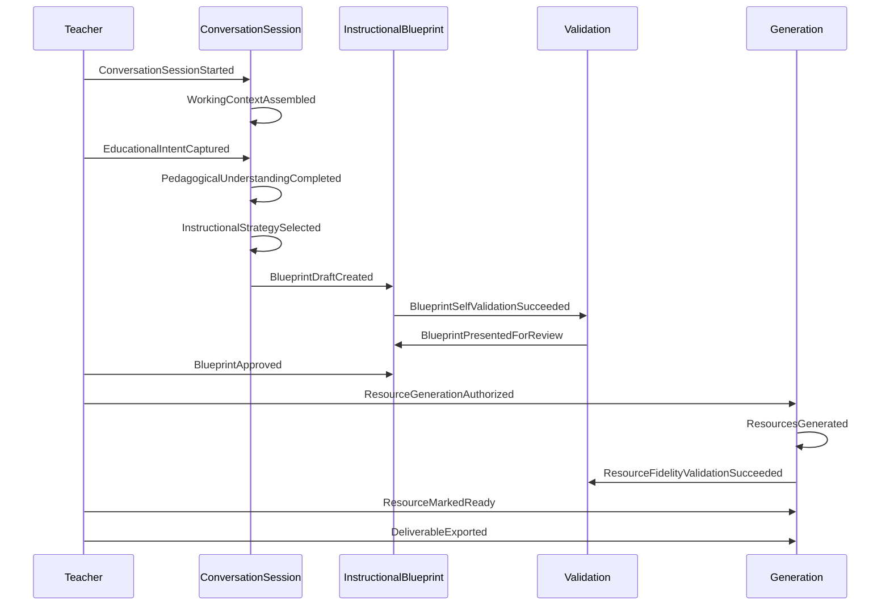
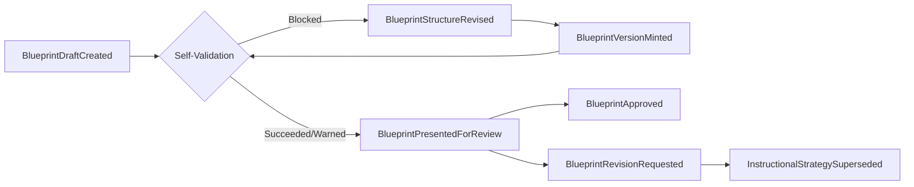
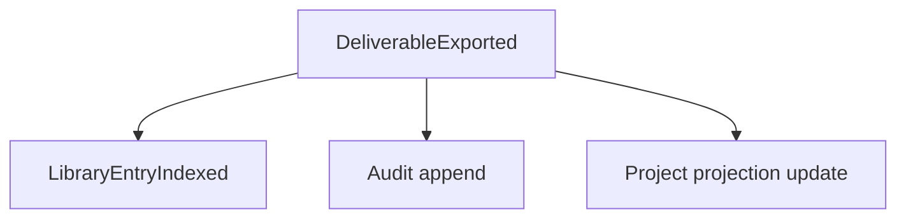

# PRIMA Constitutional Event Model

**Version:** 1.0  
**Status:** Official — Constitutional Event Architecture  
**Validity horizon:** ≥ 10 years  

> Events are **facts that have already happened**.  
> They are not commands, requests, intentions, or API messages.

**Architectural principle:** Everything important that changes business state is an Event. Events are immutable and describe the past.

**Precedence:** This document is the constitutional event vocabulary. Future services, workflows, AI engines, and plugins must communicate **business meaning** through these events (transport may vary).

**Vocabulary:** Official Names from Constitutional Language; aggregates from Constitutional Domain Model.

**Non-goals:** HTTP routes, queue vendors, schema serialization formats, UI toasts.

---

## Event design principles

| ID | Principle |
|----|-----------|
| **CEP-01** | Past tense, business language |
| **CEP-02** | Immutable once recorded |
| **CEP-03** | Emitted from an Aggregate (or explicit System stream) |
| **CEP-04** | Payload is conceptual — identities + meaningful values, not DB rows |
| **CEP-05** | Replay-safe: consumers must tolerate redelivery |
| **CEP-06** | No event means “please do X” — that is a command |
| **CEP-07** | Teacher Approval and Export facts are never AI-attributed as grantor |
| **CEP-08** | Design events never imply Resources exist |

---

# 1. Aggregates in scope

| Aggregate | Event stream home |
|-----------|-------------------|
| **Project** | Project lifecycle, notes, archive |
| **ConversationSession** | Context, Intent, Understanding, Strategy, pipeline position |
| **InstructionalBlueprint** | Draft, structure, versions, approvals |
| **ValidationReport** | Validation outcomes issued |
| **GenerationPackage** | Generation runs and contained Resource drafts |
| **ExportPackage** | Export assemblies |
| **KnowledgePack** | Pack publication lifecycle |
| **MemoryProfile** | Memory item accept/delete |
| **Teacher** *(identity stream)* | Registration/suspension (thin) |
| **LibraryEntry** | Indexed/hidden (may project from Export/Resource events) |

**Not aggregates — no primary event stream:** Home, Assessment (unqualified), “Conversation” as chat. Collaboration events are **Future** stubs.

---

# 2. Event Catalog

Legend — **Replay:** Yes = safe if handlers idempotent.  
**Producer role:** Teacher | PRIMA (EOS/engines as workers) | System | Administrator  

Payload fields are **conceptual**.

---

## 2.1 Project stream

### ProjectCreated
| Field | Content |
|-------|---------|
| **Description** | A Project was created for a Teacher. |
| **Trigger** | Intention entry or Continuă-new-work path creates Project |
| **Aggregate** | Project |
| **Business Meaning** | Unit of work now exists |
| **Payload** | ProjectId; TeacherId; title seed; subject/grade if known; LearningExperienceId? |
| **Who triggers** | Teacher (via product act); PRIMA may propose title |
| **Who reacts** | Continuă read models; Analytics (future); Session can bind |
| **Replay** | Yes |

### ProjectRenamed
| Field | Content |
|-------|---------|
| **Description** | Project display title changed. |
| **Trigger** | Teacher edit |
| **Aggregate** | Project |
| **Meaning** | Identity label updated |
| **Payload** | ProjectId; oldTitle; newTitle |
| **Triggers / Reacts** | Teacher / Library & Continuă projections |
| **Replay** | Yes |

### ProjectPaused / ProjectResumed / ProjectCompleted / ProjectArchived
| Field | Content |
|-------|---------|
| **Description** | Project lifecycle state changed. |
| **Trigger** | Teacher or policy (archive) |
| **Aggregate** | Project |
| **Meaning** | Continuă eligibility and visibility changed |
| **Payload** | ProjectId; state; timestamp |
| **Replay** | Yes |

### TeacherNoteAdded / TeacherNoteUpdated
| Field | Content |
|-------|---------|
| **Aggregate** | Project |
| **Meaning** | Non-Blueprint note recorded |
| **Payload** | ProjectId; TeacherNoteId; content ref |
| **Replay** | Yes |

---

## 2.2 ConversationSession stream

### ConversationSessionStarted
| Field | Content |
|-------|---------|
| **Description** | A Conversation Session began on a Project. |
| **Trigger** | Open Project Workspace / Continuă / new Intention |
| **Aggregate** | ConversationSession |
| **Meaning** | Cognitive thread open |
| **Payload** | ConversationSessionId; ProjectId; TeacherId; entryPath |
| **Triggers** | Teacher |
| **Reacts** | Orchestrator projections; Analytics |
| **Replay** | Yes |

### ConversationSessionPaused / ConversationSessionCompleted / ConversationSessionAbandoned
| Field | Content |
|-------|---------|
| **Meaning** | Session closed or paused |
| **Payload** | ConversationSessionId; reason? |
| **Replay** | Yes |

### WorkingContextAssembled
| Field | Content |
|-------|---------|
| **Description** | Working Context snapshot assembled for the run. |
| **Trigger** | Session start/refresh |
| **Aggregate** | ConversationSession |
| **Meaning** | Situational truth bound (with sufficiency) |
| **Payload** | ConversationSessionId; sufficiency; contextFingerprint |
| **Triggers** | PRIMA (Context assembly) |
| **Reacts** | Intent/Understanding processes |
| **Replay** | Yes |

### EducationalIntentCaptured
| Field | Content |
|-------|---------|
| **Description** | Educational Intent emerged from Teacher Intention. |
| **Trigger** | Intention stated or inferred and recorded |
| **Aggregate** | ConversationSession |
| **Meaning** | Purpose thread started |
| **Payload** | EducationalIntentId; ProjectId; intentSummary; state=emerging |
| **Triggers** | Teacher + PRIMA structuring |
| **Reacts** | Understanding; Knowledge retrieval |
| **Replay** | Yes |

### EducationalIntentStabilized / EducationalIntentSuperseded
| Field | Content |
|-------|---------|
| **Meaning** | Intent became Stable or was replaced |
| **Payload** | EducationalIntentId; state |
| **Replay** | Yes |

### PedagogicalUnderstandingUpdated
| Field | Content |
|-------|---------|
| **Description** | A new Understanding snapshot was accepted into session state. |
| **Trigger** | Mirror confirmed / inference applied |
| **Aggregate** | ConversationSession |
| **Meaning** | Shared understanding progressed |
| **Payload** | ConversationSessionId; understandingFingerprint; ready=false\|true |
| **Triggers** | Teacher corrections; PRIMA inference |
| **Reacts** | Strategy eligibility |
| **Replay** | Yes |

### PedagogicalUnderstandingCompleted
| Field | Content |
|-------|---------|
| **Description** | Understanding Ready reached. |
| **Trigger** | Minimum viable understanding met |
| **Aggregate** | ConversationSession |
| **Meaning** | Strategy may proceed |
| **Payload** | ConversationSessionId; understandingFingerprint |
| **Challenge vs Updated:** Keep **both** — Updated is incremental; Completed is the gate fact. |
| **Replay** | Yes |

### InstructionalStrategyProposed
| Field | Content |
|-------|---------|
| **Description** | PRIMA proposed an Instructional Strategy. |
| **Trigger** | Strategy formulation |
| **Aggregate** | ConversationSession |
| **Meaning** | Approach candidate exists |
| **Payload** | InstructionalStrategyId; approachSummary; rationaleRef |
| **Triggers** | PRIMA |
| **Reacts** | Teacher Confirm path |
| **Replay** | Yes |

### InstructionalStrategySelected
| Field | Content |
|-------|---------|
| **Description** | Strategy confirmed (Teacher confirm or accepted recommend). |
| **Trigger** | Confirm-level Decision Authority |
| **Aggregate** | ConversationSession |
| **Meaning** | Blueprint composition allowed |
| **Payload** | InstructionalStrategyId; confirmedBy=Teacher |
| **Triggers** | Teacher (authority); PRIMA never sole grantor |
| **Reacts** | Blueprint compose |
| **Replay** | Yes |

### InstructionalStrategySuperseded
| Field | Content |
|-------|---------|
| **Meaning** | Prior strategy replaced |
| **Payload** | oldStrategyId; newStrategyId |
| **Replay** | Yes |

### PipelinePositionAdvanced
| Field | Content |
|-------|---------|
| **Description** | EOS pipeline stage advanced. |
| **Trigger** | Legal stage transition |
| **Aggregate** | ConversationSession |
| **Meaning** | Orchestration progress fact |
| **Payload** | ConversationSessionId; fromStage; toStage |
| **Triggers** | Orchestrator / EOS |
| **Reacts** | Projections; plugins |
| **Replay** | Yes |
| **Note** | Prefer specific business events when available; use this for residual stage moves |

---

## 2.3 InstructionalBlueprint stream

### LearningExperienceInitiated
| Field | Content |
|-------|---------|
| **Description** | Learning Experience identity started for a Project. |
| **Trigger** | Design cycle begins |
| **Aggregate** | Project or Blueprint family *(emit on Project, reference LE)* |
| **Meaning** | Pedagogical object of design exists |
| **Payload** | LearningExperienceId; ProjectId |
| **Replay** | Yes |

### BlueprintDraftCreated
| Field | Content |
|-------|---------|
| **Description** | First draft Instructional Blueprint composed from Strategy. |
| **Trigger** | Blueprint composition |
| **Aggregate** | InstructionalBlueprint |
| **Meaning** | Design contract draft exists |
| **Payload** | InstructionalBlueprintId; BlueprintVersionId; InstructionalStrategyId; LearningExperienceId |
| **Triggers** | PRIMA (Blueprint Engine as worker) |
| **Reacts** | Self-Validation |
| **Replay** | Yes |

### BlueprintStructureRevised
| Field | Content |
|-------|---------|
| **Description** | Objectives/Phases/Activities/AssessmentDesign changed pre-approval. |
| **Trigger** | Teacher edit or PRIMA revision |
| **Aggregate** | InstructionalBlueprint |
| **Meaning** | Design content changed; may mint new draft Version |
| **Payload** | InstructionalBlueprintId; BlueprintVersionId; changeSummary |
| **Replay** | Yes |

### BlueprintVersionMinted
| Field | Content |
|-------|---------|
| **Description** | New BlueprintVersion identity created. |
| **Trigger** | Material design change |
| **Aggregate** | InstructionalBlueprint |
| **Meaning** | Lineage advanced |
| **Payload** | BlueprintVersionId; parentVersionId?; state=draft_snapshot |
| **Replay** | Yes |

### BlueprintSelfValidationSucceeded / BlueprintSelfValidationWarned / BlueprintSelfValidationBlocked
| Field | Content |
|-------|---------|
| **Description** | Self-Validation completed with outcome. |
| **Trigger** | Validation run on draft |
| **Aggregate** | ValidationReport *(also correlate BlueprintVersionId)* |
| **Meaning** | ReadyForReview / warnings / blocked |
| **Payload** | ValidationReportId; BlueprintVersionId; outcome; findingCount |
| **Triggers** | PRIMA Validation |
| **Reacts** | Teacher Review eligibility; Orchestrator |
| **Replay** | Yes |
| **Naming note** | Prefer these over vague `BlueprintValidated` |

### BlueprintPresentedForReview
| Field | Content |
|-------|---------|
| **Description** | Plan presented to Teacher for review. |
| **Trigger** | ReadyForReview or ReadyWithWarnings |
| **Aggregate** | InstructionalBlueprint |
| **Meaning** | Teacher Review begun |
| **Payload** | BlueprintVersionId; TeacherId |
| **Triggers** | Orchestrator |
| **Reacts** | Teacher UI projections |
| **Replay** | Yes |

### BlueprintRevisionRequested
| Field | Content |
|-------|---------|
| **Description** | Teacher requested design changes instead of approving. |
| **Trigger** | Teacher refuse/revise |
| **Aggregate** | InstructionalBlueprint |
| **Meaning** | Return to design/strategy |
| **Payload** | BlueprintVersionId; reasonSummary |
| **Triggers** | Teacher |
| **Reacts** | Session Strategy/Blueprint compose |
| **Replay** | Yes |

### BlueprintApproved
| Field | Content |
|-------|---------|
| **Description** | Teacher Approval granted for a BlueprintVersion. |
| **Trigger** | Design Authorization succeed |
| **Aggregate** | InstructionalBlueprint |
| **Meaning** | Generation becomes eligible |
| **Payload** | TeacherApprovalId; BlueprintVersionId; TeacherId; approvedAt |
| **Triggers** | **Teacher only** |
| **Reacts** | Generation eligibility; Audit; Analytics |
| **Replay** | Yes |

### BlueprintApprovalSuperseded
| Field | Content |
|-------|---------|
| **Description** | Prior approval archived because a new Version cycle superseded it. |
| **Trigger** | New approval cycle |
| **Aggregate** | InstructionalBlueprint |
| **Meaning** | Old approval no longer authorizes Generation |
| **Payload** | oldApprovalId; newBlueprintVersionId |
| **Replay** | Yes |

---

## 2.4 Generation & Resource stream

### ResourceGenerationAuthorized
| Field | Content |
|-------|---------|
| **Description** | Preconditions met: Approved Blueprint + Teacher confirm to generate. |
| **Trigger** | Teacher confirms generate |
| **Aggregate** | GenerationPackage *(pending)* or Blueprint correlation |
| **Meaning** | Legal to start Generation |
| **Payload** | BlueprintVersionId; TeacherId; resourceScope |
| **Triggers** | Teacher |
| **Reacts** | GenerationCoordinationService |
| **Replay** | Yes |
| **Challenge:** Not `ResourceGenerationRequested` as a command-like name — this is the **fact** that authorization to generate was given. |

### ResourceGenerationStarted
| Field | Content |
|-------|---------|
| **Description** | Generation run began. |
| **Trigger** | GenerationCoordinationService start |
| **Aggregate** | GenerationPackage |
| **Meaning** | Run in progress |
| **Payload** | GenerationPackageId; BlueprintVersionId; scope |
| **Triggers** | PRIMA Generation |
| **Replay** | Yes |

### ResourceGenerationFailed
| Field | Content |
|-------|---------|
| **Meaning** | Run failed visibly |
| **Payload** | GenerationPackageId; failureClass |
| **Triggers** | PRIMA / System |
| **Reacts** | Failure recovery; Teacher notification projections |
| **Replay** | Yes |

### ResourcesGenerated
| Field | Content |
|-------|---------|
| **Description** | Resource drafts produced for a run. |
| **Trigger** | Generation completed |
| **Aggregate** | GenerationPackage |
| **Meaning** | Drafts exist; not yet Teacher-accepted as ready |
| **Payload** | GenerationPackageId; ResourceIds[]; kinds |
| **Triggers** | PRIMA Generation |
| **Reacts** | Fidelity Validation |
| **Replay** | Yes |

### ResourceFidelityValidationSucceeded / ResourceFidelityValidationFailed
| Field | Content |
|-------|---------|
| **Aggregate** | ValidationReport |
| **Meaning** | Realization Validation outcome |
| **Payload** | ValidationReportId; GenerationPackageId; outcome |
| **Triggers** | PRIMA Validation |
| **Reacts** | Craft eligibility / regen |
| **Replay** | Yes |

### ResourceEdited
| Field | Content |
|-------|---------|
| **Description** | Teacher edited a Resource. |
| **Trigger** | Craft |
| **Aggregate** | GenerationPackage or Project-linked Resource stream |
| **Meaning** | Teacher craft progressed |
| **Payload** | ResourceId; editFingerprint |
| **Triggers** | Teacher |
| **Replay** | Yes |

### ResourceMarkedReady
| Field | Content |
|-------|---------|
| **Description** | Teacher accepted Resource as ready (craft complete). |
| **Trigger** | Teacher accept |
| **Aggregate** | Resource / GenerationPackage |
| **Meaning** | Ready for export |
| **Payload** | ResourceId |
| **Triggers** | Teacher |
| **Challenge vs ResourceAccepted:** Prefer **ResourceMarkedReady** — clearer than Accepted. |
| **Replay** | Yes |

### ResourceRegenerationCompleted
| Field | Content |
|-------|---------|
| **Meaning** | Scoped regen produced new draft version of Resource |
| **Payload** | ResourceId; GenerationPackageId |
| **Replay** | Yes |

---

## 2.5 Export & Library

### DeliverableExported
| Field | Content |
|-------|---------|
| **Description** | ExportPackage assembled under Teacher Exclusive act. |
| **Trigger** | Teacher export |
| **Aggregate** | ExportPackage |
| **Meaning** | Classroom deliverable produced |
| **Payload** | ExportPackageId; ResourceIds; formats; TeacherId |
| **Triggers** | Teacher |
| **Reacts** | LibraryEntry indexing |
| **Replay** | Yes |

### LibraryEntryIndexed / LibraryEntryHidden
| Field | Content |
|-------|---------|
| **Aggregate** | LibraryEntry |
| **Meaning** | Reuse catalog updated |
| **Payload** | LibraryEntryId; ProjectId; ExportPackageId/ResourceId |
| **Triggers** | System projection from export/save |
| **Reacts** | Reuse evaluation |
| **Replay** | Yes |

### PriorCraftSelectedForReuse
| Field | Content |
|-------|---------|
| **Description** | Teacher chose prior craft to reuse/adapt. |
| **Trigger** | Reuse path |
| **Aggregate** | Project (new or continued) |
| **Meaning** | Reuse-before-create engaged |
| **Payload** | sourceLibraryEntryId; targetProjectId |
| **Triggers** | Teacher |
| **Reacts** | Session Intent seeding |
| **Replay** | Yes |

---

## 2.6 Knowledge stream

### KnowledgePackPublished / KnowledgePackDeprecated
| Field | Content |
|-------|---------|
| **Aggregate** | KnowledgePack |
| **Meaning** | Curriculum/evidence release changed |
| **Payload** | KnowledgePackId; version |
| **Triggers** | Administrator / curation |
| **Reacts** | Retrieval availability |
| **Replay** | Yes |

### KnowledgeEvidenceRetrieved
| Field | Content |
|-------|---------|
| **Description** | KnowledgePackage assembled for a cognitive act. |
| **Trigger** | Retrieval service |
| **Aggregate** | ConversationSession *(correlation)* — fact may be session-scoped |
| **Meaning** | Evidence available or unsupported marked |
| **Payload** | ConversationSessionId; packVersions[]; unsupported=bool |
| **Triggers** | PRIMA Knowledge |
| **Reacts** | Understanding/Strategy/Validation |
| **Replay** | Yes |

---

## 2.7 Memory & Reflection

### ReflectionCaptured
| Field | Content |
|-------|---------|
| **Aggregate** | ConversationSession / ReflectionRecord |
| **Meaning** | ReflectionRecord created |
| **Payload** | ReflectionRecordId; ProjectId; signalsSummary |
| **Triggers** | PRIMA Reflection; optional Teacher note |
| **Reacts** | Memory proposals |
| **Replay** | Yes |

### MemoryItemProposed / MemoryItemAccepted / MemoryItemRejected / MemoryItemDeleted
| Field | Content |
|-------|---------|
| **Aggregate** | MemoryProfile |
| **Meaning** | Memory lifecycle facts |
| **Payload** | MemoryItemId; TeacherId; kind |
| **Triggers** | PRIMA proposes; **Teacher** accepts/rejects/deletes |
| **Reacts** | Future WorkingContextAssembled |
| **Replay** | Yes |

---

## 2.8 Teacher identity & system

### TeacherRegistered / TeacherSuspended
| Field | Content |
|-------|---------|
| **Aggregate** | Teacher |
| **Meaning** | Account authority state |
| **Payload** | TeacherId |
| **Triggers** | System / Administrator |
| **Replay** | Yes |

### PlatformConfigurationChanged
| Field | Content |
|-------|---------|
| **Aggregate** | System stream |
| **Meaning** | Non-creative config changed |
| **Payload** | configKeys |
| **Triggers** | Administrator |
| **Replay** | Yes |

### DomainFailureRecorded
| Field | Content |
|-------|---------|
| **Description** | Material business failure recorded (fail visible). |
| **Trigger** | Policy FailureVisibility |
| **Aggregate** | correlated aggregate + System audit |
| **Meaning** | Failure is a fact |
| **Payload** | failureClass; correlationIds |
| **Triggers** | System / EOS |
| **Replay** | Yes |

---

## 2.9 Future collaboration (registered, inactive)

### ProjectCollaboratorInvited / ProjectCollaboratorJoined *(Future)*
| Field | Content |
|-------|---------|
| **Meaning** | Collaboration — must not grant TeacherApproval by invite alone |
| **Maturity** | Long-term |

---

# 3. Event classification (challenged)

| Proposed bucket | Verdict | Refined bucket |
|-----------------|---------|----------------|
| Lifecycle Events | Keep | **Lifecycle** — Project, Session, Pack, Teacher |
| Decision Events | Ambiguous | Split → **Cognition** (Intent/Understanding/Strategy) |
| Approval Events | Keep | **Authorization** |
| Generation Events | Keep | **Realization** |
| Reflection Events | Keep | **Reflection** |
| Memory Events | Keep | **Memory** |
| Collaboration Events | Future only | **Future Collaboration** |
| System Events | Keep | **System & Failure** |
| Validation | Missing as top class | **Validation** (Self + Fidelity) |
| Export/Library | Missing | **Delivery & Reuse** |

**Official classes:** Lifecycle · Cognition · Design · Validation · Authorization · Realization · Delivery & Reuse · Reflection · Memory · System & Failure · Future Collaboration

---

# 4. Lifecycle event chains

## 4.1 Canonical design→realize chain (refined)

```
ConversationSessionStarted
→ WorkingContextAssembled
→ EducationalIntentCaptured → EducationalIntentStabilized
→ KnowledgeEvidenceRetrieved
→ PedagogicalUnderstandingUpdated* → PedagogicalUnderstandingCompleted
→ InstructionalStrategyProposed → InstructionalStrategySelected
→ LearningExperienceInitiated
→ BlueprintDraftCreated → BlueprintVersionMinted
→ BlueprintSelfValidationSucceeded | Warned | Blocked
→ [if blocked] BlueprintStructureRevised → …validation loop
→ BlueprintPresentedForReview
→ BlueprintRevisionRequested? → (loop to Strategy/Blueprint)
→ BlueprintApproved
→ ResourceGenerationAuthorized
→ ResourceGenerationStarted
→ ResourcesGenerated | ResourceGenerationFailed
→ ResourceFidelityValidationSucceeded | Failed
→ ResourceEdited* → ResourceMarkedReady
→ DeliverableExported
→ LibraryEntryIndexed
```

### Challenges to the naive chain

| Naive step | Issue | Fix |
|------------|-------|-----|
| `ResourceGenerationRequested` | Sounds like a command | **ResourceGenerationAuthorized** (fact) |
| Single `BlueprintValidated` | Hides block/warn | Three Self-Validation outcome events |
| `UnderstandingCompleted` without updates | Loses incremental facts | Keep Updated + Completed |
| Missing Knowledge retrieval | Design ungrounded | **KnowledgeEvidenceRetrieved** |
| Missing Teacher confirm generate | Approval ≠ generate | **ResourceGenerationAuthorized** after Approve |
| `ResourceAccepted` | Vague | **ResourceMarkedReady** |

## 4.2 Continuă chain

```
ProjectCreated (historically)
→ ConversationSessionPaused / Completed
→ ConversationSessionStarted (resume)
→ WorkingContextAssembled
→ PipelinePositionAdvanced (to last meaningful stage)
→ (continue canonical chain from that stage)
```

## 4.3 Reuse chain

```
LibraryEntryIndexed (prior)
→ PriorCraftSelectedForReuse
→ ProjectCreated | ProjectResumed
→ EducationalIntentCaptured (adapted)
→ …design chain (Approval required if design materially changes)
```

## 4.4 Memory improvement chain

```
ReflectionCaptured
→ MemoryItemProposed
→ MemoryItemAccepted | Rejected
→ (later) WorkingContextAssembled uses Memory views
```

---

# 5. Event producers

| Producer | Events typically emitted |
|----------|--------------------------|
| **Teacher** | Project*, Session start/pause, Intent (source), StrategySelected (authority), BlueprintRevisionRequested, BlueprintApproved, ResourceGenerationAuthorized, ResourceEdited, ResourceMarkedReady, DeliverableExported, MemoryItemAccepted/Rejected/Deleted, PriorCraftSelectedForReuse |
| **PRIMA / EOS workers** | WorkingContextAssembled, IntentCaptured/Stabilized (structuring), Understanding*, StrategyProposed, BlueprintDraftCreated, StructureRevised (assist), Validation*, GenerationStarted/Generated/Failed, KnowledgeEvidenceRetrieved, ReflectionCaptured, MemoryItemProposed, PipelinePositionAdvanced |
| **Administrator** | KnowledgePackPublished/Deprecated, PlatformConfigurationChanged, TeacherSuspended |
| **System** | DomainFailureRecorded, LibraryEntryIndexed (projection), TeacherRegistered |

**Rule:** PRIMA never appears as grantor on BlueprintApproved or DeliverableExported.

---

# 6. Event consumers

| Consumer | Interest |
|----------|----------|
| **ConversationSession / Orchestrator projections** | Stage legality; Continuă restore |
| **Project read models** | Lists, Continuă |
| **InstructionalBlueprint handlers** | Compose/validate/approve sequence |
| **Generation** | Authorized → start run |
| **Validation** | Draft/package available |
| **Library Catalog** | Export/index |
| **MemoryProfile** | Reflection proposals |
| **Knowledge** | Pack publication invalidates caches |
| **Audit / System Governance** | Approvals, exports, failures |
| **Analytics** *(future)* | Aggregates of design/realize facts — no surveillance of Learners by default |
| **Notification** *(peripheral)* | Optional Teacher alerts on GenerationFailed — not core pedagogy |
| **Future Plugins** | Subscribe by event name; cannot invent Approval |

**Anti-consumer:** Generation must not consume IntentCaptured to emit ResourcesGenerated (skips Authorization).

---

# 7. Mermaid diagrams

## 7.1 Primary happy path



## 7.2 Validation gate (block path)



## 7.3 Multi-aggregate fan-out after export



---

# 8. Naming Rules

| ID | Rule | Challenge / refinement |
|----|------|------------------------|
| **ENR-01** | Official Names are **PastPerfect / simple past** phrases (`BlueprintApproved`) | Keep |
| **ENR-02** | Business language — Constitutional Names inside | Keep |
| **ENR-03** | Never technical (`RowInserted`, `HttpSucceeded`, `ModelTokenLimit`) | Keep |
| **ENR-04** | Never command-shaped (`GenerateResources`, `RequestApproval`) | Keep — use Authorized/Started/Generated |
| **ENR-05** | Outcome forks use explicit suffixes (`Succeeded` / `Failed` / `Blocked` / `Warned`) | Improves on single `Validated` |
| **ENR-06** | One fact per event — don’t smuggle Approval inside Generated | Keep |
| **ENR-07** | Stable for decade — rename only via versioned constitution amendment | Keep |
| **ENR-08** | Aggregate identity in payload always | Keep |
| **ENR-09** | “PRIMA” may be producer role, not event name prefix | Prefer domain nouns |
| **ENR-10** | Future events registered before emission | Keep |

**Rejected rule:** “Always end with Past Participle only” — `ResourcesGenerated` is fine; don’t force awkward English.

---

# 9. Event Ownership Matrix

| Aggregate | Owns emission of |
|-----------|------------------|
| Project | Project*, TeacherNote*, PriorCraftSelectedForReuse (when bound) |
| ConversationSession | Session*, Context, Intent*, Understanding*, Strategy*, KnowledgeEvidenceRetrieved (corr), Pipeline*, ReflectionCaptured (corr) |
| InstructionalBlueprint | LearningExperienceInitiated (corr), Blueprint*, Approval* |
| ValidationReport | *Validation* outcome events |
| GenerationPackage | Generation*, ResourceEdited/MarkedReady/Regeneration* (if resource stream nested) |
| ExportPackage | DeliverableExported |
| LibraryEntry | LibraryEntry* |
| KnowledgePack | KnowledgePack* |
| MemoryProfile | MemoryItem* |
| Teacher | TeacherRegistered/Suspended |
| System | PlatformConfigurationChanged, DomainFailureRecorded |

---

# 10. Architecture Validation

## 10.1 Missing events (now included)

Strategy propose/select; Self-Validation tri-state; ResourceGenerationAuthorized; Fidelity outcomes; Library index; Knowledge retrieve; Memory accept; Continuă via SessionStarted+Context; Failure recorded.

## 10.2 Duplicates avoided

| Pair | Resolution |
|------|------------|
| BlueprintValidated vs tri-state | Tri-state wins |
| ResourceAccepted vs MarkedReady | MarkedReady wins |
| GenerationRequested vs Authorized | Authorized wins |

## 10.3 Weak naming fixed

Command-like and chatbot terms removed from Official Names.

## 10.4 Circular flows

Revision loop is **intentional** (Review → RevisionRequested → Strategy/Blueprint → Validation). Not a bug if Orchestrator enforces progress policies.

## 10.5 Hidden coupling risks

| Risk | Mitigation |
|------|------------|
| UI listens only to PipelinePositionAdvanced | Prefer specific business events |
| Generation subscribes to IntentCaptured | Forbidden consumer rule |
| Memory auto-accepts proposals | Only MemoryItemAccepted by Teacher |

## 10.6 Scalability

| Concern | Support |
|---------|---------|
| Event sourcing | Per-aggregate streams defined |
| CQRS | Library/Continuă as consumers |
| Plugins | Subscribe to stable names |
| Multi-resource | ResourcesGenerated carries kinds[] |

## 10.7 Verdict

Constitutional Event Model is **sufficient** for EOS + Domain Model + Capabilities. Technology may change; **these facts** remain the business history of PRIMA.

---

# 11. Deliverable Index

| # | Deliverable | Section |
|---|-------------|---------|
| 1 | Event Catalog | §2 |
| 2 | Event Ownership Matrix | §9 |
| 3 | Event Producers | §5 |
| 4 | Event Consumers | §6 |
| 5 | Lifecycle Event Chains | §4 |
| 6 | Mermaid Diagrams | §7 |
| 7 | Naming Rules | §8 |
| 8 | Architecture Validation | §10 |

---

## Closing

> **Commands ask.  
> Events tell.**  

PRIMA’s history is a sequence of educational facts: intent captured, strategy selected, blueprint approved, resources generated, deliverables exported — under Teacher authority, forever replayable as meaning.
