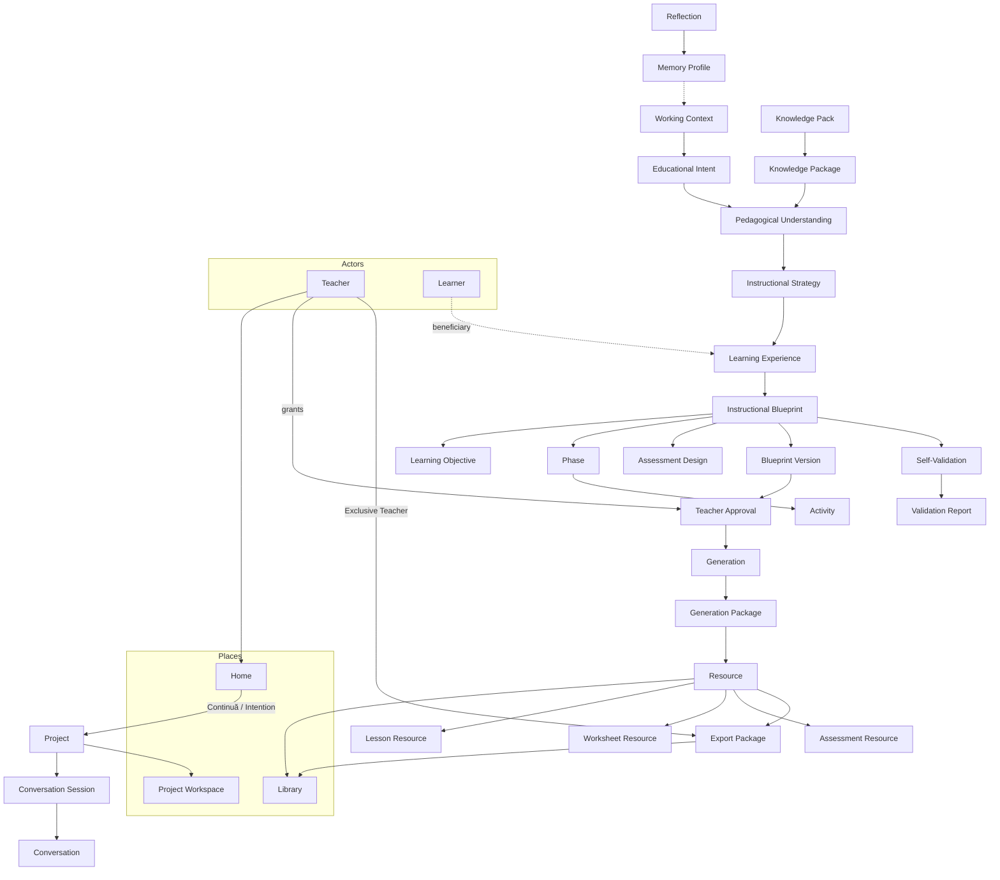

# PRIMA Constitutional Language

**Version:** 2.0  
**Status:** Official — Constitutional Vocabulary of PRIMA  
**Validity horizon:** ≥ 10 years  

> This is **not** a casual glossary.  
> This is the **official language** of PRIMA.

Every important concept has:

| Constraint | Meaning |
|------------|---------|
| **Exactly one official name** | No competing synonyms in technical surfaces |
| **Exactly one meaning** | No “it depends” without an amendment |
| **Exactly one owner** | One home domain or engine |
| **Exactly one lifecycle** | Declared states; no silent overwrite of identity |
| **Exactly one responsibility** | If it does two jobs, it is two concepts |

**Architectural principles of language**

1. **Every Concept Has One Home.**  
2. **Every Concept Has One Meaning.**  
3. **Every Concept Has One Owner.**  
4. **Every Concept Has One Lifecycle.**  
5. **Every Concept Has One Responsibility.**

**Binding surfaces:** documentation, UI concept-maps, code, API, database, AI prompts, workflows, future architecture.

**Precedence:** On naming or meaning conflict, **this document wins**. [`PRIMA_UBIQUITOUS_LANGUAGE.md`](./PRIMA_UBIQUITOUS_LANGUAGE.md) is the EPIC 4 register and **defers** to this constitution. Domain Model and Canonical Artifacts shall align.

**Interpretation test:** After reading an entry, two architects must not diverge. If they can, amend the entry.

---

# 1. Official PRIMA Vocabulary (registry)

Concepts are identified `CL-###`. Engines are `CL-E##`.

## 1.1 Platform & intelligence

| ID | Official Name | Owner Domain | Responsibility (one line) |
|----|---------------|--------------|---------------------------|
| CL-001 | LUDI ON | Product | The instructional design product |
| CL-002 | PRIMA | Intelligence | Pedagogical intelligence of LUDI ON |
| CL-003 | Educational Operating System | Intelligence | Constitutional intelligence layer (EOS) |
| CL-004 | Educational Cognitive Pipeline | EOS | Ordered cognitive stages S0–S9 |
| CL-005 | Orchestrator | Orchestration | Gate enforcement and engine sequencing |
| CL-006 | Decision Authority | EOS | Automatic→…→Exclusive Teacher policy |

## 1.2 Actors

| ID | Official Name | Owner Domain | Responsibility |
|----|---------------|--------------|----------------|
| CL-010 | Teacher | Teacher Interaction | Human authority; owns outcomes |
| CL-011 | Learner | Instructional Design (referent) | Beneficiary of the Learning Experience |
| CL-012 | Administrator | System Governance | Institutional/config authority (non-pedagogical) |

## 1.3 Experience places

| ID | Official Name | Owner Domain | Responsibility |
|----|---------------|--------------|----------------|
| CL-020 | Home | Product Experience | Door: Continuă + Intention |
| CL-021 | Project Workspace | Product Experience | Continuous surface inside a Project |
| CL-022 | Library | Product Experience | Reuse view of saved craft |
| CL-023 | Settings | Product Experience | Non-creative preferences |

## 1.4 Work aggregates

| ID | Official Name | Owner Domain | Responsibility |
|----|---------------|--------------|----------------|
| CL-030 | Project | Orchestration | Unit of educational work |
| CL-031 | Conversation Session | Orchestration | Bounded dialogue + pipeline state |
| CL-032 | Conversation | Teacher Interaction | Guided pedagogical dialogue |
| CL-033 | Continuă | Product Experience | Resume operation |
| CL-034 | Intention | Product Experience | Teacher entry act seeding Intent |

## 1.5 Cognition artifacts

| ID | Official Name | Owner Domain | Responsibility |
|----|---------------|--------------|----------------|
| CL-040 | Working Context | Context Engine | Situational truth for this run |
| CL-041 | Educational Intent | Intent Engine | Structured educational purpose |
| CL-042 | Pedagogical Understanding | Understanding Engine | Shared goals/learners/constraints |
| CL-043 | Instructional Strategy | Strategy Engine | How learning will proceed |
| CL-044 | Learning Experience | Instructional Design | Designed instructional outcome |
| CL-045 | Instructional Blueprint | Blueprint Engine | Authoritative design contract |
| CL-046 | Blueprint Version | Blueprint Engine | Immutable Blueprint identity |
| CL-047 | Teacher Approval | Teacher / Orchestrator | Explicit authorize record |
| CL-048 | Self-Validation | Validation Engine | Pre-review design critique |
| CL-049 | Realization Validation | Validation Engine | Post-generation fidelity critique |
| CL-050 | Validation Report | Validation Engine | Structured validation findings |
| CL-051 | Teacher Review | Teacher | Human plan examination/edit |
| CL-052 | Design Authorization | Orchestrator + Teacher | Stage granting/refusing approval |
| CL-053 | Generation | Generation Engine | Produce Resource drafts from approval |
| CL-054 | Generation Package | Generation | One generation run bundle |
| CL-055 | Reflection | Reflection Engine | Experience → candidate learning |
| CL-056 | Reflection Record | Reflection Engine | Structured reflection artifact |

## 1.6 Blueprint internals

| ID | Official Name | Owner Domain | Responsibility |
|----|---------------|--------------|----------------|
| CL-060 | Learning Objective | Instructional Design | Measurable intended learner outcome unit |
| CL-061 | Phase | Instructional Design | Ordered segment of the Learning Experience |
| CL-062 | Activity | Instructional Design | Designed action within a Phase |
| CL-063 | Assessment Design | Instructional Design | How learning will be evidenced (in Blueprint) |
| CL-064 | Differentiation Design | Instructional Design | How variance among Learners is addressed |
| CL-065 | Competency | Knowledge / Design | Referenced capability from curriculum knowledge |
| CL-066 | Curriculum | Knowledge | Structured expectations source (via packs) |

## 1.7 Knowledge & memory

| ID | Official Name | Owner Domain | Responsibility |
|----|---------------|--------------|----------------|
| CL-070 | Knowledge | Knowledge | Attributable educational substance domain |
| CL-071 | Knowledge Pack | Knowledge | Versioned curated release |
| CL-072 | Knowledge Object | Knowledge | Atomic curated unit |
| CL-073 | Knowledge Package | Knowledge Engine | Assembled evidence for a cognitive act |
| CL-074 | Memory | Memory | Teacher-controlled durable personalization domain |
| CL-075 | Memory Profile | Memory | Aggregate boundary for a Teacher’s memory |
| CL-076 | Memory Item | Memory | Single stored preference or pattern |

## 1.8 Resources & delivery

| ID | Official Name | Owner Domain | Responsibility |
|----|---------------|--------------|----------------|
| CL-080 | Resource | Generation | Editable classroom material from Approved Blueprint |
| CL-081 | Lesson Resource | Generation | Resource subtype: lesson materials |
| CL-082 | Worksheet Resource | Generation | Resource subtype: practice sheet |
| CL-083 | Assessment Resource | Generation | Resource subtype: assessment instrument |
| CL-084 | Presentation Resource | Generation | Resource subtype: slides/visuals |
| CL-085 | Story Resource | Generation | Resource subtype: narrative learning text |
| CL-086 | Game Resource | Generation | Resource subtype: game content |
| CL-087 | Rubric | Generation / Design | Scoring guide artifact (often with Assessment Resource) |
| CL-088 | Observation Protocol | Generation / Design | Structured classroom observation aid |
| CL-089 | Export Package | Generation / Orchestration | Teacher-finalized deliverable bundle |
| CL-090 | Teacher Note | Project | Free-text note inside Project (non-Blueprint) |

## 1.9 Engines (EOS)

| ID | Official Name | Owner | Responsibility |
|----|---------------|-------|----------------|
| CL-E01 | Context Engine | EOS | Assemble Working Context |
| CL-E02 | Knowledge Engine | EOS | Knowledge Assembly |
| CL-E03 | Intent Engine | EOS | Educational Intent lifecycle |
| CL-E04 | Understanding Engine | EOS | Pedagogical Understanding |
| CL-E05 | Instructional Strategy Engine | EOS | Instructional Strategy |
| CL-E06 | Blueprint Engine | EOS | Blueprint compose/version |
| CL-E07 | Validation Engine | EOS | Self- and Realization Validation |
| CL-E08 | Generation Engine | EOS | Generation execution |
| CL-E09 | Reflection Engine | EOS | Reflection |
| CL-E10 | Memory Engine | EOS | Memory persistence/views |

## 1.10 Explicitly not domain concepts (banned as Official Names)

| Term | Why banned | Use instead |
|------|------------|-------------|
| Dashboard | Legacy module place | Home |
| Studio / Builder | Implementation leakage | Project Workspace / Intention |
| AI Partner (place) | Intelligence as app | Conversation in Project Workspace |
| Chat / Chatbot | Product category error | Conversation |
| Scenario | Ambiguous design object | Instructional Blueprint |
| Quiz (as aggregate) | Format fetish | Assessment Resource or Game Resource subtype detail |
| Exercise (as aggregate) | Ambiguous | Worksheet Resource or Activity |
| Notification (as core pedagogy) | Peripheral product | Out of constitutional core until registered |
| Student (English architecture) | Prefer Learner | Learner; UI *elev* |

---

# 2. Canonical Definitions (core)

Full form for concepts most often contested. Remaining registry IDs inherit short definitions in §7.

---

### CL-001 — LUDI ON

| Field | Content |
|-------|---------|
| **Definition** | The product: AI-assisted instructional design platform for teachers. |
| **Purpose** | Deliver PRIMA-powered design and classroom craft under teacher authority. |
| **Owner Domain** | Product |
| **Lifecycle** | Product releases |
| **Relationships** | Contains PRIMA; surfaces Home, Project, Library |
| **Allowed Operations** | Brand, release, configure |
| **Forbidden Operations** | Equating LUDI ON with “the LLM” |
| **Typical Examples** | The web application teachers open |
| **Common Misunderstandings** | “LUDI ON is just a content marketplace” — false |

### CL-002 — PRIMA

| Field | Content |
|-------|---------|
| **Definition** | Pedagogical Reasoning and Instructional Model Architecture — intelligence of LUDI ON, realized as EOS. |
| **Purpose** | Partner in designing Learning Experiences. |
| **Owner Domain** | Intelligence |
| **Lifecycle** | Platform capability versions |
| **Relationships** | Implements EOS; partners with Teacher |
| **Allowed** | Named partner in UI |
| **Forbidden** | PRIMA = chatbot wrapper; PRIMA auto-approves |
| **Examples** | “PRIMA proposed a plan” |
| **Misunderstandings** | PRIMA is a separate consumer app from LUDI ON |

### CL-003 — Educational Operating System

| Field | Content |
|-------|---------|
| **Definition** | Constitutional intelligence layer: principles, invariants, engines, pipeline, Decision Authority. |
| **Purpose** | Stable educational law across technology change. |
| **Owner Domain** | Intelligence / Architecture |
| **Lifecycle** | Versioned constitution |
| **Relationships** | Contains Pipeline and Engines |
| **Allowed** | Conformance claims |
| **Forbidden** | UI label “EOS” for teachers |
| **Examples** | Gate: no Generation without Teacher Approval |
| **Misunderstandings** | EOS is a cloud OS or LLM OS product |

### CL-010 — Teacher

| Field | Content |
|-------|---------|
| **Definition** | Human instructional designer with final authority over approval, edits, export, publication. |
| **Purpose** | Professional responsibility for learning design outcomes. |
| **Owner Domain** | Teacher Interaction |
| **Lifecycle** | Account / professional tenure |
| **Relationships** | Owns Projects, Memory Profile, Approvals, Exports |
| **Allowed** | Approve, refuse, edit, export, override recommendations |
| **Forbidden** | AI forging Teacher Approval |
| **Examples** | Primary school teacher preparing tomorrow’s lesson |
| **Misunderstandings** | Teacher is a form-filling operator |

### CL-011 — Learner

| Field | Content |
|-------|---------|
| **Definition** | Pupil/student for whom the Learning Experience is designed. |
| **Purpose** | Pedagogical beneficiary — not PRIMA operator (MVP). |
| **Owner Domain** | Instructional Design (referent) |
| **Lifecycle** | Classroom reality; lightly modeled when Teacher provides traits |
| **Relationships** | Target of Learning Experience |
| **Allowed** | Described in Understanding when stated |
| **Forbidden** | Invented diagnoses; silent minor profiling into Memory |
| **Examples** | “Clasa a III-a, 28 elevi” |
| **Misunderstandings** | Learner has a PRIMA login in MVP |

### CL-020 — Home

| Field | Content |
|-------|---------|
| **Definition** | Primary product door: Continuă and Intention. |
| **Purpose** | Orient; start or resume work with low cognitive load. |
| **Owner Domain** | Product Experience |
| **Lifecycle** | Persistent place |
| **Relationships** | Opens Project; links Library |
| **Allowed** | Continuă, intentions, soft suggestions |
| **Forbidden** | Builder grids; Blueprint jargon; statistics as primary |
| **Examples** | “Ce ai vrea să pregătești azi?” |
| **Misunderstandings** | Home = analytics dashboard |

### CL-030 — Project

| Field | Content |
|-------|---------|
| **Definition** | Aggregate for one educational effort: intent thread, conversation, blueprint lineage, resources, notes. |
| **Purpose** | Single unit of work and continuity. |
| **Owner Domain** | Orchestration |
| **Lifecycle** | active → paused → completed → archived |
| **Relationships** | Contains Conversation Sessions; Resources; references Blueprint Versions |
| **Allowed** | Create, resume, improve, archive |
| **Forbidden** | Orphan Resources; duplicate shadow Projects for same effort without lineage |
| **Examples** | “Fracții — clasa a III-a” |
| **Misunderstandings** | Project = single exported PDF |

### CL-021 — Project Workspace

| Field | Content |
|-------|---------|
| **Definition** | Continuous Teacher surface inside a Project (dialogue, plan, resources). |
| **Purpose** | One place — no app-switching mid-prep. |
| **Owner Domain** | Product Experience |
| **Lifecycle** | While Project open |
| **Relationships** | Embodies Pipeline without exposing engine names |
| **Allowed** | Modes Discutăm / Planul / Resurse |
| **Forbidden** | Peer “AI app” outside Project |
| **Examples** | Working on Fotosinteză plan and fișă together |
| **Misunderstandings** | Workspace = IDE settings |

### CL-040 — Working Context

| Field | Content |
|-------|---------|
| **Definition** | Situational truth for this run (who, Project, known class facts, entry, preferences in force). |
| **Purpose** | Ground cognition; avoid re-asking known facts. |
| **Owner Domain** | Context Engine |
| **Lifecycle** | Assembled per run; Sparse \| Partial \| Sufficient |
| **Relationships** | Reads Memory views; feeds Intent/Understanding; ≠ Knowledge |
| **Allowed** | Bind, refresh, declare unknowns |
| **Forbidden** | Invent school/class facts; store curriculum as Context |
| **Examples** | Teacher = Octavian; Project = Fracții; grade known |
| **Misunderstandings** | Context = prompt window; Context = curriculum |

### CL-041 — Educational Intent

| Field | Content |
|-------|---------|
| **Definition** | Structured educational purpose for this cycle, bound to a Project. |
| **Purpose** | North star; block format-first generation. |
| **Owner Domain** | Intent Engine |
| **Lifecycle** | Emerging → Stable → Superseded |
| **Relationships** | Seeded by Intention; feeds Understanding |
| **Allowed** | Infer, confirm, revise |
| **Forbidden** | Equating to raw prompt; Generation from Intent alone |
| **Examples** | “Elevii să compare fracții unitare mâine” |
| **Misunderstandings** | Intent = “make a quiz” without learner outcome |

### CL-042 — Pedagogical Understanding

| Field | Content |
|-------|---------|
| **Definition** | Shared model of goals, learners, constraints, risks, success — sufficient to strategize. |
| **Purpose** | Gate into Instructional Strategy. |
| **Owner Domain** | Understanding Engine |
| **Lifecycle** | Refined until Understanding Ready |
| **Relationships** | Consumes Intent, Working Context, Knowledge Packages |
| **Allowed** | Mirror, correct, deepen |
| **Forbidden** | Treating Understanding as Blueprint approval |
| **Examples** | Mirrored goals confirmed by Teacher |
| **Misunderstandings** | Understanding = chat transcript dump |

### CL-043 — Instructional Strategy

| Field | Content |
|-------|---------|
| **Definition** | Explicit approach: sequencing, activity-pattern stance, assessment stance, differentiation stance, time hypothesis. |
| **Purpose** | Bridge Understanding → Blueprint. |
| **Owner Domain** | Instructional Strategy Engine |
| **Lifecycle** | proposed → confirmed → superseded |
| **Relationships** | Required before Blueprint composition |
| **Allowed** | Propose, confirm, switch |
| **Forbidden** | Skip Strategy; hide Strategy only inside prompts |
| **Examples** | Guided practice → formative check; 45 minutes |
| **Misunderstandings** | Strategy = Resource type picker |

### CL-044 — Learning Experience

| Field | Content |
|-------|---------|
| **Definition** | Designed instructional outcome for Learners (what they do, learn, demonstrate). |
| **Purpose** | Name the object of design — not a file format. |
| **Owner Domain** | Instructional Design |
| **Lifecycle** | Designed → authorized → realized → refined |
| **Relationships** | Described by Instructional Blueprint; realized by Resources |
| **Allowed** | Design, approve, realize |
| **Forbidden** | Synonymizing with Lesson Resource |
| **Examples** | Tomorrow’s fractions learning design |
| **Misunderstandings** | Learning Experience = the PDF worksheet |

### CL-045 — Instructional Blueprint

| Field | Content |
|-------|---------|
| **Definition** | Authoritative pedagogical design contract (objectives, phases, activities, differentiation, assessment approach, resource requirements). Design only — not worksheet prose. |
| **Purpose** | Sole design authority before Generation. |
| **Owner Domain** | Blueprint Engine |
| **Lifecycle** | draft → self-validated → teacher-reviewed → approved → superseded |
| **Relationships** | Contains Objectives, Phases, Activities, Assessment Design; versions via Blueprint Version |
| **Allowed** | Compose, edit pre-approval, version, approve |
| **Forbidden** | Generation without approval; post-approval silent mutation |
| **Examples** | Plan with 3 phases and formative check |
| **Misunderstandings** | Blueprint = generated lesson text; Blueprint = “scenario” |

**Teacher-facing label:** Plan pedagogic.

### CL-046 — Blueprint Version

| Field | Content |
|-------|---------|
| **Definition** | Immutable identity of a Blueprint revision, especially approved snapshots. |
| **Purpose** | Traceability; approval binding. |
| **Owner Domain** | Blueprint Engine / Governance |
| **Lifecycle** | Minted on material change; approved versions immutable for cycle |
| **Relationships** | Bound by Teacher Approval; referenced by Generation Package |
| **Allowed** | Mint, bind, supersede via new version |
| **Forbidden** | In-place overwrite of approved version |
| **Examples** | `bp-fracții-v3-approved` |
| **Misunderstandings** | Version = UI theme version |

### CL-047 — Teacher Approval

| Field | Content |
|-------|---------|
| **Definition** | Explicit Teacher act/record authorizing a Blueprint Version for Generation. |
| **Purpose** | Non-delegable educational commitment. |
| **Owner Domain** | Teacher (authority); Orchestrator (binding) |
| **Lifecycle** | granted → archived on supersession; never implicit |
| **Relationships** | Unlocks Generation; does not auto-publish |
| **Allowed** | Grant, refuse, re-open via new version |
| **Forbidden** | Auto-approve; timeout-approve; AI-signed approval |
| **Examples** | Click “Aprobă planul” |
| **Misunderstandings** | Self-Validation = Approval |

### CL-048 — Self-Validation

| Field | Content |
|-------|---------|
| **Definition** | Mandatory EOS critique of Blueprint Draft before ready Teacher Review. |
| **Purpose** | Coherence, curriculum, objective/activity/assessment alignment, differentiation, time realism. |
| **Owner Domain** | Validation Engine |
| **Lifecycle** | Per draft; ReadyForReview / ReadyWithWarnings / BlockedFromReview |
| **Relationships** | Emits Validation Report; cannot approve |
| **Allowed** | Block ready presentation |
| **Forbidden** | Substituting for Teacher Approval |
| **Examples** | Block: assessment ignores stated objectives |
| **Misunderstandings** | Validation = spellcheck only |

### CL-053 — Generation

| Field | Content |
|-------|---------|
| **Definition** | Execution that produces Resource drafts from an Approved Blueprint Version. Not design. |
| **Purpose** | Realize Learning Experience as editable materials. |
| **Owner Domain** | Generation Engine |
| **Lifecycle** | authorized → running → drafted → validated |
| **Relationships** | Requires Teacher Approval; emits Generation Package + Resources |
| **Allowed** | Scoped regenerate |
| **Forbidden** | Designing in Generation; mutating Approved Blueprint; auto-publish |
| **Examples** | Generate Lesson Resource after approval |
| **Misunderstandings** | Opening chat “generates the lesson” immediately |

### CL-080 — Resource

| Field | Content |
|-------|---------|
| **Definition** | Editable classroom material derived from an Approved Blueprint. |
| **Purpose** | Teacher craft: edit, export, reuse. |
| **Owner Domain** | Generation (create); Teacher (edits/finality) |
| **Lifecycle** | draft → ready → exported/archived |
| **Relationships** | Traces to Blueprint sections; lives in Project; may appear in Library |
| **Allowed** | Edit, export, scoped regen |
| **Forbidden** | Authoritative Resource without Approved Blueprint |
| **Examples** | Fișă PDF draft; lesson outline editable |
| **Misunderstandings** | Resource = Blueprint; Resource = any chat message |

### CL-060 — Learning Objective

| Field | Content |
|-------|---------|
| **Definition** | Measurable intended Learner outcome unit inside the Blueprint. |
| **Purpose** | Align activities and assessment. |
| **Owner Domain** | Instructional Design / Blueprint Engine |
| **Lifecycle** | Draft with Blueprint; frozen on approval for cycle |
| **Relationships** | Part of Blueprint; may reference Competency |
| **Allowed** | Add, edit pre-approval |
| **Forbidden** | Orphan objectives outside Blueprint |
| **Examples** | “Compară fracții unitare cu același numitor” |
| **Misunderstandings** | Objective = lesson title |

### CL-061 — Phase

| Field | Content |
|-------|---------|
| **Definition** | Ordered segment of the Learning Experience (e.g. activate → construct → apply). |
| **Purpose** | Structure time and pedagogy. |
| **Owner Domain** | Instructional Design |
| **Lifecycle** | With Blueprint |
| **Relationships** | Contains Activities; belongs to Blueprint |
| **Allowed** | Reorder pre-approval |
| **Forbidden** | Equating Phase with Resource |
| **Examples** | “Aplicare — 15 min” |
| **Misunderstandings** | Phase = UI wizard step |

### CL-062 — Activity

| Field | Content |
|-------|---------|
| **Definition** | Designed Learner/Teacher action within a Phase (instructional design unit). |
| **Purpose** | Specify what happens pedagogically. |
| **Owner Domain** | Instructional Design |
| **Lifecycle** | With Blueprint |
| **Relationships** | Serves Learning Objectives; may imply later Resources |
| **Allowed** | Define, align to objectives |
| **Forbidden** | Using Activity as entry “builder type”; Activity = Game Resource |
| **Examples** | “Lucru în perechi: sortează fracții” |
| **Misunderstandings** | Activity Type picker as product entry |

### CL-063 — Assessment Design

| Field | Content |
|-------|---------|
| **Definition** | Blueprint section describing how learning will be evidenced (approach, criteria stance) — not the item bank text. |
| **Purpose** | Align evidence with objectives before Generation. |
| **Owner Domain** | Instructional Design |
| **Lifecycle** | With Blueprint |
| **Relationships** | Informs Assessment Resource generation |
| **Allowed** | Specify formative/summative stance |
| **Forbidden** | Confusing with Assessment Resource |
| **Examples** | “Evaluare formativă orală + 3 itemi” |
| **Misunderstandings** | Assessment = Quiz builder |

### CL-070 / CL-071 / CL-073 — Knowledge triad

| Name | Definition (distinct) |
|------|----------------------|
| **Knowledge** | Domain of attributable educational substance |
| **Knowledge Pack** | Versioned curated release |
| **Knowledge Package** | Assembled, provenance-bearing evidence for one cognitive act |

**Misunderstanding to eliminate:** Using one word “knowledge” for all three.

### CL-074 / CL-075 — Memory triad start

| Name | Definition |
|------|------------|
| **Memory** | Domain of teacher-controlled durable personalization |
| **Memory Profile** | Aggregate boundary per Teacher |

≠ Working Context; ≠ Knowledge Pack.

### CL-032 — Conversation

| Field | Content |
|-------|---------|
| **Definition** | Guided pedagogical dialogue inside a Project. |
| **Purpose** | Form Intent and Understanding. |
| **Owner Domain** | Teacher Interaction |
| **Lifecycle** | Within Conversation Session |
| **Allowed** | Ask, mirror, propose |
| **Forbidden** | Official name “Chat”; Conversation = Generation |
| **Misunderstandings** | Unlimited ChatGPT session is the product |

### CL-022 — Library

| Field | Content |
|-------|---------|
| **Definition** | Teacher-facing portfolio of reusable craft from Projects/Exports. |
| **Purpose** | Reuse-before-create. |
| **Owner Domain** | Product Experience |
| **Lifecycle** | Grows with saves/exports |
| **Forbidden** | Library as design authority replacing Blueprint |
| **Misunderstandings** | Library = public content marketplace (MVP) |

### CL-023 — Settings

| Field | Content |
|-------|---------|
| **Definition** | Non-creative preferences (language, notifications peripheral, account). |
| **Purpose** | Configuration without competing with Home. |
| **Owner Domain** | Product Experience |
| **Forbidden** | Pedagogical design decisions buried only in Settings |
| **Misunderstandings** | Settings = instructional strategy |

### CL-012 — Administrator

| Field | Content |
|-------|---------|
| **Definition** | Role for institutional/platform configuration — not Learning Experience designer by default. |
| **Purpose** | School/platform ops when product supports it. |
| **Owner Domain** | System Governance |
| **Forbidden** | Administrator silently approving Blueprints for Teachers |
| **Misunderstandings** | Admin replaces Teacher authority |

---

# 3. Naming Standard

## 3.1 Official rules

| ID | Rule |
|----|------|
| **NS-01** | Persistent concepts use **nouns** as Official Names. |
| **NS-02** | Teacher/system **operations** use verbs in prose (`approve`, `generate`, `export`); persisted records remain nouns (`TeacherApproval`). |
| **NS-03** | **States** use adjectives or past participles (`draft`, `approved`, `ready`) — not new concept nouns. |
| **NS-04** | Cognitive capability modules end with **`Engine`**. |
| **NS-05** | **Orchestrator** does not end with Engine. |
| **NS-06** | Instructional Blueprint is **never** named Scenario, Plan-as-separate-artifact, or Prompt. |
| **NS-07** | Learning Experience is **never** named Lesson in architecture; Lesson is only a **Resource subtype** qualifier. |
| **NS-08** | Teacher-facing RO labels map **1:1** to Official Names; UI may hide internal names. |
| **NS-09** | Resource subtypes use the pattern `{Kind} Resource` in English technical language. |
| **NS-10** | Unqualified “Context” is forbidden in new writing — use **Working Context**. |
| **NS-11** | Unqualified “Validation” is forbidden — use Self-Validation or Realization Validation. |
| **NS-12** | Unqualified “Approval” is forbidden — use **Teacher Approval**. |
| **NS-13** | No place-names from implementation (`Studio`, `Builder`, `Module`) as Official Names. |
| **NS-14** | “AI” is not a domain object; name PRIMA, EOS, or the Engine. |
| **NS-15** | New concepts require registry amendment before use in API/DB/UI. |

## 3.2 Challenges accepted

| Proposed simplistic rule | Verdict |
|--------------------------|---------|
| “Every workflow is a verb” | **Rejected** — workflows compose stages; verb-only naming collides with nouns (`Generation`). |
| “Blueprint must appear as Blueprint in UI” | **Rejected** — Plan pedagogic is mandatory Teacher label. |
| “Never Romanian in any doc” | **Rejected** — UI mapping table is normative; architecture stays English Official Names. |

---

# 4. Concept Relationship Diagram

---

# 5. Deprecated Terminology

| Ambiguous / legacy | Canonical | Why |
|--------------------|-----------|-----|
| Dashboard | **Home** | Door ≠ analytics module |
| Studio / Builder | **Project Workspace** / Intention | Implementation leakage |
| AI Partner (nav place) | **Conversation** in Project | Intelligence is not a peer app |
| Chat / Chatbot | **Conversation** | Wrong product category |
| Teacher Intent | **Educational Intent** | EOS alignment |
| Scenario | **Instructional Blueprint** | Ambiguous fiction/planning |
| Plan (unqualified) | **Instructional Blueprint** or Plan pedagogic (UI only) | Collides with Strategy |
| Lesson (for whole design) | **Learning Experience** | Lesson = Resource subtype |
| Experience (unqualified) | **Learning Experience** or PRIMA partnership prose | Too vague alone |
| Activity Type (entry) | Intention + **Instructional Strategy** | Tool taxonomy |
| Activity (when meaning Resource) | **Resource** / subtype | Design vs material |
| Session (unqualified) | **Conversation Session** | Ambiguous login session |
| Quiz (aggregate) | **Assessment Resource** or detail inside Game Resource | Format fetish |
| Assessment (unqualified) | **Assessment Design** vs **Assessment Resource** | Must qualify |
| Worksheet / Fișă (as design contract) | **Worksheet Resource** | Not Blueprint |
| Exercise | **Activity** or **Worksheet Resource** | Split meaning |
| Exercise sheet | **Worksheet Resource** | |
| Knowledge (unqualified when meaning pack/package) | Qualify triad | Three distinct concepts |
| Context (unqualified) | **Working Context** | |
| Validation (unqualified) | Self- / Realization Validation | |
| Approval (unqualified) | **Teacher Approval** | |
| Student (architecture EN) | **Learner** | Consistency |
| Generated Resource / Learning Resource | **Resource** | One name |
| Reflection Report vs Record | **Reflection Record** | Align EOS |
| Decision Engine (monolith) | **Decision Authority** + engines | EOS |
| Notification (as core) | Unregistered until amended | Not pedagogical core |
| Settings as creative home | **Settings** peripheral only | |

---

# 6. Audience Language Matrix

| Concept | Teacher UI | Administrator | AI / prompts | Developer | Database / API |
|---------|------------|---------------|--------------|-----------|----------------|
| Home | Acasă | — | Home | `Home` | — |
| Project | Proiect | school project lists if any | Project | `Project` | `projects` |
| Project Workspace | inside Proiect | — | Project Workspace | UI routes under project | — |
| Continuă | Continuă | — | Continuă / resume | `continue` action | — |
| Conversation | Discutăm / Conversație | — | Conversation | `Conversation` | `conversation_sessions` |
| Educational Intent | (goal language; rarely labeled) | — | Educational Intent | `EducationalIntent` | `educational_intents` |
| Working Context | invisible | — | Working Context | `WorkingContext` | `working_contexts` / ephemeral |
| Knowledge Package | invisible | pack admin maybe | Knowledge Package | `KnowledgePackage` | ephemeral / cache |
| Knowledge Pack | invisible | **yes** (content ops) | Knowledge Pack | `KnowledgePack` | `knowledge_packs` |
| Pedagogical Understanding | oglindire în dialog | — | Pedagogical Understanding | `PedagogicalUnderstanding` | JSON/doc |
| Instructional Strategy | Abordare | — | Instructional Strategy | `InstructionalStrategy` | `instructional_strategies` |
| Learning Experience | experiență de învățare (rare label) | — | Learning Experience | `LearningExperience` | attributed on project |
| Instructional Blueprint | **Plan pedagogic** | audit views | Instructional Blueprint | `InstructionalBlueprint` | `blueprints` |
| Blueprint Version | version hint optional | audit | Blueprint Version | `BlueprintVersion` | `blueprint_versions` |
| Self-Validation | warnings in plan UI | — | Self-Validation | `SelfValidation` | via `validation_reports` |
| Teacher Review | Revizuire plan | — | Teacher Review | UX state | — |
| Teacher Approval | Aprobă planul | never auto | Teacher Approval | `TeacherApproval` | `teacher_approvals` |
| Generation | Generează | — | Generation | `Generation` | `generation_packages` |
| Resource | Resursă / Lecție / Fișă… | — | Resource + subtype | `Resource` | `resources` |
| Library | Bibliotecă | — | Library | `Library` views | indexes |
| Memory Profile | Preferințe / memorie (control) | privacy ops | Memory Profile | `MemoryProfile` | `memory_profiles` |
| Reflection | Reflecție optional | — | Reflection | `Reflection` | `reflection_records` |
| Settings | Setări | platform settings | Settings | `Settings` | `settings` |
| Learner | elev | roster if any | Learner | `Learner` | optional |
| EOS / Engines | **hidden** | architecture docs | EOS names in system prompts | Engine types | — |
| Orchestrator | **hidden** | — | may be named in sys prompts | `Orchestrator` | — |
| Administrator | — | Admin console | — | `Administrator` | `admins` |

**Rule:** Teachers never need the words EOS, Engine, Orchestrator, Working Context, or Knowledge Package. Developers and AI system prompts **must** use Official Names for gates and artifacts.

---

# 7. Constitutional Glossary (alphabetical)

| Official Name | ID | One-sentence definition |
|---------------|-----|-------------------------|
| Activity | CL-062 | Designed action within a Phase of the Blueprint |
| Administrator | CL-012 | Institutional/config role without default pedagogical authority |
| Assessment Design | CL-063 | Blueprint description of how learning will be evidenced |
| Assessment Resource | CL-083 | Resource subtype: assessment instrument |
| Blueprint Version | CL-046 | Immutable Blueprint revision identity |
| Competency | CL-065 | Curriculum-referenced capability used in design |
| Context Engine | CL-E01 | Assembles Working Context |
| Continuă | CL-033 | Resume in-progress Project |
| Conversation | CL-032 | Guided pedagogical dialogue |
| Conversation Session | CL-031 | Bounded dialogue + pipeline state aggregate |
| Curriculum | CL-066 | Structured expectations accessed via Knowledge |
| Decision Authority | CL-006 | Automatic→Recommend→Confirm→Authorize→Exclusive Teacher |
| Design Authorization | CL-052 | Stage for granting/refusing Teacher Approval |
| Differentiation Design | CL-064 | Blueprint treatment of Learner variance |
| Educational Cognitive Pipeline | CL-004 | Ordered EOS cognitive stages |
| Educational Intent | CL-041 | Structured educational purpose for a cycle |
| Educational Operating System | CL-003 | Constitutional intelligence layer |
| Export Package | CL-089 | Teacher-finalized deliverable bundle |
| Game Resource | CL-086 | Resource subtype: game content |
| Generation | CL-053 | Produce Resource drafts from Approved Blueprint |
| Generation Engine | CL-E08 | Executes Generation |
| Generation Package | CL-054 | Bundle for one generation run |
| Home | CL-020 | Product door: Continuă + Intention |
| Instructional Blueprint | CL-045 | Authoritative pedagogical design contract |
| Instructional Strategy | CL-043 | Explicit approach before Blueprint |
| Instructional Strategy Engine | CL-E05 | Owns Instructional Strategy |
| Intention | CL-034 | Teacher entry act seeding Educational Intent |
| Intent Engine | CL-E03 | Owns Educational Intent |
| Knowledge | CL-070 | Domain of attributable educational substance |
| Knowledge Engine | CL-E02 | Assembles Knowledge Packages |
| Knowledge Object | CL-072 | Atomic curated knowledge unit |
| Knowledge Pack | CL-071 | Versioned curated knowledge release |
| Knowledge Package | CL-073 | Provenance-bearing assembly for a cognitive act |
| Learner | CL-011 | Beneficiary of the Learning Experience |
| Learning Experience | CL-044 | Designed instructional outcome for Learners |
| Learning Objective | CL-060 | Measurable outcome unit in the Blueprint |
| Lesson Resource | CL-081 | Resource subtype: lesson materials |
| Library | CL-022 | Reuse portfolio of saved craft |
| LUDI ON | CL-001 | The instructional design product |
| Memory | CL-074 | Teacher-controlled durable personalization domain |
| Memory Engine | CL-E10 | Persists Memory / exposes views |
| Memory Item | CL-076 | Single memory preference or pattern |
| Memory Profile | CL-075 | Aggregate boundary for Teacher memory |
| Observation Protocol | CL-088 | Structured observation aid artifact |
| Orchestrator | CL-005 | Gate enforcement and sequencing kernel |
| Pedagogical Understanding | CL-042 | Shared understanding sufficient to strategize |
| Phase | CL-061 | Ordered segment of the Learning Experience |
| Plan pedagogic | UI↔CL-045 | Teacher-facing label for Instructional Blueprint |
| Presentation Resource | CL-084 | Resource subtype: presentation |
| PRIMA | CL-002 | Pedagogical intelligence of LUDI ON |
| Project | CL-030 | Unit of educational work |
| Project Workspace | CL-021 | Continuous surface inside a Project |
| Realization Validation | CL-049 | Post-generation fidelity validation |
| Reflection | CL-055 | Experience → candidate learning |
| Reflection Engine | CL-E09 | Owns Reflection |
| Reflection Record | CL-056 | Structured reflection artifact |
| Resource | CL-080 | Editable classroom material from Approved Blueprint |
| Rubric | CL-087 | Scoring guide artifact |
| Self-Validation | CL-048 | Pre-review design critique |
| Settings | CL-023 | Non-creative preferences |
| Story Resource | CL-085 | Resource subtype: narrative learning text |
| Teacher | CL-010 | Human authority over outcomes |
| Teacher Approval | CL-047 | Explicit authorization of a Blueprint Version |
| Teacher Note | CL-090 | Free-text note in Project |
| Teacher Review | CL-051 | Human examination/edit of plan |
| Understanding Engine | CL-E04 | Owns Pedagogical Understanding |
| Validation Engine | CL-E07 | Owns validation acts and reports |
| Validation Report | CL-050 | Structured validation findings |
| Working Context | CL-040 | Situational truth for this run |
| Worksheet Resource | CL-082 | Resource subtype: practice sheet |

---

# 8. Validation Report (language quality)

## 8.1 Duplicate meanings eliminated

| Collision | Resolution |
|-----------|------------|
| Lesson vs Learning Experience | Learning Experience = design; Lesson Resource = material |
| Assessment vs Assessment Resource | Assessment Design in Blueprint; Assessment Resource after Generation |
| Context vs Knowledge | Working Context vs Knowledge triad |
| Activity vs Resource | Activity in Blueprint; Resource after approval |
| Validation vs Approval | Self-Validation ≠ Teacher Approval |
| Plan vs Blueprint vs Strategy | Strategy → Blueprint; UI Plan pedagogic = Blueprint |
| Session vs Conversation | Conversation Session aggregate; Conversation = dialogue |
| Intent vs Intention | Intention = UI entry; Educational Intent = artifact |

## 8.2 Weak definitions reinforced

| Concept | Prior weakness | Fix |
|---------|----------------|-----|
| Resource | Multiple English names | Single Official Name + subtypes |
| Knowledge | One word, three jobs | Pack / Object / Package |
| Workspace | Vague | Project Workspace only |
| Generation | Confused with chat output | Requires Teacher Approval |

## 8.3 Remaining conflicts to align in other docs

| Source | Conflict | Recommendation |
|--------|----------|----------------|
| Project Bible | Dashboard; eight-engine list | Amend to Home; EOS engine set |
| Canonical Artifacts | Teacher Intent | Rename to Educational Intent |
| Domain Model | Learning Resource | Alias → Resource |
| UI code | Create / AI Partner places | Migrate to Project Workspace Conversation |
| Reflection Report vs Record | Dual naming | Prefer Reflection Record |

## 8.4 Hidden ambiguity / future risks

| Risk | Mitigation |
|------|------------|
| “Activity” reintroduced as builder entry | NS + deprecated list; PR reviews |
| New Resource kinds invent new aggregates | Always `{Kind} Resource` under CL-080 |
| Multimodal tutors invent “Agent” as peer to Teacher | Register new concept before shipping; never auto-approve |
| School admin features blur Teacher Approval | Administrator cannot grant Teacher Approval |
| Romanian synonyms drift (`plan`, `proiect didactic`) | Maintain §6 mapping; one RO label per concept |
| Quiz as marketplace SKU | Keep as content detail under Assessment/Game Resource |

## 8.5 Improvements recommended next

1. Patch Project Bible terminology to this constitution.  
2. Global rename Teacher Intent → Educational Intent in Canonical Artifacts.  
3. Add CI lint (optional) forbidding deprecated terms in `/docs` and `/src` identifiers over time.  
4. Publish RO mapping as the only UI copy source for core nouns.  
5. Re-run this Validation Report on each major EOS version.

---

## Closing

> **One name. One meaning. One owner. One lifecycle. One responsibility.**

Workers, UIs, and databases will change.  
**Constitutional Language does not.**

If a term needs a meeting to explain, it is not yet constitutional — amend this document until it is.
