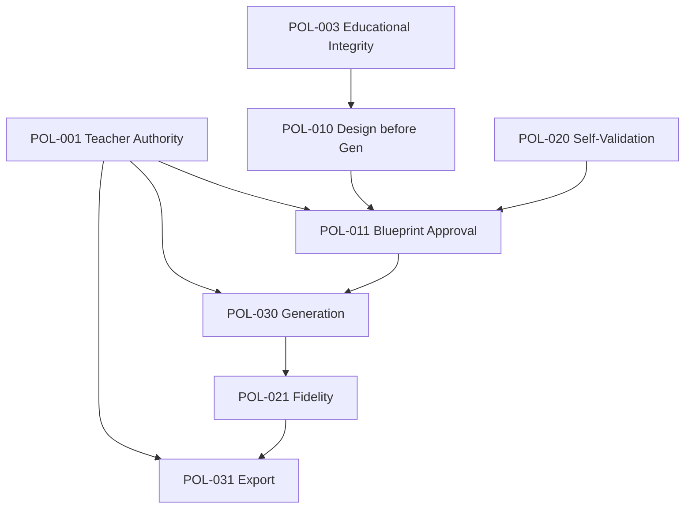
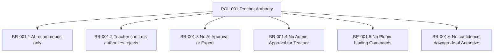
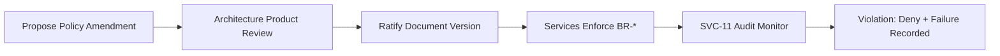
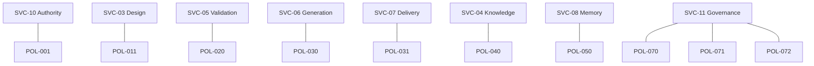

# PRIMA Constitutional Policies & Business Rules

**Version:** 1.0  
**Status:** Official — Constitutional Governance Model  
**Validity horizon:** ≥ 10 years  

> **Policies** define invariant business truths (**WHY**).  
> **Business Rules** define conceptual enforcement (**HOW**, without technology).  
> Policies **cannot be bypassed** by UI, APIs, models, plugins, or delivery pressure.

**Compliance:** Every future module, AI worker, service, plugin, and interface must comply.

**Precedence:** On governance conflict with engine or solution docs, **this document wins** until deliberately amended.

---

## How to read this constitution

| Term | Meaning |
|------|---------|
| **Policy (POL-*)** | Permanent invariant |
| **Business Rule (BR-*)** | Conceptual enforcement of a Policy |
| **Violation** | Attempted illegal Command, transition, or silent skip |
| **Consequence** | Reject Command; emit DomainFailureRecorded; no success Event |

---

# 1. Policy Categories (challenged)

| Proposed | Verdict | Official category |
|----------|---------|-------------------|
| Educational Policies | Keep | **Educational Integrity** |
| Governance Policies | Keep | **Authority & Governance** |
| Knowledge Policies | Keep | **Knowledge** |
| Validation Policies | Keep | **Validation** |
| Generation Policies | Keep | **Realization** |
| Security Policies | Keep | **Security & Tenancy** |
| Memory / Reflection | Keep | **Memory & Reflection** |
| Audit / Traceability | Keep | **Audit & Traceability** |
| Platform / Versioning | Keep | **Platform & Versioning** |
| Collaboration / Plugin | Keep | **Extensibility (Future-ready)** |
| Continuity / Reuse | **Add** | **Continuity & Reuse** |
| Query / Information | **Add** | **Information Access** |

---

# 2. Constitutional Policy Catalog

---

## 2.1 Authority & Governance

### POL-001 — Teacher Authority Policy
| Field | Content |
|-------|---------|
| **Purpose** | Preserve Teacher as final educational authority |
| **Meaning** | PRIMA proposes; Teacher decides binding outcomes |
| **Scope** | All binding Commands and Approvals |
| **Aggregates** | Teacher, TeacherApproval, BlueprintVersion, ExportPackage, MemoryItem, InstructionalStrategy |
| **Services** | SVC-10 Authority; consumers SVC-02/03/06/07/08 |
| **Commands** | SelectInstructionalStrategy, ApproveBlueprint, AuthorizeResourceGeneration, MarkResourceReady, ExportDeliverable, Accept/Reject/DeleteMemoryItem |
| **Events** | *Selected, BlueprintApproved, ResourceGenerationAuthorized, ResourceMarkedReady, DeliverableExported, MemoryItemAccepted… |
| **Decisions** | DEC-031, 060–062, 081 |
| **States** | Strategy Confirmed; Blueprint Approved; Resource Ready; Export Delivered; Memory Accepted |
| **Exceptions** | None for binding acts — Temporary Suspended Teacher blocks acts |
| **Violation Consequences** | Command Denied; no success Event; optional DomainFailureRecorded |

**Business Rules**
- **BR-001.1** AI/PRIMA may Recommend and Propose only.  
- **BR-001.2** Teacher may Confirm, Authorize, Reject, Override recommendations.  
- **BR-001.3** AI must never appear as grantor of TeacherApproval or Export.  
- **BR-001.4** Administrator must never Approve Blueprints for Teachers.  
- **BR-001.5** Plugins must never issue Teacher-only Commands.  
- **BR-001.6** Decision Authority level Exclusive Teacher / Authorize cannot be downgraded by confidence scores.

---

### POL-002 — Decision Authority Precedence Policy
| Field | Content |
|-------|---------|
| **Purpose** | Bind EOS Automatic→…→Exclusive Teacher levels |
| **Meaning** | Higher authority levels override lower for binding outcomes |
| **Scope** | All Decisions DEC-* |
| **Services** | All; Orchestrator coordination |
| **Exceptions** | None |
| **Violations** | Treating Recommend as Authorize |

**Business Rules**
- **BR-002.1** Automatic may continue only for non-binding ops.  
- **BR-002.2** Recommend never silently becomes Confirm.  
- **BR-002.3** Authorize and Exclusive Teacher require explicit Teacher Commands.

---

### POL-003 — Educational Integrity Policy
| Field | Content |
|-------|---------|
| **Purpose** | Keep PRIMA an instructional design platform, not a content vending machine |
| **Meaning** | Learning Experience design precedes Resources |
| **Scope** | Entire EOS pipeline |
| **Aggregates** | Intent, Strategy, Blueprint, Resource |
| **Related** | DesignBeforeGeneration, Validation, Knowledge |
| **Exceptions** | None that skip design for “speed” |
| **Violations** | Generate from Intent alone; builder-first entry as product law |

**Business Rules**
- **BR-003.1** Educational Intent must be meaningful before Strategy.  
- **BR-003.2** Format-only requests must clarify learner outcomes (DEC-020).  
- **BR-003.3** Resource kinds never replace Blueprint as design authority.  
- **BR-003.4** Pedagogy-visible language in Teacher outcomes; engines hidden.

---

## 2.2 Educational design & Blueprint

### POL-010 — Design Before Generation Policy
| Field | Content |
|-------|---------|
| **Purpose** | Enforce cognitive order |
| **Meaning** | Understanding → Strategy → Blueprint → Authorization → Generation |
| **Aggregates** | Session pipeline, Strategy, Blueprint, GenerationPackage |
| **Commands** | CreateBlueprintDraft requires Strategy Confirmed; StartResourceGeneration requires Approval+Authorize |
| **Decisions** | DEC-023, 030, 060, 061 |
| **States** | PipelinePosition lawful advances only |
| **Exceptions** | None |
| **Violations** | Illegal state transitions |

**Business Rules**
- **BR-010.1** No Blueprint compose without Confirmed Strategy.  
- **BR-010.2** No Generation without Approved BlueprintVersion.  
- **BR-010.3** No Pipeline jump skipping Authorization states.  
- **BR-010.4** Continuă resume must not skip Authorization gates.

---

### POL-011 — Blueprint Approval Policy
| Field | Content |
|-------|---------|
| **Purpose** | Make TeacherApproval the generation gate |
| **Meaning** | Approval is explicit, recorded, version-bound |
| **Aggregates** | InstructionalBlueprint, BlueprintVersion, TeacherApproval |
| **Commands** | ApproveBlueprint |
| **Events** | BlueprintApproved |
| **Exceptions** | Implicit/timeout/auto-approve **forbidden** |
| **Violations** | Approve on Blocked presentation |

**Business Rules**
- **BR-011.1** Approval never implicit.  
- **BR-011.2** Approval binds exactly one BlueprintVersion.  
- **BR-011.3** Blocked Self-Validation cannot be Approved as ready.  
- **BR-011.4** Material design change requires new Version + new Approval (DEC-041).  
- **BR-011.5** Supersession archives prior Approval; does not silently rewrite it.

---

### POL-012 — Blueprint Design-Only Policy
| Field | Content |
|-------|---------|
| **Purpose** | Keep Blueprint as design contract |
| **Meaning** | No worksheet prose as Blueprint authority |
| **Aggregates** | InstructionalBlueprint |
| **Exceptions** | None |
| **Violations** | Treating Resource text as Blueprint |

**Business Rules**
- **BR-012.1** Blueprint contains Objectives, Phases, Activities, Assessment/Differentiation Design, ResourceRequirements — not final Resource bodies.  
- **BR-012.2** Generation writes Resources, not Blueprint content.

---

## 2.3 Validation

### POL-020 — Self-Validation Before Ready Review Policy
| Field | Content |
|-------|---------|
| **Purpose** | Protect Teacher attention and design quality |
| **Aggregates** | Blueprint, ValidationReport |
| **Commands** | RunBlueprintSelfValidation, PresentBlueprintForReview |
| **Decisions** | DEC-050, 051 |
| **Exceptions** | Validator outage → fail visible, not fake pass |
| **Violations** | Present as ready while Blocked |

**Business Rules**
- **BR-020.1** Draft must be Self-Validated before Present-as-ready.  
- **BR-020.2** Outcome Blocked ⇒ HoldForRevision.  
- **BR-020.3** Warned ⇒ Present allowed with visible warnings.  
- **BR-020.4** Validation never grants TeacherApproval.  
- **BR-020.5** Validation does not mutate Blueprint content.

---

### POL-021 — Realization Fidelity Policy
| Field | Content |
|-------|---------|
| **Purpose** | Resources must trace to Approved Blueprint |
| **Aggregates** | GenerationPackage, Resource, ValidationReport |
| **Commands** | RunResourceFidelityValidation, MarkResourceReady |
| **Exceptions** | None that allow silent Ready on Failed fidelity without Teacher awareness |
| **Violations** | Mark Ready while hiding Failed report |

**Business Rules**
- **BR-021.1** After ResourcesGenerated, Fidelity Validation should run.  
- **BR-021.2** Failed fidelity ⇒ offer regen/edit/design revision — not silent success.  
- **BR-021.3** TraceLinks required conceptually between Resource and Blueprint sections.

---

## 2.4 Realization & Delivery

### POL-030 — Generation Policy
| Field | Content |
|-------|---------|
| **Purpose** | Govern Resource creation |
| **Aggregates** | GenerationPackage, Resource, BlueprintVersion |
| **Commands** | AuthorizeResourceGeneration, StartResourceGeneration, RegenerateResource |
| **Events** | ResourceGeneration* |
| **Exceptions** | None for missing Approval |
| **Violations** | Auto-start on Approve alone |

**Business Rules**
- **BR-030.1** AuthorizeResourceGeneration is Teacher-only and distinct from ApproveBlueprint.  
- **BR-030.2** StartResourceGeneration only after Authorized.  
- **BR-030.3** GenerationPackage binds one Approved BlueprintVersion.  
- **BR-030.4** Generation must not mutate Approved Blueprint.  
- **BR-030.5** Outputs are drafts until Teacher MarkResourceReady.  
- **BR-030.6** MVP default scope may Recommend Lesson Resource; Teacher may Confirm other scopes when offered.

---

### POL-031 — Export & Publication Policy
| Field | Content |
|-------|---------|
| **Purpose** | Classroom delivery under Exclusive Teacher |
| **Aggregates** | ExportPackage, Resource, LibraryEntry |
| **Commands** | ExportDeliverable |
| **Exceptions** | Marketplace “Publish” is Future and still Teacher-originated |
| **Violations** | AI Export |

**Business Rules**
- **BR-031.1** ExportDeliverable is Exclusive Teacher.  
- **BR-031.2** MVP requires Resource Ready before Export (no skip).  
- **BR-031.3** “Publish” to marketplace is not a core Command until Extensibility policies amend.

---

### POL-032 — Library Non-Authority Policy
| Field | Content |
|-------|---------|
| **Purpose** | Portfolio ≠ design authority |
| **Aggregates** | LibraryEntry, Blueprint |
| **Exceptions** | None |
| **Violations** | Treating LibraryEntry as Approval |

**Business Rules**
- **BR-032.1** LibraryEntry never replaces TeacherApproval.  
- **BR-032.2** Reuse that changes design materially requires new Approval cycle.  
- **BR-032.3** Queries to Library are read-only.

---

## 2.5 Knowledge & Context

### POL-040 — Knowledge Provenance Policy
| Field | Content |
|-------|---------|
| **Purpose** | Educational claims must be evidenced or marked unsupported |
| **Aggregates** | KnowledgePack, KnowledgeObject |
| **Services** | SVC-04 |
| **Decisions** | DEC-010, 011 |
| **Exceptions** | Classroom reality corrections by Teacher in Understanding (not pack mutation) |
| **Violations** | Invented curriculum |

**Business Rules**
- **BR-040.1** Knowledge Packages carry provenance.  
- **BR-040.2** Unsupported claims must be marked — not fabricated.  
- **BR-040.3** Memory must not write KnowledgePacks.  
- **BR-040.4** Only Administrator publishes/deprecates packs (MVP).

---

### POL-041 — Context Non-Invention Policy
| Field | Content |
|-------|---------|
| **Purpose** | Situational truth must not be fabricated |
| **Aggregates** | ConversationSession (WorkingContextSnapshot) |
| **Decisions** | DEC-002, 003 |
| **Exceptions** | None |
| **Violations** | Invented school/class facts |

**Business Rules**
- **BR-041.1** Sparse/Partial Context declares unknowns.  
- **BR-041.2** Clarify one design-critical gap at a time.  
- **BR-041.3** Context ≠ Knowledge.

---

## 2.6 Memory & Reflection

### POL-050 — Memory Update Policy
| Field | Content |
|-------|---------|
| **Purpose** | Personalization under Teacher control |
| **Aggregates** | MemoryProfile, MemoryItem |
| **Commands** | Propose/Accept/Reject/DeleteMemoryItem |
| **Decisions** | DEC-081, 082 |
| **Exceptions** | Sensitive content must not even be Proposed |
| **Violations** | Auto-Accept consequential Memory |

**Business Rules**
- **BR-050.1** PRIMA may Propose; Teacher Accepts/Rejects/Deletes.  
- **BR-050.2** Forbidden to auto-learn sensitive Learner/private data.  
- **BR-050.3** Active Memory is advisory to Context/Strategy — never Approval.  
- **BR-050.4** Teacher may view/edit/delete Memory.

---

### POL-051 — Reflection Non-Blocking Policy
| Field | Content |
|-------|---------|
| **Purpose** | Reflection never traps Teachers |
| **Commands** | CaptureReflection, CompleteConversationSession |
| **Decisions** | DEC-080 |
| **Exceptions** | None that block exit |
| **Violations** | Requiring Reflection to Complete Session |

**Business Rules**
- **BR-051.1** CaptureReflection is optional.  
- **BR-051.2** Session Complete/Abandon must succeed without Reflection.  
- **BR-051.3** Reflection may trigger Memory Propose only under POL-050.

---

## 2.7 Continuity & Reuse

### POL-060 — Continuity Preference Policy
| Field | Content |
|-------|---------|
| **Purpose** | Prefer Continuă over cognitive restart |
| **Aggregates** | Project, ConversationSession |
| **Decisions** | DEC-001 |
| **Queries** | QRY-001, 002 |
| **Exceptions** | Teacher may always choose new Intention |
| **Violations** | Hiding Continuă when unfinished work exists |

**Business Rules**
- **BR-060.1** When unfinished Projects exist, Orientation must surface Continuă.  
- **BR-060.2** Resume restores PipelinePosition without skipping Authorization.  
- **BR-060.3** Archive removes Continuă eligibility but preserves lineage.

---

### POL-061 — Reuse Before Create Policy
| Field | Content |
|-------|---------|
| **Purpose** | Compound Teacher investment |
| **Decisions** | DEC-040 |
| **Commands** | SelectPriorCraftForReuse, DuplicateProject |
| **Exceptions** | Weak match → Fresh allowed |
| **Violations** | Forced reuse against Teacher choice |

**Business Rules**
- **BR-061.1** System may Recommend reuse; Teacher decides.  
- **BR-061.2** Reuse does not copy TeacherApproval.  
- **BR-061.3** Scoped improve preferred over full restart when fit is high (CDP-12).

---

## 2.8 Audit, Immutability, Failure

### POL-070 — Immutability & Versioning Policy
| Field | Content |
|-------|---------|
| **Purpose** | Preserve lineage and trust |
| **Aggregates** | BlueprintVersion, ValidationReport, TeacherApproval, KnowledgePack published |
| **Exceptions** | Drafts mutable until Approved/Issued/Published |
| **Violations** | In-place overwrite of Approved Version |

**Business Rules**
- **BR-070.1** Approved BlueprintVersion immutable for its generation cycle.  
- **BR-070.2** Issued ValidationReport immutable; new run ⇒ new report.  
- **BR-070.3** Published KnowledgePack immutable; change ⇒ new version/deprecate.  
- **BR-070.4** Material design change ⇒ Mint new BlueprintVersion.

---

### POL-071 — Traceability & Audit Policy
| Field | Content |
|-------|---------|
| **Purpose** | Reconstruct why outcomes occurred |
| **Services** | SVC-11 Governance; Decision Trace queries |
| **Events** | Approvals, Exports, Failures, major Decisions |
| **Exceptions** | No silent history mutation |
| **Violations** | Deleting audit of Approvals |

**Business Rules**
- **BR-071.1** Binding acts append audit-grade records.  
- **BR-071.2** Decision traces answer Why/BasedOn/Alternatives/RejectedWhy.  
- **BR-071.3** Resources must be conceptually traceable to Blueprint sections.  
- **BR-071.4** Audit is append-only.

---

### POL-072 — Failure Visibility Policy
| Field | Content |
|-------|---------|
| **Purpose** | No silent pedagogical degradation |
| **Events** | DomainFailureRecorded, ResourceGenerationFailed |
| **Exceptions** | None for material failures |
| **Violations** | Fake success Events |

**Business Rules**
- **BR-072.1** Material failures are visible to Teacher.  
- **BR-072.2** Failed Generation does not revoke Approval.  
- **BR-072.3** Failed Commands produce no success state transition.

---

## 2.9 Security & Information Access

### POL-080 — Tenancy & Access Policy
| Field | Content |
|-------|---------|
| **Purpose** | Teachers access only their educational work |
| **Queries** | All Teacher QRY-* |
| **Exceptions** | Admin audit per explicit policy |
| **Violations** | Cross-Teacher Project read/write |

**Business Rules**
- **BR-080.1** Teacher Commands/Queries scoped to owned Projects.  
- **BR-080.2** Suspended Teacher: binding writes denied; queries denied except account status (constitutional default).  
- **BR-080.3** Administrator cannot read pedagogical content beyond audit policy allows.

---

### POL-081 — Query Non-Mutation Policy
| Field | Content |
|-------|---------|
| **Purpose** | CQRS integrity |
| **Scope** | All Queries |
| **Exceptions** | None |
| **Violations** | Query that Approves/Generates/Exports |

**Business Rules**
- **BR-081.1** Queries never modify Aggregate state.  
- **BR-081.2** Queries never emit success Domain Events of write kinds.

---

### POL-082 — Plugin Boundary Policy
| Field | Content |
|-------|---------|
| **Purpose** | Extensibility without authority capture |
| **Scope** | Future plugins |
| **Exceptions** | Explicit allow-listed Queries only |
| **Violations** | Plugin ApproveBlueprint |

**Business Rules**
- **BR-082.1** Plugins default deny on Commands.  
- **BR-082.2** Plugins may consume published Events only if contracted.  
- **BR-082.3** Plugins cannot elevate Decision Authority.

---

### POL-083 — Collaboration Authority Policy *(Future-ready)*
| Field | Content |
|-------|---------|
| **Purpose** | Multi-Teacher work without accidental Approval rights |
| **Scope** | Future Collaboration Service |
| **Exceptions** | Explicit grant of Approve right required |
| **Violations** | Invite implies Approve |

**Business Rules**
- **BR-083.1** Collaborator join ≠ ApproveBlueprint permission.  
- **BR-083.2** Binding acts still identify a responsible Teacher grantor.

---

### POL-084 — Learner Data Sensitivity Policy
| Field | Content |
|-------|---------|
| **Purpose** | Protect Learners as beneficiaries |
| **Scope** | Understanding, Memory, Future delivery |
| **Exceptions** | Teacher-stated classroom traits only when needed |
| **Violations** | Invented diagnoses; silent minor profiling into Memory |

**Business Rules**
- **BR-084.1** No invented Learner medical/disability inferences.  
- **BR-084.2** Memory Propose forbidden for sensitive Learner private data.  
- **BR-084.3** Future Learner portal Queries are separate allow-lists.

---

## 2.10 Platform

### POL-090 — Platform Configuration Limits Policy
| Field | Content |
|-------|---------|
| **Purpose** | Settings never replace pedagogy |
| **Commands** | ChangePlatformConfiguration |
| **Exceptions** | None that encode Instructional Strategy in config |
| **Violations** | Config auto-selects Strategy as binding |

**Business Rules**
- **BR-090.1** PlatformConfiguration is non-creative defaults.  
- **BR-090.2** Strategy remains Session/Design concern under Teacher Confirm.

---

### POL-091 — Constitutional Language Policy
| Field | Content |
|-------|---------|
| **Purpose** | One name, one meaning across surfaces |
| **Scope** | Docs, Commands, Events, Queries, Services, UI mappings |
| **Exceptions** | Teacher-facing RO labels mapped 1:1 |
| **Violations** | Introducing deprecated synonyms as Official Names |

**Business Rules**
- **BR-091.1** New Official Names require glossary amendment.  
- **BR-091.2** Deprecated terms (Dashboard, Chat, Scenario as Blueprint, etc.) forbidden in new constitutional writing.

---

### POL-092 — Aggregate Boundary Policy
| Field | Content |
|-------|---------|
| **Purpose** | Consistency boundaries |
| **Rules source** | Domain Model |
| **Exceptions** | None for cross-aggregate direct mutation |
| **Violations** | Generation mutating Blueprint aggregate internals |

**Business Rules**
- **BR-092.1** Cross-aggregate references by ID only.  
- **BR-092.2** Mutations occur through owning Aggregate root Commands.  
- **BR-092.3** Service Contracts must not imply shared writable Blueprint buffers.

---

# 3. Business Rule Catalog (index by Policy)

| Policy | Rules |
|--------|-------|
| POL-001 | BR-001.1–001.6 |
| POL-002 | BR-002.1–002.3 |
| POL-003 | BR-003.1–003.4 |
| POL-010 | BR-010.1–010.4 |
| POL-011 | BR-011.1–011.5 |
| POL-012 | BR-012.1–012.2 |
| POL-020 | BR-020.1–020.5 |
| POL-021 | BR-021.1–021.3 |
| POL-030 | BR-030.1–030.6 |
| POL-031 | BR-031.1–031.3 |
| POL-032 | BR-032.1–032.3 |
| POL-040 | BR-040.1–040.4 |
| POL-041 | BR-041.1–041.3 |
| POL-050 | BR-050.1–050.4 |
| POL-051 | BR-051.1–051.3 |
| POL-060 | BR-060.1–060.3 |
| POL-061 | BR-061.1–061.3 |
| POL-070 | BR-070.1–070.4 |
| POL-071 | BR-071.1–071.4 |
| POL-072 | BR-072.1–072.3 |
| POL-080 | BR-080.1–080.3 |
| POL-081 | BR-081.1–081.2 |
| POL-082 | BR-082.1–082.3 |
| POL-083 | BR-083.1–083.2 |
| POL-084 | BR-084.1–084.3 |
| POL-090 | BR-090.1–090.2 |
| POL-091 | BR-091.1–091.2 |
| POL-092 | BR-092.1–092.3 |

---

# 4. Policy Ownership Matrix

| Policy | Policy Owner (governance) | Enforcing Service(s) | Monitoring / Audit | Plugins |
|--------|---------------------------|----------------------|--------------------|---------|
| POL-001 Teacher Authority | Product + Architecture | SVC-10; all binding consumers | SVC-11 | Must comply; no bypass |
| POL-002 Authority levels | EOS Architecture | Orchestration coordination + SVC-10 | SVC-11 | — |
| POL-003 Educational Integrity | Product | SVC-02, SVC-03, SVC-06 | SVC-11 | — |
| POL-010 Design before Gen | EOS | SVC-02, SVC-03, SVC-06 | State machine guards | — |
| POL-011 Blueprint Approval | Product | SVC-03, SVC-10 | SVC-11 | Deny Approve |
| POL-012 Design-only | Instructional Design | SVC-03, SVC-06 | — | — |
| POL-020/021 Validation | Validation BC | SVC-05 | SVC-11 on failures | — |
| POL-030/031 Generation/Export | Generation BC | SVC-06, SVC-07, SVC-10 | SVC-11 | Deny Export |
| POL-032 Library | Teacher Interaction | SVC-07 | — | — |
| POL-040/041 Knowledge/Context | Knowledge / Orchestration | SVC-04, SVC-02 | — | — |
| POL-050/051 Memory/Reflection | Memory / TI | SVC-08, SVC-09, SVC-10 | — | — |
| POL-060/061 Continuity/Reuse | Orchestration / TI | SVC-01, SVC-02 | — | — |
| POL-070–072 Immutability/Audit/Fail | Governance | All + SVC-11 | SVC-11 | Append-only |
| POL-080–084 Security | Governance + Product | SVC-10, Query layer | SVC-11 | Allow-list only |
| POL-090–092 Platform/Language/Aggregates | Architecture | All services | Doc CI / reviews | — |

---

# 5. Policy Dependencies & Precedence

## 5.1 Dependency graph (conceptual)

```
POL-001 Teacher Authority
  elevates over all Recommend/Automatic conflicts
POL-003 Educational Integrity
  → POL-010 Design before Generation
     → POL-011 Approval
        → POL-030 Generation
           → POL-021 Fidelity
              → POL-031 Export
POL-020 Self-Validation → POL-011 (blocks Approve path)
POL-040 Knowledge + POL-041 Context → feed POL-003
POL-050 Memory ← POL-051 Reflection (non-block)
POL-032 Library ↛ POL-011 (non-authority)
POL-070 Immutability supports POL-011/040/071
POL-072 Failure Visibility supports all
POL-080/082 Security wraps all access
POL-091 Language wraps all naming
POL-092 Aggregates wraps all collaboration
```

## 5.2 Precedence rules

| Priority | When conflict |
|----------|----------------|
| **P1** | POL-001 Teacher Authority |
| **P2** | POL-003 Educational Integrity + POL-010 |
| **P3** | POL-011 / POL-020 (gates) |
| **P4** | POL-040 / POL-041 (truthfulness) |
| **P5** | POL-070 / POL-071 / POL-072 (lineage & visibility) |
| **P6** | POL-060 / POL-061 (preference, not override of P1–P3) |
| **P7** | Convenience, model confidence, delivery speed | **Never win** |

## 5.3 Conflict resolutions

| Conflict | Resolution |
|----------|------------|
| High model confidence vs Teacher reject | Teacher wins (POL-001) |
| Reuse convenience vs design change | New Approval (POL-011 + POL-061.2) |
| Continuă speed vs Authorization | No skip (POL-010.4) |
| Memory personalization vs Knowledge | Memory advisory only (POL-040.3, POL-050.3) |
| Validation pass vs Teacher reject | Teacher may still RequestRevision / not Approve |

---

# 6. Policy Lifecycle & Governance

| Stage | Meaning |
|-------|---------|
| **Draft** | Proposed amendment text |
| **Review** | Architecture + Product + (as needed) Pedagogy review |
| **Ratified** | Version bump of this document; Status Official |
| **In Force** | Binding on all modules |
| **Deprecated** | Named successor; dual-run period if needed |
| **Retired** | Removed from In Force catalog |

**Rules**
- Policies are versioned with this document (major = breaking invariant change).  
- Deprecation requires explicit replacement Policy ID.  
- Emergency hotfixes cannot invent silent exceptions to POL-001/010/011.  
- Engine/prompt/UI changes **never** amend Policies without document ratification.

---

# 7. Mermaid Diagrams

## 7.1 Policy dependency graph



## 7.2 Business rule hierarchy (Teacher Authority)



## 7.3 Governance model



## 7.4 Policy ownership map



---

# 8. Architecture Validation

## 8.1 Missing policies added
Educational Integrity; Design-only Blueprint; Fidelity; Export; Continuity; Query non-mutation; Plugin; Collaboration (future-ready); Learner sensitivity; Language; Aggregate boundary; Authority level precedence.

## 8.2 Duplicates avoided
Single Teacher Authority umbrella; Approval vs Generation kept distinct; Library vs Approval separated.

## 8.3 Contradictory rules
Resolved via precedence P1–P7. Reuse never outranks Approval.

## 8.4 Gaps closed
Approve ≠ Generate; Blocked ≠ Present; Suspended access; Immutable reports/versions.

## 8.5 Risks

| Risk | Mitigation |
|------|------------|
| Delivery pressure skips Self-Validation | POL-020 + state machine forbid |
| Model swap changes behaviour | Policies model-independent |
| Plugin ecosystem | POL-082 default deny |
| Compliance / audit | POL-071 append-only |
| Educational trust erosion | POL-003 + POL-001 |
| Scalability of rule sprawl | Rules nested under Policies; amend via lifecycle |

## 8.6 Verdict
Governance model is **complete** for constitutional PRIMA, **conflict-resolved**, and **binding** on all future implementations.

---

# 9. Deliverable Index

| # | Deliverable | Section |
|---|-------------|---------|
| 1 | Constitutional Policy Catalog | §2 |
| 2 | Business Rule Catalog | §2–§3 |
| 3 | Policy Ownership Matrix | §4 |
| 4 | Policy Dependency Matrix | §5 |
| 5 | Governance Model | §6 |
| 6 | Mermaid Diagrams | §7 |
| 7 | Architecture Validation | §8 |

---

## Closing

> **If a feature violates a Policy, the feature is wrong — not the Policy.**  

The non-negotiable core:

**Teacher Authority · Design before Generation · Explicit Blueprint Approval · Self-Validate before ready review · Provenance over invention · Fail visible · Library never approves.**
