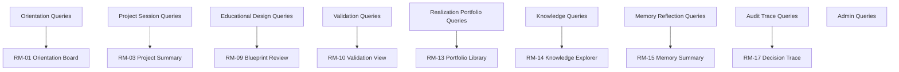
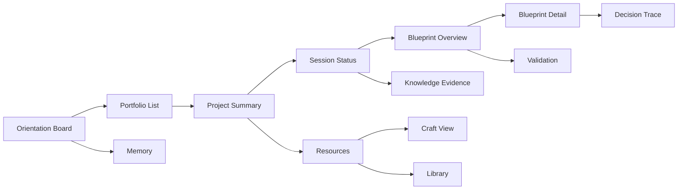
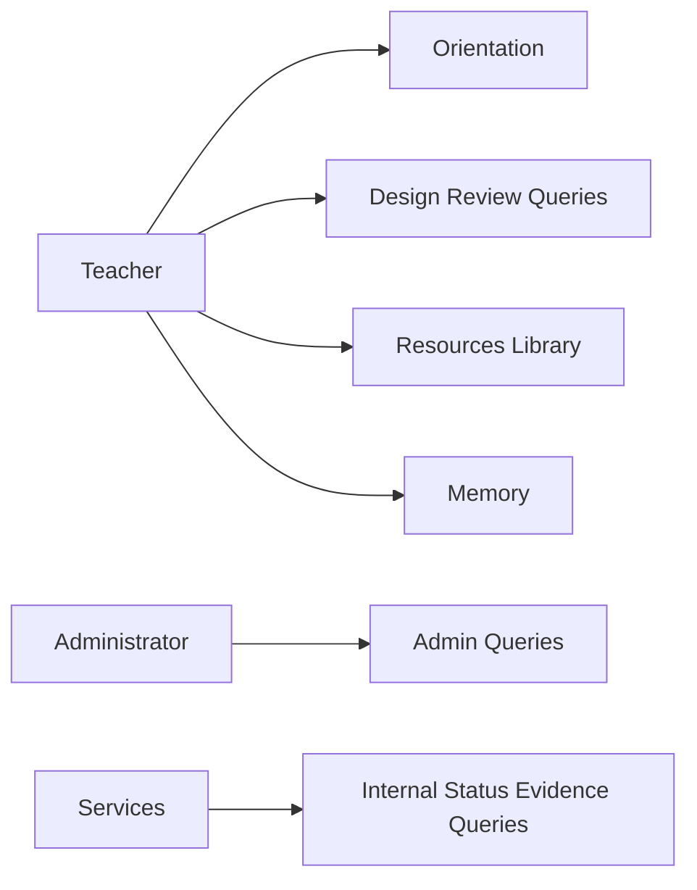
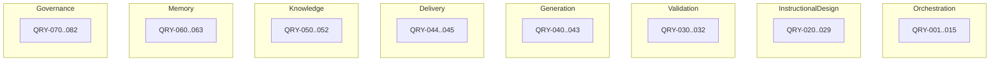

# PRIMA Constitutional Query Model

**Version:** 1.0  
**Status:** Official — Constitutional CQRS Read Architecture  
**Validity horizon:** ≥ 10 years  

> Queries define **what business information can be requested**.  
> A Query **never** changes business state and **never** performs business actions.

**Principles**

| ID | Principle |
|----|-----------|
| **CQM-01** | Queries are read-only |
| **CQM-02** | Queries return business information in Constitutional Language |
| **CQM-03** | Each Query has an owning Bounded Context (even if projected from many events) |
| **CQM-04** | Aggregation across services is allowed; **ownership remains explicit** |
| **CQM-05** | Every Query supports ≥1 Use Case (or Decision/Service collaboration) |
| **CQM-06** | Security: Teachers see only their Projects; binding data never leaks to plugins by default |
| **CQM-07** | Technology independent — no SQL, REST, GraphQL in this constitution |
| **CQM-08** | Read Models are purpose-built views — not “the database exposed” |

**Frame:** Commands write · Events record · **Queries inform** · Decisions choose · Use Cases orchestrate.

---

# 1. Actors (query consumers)

## 1.1 Challenge

| Candidate | Verdict |
|-----------|---------|
| **Teacher** | Primary consumer |
| **Administrator** | Ops / Knowledge / Audit queries |
| **EOS / PRIMA services** | Internal consumers (Context, Decisions) |
| **AI Engines** | **Not actors** — workers behind services that issue Queries |
| Validation/Knowledge/Memory Engines | **Not actors** — part of owning services |
| **Plugins** | Future; limited query scopes |
| **Student / Parent portals** | Future actors |
| System | May run scheduled projections — not a Teacher-facing actor |

## 1.2 Official Actor → Query access classes

| Actor | Access class |
|-------|--------------|
| Teacher | Own Projects, Sessions, Blueprints, Resources, Library, Memory, Decision traces (own) |
| Administrator | Knowledge packs, Teacher account status, platform config, aggregate audit (policy-bound) |
| Design Session / Design / Generation / Validation / Memory / Knowledge Services | Internal queries for preconditions & decisions |
| Plugin (Future) | Explicit allow-list only |
| Learner / Parent (Future) | Delivery-scoped views only |

---

# 2. Business Question Catalog

| Area | Business questions |
|------|--------------------|
| **Orientation** | What should I do next? Which Projects need Continuă? What unfinished work exists? |
| **Project** | What Projects exist? Which are Active/Paused/Archived? What is in this Project? |
| **Session** | Is a Session open? What is PipelinePosition? What is Working Context sufficiency? Pending clarifications? |
| **Intent / Understanding** | What is current Educational Intent? Is Understanding Ready? What was mirrored? |
| **Strategy** | What Strategy is Proposed/Confirmed? Why recommended? Alternatives? |
| **Blueprint** | Which Version is current? Approval status? What Objectives/Phases/Activities? Validation findings? Why blocked? |
| **Learning Experience** | LE state? Competencies referenced? Objectives uncovered vs Assessment Design? |
| **Generation** | Which Resources exist? Draft/Ready/Exported? Which runs Failed? Scope? Trace to Blueprint sections? |
| **Delivery / Library** | What can I reuse? What was exported? Hidden entries? |
| **Knowledge** | Which packs apply? What evidence supported this act? Unsupported marks? |
| **Memory** | Active preferences? Proposed suggestions? Accepted/Rejected history? |
| **Reflection** | Reflection history? |
| **Authority / Audit** | Who approved? When? Decision traces? Failures? |
| **Admin** | Pack publication state? Suspended Teachers? Config? |
| **Future analytics** | Patterns across Projects (Teacher-owned, non-surveillance) |

---

# 3. Query Catalog

IDs: `QRY-xxx`.  
**Performance expectations** are qualitative: Interactive (orientation) · Standard · Batch/Audit.

---

## 3.1 Orientation & Continuity

### QRY-001 — GetTeacherNextBestActions
| Field | Content |
|-------|---------|
| **Purpose** | Support DEC-090 / UC-C01 |
| **Meaning** | Ranked primary next actions (Continuă, Review plan, Authorize generate, …) |
| **Primary Actor** | Teacher |
| **Owned Context** | Orchestration (projection) |
| **Returns** | Ordered action list with Project/Session/Blueprint refs |
| **Sources** | Project, Session pipeline, Blueprint, GenerationPackage states |
| **Rules** | One primary recommendation emphasis; no commands executed |
| **Security** | Own Teacher only |
| **Performance** | Interactive |

### QRY-002 — ListContinuăCandidates
| Field | Content |
|-------|---------|
| **Purpose** | UC-S03 |
| **Returns** | Unfinished Projects with pipeline hint + lastEdited |
| **Owned Context** | Orchestration / Project Continuity Service |
| **Sources** | Project Active/Paused; Session checkpoints |
| **Security** | Own Teacher |
| **Performance** | Interactive |

### QRY-003 — ListTeacherProjects
| Field | Content |
|-------|---------|
| **Purpose** | UC-C07 |
| **Returns** | Project summaries by state filter |
| **Owned Context** | Orchestration |
| **Sources** | Project |
| **Security** | Own Teacher |

---

## 3.2 Project & Session

### QRY-010 — GetProjectSummary
| Field | Content |
|-------|---------|
| **Purpose** | Project Workspace orientation |
| **Returns** | Title, state, subject/grade, LE state, resource counts, pipeline hint |
| **Owned Context** | Orchestration |
| **Sources** | Project, LE, Session, Resource refs |
| **Security** | Owner Teacher |

### QRY-011 — GetProjectContents
| Field | Content |
|-------|---------|
| **Returns** | Notes, BlueprintVersion refs, Resource ids/kinds/states, Library links |
| **Owned Context** | Orchestration (compose) |
| **Sources** | Project + foreign IDs resolved via other read models |
| **Rules** | Does not embed full Blueprint prose unless requested via Blueprint queries |

### QRY-012 — GetConversationSessionStatus
| Field | Content |
|-------|---------|
| **Returns** | Lifecycle state; PipelinePosition; Intent/Strategy ids & states |
| **Owned Context** | Orchestration / Design Session Service |
| **Sources** | ConversationSession |

### QRY-013 — GetWorkingContextSnapshot
| Field | Content |
|-------|---------|
| **Purpose** | Decisions DEC-002/003; explainability |
| **Returns** | Sufficiency; declared knowns/unknowns; fingerprint |
| **Owned Context** | Orchestration |
| **Sources** | Session VO snapshot |
| **Security** | Owner; internal services |

### QRY-014 — GetPendingClarifications
| Field | Content |
|-------|---------|
| **Returns** | Open design-critical questions (if any) |
| **Owned Context** | Design Session |
| **Sources** | Session understanding gaps |

### QRY-015 — GetConversationTimeline
| Field | Content |
|-------|---------|
| **Purpose** | Reconstruct dialogue/cognition history for Teacher trust |
| **Returns** | Ordered cognitive milestones (not raw model logs) |
| **Owned Context** | Design Session |
| **Sources** | Session events projection |
| **Rules** | Business timeline — not token traces |

---

## 3.3 Educational design

### QRY-020 — GetEducationalIntent
| Field | Content |
|-------|---------|
| **Returns** | Intent state + summary |
| **Owned Context** | Instructional Design / Session |
| **Sources** | EducationalIntent |

### QRY-021 — GetPedagogicalUnderstanding
| Field | Content |
|-------|---------|
| **Returns** | Latest Understanding snapshot; Ready flag |
| **Owned Context** | Design Session |
| **Sources** | Understanding VO |

### QRY-022 — GetInstructionalStrategy
| Field | Content |
|-------|---------|
| **Returns** | Proposed/Confirmed strategy; rationale; alternatives if stored |
| **Owned Context** | Design Session |
| **Sources** | InstructionalStrategy |
| **Supports** | UC-C03; *De ce?* |

### QRY-023 — GetLearningExperienceOverview
| Field | Content |
|-------|---------|
| **Returns** | LE state; linked BlueprintVersion; resource readiness |
| **Owned Context** | Instructional Design |
| **Sources** | LearningExperience, Blueprint, Resources |

### QRY-024 — GetBlueprintOverview
| Field | Content |
|-------|---------|
| **Purpose** | Plan pedagogic summary for review |
| **Returns** | Version id; Blueprint family state; approval status; objective/phase counts; validation outcome summary |
| **Owned Context** | Instructional Design / SVC-03 |
| **Sources** | InstructionalBlueprint, BlueprintVersion, TeacherApproval, latest ValidationReport ref |
| **Security** | Owner Teacher |

### QRY-025 — GetBlueprintDetail
| Field | Content |
|-------|---------|
| **Returns** | Objectives, Phases, Activities, AssessmentDesign, DifferentiationDesign, ResourceRequirements |
| **Owned Context** | Instructional Design |
| **Sources** | Blueprint aggregate |
| **Supports** | UC-C05 Teacher Review |

### QRY-026 — ListBlueprintVersions
| Field | Content |
|-------|---------|
| **Returns** | Version lineage with states (DraftSnapshot/Approved/Superseded) |
| **Owned Context** | Instructional Design |

### QRY-027 — GetBlueprintApprovalStatus
| Field | Content |
|-------|---------|
| **Returns** | Eligible/Approved/Ineligible; Approval id; approver Teacher; timestamp |
| **Owned Context** | Instructional Design + Authority projection |
| **Sources** | TeacherApproval, Version state |

### QRY-028 — GetObjectiveCoverage
| Field | Content |
|-------|---------|
| **Purpose** | Educational quality question |
| **Returns** | Objectives vs Activities vs AssessmentDesign alignment hints |
| **Owned Context** | Instructional Design (may use Validation findings) |
| **Sources** | Blueprint; ValidationFinding |
| **Rules** | Informational — not a substitute for Self-Validation |

### QRY-029 — GetCompetencyReferences
| Field | Content |
|-------|---------|
| **Returns** | CompetencyRefs used in Blueprint/Understanding |
| **Owned Context** | Instructional Design / Knowledge join |
| **Ownership** | Design owns query; Knowledge owns pack truth |

---

## 3.4 Validation

### QRY-030 — GetLatestBlueprintValidationReport
| Field | Content |
|-------|---------|
| **Returns** | Outcome Succeeded/Warned/Blocked; findings with rule/section refs |
| **Owned Context** | Validation |
| **Supports** | Why blocked?; UC-C04/C05 |
| **Security** | Owner Teacher; Design/Validation services |

### QRY-031 — GetResourceFidelityReport
| Field | Content |
|-------|---------|
| **Returns** | Pass/fail findings for GenerationPackage |
| **Owned Context** | Validation |

### QRY-032 — ListValidationHistory
| Field | Content |
|-------|---------|
| **Returns** | Prior ValidationReports for BlueprintVersion / Package |
| **Owned Context** | Validation |
| **Performance** | Standard / Audit |

---

## 3.5 Generation & Delivery

### QRY-040 — ListProjectResources
| Field | Content |
|-------|---------|
| **Returns** | Resources with kind, state Draft/Ready/Exported, package refs |
| **Owned Context** | Generation |
| **Supports** | UC-S02, UC-C06, UC-C09 |

### QRY-041 — GetResourceDetail
| Field | Content |
|-------|---------|
| **Returns** | Editable content summary; TraceLinks to Blueprint sections; state |
| **Owned Context** | Generation |
| **Rules** | Read-only; edits via Commands |

### QRY-042 — ListGenerationRuns
| Field | Content |
|-------|---------|
| **Returns** | GenerationPackages Authorized/Running/Completed/Failed |
| **Owned Context** | Generation |

### QRY-043 — GetFailedGenerations
| Field | Content |
|-------|---------|
| **Returns** | Failed runs with failureClass |
| **Owned Context** | Generation |
| **Supports** | UC-P04 recovery |

### QRY-044 — ListReusableLibraryEntries
| Field | Content |
|-------|---------|
| **Purpose** | UC-S04 |
| **Returns** | Visible LibraryEntries with Project/Export/Resource refs |
| **Owned Context** | Delivery & Portfolio |
| **Sources** | LibraryEntry |
| **Security** | Own Teacher |

### QRY-045 — GetExportPackageSummary
| Field | Content |
|-------|---------|
| **Returns** | Formats, resources included, deliveredAt |
| **Owned Context** | Delivery & Portfolio |

---

## 3.6 Knowledge

### QRY-050 — ListApplicableKnowledgePacks
| Field | Content |
|-------|---------|
| **Actor** | Teacher (discovery) / Admin / Session service |
| **Returns** | Published packs for CurriculumScope |
| **Owned Context** | Knowledge |
| **Security** | Published packs readable; drafts Admin only |

### QRY-051 — GetKnowledgeEvidenceForAct
| Field | Content |
|-------|---------|
| **Purpose** | Explain grounding of a cognitive act |
| **Returns** | Last KnowledgePackage summary + provenance for Session/BlueprintVersion correlation |
| **Owned Context** | Knowledge |
| **Supports** | Traceability; DEC-011 |

### QRY-052 — GetUnsupportedKnowledgeMarks
| Field | Content |
|-------|---------|
| **Returns** | Where design proceeded with UnsupportedMarked |
| **Owned Context** | Knowledge / Session projection |

---

## 3.7 Memory & Reflection

### QRY-060 — GetActiveTeachingPreferences
| Field | Content |
|-------|---------|
| **Returns** | Active MemoryItems |
| **Owned Context** | Memory |
| **Actor** | Teacher |
| **Supports** | UC-C08; Context assembly (internal) |

### QRY-061 — ListMemorySuggestions
| Field | Content |
|-------|---------|
| **Returns** | Proposed MemoryItems awaiting Accept/Reject |
| **Owned Context** | Memory |

### QRY-062 — GetMemoryDecisionHistory
| Field | Content |
|-------|---------|
| **Returns** | Accepted/Rejected/Deleted history |
| **Owned Context** | Memory |

### QRY-063 — ListReflectionHistory
| Field | Content |
|-------|---------|
| **Returns** | ReflectionRecords for Project/Teacher |
| **Owned Context** | Reflection / Teacher Interaction |
| **Rules** | No blocking analytics required for MVP |

---

## 3.8 Decision & Audit

### QRY-070 — GetDecisionTrace
| Field | Content |
|-------|---------|
| **Purpose** | Constitutional Decision Traceability |
| **Returns** | Why/BasedOn/Alternatives/RejectedWhy/Authority/Confidence for DEC-* instances |
| **Owned Context** | Governance projection (fed by services) |
| **Supports** | *De ce?*; support; audit |
| **Security** | Own Teacher for pedagogical traces; Admin for platform-wide per policy |

### QRY-071 — GetApprovalAudit
| Field | Content |
|-------|---------|
| **Returns** | BlueprintApproved / Export / AuthorizeGenerate facts |
| **Owned Context** | Governance / Design |
| **Performance** | Audit |

### QRY-072 — ListDomainFailures
| Field | Content |
|-------|---------|
| **Returns** | DomainFailureRecorded correlated to Project/Session |
| **Owned Context** | Governance |
| **Supports** | UC-P04 |

---

## 3.9 Administration

### QRY-080 — ListKnowledgePackLifecycle
| Field | Content |
|-------|---------|
| **Actor** | Administrator |
| **Returns** | Draft/Published/Deprecated packs |
| **Owned Context** | Knowledge |

### QRY-081 — GetTeacherAccountStatus
| Field | Content |
|-------|---------|
| **Actor** | Administrator |
| **Returns** | Active/Suspended |
| **Owned Context** | Teacher Authority |

### QRY-082 — GetPlatformConfiguration
| Field | Content |
|-------|---------|
| **Actor** | Administrator / System |
| **Returns** | Non-creative config |
| **Owned Context** | Platform Governance |

---

## 3.10 Future queries (registered)

| ID | Name | Notes |
|----|------|-------|
| QRY-F01 | GetLearnerDeliveryView | UC-F03 |
| QRY-F02 | GetParentShareView | Policy-bound |
| QRY-F03 | GetCollaborationProjectView | UC-F01 |
| QRY-F04 | GetTeacherPatternInsights | Opt-in analytics — not surveillance |
| QRY-F05 | PluginAllowlistedProjectSnapshot | Explicit scopes only |

---

# 4. Query Categories (challenged)

| Proposed | Verdict | Official |
|----------|---------|----------|
| Operational Queries | Keep | **Operational** — Session/Project status, failures |
| Dashboard Queries | Rename | **Orientation** — NextBestActions, Continuă (avoid “Dashboard” Official Name) |
| Educational Queries | Keep | **Educational Design** |
| Knowledge / Memory | Keep | **Knowledge**, **Memory & Reflection** |
| Analytics | Future-leaning | **Insights (Future)** |
| Audit | Keep | **Audit & Trace** |
| Administration | Keep | **Administration** |
| Generation/Library | **Add** | **Realization & Portfolio** |
| AI Queries | Reject name | Internal service queries under Operational/Educational |

---

# 5. Read Model Catalog

Read Models are constitutive **views** optimized for Queries (projections from Events).

| ID | Read Model | Business purpose | Primary Queries | Owning Service |
|----|------------|------------------|-----------------|----------------|
| **RM-01** | Teacher Orientation Board | Next actions + Continuă | QRY-001, 002 | Project Continuity + Session projections |
| **RM-02** | Project Portfolio List | Manage Projects | QRY-003 | Project Continuity |
| **RM-03** | Active Project Summary | Workspace header | QRY-010 | Project Continuity |
| **RM-04** | Project Contents Index | What’s in the Project | QRY-011 | Project Continuity |
| **RM-05** | Session Status Panel | Lifecycle + Pipeline | QRY-012–014 | Design Session |
| **RM-06** | Conversation Timeline | Trust / history | QRY-015 | Design Session |
| **RM-07** | Learning Experience Overview | LE progress | QRY-023 | LE Design |
| **RM-08** | Blueprint Overview Card | Plan status | QRY-024, 027 | LE Design |
| **RM-09** | Blueprint Review Document | Full Plan pedagogic | QRY-025, 026, 028, 029 | LE Design |
| **RM-10** | Validation Report View | Why blocked/warned | QRY-030–032 | Validation |
| **RM-11** | Resource Library Shelf | Project resources | QRY-040–043 | Generation |
| **RM-12** | Resource Craft View | Edit/read resource | QRY-041 | Generation |
| **RM-13** | Portfolio Library | Reuse | QRY-044–045 | Delivery & Portfolio |
| **RM-14** | Knowledge Explorer | Pack discovery / evidence | QRY-050–052 | Knowledge |
| **RM-15** | Teaching Profile / Memory Summary | Preferences & suggestions | QRY-060–062 | Memory |
| **RM-16** | Reflection Timeline | Optional history | QRY-063 | Reflection |
| **RM-17** | Decision Trace Viewer | Explainability / audit | QRY-070–072 | Governance |
| **RM-18** | Admin Knowledge Console | Pack lifecycle | QRY-080 | Knowledge |
| **RM-19** | Admin Account Console | Teacher status | QRY-081–082 | Authority / Governance |

**Rejected Official Name:** “Teacher Dashboard” → use **Teacher Orientation Board (RM-01)**.

---

# 6. Query Relationships

| Supports | Examples |
|----------|----------|
| **Use Cases** | QRY-001→UC-C01; QRY-002→UC-S03; QRY-024/025→UC-S01 review; QRY-040→UC-S02; QRY-044→UC-S04 |
| **Commands** | Preconditions: GetBlueprintApprovalStatus before AuthorizeGenerate; GetSessionStatus before Present |
| **Decisions** | GetWorkingContextSnapshot→DEC-002; GetInstructionalStrategy→DEC-031 explain; Validation reports→DEC-050 |
| **State Machines** | Status queries reflect lawful states only |
| **Service Contracts** | CTR-01…09 consumers use status/overview queries before calling provider |
| **Architecture navigation** | Decision Trace + Conversation Timeline for support |

---

# 7. Query Ownership Matrix

| Query range | Owning Context | Responsible Service | Consumers | AuthZ | Cache |
|-------------|----------------|---------------------|-----------|-------|-------|
| QRY-001–003, 010–011 | Orchestration | SVC-01 / projections | Teacher | Owner | Short TTL Interactive |
| QRY-012–015, 020–022 | Orchestration / Design intake | SVC-02 | Teacher, SVC-03 | Owner | Short |
| QRY-023–029 | Instructional Design | SVC-03 | Teacher | Owner | Invalidate on Blueprint* events |
| QRY-030–032 | Validation | SVC-05 | Teacher, SVC-03/06 | Owner | Per report immutable |
| QRY-040–043 | Generation | SVC-06 | Teacher | Owner | Invalidate on Resource* |
| QRY-044–045 | Delivery | SVC-07 | Teacher | Owner | Invalidate on Export/Hide |
| QRY-050–052 | Knowledge | SVC-04 | Teacher, SVC-02/05 | Published vs Admin | Pack-level cache |
| QRY-060–062 | Memory | SVC-08 | Teacher, SVC-02 | Owner | Invalidate on MemoryItem* |
| QRY-063 | Reflection | SVC-09 | Teacher | Owner | Standard |
| QRY-070–072 | Governance | SVC-11 | Teacher/Admin | Policy | Append-only friendly |
| QRY-080–082 | Knowledge/Authority/Gov | SVC-04/10/11 | Admin | Admin | Standard |

---

# 8. Actor → Query Matrix (summary)

| Actor | May call |
|-------|----------|
| **Teacher** | QRY-001–072 (own scope); not Admin consoles |
| **Administrator** | QRY-080–082; audit subsets of 070–072 per policy; Knowledge explorer |
| **SVC-02 Session** | Context, Memory views, Knowledge evidence, Project summary |
| **SVC-03 Design** | Strategy, Validation reports, Session status |
| **SVC-06 Generation** | Approval status, Blueprint overview (trace), Fidelity |
| **Plugins** | None by default; Future allow-list |

---

# 9. Mermaid Diagrams

## 9.1 Query landscape

## 9.2 Read model relationships

## 9.3 Actor → Query map

## 9.4 Bounded context query map

---

# 10. Architecture Validation

## 10.1 Missing queries addressed
Next-best-action; Continuă; Pipeline/clarifications; Strategy rationale; Version lineage; Validation why-blocked; Fidelity; Failed generations; Library reuse; Memory suggestions; Decision traces; Admin pack/account.

## 10.2 Duplicates avoided
“Dashboard” vs Orientation Board.  
Resource list vs Library (Project craft vs portfolio reuse).  
Blueprint Overview vs Detail.

## 10.3 Cross-context violations
GetProjectContents may **reference** IDs from other contexts but does not own Blueprint detail — Detail query stays Design-owned.

## 10.4 Leaky abstractions
Conversation Timeline forbids raw model logs.  
Queries never expose engine internals or prompts.

## 10.5 Performance risks
Orientation board must stay Interactive — precomputed from events.  
Blueprint Detail heavier — on-demand.  
Audit queries Batch-tolerant.

## 10.6 Security risks
Owner scoping mandatory.  
Admin audit separated.  
Plugins default deny.  
Suspended Teacher: writes fail; reads may be read-only policy (constitutional default: deny writes; reads allowed for own historical data unless Suspended implies full lock — **default: Suspended denies all Teacher queries except account status**).

## 10.7 Scalability & extensibility
New Resource kinds extend Resource Shelf fields.  
Future Learner views are new QRY-F* — do not overload Teacher Orientation Board.

## 10.8 Verdict
Query Model is **business-complete** for CQRS read side of constitutional PRIMA, **use-case aligned**, and **implementation-free**.

---

# 11. Deliverable Index

| # | Deliverable | Section |
|---|-------------|---------|
| 1 | Complete Query Catalog | §3 |
| 2 | Business Question Catalog | §2 |
| 3 | Read Model Catalog | §5 |
| 4 | Query Ownership Matrix | §7 |
| 5 | Actor → Query Matrix | §8 |
| 6 | Bounded Context Query Map | §9.4 |
| 7 | Mermaid Diagrams | §9 |
| 8 | Architecture Validation | §10 |

---

## Closing

> **Writes change the world.  
> Queries explain the world.**  

PRIMA’s read architecture exists so Teachers can Continuă, review Plan pedagogic, understand validation, craft Resources, and reuse craft — without ever turning a Query into a Command.
