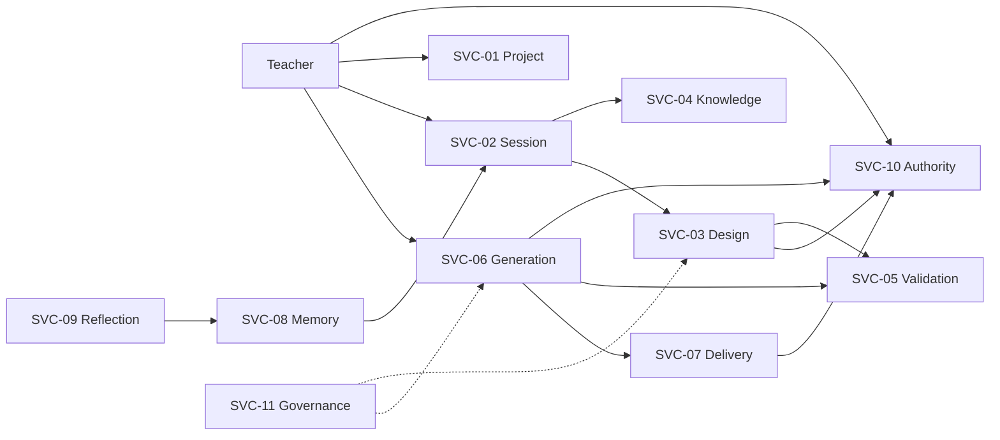
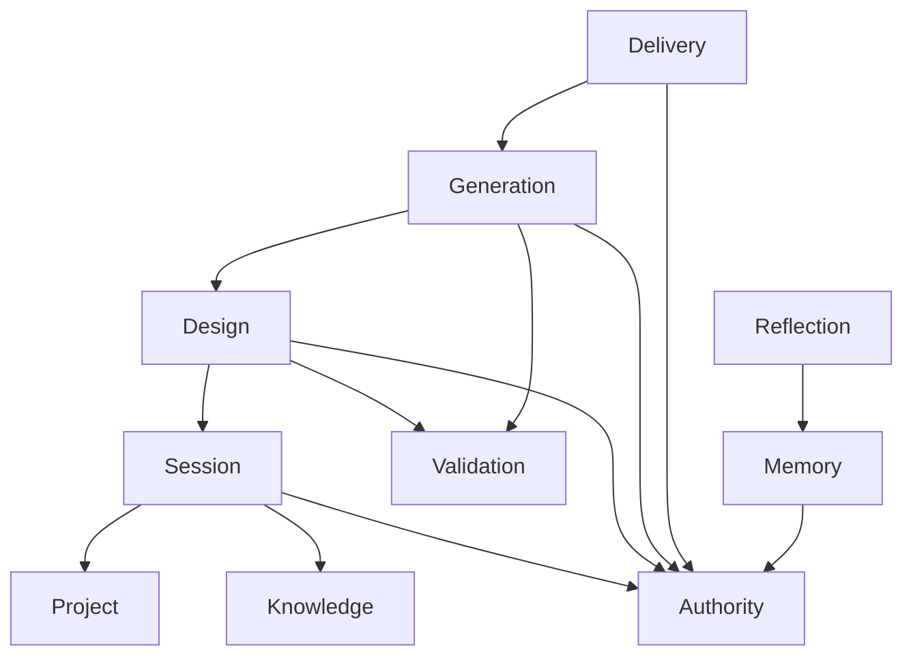
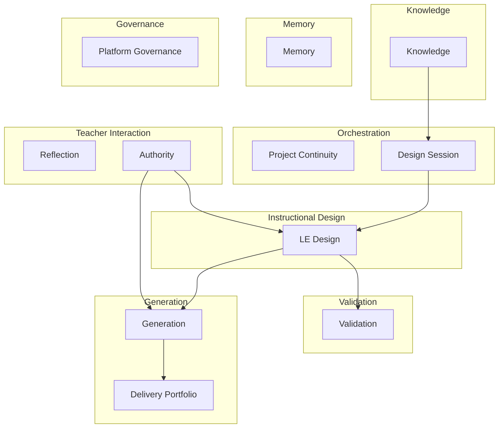
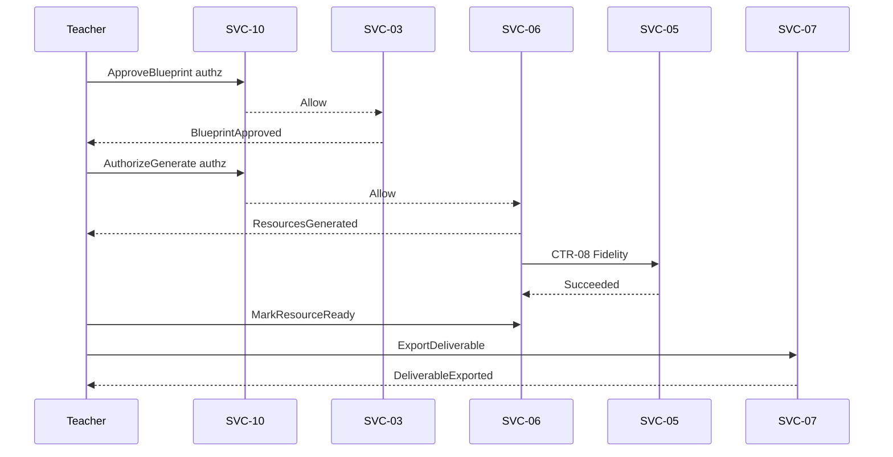

# PRIMA Constitutional Service Contract Model

**Version:** 1.0  
**Status:** Official — Constitutional Business Collaboration Architecture  
**Validity horizon:** ≥ 10 years  

> A **Service Contract** is a stable business collaboration agreement between capabilities.  
> It is **not** an API, REST surface, HTTP route, or database schema.  
> **PAS family:** Logical Service Architecture is consolidated in [`../engineering/PAS-003_PRIMA_SERVICE_ARCHITECTURE.md`](../engineering/PAS-003_PRIMA_SERVICE_ARCHITECTURE.md) (**PAS-003**). This document remains the detailed SVC/CTR catalog.

**Principles**

| ID | Principle |
|----|-----------|
| **CSC-01** | Services collaborate through contracts, not shared mutable internals |
| **CSC-02** | Contracts use Constitutional Language only |
| **CSC-03** | Technology independent — transport irrelevant |
| **CSC-04** | One primary Bounded Context ownership per service |
| **CSC-05** | Commands enter one service; Events exit for others to consume |
| **CSC-06** | No service Approves Blueprints or Exports except via Teacher Authority contracts |
| **CSC-07** | Orchestration coordinates; it does not own pedagogy |

**Frame:** Commands request · Decisions choose · Services fulfill · Events report · States evolve.

**Precedence:** This document owns business service identity and contracts. Component/API models must map to it — never the reverse.

---

# 1. Business Service Catalog

## 1.1 Challenge to example list

| Candidate | Verdict |
|-----------|---------|
| Project Service | **Keep** as **Project Continuity Service** |
| Conversation Service | **Keep** as **Design Session Service** (Session + cognition intake) |
| Blueprint / Learning Experience Service | **Merge** into **Learning Experience Design Service** (one design authority) |
| Knowledge Service | **Keep** |
| Validation Service | **Keep** |
| Generation Service | **Keep** |
| Memory Service | **Keep** |
| Reflection Service | **Keep thin** or compose into Session — **Keep** as distinct publisher of Reflection facts |
| Library Service | **Keep** as **Delivery & Portfolio Service** (Export + Library) |
| Assessment Service | **Reject** as separate core service — Assessment Design ∈ Design; Assessment Resource ∈ Generation |
| Collaboration Service | **Future** |
| Notification Service | **Peripheral / Future** — not pedagogical core |
| Teacher Authority Service | **Add** thin — identity + binding approval/export eligibility façade |

## 1.2 Official services

| ID | Official Name | Bounded Context | Maturity |
|----|---------------|-----------------|----------|
| **SVC-01** | Project Continuity Service | Orchestration | MVP |
| **SVC-02** | Design Session Service | Orchestration + Instructional Design intake | MVP |
| **SVC-03** | Learning Experience Design Service | Instructional Design | MVP |
| **SVC-04** | Knowledge Service | Knowledge | MVP |
| **SVC-05** | Validation Service | Validation | MVP |
| **SVC-06** | Generation Service | Generation | MVP |
| **SVC-07** | Delivery & Portfolio Service | Generation + Teacher Interaction (portfolio) | MVP |
| **SVC-08** | Memory Service | Memory | V1 (thin MVP) |
| **SVC-09** | Reflection Service | Teacher Interaction | V1 (optional MVP) |
| **SVC-10** | Teacher Authority Service | Teacher Interaction | MVP |
| **SVC-11** | Platform Governance Service | System Governance | MVP |
| **SVC-12** | Collaboration Service | Teacher Interaction | Future |
| **SVC-13** | Notification Service | System (peripheral) | Future |

**EOS Orchestrator** is the **coordination policy** across services — not a pedagogical service and not a substitute for contracts.

---

# 2. Service Responsibility Matrix

### SVC-01 — Project Continuity Service
| Field | Content |
|-------|---------|
| **Responsibility** | Manage Projects as units of work; Continuă eligibility; notes; archive |
| **Owned Aggregates** | Project |
| **Owned Commands** | Create/Rename/Pause/Resume/Complete/Archive/DuplicateProject, Add/UpdateTeacherNote, SelectPriorCraftForReuse |
| **Published Events** | Project*, TeacherNote*, PriorCraftSelectedForReuse |
| **Consumed Events** | TeacherSuspended (freeze writes); DeliverableExported (projection hints) |
| **Required Decisions** | DEC-001 Continuă offer inputs; DEC-040 reuse hints |
| **Outcomes** | Active Project ready for Sessions |
| **Rules** | Archived Projects reject StartConversationSession |

### SVC-02 — Design Session Service
| Field | Content |
|-------|---------|
| **Responsibility** | ConversationSession lifecycle; Working Context; Intent; Understanding; Strategy propose/select; Knowledge retrieve requests; PipelinePosition |
| **Owned Aggregates** | ConversationSession; EducationalIntent; InstructionalStrategy |
| **Owned Commands** | Start/Pause/Complete/Abandon Session, AssembleWorkingContext, Intent*, Understanding*, Strategy*, RetrieveKnowledgeEvidence, AdvancePipelinePosition, CaptureReflection *(intake)* |
| **Published Events** | Session*, WorkingContextAssembled, Intent*, Understanding*, Strategy*, KnowledgeEvidenceRetrieved *(corr)*, PipelinePositionAdvanced, ReflectionCaptured *(corr)* |
| **Consumed Events** | Blueprint* (sync pipeline); Resource* (pipeline Realization/Ready); ProjectArchived |
| **Required Decisions** | DEC-002–003, 020–023, 030–031, 010, 090 |
| **Outcomes** | StrategyConfirmed; UnderstandingReady; session checkpoints |
| **Rules** | Cannot Approve Blueprint; cannot Generate; Teacher SelectStrategy |

### SVC-03 — Learning Experience Design Service
| Field | Content |
|-------|---------|
| **Responsibility** | LearningExperience + InstructionalBlueprint compose/revise/present; Version mint; hold TeacherApproval records |
| **Owned Aggregates** | LearningExperience; InstructionalBlueprint; BlueprintVersion; TeacherApproval |
| **Owned Commands** | CreateBlueprintDraft, ReviseBlueprintStructure, MintBlueprintVersion, PresentBlueprintForReview, RequestBlueprintRevision, ApproveBlueprint |
| **Published Events** | LearningExperienceInitiated, Blueprint*, BlueprintApproved, ApprovalSuperseded |
| **Consumed Events** | InstructionalStrategySelected; BlueprintSelfValidation*; ConversationSessionAbandoned |
| **Required Decisions** | DEC-041, 051, 060 |
| **Outcomes** | BlueprintInReview; BlueprintApproved |
| **Rules** | Design only; no Resource prose authority; Teacher-only Approve |

### SVC-04 — Knowledge Service
| Field | Content |
|-------|---------|
| **Responsibility** | KnowledgePack curation; Knowledge Assembly for cognitive acts |
| **Owned Aggregates** | KnowledgePack; KnowledgeObject |
| **Owned Commands** | Publish/DeprecateKnowledgePack; fulfill RetrieveKnowledgeEvidence |
| **Published Events** | KnowledgePackPublished/Deprecated; KnowledgeEvidenceRetrieved |
| **Consumed Events** | — (mostly query-driven) |
| **Required Decisions** | DEC-010, DEC-011 |
| **Outcomes** | KnowledgePackage VO / unsupported mark |
| **Rules** | Never invent; Memory ≠ Knowledge |

### SVC-05 — Validation Service
| Field | Content |
|-------|---------|
| **Responsibility** | Self-Validation of Blueprints; Realization fidelity of GenerationPackages |
| **Owned Aggregates** | ValidationReport; ValidationRule catalog |
| **Owned Commands** | RunBlueprintSelfValidation; RunResourceFidelityValidation |
| **Published Events** | BlueprintSelfValidation*; ResourceFidelityValidation* |
| **Consumed Events** | BlueprintDraftCreated/StructureRevised; ResourcesGenerated |
| **Required Decisions** | DEC-050–052 |
| **Outcomes** | Succeeded/Warned/Blocked; fidelity pass/fail |
| **Rules** | Does not mutate Blueprint/Resources; never Approves |

### SVC-06 — Generation Service
| Field | Content |
|-------|---------|
| **Responsibility** | Authorize/start generation runs; produce Resource drafts; regen; craft edits persistence |
| **Owned Aggregates** | GenerationPackage; Resource (draft/ready) |
| **Owned Commands** | AuthorizeResourceGeneration, StartResourceGeneration, RegenerateResource, RecordResourceEdit, MarkResourceReady |
| **Published Events** | ResourceGeneration*, ResourcesGenerated, ResourceEdited, ResourceMarkedReady, Regeneration* |
| **Consumed Events** | BlueprintApproved; Fidelity*; TeacherSuspended |
| **Required Decisions** | DEC-061, 070–072 |
| **Outcomes** | Resource.Draft/Ready under Approved Version |
| **Rules** | No design authority; no auto-start on Approve alone |

### SVC-07 — Delivery & Portfolio Service
| Field | Content |
|-------|---------|
| **Responsibility** | ExportPackage assembly; LibraryEntry indexing/visibility |
| **Owned Aggregates** | ExportPackage; LibraryEntry |
| **Owned Commands** | ExportDeliverable; HideLibraryEntry |
| **Published Events** | DeliverableExported; LibraryEntryIndexed/Hidden |
| **Consumed Events** | ResourceMarkedReady; ProjectArchived |
| **Required Decisions** | DEC-062 |
| **Outcomes** | Delivered exports; Visible library entries |
| **Rules** | Teacher-only Export; LibraryNonAuthority |

### SVC-08 — Memory Service
| Field | Content |
|-------|---------|
| **Responsibility** | MemoryProfile / MemoryItem lifecycle under Teacher control |
| **Owned Aggregates** | MemoryProfile; MemoryItem |
| **Owned Commands** | Propose/Accept/Reject/DeleteMemoryItem |
| **Published Events** | MemoryItem* |
| **Consumed Events** | ReflectionCaptured; WorkingContextAssembled *(as consumer of memory views — read)* |
| **Required Decisions** | DEC-081–082 |
| **Outcomes** | Accepted Active preferences |
| **Rules** | Teacher Accept/Reject/Delete; no sensitive auto-learn |

### SVC-09 — Reflection Service
| Field | Content |
|-------|---------|
| **Responsibility** | Capture ReflectionRecords; signal Memory proposals |
| **Owned Aggregates** | ReflectionRecord *(or Session-correlated)* |
| **Owned Commands** | CaptureReflection |
| **Published Events** | ReflectionCaptured |
| **Consumed Events** | SessionCompleted; BlueprintApproved; DeliverableExported *(optional triggers)* |
| **Required Decisions** | DEC-080 |
| **Outcomes** | Optional reflection; never blocks exit |
| **Rules** | Non-blocking; may call Memory Propose |

### SVC-10 — Teacher Authority Service
| Field | Content |
|-------|---------|
| **Responsibility** | Teacher identity state; assert actor authorization for binding commands |
| **Owned Aggregates** | Teacher |
| **Owned Commands** | RegisterTeacher, SuspendTeacher; **authorization checks** for Approve/AuthorizeGenerate/Export/SelectStrategy |
| **Published Events** | TeacherRegistered/Suspended |
| **Consumed Events** | — |
| **Required Decisions** | Enforces CDP-03 / TeacherAuthorityPolicy |
| **Outcomes** | Allow/Deny binding acts |
| **Rules** | AI never passes as Teacher for binding commands |

### SVC-11 — Platform Governance Service
| Field | Content |
|-------|---------|
| **Responsibility** | PlatformConfiguration; audit append; failure visibility coordination |
| **Owned Aggregates** | PlatformConfiguration; Audit stream |
| **Owned Commands** | ChangePlatformConfiguration |
| **Published Events** | PlatformConfigurationChanged; DomainFailureRecorded |
| **Consumed Events** | Material Approvals/Exports/Failures |
| **Outcomes** | Config + audit integrity |
| **Rules** | Config never replaces Instructional Strategy |

### SVC-12 / SVC-13 — Future
Collaboration (multi-teacher Project membership without default Approve rights).  
Notification (optional Teacher alerts on GenerationFailed) — must not become a core dependency of design.

---

# 3. Dependency Matrix

| Consumer ↓ \ Provider → | 01 Project | 02 Session | 03 Design | 04 Knowledge | 05 Validation | 06 Generation | 07 Delivery | 08 Memory | 09 Reflection | 10 Authority | 11 Governance |
|-------------------------|------------|------------|-----------|--------------|---------------|---------------|-------------|-----------|---------------|--------------|---------------|
| **01 Project** | — | opt | — | — | — | — | opt | — | — | mand | opt |
| **02 Session** | mand | — | mand | mand | opt | opt | — | opt | opt | mand | opt |
| **03 Design** | mand | mand | — | opt | mand | — | — | — | — | mand | opt |
| **04 Knowledge** | — | — | — | — | — | — | — | — | — | — | mand |
| **05 Validation** | — | — | mand | opt | — | mand | — | — | — | — | opt |
| **06 Generation** | mand | opt | mand | — | mand | — | — | — | — | mand | opt |
| **07 Delivery** | mand | — | — | — | — | mand | — | — | — | mand | opt |
| **08 Memory** | — | opt | — | **forbid write** | — | — | — | — | mand | mand | — |
| **09 Reflection** | opt | mand | opt | — | — | opt | opt | mand | — | — | — |
| **10 Authority** | — | — | — | — | — | — | — | — | — | — | opt |
| **11 Governance** | opt | opt | opt | opt | opt | opt | opt | opt | opt | opt | — |

**Mandatory** = required for happy path. **Optional** = soft.  

**Challenged coupling removed:** Generation ↛ Knowledge directly (evidence already in Blueprint/Session). Memory ↛ Knowledge writes. Design ↛ Generation (only Events/eligibility).

---

# 4. Service Contract Catalog

Contract IDs: `CTR-xxx`. Provider guarantees business outcomes to Consumer.

---

### CTR-01 — OpenDesignSession
| Field | Content |
|-------|---------|
| **Provider** | SVC-02 Design Session |
| **Consumer** | Teacher (via UC-S01/S03); uses SVC-01 |
| **Purpose** | Begin/resume cognitive thread on a Project |
| **Inputs** | TeacherId; ProjectId; entryPath |
| **Preconditions** | Project Active; Teacher Active (SVC-10) |
| **Outputs** | ConversationSession Active; Pipeline at ContextBound |
| **Events** | ConversationSessionStarted; WorkingContextAssembled |
| **Failures** | ProjectArchived; TeacherSuspended |
| **Postconditions** | Session checkpoint exists |

### CTR-02 — ProvideKnowledgeEvidence
| Field | Content |
|-------|---------|
| **Provider** | SVC-04 Knowledge |
| **Consumer** | SVC-02 Session; SVC-05 Validation; SVC-03 Design |
| **Purpose** | Ground cognition/validation in provenance-bearing evidence |
| **Inputs** | CurriculumScope; act correlation ids |
| **Preconditions** | Pack Published or unsupported allowed |
| **Outputs** | KnowledgePackage or UnsupportedMarked |
| **Events** | KnowledgeEvidenceRetrieved |
| **Failures** | Pack miss → Unsupported; never invent |
| **Postconditions** | Consumer may proceed with declared support level |

### CTR-03 — ConfirmInstructionalStrategy
| Field | Content |
|-------|---------|
| **Provider** | SVC-02 Session |
| **Consumer** | SVC-03 Design (awaits Confirmed Strategy) |
| **Purpose** | Establish Strategy before Blueprint compose |
| **Inputs** | UnderstandingReady; Teacher Select |
| **Preconditions** | DEC-023 Ready; Strategy Proposed |
| **Outputs** | InstructionalStrategy Confirmed |
| **Events** | InstructionalStrategyProposed; InstructionalStrategySelected |
| **Failures** | AI-only Select forbidden (SVC-10 deny) |
| **Postconditions** | CreateBlueprintDraft eligible |

### CTR-04 — ComposeBlueprintFromStrategy
| Field | Content |
|-------|---------|
| **Provider** | SVC-03 Design |
| **Consumer** | UC-S01 / Session pipeline |
| **Purpose** | Produce Blueprint Draft |
| **Inputs** | Confirmed StrategyId; Understanding snapshot; optional Knowledge |
| **Preconditions** | Strategy Confirmed |
| **Outputs** | Blueprint Drafting + DraftSnapshot Version |
| **Events** | BlueprintDraftCreated; BlueprintVersionMinted; LearningExperienceInitiated |
| **Failures** | No Strategy → reject |
| **Postconditions** | Self-Validation should run (CTR-05) |

### CTR-05 — SelfValidateBlueprint
| Field | Content |
|-------|---------|
| **Provider** | SVC-05 Validation |
| **Consumer** | SVC-03 Design |
| **Purpose** | Critique design before ready review |
| **Inputs** | BlueprintVersionId (draft) |
| **Preconditions** | Draft exists |
| **Outputs** | ValidationReport Issued; outcome Succeeded/Warned/Blocked |
| **Events** | BlueprintSelfValidation* |
| **Failures** | Validator unavailable → fail visible |
| **Postconditions** | Blocked ⇒ Present forbidden |

### CTR-06 — PresentAndApproveBlueprint
| Field | Content |
|-------|---------|
| **Provider** | SVC-03 Design + SVC-10 Authority |
| **Consumer** | Teacher |
| **Purpose** | Teacher Review and Authorization |
| **Inputs** | Presentable Version; Teacher Approve command |
| **Preconditions** | Not Blocked; Teacher owns Project |
| **Outputs** | BlueprintApproved; TeacherApproval Granted; LE Authorized |
| **Events** | BlueprintPresentedForReview; BlueprintApproved |
| **Failures** | Non-Teacher initiator; Blocked |
| **Postconditions** | Generation **eligible** (not started) |

### CTR-07 — RealizeResourcesFromApprovedBlueprint
| Field | Content |
|-------|---------|
| **Provider** | SVC-06 Generation |
| **Consumer** | Teacher (UC-S02) |
| **Purpose** | Produce Resource drafts under Approval |
| **Inputs** | Approved BlueprintVersionId; resourceScope; Authorize + Start |
| **Preconditions** | BlueprintApproved; SVC-10 allows Teacher |
| **Outputs** | GenerationPackage Completed; Resources Draft |
| **Events** | ResourceGenerationAuthorized/Started/Generated or Failed |
| **Failures** | Missing Approval; GenerationFailed |
| **Postconditions** | Fidelity validation expected (CTR-08) |

### CTR-08 — ValidateResourceFidelity
| Field | Content |
|-------|---------|
| **Provider** | SVC-05 Validation |
| **Consumer** | SVC-06 Generation / Teacher |
| **Purpose** | Ensure drafts match Approved Blueprint |
| **Inputs** | GenerationPackageId |
| **Outputs** | Fidelity Succeeded/Failed report |
| **Events** | ResourceFidelityValidation* |
| **Failures** | Fail visible; no silent Ready |
| **Postconditions** | Failed ⇒ regen/edit/design revision paths |

### CTR-09 — CraftAndExportDeliverable
| Field | Content |
|-------|---------|
| **Provider** | SVC-06 + SVC-07 |
| **Consumer** | Teacher |
| **Purpose** | Mark ready and export to portfolio |
| **Inputs** | ResourceId; Export formats |
| **Preconditions** | Draft exists; Teacher Exclusive for Export |
| **Outputs** | Resource Ready/Exported; ExportPackage Delivered; LibraryEntry Visible |
| **Events** | ResourceMarkedReady; DeliverableExported; LibraryEntryIndexed |
| **Failures** | AI Export denied |
| **Postconditions** | Reuse available via portfolio |

### CTR-10 — SupplyMemoryViewsForContext
| Field | Content |
|-------|---------|
| **Provider** | SVC-08 Memory |
| **Consumer** | SVC-02 Session (AssembleWorkingContext) |
| **Purpose** | Advisory personalization |
| **Inputs** | TeacherId |
| **Preconditions** | Accepted MemoryItems optional |
| **Outputs** | Memory views (read) |
| **Events** | — (read); writes via Accept only |
| **Failures** | — |
| **Postconditions** | Context may become more Sufficient |

### CTR-11 — ProposeMemoryFromReflection
| Field | Content |
|-------|---------|
| **Provider** | SVC-09 Reflection → SVC-08 Memory |
| **Consumer** | Teacher |
| **Purpose** | Optional learning from experience |
| **Inputs** | ReflectionCaptured |
| **Preconditions** | DEC-082 AllowPropose |
| **Outputs** | MemoryItem Proposed |
| **Events** | ReflectionCaptured; MemoryItemProposed |
| **Failures** | Sensitive forbid |
| **Postconditions** | No Active memory until Teacher Accept |

### CTR-12 — AssertTeacherBindingAuthority
| Field | Content |
|-------|---------|
| **Provider** | SVC-10 Authority |
| **Consumer** | SVC-02/03/06/07 |
| **Purpose** | Allow/deny SelectStrategy, Approve, AuthorizeGenerate, Export, Memory Accept |
| **Inputs** | TeacherId; command type |
| **Preconditions** | Teacher Active |
| **Outputs** | Allow \| Deny |
| **Events** | — (deny may correlate DomainFailureRecorded) |
| **Failures** | Suspended / non-Teacher |
| **Postconditions** | Binding command proceeds only on Allow |

### CTR-13 — PublishCurriculumKnowledge
| Field | Content |
|-------|---------|
| **Provider** | SVC-04 Knowledge |
| **Consumer** | Administrator; later all retrieve consumers |
| **Purpose** | Release KnowledgePack |
| **Inputs** | Pack content identity |
| **Preconditions** | Admin authorized (Governance) |
| **Outputs** | Pack Published |
| **Events** | KnowledgePackPublished |
| **Failures** | Invalid pack |
| **Postconditions** | Retrieve may succeed for scope |

---

# 5. Contract Taxonomy (challenged)

| Proposed | Verdict | Official group |
|----------|---------|----------------|
| Core Contracts | Keep | **Core Continuity** — CTR-01, CTR-12 |
| Educational Contracts | Keep | **Educational Design** — CTR-03, CTR-04, CTR-06 |
| Knowledge Contracts | Keep | **Knowledge** — CTR-02, CTR-13 |
| Validation Contracts | Keep | **Validation** — CTR-05, CTR-08 |
| Generation Contracts | Keep | **Realization** — CTR-07 |
| Memory/Reflection | Keep | **Memory & Reflection** — CTR-10, CTR-11 |
| Collaboration | Future | **Future Collaboration** |
| System | Keep | **Governance** — audit/config via SVC-11 |
| Delivery | **Add** | **Delivery & Portfolio** — CTR-09 |

---

# 6. Cross-Service Interaction (spine)

```
Teacher
  → CTR-12 Authority
  → CTR-01 Session (SVC-02) + Project (SVC-01)
  → CTR-02 Knowledge (SVC-04)
  → CTR-03 Strategy Confirm (SVC-02)
  → CTR-04 Blueprint Compose (SVC-03)
  → CTR-05 Self-Validate (SVC-05)
  → CTR-06 Present/Approve (SVC-03 + SVC-10)
  → CTR-07 Generate (SVC-06)
  → CTR-08 Fidelity (SVC-05)
  → CTR-09 Craft/Export (SVC-06/07)
  → CTR-11 Reflection→Memory (optional)
```

States evolve per Constitutional State Machine Model inside owning services.

---

# 7. Mermaid Diagrams

## 7.1 Service collaboration



## 7.2 Dependency graph (mandatory arrows only)



## 7.3 Context map (bounded contexts)



## 7.4 Contract flow — Approve to Export



---

# 8. Architecture Validation

## 8.1 Circular dependencies
No A↔B mandatory cycle. Session→Design→Validation is acyclic; Generation→Validation is request/response style without Design depending on Generation.

## 8.2 Hidden coupling
Forbidden: shared Blueprint mutable buffer across Generation.  
Forbidden: Memory writing KnowledgePacks.  
Forbidden: Notification required for Approve.

## 8.3 Shared ownership
TeacherApproval **record** owned by Design aggregate; **authority check** by SVC-10 — documented dual concern without dual command owners.

## 8.4 Contract duplication
Compose vs Validate kept separate (CTR-04/05). Approve vs Authorize Generate kept separate (CTR-06/07).

## 8.5 Bounded context violations
Assessment Service rejected. Conversation≠chat app. Library cannot approve design (CTR-09 postconditions).

## 8.6 Scalability & extensibility
New Resource kinds extend CTR-07 scope payloads.  
Collaboration SVC-12 plugs via events without rewriting CTR-06 authority.  
Workers (LLMs) implement service internals — contracts unchanged.

## 8.7 Verdict
Service Contract Model is **constitutionally complete** for MVP–V1 collaboration, **implementation-free**, and **Teacher-authority preserving**.

---

# 9. Deliverable Index

| # | Deliverable | Section |
|---|-------------|---------|
| 1 | Business Service Catalog | §1 |
| 2 | Service Responsibility Matrix | §2 |
| 3 | Service Contract Catalog | §4 |
| 4 | Dependency Matrix | §3 |
| 5 | Collaboration Diagrams | §6–§7 |
| 6 | Contract Taxonomy | §5 |
| 7 | Architecture Validation | §8 |

---

## Closing

> **Services do not share databases in the constitution — they share meaning.**  
> Contracts say what must be true before and after collaboration.  

PRIMA’s collaboration spine remains:

**Session → Knowledge → Strategy → Design → Validation → Authority → Generation → Validation → Delivery**  
with **Memory/Reflection** advisory beside Continuă — never above Teacher Approval.
