# PRIMA Constitutional State Machine Model

**Version:** 1.0  
**Status:** Official — Constitutional Aggregate Lifecycle Architecture  
**Validity horizon:** ≥ 10 years  

> State machines describe the **legal evolution** of business objects over time.  
> Not UI. Not APIs. Not databases.

**Principles**

| ID | Principle |
|----|-----------|
| **CSM-01** | Every Aggregate has a declared lifecycle |
| **CSM-02** | Lifecycles are finite; final states are explicit |
| **CSM-03** | Every state has business meaning |
| **CSM-04** | Every transition has a trigger (Command and/or Automatic Decision) |
| **CSM-05** | Illegal transitions are explicitly forbidden |
| **CSM-06** | Successful transitions emit Domain Events |
| **CSM-07** | Cross-aggregate sync never bypasses Teacher Authorization |
| **CSM-08** | Orthogonal concerns may use parallel state dimensions (not fake mega-states) |

**Precedence:** This document owns aggregate lifecycle legality. (The `solution/PRIMA_STATE_MODEL.md` required to align with it was removed in the August 2026 cleanup.)

---

# 1. Aggregates requiring State Machines

| Aggregate / Entity | Machine required? | Notes |
|--------------------|-------------------|-------|
| **Project** | Yes | Continuity container |
| **ConversationSession** | Yes | Dual: *Lifecycle* + *PipelinePosition* |
| **EducationalIntent** | Yes (nested) | Inside Session |
| **InstructionalStrategy** | Yes (nested) | Inside Session |
| **LearningExperience** | Yes | Pedagogical object lifecycle |
| **InstructionalBlueprint** | Yes | Design family lifecycle |
| **BlueprintVersion** | Yes | Snapshot/approval identity |
| **TeacherApproval** | Yes (nested) | Bound to Version |
| **ValidationReport** | Yes | Outcome terminal quickly |
| **GenerationPackage** | Yes | Realization run |
| **Resource** | Yes | Craft lifecycle (often nested in Package/Project) |
| **ExportPackage** | Yes | Delivery |
| **KnowledgePack** | Yes | Curation |
| **MemoryProfile** | Thin | mostly Active/Purged |
| **MemoryItem** | Yes | Nested in Profile |
| **LibraryEntry** | Yes | Visibility |
| **Teacher** | Yes (thin) | Identity |
| Assessment (unqualified) | **No** | Split Design VO vs Assessment Resource |
| Conversation (chat) | **No** | Use ConversationSession |
| Teacher Session | **No** | Use ConversationSession |
| Home / Workspace | **No** | Places, not aggregates |

---

# 2. Aggregate Lifecycle Catalog

Legend — **Enter/Exit:** business actions, not code hooks.

---

## 2.1 Project

| Field | Content |
|-------|---------|
| **States** | `Created` → `Active` → `Paused` → `Completed` → `Archived` |
| **Initial** | Created (immediately transitions to Active on success) *or* Active |
| **Final** | Archived *(Completed may be soft-final; Archive is hard-final for Continuă)* |
| **Business Meaning** | Unit of educational work availability for Continuă |
| **Entry Active** | Project eligible for Continuă and Sessions |
| **Exit Archived** | Hidden from Continuă; lineage retained |

**Allowed transitions**

| From | To | Command | Decision | Events | Validation | Failure / Rollback |
|------|-----|---------|----------|--------|------------|--------------------|
| — | Active | CreateProject | — | ProjectCreated | Teacher active | Reject command |
| Active | Paused | PauseProject | — | ProjectPaused | Owner | Reject |
| Paused | Active | ResumeProject | — | ProjectResumed | Owner | Reject |
| Active/Paused | Completed | CompleteProject | — | ProjectCompleted | Owner | Reject |
| */Completed | Archived | ArchiveProject | — | ProjectArchived | Owner | Reject |
| Active | Active | RenameProject / Duplicate… | — | ProjectRenamed / new Project | Owner | Reject |

**Forbidden:** Archived → Active (restore = new governance command, not default); delete-destroy lineage; Session start on Archived.

**Ownership:** Teacher enters/leaves; System may not Archive without policy.

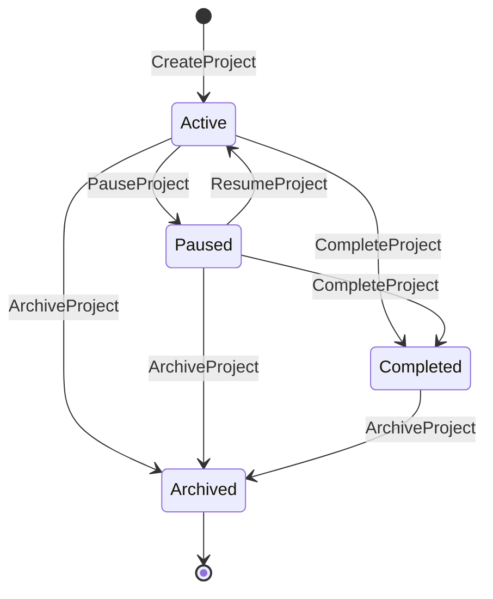

---

## 2.2 ConversationSession — Dimension A: Lifecycle

| Field | Content |
|-------|---------|
| **States** | `Started` → `Active` → `Paused` → `Completed` \| `Abandoned` |
| **Initial** | Started→Active |
| **Final** | Completed, Abandoned |
| **Meaning** | Whether the cognitive thread is open |

**Transitions**

| From | To | Command | Events |
|------|-----|---------|--------|
| — | Active | StartConversationSession | ConversationSessionStarted |
| Active | Paused | PauseConversationSession | ConversationSessionPaused |
| Paused | Active | StartConversationSession (resume) | ConversationSessionStarted |
| Active/Paused | Completed | CompleteConversationSession | ConversationSessionCompleted |
| Active/Paused | Abandoned | AbandonConversationSession | ConversationSessionAbandoned |

**Forbidden:** Completed/Abandoned → mutate Intent/Strategy; resume that skips Blueprint Authorization.

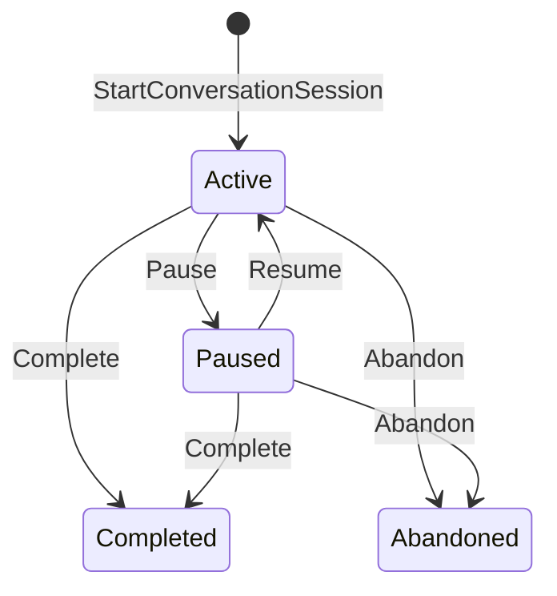

---

## 2.3 ConversationSession — Dimension B: PipelinePosition

Orthogonal to Lifecycle. Only meaningful while Lifecycle ∈ {Active, Paused}.

| States (order) | Meaning |
|----------------|---------|
| `ContextBound` | Working Context assembled |
| `IntentActive` | Intent emerging/stable in progress |
| `UnderstandingReady` | May strategize |
| `StrategyConfirmed` | May compose Blueprint |
| `BlueprintDrafting` | Draft/revise/self-validate |
| `BlueprintInReview` | Presented to Teacher |
| `BlueprintApproved` | Realization eligible |
| `RealizationInProgress` | Generation running/craft |
| `ResourcesReady` | Resources marked ready / exportable |

**Initial after start:** ContextBound (via AssembleWorkingContext)  
**Final soft:** ResourcesReady (session may still Complete)

**Allowed advances (examples)**

| From | To | Command / Auto | Decision | Events |
|------|-----|----------------|----------|--------|
| — | ContextBound | AssembleWorkingContext | DEC-002 | WorkingContextAssembled |
| ContextBound | IntentActive | CaptureEducationalIntent | DEC-020 | EducationalIntentCaptured |
| IntentActive | UnderstandingReady | CompletePedagogicalUnderstanding | DEC-023 | PedagogicalUnderstandingCompleted |
| UnderstandingReady | StrategyConfirmed | SelectInstructionalStrategy | DEC-031 | InstructionalStrategySelected |
| StrategyConfirmed | BlueprintDrafting | CreateBlueprintDraft | — | BlueprintDraftCreated |
| BlueprintDrafting | BlueprintInReview | PresentBlueprintForReview | DEC-051 | BlueprintPresentedForReview |
| BlueprintInReview | BlueprintDrafting | RequestBlueprintRevision | — | BlueprintRevisionRequested |
| BlueprintInReview | BlueprintApproved | ApproveBlueprint | DEC-060 | BlueprintApproved |
| BlueprintApproved | RealizationInProgress | Authorize+Start Generation | DEC-061 | ResourceGenerationAuthorized/Started |
| RealizationInProgress | ResourcesReady | MarkResourceReady | — | ResourceMarkedReady |

**Forbidden pipeline jumps:** IntentActive → BlueprintApproved; UnderstandingReady → RealizationInProgress; any → ResourcesReady without Approve+Generate path; BlueprintApproved → IntentActive *without* new design cycle (use Supersede + new Version).

**Automatic:** Context assembly, Self-Validation run after draft, Present when not Blocked.  
**Manual (Teacher):** SelectStrategy, Approve, AuthorizeGenerate, MarkReady.

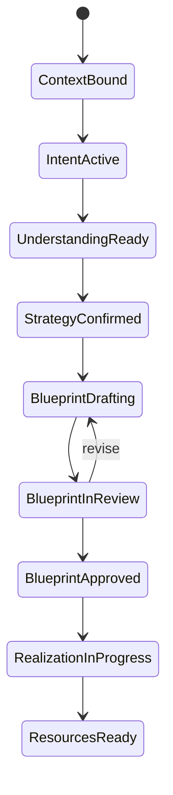

---

## 2.4 EducationalIntent (nested)

| States | Initial | Final |
|--------|---------|-------|
| `Emerging` → `Stable` → `Superseded` | Emerging | Superseded |

| Transition | Command | Events |
|------------|---------|--------|
| → Emerging | CaptureEducationalIntent | EducationalIntentCaptured |
| Emerging→Stable | StabilizeEducationalIntent | EducationalIntentStabilized |
| *→Superseded | SupersedeEducationalIntent | EducationalIntentSuperseded |

**Forbidden:** Stable→Emerging; generate Resources from Emerging alone.

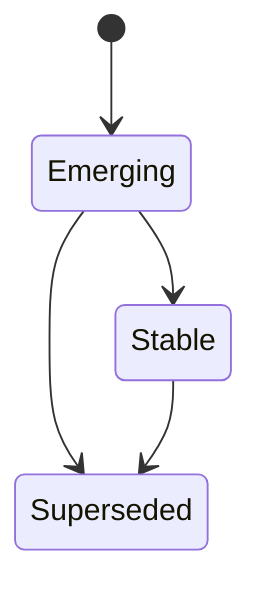

---

## 2.5 InstructionalStrategy (nested)

| States | Initial | Final |
|--------|---------|-------|
| `Proposed` → `Confirmed` → `Superseded` | Proposed | Superseded |

| Transition | Command | Who |
|------------|---------|-----|
| →Proposed | ProposeInstructionalStrategy | PRIMA |
| Proposed→Confirmed | SelectInstructionalStrategy | **Teacher** |
| *→Superseded | SupersedeInstructionalStrategy | Teacher |

**Forbidden:** PRIMA auto-Confirm; BlueprintDraft from Proposed without Confirm.

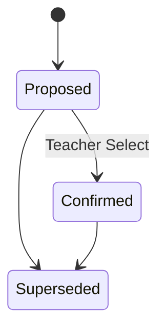

---

## 2.6 LearningExperience

| States | Meaning |
|--------|---------|
| `Initiated` | Identity created |
| `Designing` | Blueprint not yet approved for cycle |
| `Authorized` | BlueprintApproved for current Version |
| `Realized` | At least one Resource ready/exported |
| `Refined` | Post-realize improve cycle (may return Designing if new Approval needed) |

| Transition | Trigger | Events |
|------------|---------|--------|
| →Initiated | CreateBlueprintDraft / Initiate | LearningExperienceInitiated |
| Initiated→Designing | drafting | — |
| Designing→Authorized | ApproveBlueprint | BlueprintApproved |
| Authorized→Realized | MarkResourceReady / Export | ResourceMarkedReady / DeliverableExported |
| Realized→Refined | Improve path | — |
| Refined→Designing | DEC-041 RequireNewApproval | BlueprintRevision… |

**Forbidden:** Initiated→Realized; Designing→Realized.

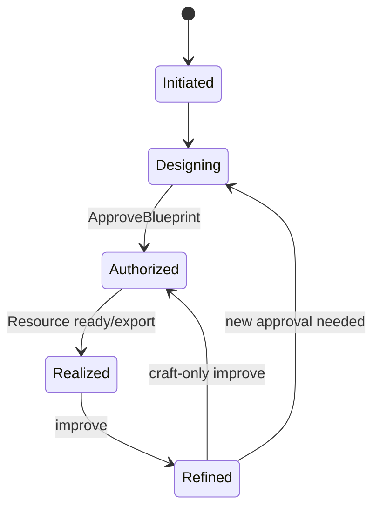

---

## 2.7 InstructionalBlueprint (family)

| States | Meaning |
|--------|---------|
| `Drafting` | Composing/revising draft Versions |
| `SelfValidating` | Validation in progress *(optional transient)* |
| `Blocked` | Self-Validation Blocked |
| `InReview` | Presented to Teacher |
| `Approved` | Current Version has TeacherApproval |
| `Superseded` | Newer cycle replaced authority |
| `Archived` | Frozen with Project archive |

| Transition | Command | Decision | Events |
|------------|---------|----------|--------|
| →Drafting | CreateBlueprintDraft | — | BlueprintDraftCreated |
| Drafting→SelfValidating | RunBlueprintSelfValidation | — | — |
| SelfValidating→Drafting | Succeeded/Warned then revise | DEC-050 | *Validation events* |
| SelfValidating→Blocked | Blocked | DEC-050 | BlueprintSelfValidationBlocked |
| Blocked→Drafting | ReviseBlueprintStructure | — | BlueprintStructureRevised |
| Drafting→InReview | PresentBlueprintForReview | DEC-051 | BlueprintPresentedForReview |
| InReview→Drafting | RequestBlueprintRevision | — | BlueprintRevisionRequested |
| InReview→Approved | ApproveBlueprint | DEC-060 | BlueprintApproved |
| Approved→Superseded | new Approve cycle / Mint+Approve | — | BlueprintApprovalSuperseded |
| *→Archived | with Project archive | — | — |

**Forbidden:** Blocked→Approved; Drafting→Approved; Approved→Drafting *in place* (must Mint new Version); AI Approve.

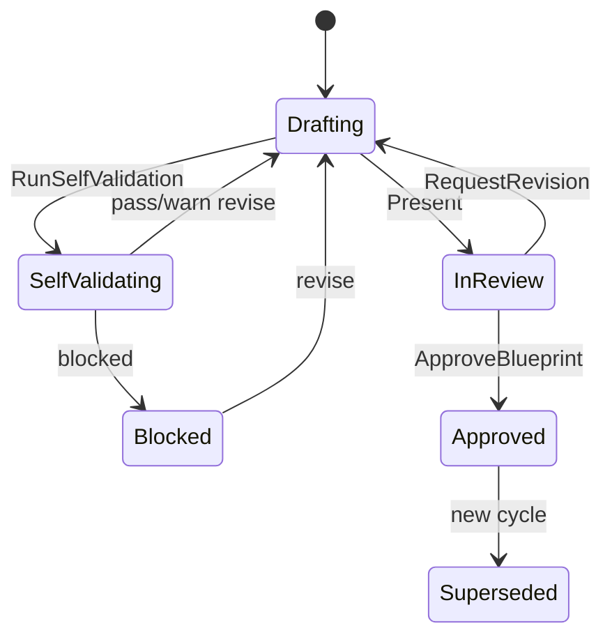

---

## 2.8 BlueprintVersion

| States | Initial | Final |
|--------|---------|-------|
| `DraftSnapshot` → `Approved` → `Superseded` | DraftSnapshot | Superseded |

| Transition | Command / Event |
|------------|-----------------|
| →DraftSnapshot | MintBlueprintVersion / CreateBlueprintDraft |
| DraftSnapshot→Approved | ApproveBlueprint |
| Approved→Superseded | newer Approved Version |
| DraftSnapshot→Superseded | abandoned draft version |

**Forbidden:** mutate content of Approved; Approved→DraftSnapshot.

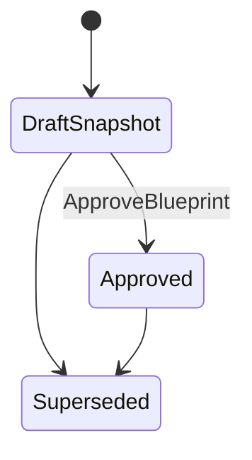

---

## 2.9 TeacherApproval (nested)

| States | Final |
|--------|-------|
| `Granted` → `ArchivedOnSupersession` | ArchivedOnSupersession |

**Forbidden:** silent revoke; AI Granted.

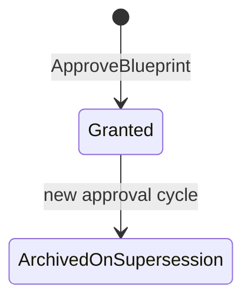

---

## 2.10 ValidationReport

| States | Meaning |
|--------|---------|
| `Issued` | Terminal outcome recorded (ReadyForReview / Warned / Blocked / realization_pass / realization_fail) |

*Simplified:* ValidationReports are **immutable once Issued** — no further transitions. Multiple runs ⇒ multiple reports.

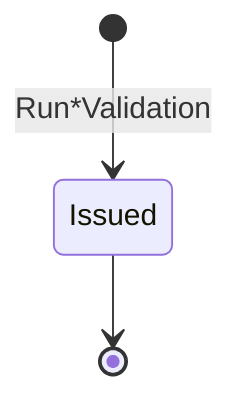

---

## 2.11 GenerationPackage

| States | Meaning |
|--------|---------|
| `Authorized` | Teacher authorized generate |
| `Running` | Generation in progress |
| `Completed` | ResourcesGenerated |
| `Failed` | ResourceGenerationFailed |
| `SupersededByRerun` | Newer package replaced |

| Transition | Command | Events |
|------------|---------|--------|
| →Authorized | AuthorizeResourceGeneration | ResourceGenerationAuthorized |
| Authorized→Running | StartResourceGeneration | ResourceGenerationStarted |
| Running→Completed | (auto) | ResourcesGenerated |
| Running→Failed | (auto) | ResourceGenerationFailed |
| Failed→Authorized | Authorize again / retry policy | — |
| Completed→SupersededByRerun | RegenerateResource new package | — |

**Forbidden:** →Running without Approved BlueprintVersion; →Completed without Started.

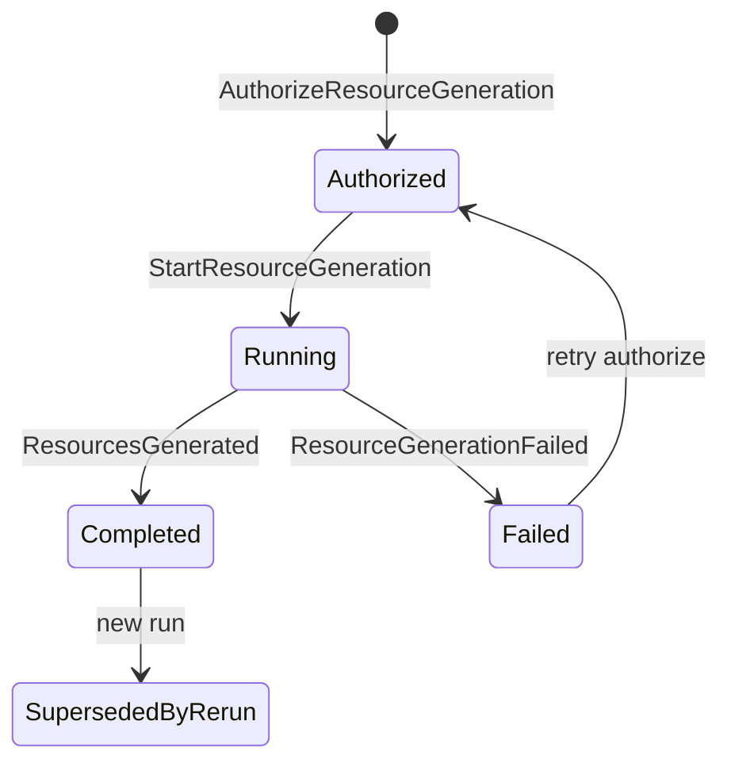

---

## 2.12 Resource

| States | Meaning |
|--------|---------|
| `Draft` | Generated / being edited |
| `Ready` | Teacher marked ready |
| `Exported` | Included in ExportPackage |
| `Archived` | Retired |

| Transition | Command | Events |
|------------|---------|--------|
| →Draft | ResourcesGenerated / Regeneration | ResourcesGenerated / RegenerationCompleted |
| Draft→Draft | RecordResourceEdit | ResourceEdited |
| Draft→Ready | MarkResourceReady | ResourceMarkedReady |
| Ready→Exported | ExportDeliverable | DeliverableExported |
| *→Archived | policy / Project archive | — |

**Forbidden:** →Ready by AI; →Exported without Teacher Export; Draft→Exported skipping Ready *unless* explicit policy warning (MVP: forbid).

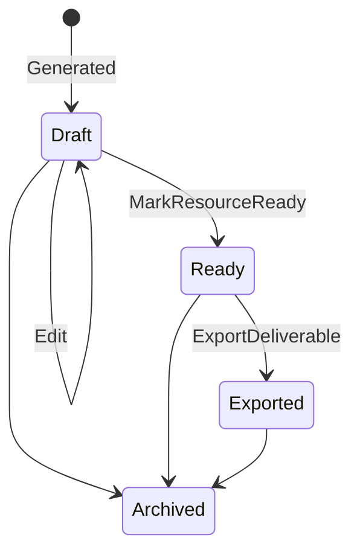

---

## 2.13 ExportPackage

| States | Initial | Final |
|--------|---------|-------|
| `Assembled` → `Delivered` → `Superseded` | Assembled | Superseded |

| Transition | Command | Events |
|------------|---------|--------|
| →Assembled/Delivered | ExportDeliverable | DeliverableExported |
| Delivered→Superseded | newer export | — |

**Forbidden:** Assembled by AI.

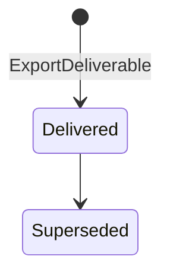

---

## 2.14 KnowledgePack

| States | Initial | Final |
|--------|---------|-------|
| `Draft` → `Published` → `Deprecated` | Draft | Deprecated |

| Transition | Command | Who |
|------------|---------|-----|
| Draft→Published | PublishKnowledgePack | Administrator |
| Published→Deprecated | DeprecateKnowledgePack | Administrator |

**Forbidden:** Teacher publish; mutate Published in place.

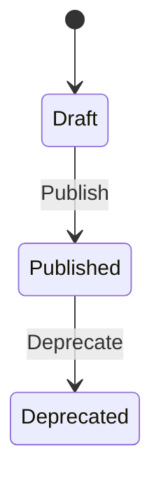

---

## 2.15 MemoryItem (nested in MemoryProfile)

| States | Initial | Final |
|--------|---------|-------|
| `Proposed` → `Accepted` → `Active` → `Deleted` ; `Proposed` → `Rejected` | Proposed | Deleted / Rejected |

| Transition | Command | Who |
|------------|---------|-----|
| →Proposed | ProposeMemoryItem | PRIMA |
| Proposed→Accepted | AcceptMemoryItem | **Teacher** |
| Accepted→Active | (auto) | System |
| Proposed→Rejected | RejectMemoryItem | Teacher |
| Active→Deleted | DeleteMemoryItem | Teacher |

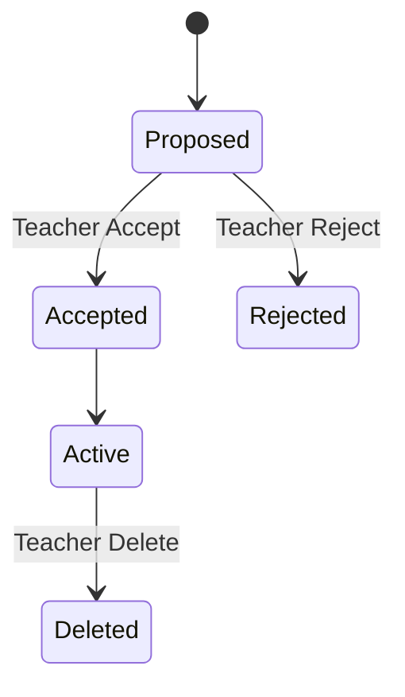

---

## 2.16 LibraryEntry

| States | Initial | Final |
|--------|---------|-------|
| `Visible` → `Hidden` | Visible | Hidden *(or Visible again if unhide future)* |

| Transition | Command | Events |
|------------|---------|--------|
| →Visible | (projection) Export | LibraryEntryIndexed |
| Visible→Hidden | HideLibraryEntry | LibraryEntryHidden |

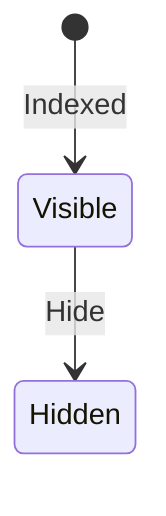

---

## 2.17 Teacher

| States | Initial | Final |
|--------|---------|-------|
| `Registered` → `Active` → `Suspended` → `Closed` | Registered/Active | Closed |

| Transition | Command |
|------------|---------|
| →Active | RegisterTeacher |
| Active→Suspended | SuspendTeacher |
| Suspended→Active | (reinstate — future command) |

**Effect:** Suspended ⇒ all Teacher write commands fail.

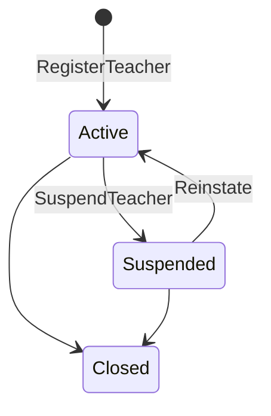

---

# 3. Transition Matrix (constitutional spine)

| # | Transition | Command | Decision | Events | Rollback |
|---|------------|---------|----------|--------|----------|
| 1 | Project Active | CreateProject | — | ProjectCreated | N/A reject |
| 2 | Session Active | StartConversationSession | — | ConversationSessionStarted | — |
| 3 | ContextBound | AssembleWorkingContext | DEC-002 | WorkingContextAssembled | retry |
| 4 | Intent Emerging | CaptureEducationalIntent | DEC-020 | EducationalIntentCaptured | — |
| 5 | UnderstandingReady | CompletePedagogicalUnderstanding | DEC-023 | …Completed | stay IntentActive |
| 6 | Strategy Confirmed | SelectInstructionalStrategy | DEC-031 | …Selected | remain Proposed |
| 7 | Blueprint Drafting | CreateBlueprintDraft | — | BlueprintDraftCreated | — |
| 8 | Validation outcome | RunBlueprintSelfValidation | DEC-050 | SelfValidation* | stay Drafting |
| 9 | InReview | PresentBlueprintForReview | DEC-051 | Presented | if Blocked forbid |
| 10 | Blueprint Approved | ApproveBlueprint | DEC-060 | BlueprintApproved | command reject |
| 11 | Gen Authorized | AuthorizeResourceGeneration | DEC-061 | …Authorized | reject |
| 12 | Gen Running/Done | StartResourceGeneration | — | Started/Generated/Failed | Failed→retry |
| 13 | Resource Ready | MarkResourceReady | — | …MarkedReady | — |
| 14 | Exported | ExportDeliverable | DEC-062 | DeliverableExported | reject |

**Failure behaviour:** Command Rejected → **no** success state change; optional DomainFailureRecorded.

---

# 4. State Ownership Summary

| State change type | Who enters | Who leaves | Who authorizes |
|-------------------|------------|------------|----------------|
| Continuă / Project lifecycle | Teacher | Teacher | Teacher |
| Pipeline cognition auto | PRIMA/EOS | PRIMA | Automatic |
| Strategy Confirmed | PRIMA proposes | Teacher confirms | **Teacher** |
| Blueprint Approved | — | — | **Teacher** |
| Generation Authorized/Export | — | — | **Teacher** |
| Self-Validation Blocked/Pass | Validation Engine | — | Automatic |
| Knowledge Published | Administrator | Administrator | Administrator |
| Memory Accepted | PRIMA proposes | Teacher | **Teacher** |

---

# 5. Cross-Aggregate Synchronization

## 5.1 Primary sync chain

```
BlueprintVersion.Approved
  + TeacherApproval.Granted
    → LearningExperience.Authorized
    → ConversationSession.PipelinePosition = BlueprintApproved
    → Project remains Active
    → GenerationPackage may enter Authorized (after Teacher command)
      → Resource.Draft
        → Resource.Ready
          → ExportPackage.Delivered
            → LibraryEntry.Visible
```

## 5.2 Important synchronizations

| When | Then |
|------|------|
| BlueprintApproved | Session pipeline → BlueprintApproved; LE → Authorized; Generation **eligible** not auto-started |
| ResourceGenerationAuthorized | GenerationPackage → Authorized |
| ResourcesGenerated | Resources → Draft; Session → RealizationInProgress |
| ResourceMarkedReady | LE may → Realized; Session may → ResourcesReady |
| DeliverableExported | LibraryEntry Visible; Resource → Exported |
| BlueprintRevisionRequested | Session → BlueprintDrafting; Blueprint → Drafting; **Approval not granted** |
| BlueprintApprovalSuperseded | Old Version → Superseded; Generation eligibility moves to new Version only |
| Project.Archived | Sessions not startable; LE/Blueprint may Archive; Continuă hides |
| Teacher.Suspended | All Teacher write transitions forbidden |
| KnowledgePack.Deprecated | New Retrieve may MarkUnsupported; existing Approvals untouched |
| MemoryItem.Accepted | Future WorkingContextAssembled may include views |
| GenerationPackage.Failed | Session stays BlueprintApproved; Teacher may retry; **no** Approval loss |

## 5.3 Explicit non-synchronizations (anti-bugs)

| Must NOT happen | Why |
|-----------------|-----|
| BlueprintApproved ⇒ auto ResourcesGenerated | Missing Authorize generate |
| IntentCaptured ⇒ Resource.Draft | Skips design |
| LibraryEntry.Visible ⇒ BlueprintApproved | LibraryNonAuthority |
| Strategy.Proposed ⇒ Blueprint.Approved | Missing Teacher Select+Approve |

---

# 6. Architecture Validation

## 6.1 Missing states
Addressed: Pipeline vs Session lifecycle split; Blueprint Blocked; Generation Authorized vs Running; Resource Ready vs Exported; Memory Proposed/Rejected.

## 6.2 Duplicate states
Avoided merging Project.Completed with Session.Completed — different aggregates.  
Avoided single “Validated” — use ValidationReport Issued + Blueprint Blocked/InReview.

## 6.3 Circular transitions
Review↔Drafting and Failed→Authorized retry are **controlled loops** with Teacher/command gates — not infinite auto-loops.

## 6.4 Dead ends
Blocked without revise path — **mitigated** by Blocked→Drafting.  
Abandoned Session — final, intentional.  
Deprecated Pack — final for that version.

## 6.5 Unreachable states
Refined on LE only via improve path — OK.  
SelfValidating transient may be skipped in impl if validation is sync — still legal conceptually.

## 6.6 Conflicting lifecycles
Resolved by sync rules: Approved Blueprint does not force Generation; Suspended Teacher freezes writes.

## 6.7 Scalability risks
| Risk | Mitigation |
|------|------------|
| Pipeline states explode per Resource kind | Keep ResourceKind on Resource; pipeline stays coarse |
| Distributed race Approve vs Generate | Commands validated against Version state |
| UI invents states | Only constitutional states allowed in projections |

## 6.8 Verdict
State machines are **complete** for constitutional aggregates, **aligned** to Commands/Events/Decisions, and **Teacher-authority safe** under cross-aggregate sync.

---

# 7. Deliverable Index

| # | Deliverable | Section |
|---|-------------|---------|
| 1 | Aggregate Lifecycle Catalog | §1–§2 |
| 2 | Complete State Machines | §2 + Mermaid |
| 3 | Transition Matrix | §3 |
| 4 | Cross-Aggregate Synchronization | §5 |
| 5 | Mermaid State Diagrams | §2 |
| 6 | Architecture Validation | §6 |

---

## Closing

> **States mean something to Teachers and to the business.**  
> Illegal jumps are not “edge cases” — they are **constitutional violations**.  

PRIMA’s history is not only events — it is **objects moving through lawful states**, especially:

**Strategy Confirmed → Blueprint Approved → Generation Authorized → Resource Ready → Deliverable Exported.**
