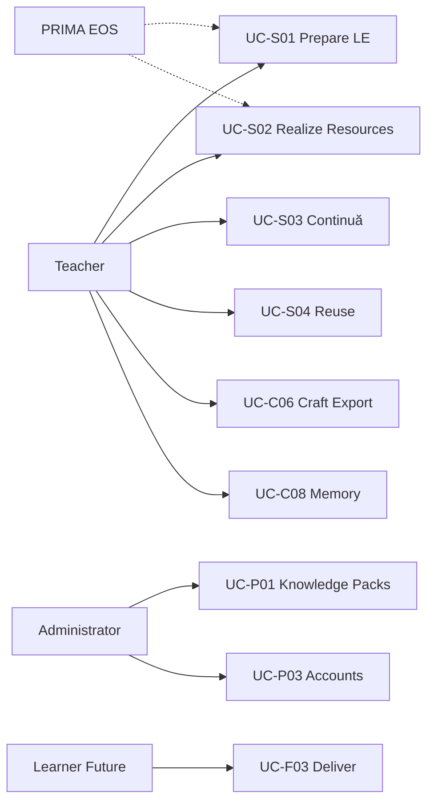
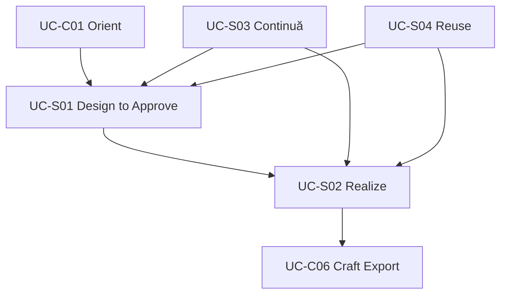
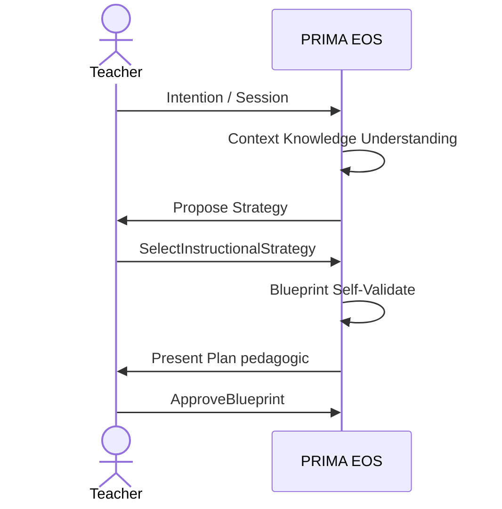

# PRIMA Constitutional Use Case Model

**Version:** 1.0  
**Status:** Official — Business Use Case Constitution  
**Validity horizon:** ≥ 10 years  

> A Use Case is how **actors achieve meaningful educational goals** with PRIMA.  
> It is **not** a UI flow, API, or implementation script.

**Definition:** Business collaboration between actors and the Educational Operating System (EOS), expressed with Constitutional Language, Capabilities, Commands, Events, and Aggregates.

**Non-goals:** Screens, wireframes, endpoints, model prompts, sequence of buttons.

---

## Use case design principles

| ID | Principle |
|----|-----------|
| **CUC-01** | Goal-oriented — name the educational/business outcome |
| **CUC-02** | Actor-honest — PRIMA is a partner, not the primary pedagogical authority |
| **CUC-03** | Technology-independent |
| **CUC-04** | Maps to Commands (intent) and Events (facts) |
| **CUC-05** | Respects Teacher-only authorization spine |
| **CUC-06** | Prefer fewer, richer use cases over UI-shaped micro-cases |

---

# 1. Actors

## 1.1 Challenge to the candidate list

| Candidate | Verdict | Role in PRIMA |
|-----------|---------|---------------|
| **Teacher** | **Primary Actor** | Owns educational goals and approvals |
| **Administrator** | Supporting / Primary for ops UCs | Knowledge packs, accounts, config — never Teacher Approval |
| **AI** | **Not an Actor** | Implementation worker behind PRIMA/EOS |
| **EOS / PRIMA** | **Supporting Actor** | Partner system that proposes, validates, generates under policy |
| **System** | Supporting | Timeouts, indexing, failure recording |
| **Student / Learner** | **Future** Primary for delivery UCs | Beneficiary today; not operator in MVP |
| **Parent** | **Future** | Not MVP |
| **Plugin** | **Future** Supporting | May react to events; cannot Approve/Export |
| **Collaborating Teacher** | **Future** | Collaboration UCs |

## 1.2 Official Actor Matrix

| Actor | Type | Goals they pursue |
|-------|------|-------------------|
| **Teacher** | Primary | Design, authorize, realize, continue, reuse, craft, export |
| **PRIMA (EOS)** | Supporting | Assemble context, retrieve knowledge, propose strategy/blueprint, validate, generate drafts, reflect proposals |
| **Administrator** | Primary (ops) / Supporting (teaching UCs) | Publish knowledge, configure, suspend accounts |
| **System** | Supporting | Continuă projections, library index, failure visibility |
| **Learner** | Future Primary | Experience delivered learning (out of MVP) |
| **Parent** | Future | View/share (policy-bound) |
| **Plugin** | Future Supporting | Extend consumers without granting authority |

---

# 2. Business Goals

| Goal ID | Business Goal | Teacher phrasing | Priority |
|---------|---------------|------------------|----------|
| **G01** | Prepare a Learning Experience for class | “Pregătesc lecția de mâine” | Strategic |
| **G02** | Continue unfinished design work | “Continuă” | Strategic |
| **G03** | Approve pedagogical plan before materials | “Aprob planul” | Strategic |
| **G04** | Obtain editable classroom Resources | “Am materialele” | Strategic |
| **G05** | Export and keep craft for reuse | “Salvez / refolosesc” | Strategic |
| **G06** | Add another Resource to same plan | “Adaug o fișă” | Core (V1) |
| **G07** | Improve existing Resource/design | “Îmbunătățesc” | Core (V2) |
| **G08** | Assess learning (design + instrument) | “Am nevoie de evaluare” | Core→Future depth |
| **G09** | Control what PRIMA remembers | “Preferințele mele” | Core (V1) |
| **G10** | Reflect lightly after work | “Ce am învățat din sesiune” | Supporting |
| **G11** | Organize Projects | “Arhivez / redenumesc” | Supporting |
| **G12** | Ground design in curriculum knowledge | (systemic goal) | Strategic |
| **G13** | Collaborate with colleagues | “Lucrăm împreună” | Future |
| **G14** | Share to marketplace / school | “Distribuie” | Future |
| **G15** | Deliver to Learners | “Elevii primesc…” | Future |

**Rejected as separate goals:** “Open AI Partner app”, “Pick builder module” — anti-goals.

---

# 3. Use Case Catalog

IDs: `UC-S*` Strategic · `UC-C*` Core · `UC-P*` Supporting · `UC-F*` Future

---

## 3.1 Strategic Use Cases

### UC-S01 — Prepare a Learning Experience (Design through Approval)

| Field | Content |
|-------|---------|
| **Goal** | G01 + G03 — Teacher leaves with an **Approved Blueprint** for a Learning Experience |
| **Primary Actor** | Teacher |
| **Supporting Actors** | PRIMA (EOS), System |
| **Preconditions** | Teacher active; may have empty or existing portfolio |
| **Trigger** | Teacher expresses Intention to prepare learning (typically a lesson) or starts design on a Project |
| **Class** | Strategic · **Maturity** MVP |

**Normal Flow**
1. Teacher orients and chooses to start new work (or opens Project).  
2. System/PRIMA ensures Project exists (`CreateProject` if needed).  
3. Teacher starts Conversation Session.  
4. PRIMA assembles Working Context; retrieves Knowledge Evidence as needed.  
5. Teacher and PRIMA capture and stabilize Educational Intent.  
6. Pedagogical Understanding progresses to Complete.  
7. PRIMA proposes Instructional Strategy; Teacher selects.  
8. PRIMA creates Blueprint Draft; runs Self-Validation.  
9. If blocked/warned, revise until presentable.  
10. Teacher reviews Plan pedagogic; may request revision (loop).  
11. Teacher **Approves Blueprint**.  

**Alternative Flows**
- A1: Continuă into mid-design → resume at incomplete step (see UC-S03).  
- A2: Self-Validation Warned → Teacher proceeds with awareness.  
- A3: Teacher supersedes Strategy mid-way → recompose Blueprint.  

**Failure Flows**
- F1: Understanding never completes → no Strategy; Teacher abandons session.  
- F2: Self-Validation blocked and unresolved → no Present/Approve.  
- F3: Teacher Suspended → commands rejected.  

**Business Rules**  
Strategy before Blueprint; Self-Validate before ready review; **ApproveBlueprint is Teacher-only**; no Resources required for success of this UC.

**Success Conditions**  
`BlueprintApproved` exists for a BlueprintVersion; Learning Experience authorized for realization.

**Commands**  
CreateProject, StartConversationSession, AssembleWorkingContext, Capture/StabilizeEducationalIntent, RetrieveKnowledgeEvidence, Update/CompletePedagogicalUnderstanding, Propose/SelectInstructionalStrategy, CreateBlueprintDraft, ReviseBlueprintStructure, RunBlueprintSelfValidation, PresentBlueprintForReview, RequestBlueprintRevision, ApproveBlueprint  

**Events**  
Matching Event Model (Intent→…→BlueprintApproved)

**Aggregates**  
Project, ConversationSession, InstructionalBlueprint, ValidationReport  

**Capabilities**  
CAP-S01, CAP-S02, CAP-S03, CAP-C01–C09, CAP-C15  

---

### UC-S02 — Realize Classroom Resources from Approved Blueprint

| Field | Content |
|-------|---------|
| **Goal** | G04 (+ G05 optional) — Teacher obtains editable Resources and may export |
| **Primary Actor** | Teacher |
| **Supporting Actors** | PRIMA, System |
| **Preconditions** | BlueprintApproved for target Version |
| **Trigger** | Teacher confirms generation for a Resource scope (e.g. Lesson Resource) |
| **Class** | Strategic · **Maturity** MVP |

**Normal Flow**
1. Teacher authorizes resource generation (scope).  
2. PRIMA starts generation; ResourcesGenerated.  
3. PRIMA runs fidelity validation.  
4. Teacher crafts (edits) as needed.  
5. Teacher marks Resource ready.  
6. Optional: Teacher exports deliverable → Library indexed.  

**Alternative Flows**
- A1: Fidelity Failed → Teacher requests regenerate or edits Blueprint via UC-S01 revision cycle.  
- A2: Export skipped — success still if ResourceMarkedReady (classroom digital use).  

**Failure Flows**
- F1: Authorize without Approval → rejected.  
- F2: GenerationFailed → fail visible; Approval intact.  

**Business Rules**  
Authorize ≠ Approve; Generation cannot mutate Blueprint; Export Teacher-only.

**Success Conditions**  
ResourcesGenerated and (ResourceMarkedReady or DeliverableExported per Teacher intent).

**Commands**  
AuthorizeResourceGeneration, StartResourceGeneration, RunResourceFidelityValidation, RegenerateResource, RecordResourceEdit, MarkResourceReady, ExportDeliverable  

**Events**  
ResourceGenerationAuthorized → … → ResourceMarkedReady / DeliverableExported / LibraryEntryIndexed  

**Aggregates**  
GenerationPackage, ExportPackage, ValidationReport, LibraryEntry  

**Capabilities**  
CAP-C10–C14  

---

### UC-S03 — Continue Educational Work

| Field | Content |
|-------|---------|
| **Goal** | G02 — Resume Project at last meaningful state without re-entering known Intent |
| **Primary Actor** | Teacher |
| **Supporting Actors** | PRIMA, System |
| **Preconditions** | Project with prior ConversationSession checkpoint |
| **Trigger** | Teacher chooses Continuă |
| **Class** | Strategic · **Maturity** MVP |

**Normal Flow**
1. Teacher selects in-progress Project.  
2. StartConversationSession (resume).  
3. AssembleWorkingContext.  
4. Pipeline/session restored to last stage.  
5. Teacher proceeds with UC-S01 or UC-S02 from that point.  

**Failure Flows**  
Corrupt checkpoint → fail visible; Teacher may restart cognition without deleting Approval history.

**Business Rules**  
Resume never skips Authorization gates.

**Commands**  
ResumeProject (if paused), StartConversationSession, AssembleWorkingContext, AdvancePipelinePosition (residual)  

**Events**  
ProjectResumed?, ConversationSessionStarted, WorkingContextAssembled, PipelinePositionAdvanced  

**Aggregates**  
Project, ConversationSession  

**Capabilities**  
CAP-S04, CAP-C01, CAP-C02, CAP-C04, CAP-P01  

---

### UC-S04 — Reuse Prior Craft

| Field | Content |
|-------|---------|
| **Goal** | G05 — Adapt prior Library/Project craft into new or continued work |
| **Primary Actor** | Teacher |
| **Supporting Actors** | PRIMA, System |
| **Preconditions** | LibraryEntry or prior Project craft exists |
| **Trigger** | Teacher selects prior craft for reuse |
| **Class** | Strategic · **Maturity** V1 (MVP: reopen/export enough; full adapt V1) |

**Normal Flow**
1. Teacher selects LibraryEntry / prior Resource.  
2. SelectPriorCraftForReuse; CreateProject or bind existing.  
3. Intent captured as adaptation.  
4. If design materially changes → UC-S01 approval path.  
5. If same Approved Blueprint still valid for new Resource → UC-S02 only.  

**Business Rules**  
Library is not design authority; material design change requires ApproveBlueprint again.

**Commands**  
SelectPriorCraftForReuse, DuplicateProject / CreateProject, CaptureEducationalIntent, …(UC-S01/S02 as needed)  

**Events**  
PriorCraftSelectedForReuse, …  

**Capabilities**  
CAP-C19, CAP-C14, CAP-C18 (when improve)  

---

## 3.2 Core Use Cases

### UC-C01 — Orient and Choose Next Work
| Field | Content |
|-------|---------|
| **Goal** | Know what to do next (Continuă vs new Intention) |
| **Actor** | Teacher · Support: System |
| **Trigger** | Teacher enters product |
| **Flow** | Review Continuă candidates and intentions → select UC-S03 or UC-S01 entry |
| **Success** | Work directed into a Project |
| **Commands** | (read models); CreateProject / StartConversationSession as follow-on |
| **Capabilities** | CAP-C02 |
| **Class** | Core · MVP |

### UC-C02 — Capture Intent and Build Understanding
| Field | Content |
|-------|---------|
| **Goal** | Stable Educational Intent + Understanding Ready |
| **Actors** | Teacher, PRIMA |
| **Flow** | Capture/Stabilize Intent → KnowledgeEvidence → Understanding Updated/Completed |
| **Success** | PedagogicalUnderstandingCompleted |
| **Commands** | Capture/StabilizeEducationalIntent, RetrieveKnowledgeEvidence, Update/CompletePedagogicalUnderstanding |
| **Class** | Core · MVP *(composed inside UC-S01)* |

### UC-C03 — Select Instructional Strategy
| Field | Content |
|-------|---------|
| **Goal** | Confirmed approach before Blueprint |
| **Actors** | Teacher (select), PRIMA (propose) |
| **Flow** | Propose → Teacher Select |
| **Success** | InstructionalStrategySelected |
| **Commands** | ProposeInstructionalStrategy, SelectInstructionalStrategy |
| **Class** | Core · MVP |

### UC-C04 — Compose and Self-Validate Blueprint
| Field | Content |
|-------|---------|
| **Goal** | Presentable Plan pedagogic |
| **Actors** | PRIMA, Teacher (revise) |
| **Flow** | CreateBlueprintDraft → Self-Validation → Revise loops → Present |
| **Success** | BlueprintPresentedForReview |
| **Commands** | CreateBlueprintDraft, ReviseBlueprintStructure, RunBlueprintSelfValidation, PresentBlueprintForReview |
| **Class** | Core · MVP |

### UC-C05 — Review Blueprint
| Field | Content |
|-------|---------|
| **Goal** | Teacher examines and optionally revises before Approve |
| **Actor** | Teacher · Support: PRIMA (explain) |
| **Flow** | Review → RequestBlueprintRevision or proceed to Approve (UC-S01 step) |
| **Success** | Teacher informed decision ready |
| **Commands** | RequestBlueprintRevision; ApproveBlueprint (handoff) |
| **Class** | Core · MVP |

### UC-C06 — Craft and Export Resources
| Field | Content |
|-------|---------|
| **Goal** | Professional craft + optional Export |
| **Actor** | Teacher · Support: PRIMA (silent while editing) |
| **Flow** | Edit → MarkReady → ExportDeliverable |
| **Success** | ResourceMarkedReady and/or DeliverableExported |
| **Commands** | RecordResourceEdit, MarkResourceReady, ExportDeliverable |
| **Class** | Core · MVP |

### UC-C07 — Manage Projects
| Field | Content |
|-------|---------|
| **Goal** | G11 — Organize work containers |
| **Actor** | Teacher |
| **Flow** | Rename, Pause, Complete, Archive, Duplicate |
| **Success** | Project state matches Teacher intent |
| **Commands** | Rename/Pause/Resume/Complete/Archive/DuplicateProject, Notes |
| **Class** | Core · MVP |

### UC-C08 — Reflect and Control Memory
| Field | Content |
|-------|---------|
| **Goal** | G09–G10 — Optional reflection; Teacher controls Memory |
| **Actors** | Teacher, PRIMA |
| **Flow** | CaptureReflection → ProposeMemoryItem → Accept/Reject/Delete |
| **Success** | Exit never blocked; Memory only changes on Teacher Accept/Delete |
| **Commands** | CaptureReflection, Propose/Accept/Reject/DeleteMemoryItem |
| **Class** | Core · V1 (light MVP optional) |

### UC-C09 — Add Resource to Existing Approved Blueprint
| Field | Content |
|-------|---------|
| **Goal** | G06 — e.g. Worksheet from same plan |
| **Preconditions** | BlueprintApproved still valid for scope |
| **Flow** | UC-S02 with new resourceScope |
| **Success** | New Resource drafts under same Version |
| **Class** | Core · V1 |

### UC-C10 — Improve Existing Resource or Design
| Field | Content |
|-------|---------|
| **Goal** | G07 |
| **Flow** | If craft-only → edit/regen; if design-affecting → UC-S01 re-approval then UC-S02 |
| **Business Rules** | Design-affecting changes require ApproveBlueprint again |
| **Class** | Core · V2 |
| **Capabilities** | CAP-C18 |

---

## 3.3 Supporting Use Cases

### UC-P01 — Publish Educational Knowledge
| Field | Content |
|-------|---------|
| **Goal** | G12 supply side |
| **Primary Actor** | Administrator |
| **Flow** | PublishKnowledgePack / DeprecateKnowledgePack |
| **Success** | KnowledgePackPublished |
| **Class** | Supporting · MVP (thin packs) |

### UC-P02 — Configure Platform Preferences
| Field | Content |
|-------|---------|
| **Actor** | Administrator (platform) / Teacher (personal non-creative settings via product — personal prefs may use Memory/Settings without Strategy replacement) |
| **Commands** | ChangePlatformConfiguration |
| **Class** | Supporting · MVP minimal |

### UC-P03 — Govern Teacher Accounts
| Field | Content |
|-------|---------|
| **Actor** | Administrator / System |
| **Commands** | RegisterTeacher, SuspendTeacher |
| **Class** | Supporting · MVP |

### UC-P04 — Recover from Visible Failure
| Field | Content |
|-------|---------|
| **Actors** | System, Teacher, PRIMA |
| **Trigger** | DomainFailureRecorded / GenerationFailed |
| **Flow** | Surface failure; preserve Approvals; offer retry scoped commands |
| **Class** | Supporting · MVP |
| **Capabilities** | CAP-P05 |

---

## 3.4 Future Use Cases

| ID | Goal | Notes |
|----|------|-------|
| **UC-F01** | Collaborate on a Project | Collaborating Teacher; cannot inherit Approve by default |
| **UC-F02** | Share craft beyond Library | Marketplace/school share — opt-in |
| **UC-F03** | Deliver Learning Experience to Learners | Learner as Primary |
| **UC-F04** | Parent visibility | Policy-bound |
| **UC-F05** | Import external materials | Under design rules |
| **UC-F06** | Classroom live assessment with Learners | Beyond Assessment Resource design |
| **UC-F07** | Plugin extends analytics/notifications | Event consumer only |

---

# 4. Prioritization Summary

| Class | Use Cases |
|-------|-----------|
| **Strategic** | UC-S01, UC-S02, UC-S03, UC-S04 |
| **Core** | UC-C01–C10 |
| **Supporting** | UC-P01–P04 |
| **Future** | UC-F01–F07 |

**MVP must excel at:** UC-S01 + UC-S02 + UC-S03 + UC-C01 + UC-C06 (+ UC-S04 light).

---

# 5. Mermaid Diagrams

## 5.1 Actor–goal overview

## 5.2 Strategic composition

## 5.3 UC-S01 internal collaboration

---

# 6. Capability Coverage

| Capability | Use Cases |
|------------|-----------|
| CAP-S01 Design LE | UC-S01, UC-C02–C05 |
| CAP-S02 Authorize | UC-S01 (Approve step), UC-C05 |
| CAP-S03 Knowledge | UC-S01, UC-P01, UC-C02 |
| CAP-S04 Continue | UC-S03 |
| CAP-C01 Projects | UC-C07, UC-S01 |
| CAP-C02 Orient | UC-C01 |
| CAP-C03–C09 | UC-S01 internals |
| CAP-C10–C14 | UC-S02, UC-C06, UC-C09 |
| CAP-C15 | UC-C02 |
| CAP-C16–C17 | UC-C08 |
| CAP-C18 | UC-C10 |
| CAP-C19 | UC-S04 |
| CAP-P01–P05, P07 | UC-S03, UC-P04, supporting |
| Future caps | UC-F* |

**Gap check:** No Strategic/Core capability lacks a use case. CAP-P03 Lineage / CAP-P04 Audit are cross-cutting inside UC-S01/S02 success paths (not separate Teacher goals).

---

# 7. Command & Event Mapping (summary)

| Use Case | Key Commands | Key Terminal Events |
|----------|--------------|---------------------|
| UC-S01 | … SelectInstructionalStrategy, ApproveBlueprint | InstructionalStrategySelected, BlueprintApproved |
| UC-S02 | AuthorizeResourceGeneration, StartResourceGeneration, MarkResourceReady, ExportDeliverable | ResourceGenerationAuthorized, ResourcesGenerated, ResourceMarkedReady, DeliverableExported |
| UC-S03 | StartConversationSession, AssembleWorkingContext | ConversationSessionStarted, WorkingContextAssembled |
| UC-S04 | SelectPriorCraftForReuse | PriorCraftSelectedForReuse |
| UC-C08 | CaptureReflection, AcceptMemoryItem | ReflectionCaptured, MemoryItemAccepted |
| UC-P01 | PublishKnowledgePack | KnowledgePackPublished |

Full command/event lists appear in each UC detail and in Command/Event constitutions.

---

# 8. Completeness Check (Task 6)

| Question | Answer |
|----------|--------|
| Enough commands for MVP UCs? | **Yes** — Command Model covers spine |
| Enough events? | **Yes** — Event Model mirrors commands |
| Enough entities/aggregates? | **Yes** — Domain Model aggregates match |
| Enough policies? | **Yes** — Approval, Generation, Memory, Context, LibraryNonAuthority |
| Missing for V1 worksheet add? | Covered by UC-C09 + existing generation commands (scope payload) |
| Missing for collaboration? | Intentionally Future — register commands/events before activating UC-F01 |

---

# 9. Architecture Validation

## 9.1 Duplicates / overlap
| Risk | Resolution |
|------|------------|
| UC-C02–C05 vs UC-S01 | C* are **constituent** use cases; S01 is the strategic composite |
| UC-C06 vs UC-S02 | C06 is craft/export slice; S02 includes authorize+generate |
| “Prepare Lesson” vs “Prepare Learning Experience” | One UC-S01; Lesson is Resource kind in UC-S02 |

## 9.2 Hidden complexity
Long UC-S01 is intentional (design partnership). Do not split into UI steps as separate strategic UCs.

## 9.3 Scalability risks
| Risk | Mitigation |
|------|------------|
| New Resource kinds spawn new strategic UCs | Extend UC-S02 scope only |
| Plugins invent Approve | Actor matrix forbids |
| Learner delivery forks Blueprint rules | UC-F03 still requires prior UC-S01/S02 integrity |

## 9.4 Verdict
Use Case Model is **business-complete** for the Teacher journey and **aligned** to EOS, Capabilities, Commands, and Events. Valid for a decade if new goals amend this catalog rather than bypass Approval.

---

# 10. Deliverable Index

| # | Deliverable | Section |
|---|-------------|---------|
| 1 | Complete Use Case Catalog | §3 |
| 2 | Use Case Diagrams | §5 |
| 3 | Actor Matrix | §1 |
| 4 | Capability Coverage | §6 |
| 5 | Command Mapping | §7 + per-UC |
| 6 | Event Mapping | §7 + per-UC |
| 7 | Architecture Validation | §9 |

---

## Closing

> Teachers pursue **goals**.  
> PRIMA supports with **proposals**.  
> Commands express **intent**.  
> Events record **what became true**.  

The Constitutional Use Case Model is the bridge from educational goals to the rest of the PRIMA constitution — without descending into screens or APIs.
