# PRIMA Context Model

**Version:** 1.0  
**Status:** Official — Enterprise Context Architecture Specification

> **Cognitive Object CO-01 (Working Context)** is catalogued in [`../engineering/ES-007_COGNITIVE_OBJECTS_MODEL.md`](../engineering/ES-007_COGNITIVE_OBJECTS_MODEL.md).  
> **EOS execution Context Object (dimensions, snapshot, MVP privacy gates):**  
> [`../engineering/ES-007_CONTEXT_MODEL.md`](../engineering/ES-007_CONTEXT_MODEL.md) is authoritative for dimension detail.  
> This document remains the conceptual Context Stack / activation philosophy; on EOS dimension identity conflicts, **ES-007 Context Object Detail prevails** after Product confirmation.

---

## Purpose

This document defines the **official conceptual context architecture** of the PRIMA platform within LUDI ON.

It answers one architectural question:

> *What information is relevant for PRIMA at any given moment?*

The Context Model specifies how contextual information is **organized**, **categorized**, **governed**, **prioritized**, **activated**, **combined**, and **retired** — without describing databases, context windows, vector stores, embeddings, prompts, or AI implementation.

This document defines **conceptual context architecture**. It remains valid regardless of implementation technology, AI model, programming language, infrastructure, or storage mechanism.

---

## Scope

| In scope | Out of scope |
|----------|--------------|
| Context definition, layers, categories, sources | Database schemas, ORM models |
| Context lifecycle, activation, deactivation | Token limits, context window sizing |
| Prioritization, quality dimensions, governance | Embeddings, vector retrieval algorithms |
| Context relationships and composition | Prompt template design |
| Context matrices and conceptual diagrams | Memory Engine storage implementation |
| Distinction: context vs knowledge vs memory | Infrastructure caching |

**Audience:** Context architects, enterprise architects, product architects, and engineering leads ensuring PRIMA activates only relevant, governed information at each workflow phase.

---

## Context Philosophy

**Context is not knowledge.**  
**Context is not memory.**  
**Context is the active subset of information required to understand the current educational situation and support high-quality pedagogical reasoning.**

| Property | Meaning |
|----------|---------|
| **Dynamic** | Context changes as workflow phase, teacher action, and session scope change |
| **Selective** | Only relevant context participates in reasoning — not entire corpora or histories |
| **Explainable** | Context selection must be reconstructable — what was active and why |
| **Governed** | Context has owners, lifecycles, and authority rules — not ad hoc accumulation |

### Three-way distinction

| Concept | Question answered | Persistence | Authority |
|---------|-------------------|-------------|-----------|
| **Knowledge** | *What is known?* | Long-lived corpus (Knowledge Pack) | Curated release — universal |
| **Memory** | *What should persist across time?* | Long-lived profile (Memory Profile) | Teacher-owned — personal |
| **Context** | *What is relevant now?* | Session-scoped or ephemeral activation | Phase-bound — governed |

Knowledge and memory **feed** context activation. They do not **substitute** for context governance.

### Context vs artifact

Many canonical artifacts **are** context carriers or context bundles:

| Artifact | Context role |
|----------|--------------|
| **Conversation Context** | Discovery-phase active capture context |
| **Teacher Intent** | Normalized intent context for reasoning |
| **Memory Context** | Active personalization context (advisory) |
| **Knowledge Package** | Active curriculum evidence context (read-only) |
| **Decision Context** | Reasoning-pass context bundle (ephemeral) |
| **Session State** | Coordination snapshot context |
| **Workflow State** | Phase-position context |

Artifacts implement context **contracts** — this model defines **when and how** they activate.

---

## Foundational Principles

| ID | Principle | Source | Context obligation |
|----|-----------|--------|-------------------|
| **CP-01** | Relevance Only | Reasoning Framework RF-05 | Only context required for current phase participates |
| **CP-02** | Teacher Precedence | TP-01; RF-03 | Active teacher statements override memory hints in context |
| **CP-03** | Knowledge Informs Never Decides | KP-02 | Knowledge context is evidence — not authority |
| **CP-04** | Memory Never Overrides | ACR-04; MP-01 | Memory context is advisory within active bundle |
| **CP-05** | Ephemeral Reasoning Scope | ACR-09 | Decision Context consumed per pass — not longitudinal authority |
| **CP-06** | No Live Knowledge at Generation | GP-05 | Generation context excludes live Knowledge Package and Memory Context |
| **CP-07** | Phase-Bound Activation | Workflow Model | Context layers activate per workflow phase — not all-at-once |
| **CP-08** | Explainable Selection | EP-01 | Context composition traceable in artifacts and audit |
| **CP-09** | Single Session Model | AC-12 | One active conversation context model per session |
| **CP-10** | No Surveillance Context | TP-05 | Class context aggregate only — no individual student identities |

---

## Context Definition

**Context** is the **governed, phase-scoped activation** of information from sources (teacher, project, curriculum, session, artifacts, governance) that PRIMA requires to perform the current cognitive or coordination function.

A context **activation** includes:

1. **Scope** — what situation is being addressed (Project, session phase, reasoning pass)  
2. **Sources** — which origin domains contribute  
3. **Priority** — authority ordering when sources conflict  
4. **Bundle** — canonical artifact(s) carrying active context  
5. **Constraints** — what context must not include  
6. **Lifetime** — when activation ends  

Context without governance is **ambient state** — prohibited in PRIMA ([`AP-03`](./PRIMA_ARCHITECTURAL_PRINCIPLES.md)).

---

## Context Layers

The **Context Stack** organizes context from broadest platform scope to narrowest task scope. Upper layers provide constraints; lower layers provide situational specificity. Not all layers are active simultaneously.

```
CL-16 Collaboration Context ....... future multi-actor scope (FE-04)
CL-15 Reflection Context .......... interpretive presentation scope
CL-14 Validation Context .......... measurement scope
CL-13 Generation Context .......... execution binding scope (post-approval)
CL-12 Reasoning Context ........... design inference scope (Decision Context)
CL-11 Task Context ................ current interaction / workflow step
CL-10 Conversation Context ........ dialogue capture scope
CL-09 Lesson Context ................ Learning Experience + Activity Type scope
CL-08 Project Context ............... durable design container scope
CL-07 Student Context ............... future — not active v1.0
CL-06 Class Context ................. aggregate classroom scope
CL-05 Teacher Context ............... teacher authority and intent scope
CL-04 Curriculum Context ............ active curriculum evidence scope
CL-03 Institution Context ........... policy and institutional adjacency
CL-02 Global Context ................ platform-wide defaults and principles
```

---

### CL-02 — Global Context

| Field | Content |
|-------|---------|
| **Purpose** | Platform-wide defaults, feature gates, and constitutional bounds |
| **Scope** | Entire LUDI ON / PRIMA platform |
| **Owner** | System Governance Domain |
| **Inputs** | Platform Configuration; Architectural Principles reference |
| **Outputs** | Policy bounds applied to all lower layers |
| **Dependencies** | None — top of stack |
| **Constraints** | Cannot override Architectural Principles ([`AC-18`](./PRIMA_DOMAIN_MODEL.md)) |
| **Business Value** | Consistent platform behaviour across all teachers and sessions |

---

### CL-03 — Institution Context

| Field | Content |
|-------|---------|
| **Purpose** | School-level policy adjacency — identity, locale defaults, institutional feature gates |
| **Scope** | School or organization (when integrated) |
| **Owner** | System Governance Domain (future FE-05) |
| **Inputs** | Platform Configuration; future school integration signals |
| **Outputs** | Institutional constraint overlay on Teacher and Project context |
| **Dependencies** | CL-02 Global Context |
| **Constraints** | v1.0: minimal — Platform Configuration only; no PRIMA session redesign |
| **Business Value** | Future institutional adoption without redesigning PRIMA core |

---

### CL-04 — Curriculum Context

| Field | Content |
|-------|---------|
| **Purpose** | Active curriculum evidence scope for current reasoning pass |
| **Scope** | One Knowledge Pack version + query scope |
| **Owner** | Knowledge Domain |
| **Inputs** | Knowledge Pack (entity); retrieval query from Teacher Intent scope |
| **Outputs** | Knowledge Package artifact (active evidence slice) |
| **Dependencies** | CL-02; Teacher Intent subject/grade signals |
| **Constraints** | KP-03 version fixed for reasoning pass; read-only at consumption; **not** full Knowledge Pack |
| **Business Value** | Curriculum-relevant reasoning without loading entire corpus |

**Distinction:** Knowledge Pack = corpus. Curriculum Context = **active retrieved slice** (Knowledge Package).

---

### CL-05 — Teacher Context

| Field | Content |
|-------|---------|
| **Purpose** | Teacher authority, explicit statements, preferences, and approval status |
| **Scope** | Current teacher identity within active session |
| **Owner** | Teacher Interaction Domain |
| **Inputs** | Teacher entity; Conversation Context; Teacher Intent; Teacher Approval status |
| **Outputs** | Authority signals; explicit constraint set for all lower layers |
| **Dependencies** | CL-02, CL-03 |
| **Constraints** | Highest authority in context priority; TP-01 |
| **Business Value** | Teacher remains designer — context serves teacher intent |

---

### CL-06 — Class Context

| Field | Content |
|-------|---------|
| **Purpose** | Aggregate classroom patterns — level, differentiation needs, grouping norms |
| **Scope** | Class-level aggregate — never individual student |
| **Owner** | Memory Domain (hints); Teacher Interaction (explicit statements) |
| **Inputs** | Teacher statements; Memory Profile class patterns |
| **Outputs** | Differentiation and activity scoping signals |
| **Dependencies** | CL-05 Teacher Context |
| **Constraints** | TP-05; AC-15; no student identities |
| **Business Value** | Classroom-realistic design without surveillance |

---

### CL-07 — Student Context (Future)

| Field | Content |
|-------|---------|
| **Purpose** | Reserved for future individualized differentiation within policy bounds |
| **Scope** | Future FE-01 / FE-07 — **not active v1.0** |
| **Owner** | Future ecosystem |
| **Inputs** | Future |
| **Outputs** | Future |
| **Dependencies** | Requires Principles review before activation |
| **Constraints** | Must not violate TP-05 without explicit governance amendment |
| **Business Value** | Future personalization — registered not implemented |

---

### CL-08 — Project Context

| Field | Content |
|-------|---------|
| **Purpose** | Durable container for design work — Activity Type, iteration history, resume pointers |
| **Scope** | One Project within teacher portfolio |
| **Owner** | Orchestration Domain |
| **Inputs** | Project entity; Activity Type; prior Blueprint versions; Library lineage refs |
| **Outputs** | Continuity scope for session entry and resume |
| **Dependencies** | CL-05 Teacher Context |
| **Constraints** | PS-01 Project Continuity; checkpoint ≠ approved Blueprint substitute |
| **Business Value** | Teachers resume work without re-entering full discovery |

**Capability:** PS-01 Project Continuity

---

### CL-09 — Lesson Context

| Field | Content |
|-------|---------|
| **Purpose** | Scope of current Learning Experience design — pedagogical outcome and Activity Type rules |
| **Scope** | One design iteration within Project |
| **Owner** | Instructional Design Domain |
| **Inputs** | Activity Type; Learning Experience intent; Teacher Intent normalized fields |
| **Outputs** | Pedagogical scoping for reasoning and generation binding |
| **Dependencies** | CL-08 Project Context |
| **Constraints** | FP-03 Single Learning Experience Contract; Activity Type ≠ Activity entity |
| **Business Value** | Designs match selected builder archetype (Lecție, Joc, Fișă) |

---

### CL-10 — Conversation Context

| Field | Content |
|-------|---------|
| **Purpose** | Progressive capture of discovery dialogue — capture truth for intent normalization |
| **Scope** | Active Conversation Session — discovery phase primarily |
| **Owner** | Orchestration Domain (lifecycle); capture process writes |
| **Inputs** | Teacher utterances; mirrors; confirmations; field confidence |
| **Outputs** | Conversation Context artifact; feeds Teacher Intent |
| **Dependencies** | CL-08, CL-09, CL-05; optional Memory Context hints |
| **Constraints** | Not design authority; confirmation ≠ approval; one active per session |
| **Business Value** | Faithful record of teacher partnership dialogue |

**Artifact:** Conversation Context  
**Capabilities:** ID-01, RF-01

---

### CL-11 — Task Context

| Field | Content |
|-------|---------|
| **Purpose** | Scope of current workflow step and active interaction |
| **Scope** | Single workflow phase + registered interaction (INT-*) |
| **Owner** | Orchestration Domain |
| **Inputs** | Workflow State; Session State; gate preconditions |
| **Outputs** | Permitted context activation set for current task |
| **Dependencies** | All upper layers constrained to phase |
| **Constraints** | CP-07 phase-bound; inactive phase contexts deactivated |
| **Business Value** | PRIMA uses only what current step requires |

**States:** Workflow State, Session State

---

### CL-12 — Reasoning Context

| Field | Content |
|-------|---------|
| **Purpose** | Ephemeral bundle for one instructional reasoning invocation |
| **Scope** | Single Decision Engine / reasoning pass |
| **Owner** | Instructional Design Domain (content); Orchestration (assembly) |
| **Inputs** | Teacher Intent; Knowledge Package; Memory Context; revision scope; Session State |
| **Outputs** | Decision Context artifact → Instructional Blueprint draft |
| **Dependencies** | CL-04, CL-05, CL-09, CL-10 (via Teacher Intent) |
| **Constraints** | ACR-09 ephemeral; consumed not stored as authority; RF-05 one pass |
| **Business Value** | Bounded, auditable reasoning scope |

**Artifact:** Decision Context  
**Capabilities:** ID-03, ID-04

---

### CL-13 — Generation Context

| Field | Content |
|-------|---------|
| **Purpose** | Execution binding scope — faithful render of approved design |
| **Scope** | Post-WG-04 generation run |
| **Owner** | Generation Domain |
| **Inputs** | Approved Blueprint Version; Teacher Approval; Revision Directives; Generation Package scope |
| **Outputs** | Generation Package; Generated Resources |
| **Dependencies** | CL-09 Lesson Context (frozen at approval); CL-05 approval record |
| **Constraints** | GP-05: **no** live Memory Context or Knowledge Package; GP-01 executes never decides |
| **Business Value** | Generation faithful to approved design — not live re-reasoning |

**Artifacts:** Blueprint Version, Teacher Approval, Revision Directives, Generation Package

---

### CL-14 — Validation Context

| Field | Content |
|-------|---------|
| **Purpose** | Measurement scope for fidelity and quality assessment |
| **Scope** | One Generation Package against bound Blueprint Version |
| **Owner** | Validation Domain |
| **Inputs** | Generation Package; Blueprint Version; Validation Rules; Platform Configuration severity |
| **Outputs** | Validation Report |
| **Dependencies** | CL-13 outputs; same Blueprint Version binding |
| **Constraints** | VP-03 measurement only; ACR-11 version match |
| **Business Value** | Transparent quality findings tied to design contract |

**Artifact:** Validation Report  
**Capabilities:** QA-01, QA-02

---

### CL-15 — Reflection Context

| Field | Content |
|-------|---------|
| **Purpose** | Interpretive scope for teacher-facing explanation |
| **Scope** | Presentation of understanding, design rationale, or findings |
| **Owner** | Teacher Interaction Domain |
| **Inputs** | Conversation Context; reasoning summary; Instructional Blueprint draft; Validation Report |
| **Outputs** | Reflection Report |
| **Dependencies** | Source layer of what is being reflected |
| **Constraints** | ACR-08 non-gating; LC-08 |
| **Business Value** | Explainability without authority transfer |

**Artifact:** Reflection Report  
**Capabilities:** RF-01, RF-02, RF-03

---

### CL-16 — Collaboration Context (Future)

| Field | Content |
|-------|---------|
| **Purpose** | Multi-teacher or co-design scope when FE-04 active |
| **Scope** | Future — **not active v1.0** |
| **Owner** | Future ecosystem |
| **Inputs** | Future |
| **Outputs** | Future |
| **Dependencies** | Must not alter WG-04 single-teacher approval v1.0 |
| **Constraints** | Registered for evolution |
| **Business Value** | Future co-design — architecture slot reserved |

---

## Context Categories

Sixteen registered categories map layers to functional concern areas.

| Category ID | Category | Primary layers | Primary artifacts |
|-------------|----------|----------------|-------------------|
| **CC-PED** | Pedagogical Context | CL-09, CL-12 | Teacher Intent, Instructional Blueprint |
| **CC-CUR** | Curricular Context | CL-04 | Knowledge Package |
| **CC-INS** | Institutional Context | CL-03 | Platform Configuration |
| **CC-INS-T** | Instructional Context | CL-09, CL-12 | Decision Context, Blueprint |
| **CC-ASS** | Assessment Context | CL-09, CL-12 | Blueprint Assessment section |
| **CC-KN** | Knowledge Context | CL-04 | Knowledge Package (active slice) |
| **CC-CON** | Conversation Context | CL-10 | Conversation Context |
| **CC-WF** | Workflow Context | CL-11 | Workflow State, Session State |
| **CC-DEC** | Decision Context | CL-12 | Decision Context |
| **CC-VAL** | Validation Context | CL-14 | Validation Report |
| **CC-REF** | Reflection Context | CL-15 | Reflection Report |
| **CC-GOV** | Governance Context | CL-02, CL-11 | Teacher Approval, Audit Record |
| **CC-MEM** | Memory Context (advisory) | CL-05, CL-06 | Memory Context |
| **CC-GEN** | Generation Context | CL-13 | Generation Package, Blueprint Version |
| **CC-PRO** | Project Context | CL-08 | Project, Session State refs |
| **CC-FUT** | Future Collaboration Context | CL-16 | Future |

**Note:** CC-MEM carries **Memory Context artifact** — advisory activation of Memory Profile. It is a context category, not Memory Profile itself.

---

## Context Sources

| Source | Purpose | Authority | Reliability | Update frequency | Business importance |
|--------|---------|-----------|-------------|------------------|---------------------|
| **Teacher** | Explicit goals, constraints, approvals, corrections | **Highest** — TP-01 | Explicit statements: high | Per utterance / action | Critical |
| **Curriculum (Knowledge Pack)** | Frameworks, competencies, pedagogy evidence | Knowledge Domain curation | High when pack current | Pack release cycle | High |
| **Knowledge Base** | Same as Knowledge Pack — corpus entity | Knowledge governance | High | Versioned releases | High |
| **Blueprint** | Approved or draft design state | Instructional Design + Teacher approval | High post-approval | Per design iteration | Critical at execution |
| **Workflow** | Phase position and gate status | Orchestration | Deterministic | Per transition | Critical |
| **Canonical Artifacts** | Structured context contracts | Per artifact owner matrix | High — governed lifecycle | Per artifact transition | Critical |
| **Session** | Checkpoint and artifact references | Orchestration | High at checkpoint | Pause/resume/failure | High |
| **Project** | Durable work container | Orchestration | High | Per project lifecycle | High |
| **Institution** | Policy adjacency | System Governance | Medium — future | Infrequent | Medium |
| **Educational Standards** | National curriculum mappings | Knowledge Pack content | High | Pack updates | High |
| **Previous Approved Work** | Lineage from Library / Version Manifest | System Governance | Immutable refs | On reuse | Medium |
| **Reflection** | Interpretive summaries | Teacher Interaction | Non-authoritative | Per presentation | Medium |
| **Validation** | Measurement findings | Validation Domain | High for measurement | Per generation run | High |
| **Governance** | Gates, audit, lineage | System Governance | Deterministic | Continuous | Critical |
| **Memory Profile** | Cross-session personalization | Memory Domain — teacher-owned | Advisory | Post-session async | Medium |
| **Future Extensions** | FE-* ecosystem | Future | TBD | TBD | Future |

---

## Context Prioritization

When sources conflict, **priority level** determines inclusion and override behaviour.

| Priority | Selection criteria | Typical usage | Business impact | Replacement rules |
|----------|-------------------|---------------|-----------------|-------------------|
| **Critical** | Required for phase legality or safety | Teacher Approval, Blueprint Version at generation, gate preconditions | Blocks phase if absent | Cannot be replaced by lower priority |
| **High** | Required for quality reasoning or execution | Teacher Intent complete, Knowledge Package for curriculum claims, approved binding | Degrades or blocks reasoning | Lower priority cannot substitute |
| **Medium** | Materially improves quality — not strictly required | Memory Context hints, Reflection inputs, Project continuity | Reduced personalization or explainability | Teacher explicit replaces |
| **Low** | Enrichment and convenience | Prior iteration summaries, non-critical preferences | Minor efficiency loss | Discarded if conflicting |
| **Optional** | Nice-to-have adjacency | Future institution overlays, exploratory research mode | None if omitted | First excluded on scope pressure |

### Authority precedence (conflict resolution)

Aligned with [`PRIMA_DECISION_FRAMEWORK.md`](./PRIMA_DECISION_FRAMEWORK.md) and [`PRIMA_REASONING_FRAMEWORK.md`](./PRIMA_REASONING_FRAMEWORK.md):

```
1. Architectural Principles / Governance Context (Critical)
2. Teacher explicit statement — current session (Critical)
3. Teacher Approval artifact (Critical)
4. Approved Instructional Blueprint / Blueprint Version (Critical at execution)
5. Teacher Intent normalized (High)
6. Knowledge Package provenance (High for curriculum)
7. Platform Configuration (High for policy)
8. Memory Context hints (Medium — advisory)
9. Inductive inference (Low — requires confirmation)
```

---

## Context Lifecycle

Every context activation follows a **nine-stage lifecycle**.

```
Discovered
    ↓
Collected
    ↓
Validated
    ↓
Activated
    ↓
Used
    ↓
Updated
    ↓
Deactivated
    ↓
Archived
    ↓
Discarded
```

| Stage | Entry criteria | Exit criteria | Example |
|-------|----------------|---------------|---------|
| **Discovered** | Source identified as potentially relevant | Relevance confirmed or rejected | Topic signal in dialogue |
| **Collected** | Data gathered from source into working scope | Collection complete or gap flagged | Conversation Context field populated |
| **Validated** | Authority, freshness, consistency checked | Passes CP-* rules or conflict surfaced | Teacher statement vs memory hint |
| **Activated** | Included in active context bundle for phase | Bundle published as artifact | Decision Context assembled |
| **Used** | Consumed by reasoning, coordination, or measurement | Consumption complete | Reasoning pass completes |
| **Updated** | Material change within same activation scope | Re-validated | Teacher correction mid-discovery |
| **Deactivated** | Phase exit or scope completion | No longer influences current task | Exit discovery → Conversation Context superseded |
| **Archived** | Long-term retention with lineage | Retention policy | Conversation Context archived |
| **Discarded** | Ephemeral — no archival authority | Removed from active influence | Decision Context consumed; Memory Context delivery discarded |

**Rules:**

- **Decision Context** → Used → Discarded (not archived as authority)  
- **Knowledge Package** → Used → Archived provenance in Blueprint  
- **Memory Context** → Used → Discarded (writes back to Memory Profile separately)  
- **Teacher Approval** → Activated → Archived (immutable record)

---

## Context Relationships

| Relationship | Description | Educational value |
|--------------|-------------|-------------------|
| Teacher Context → Lesson Context | Teacher goals scope Learning Experience design | Designs serve teacher intent |
| Teacher Context → Conversation Context | Utterances populate capture | Faithful partnership record |
| Conversation Context → Teacher Intent | Normalization distils capture | Structured reasoning input |
| Project Context → Conversation Context | Resume enriches entry | Continuity across sessions |
| Curriculum Context → Reasoning Context | Knowledge Package embedded in Decision Context | Evidence-based design |
| Memory Context → Conversation Context | Hints accelerate discovery | Less repetition — not override |
| Memory Context → Reasoning Context | Advisory hints in Decision Context | Personalization — not authority |
| Lesson Context → Reasoning Context | Activity Type constrains design space | Archetype-appropriate designs |
| Reasoning Context → Blueprint | Composition output | Design artifact |
| Blueprint → Generation Context | Approved version binds execution | Design–execution separation |
| Generation Context → Validation Context | Outputs measured against binding | Quality assurance |
| Validation Context → Reflection Context | Findings interpreted for teacher | Actionable understanding |
| Reflection Context → Conversation Context | Corrections loop back | Collaborative refinement |
| Workflow Context → All layers | Phase gates activate/deactivate subsets | Relevance-only participation |
| Governance Context → All layers | Gates block illegal context use | Architectural integrity |
| Previous Approved Work → Project Context | Library reopen enriches | Reuse with lineage |

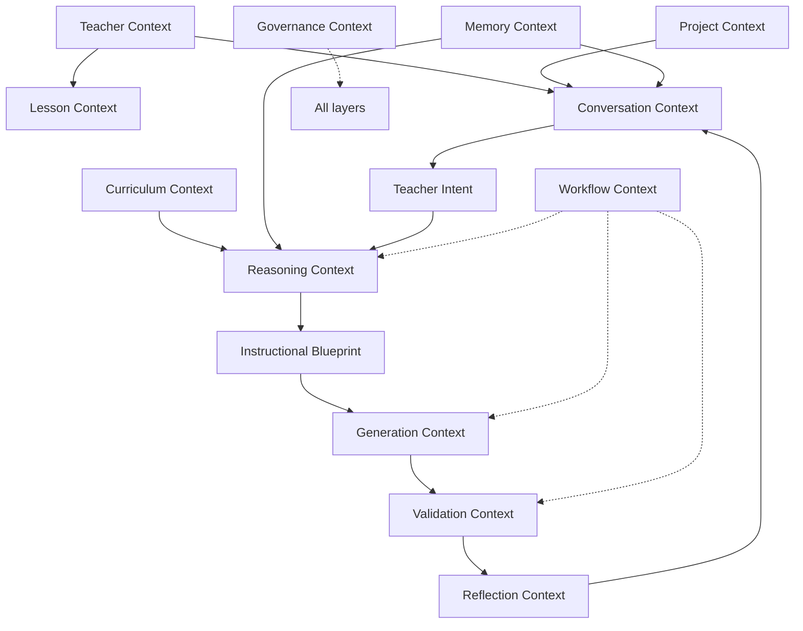

---

## Context Activation

### Activation triggers

| Trigger | Layers typically activated |
|---------|---------------------------|
| Teacher enters PRIMA Experience | CL-08, CL-09, CL-05, CL-02; CL-06 via Memory delivery |
| Discovery dialogue turn | CL-10, CL-05 |
| WG-01 passed — reasoning authorized | CL-04, CL-12 (+ upstream collected) |
| Blueprint review presentation | CL-15, CL-09 |
| WG-04 passed — generation authorized | CL-13 (CL-04, CL-10 **deactivated** per GP-05) |
| Generation complete — validation | CL-14 |
| Teacher editing session | CL-13 outputs; CL-05 |
| Session pause | CL-11 snapshot; all active preserved in Session State |
| Session resume | CL-11 restore; gate re-validation |
| Library reopen | CL-08 enriched from Version Manifest |

### Activation criteria

| Criterion | Rule |
|-----------|------|
| **Phase legality** | Workflow State permits layer activation |
| **Gate satisfaction** | Critical sources present for phase |
| **Authority validity** | Teacher Approval present before CL-13 |
| **Version binding** | Blueprint Version matches for CL-13, CL-14 |
| **Scope budget** | Only layers registered for phase — CP-01 |

### Context composition

Reasoning-phase composition (CL-12):

```
Decision Context =
    Teacher Intent (High)
  + Knowledge Package (High — curriculum)
  + Memory Context (Medium — advisory)
  + Revision Directives (High — if evolution)
  + Session State refs (Medium)
  + Activity Type constraints from CL-09 (High)
  + Platform Configuration bounds from CL-02 (High)
```

Generation-phase composition (CL-13) — **restricted**:

```
Generation binding =
    Approved Blueprint Version (Critical)
  + Teacher Approval granted (Critical)
  + Revision Directives (High)
  + Generation Package scope (High)
  EXCLUDES: live Knowledge Package, Memory Context (GP-05)
```

### Conflict resolution

Per [`PRIMA_REASONING_FRAMEWORK.md`](./PRIMA_REASONING_FRAMEWORK.md) — surface conflicts; apply authority precedence; never silent merge.

### Context inheritance

| Child layer | Inherits from |
|-------------|---------------|
| CL-09 Lesson | CL-08 Project (Activity Type, iteration) |
| CL-10 Conversation | CL-08, CL-09, CL-05 |
| CL-12 Reasoning | CL-10 (via Teacher Intent), CL-04, CL-06 hints |
| CL-13 Generation | CL-09 frozen at approval — not live inheritance |
| CL-14 Validation | CL-13 outputs + approval binding |

### Context merging

Merging applies **only** at governed assembly points:

- **Teacher Intent** merges Conversation Context fragments  
- **Decision Context** merges Teacher Intent + Knowledge Package + Memory Context  
- **Session State** merges artifact references — not content mutation  

Ad hoc merge outside artifact contracts is **prohibited** (AP-03).

### Context isolation

| Isolation rule | Purpose |
|----------------|---------|
| Generation isolates from live curriculum/memory | GP-05 faithful execution |
| Decision Context isolates per reasoning pass | RF-05 bounded scope |
| Validation isolates measurement from design mutation | VP-03 |
| Reflection isolates interpretive from authoritative | ACR-08 |

### Context expiration

| Context | Expiration event |
|---------|------------------|
| Decision Context | Reasoning pass complete — consumed |
| Memory Context delivery | Session-scoped delivery discarded |
| Knowledge Package query response | Superseded by new query or pass end |
| Conversation Context | Superseded by new session or archived |
| Teacher Approval | Superseded by new approval cycle — prior immutable |
| Workflow State `approved` | Expires on design return — regen path excepted |

---

## Context Deactivation

Deactivation removes layer influence **without deleting lineage**.

| Phase exit | Deactivated layers | Preserved |
|------------|-------------------|-----------|
| Discovery → Reasoning | CL-10 raw capture priority reduced; Teacher Intent takes precedence | Conversation Context archived path |
| Reasoning → Review | CL-12 Decision Context consumed/discarded | Blueprint draft |
| Approval → Generation | CL-04, CL-10, CL-12 live curriculum/dialogue context | Approved Blueprint Version |
| Generation → Validation | CL-13 in-progress signals | Generation Package |
| Session pause | CL-11 active task — checkpointed | Session State full snapshot |
| Terminal session | All active layers | Audit + best-effort drafts |

**Rule:** Deactivated context must not influence decisions ([`CM-CR-04`](#compliance-rules)).

---

## Context Quality

| Dimension | Definition | Failure signal |
|-----------|------------|----------------|
| **Relevance** | Context applies to current phase and Learning Experience | Irrelevant pack query; FAIL-INT-01 |
| **Completeness** | Critical sources present for phase | FAIL-INT-02; gate block |
| **Accuracy** | Context faithfully represents source | Version conflict FAIL-VER-01 |
| **Consistency** | No unresolved internal contradiction | FAIL-CON-01 |
| **Freshness** | Active Knowledge Pack version; current teacher statements | Stale pack; superseded approval |
| **Authority** | Sources used at correct priority level | Memory override attempt — blocked |
| **Traceability** | Composition reconstructable from artifacts | Missing provenance |
| **Explainability** | Selection rationale available | EP-01 violation |
| **Business Value** | Context enables better instructional outcome | N/A — qualitative governance |

---

## Context Governance

### Ownership summary

| Layer / category | Owner domain | Modifier | Activator |
|------------------|--------------|----------|-----------|
| Global / Institutional | System Governance | Platform admin governance | Platform Configuration load |
| Curriculum / Knowledge | Knowledge Domain | Curation governance — not session | Reasoning phase assembly |
| Teacher / Conversation | Teacher Interaction + Orchestration | Teacher (utterances); capture process | Discovery phase |
| Memory (advisory) | Memory Domain | Memory Engine delivery; teacher profile | Session entry |
| Project / Session | Orchestration | Orchestrator checkpoint | Session lifecycle |
| Reasoning | Instructional Design | Reasoning assembly — ephemeral | WG-01 pass |
| Generation | Generation Domain | Execution pipeline | WG-04 pass |
| Validation | Validation Domain | Validation Gate | WG-05 pass |
| Reflection | Teacher Interaction | Reflection presentation | Review/validation phases |
| Governance | System Governance | Gate evaluation — deterministic | All transitions |

### Conflict resolution

Conflicts resolved by **authority precedence** — then **teacher dialogue** if still unresolved. See [`PRIMA_REASONING_FRAMEWORK.md`](./PRIMA_REASONING_FRAMEWORK.md) §Conflict Resolution.

### Consistency preservation

- Artifact lifecycle constraints (LC-*, ACR-*)  
- Single session model (AC-12)  
- Immutable approval records (ACR-05)  
- Phase-bound activation (CP-07)  

---

## Explainability

Context selection must answer:

| Question | Answer source |
|----------|---------------|
| What context was active? | Artifact bundle at phase (Decision Context, Session State) |
| Why was it included? | Phase activation rules + gate requirements |
| Why was something excluded? | GP-05, CP-01 relevance rules |
| What authority applied? | Priority precedence record |
| What changed at deactivation? | Workflow transition audit |

Explainability feeds **Reflection Report** and **Audit Record** — not hidden selection logic.

---

## Future Evolution

| Area | Evolution | Guardrail |
|------|-----------|-----------|
| CL-07 Student Context | FE-07 adaptive learning | TP-05 review required |
| CL-16 Collaboration | FE-04 co-design | WG-04 unchanged v1.0 |
| CL-03 Institution | FE-05 school integration | Policy adjacency only |
| Richer Project context | Deeper Library lineage | Traceability preserved |
| New context layer | Register in this document first | CP-* principles immutable |

---

## Context Graph

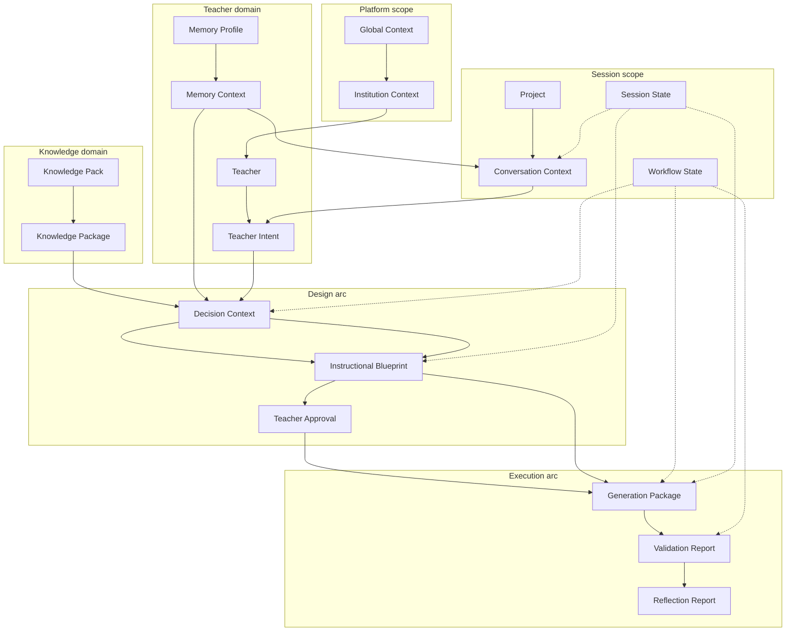

---

## Context Matrices

### Context → Workflow

| Workflow phase | Active context layers | Primary artifacts |
|----------------|----------------------|-------------------|
| WF-PR-01 Discovery | CL-05, CL-08, CL-09, CL-10, CL-06 | Conversation Context, Memory Context |
| WF-PR-01 Reasoning | CL-04, CL-12, CL-05, CL-09 | Decision Context, Knowledge Package |
| WF-PR-02 Approval | CL-15, CL-09, CL-05 | Reflection Report, Blueprint |
| WF-PR-03 Generation | CL-13 only (+ frozen CL-09) | Blueprint Version, Teacher Approval |
| WF-PR-04 Validation | CL-14 | Validation Report |
| WF-PR-05 Editing | CL-13 outputs, CL-05 | Generated Resource |
| WF-SU-01 Recovery | CL-11 full snapshot | Session State, Audit Record |

### Context → Decision

| Decision | Required context (Critical/High) |
|----------|----------------------------------|
| DEC-INT-01 | CL-10, CL-05 |
| DEC-DIS-01 / WG-01 | Teacher Intent complete |
| DEC-KN-01 | CL-04 scoped query |
| DEC-BP-01 | CL-12 Decision Context assembled |
| DEC-BP-02 | CL-15, Blueprint draft, CL-05 |
| DEC-GN-01 | CL-13 binding — Teacher Approval + Blueprint Version |
| DEC-VAL-01 | CL-14 |
| DEC-REC-01 | CL-11 Session State snapshot |

### Context → State

| Context layer | Governing state object |
|---------------|------------------------|
| CL-10 | Conversation Context lifecycle |
| CL-05 (intent) | Teacher Intent lifecycle |
| CL-12 | Decision Context assembled → consumed |
| CL-11 | Workflow State, Session State |
| CL-13 | Generation Package lifecycle |
| CL-14 | Validation Report lifecycle |
| CL-15 | Reflection Report lifecycle |

### Context → Artifact

| Artifact | Context layer embodied |
|----------|------------------------|
| Conversation Context | CL-10 |
| Teacher Intent | CL-05 normalized |
| Memory Context | CL-06 advisory delivery |
| Knowledge Package | CL-04 active slice |
| Decision Context | CL-12 bundle |
| Instructional Blueprint | CL-09 design authority (post-composition) |
| Session State | CL-11 snapshot |
| Workflow State | CL-11 phase pointer |

### Context → Capability

| Capability | Context consumed |
|------------|-------------------|
| ID-01 Instruction Discovery | CL-10, CL-06, CL-08 |
| ID-03 Instructional Reasoning | CL-12 |
| ID-04 Blueprint Composition | CL-12 |
| RF-01 Understanding Mirroring | CL-10 |
| RF-02 Design Explainability | CL-12 output, CL-09 |
| GN-01 Learning Resource Generation | CL-13 only |
| QA-01 Blueprint Fidelity | CL-14 |
| GV-01 Session Integrity | CL-11 |
| PS-05 Personalization | Memory Profile → CL-06 delivery |

### Context → Component

| Component | Context responsibility |
|-----------|------------------------|
| CMP-I01 Engine Suite | Assembles CL-04, CL-10, CL-12 inputs |
| CMP-I02 Orchestrator | CL-11 activation/deactivation; gate context |
| CMP-A01 Session Store | CL-11 Session State persistence |
| CMP-X01 Generation | CL-13 binding only |
| CMP-X02 Validation | CL-14 |
| CMP-G01 Identity/Preferences | CL-05 teacher profile adjacency |

### Context → Authority

| Context source | Authority level |
|----------------|-----------------|
| Teacher explicit | Critical |
| Teacher Approval | Critical |
| Approved Blueprint Version | Critical at execution |
| Teacher Intent | High |
| Knowledge Package | High (evidence) |
| Platform Configuration | High (policy) |
| Memory Context | Medium (advisory) |
| Reflection Report | Low (interpretive) |

### Context → Intelligence Layer

| Intelligence layer ([`PRIMA_INTELLIGENCE_MODEL.md`](./PRIMA_INTELLIGENCE_MODEL.md)) | Context layers consumed |
|-------------------------------------------------------------------------------------|-------------------------|
| IL-02 Contextual Intelligence | CL-05 through CL-11 |
| IL-03 Knowledge Intelligence | CL-04 |
| IL-04 Reasoning Intelligence | CL-12 |
| IL-07 Validation Intelligence | CL-14 |
| IL-08 Reflective Intelligence | CL-15 |
| IL-10 Governance Intelligence | CL-02, CL-11, CL-05 approval |

---

## Context Diagrams

### Diagram 1 — Overall context architecture

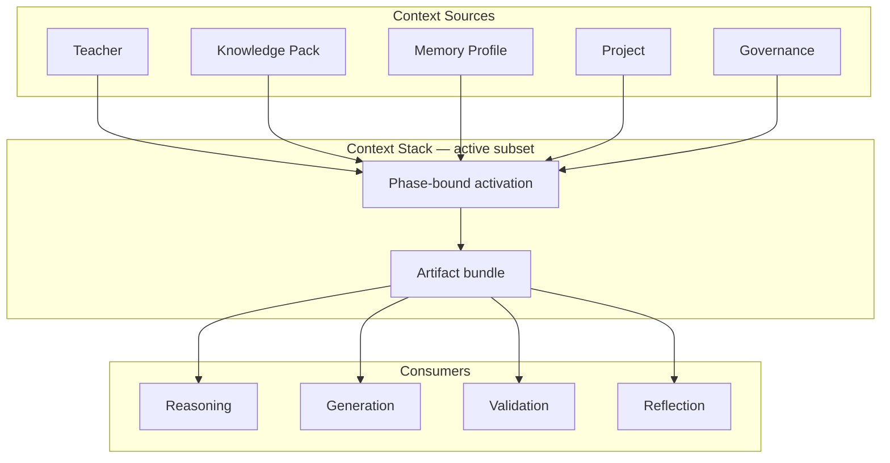

---

### Diagram 2 — Context stack

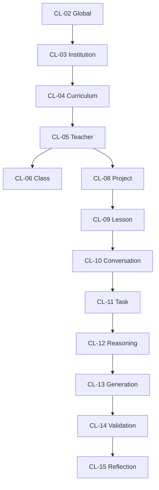

---

### Diagram 3 — Context lifecycle

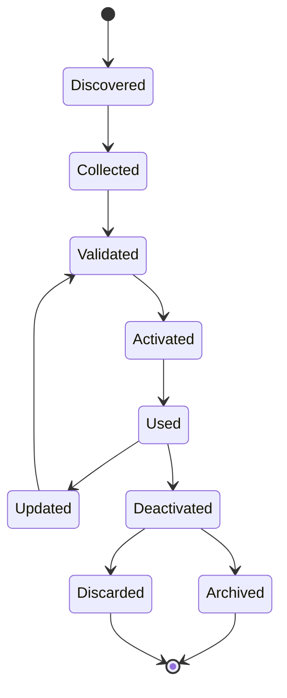

---

### Diagram 4 — Context relationships (educational ecosystem)

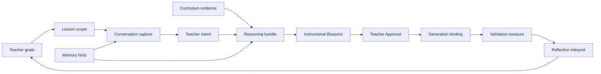

---

### Diagram 5 — Context activation flow

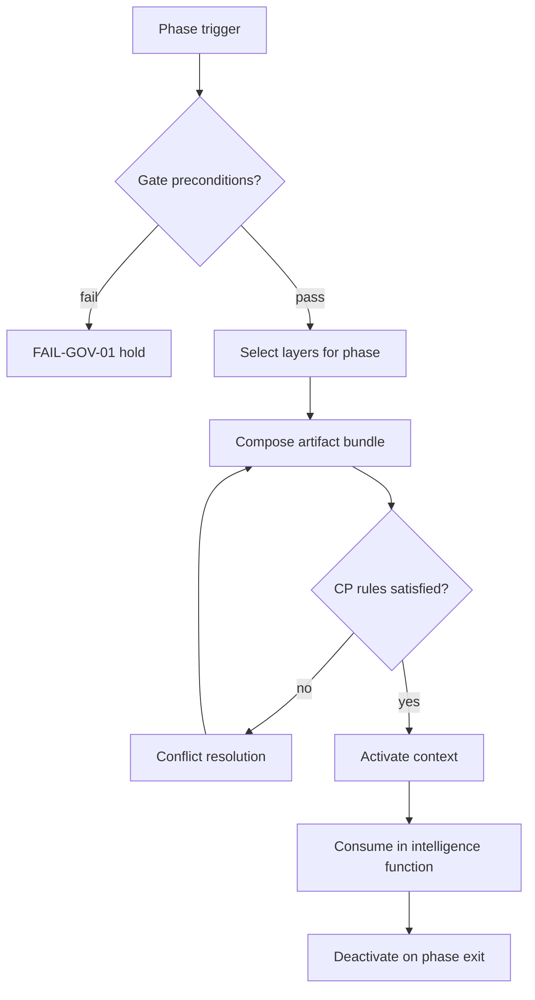

---

### Diagram 6 — Context governance

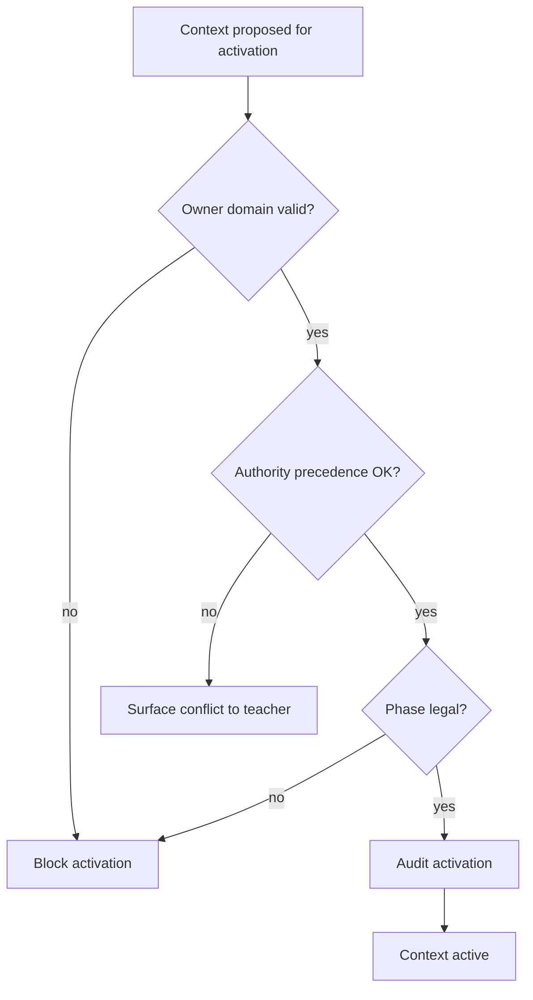

---

### Diagram 7 — Reasoning context composition

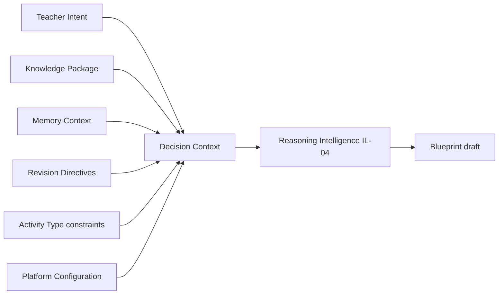

---

### Diagram 8 — Knowledge vs Memory vs Context

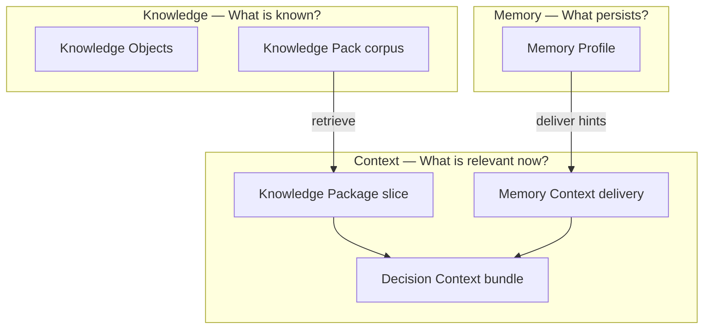

---

### Diagram 9 — Educational context ecosystem

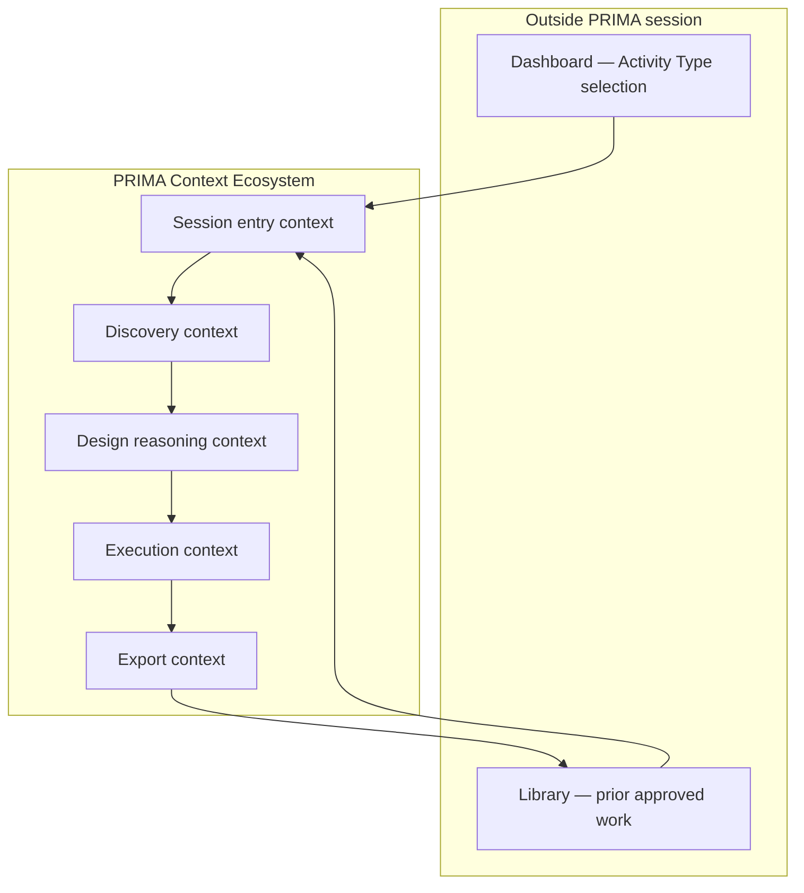

---

## Compliance Rules

| ID | Rule |
|----|------|
| **CM-CR-01** | Only relevant context may participate in reasoning — CP-01 |
| **CM-CR-02** | Context never overrides teacher authority — CP-02 |
| **CM-CR-03** | Context selection must be explainable — CP-08 |
| **CM-CR-04** | Inactive context must not influence decisions or gates |
| **CM-CR-05** | Conflicting contexts require explicit resolution — never silent merge |
| **CM-CR-06** | Every context layer must have an identifiable owner |
| **CM-CR-07** | Every context activation must have a defined lifecycle stage |
| **CM-CR-08** | Generation context excludes live Knowledge Package and Memory Context — GP-05 |
| **CM-CR-09** | Decision Context never persists as design authority — ACR-09 |
| **CM-CR-10** | Context Model prevails on context architecture conflict until officially revised |

---

## Summary

The **PRIMA Context Model** defines the conceptual architecture governing **contextual information** within PRIMA — what is relevant at any given moment, how it is layered, prioritized, activated, combined, and retired.

Three questions — three architectural answers:

| Question | Answer | Specification |
|----------|--------|---------------|
| *What is known?* | **Knowledge** | Knowledge Pack / Knowledge Package |
| *What is relevant now?* | **Context** | This document — Context Stack and activation |
| *What should persist across time?* | **Memory** | Memory Profile / Memory Context delivery |

The Context Model is the **bridge** between Knowledge, Memory, Reasoning ([`PRIMA_REASONING_FRAMEWORK.md`](./PRIMA_REASONING_FRAMEWORK.md)), Intelligence ([`PRIMA_INTELLIGENCE_MODEL.md`](./PRIMA_INTELLIGENCE_MODEL.md)), and Decision ([`PRIMA_DECISION_FRAMEWORK.md`](./PRIMA_DECISION_FRAMEWORK.md)) architectures.

Context is **dynamic, selective, explainable, and governed**. It enables PRIMA to reason with precisely the information the current educational situation requires — nothing more, nothing less — while preserving teacher authority and architectural integrity.

All present and future PRIMA implementations **must conform to this Context Model** regardless of AI technology, storage, or infrastructure.

---

## Document Authority

| Layer | Relationship |
|-------|--------------|
| [`PRIMA_CANONICAL_ARTIFACTS.md`](./PRIMA_CANONICAL_ARTIFACTS.md) | Artifact contracts embody context bundles |
| [`PRIMA_DOMAIN_MODEL.md`](./PRIMA_DOMAIN_MODEL.md) | Entities (Project, Memory Profile, Knowledge Pack) are context sources |
| [`PRIMA_INTELLIGENCE_MODEL.md`](./PRIMA_INTELLIGENCE_MODEL.md) | IL-02 Contextual Intelligence consumes context layers |
| [`PRIMA_REASONING_FRAMEWORK.md`](./PRIMA_REASONING_FRAMEWORK.md) | Context Collection phase assembles CL-12 |
| [`PRIMA_WORKFLOW_MODEL.md`](./solution/PRIMA_WORKFLOW_MODEL.md) | Workflow phases trigger activation/deactivation |
| [`PRIMA_STATE_MODEL.md`](./solution/PRIMA_STATE_MODEL.md) | States record context object conditions |

---

## Next Recommended Document

→ [`PRIMA_ARCHITECTURE_CONSISTENCY_REVIEW.md`](./PRIMA_ARCHITECTURE_CONSISTENCY_REVIEW.md) — Cross-document consistency audit including context, reasoning, intelligence, and artifact alignment.
