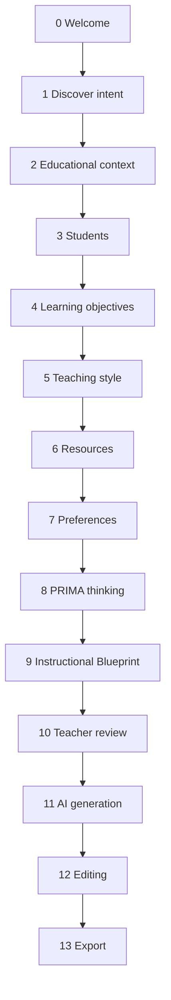

# LUDI ON – PRIMA Conversation Blueprint

# Purpose

This document defines the complete conversational architecture of the PRIMA experience inside LUDI ON.

It is the foundation for all future PRIMA development: UI, engine logic, data contracts, and AI orchestration.

PRIMA is not implemented here. This document describes **what the experience must feel like**, **why each moment exists**, and **what intelligence must be captured** before any code is written.

---

# Foundational Principles

| PRIMA is | PRIMA is not |
|----------|--------------|
| A pedagogical partner | A chatbot |
| A discovery process | A wizard |
| A guided conversation | A form |
| An intelligence that listens first | A questionnaire |

## Design commitments

1. **Continuity** — The experience reads as one unfolding dialogue, never as numbered steps.
2. **Pedagogy first** — Every stage exists because sound instructional design requires that information.
3. **Inference over interrogation** — PRIMA asks only what it cannot know or cannot responsibly assume.
4. **Teacher authority** — PRIMA recommends. The teacher decides.
5. **Emotional safety** — Teachers arrive with expertise; PRIMA honors that expertise before asking for details.
6. **Transparency at the right moment** — PRIMA shows its thinking when the teacher is ready to review, not while they are still imagining.

## Language rules (UI and conversation)

Never surface to the teacher:

- "Step 1", "Step 2", …
- "Question 3 of 10"
- "Form", "Field", "Submit"
- "Wizard", "Module", "Pipeline"

Instead surface:

- Natural transitions ("Acum că știu despre elevii tăi…")
- Reflective summaries ("Deci vrei să construim…")
- Invitations ("Povestește-mi…", "Cum ar arăta succesul pentru tine?")

---

# Conversation Architecture Overview



## Stage groups

| Group | Stages | Role |
|-------|--------|------|
| **Arrival** | 0 | Emotional and cognitive entry into PRIMA |
| **Discovery** | 1–7 | Co-construction of instructional intent |
| **Reasoning** | 8–9 | PRIMA makes pedagogy visible |
| **Creation** | 10–13 | Teacher approval, generation, refinement, delivery |

## Persistent conversation object

Every stage writes to a single evolving structure: the **PRIMA Session Model** (conceptual, not implementation).

```
PRIMA Session
├── teacher_profile (known + inferred)
├── activity_intent
├── educational_context
├── learner_model
├── objectives
├── instructional_strategy
├── resource_constraints
├── personalization
├── instructional_blueprint (draft → approved)
└── generated_outputs (draft → final)
```

---

# Stage Specifications

---

## Stage 0 — Welcome

### 1. Stage name

**Welcome** (*Bun venit în universul PRIMA*)

### 2. Purpose

Establish trust, emotional tone, and psychological separation from the Dashboard. Prepare the teacher to enter a calm, premium space where PRIMA listens before acting.

### 3. Why this stage exists (pedagogical perspective)

Before any instructional decision, the teacher must feel **safe, respected, and curious**. Anxiety about AI or fear of "doing it wrong" blocks creative pedagogical thinking. Welcome reframes PRIMA as a **partner**, not a tool to operate.

Pedagogically, this mirrors the **warm-up phase** of a professional coaching conversation: relationship before content.

### 4. What PRIMA wants to understand

- Is the teacher ready to begin?
- Has the teacher selected an activity type (e.g. Lecție) from the Dashboard?
- Optional: first emotional signal (confidence, hesitation, urgency) from micro-interactions (time on screen, scroll, hover — never intrusive)

### 5. Example conversation

```
PRIMA:
Bine ai venit!

Ai pășit în universul PRIMA — locul în care experiența ta didactică
și inteligența artificială lucrează împreună.

Eu sunt PRIMA. Nu sunt un formular și nu sunt un generator rapid.
Sunt partenerul tău în proiectarea activităților didactice.

[Teacher reads, explores, presses "Descoperă PRIMA"]
```

### 6. Information extracted

| Field | Source |
|-------|--------|
| `activity_type` | Dashboard selection (e.g. `lesson`) |
| `session_started_at` | System timestamp |
| `entry_point` | Dashboard builder card |

### 7. Information inferred automatically

| Inference | Signal |
|-----------|--------|
| Teacher has intent to create, not browse | Clicked "Lecție" |
| First-time vs returning PRIMA user | Account history |
| Preferred language | Profile / locale |

### 8. What questions should never be asked

- "What would you like to create?" — already chosen on Dashboard
- "Are you a teacher?" — account role
- "Which language do you prefer?" — platform setting

### 9. Transition sentence to next stage

> *"Acum hai să descoperim împreună ce vrei să construiești — în cuvintele tale."*

---

## Stage 1 — Discover What the Teacher Wants to Create

### 1. Stage name

**Discover Intent** (*Descoperim intenția*)

### 2. Purpose

Capture the teacher's vision in natural language before structuring it. Allow imagination, nuance, and pedagogical intent to emerge without premature categorization.

### 3. Why this stage exists (pedagogical perspective)

Instructional design begins with **constructivist intent**: what the teacher wants learners to experience, not which template to fill. Asking too early for grade level or objectives forces premature convergence and produces generic activities.

This stage honors **backward design** (Wiggins & McTighe) at the narrative level: the teacher describes the desired learning experience; PRIMA listens for seeds of objectives, methods, and success criteria embedded in natural speech.

### 4. What PRIMA wants to understand

- Topic or theme (explicit or implied)
- Desired activity format feeling (exploration, practice, story, challenge…)
- Why now? (lesson position in unit, problem being solved)
- What would make the teacher say "this worked"?

### 5. Example conversation

```
PRIMA:
Spune-mi, ce ai în minte?

Nu trebuie să fie perfect formulat — descrie-mi lecția
așa cum ți-ai imagina-o pentru elevii tăi.

Profesoară:
Vreau o lecție despre fotosinteză pentru clasa a IV-a.
Mi-ar plăcea ceva vizual, cu o poveste scurtă,
ca elevii să înțeleagă procesul, nu doar să memoreze termeni.

PRIMA:
Deci vrei ca elevii să înțeleagă procesul fotosintezei
printr-o experiență vizuală și narrativă — nu doar memorare.
Asta e o direcție foarte bună.
```

### 6. Information extracted

| Field | Example |
|-------|---------|
| `topic` | Fotosinteză |
| `grade_hint` | Clasa a IV-a |
| `desired_experience` | Vizual, narativ |
| `anti_patterns` | Evită memorare mecanică |
| `teacher_voice_raw` | Full natural language input |

### 7. Information inferred automatically

| Inference | Basis |
|-----------|-------|
| Subject domain | Biology / Științe |
| Cognitive level (preliminary) | Understand vs remember |
| Activity archetype candidate | Story-led lesson |
| Curriculum area | Plants, energy, environment |

### 8. What questions should never be asked

- "Select a topic from this list" — if topic already stated
- "Choose lesson type" — if Dashboard already set `lesson`
- "How many minutes?" — too early; belongs in context stage

### 9. Transition sentence to next stage

> *"Ca să proiectez ceva cu adevărat potrivit, vreau să înțeleg puțin contextul — unde se încadrează lecția ta."*

---

## Stage 2 — Understand the Educational Context

### 1. Stage name

**Educational Context** (*Contextul educațional*)

### 2. Purpose

Situate the activity within curriculum, timing, prior knowledge, and classroom constraints so PRIMA designs something **feasible and coherent**, not isolated.

### 3. Why this stage exists (pedagogical perspective)

Activities fail when designed in a vacuum. Context determines:

- **Prior knowledge** (what can be assumed vs taught)
- **Instructional sequence** (introduction vs consolidation vs assessment)
- **Time realism** (depth vs breadth)
- **Curriculum alignment** (Romanian national curriculum competencies)

This stage supports **situated learning**: the activity must fit the teacher's real classroom moment.

### 4. What PRIMA wants to understand

- Subject and curriculum area
- Position in unit / sequence (new topic, reinforcement, remediation)
- Available time (single lesson, double, homework extension)
- Connection to previous or next lessons
- Any official competency targets (if teacher knows them)

### 5. Example conversation

```
PRIMA:
Unde se află această lecție în parcursul tău?

Profesoară:
Suntem la unitatea despre plante. Am făcut deja părțile plantei.
Acum intrăm în procesele vitale. Am 50 de minute.

PRIMA:
Perfect — deci fotosinteza vine după structura plantei,
ca proces vital, într-o lecție de 50 de minute.
```

### 6. Information extracted

| Field | Example |
|-------|---------|
| `subject` | Științe |
| `unit` | Plante |
| `lesson_position` | After plant structure |
| `duration_minutes` | 50 |
| `lesson_function` | Introduction to photosynthesis |

### 7. Information inferred automatically

| Inference | Basis |
|-----------|-------|
| Curriculum grade band | Clasa IV + subject |
| Recommended scaffolding | Prior lesson on plant parts |
| Time budget per phase | ~50 min lesson structure |
| Competency candidates | National curriculum mapping for Grade 4 Sciences |

### 8. What questions should never be asked

- "What subject are you teaching?" — if already stated in Stage 1
- "What grade?" — if already mentioned; confirm silently instead
- "Is this a lesson?" — known from Dashboard

### 9. Transition sentence to next stage

> *"Acum vreau să mă gândesc la elevii care vor trăi această lecție — fiecare clasă e diferită."*

---

## Stage 3 — Understand the Students

### 1. Stage name

**Students** (*Elevii tăi*)

### 2. Purpose

Build a learner model that enables differentiation, appropriate challenge, and inclusive design.

### 3. Why this stage exists (pedagogical perspective)

Pedagogy is never generic. The same topic requires different scaffolding based on:

- **Developmental stage**
- **Heterogeneity** (mixed abilities)
- **Special educational needs**
- **Motivation and engagement patterns**
- **Language and cultural context**

This stage enables **differentiated instruction** and **universal design for learning (UDL)** before content is generated.

### 4. What PRIMA wants to understand

- Class profile (size, general ability spread)
- Specific challenges (attention, reading level, language support)
- Strengths to leverage (creativity, collaboration, curiosity)
- Individual or group considerations (SEN, gifted, anxiety)
- What has worked before with this class

### 5. Example conversation

```
PRIMA:
Cum e clasa ta?

Profesoară:
Sunt 24 de elevi. Sunt curioși, dar pierd repede atenția
dacă e prea mult de citit. Am doi elevi cu dificultăți de citire
și unul foarte avansat.

PRIMA:
Atunci vom construi ceva vizual, cu activități scurte,
și voi pregăti variante diferite de suport — fără ca tu
să faci trei lecții separate.
```

### 6. Information extracted

| Field | Example |
|-------|---------|
| `class_size` | 24 |
| `engagement_profile` | High curiosity, low sustained reading tolerance |
| `differentiation_needs` | 2 reading support, 1 advanced |
| `modality_preference` | Visual, short segments |

### 7. Information inferred automatically

| Inference | Basis |
|-----------|-------|
| Grouping strategy | Mixed-ability with tiered tasks |
| Reading load limit | Reduced text blocks |
| Extension activities | For advanced learner |
| Attention rhythm | Phase changes every 8–12 min (suggested) |

### 8. What questions should never be asked

- "How many students?" — if inferable from teacher profile default
- "Grade level?" — already known
- Diagnostic test scores — never; not PRIMA's role

### 9. Transition sentence to next stage

> *"Știind cine sunt elevii tăi, putem clarifica ce ar trebui să știe sau să poată face la finalul lecției."*

---

## Stage 4 — Discover the Learning Objectives

### 1. Stage name

**Learning Objectives** (*Obiectivele de învățare*)

### 2. Purpose

Co-define measurable, pedagogically sound objectives aligned with teacher intent — without forcing bureaucratic language.

### 3. Why this stage exists (pedagogical perspective)

Clear objectives are the backbone of instructional design. They:

- Align activities with **intended outcomes**
- Enable **assessment alignment**
- Prevent **activity without learning**

PRIMA must help teachers articulate objectives in **teacher-friendly language**, then translate internally to Bloom's levels and curriculum competencies. The teacher should not feel like they are writing official curriculum documents unless they want to.

### 4. What PRIMA wants to understand

- What should students know, understand, or do after the lesson?
- Depth of mastery (recognize, explain, apply, create)
- Success criteria from the teacher's point of view
- Optional: alignment with competencies teacher cares about

### 5. Example conversation

```
PRIMA:
La finalul lecției, ce ar trebui să poată face elevii tăi?

Profesoară:
Să explice pe scurt ce este fotosinteza și de ce e importantă
pentru plante. Să recunoască lumina și apa ca elemente esențiale.

PRIMA:
Am notat două obiective clare:
• Explică procesul fotosintezei în cuvinte proprii
• Identifică rolul luminii și al apei

Le poți ajusta dacă vrei — sunt punctul de plecare al proiectului.
```

### 6. Information extracted

| Field | Example |
|-------|---------|
| `objectives[]` | Explain photosynthesis; identify light and water roles |
| `bloom_level` | Understand / Apply |
| `success_criteria` | Own words explanation, element identification |
| `teacher_approved_objectives` | Boolean (after confirmation) |

### 7. Information inferred automatically

| Inference | Basis |
|-----------|-------|
| Curriculum competency mapping | Topic + grade + objectives |
| Assessment type suggestion | Formative oral + visual check |
| Objective gaps | Missing "importance for ecosystem" if mentioned earlier |
| Verb refinement | "Explain" → measurable indicator |

### 8. What questions should never be asked

- "Write 3 SMART objectives in this format" — bureaucratic; offer draft instead
- Objectives already stated verbatim in Stage 1 — confirm, don't re-ask
- "What is your lesson topic?" — known

### 9. Transition sentence to next stage

> *"Acum știu ce vrem să obținem. Spune-mi cum predai de obicei — vreau ca lecția să te reprezinte."*

---

## Stage 5 — Discover the Teacher's Teaching Style

### 1. Stage name

**Teaching Style** (*Stilul tău de predare*)

### 2. Purpose

Ensure the generated activity fits **how this teacher actually teaches**, not an idealized generic method.

### 3. Why this stage exists (pedagogical perspective)

Pedagogical effectiveness depends on **teacher authenticity**. A lecture-heavy teacher cannot suddenly deliver an unprepared inquiry lab; a playful teacher needs room for creativity.

This stage supports **self-consistency** and **implementation fidelity** — the activity must be one the teacher will actually use on Monday morning.

### 4. What PRIMA wants to understand

- Preferred methods (storytelling, discussion, hands-on, games, direct instruction)
- Teacher's role (facilitator, narrator, coach)
- Technology comfort level
- Classroom energy (calm, dynamic, collaborative)
- What the teacher avoids (long worksheets, loud games…)

### 5. Example conversation

```
PRIMA:
Cum îți place să predai, de obicei?

Profesoară:
Pornesc cu o poveste sau o imagine, apoi discutăm.
Nu îmi place să citesc mult din manual. Prefer ca ei să descopere.

PRIMA:
Atunci vom construi o lecție care începe narativ,
cu momente scurte de descoperire ghidată — nu lectură lungă.
```

### 6. Information extracted

| Field | Example |
|-------|---------|
| `primary_method` | Narrative + guided discovery |
| `teacher_role` | Facilitator |
| `avoid` | Long textbook reading |
| `energy_level` | Moderate-dynamic |
| `tech_comfort` | (if discussed) |

### 7. Information inferred automatically

| Inference | Basis |
|-----------|-------|
| Activity structure | Story hook → exploration → consolidation |
| Materials style | Visual prompts, not dense text |
| Future memory update | Teaching style pattern for this teacher |
| Method-objective fit check | Narrative suits "explain in own words" |

### 8. What questions should never be asked

- "Are you an expert teacher?" — respect default
- Teaching style from past sessions — confirm lightly, don't repeat full questionnaire
- "Do you want gamification?" — infer from style + intent unless ambiguous

### 9. Transition sentence to next stage

> *"Ultimul lucru despre realitatea clasei: ce resurse ai la îndemână?"*

---

## Stage 6 — Available Resources

### 1. Stage name

**Resources** (*Resursele disponibile*)

### 2. Purpose

Design within real-world constraints: devices, materials, space, time outside class, printable needs.

### 3. Why this stage exists (pedagogical perspective)

The best pedagogical idea fails if it requires resources the classroom lacks. This stage ensures **feasibility** and prevents AI from proposing:

- Digital interactives when there is one shared computer
- Crafts requiring materials schools don't have
- Homework assuming parental support unavailable

Also supports **multi-format output** decisions (screen vs print vs both).

### 4. What PRIMA wants to understand

- Digital access (1:1, shared, offline)
- Printable needs (worksheets, cards)
- Physical materials (paper, colors, lab items)
- Space constraints (desks, outdoor, groups)
- Time beyond lesson (homework yes/no)

### 5. Example conversation

```
PRIMA:
Ce ai disponibil pentru această lecție?

Profesoară:
Am tablă și proiector. Pot printa câteva fișe, dar nu mult.
Elevii au caiete, nu dispozitive.

PRIMA:
Voi prioritiza proiectorul + caiete,
cu o fișă scurtă de consolidare — nu pachet mare de printare.
```

### 6. Information extracted

| Field | Example |
|-------|---------|
| `digital.projector` | true |
| `digital.student_devices` | false |
| `printable.budget` | low |
| `materials` | notebooks |
| `homework` | not requested |

### 7. Information inferred automatically

| Inference | Basis |
|-----------|-------|
| Output formats | Slides + 1 worksheet max |
| Interaction type | Whole-class + individual notebook work |
| Avoid | Digital-only student activities |
| Export targets | PDF worksheet, presentation |

### 8. What questions should never be asked

- "Do you have internet?" — if platform already online; ask classroom-specific only
- Resources PRIMA can generate (worksheets) — don't ask if teacher wants them; offer later
- School name / address — irrelevant

### 9. Transition sentence to next stage

> *"Mai am câteva preferințe despre cum ar trebui să se simtă lecția — apoi încep să construiesc planul."*

---

## Stage 7 — Preferences and Personalization

### 1. Stage name

**Preferences** (*Preferințe și personalizare*)

### 2. Purpose

Capture final nuance: tone, language level, cultural context, assessment inclusion, aesthetic preferences, and teacher-specific defaults.

### 3. Why this stage exists (pedagogical perspective)

Two teachers with identical objectives and context will still want different **tone**, **cultural framing**, and **output shape**. Personalization increases **ownership** and **satisfaction**.

This stage also feeds **Future Learning Memory** for subsequent sessions.

### 4. What PRIMA wants to understand

- Language complexity for students
- Tone (playful, serious, exploratory)
- Include assessment or not?
- Characters / themes / cultural references welcome or avoid
- Length preference (concise vs rich)
- Anything the teacher wants PRIMA to remember

### 5. Example conversation

```
PRIMA:
Există preferințe finale?

Profesoară:
Limba simplă, propoziții scurte. Ton prietenos.
Aș vrea un mini-quiz la final, 5 întrebări.
Folosim des personaje din natură — animale, plante.

PRIMA:
Notat: limbaj accesibil, ton cald, quiz scurt final,
cu personaje din natură ca fir narrativ.
```

### 6. Information extracted

| Field | Example |
|-------|---------|
| `language_level` | Simple, short sentences |
| `tone` | Friendly |
| `assessment.include` | true |
| `assessment.length` | 5 questions |
| `narrative.themes` | Nature characters |
| `remember_preferences` | true |

### 7. Information inferred automatically

| Inference | Basis |
|-----------|-------|
| Vocabulary ceiling | Grade 4 + simple language flag |
| Quiz format | Short formative, not high-stakes |
| Narrative wrapper | Nature characters for photosynthesis story |
| Memory profile update | Teacher preference fingerprint |

### 8. What questions should never be asked

- Preferences already expressed (tone, visual) — synthesize, confirm once
- Account settings (name, email)
- "Do you want AI to generate?" — implicit

### 9. Transition sentence to next stage

> *"Mulțumesc — am tot ce îmi trebuie. Acum mă voi gândi cum arată cea mai bună lecție pentru tine și elevii tăi."*

---

## Stage 8 — PRIMA Thinking Process

### 1. Stage name

**PRIMA Thinking** (*Procesul de gândire PRIMA*)

### 2. Purpose

Make PRIMA's pedagogical reasoning visible — building trust before showing a formal plan. The teacher sees *how* PRIMA arrived at recommendations, not a black box.

### 3. Why this stage exists (pedagogical perspective)

Teachers are professional decision-makers. Showing reasoning:

- Builds **trust in AI** without blind acceptance
- Models **reflective instructional design**
- Allows early correction ("Nu, de fapt vreau mai multă exersare")

Pedagogically, this mirrors **think-aloud** and **metacognitive transparency** — PRIMA demonstrates how an expert designer thinks through a lesson.

### 4. What PRIMA wants to understand

- Does the teacher agree with PRIMA's interpretation?
- Any correction before blueprint formalization?
- Emotional readiness to see structured plan

### 5. Example conversation

```
PRIMA:
Iată cum m-am gândit:

• Elevii tăi au nevoie de vizual și segmente scurte
• Obiectivele cer explicare, nu memorare — deci pornesc cu poveste
• Ai proiector + caiete — structurez: poveste → discuție → activitate → quiz
• Voi diferenția: suport vizual pentru citit, extensie pentru avansat

Profesoară:
Da, dar aș vrea mai mult timp pe activitatea practică.

PRIMA:
Perfect — mut accentul: mai puțină poveste, mai multă explorare ghidată.
```

### 6. Information extracted

| Field | Example |
|-------|---------|
| `reasoning_summary` | Structured narrative |
| `teacher_corrections[]` | More time on practical activity |
| `approval_to_blueprint` | Boolean |

### 7. Information inferred automatically

| Inference | Basis |
|-----------|-------|
| Phase time rebalancing | Teacher correction |
| Risk flags | Objective-method misalignment (resolved) |
| Confidence score | Completeness of session model |

### 8. What questions should never be asked

- Any new discovery question — discovery is complete
- "Do you trust AI?" — demonstrate trust through transparency
- Technical model names or prompts

### 9. Transition sentence to next stage

> *"Pe baza acestui plan, am pregătit blueprint-ul instrucțional — harta completă a lecției tale."*

---

## Stage 9 — Instructional Blueprint

### 1. Stage name

**Instructional Blueprint** (*Blueprint-ul instrucțional*)

### 2. Purpose

Present the complete pedagogical architecture of the activity in structured, readable form — the contract between PRIMA, teacher, and generation engines.

### 3. Why this stage exists (pedagogical perspective)

The **Instructional Blueprint** (see `INSTRUCTIONAL_BLUEPRINT.md`) is the central model of LUDI ON. It ensures:

- Objectives → activities → assessment **alignment**
- Explicit **phases**, **timing**, **materials**
- **Differentiation** and **teacher notes** documented
- Generation engines receive **pedagogical intent**, not raw chat logs

This stage converts conversation into **durable instructional design**.

### 4. What PRIMA wants to understand

- Does the blueprint match teacher intent?
- Which sections need editing?
- Approval to proceed to generation

### 5. Example conversation

```
PRIMA:
Iată blueprint-ul lecției tale:

Obiective · Faze · Durată · Materiale · Diferențiere · Evaluare

[Fiecare secțiune afișată clar, editabilă]

Profesoară:
[Reviewing…] La faza 2, schimbă activitatea cu una de grup.

PRIMA:
Am actualizat blueprint-ul. Vrei să continui spre generare?
```

### 6. Information extracted

| Field | Example |
|-------|---------|
| `blueprint.version` | 1.0 |
| `blueprint.phases[]` | Hook, Explore, Practice, Check |
| `blueprint.materials[]` | Slides, worksheet, quiz |
| `blueprint.differentiation` | Tiered support notes |
| `blueprint.approved` | Boolean |

### 7. Information inferred automatically

| Inference | Basis |
|-----------|-------|
| Full phase timing | Duration + method + objectives |
| Material list | Resources + blueprint structure |
| Engine routing | Lesson → Content + Resource engines |
| Validation pre-check | Pedagogy engine rules |

### 8. What questions should never be asked

- Re-ask discovery questions — edit blueprint inline instead
- "Select template" — blueprint IS the plan
- Generate before approval

### 9. Transition sentence to next stage

> *"Blueprint-ul e aprobat. Acum pot genera resursele lecției — tu rămâi în control."*

---

## Stage 10 — Teacher Review (Pre-Generation Gate)

### 1. Stage name

**Teacher Review** (*Revizuirea ta*)

### 2. Purpose

Final human checkpoint before AI generation consumes resources and shapes deliverables. Explicit consent moment.

### 3. Why this stage exists (pedagogical perspective)

**Teacher agency** is a core LUDI ON pillar. Review prevents:

- Unwanted generative output
- Misaligned content reaching students
- Feeling of loss of control

Pedagogically, this mirrors **lesson planning approval** in collaborative school cultures — the teacher signs off before materials are printed.

### 4. What PRIMA wants to understand

- Explicit approval to generate
- Optional last-minute blueprint edits
- Which outputs to generate (slides, worksheet, quiz…)

### 5. Example conversation

```
PRIMA:
Ultima verificare înainte de generare:

• Lecție narrativă, 50 minute, clasa a IV-a
• 2 obiective · 4 faze · quiz de 5 întrebări
• Voi genera: plan lecție, prezentare, fișă, quiz

Totul arată bine?

Profesoară:
Da, generează.

PRIMA:
Încep generarea. Te țin la curent.
```

### 6. Information extracted

| Field | Example |
|-------|---------|
| `generation.approved` | true |
| `generation.outputs[]` | lesson plan, slides, worksheet, quiz |
| `generation.timestamp` | ISO datetime |

### 7. Information inferred automatically

| Inference | Basis |
|-----------|-------|
| Generation pipeline scope | Blueprint materials |
| Estimated generation time | Output set complexity |
| Validation strictness | Grade + subject rules |

### 8. What questions should never be asked

- New pedagogical discovery
- "Are you sure?" without summary — always show summary first
- Marketing or upsell questions

### 9. Transition sentence to next stage

> *"Generez resursele — durează un moment. Vei vedea totul imediat ce e gata."*

---

## Stage 11 — AI Generation

### 1. Stage name

**Generation** (*Generarea resurselor*)

### 2. Purpose

Execute orchestrated AI pipeline to produce classroom-ready materials from approved blueprint.

### 3. Why this stage exists (pedagogical perspective)

Generation is **execution**, not design. Separating it from discovery ensures:

- Design decisions are not rushed
- Generated content traces to **approved pedagogy**
- Engines (Content, Resource, Pedagogy, Validation) operate on **structured input**

The teacher experiences progress and transparency, not a blank wait.

### 4. What PRIMA wants to understand

- Generation progress (system)
- Partial failures or validation retries (system)
- Teacher patience / cancel intent (optional)

### 5. Example conversation

```
PRIMA:
Lucrez la lecția ta…

✓ Plan lecție
✓ Prezentare
→ Fișă de lucru…
  Quiz

[Soft progress — no technical jargon]

PRIMA:
Gata! Resursele sunt pregătite. Hai să le parcurgem împreună.
```

### 6. Information extracted

| Field | Example |
|-------|---------|
| `generation.status` | complete |
| `generation.artifacts[]` | IDs of generated resources |
| `validation.results` | pass / retry log |

### 7. Information inferred automatically

| Inference | Basis |
|-----------|-------|
| Quality score | Validation engine |
| Suggested edits | Common issue patterns |
| Version lineage | Blueprint v1 → artifacts v1 |

### 8. What questions should never be asked

- Any user input during generation unless error requires decision
- "Please wait" without progress indicator

### 9. Transition sentence to next stage

> *"Resursele sunt generate. Poți modifica orice — nimic nu e definitiv."*

---

## Stage 12 — Editing

### 1. Stage name

**Editing** (*Editare*)

### 2. Purpose

Give teachers full control to refine, personalize, and approve final content before classroom use.

### 3. Why this stage exists (pedagogical perspective)

AI output is a **draft**, not a verdict. Professional teachers adapt materials to:

- Last-minute class dynamics
- Personal voice and examples
- Local context students recognize

Editing honors **teacher professionalism** and improves **implementation quality**.

### 4. What PRIMA wants to understand

- What sections teacher changes
- Whether teacher wants PRIMA assist for rewrites
- Satisfaction signals (implicit)

### 5. Example conversation

```
PRIMA:
Iată lecția ta. Poți edita direct textul, slide-urile sau fișa.

Profesoară:
[Edits quiz question 3]
PRIMA, reformulează întrebarea 3 mai simplu.

PRIMA:
Iată o variantă mai accesibilă pentru clasa ta. O aplici?
```

### 6. Information extracted

| Field | Example |
|-------|---------|
| `edits[]` | Diff log per artifact |
| `assist_requests[]` | Rewrite question 3 |
| `final_approved` | Boolean |

### 7. Information inferred automatically

| Inference | Basis |
|-----------|-------|
| Edit patterns for memory | Frequent simplification requests |
| Quality improvement suggestions | Validation + edit diff |
| Readiness to export | No pending edits |

### 8. What questions should never be asked

- Re-run full discovery for small edits
- "Do you want to save?" — auto-save default

### 9. Transition sentence to next stage

> *"Când ești mulțumită de lecție, o poți exporta în formatele de care ai nevoie."*

---

## Stage 13 — Export

### 1. Stage name

**Export** (*Export*)

### 2. Purpose

Deliver final resources in formats the teacher can use immediately: PDF, PPTX, print, LMS share, library save.

### 3. Why this stage exists (pedagogical perspective)

Pedagogical value is realized only when materials reach the classroom. Export closes the loop:

- **Print** for students without devices
- **Presentation** for classroom delivery
- **Archive** in Personal Library for reuse and iteration

This stage supports **sustainability of teacher work** — today's lesson becomes tomorrow's template.

### 4. What PRIMA wants to understand

- Desired export formats
- Save to library intent
- Optional sharing (future: school/community)

### 5. Example conversation

```
PRIMA:
Lecția ta e gata. Cum vrei să o iei cu tine?

• PDF pentru fișă
• Prezentare
• Salvează în Biblioteca mea

Profesoară:
PDF + prezentare, salvează în bibliotecă.

PRIMA:
Perfect. Lecția despre fotosinteză e salvată.
Vrei să începi o activitate nouă sau revii la Dashboard?
```

### 6. Information extracted

| Field | Example |
|-------|---------|
| `export.formats[]` | PDF, PPTX |
| `library.saved` | true |
| `project.id` | UUID |
| `session.completed_at` | timestamp |

### 7. Information inferred automatically

| Inference | Basis |
|-----------|-------|
| Reuse recommendation | Similar future topics |
| Memory: successful session pattern | Full session model |
| Dashboard "Continue working" entry | Project metadata |

### 8. What questions should never be asked

- Export formats blueprint didn't generate
- Account payment (future monetization) during export
- Re-confirm all objectives

### 9. Transition sentence to next stage

> *Session complete. Return to Dashboard or begin a new PRIMA conversation.*

---

# Cross-Cutting Architecture

## Inference engine (conceptual)

PRIMA maintains an **Inference Layer** that runs continuously across stages:

| Source | Examples |
|--------|----------|
| Teacher profile | Grade, subject, school type, past sessions |
| Dashboard selection | Activity type |
| Natural language | Objectives, tone, topic embedded in speech |
| Curriculum graph | Romanian competency mapping |
| Session coherence | Later statements override earlier assumptions |

**Rule:** If confidence ≥ threshold, PRIMA confirms silently in summaries. If confidence < threshold, PRIMA asks **one focused question**, never a form.

## Conversation memory

Within a session, all stages share one thread. PRIMA never asks for information present earlier in the same conversation.

Across sessions, **Future Learning Memory** (see `AI_ARCHITECTURE.md`) pre-fills:

- Typical class size
- Preferred methods
- Language tone
- Resource constraints

…with teacher confirmation: *"Ca de obicei, folosesc proiectorul?"*

## Error and ambiguity handling

| Situation | PRIMA behavior |
|-----------|----------------|
| Contradiction | Reflect gently: *"Mai devreme ai spus… acum simt că… Care e varianta potrivită?"* |
| Missing critical info | One targeted question, not a form |
| Off-topic | Acknowledge, redirect with warmth |
| Teacher fatigue (long session) | Offer pause: *"Putem salva progresul și continuăm mai târziu."* |

## UI metaphors (not implementation)

| Avoid | Prefer |
|-------|--------|
| Stepper | Flowing conversation panel |
| Form fields | Inline chips, voice, short replies |
| Chat bubbles only | Mixed: narrative + structured cards + blueprint viewer |
| Progress bar "3/10" | Phase labels: *Descoperim · Construim · Generăm · Finalizăm* |

---

# Relationship to LUDI ON Engines

| Stage | Primary engine |
|-------|----------------|
| 0–7 | PRIMA Engine (discovery + session model) |
| 8 | PRIMA Engine (reasoning exposition) |
| 9 | PRIMA Engine → Instructional Blueprint output |
| 10 | Teacher gate (application layer) |
| 11 | AI Orchestrator → Content + Resource + Validation |
| 12 | Application layer + Content Engine (assistive edits) |
| 13 | Resource Engine + Library |

---

# Success Criteria for PRIMA Conversation v1

1. Teachers describe the experience as **conversation**, not form-filling.
2. Median time to approved blueprint ≤ product North Star alignment (under 5 minutes for experienced users).
3. ≥ 80% of discovery fields populated by inference or earlier stages (measure: questions asked vs information needed).
4. Zero visible "Step N" in UI copy audit.
5. Blueprint approval rate ≥ 70% without returning to Stage 1.
6. Teacher trust score (post-session survey): "PRIMA understood my intent" ≥ 4.2/5.

---

# Suggested Improvements and Future Opportunities

## 1. Adaptive stage compression

Not every teacher needs all discovery stages every time. Returning users with rich memory could merge Stages 2–6 into a **single reflective summary** PRIMA confirms in one screen — reducing time without losing pedagogy.

## 2. "Sketch mode" for expert teachers

Allow teachers to paste a rough plan or upload an existing outline. PRIMA skips to **Blueprint** with gaps highlighted — respects expert users who already did the instructional thinking.

## 3. Collaborative PRIMA (future)

Grade-level teams co-design. Conversation supports multiple teacher voices with role attribution — valuable for Romanian school planning cultures.

## 4. Classroom feedback loop

After export, PRIMA optionally collects **post-lesson reflection** ("Ce a funcționat?") to close the **learning engineering loop** — rare in EdTech, high pedagogical value.

## 5. Competency auto-mapping UI

Show teachers Romanian curriculum competencies as **optional elegant chips** during Objective stage — increases official alignment without forcing bureaucracy.

## 6. Emotional tone detection (careful)

If teacher language signals stress or urgency ("mâine am lecția"), PRIMA adapts tone and offers **fast-path** with explicit tradeoff transparency — never at the cost of pedagogy without consent.

## 7. Multimodal input

Voice dictation for discovery stages — many teachers think aloud faster than they type; aligns with natural conversation metaphor.

## 8. Blueprint diff across iterations

When teachers return to edit a saved lesson, show **what changed** pedagogically between versions — supports professional growth and reuse.

## 9. Separate "Explore PRIMA" mode

Secondary link from Welcome (*Cum funcționează PRIMA?*) could open a **non-linear explainer** — interactive, not documentation — for teachers hesitant about AI.

## 10. Stronger linkage to Dashboard

When teacher selects **Lecție**, Stage 0–1 should feel seamless: Dashboard intent carries forward visually (topic card becomes first PRIMA reflection) so the world transition feels continuous, not a hard cut.

---

# Document Governance

| Action | Owner |
|--------|-------|
| Blueprint changes | Product + Pedagogy lead |
| Engine contract changes | Engineering + AI Architecture |
| UI interpretation | Design lead |
| Localization | Product (Romanian primary) |

**Next documents to derive from this blueprint:**

- `PRIMA_SESSION_MODEL.md` — data schema
- `PRIMA_UI_FLOW.md` — screen map per stage
- `PRIMA_COPY_GUIDE.md` — Romanian voice and tone
- Updates to `PRIMA_ENGINE.md` and `INSTRUCTIONAL_BLUEPRINT.md`

---

# References

- `docs/PRODUCT.md`
- `docs/AI_ARCHITECTURE.md`
- `docs/LUDI_ON_BLUEPRINT/PRIMA_ENGINE.md`
- `docs/LUDI_ON_BLUEPRINT/INSTRUCTIONAL_BLUEPRINT.md`
- `docs/UI_GUIDELINES.md`

---

*End of PRIMA Conversation Blueprint v1.0*

---

## Next Recommended Document

→ [`PRIMA_DECISION_ENGINE.md`](./PRIMA_DECISION_ENGINE.md) — How PRIMA converts conversation into instructional decisions and blueprint structure.
