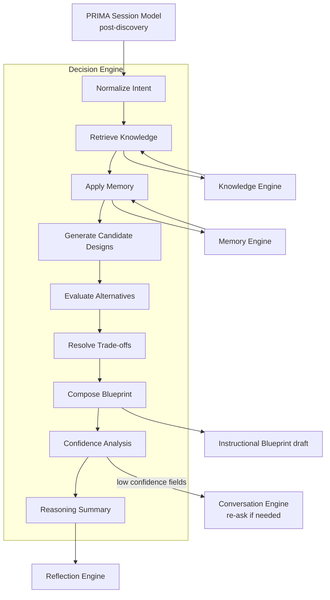
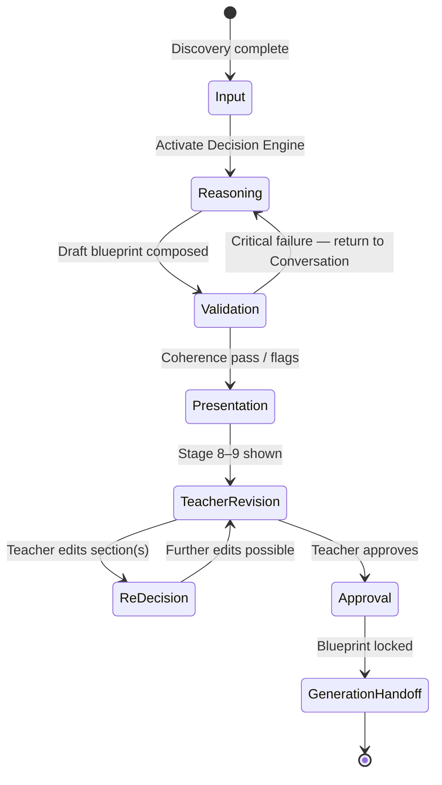
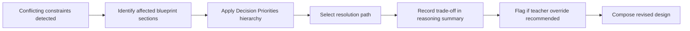
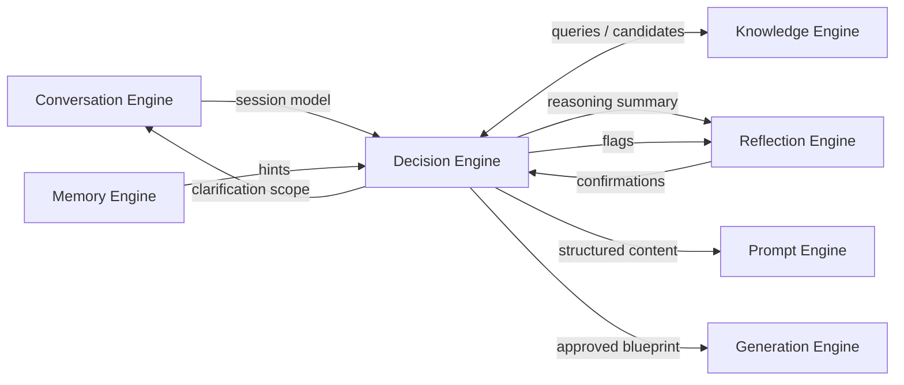

# PRIMA Decision Engine — Product Architecture Specification

---

## Purpose

This document defines how PRIMA converts discovered teacher intent into **pedagogical decisions** and a structured **Instructional Blueprint**.

The Decision Engine is PRIMA's reasoning core — not its voice, not its memory, not its generator. It interprets what the Conversation Engine captured, queries what the Knowledge Engine knows, weighs what the Memory Engine suggests, and produces a coherent instructional plan the teacher can review, revise, and approve.

This specification describes **product architecture only**. It does not define APIs, prompts, models, databases, or code.

The Decision Engine is the **reasoning heart** of LUDI ON. Every future implementation of pedagogical logic in PRIMA must conform to this document.

---

## Responsibilities

| Function | Description |
|----------|-------------|
| **Interpret** | Parse the completed PRIMA Session Model into structured instructional intent |
| **Align** | Map intent to objectives, methods, and assessment using backward design |
| **Evaluate** | Generate and compare pedagogical alternatives before committing to a design |
| **Resolve** | Apply priority hierarchy when instructional constraints conflict |
| **Validate** | Check pedagogical coherence across blueprint sections before presentation |
| **Explain** | Produce traceable reasoning for teacher review (Conversation Blueprint Stage 8) |
| **Compose** | Assemble Instructional Blueprint sections in dependency order |
| **Revise** | Incorporate teacher corrections incrementally without restarting discovery |
| **Score** | Maintain field-level confidence for downstream confirmation behaviour |
| **Hand off** | Package approved blueprint and revision directives for the Generation Engine |

---

## Inputs

| Input | Source | Role in reasoning |
|-------|--------|-------------------|
| PRIMA Session Model (post-discovery) | Conversation Engine | Primary intent, context, learner model, constraints |
| Curriculum mappings and strategy candidates | Knowledge Engine | Objectives, frameworks, subject pedagogy |
| Teacher preferences and class patterns | Memory Engine | Defaults and inference shortcuts — never overrides |
| Activity type constraints | Dashboard / builder selection | Output shape and archetype rules (Lecție, Joc, etc.) |
| Teacher blueprint revisions | Reflection Engine / review UI | Incremental re-decision triggers |
| Confidence thresholds | Product configuration | Ask vs confirm vs decide behaviour |

---

## Outputs

| Output | Consumer | Description |
|--------|----------|-------------|
| `reasoning_summary` | Reflection Engine → Prompt Engine | Transparent explanation for Stage 8 — PRIMA thinking |
| `instructional_blueprint` | PRIMA Orchestrator, Generation Engine | Versioned design artifact: draft → reviewed → approved |
| `confidence_map` | Conversation Engine, Reflection Engine | Field-level inference strength |
| `revision_directives` | Generation Engine | Section-level constraints after approval |
| `pedagogical_flags` | Reflection Engine | Risks, trade-offs, and items needing teacher attention |
| `re_decision_scope` | PRIMA Orchestrator | Which blueprint sections changed after teacher edit |

---

## Decision Philosophy

Every pedagogical decision in PRIMA is governed by the following principles. These are architectural commitments — not preferences that can be overridden by optimization.

### Explicit reasoning

Decisions are made through visible reasoning steps, not opaque outputs. PRIMA must be able to explain *why* each major design choice was made before the teacher approves the blueprint.

### Teacher authority

The teacher's explicit statements take precedence over inference, memory, and curriculum defaults. PRIMA never silently overrides what the teacher said. Contradictions are surfaced, not resolved invisibly.

### Explainability

Every recommendation in the Instructional Blueprint must trace to evidence: conversation capture, knowledge retrieval, or stated pedagogical rationale. Unexplainable decisions are invalid decisions.

### Pedagogical coherence over optimization

PRIMA optimizes for a coherent Learning Experience — objectives, activities, and assessment aligned — not for speed, novelty, or content volume. A simpler coherent design beats a complex incoherent one.

### Transparency before Generation

Reasoning is presented to the teacher (Stage 8) and the blueprint is reviewable (Stages 9–10) before any **Generation** runs. The Decision Engine completes its work in the design phase.

### Backward design

PRIMA reasons from desired learning outcomes toward activities and assessment — not from available templates toward filler objectives. Objectives drive structure; structure does not drive objectives.

### Evidence-based instructional reasoning

Decisions draw on the Knowledge Engine (curriculum, frameworks, developmental norms) and established instructional patterns — not on arbitrary or purely aesthetic choices. Creativity operates within pedagogical evidence, not outside it.

---

## Internal Decision Architecture

The Decision Engine executes a sequential reasoning pipeline. Each stage consumes structured outputs from the previous stage and may invoke sibling engines where noted.

### Reasoning Pipeline

```
Completed Conversation (Session Model)
              ↓
       Normalize Intent
              ↓
       Retrieve Knowledge
              ↓
         Apply Memory
              ↓
   Generate Candidate Designs
              ↓
 Evaluate Pedagogical Alternatives
              ↓
      Resolve Trade-offs
              ↓
       Compose Blueprint
              ↓
      Confidence Analysis
              ↓
      Reasoning Summary
```

### Pipeline Stages

| Stage | Responsibility |
|-------|----------------|
| **Normalize Intent** | Convert session model fragments into a consistent internal intent representation; resolve duplicates; flag gaps |
| **Retrieve Knowledge** | Query Knowledge Engine for competencies, strategies, prerequisites, developmental norms |
| **Apply Memory** | Load preference hints; adjust defaults where confidence allows; never override explicit teacher input |
| **Generate Candidate Designs** | Produce 2–3 viable instructional approaches at strategy level |
| **Evaluate Pedagogical Alternatives** | Score candidates against coherence, learner model, constraints, curriculum |
| **Resolve Trade-offs** | Apply Decision Priorities when candidates conflict on constraints |
| **Compose Blueprint** | Assemble winning design into blueprint sections in dependency order |
| **Confidence Analysis** | Score each blueprint field; identify fields requiring confirmation |
| **Reasoning Summary** | Package explainability trace for Reflection Engine presentation |

### Internal Architecture Diagram



---

## Decision Lifecycle

Decision making spans from the moment discovery is complete until the teacher approves the blueprint and Generation is authorized.

### Lifecycle Phases

| Phase | Description | Blueprint state |
|-------|-------------|-----------------|
| **Input** | Session model marked complete; Decision Engine activated | — |
| **Reasoning** | Full pipeline executes; draft blueprint and reasoning summary produced | `draft` |
| **Validation** | Internal coherence checks; pedagogical flags generated | `draft` |
| **Presentation** | Reflection and Prompt engines present thinking (Stage 8) and blueprint (Stage 9) | `draft` |
| **Teacher Revision** | Teacher edits one or more blueprint sections | `draft` / `reviewed` |
| **Re-decision** | Decision Engine updates affected sections only; preserves unchanged decisions | `reviewed` |
| **Approval** | Teacher explicitly approves blueprint | `approved` |
| **Generation Handoff** | Orchestrator releases blueprint to Generation Engine with revision directives | `approved` — locked |

### Lifecycle Diagram



### Re-entry to Conversation

If validation detects **critical information gaps** (not low confidence on preferences — missing objectives, unknown grade, contradictory unstated constraints), the Decision Engine returns control to the Conversation Engine with a scoped clarification request. Full discovery does not restart.

---

## Decision Layers

The Decision Engine organizes reasoning into five layers. Each layer builds on the previous. Layers may iterate internally before passing output forward.

---

### Layer 1 — Intent Resolution

#### Purpose

Transform natural-language discovery into a structured, unambiguous instructional intent: topic, purpose, success criteria, and scope boundaries.

#### Inputs

| Input | Source |
|-------|--------|
| `activity_intent` | Session model |
| `educational_context` | Session model |
| Teacher utterances (normalized) | Conversation Engine |
| Activity type | Builder selection |

#### Outputs

| Output | Consumer |
|--------|----------|
| `resolved_intent` | Layer 2, Knowledge Engine queries |
| `success_criteria` | Layer 4, Layer 5 |
| `scope_boundaries` | Layer 3 |
| `intent_confidence` | Confidence Analysis |

#### Responsibilities

- Resolve topic, disciplinary framing, and lesson purpose
- Distinguish stated goals from implied goals
- Define what success looks like for the teacher
- Flag ambiguous or overly broad intent for confirmation
- Never invent objectives the teacher did not imply or state

#### Dependencies

| Engine | Relationship |
|--------|--------------|
| Conversation Engine | Source session model |
| Knowledge Engine | Prerequisite topic validation |
| Memory Engine | Topic patterns from past sessions |

#### Example

| Discovery capture | Resolved intent |
|-------------------|-----------------|
| "Vreau ceva vizual despre fotosinteză, să înțeleagă procesul, nu să memoreze termeni" | Topic: photosynthesis · Purpose: conceptual understanding · Success: explain process in own words · Anti-goal: terminology memorization |

#### Failure Cases

| Failure | Product behaviour |
|---------|-------------------|
| Topic too broad ("despre natură") | Flag medium confidence; Reflection confirms scope |
| Conflicting purpose statements | Surface contradiction; request clarification via Conversation |
| Missing grade/subject | Block Layer 2; return to Conversation for context |

#### Future Evolution

- Intent clustering for multi-lesson units
- Cross-session intent continuity from Memory Engine

---

### Layer 2 — Instructional Strategy Selection

#### Purpose

Select teaching methods and learning modalities aligned with resolved intent, learner model, and subject pedagogy.

#### Inputs

| Input | Source |
|-------|--------|
| `resolved_intent` | Layer 1 |
| `learner_model` | Session model |
| `strategy_recommendations[]` | Knowledge Engine |
| Teacher style preferences | Session model + Memory Engine |

#### Outputs

| Output | Consumer |
|--------|----------|
| `instructional_strategy` | Layer 3, blueprint strategy section |
| `modality_profile` | Layer 3 (visual, kinesthetic, narrative, etc.) |
| `strategy_rationale` | Explainability Framework |
| `strategy_confidence` | Confidence Analysis |

#### Responsibilities

- Match methods to objectives (e.g., understanding → inquiry, not drill)
- Respect teacher style where compatible with pedagogy
- Account for learner model (attention span, SEN, class size implications)
- Reject strategies that contradict explicit teacher constraints
- Generate candidate strategies for Layer evaluation

#### Dependencies

| Engine | Relationship |
|--------|--------------|
| Knowledge Engine | Strategy catalog, subject pedagogy |
| Memory Engine | Past approved strategy patterns |

#### Example

| Context | Strategy decision |
|---------|-------------------|
| Grade 4 · photosynthesis · visual · 50 min · 2 SEN reading support | Narrative visual hook + guided discovery + pair work (reduces individual reading load) — not lecture |

#### Failure Cases

| Failure | Product behaviour |
|---------|-------------------|
| Teacher requests lecture-only for inquiry objective | Flag pedagogical risk; propose alternative; teacher may override |
| No strategy fits resource constraints | Escalate to Trade-off Resolution |
| Knowledge Engine returns empty strategies | Fall back to activity-type defaults; flag low curriculum confidence |

#### Future Evolution

- Strategy libraries per activity archetype (Joc, Misiune)
- Evidence-weighted strategy ranking from aggregate success patterns

---

### Layer 3 — Structure Design

#### Purpose

Define the phased Learning Flow: sequence, timing, grouping, transitions, and materials per phase.

#### Inputs

| Input | Source |
|-------|--------|
| `instructional_strategy` | Layer 2 |
| `resource_constraints` | Session model |
| Duration and scheduling context | Session model |
| Activity type structure templates | Knowledge Engine |

#### Outputs

| Output | Consumer |
|--------|----------|
| `learning_flow` | Blueprint composition |
| `phase_definitions[]` | Layer 4, Layer 5, Generation |
| `timing_allocation` | Validation (timing vs cognitive load) |
| `materials_per_phase` | Resources section |

#### Responsibilities

- Design phase sequence with clear pedagogical purpose per phase
- Allocate time realistically for grade band and class size
- Specify grouping (whole class, pairs, individual) per phase
- Define transitions between phases in natural language
- Default to simpler structure when time or resources are limited

#### Dependencies

| Engine | Relationship |
|--------|--------------|
| Knowledge Engine | Activity archetype phase patterns |
| Memory Engine | Typical lesson duration patterns |

#### Example

| Input | Structure output |
|-------|----------------|
| 50 min · narrative visual strategy | 4 phases: Hook (8 min) → Explore (15 min) → Apply pairs (20 min) → Check (7 min) |

#### Failure Cases

| Failure | Product behaviour |
|---------|-------------------|
| Requested depth exceeds available time | Trade-off Resolution: depth vs time |
| Structure requires unavailable resources | Simplify structure or flag resource conflict |
| Too many phases for attention span | Merge phases; flag in reasoning summary |

#### Future Evolution

- Adaptive phase compression for micro-lessons
- Multi-session project structures spanning days

---

### Layer 4 — Differentiation Planning

#### Purpose

Plan how the Learning Experience adapts for varied learners: support tiers, extension paths, and assessment accommodations.

#### Inputs

| Input | Source |
|-------|--------|
| `learner_model` | Session model |
| `phase_definitions[]` | Layer 3 |
| `success_criteria` | Layer 1 |
| Developmental norms | Knowledge Engine |

#### Outputs

| Output | Consumer |
|--------|----------|
| `differentiation_plan` | Blueprint differentiation section |
| `support_tiers` | Generation directives |
| `extension_options` | Generation directives |
| `assessment_accommodations` | Layer 5, assessment section |

#### Responsibilities

- Translate learner model (SEN, mixed ability, language needs) into design adaptations
- Ensure differentiation is embedded in activities — not an appendix
- Plan at least support + core + extension when learner variance is known
- Avoid over-differentiation that fragments classroom management unrealistically

#### Dependencies

| Engine | Relationship |
|--------|--------------|
| Knowledge Engine | UDL patterns, developmental norms |
| Memory Engine | Known class differentiation patterns |

#### Example

| Learner model | Differentiation |
|---------------|-----------------|
| 2 students with reading support needs | Pair cards with visual cues; teacher read-aloud option in Explore phase; simplified written output in assessment |

#### Failure Cases

| Failure | Product behaviour |
|---------|-------------------|
| No learner variance captured | Provide core design only; note optional differentiation in teacher notes |
| Differentiation request conflicts with time | Trade-off Resolution |
| SEN needs unspecified but inferred | Medium confidence; confirm via Reflection before locking |

#### Future Evolution

- Tier auto-generation from learner model depth
- Individual education plan pattern library (special education)

---

### Layer 5 — Coherence Validation

#### Purpose

Verify backward-design alignment across the composed design before blueprint presentation. This is the Decision Engine's internal quality gate — distinct from platform Validation Engine post-Generation.

#### Inputs

| Input | Source |
|-------|--------|
| All Layer 1–4 outputs | Prior layers |
| Composed blueprint draft | Compose Blueprint stage |
| Assessment approach | Session model + Layer 2 |

#### Outputs

| Output | Consumer |
|--------|----------|
| `validation_report` | Internal; drives flags |
| `coherence_score` | Confidence Analysis |
| `pedagogical_flags[]` | Reflection Engine |
| `blocking_issues[]` | Orchestrator — may block presentation |

#### Responsibilities

- Verify objectives ↔ activities ↔ assessment alignment
- Detect memorization-only paths for understanding objectives
- Check timing vs cognitive load per phase
- Validate resources vs chosen strategy
- Validate differentiation vs learner model coverage
- Block blueprint presentation on critical incoherence

#### Dependencies

| Engine | Relationship |
|--------|--------------|
| Knowledge Engine | Assessment verb taxonomy, framework rules |
| All prior layers | Full design context |

#### Example

| Check | Result |
|-------|--------|
| Objective: explain photosynthesis process | Activity: label diagram from memory only | **Flag:** activity supports recall, not explanation — revise Layer 3 |

#### Failure Cases

| Failure | Product behaviour |
|---------|-------------------|
| Objectives vs activities misaligned | Re-run affected layers; do not present until resolved or flagged for teacher |
| Assessment does not measure success criteria | Revise assessment section; explain in reasoning summary |
| Unresolvable incoherence | Return scoped request to Conversation Engine |

#### Future Evolution

- Automated coherence scoring with teacher-visible report
- Cross-blueprint comparison for serial lesson planning

---

## Trade-off Resolution

Instructional design constantly involves conflicting constraints. The Decision Engine does not apply arbitrary rules or random defaults. It resolves conflicts through the **Decision Priorities** hierarchy and explicit trade-off reasoning recorded in the reasoning summary.

### Common Trade-off Scenarios

| Conflict | Typical resolution logic |
|----------|-------------------------|
| **Short lesson vs deep understanding** | Preserve core objective depth; simplify phases and cut extension — never reduce to memorization-only unless teacher explicitly accepts |
| **Large class vs active learning** | Retain active learning with scalable structures (pairs, gallery walk, think-pair-share) — avoid defaulting to lecture for management convenience |
| **Limited resources vs desired pedagogy** | Adapt strategy to available resources; surface substitution in reasoning; teacher confirms acceptability |
| **Teacher preference vs learner needs** | Learner needs rank above preferences when pedagogy is at stake; teacher is informed and may override with explicit acknowledgment |
| **Curriculum vs creativity** | Curriculum alignment is mandatory for objectives; creativity applies to activities and presentation within aligned boundaries |
| **Time vs differentiation** | Maintain core differentiation for identified SEN; defer extension tiers if time-critical |

### Trade-off Process



### Transparency Requirement

Every trade-off resolution must appear in the reasoning summary in teacher-friendly language. PRIMA states what was sacrificed, what was preserved, and why — never silently compresses design quality.

---

## Decision Priorities

When constraints conflict and multiple valid paths exist, the Decision Engine applies the following hierarchy. Higher priorities constrain lower priorities.

```
1. Pedagogical coherence
        ↓
2. Teacher intent (explicit statements)
        ↓
3. Student needs (learner model)
        ↓
4. Curriculum alignment
        ↓
5. Resource availability
        ↓
6. Teacher preferences (inferred / memory)
        ↓
7. Presentation aesthetics
```

### Priority Definitions

| Priority | Meaning | Example |
|----------|---------|---------|
| **1. Pedagogical coherence** | Objectives, activities, and assessment must form a defensible whole | Never pair "critical thinking" objective with pure recall activity without flagging |
| **2. Teacher intent** | Explicit teacher statements beat inference | Teacher says "no group work" → no group work, even if pedagogy favors it |
| **3. Student needs** | SEN, attention, language, and mixed-ability requirements shape design | Reading support overrides preferred lecture format |
| **4. Curriculum alignment** | Objectives map to grade-appropriate Romanian curriculum expectations | Competency alignment when grade + subject known |
| **5. Resource availability** | Design must be deliverable with stated resources | No lab simulation if no devices and teacher confirmed none |
| **6. Teacher preferences** | Style, tone, and method preferences from session or memory | Prefer project-based if teacher consistently approves it |
| **7. Presentation aesthetics** | Visual polish, slide style, formatting preferences | Lowest priority — never compromises learning design |

### Override Rule

The teacher may override any Decision Engine recommendation during blueprint review. Overrides are recorded in the session model and take precedence in re-decision. PRIMA never re-applies overridden decisions without teacher initiation.

---

## Confidence Model

The `confidence_map` scores every significant field in the session model and blueprint. Confidence governs whether PRIMA asks, confirms, or decides — coordinating with the Conversation and Reflection engines.

### Confidence Levels

| Level | Definition | Typical sources |
|-------|------------|-----------------|
| **High** | Strong evidence from explicit teacher statement or repeated confirmed memory | "Clasa a IV-a, 45 minute" stated clearly |
| **Medium** | Reasonable inference from context; not explicitly confirmed | Strategy inferred from "ceva vizual" + science topic |
| **Low** | Weak inference; multiple valid interpretations | Differentiation depth unspecified |
| **Very low** | Missing or contradictory; cannot decide responsibly | Grade unknown; conflicting objectives |

### Behaviour Matrix

| Confidence | Ask (Conversation) | Confirm (Reflection) | Decide automatically |
|------------|-------------------|----------------------|----------------------|
| **High** | No | Optional lightweight mirror | Yes — include in blueprint |
| **Medium** | No | Yes — reflective confirmation | Yes — with confirmation prompt |
| **Low** | Yes — if discovery still open | Yes — before blueprint lock | No — hold section as provisional |
| **Very low** | Yes — required | No — insufficient basis | No — block blueprint section |

### Confidence → Product Experience

| Level | Teacher experience |
|-------|-------------------|
| High | Blueprint section appears settled; reasoning summary mentions only if non-obvious |
| Medium | "Am presupus că… E corect?" during or after discovery |
| Low | Targeted conversation extension or explicit blueprint note: "Aici am nevoie de confirmarea ta" |
| Very low | Conversation re-opens for specific gap; blueprint section marked incomplete |

### Confidence Analysis Outputs

The Confidence Analysis pipeline stage produces:

- Per-field confidence scores
- Aggregate blueprint readiness score
- List of fields requiring confirmation before approval gate
- Signals to Conversation Engine for scoped re-ask (very low only, post-discovery)

---

## Explainability Framework

Every Decision Engine output must be traceable from blueprint section back to evidence. Explainability is not optional documentation — it is a product requirement for teacher trust.

### Explainability Chain

```
Decision
    ↓
Evidence (conversation quote · knowledge retrieval · memory hint)
    ↓
Pedagogical rationale (framework · strategy rule · trade-off resolution)
    ↓
Teacher-friendly explanation (via Reflection + Prompt engines)
    ↓
Blueprint section (with linked rationale metadata)
```

### Traceability Requirements

| Blueprint section | Must trace to |
|-------------------|---------------|
| Objectives | Teacher success criteria + Knowledge Engine competency mapping |
| Learning Flow | Instructional strategy + Layer 3 reasoning |
| Activities | Phase purpose + objective alignment |
| Assessment | Success criteria + assessment taxonomy |
| Differentiation | Learner model capture |
| Resources | Resource constraints from discovery |
| Teacher Notes | Trade-offs, flags, overrides |

### Stage 8 Presentation

The `reasoning_summary` packages explainability for Conversation Blueprint Stage 8 — PRIMA thinking. It follows this structure at product level:

1. **What I understood** — intent mirror
2. **What I considered** — alternatives briefly acknowledged
3. **What I chose and why** — primary decisions with rationale
4. **What you may want to adjust** — flagged items and medium-confidence fields

The Decision Engine produces content; the Reflection and Prompt engines format and deliver it. The Decision Engine never speaks directly to the teacher.

---

## Blueprint Composition Strategy

The Instructional Blueprint is assembled in **dependency order** — each section builds on prior decisions. This is the reasoning order, not a schema definition.

### Composition Order

| Order | Section | Reasoning dependency |
|-------|---------|---------------------|
| 1 | **Objectives** | Anchors backward design; all else aligns here |
| 2 | **Learning Flow** | Strategy and phase sequence from Layers 2–3 |
| 3 | **Activities** | Detailed phase activities implementing the flow |
| 4 | **Assessment** | Must measure stated objectives and success criteria |
| 5 | **Differentiation** | Embeds adaptations into activities and assessment |
| 6 | **Resources** | Materials and tools required per phase |
| 7 | **Teacher Notes** | Trade-offs, flags, optional adjustments, rationale summary |
| 8 | **Validation** | Final coherence pass; pedagogical flags attached |

### Composition Rules

| Rule | Description |
|------|-------------|
| **Objectives first** | No activity is composed without linked objective(s) |
| **Flow before detail** | Phase structure exists before activity elaboration |
| **Assessment last among core sections** | Assessment designed to measure what activities teach |
| **Differentiation embedded** | Not a separate disconnected appendix |
| **Resources follow structure** | Derived from what phases actually require |
| **Teacher Notes capture judgment** | Where PRIMA flagged uncertainty or trade-offs |

### Version States

| State | Meaning |
|-------|---------|
| `draft` | Initial Decision Engine output |
| `reviewed` | Teacher has viewed and optionally edited |
| `approved` | Teacher explicit approval; Generation authorized |

---

## Decision Validation

Validation runs as Layer 5 and as a final pass after Blueprint Composition. It ensures the presented blueprint is pedagogically coherent before the teacher invests review effort.

### Validation Dimensions

| Dimension | Question asked | Example failure |
|-----------|----------------|-----------------|
| **Objectives vs Activities** | Does each activity advance at least one objective? | Diagram labeling for "explain process" objective |
| **Activities vs Assessment** | Does assessment measure what activities develop? | Quiz on vocabulary when objective is application |
| **Resources vs Strategy** | Can the strategy execute with listed resources? | Group digital activity with no devices confirmed |
| **Timing vs Cognitive Load** | Is time allocation realistic for grade and task complexity? | 5 minutes for complex written reflection in Grade 1 |
| **Differentiation vs Learner Model** | Are identified learner needs addressed in design? | SEN reading need with text-heavy independent work only |

### Validation Outcomes

| Outcome | Behaviour |
|---------|-----------|
| **Pass** | Blueprint proceeds to presentation |
| **Pass with flags** | Blueprint presented; pedagogical flags in Teacher Notes and reasoning |
| **Fail — recoverable** | Re-run affected Decision Layers; re-compose sections |
| **Fail — critical** | Return to Conversation Engine for missing information |

### Pre-Approval Gate

The teacher approval control remains disabled until:

- No `blocking_issues` remain
- Very-low-confidence fields are resolved or explicitly acknowledged by teacher
- Validation pass or pass-with-flags state is reached

---

## Revision Loop

Teachers edit the blueprint during Stage 10 review. The Decision Engine responds **incrementally** — updating affected sections and preserving stable decisions. Discovery does not restart.

### Revision Pipeline

```
Teacher correction (blueprint section edit)
              ↓
Decision update (scoped re-decision)
              ↓
Affected blueprint sections recomposed
              ↓
Preserved decisions unchanged
              ↓
New reasoning summary (delta + full if major)
              ↓
Re-validation (Layer 5 on affected scope)
```

### Scope Rules

| Edit type | Re-decision scope |
|-----------|-------------------|
| Objective change | Objectives, Learning Flow, Activities, Assessment, Differentiation |
| Phase timing change | Learning Flow, Activities, Resources, Timing validation |
| Activity change in one phase | That phase's activities; assessment if aligned |
| Differentiation tier edit | Differentiation section only |
| Resource edit | Resources section; strategy if conflict detected |
| Teacher Notes edit | No re-decision — teacher-owned text |

### Preservation Principle

Sections outside re-decision scope retain their version content and rationale metadata. PRIMA presents a delta summary: "Am actualizat activitățile din faza 2 pentru a se alinia noului obiectiv."

### Revision Limits

There is no artificial cap on revision cycles before approval. The teacher approves when satisfied. Each revision increments blueprint version (e.g., v0.9 → v1.0).

---

## Relationship with Other PRIMA Engines

The Decision Engine operates at the center of PRIMA's intelligence layer. It consumes inputs from discovery and sibling engines and produces artifacts consumed by reflection and generation.

### Interaction Matrix

| Engine | Direction | What crosses the boundary |
|--------|-----------|---------------------------|
| **Conversation Engine** | → Decision | Completed session model; re-ask triggers for very low confidence |
| **Conversation Engine** | Decision → | Scoped clarification requests; confidence_map gaps |
| **Reflection Engine** | Decision → | `reasoning_summary`, `pedagogical_flags`, delta summaries on revision |
| **Reflection Engine** | → Decision | Teacher confirmations; correction signals from mirrors |
| **Knowledge Engine** | ↔ Decision | Queries: competencies, strategies, norms · Returns: candidates and constraints |
| **Memory Engine** | → Decision | Preference hints, class patterns, compression eligibility |
| **Memory Engine** | Decision → | None — Decision does not write memory |
| **Prompt Engine** | Decision → | Structured reasoning content only — never raw teacher-facing copy |
| **Prompt Engine** | → Decision | None |
| **Generation Engine** | Decision → | Approved blueprint + `revision_directives` |
| **Generation Engine** | → Decision | None — post-approval edits happen in editor, not Decision Engine |
| **PRIMA Orchestrator** | ↔ Decision | Lifecycle control, approval gate, re-entry to Conversation |

### Boundary Rules

| Rule | Owner |
|------|-------|
| Discovery dialogue | Conversation Engine |
| Teacher-facing language | Prompt Engine |
| Curriculum facts | Knowledge Engine |
| Long-term personalization storage | Memory Engine |
| Pedagogical reasoning and blueprint | Decision Engine |
| Content and resource production | Generation Engine |

### Engine Interaction Diagram



---

## Failure Handling

The Decision Engine encounters incomplete, contradictory, or ambiguous inputs. Product behaviour must be predictable and trust-preserving.

### Failure Scenarios

| Scenario | Detection | Product behaviour |
|----------|-----------|-------------------|
| **Insufficient information** | Very low confidence on required fields | Block blueprint section; scoped return to Conversation |
| **Contradictory teacher statements** | Intent normalization conflict | Surface contradiction via Reflection; request resolution — never pick silently |
| **Curriculum ambiguity** | Knowledge Engine returns multiple valid mappings | Present options in reasoning; teacher selects or accepts PRIMA recommendation |
| **Low confidence** | Confidence Analysis below threshold | Confirm before lock; mark provisional in blueprint |
| **Resource conflicts** | Strategy requires unavailable resources | Trade-off Resolution; propose alternative; flag in Teacher Notes |
| **Pedagogical inconsistency** | Layer 5 validation fail | Re-reason affected layers; if unresolvable, flag for teacher judgment |
| **Teacher override of recommendation** | Explicit edit contradicts Decision output | Accept; record override; skip re-argument unless new edit creates incoherence |

### Teacher-Facing Failure Tone

Failures are never framed as errors. PRIMA uses collaborative language: "Ca să finalizez planul, am nevoie să clarificăm…" — routed through Reflection and Prompt engines.

### Escalation Path

```
Internal retry (re-reason affected layers)
        ↓
Flag with pedagogical note (teacher decides)
        ↓
Scoped conversation re-entry (missing information)
        ↓
Session pause with save (teacher returns later)
```

---

## Decision Rules (Product)

These operational rules implement Decision Philosophy in daily reasoning.

| # | Rule |
|---|------|
| 1 | Never contradict explicit teacher statements without asking |
| 2 | Prefer inference over question when confidence is high or medium with confirmation path |
| 3 | Default to simpler structure when time or resources are limited — preserve objective depth |
| 4 | Flag pedagogical risk when design contradicts stated learning goals |
| 5 | Apply Romanian curriculum alignment when grade and subject are known |
| 6 | Record every trade-off in reasoning summary |
| 7 | Incremental revision only — never restart discovery for blueprint edits |
| 8 | Teacher override always wins over inference and memory |

---

## Example Decision Trace

```
Input:     Grade 4 · Fotosinteză · Visual · 50 min · 2 SEN reading support
Layer 1:   Intent — conceptual understanding of process; anti-memorization
Layer 2:   Strategy — narrative visual hook + guided discovery + pairs
Layer 3:   Structure — 4 phases (8+15+20+7 min)
Layer 4:   Differentiation — visual pair cards; read-aloud option; simplified output
Layer 5:   Validation — pass; quiz checks explanation not term recall
Trade-off: Depth preserved; extension tier cut for time
Output:    Blueprint v0.9 → teacher edits phase 2 activity → re-decision scope:
           Activities phase 2 only → Blueprint v1.0 approved → Generation handoff
```

---

## What the Decision Engine Never Does

| Boundary | Correct owner |
|----------|---------------|
| Ask discovery questions | Conversation Engine |
| Speak directly to the teacher | Prompt Engine (via Reflection) |
| Store long-term preferences | Memory Engine |
| Generate worksheet, slide, or game text | Generation Engine |
| Lookup curriculum facts without Knowledge Engine | Knowledge Engine |
| Publish or export content | Platform export flow |
| Run without completed discovery session model | Conversation Engine must complete first |

---

## Future Evolution

The following capabilities are **future product scope** — not Version 1.0 commitments. They extend Decision Engine reasoning without changing core architectural boundaries.

| Capability | Description | Phase |
|------------|-------------|-------|
| **Multi-objective optimization** | Balance competing objectives across a lesson series with explicit Pareto-style trade-off presentation | v3+ |
| **Project-based reasoning** | Multi-session Instructional Blueprint with milestone objectives | v3+ |
| **Cross-subject planning** | Unified design across disciplines (e.g., Științe + Limba română) | v4+ |
| **Adaptive decision graphs** | Non-linear reasoning paths based on activity type and confidence | v4+ |
| **School-level recommendations** | Aggregate patterns inform defaults — never override individual teacher | v5+ |
| **Blueprint diff engine** | Visual and logical comparison between blueprint versions | v3 |
| **Confidence-scored auto-completion** | High-confidence sections pre-filled; teacher confirms batch | v3 |
| **Activity-type decision templates** | Specialized Layer 2–3 patterns for Joc, Misiune, Fișă | v2 |

---

## Architectural Principles

Permanent rules governing the Decision Engine. These do not change across versions without official revision of this document.

| # | Principle |
|---|-----------|
| 1 | **Decision never generates** — no classroom content text; blueprint and directives only |
| 2 | **Decision never stores memory** — reads Memory Engine; does not write preferences |
| 3 | **Decision never speaks directly** — all teacher language via Reflection and Prompt engines |
| 4 | **Decision is always explainable** — every major choice has evidence and rationale |
| 5 | **Blueprint before Generation** — no handoff without approved blueprint |
| 6 | **Teacher always overrides inference** — explicit correction beats model and memory |
| 7 | **Coherence before complexity** — simpler coherent design preferred |
| 8 | **Backward design is mandatory** — objectives precede activities and assessment |
| 9 | **Trade-offs are visible** — silent quality compression is forbidden |
| 10 | **Revision is incremental** — scoped re-decision; discovery is not repeated |
| 11 | **Knowledge is retrieved, not invented** — curriculum claims require Knowledge Engine |
| 12 | **Validation blocks incoherence** — critical failures prevent approval gate |

---

## Next Recommended Document

→ [`PRIMA_KNOWLEDGE_ENGINE.md`](./PRIMA_KNOWLEDGE_ENGINE.md) — Curriculum and pedagogical knowledge the Decision Engine retrieves during reasoning.
