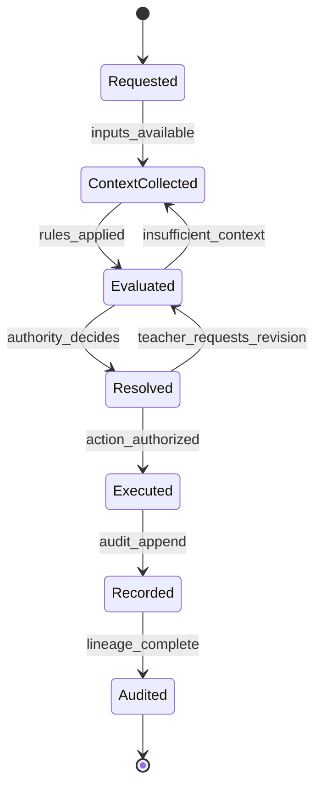
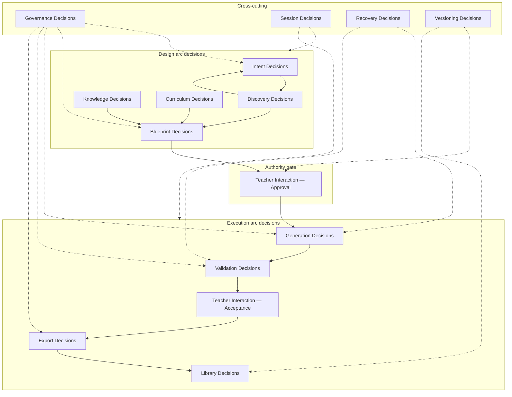
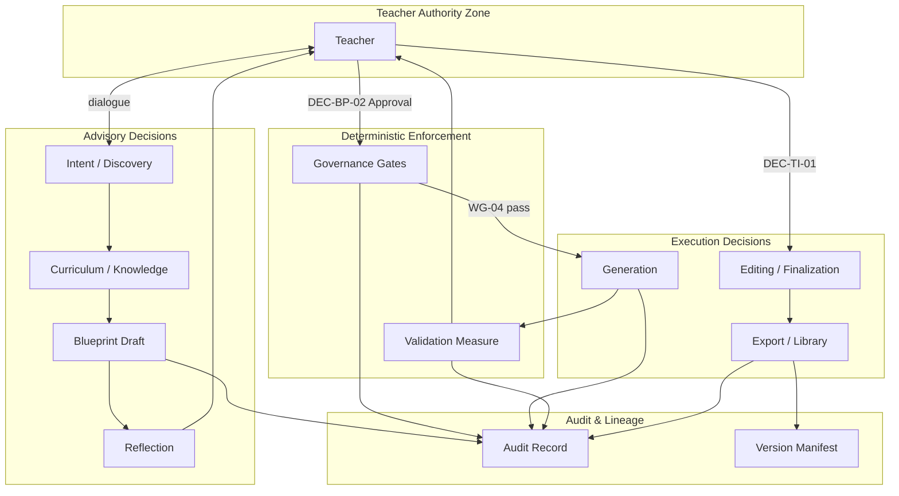
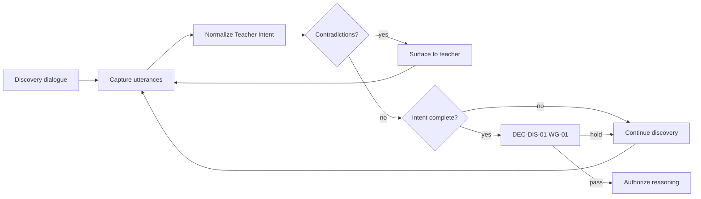
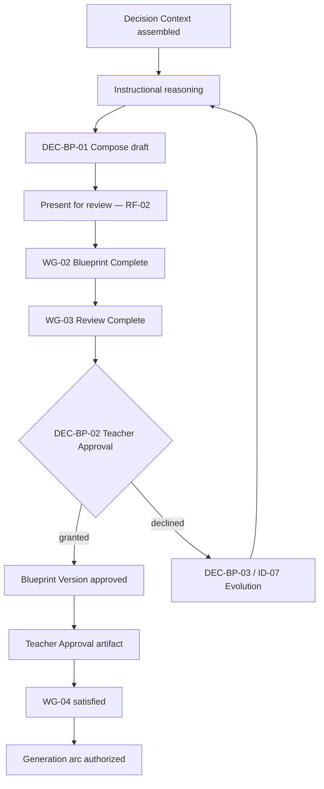
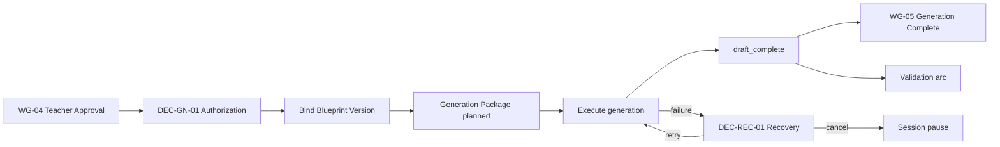
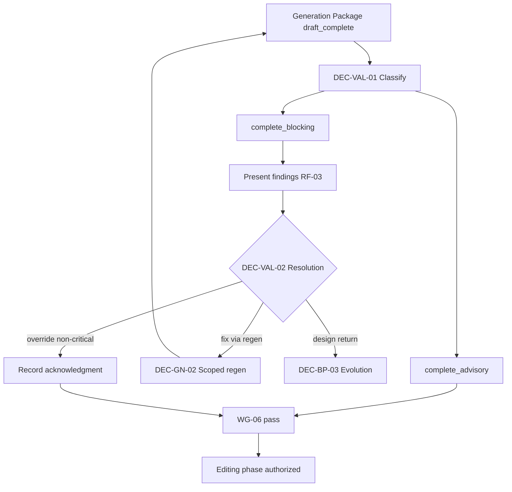
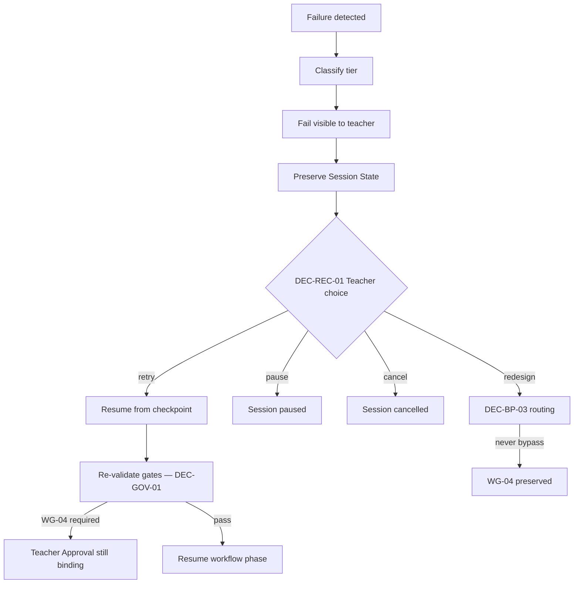
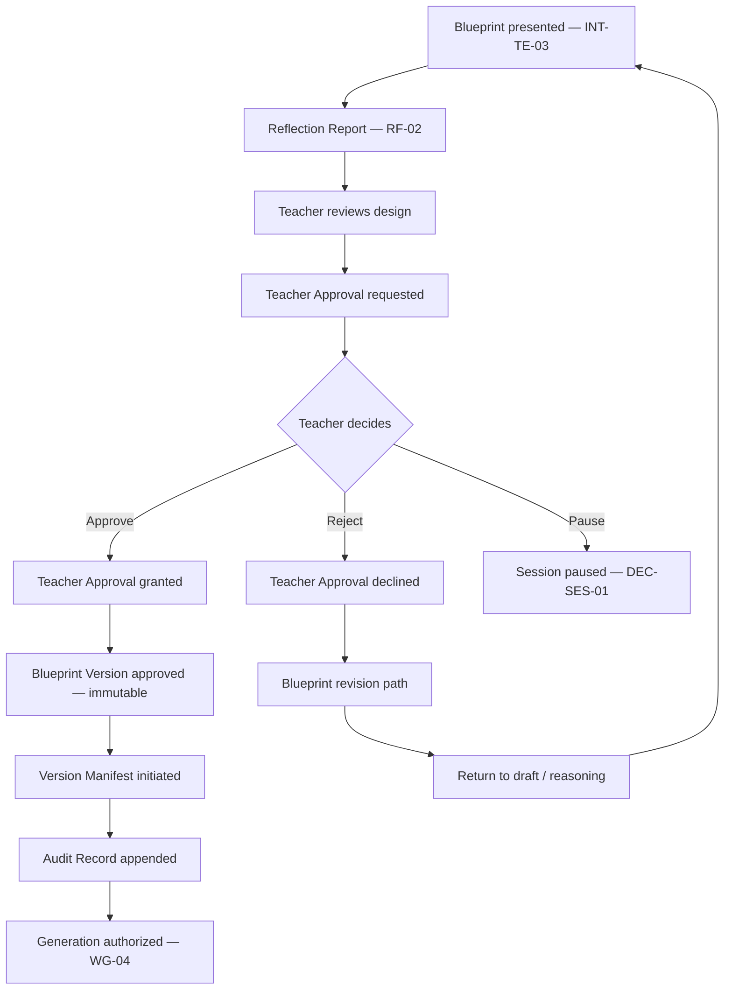

# PRIMA Decision Framework

**Version:** 1.0  
**Status:** Official — Enterprise Decision Architecture Specification

---

## Purpose

This document defines the **official decision-making architecture** of the PRIMA platform within LUDI ON.

It answers one architectural question:

> *How does PRIMA make decisions?*

The Decision Framework specifies **what categories of decisions exist**, **who owns them**, **what authority applies**, **how decisions flow through the platform**, **what constraints govern them**, and **how they remain explainable, traceable, and auditable**.

This document defines **enterprise decision architecture** — not AI algorithms, not prompts, not APIs, and not implementation technology. It governs **architectural and business decisions** that PRIMA must make or mediate across the instructional design lifecycle.

Pedagogical reasoning mechanics within the Intelligence layer are further specified in [`PRIMA_DECISION_ENGINE.md`](./PRIMA_DECISION_ENGINE.md). That document **implements** a subset of this framework; it does not supersede it.

Product decision behavior — *what is the next best action for the teacher* — is specified in [`PRIMA_DECISION_MODEL.md`](./PRIMA_DECISION_MODEL.md). That document **operationalizes** this framework as teacher-facing behavior; it does not override authority rules here.

---

## Scope

| In scope | Out of scope |
|----------|--------------|
| Decision categories, taxonomy, and registry | Model selection, inference parameters, or LLM behaviour |
| Decision ownership and authority | HTTP APIs, event schemas, database design |
| Decision lifecycle and flow | UI copy, micro-interaction design |
| Decision inputs, outputs, constraints, dependencies | Code modules, class diagrams, deployment |
| Governance, explainability, auditability | Engine-internal algorithm design |
| Decision matrices and architectural diagrams | Business process automation outside PRIMA boundary |

**Audience:** Enterprise architects, product architects, compliance reviewers, and implementation leads who must ensure every PRIMA subsystem respects decision authority and traceability.

---

## Decision Philosophy

PRIMA is an **AI-assisted instructional design platform** where the **teacher remains the final authority** over design approval, content acceptance, and export. The Decision Framework encodes that philosophy as architecture — not as a UX preference.

### Core commitments

| Commitment | Architectural meaning |
|------------|------------------------|
| **Teacher-centric** | Decisions that affect classroom outcomes require explicit teacher authority unless classified as deterministic system enforcement |
| **Design before execution** | No generation, validation, or export decision may bypass an approved Instructional Blueprint |
| **Artifact-mediated** | Decisions produce or consume **canonical artifacts** — not hidden internal state |
| **Explainable by default** | Every material decision has a documented rationale retrievable from artifacts and audit records |
| **Deterministic where possible** | Gate enforcement, lifecycle preconditions, and authority checks are rule-based — not probabilistic |
| **Probabilistic where necessary** | Instructional reasoning may use inference — but outputs remain reviewable before they become authority |
| **Governed and auditable** | Decision history is append-only; conflicts resolve through declared authority hierarchy — never silent override |

### Decision vs workflow vs state

| Concept | Question answered | Specification |
|---------|-------------------|---------------|
| **Decision** | *What was chosen, by whom, on what grounds?* | This document |
| **Workflow** | *What business process delivers value?* | [`PRIMA_WORKFLOW_MODEL.md`](./solution/PRIMA_WORKFLOW_MODEL.md) |
| **State** | *What is the current condition of an object?* | [`PRIMA_STATE_MODEL.md`](./solution/PRIMA_STATE_MODEL.md) |
| **Interaction** | *How do components collaborate to act?* | [`PRIMA_INTERACTION_MODEL.md`](./solution/PRIMA_INTERACTION_MODEL.md) |

A **decision** resolves ambiguity and authorizes transition. A **workflow** sequences activities. A **state** records object condition after a decision is executed and recorded.

---

## Decision Principles

These principles instantiate [`PRIMA_ARCHITECTURAL_PRINCIPLES.md`](./PRIMA_ARCHITECTURAL_PRINCIPLES.md) as decision-level rules.

| ID | Principle | Source | Decision implication |
|----|-----------|--------|---------------------|
| **DP-01** | Teacher Final Authority | TP-01 | Teacher decisions on approval, finalization, export, and non-critical override cannot be algorithmically superseded |
| **DP-02** | Explicit Approval Gate | TP-02 | Generation authorization requires Teacher Approval `granted` — no implicit approval |
| **DP-03** | Design–Execution Separation | AP-04 | Blueprint decisions precede and constrain generation decisions |
| **DP-04** | Artifact Authority | AP-03 | Decisions bind to canonical artifacts; unregistered payloads cannot authorize action |
| **DP-05** | Measurement Not Mutation | VP-03, ACR-02 | Validation decisions classify and report — never alter Blueprint or Generated Resource content |
| **DP-06** | Evidence Not Authority | KP-02, ACR-03 | Knowledge Package supplies evidence; Knowledge decisions do not substitute for Blueprint authority |
| **DP-07** | Memory Never Overrides | ACR-04 | Personalization informs discovery; Memory never overrides Teacher Intent or Blueprint |
| **DP-08** | Reflection Non-Gating | ACR-08, LC-08 | Reflection decisions are interpretive — never authorize generation or export |
| **DP-09** | Immutable Approval | ACR-05, LC-07 | Granted Teacher Approval and approved Blueprint Version are immutable within a cycle |
| **DP-10** | Gate Determinism | WF-CR-03, LC-06 | Same artifact states and preconditions yield the same gate outcome |
| **DP-11** | Traceable Lineage | GV-02 | Material decisions reference governing artifacts in Version Manifest and Audit Record |
| **DP-12** | Fail Visible | GV-06 | Recovery decisions present options — never silent degradation |

---

## Decision Taxonomy

Decisions are classified into **fifteen categories**. Each category maps to domain ownership, capability clusters, and workflow phases.

| Category ID | Category | Primary domain | Typical authority | Gate involvement |
|-------------|----------|----------------|-------------------|------------------|
| **DC-INT** | Intent Decisions | Instructional Design | System + Teacher correction | WG-01 |
| **DC-DIS** | Discovery Decisions | Instructional Design / Orchestration | System + Teacher dialogue | WG-01 |
| **DC-CUR** | Curriculum Decisions | Instructional Design | System (evidence-bound) | — |
| **DC-KN** | Knowledge Decisions | Knowledge | System (retrieval scope) | — |
| **DC-BP** | Blueprint Decisions | Instructional Design | System draft + **Teacher approval** | WG-02, WG-03, WG-04 |
| **DC-GN** | Generation Decisions | Generation | System (post-authorization) | WG-05 |
| **DC-VAL** | Validation Decisions | Validation | System measure + **Teacher resolution** | WG-06 |
| **DC-TI** | Teacher Interaction Decisions | Teacher Interaction | **Teacher** | WG-03, WG-04, WG-07 |
| **DC-EXP** | Export Decisions | Teacher Interaction | **Teacher** | WG-08 |
| **DC-LIB** | Library Decisions | Platform Services | **Teacher** initiation | WG-09 |
| **DC-SES** | Session Decisions | Orchestration | Teacher + Session Governance | — |
| **DC-REC** | Recovery Decisions | Orchestration | Teacher choice + Governance routing | — |
| **DC-GOV** | Governance Decisions | System Governance | Session Governance (deterministic) | All WG-* |
| **DC-VER** | Versioning Decisions | System Governance | Governance + Teacher trigger | WG-04, WG-09 |
| **DC-FUT** | Future Collaboration Decisions | Future ecosystem | Teacher (v1.0: registered only) | Future |

---

## Decision Lifecycle

Every governed decision evolves through a **seven-phase lifecycle**. Phases may compress for deterministic enforcement decisions, but none may be skipped for material teacher-facing outcomes.

```
Requested
    ↓
Context Collected
    ↓
Evaluated
    ↓
Resolved
    ↓
Executed
    ↓
Recorded
    ↓
Audited
```

| Phase | Description | Typical actor | Artifact signal |
|-------|-------------|---------------|-----------------|
| **Requested** | A decision need is identified by workflow phase, gate evaluation, or teacher action | Workflow trigger, gate, or teacher | Workflow State transition request |
| **Context Collected** | Required inputs and canonical artifacts assembled per Decision Context rules | Artifact Coordination, relevant components | Decision Context, Memory Context, Knowledge Package |
| **Evaluated** | Business rules and constraints applied; alternatives considered where applicable | Owning domain component | Reflection Report, Validation Report (when applicable) |
| **Resolved** | Authority holder selects outcome; gate pass/fail determined | Teacher or Session Governance | Teacher Approval, gate signal |
| **Executed** | Authorized action performed — state transitions, artifact production | Implementing components | Generation Package, Export Package, etc. |
| **Recorded** | Outcome immutably captured with rationale references | Audit and Lineage Service | Audit Record, Artifact Metadata |
| **Audited** | Decision reconstructable from artifact chain and audit trail | Compliance / resume / explainability | Version Manifest, Audit Record |



---

## Decision Ownership

**Ownership** defines who is accountable for decision quality and lifecycle integrity — not necessarily who clicks approve.

| Domain | Owns decision categories | Never owns |
|--------|-------------------------|------------|
| **Instructional Design** | Intent, Discovery, Curriculum, Blueprint (draft) | Generation execution; export authority |
| **Knowledge** | Knowledge retrieval scope and evidence packaging | Pedagogical commitment; Blueprint approval |
| **Generation** | Generation scope and execution routing (post-approval) | Instructional Blueprint mutation |
| **Validation** | Measurement classification and finding severity | Design changes; export authorization |
| **Teacher Interaction** | Teacher-facing approval, editing, export initiation | Autonomous gate bypass |
| **Orchestration** | Session routing, gate orchestration, recovery routing | Pedagogical reasoning content |
| **System Governance** | Traceability, audit, version lineage enforcement | Instructional content |
| **Memory** | Personalization hint delivery | Intent or Blueprint authority |

---

## Decision Authorities

Three authority classes govern all PRIMA decisions.

| Authority class | Definition | Examples |
|-----------------|------------|----------|
| **Teacher Authority** | Human instructional designer — final say on approval, acceptance, export, override | Blueprint approval, resource finalization, export initiation |
| **System Authority (Deterministic)** | Rule-based enforcement without inference — same inputs, same outcome | Gate preconditions, lifecycle constraints, immutability checks |
| **System Authority (Advisory)** | Inference-assisted recommendation requiring teacher review before becoming binding | Blueprint draft composition, curriculum alignment suggestions, reflection mirroring |

### Authority hierarchy (conflict resolution)

When authorities conflict, resolution follows this order — **higher wins**:

```
1. Architectural Principles (constitutional)
2. Teacher explicit statement (current session)
3. Teacher Approval artifact (recorded authority)
4. Approved Instructional Blueprint / Blueprint Version
5. Platform Configuration (policy bounds)
6. Memory Context (hints only)
7. Knowledge Package (evidence only)
8. System defaults
```

**Rule:** Lower authorities may inform but **never silently override** higher authorities. Conflicts surface as Reflection Report or gate block — not invisible resolution.

---

## Decision Inputs

All decisions consume **conceptual inputs** drawn from canonical artifacts and domain entities.

| Input class | Source artifacts / entities | Used by categories |
|-------------|----------------------------|-------------------|
| **Teacher utterances and actions** | Conversation Context, teacher events | DC-INT, DC-DIS, DC-TI |
| **Normalized intent** | Teacher Intent | DC-INT, DC-BP, DC-CUR |
| **Evidence bundles** | Knowledge Package, Memory Context | DC-KN, DC-CUR, DC-BP |
| **Reasoning scope** | Decision Context | DC-BP, DC-CUR |
| **Design authority** | Instructional Blueprint, Blueprint Version | DC-BP, DC-GN, DC-VAL |
| **Governance records** | Teacher Approval, Workflow State, Session State | DC-GOV, DC-GN, DC-EXP |
| **Execution outputs** | Generation Package, Generated Resource | DC-VAL, DC-TI, DC-EXP |
| **Measurement outputs** | Validation Report, Reflection Report | DC-VAL, DC-TI |
| **Lineage context** | Version Manifest, Audit Record | DC-VER, DC-LIB, DC-GOV |
| **Policy bounds** | Platform Configuration | All categories |

---

## Decision Outputs

Decisions produce **outcomes** captured as artifact state transitions, gate signals, or new artifacts.

| Output type | Description | Examples |
|-------------|-------------|----------|
| **Gate signal** | Pass/fail authorization for workflow phase | WG-04 pass → generation authorized |
| **Artifact state transition** | Legal lifecycle advance | Teacher Approval `granted`; Blueprint Version `approved` |
| **New artifact** | Decision materialized as contract | Generation Package, Export Package |
| **Routing directive** | Which workflow/interaction path follows | Design evolution vs scoped regeneration |
| **Audit entry** | Immutable decision record | Gate event, override acknowledgment |
| **Explainability bundle** | Rationale references for teacher | Reflection Report, Validation Report findings |

---

## Decision Constraints

Permanent constraints apply across all categories. They align with Lifecycle Constraints (LC-*), Workflow Compliance (WF-CR-*), and Artifact Constraints (ACR-*).

| ID | Constraint |
|----|------------|
| **DEC-C-01** | No generation decision without Teacher Approval `granted` and Blueprint Version `approved` (LC-02, LC-06, WF-CR-03) |
| **DEC-C-02** | No validation decision before Generation Package `draft_complete` (LC-03) |
| **DEC-C-03** | No export decision before Generated Resource `teacher_finalized` (LC-04) |
| **DEC-C-04** | Validation decisions are measurement-only — no content mutation (ACR-02, DP-05) |
| **DEC-C-05** | Knowledge Package is read-only evidence at decision time (ACR-03, DP-06) |
| **DEC-C-06** | Memory Context never overrides Teacher Intent (ACR-04, DP-07) |
| **DEC-C-07** | Reflection outcomes never substitute for Teacher Approval (ACR-08, LC-08, DP-08) |
| **DEC-C-08** | Decision Context never persists as design authority (ACR-09) |
| **DEC-C-09** | Approved Blueprint Version is immutable — evolution requires new version (LC-07, WF-CR-04) |
| **DEC-C-10** | Every material decision appends Audit Record (LC-11, DP-11) |
| **DEC-C-11** | Gate evaluation is deterministic given artifact states (DP-10) |
| **DEC-C-12** | Recovery decisions never bypass WG-04 (WF-CR-08) |

---

## Decision Dependencies



| Upstream decision | Downstream decision | Dependency type |
|-------------------|---------------------|-----------------|
| Intent Normalization Complete | Blueprint Composition | Hard — WG-01 |
| Blueprint Composition Complete | Blueprint Approval | Hard — WG-02, WG-03 |
| Blueprint Approval Granted | Generation Authorization | Hard — WG-04 |
| Generation Complete | Validation Classification | Hard — WG-05 |
| Validation Resolved | Resource Finalization | Hard — WG-06 |
| Resource Finalized | Export Authorization | Hard — WG-07 |
| Export Authorized | Library Persistence | Hard — WG-08, WG-09 |
| Validation Blocking | Recovery Path Selection | Conditional |
| Blueprint Declined | Blueprint Evolution | Conditional — redesign |

---

## Decision Registry

The following registry defines **architecturally material decisions** — those that affect gates, authority, artifact production, or traceability. Each entry follows the standard decision specification template.

---

### DC-INT — Intent Decisions

#### DEC-INT-01 — Intent Normalization Complete

| Field | Content |
|-------|---------|
| **Decision Name** | Intent Normalization Complete |
| **Purpose** | Determine whether captured teacher intent is sufficiently structured to enter instructional reasoning |
| **Trigger** | Discovery dialogue reaches closure signal; Conversation Context `discovery_complete` candidate |
| **Inputs** | Conversation Context, Teacher utterances, Memory Context hints |
| **Required Context** | Active Conversation Session; Session State `active` |
| **Business Rules** | Required intent fields populated per activity type; contradictions surfaced not silently merged |
| **Decision Authority** | System Authority (Advisory) proposes; Teacher may correct before lock |
| **Possible Outcomes** | `complete` (proceed to WG-01) \| `revised` (return to discovery) \| `blocked` (missing critical intent) |
| **Constraints** | DEC-C-06; Memory cannot override explicit teacher statements |
| **Dependencies** | Precedes DEC-BP-01; enables WF-PR-01 reasoning phase |
| **Related Workflows** | WF-PR-01 (discovery phase) |
| **Related States** | Teacher Intent: `forming`→`complete`; Conversation Context: `discovery_complete` |
| **Related Components** | CMP-I01 (Conversation), CMP-I02 (Orchestrator) |
| **Related Artifacts** | Conversation Context, Teacher Intent |
| **Audit Information** | Intent normalization event; field completeness summary |
| **Explainability Requirements** | Reflection Report mirrors captured intent; teacher confirms or corrects |

**Capabilities:** ID-01 Instruction Discovery, ID-02 Intent Modeling, RF-01 Understanding Mirroring

---

### DC-DIS — Discovery Decisions

#### DEC-DIS-01 — Discovery Scope Closure

| Field | Content |
|-------|---------|
| **Decision Name** | Discovery Scope Closure |
| **Purpose** | Close discovery phase and authorize handoff to design reasoning |
| **Trigger** | DEC-INT-01 outcome `complete`; Orchestrator evaluates WG-01 |
| **Inputs** | Teacher Intent `complete`, Conversation Context |
| **Required Context** | Workflow State `discovery`; no pending teacher corrections |
| **Business Rules** | WG-01: Teacher Intent normalized; discovery-complete signal recorded |
| **Decision Authority** | System Authority (Deterministic) — gate evaluation |
| **Possible Outcomes** | Gate pass → reasoning authorized \| Gate hold → remain in discovery |
| **Constraints** | DEC-C-11; DEC-C-10 |
| **Dependencies** | Requires DEC-INT-01; precedes DEC-BP-01 |
| **Related Workflows** | WF-PR-01; gate WG-01 |
| **Related States** | Workflow State: `discovery`→`reasoning` |
| **Related Components** | CMP-I02 (Orchestrator) |
| **Related Artifacts** | Teacher Intent, Session State |
| **Audit Information** | WG-01 pass/fail; timestamp; Session State checkpoint |
| **Explainability Requirements** | Gate hold explains missing preconditions to teacher |

**Capabilities:** GV-01 Session Integrity, ID-01 Instruction Discovery

---

### DC-KN — Knowledge Decisions

#### DEC-KN-01 — Knowledge Retrieval Scope

| Field | Content |
|-------|---------|
| **Decision Name** | Knowledge Retrieval Scope |
| **Purpose** | Determine which Knowledge Pack version and query scope supply evidence for a reasoning pass |
| **Trigger** | Decision Context assembly for instructional reasoning |
| **Inputs** | Teacher Intent, Platform Configuration, active Knowledge Pack version |
| **Required Context** | Decision Context `assembled`; session-scoped reasoning pass |
| **Business Rules** | AC-14: scoped to active pack version; pack contents immutable for query |
| **Decision Authority** | System Authority (Deterministic) — policy-bound retrieval |
| **Possible Outcomes** | Scoped Knowledge Package delivered \| Retrieval deferred (missing pack) |
| **Constraints** | DEC-C-05; Knowledge never supplies decisions |
| **Dependencies** | Feeds DEC-CUR-01, DEC-BP-01 |
| **Related Workflows** | WF-PR-01 reasoning phase |
| **Related States** | Knowledge Package: `delivered`→`embedded` |
| **Related Components** | CMP-I01 (Knowledge), CMP-I02 |
| **Related Artifacts** | Knowledge Package, Decision Context |
| **Audit Information** | Pack version ID; query scope; provenance references |
| **Explainability Requirements** | Provenance references available in Blueprint Curriculum section |

**Capabilities:** ID-03 Instructional Reasoning (consumer); Knowledge domain services

---

### DC-CUR — Curriculum Decisions

#### DEC-CUR-01 — Curriculum Alignment Resolution

| Field | Content |
|-------|---------|
| **Decision Name** | Curriculum Alignment Resolution |
| **Purpose** | Resolve which curriculum frameworks and competency mappings apply to the design |
| **Trigger** | Instructional reasoning pass with Teacher Intent and Knowledge Package available |
| **Inputs** | Teacher Intent, Knowledge Package evidence, Activity Type constraints |
| **Required Context** | Decision Context; Romanian classroom context (FP-04) |
| **Business Rules** | Backward design alignment; explicit teacher curriculum statements precede inference |
| **Decision Authority** | System Authority (Advisory) — draft alignment only |
| **Possible Outcomes** | Alignment proposal recorded in Blueprint draft \| Flagged ambiguity for teacher review |
| **Constraints** | DEC-C-06, DEC-C-07; teacher statements win on conflict |
| **Dependencies** | Requires DEC-KN-01; feeds DEC-BP-01 |
| **Related Workflows** | WF-PR-01 |
| **Related States** | Instructional Blueprint `draft` |
| **Related Components** | CMP-I01 (Decision) |
| **Related Artifacts** | Instructional Blueprint, Decision Context, Reflection Report |
| **Audit Information** | Framework IDs; evidence citations |
| **Explainability Requirements** | RF-02 Design Explainability — why frameworks selected |

**Capabilities:** ID-03 Instructional Reasoning, ID-04 Blueprint Composition, RF-02 Design Explainability

---

### DC-BP — Blueprint Decisions

#### DEC-BP-01 — Blueprint Composition Commit

| Field | Content |
|-------|---------|
| **Decision Name** | Blueprint Composition Commit |
| **Purpose** | Commit draft Instructional Blueprint for teacher review |
| **Trigger** | Reasoning pass complete; Decision Context consumed |
| **Inputs** | Teacher Intent, Decision Context, Knowledge Package provenance |
| **Required Context** | Workflow State `reasoning`; internal coherence checks satisfied |
| **Business Rules** | AC-07: one authoritative Blueprint per design iteration; schema validation |
| **Decision Authority** | System Authority (Advisory) — produces draft; Teacher owns review |
| **Possible Outcomes** | Blueprint `draft`→`under_review`; Blueprint Version created |
| **Constraints** | DEC-C-08; Decision Context not persisted as authority |
| **Dependencies** | Requires WG-01; enables WG-02 |
| **Related Workflows** | WF-PR-01, WF-PR-02 entry |
| **Related States** | Instructional Blueprint: `draft`→`under_review`; Workflow State: `reasoning`→`review` |
| **Related Components** | CMP-I01 (Decision), CMP-E02 (Shell), CMP-I02 |
| **Related Artifacts** | Instructional Blueprint, Blueprint Version, Reflection Report |
| **Audit Information** | Composition completion; version ID assigned |
| **Explainability Requirements** | RF-02 full design rationale before review |

**Capabilities:** ID-04 Blueprint Composition, ID-05 Blueprint Review

---

#### DEC-BP-02 — Blueprint Approval

| Field | Content |
|-------|---------|
| **Decision Name** | Blueprint Approval |
| **Purpose** | Record teacher authority over Instructional Blueprint before any execution |
| **Trigger** | Teacher reviews blueprint presentation; WG-03 satisfied |
| **Inputs** | Instructional Blueprint, Blueprint Version, Reflection Report |
| **Required Context** | Instructional Blueprint `under_review`; INT-TE-04 initiated |
| **Business Rules** | TP-02: explicit approval required; LC-01: cannot skip `under_review` |
| **Decision Authority** | **Teacher Authority** — exclusive |
| **Possible Outcomes** | `granted` + Blueprint Version `approved` \| `declined` → redesign path |
| **Constraints** | DEC-C-01, DEC-C-09; highest authority gate in design arc |
| **Dependencies** | Blocks all DC-GN until resolved |
| **Related Workflows** | WF-PR-02; gates WG-03, WG-04 |
| **Related States** | Teacher Approval: `requested`→`granted`\|`declined`; Blueprint Version: `approved` |
| **Related Components** | CMP-E02, CMP-I02, Teacher |
| **Related Artifacts** | Teacher Approval, Blueprint Version, Audit Record, Version Manifest (initiated) |
| **Audit Information** | Approval timestamp; teacher identity; blueprint version ID; immutable record |
| **Explainability Requirements** | Teacher decision — platform presents design summary; teacher rationale optional |

**Capabilities:** ID-06 Blueprint Approval, GV-05 Teacher Authority Enforcement

---

#### DEC-BP-03 — Blueprint Evolution vs Execution Return

| Field | Content |
|-------|---------|
| **Decision Name** | Blueprint Evolution vs Execution Return |
| **Purpose** | Route post-validation failures to design revision or scoped regeneration |
| **Trigger** | Validation blocking findings; teacher rejects generated fidelity |
| **Inputs** | Validation Report, Instructional Blueprint version, Generation Package |
| **Required Context** | WG-06 not satisfied; root cause classified |
| **Business Rules** | Design defects → ID-07 evolution; execution defects → GN-02 partial regen |
| **Decision Authority** | **Teacher Authority** with System Authority (Deterministic) routing |
| **Possible Outcomes** | Design return (WF-PR-07) \| Scoped regeneration (INT-GN-02) |
| **Constraints** | DEC-C-09; approved version never silently mutated |
| **Dependencies** | Follows DEC-VAL-01; may invalidate prior Generation Package |
| **Related Workflows** | WF-PR-07, WF-PR-04 recovery branches |
| **Related States** | Workflow State: `validating`→`review` OR `generating` |
| **Related Components** | CMP-I02, CMP-X01, CMP-X02, Teacher |
| **Related Artifacts** | Validation Report, Revision Directives |
| **Audit Information** | Routing rationale; root cause classification |
| **Explainability Requirements** | RF-03 presents findings; teacher chooses path |

**Capabilities:** ID-07 Blueprint Evolution, GN-02 Partial Regeneration, GV-06 Failure Recovery

---

### DC-GN — Generation Decisions

#### DEC-GN-01 — Generation Authorization

| Field | Content |
|-------|---------|
| **Decision Name** | Generation Authorization |
| **Purpose** | Authorize Platform Generation to execute against approved Blueprint Version |
| **Trigger** | WG-04 passed; INT-GN-01 handoff initiated |
| **Inputs** | Teacher Approval `granted`, Blueprint Version `approved`, Revision Directives |
| **Required Context** | Workflow State `approved`; LC-02, LC-10 satisfied |
| **Business Rules** | ACR-10: bind to exactly one approved Blueprint Version; GP-05: no live Memory/Knowledge at generation |
| **Decision Authority** | System Authority (Deterministic) — gate enforcement after teacher approval |
| **Possible Outcomes** | Authorized → Generation Package `planned`→`generating` \| Blocked → gate failure |
| **Constraints** | DEC-C-01, DEC-C-11 |
| **Dependencies** | Requires DEC-BP-02 `granted` |
| **Related Workflows** | WF-PR-03; gate WG-04→WG-05 |
| **Related States** | Generation Package: `planned`→`generating`; Workflow State: `approved`→`generating` |
| **Related Components** | CMP-I02, CMP-X01 |
| **Related Artifacts** | Teacher Approval, Blueprint Version, Generation Package, Version Manifest |
| **Audit Information** | Authorization event; bound blueprint version ID |
| **Explainability Requirements** | Confirm approved version identity to teacher at handoff |

**Capabilities:** GN-01 Learning Resource Generation, GN-03 Generation Coordination, GV-05

---

#### DEC-GN-02 — Scoped Regeneration Scope

| Field | Content |
|-------|---------|
| **Decision Name** | Scoped Regeneration Scope |
| **Purpose** | Determine which Generated Resources or sections require re-execution |
| **Trigger** | DEC-BP-03 outcome = scoped regeneration; or teacher requests partial regen |
| **Inputs** | Validation Report, Generation Package, teacher edit scope |
| **Required Context** | Approved Blueprint Version unchanged; Workflow State permits regen |
| **Business Rules** | Regeneration ≠ redesign; unrelated finalized resources preserved |
| **Decision Authority** | **Teacher Authority** confirms scope; System executes |
| **Possible Outcomes** | Scoped regen executed \| Scope rejected → return to editing |
| **Constraints** | DEC-C-01; cannot change approved Blueprint without DEC-BP-02 cycle |
| **Dependencies** | DEC-VAL-01; INT-GN-02 |
| **Related Workflows** | WF-PR-03 supporting path |
| **Related States** | Generation Package: `superseded`; new run `planned` |
| **Related Components** | CMP-X01, CMP-E03, CMP-I02 |
| **Related Artifacts** | Revision Directives, Generation Package, Generated Resource |
| **Audit Information** | Scope definition; supersession linkage |
| **Explainability Requirements** | Which resources affected and why |

**Capabilities:** GN-02 Partial Regeneration, PS-04 Teacher Editing

---

### DC-VAL — Validation Decisions

#### DEC-VAL-01 — Validation Outcome Classification

| Field | Content |
|-------|---------|
| **Decision Name** | Validation Outcome Classification |
| **Purpose** | Classify Generation Package against Blueprint fidelity and pedagogical quality rules |
| **Trigger** | Generation Package `draft_complete`; WG-05 candidate |
| **Inputs** | Generation Package, Blueprint Version, Validation Rules |
| **Required Context** | LC-03; same Blueprint Version as Generation Package |
| **Business Rules** | AC-09: findings reference rules or Blueprint sections; measurement only |
| **Decision Authority** | System Authority (Deterministic) — rule evaluation |
| **Possible Outcomes** | `complete_advisory` \| `complete_blocking` \| `pending`→measurement |
| **Constraints** | DEC-C-02, DEC-C-04 |
| **Dependencies** | Requires DEC-GN-01 complete |
| **Related Workflows** | WF-PR-04; gate WG-05→WG-06 |
| **Related States** | Validation Report lifecycle; Generation Package `validated` |
| **Related Components** | CMP-X02, CMP-I02 |
| **Related Artifacts** | Validation Report, Generation Package |
| **Audit Information** | Rule IDs; severity classification; blueprint section refs |
| **Explainability Requirements** | RF-03 Quality Finding Presentation |

**Capabilities:** QA-01 Blueprint Fidelity Validation, QA-02 Pedagogical Quality Validation

---

#### DEC-VAL-02 — Blocking Finding Resolution

| Field | Content |
|-------|---------|
| **Decision Name** | Blocking Finding Resolution |
| **Purpose** | Resolve whether critical validation findings block progression to editing |
| **Trigger** | DEC-VAL-01 outcome `complete_blocking` |
| **Inputs** | Validation Report, Reflection Report, teacher review |
| **Required Context** | WG-06 evaluation |
| **Business Rules** | TP-04: teacher may override non-critical with acknowledgment; critical requires fix or design return |
| **Decision Authority** | **Teacher Authority** for override; System enforces critical block |
| **Possible Outcomes** | Resolved → WG-06 pass \| Override recorded \| Route to DEC-BP-03 |
| **Constraints** | DEC-C-04; override appended to Audit Record — not finding mutation |
| **Dependencies** | DEC-VAL-01 |
| **Related Workflows** | WF-PR-04 |
| **Related States** | Validation Report `acknowledged`; Workflow State `validating`→`editing` |
| **Related Components** | CMP-X02, CMP-E02, Teacher |
| **Related Artifacts** | Validation Report, Audit Record |
| **Audit Information** | Override acknowledgment; finding IDs; teacher identity |
| **Explainability Requirements** | Each finding: rule, evidence, recommended action, alternatives |

**Capabilities:** QA-01, QA-02, RF-03, GV-05

---

### DC-TI — Teacher Interaction Decisions

#### DEC-TI-01 — Resource Finalization

| Field | Content |
|-------|---------|
| **Decision Name** | Resource Finalization |
| **Purpose** | Teacher accepts edited Generated Resources as classroom-ready |
| **Trigger** | Teacher completes editing session; WG-07 candidate |
| **Inputs** | Generated Resource(s), Validation Report (if applicable) |
| **Required Context** | WG-06 satisfied; resources in editable state |
| **Business Rules** | TP-03: teacher owns final content; LC-04 prerequisite for export |
| **Decision Authority** | **Teacher Authority** — exclusive |
| **Possible Outcomes** | `teacher_finalized` \| Return to editing |
| **Constraints** | DEC-C-03 |
| **Dependencies** | Precedes DEC-EXP-01 |
| **Related Workflows** | WF-PR-05; gate WG-07 |
| **Related States** | Generated Resource: `teacher_finalized` |
| **Related Components** | CMP-E03, Teacher |
| **Related Artifacts** | Generated Resource, Audit Record |
| **Audit Information** | Finalization timestamp; resource IDs |
| **Explainability Requirements** | N/A — teacher acceptance is the rationale |

**Capabilities:** PS-04 Teacher Editing, ID-05 (review continuation)

---

### DC-EXP — Export Decisions

#### DEC-EXP-01 — Export Authorization

| Field | Content |
|-------|---------|
| **Decision Name** | Export Authorization |
| **Purpose** | Authorize assembly and persistence of Export Package |
| **Trigger** | Teacher initiates export; WG-08 candidate |
| **Inputs** | Generated Resource `teacher_finalized`, Blueprint Version, Version Manifest |
| **Required Context** | Lineage complete; LC-04 satisfied |
| **Business Rules** | AC-11, ACR-12: teacher initiation; finalized resources only |
| **Decision Authority** | **Teacher Authority** — exclusive |
| **Possible Outcomes** | Export authorized → Export Package `assembling` \| Cancelled |
| **Constraints** | DEC-C-03, DEC-C-10 |
| **Dependencies** | Requires DEC-TI-01 |
| **Related Workflows** | WF-PR-06; gates WG-08, WG-09 |
| **Related States** | Export Package: `assembling`→`ready`→`persisted` |
| **Related Components** | CMP-E04, CMP-I02, CMP-G02 |
| **Related Artifacts** | Export Package, Version Manifest, Audit Record |
| **Audit Information** | Export initiation; manifest binding |
| **Explainability Requirements** | Lineage summary presented before confirm |

**Capabilities:** PS-03 Export, GV-02 Traceability, GV-04 Version Lineage

---

### DC-LIB — Library Decisions

#### DEC-LIB-01 — Library Persistence Confirmation

| Field | Content |
|-------|---------|
| **Decision Name** | Library Persistence Confirmation |
| **Purpose** | Confirm Export Package and Version Manifest are stored for reuse |
| **Trigger** | Export Package `ready`; WG-09 evaluation |
| **Inputs** | Export Package, Version Manifest |
| **Required Context** | WG-08 passed; storage preconditions met |
| **Business Rules** | Immutable manifest on seal; library record preserves lineage |
| **Decision Authority** | System Authority (Deterministic) on write; Teacher initiated export |
| **Possible Outcomes** | Persisted → WG-09 pass \| Storage failure → recovery |
| **Constraints** | LC-09; DEC-C-10 |
| **Dependencies** | DEC-EXP-01 |
| **Related Workflows** | WF-PR-08 |
| **Related States** | Export Package `persisted`; Version Manifest `sealed` |
| **Related Components** | CMP-A02, CMP-G02 |
| **Related Artifacts** | Export Package, Version Manifest |
| **Audit Information** | Library record ID; manifest seal event |
| **Explainability Requirements** | Confirmation of saved activity identity |

**Capabilities:** PS-02 Library Management, GV-02, GV-04

---

### DC-SES — Session Decisions

#### DEC-SES-01 — Session Pause and Resume

| Field | Content |
|-------|---------|
| **Decision Name** | Session Pause and Resume |
| **Purpose** | Preserve or restore session collaboration without losing gate progress |
| **Trigger** | Teacher exit, explicit pause, or recoverable failure |
| **Inputs** | Session State, Workflow State, artifact references |
| **Required Context** | Active Conversation Session |
| **Business Rules** | ACR-07: checkpoint never substitutes for approved Blueprint; gates re-validated on resume |
| **Decision Authority** | Teacher initiates pause; Session Governance executes checkpoint |
| **Possible Outcomes** | `paused` with checkpoint \| Resume to valid phase \| Cancel |
| **Constraints** | DEC-C-10; approved states preserved |
| **Dependencies** | Cross-cutting all workflows |
| **Related Workflows** | WF-PR-01 supporting; INT-PS-02 |
| **Related States** | Session State: `paused`→`active`; Workflow State: `paused` |
| **Related Components** | CMP-I02, CMP-A01 |
| **Related Artifacts** | Session State, Audit Record |
| **Audit Information** | Checkpoint timestamp; phase; artifact refs |
| **Explainability Requirements** | Resume presents last valid collaboration point |

**Capabilities:** GV-01 Session Integrity, TE-03 Work Continuation, PS-01 Project Continuity

---

### DC-REC — Recovery Decisions

#### DEC-REC-01 — Failure Recovery Path Selection

| Field | Content |
|-------|---------|
| **Decision Name** | Failure Recovery Path Selection |
| **Purpose** | Choose constructive recovery after classified failure without gate bypass |
| **Trigger** | Workflow State `failed_recoverable`; INT-GV-03 |
| **Inputs** | Failure classification, Session State checkpoint, Audit Record |
| **Required Context** | Teacher notified; options presented |
| **Business Rules** | WF-CR-08: recovery never bypasses WG-04; DP-12 fail visible |
| **Decision Authority** | **Teacher Authority** selects path; Governance routes |
| **Possible Outcomes** | Retry scope \| Pause \| Cancel \| Route to DEC-BP-03 |
| **Constraints** | DEC-C-12 |
| **Dependencies** | May follow any execution-phase failure |
| **Related Workflows** | WF-PR-09 (administrative recovery) |
| **Related States** | Workflow State: `failed_recoverable`→ prior phase |
| **Related Components** | CMP-I02, CMP-G02 |
| **Related Artifacts** | Session State, Audit Record |
| **Audit Information** | Failure tier; teacher choice; retry outcome |
| **Explainability Requirements** | What failed, what is preserved, what options exist |

**Capabilities:** GV-06 Failure Recovery, GV-03 Audit

---

### DC-GOV — Governance Decisions

#### DEC-GOV-01 — Architectural Gate Evaluation

| Field | Content |
|-------|---------|
| **Decision Name** | Architectural Gate Evaluation |
| **Purpose** | Deterministically evaluate whether workflow phase transition preconditions are satisfied |
| **Trigger** | Any phase transition request; INT-GV-02 |
| **Inputs** | Relevant artifact states, Workflow State, Teacher Approval status |
| **Required Context** | Registered gate WG-01 through WG-09 |
| **Business Rules** | LC-01 through LC-12; WF-CR-03; same states → same outcome |
| **Decision Authority** | System Authority (Deterministic) — Session Governance exclusive |
| **Possible Outcomes** | Gate pass → transition authorized \| Gate block → hold + explain |
| **Constraints** | DEC-C-11; DEC-C-01 through DEC-C-03 |
| **Dependencies** | Evaluated at every workflow gate |
| **Related Workflows** | All WF-PR-* |
| **Related States** | Workflow State transitions |
| **Related Components** | CMP-I02 |
| **Related Artifacts** | All gate-relevant artifacts |
| **Audit Information** | Gate ID; precondition snapshot; pass/fail |
| **Explainability Requirements** | Block message cites missing artifact/state |

**Capabilities:** GV-01, GV-05, GV-03

---

### DC-VER — Versioning Decisions

#### DEC-VER-01 — Version Supersession

| Field | Content |
|-------|---------|
| **Decision Name** | Version Supersession |
| **Purpose** | Create new version record when design or export iteration requires — never in-place overwrite |
| **Trigger** | Blueprint evolution, new approval cycle, re-export after edit |
| **Inputs** | Current Blueprint Version or Export Package, teacher initiation |
| **Required Context** | Prior version immutable (LC-07, LC-09) |
| **Business Rules** | EV-03 immutability; prior versions remain addressable |
| **Decision Authority** | Teacher triggers; System Governance records lineage |
| **Possible Outcomes** | New version/supersession record \| Rejected (illegal overwrite attempt) |
| **Constraints** | DEC-C-09 |
| **Dependencies** | DEC-BP-02, DEC-EXP-01 |
| **Related Workflows** | WF-PR-07 |
| **Related States** | `superseded` on prior; new record `draft` or `approved` |
| **Related Components** | CMP-G02, CMP-I02 |
| **Related Artifacts** | Blueprint Version, Version Manifest, Revision Directives |
| **Audit Information** | Supersession link; prior and new version IDs |
| **Explainability Requirements** | What changed between versions |

**Capabilities:** GV-04 Version Lineage, ID-07 Blueprint Evolution

---

### DC-FUT — Future Collaboration Decisions

#### DEC-FUT-01 — Collaboration Branch Selection (Future)

| Field | Content |
|-------|---------|
| **Decision Name** | Collaboration Branch Selection |
| **Purpose** | Choose co-design or shared editing path when FE-04 Collaboration is active |
| **Trigger** | Future multi-teacher session entry |
| **Inputs** | Project scope, teacher roles, export lineage |
| **Required Context** | Registered future capability FE-04 — **not active v1.0** |
| **Business Rules** | Design arc remains single-teacher authoritative in v1.0 |
| **Decision Authority** | Teacher Authority (future) |
| **Possible Outcomes** | Registered for evolution — no v1.0 execution |
| **Constraints** | Must not alter WG-04 semantics |
| **Dependencies** | PS-02 Library outputs |
| **Related Workflows** | WF-FU-* (future) |
| **Related States** | Future registration |
| **Related Components** | Future |
| **Related Artifacts** | Future |
| **Audit Information** | Future |
| **Explainability Requirements** | Future |

**Capabilities:** FE-04 Collaboration (Future)

---

## Decision Matrices

### Decision → Authority

| Decision ID | Decision name | Authority class | Teacher confirmation required |
|-------------|---------------|-----------------|:-----------------------------:|
| DEC-INT-01 | Intent Normalization Complete | Advisory + correction | Optional correction |
| DEC-DIS-01 | Discovery Scope Closure | Deterministic | No |
| DEC-KN-01 | Knowledge Retrieval Scope | Deterministic | No |
| DEC-CUR-01 | Curriculum Alignment Resolution | Advisory | Review in blueprint |
| DEC-BP-01 | Blueprint Composition Commit | Advisory | Review required |
| DEC-BP-02 | Blueprint Approval | **Teacher** | **Yes — mandatory** |
| DEC-BP-03 | Blueprint Evolution vs Execution Return | **Teacher** | **Yes** |
| DEC-GN-01 | Generation Authorization | Deterministic (post-approval) | No (already approved) |
| DEC-GN-02 | Scoped Regeneration Scope | **Teacher** | **Yes** |
| DEC-VAL-01 | Validation Outcome Classification | Deterministic | No |
| DEC-VAL-02 | Blocking Finding Resolution | **Teacher** | **Yes — if override** |
| DEC-TI-01 | Resource Finalization | **Teacher** | **Yes — mandatory** |
| DEC-EXP-01 | Export Authorization | **Teacher** | **Yes — mandatory** |
| DEC-LIB-01 | Library Persistence Confirmation | Deterministic write | Initiated by teacher |
| DEC-SES-01 | Session Pause and Resume | Teacher + Governance | Pause yes |
| DEC-REC-01 | Failure Recovery Path Selection | **Teacher** | **Yes** |
| DEC-GOV-01 | Architectural Gate Evaluation | Deterministic | No |
| DEC-VER-01 | Version Supersession | Teacher trigger + Governance | Yes on evolution |
| DEC-FUT-01 | Collaboration Branch | Future | Future |

---

### Decision → Workflow

| Decision ID | Primary workflow | Gate |
|-------------|------------------|------|
| DEC-INT-01 | WF-PR-01 | WG-01 (input) |
| DEC-DIS-01 | WF-PR-01 | WG-01 |
| DEC-BP-01 | WF-PR-01, WF-PR-02 | WG-02 |
| DEC-BP-02 | WF-PR-02 | WG-03, WG-04 |
| DEC-GN-01 | WF-PR-03 | WG-04→WG-05 |
| DEC-VAL-01 | WF-PR-04 | WG-05→WG-06 |
| DEC-VAL-02 | WF-PR-04 | WG-06 |
| DEC-TI-01 | WF-PR-05 | WG-07 |
| DEC-EXP-01 | WF-PR-06, WF-PR-08 | WG-08, WG-09 |
| DEC-BP-03 | WF-PR-07 | — |
| DEC-REC-01 | WF-PR-09 | — |
| DEC-GOV-01 | All WF-PR-* | All WG-* |

---

### Decision → State

| Decision ID | Primary state transitions |
|-------------|---------------------------|
| DEC-INT-01 | Teacher Intent → `complete` |
| DEC-BP-02 | Teacher Approval → `granted`; Blueprint Version → `approved` |
| DEC-GN-01 | Generation Package → `generating`; Workflow State → `generating` |
| DEC-VAL-01 | Validation Report → `complete_advisory` \| `complete_blocking` |
| DEC-TI-01 | Generated Resource → `teacher_finalized` |
| DEC-EXP-01 | Export Package → `assembling`→`ready` |
| DEC-LIB-01 | Export Package → `persisted`; Version Manifest → `sealed` |
| DEC-GOV-01 | Workflow State phase transitions |
| DEC-SES-01 | Session State ↔ `paused`/`active` |

---

### Decision → Artifact

| Decision ID | Primary input artifacts | Primary output artifacts |
|-------------|------------------------|-------------------------|
| DEC-INT-01 | Conversation Context | Teacher Intent |
| DEC-KN-01 | Knowledge Pack (domain) | Knowledge Package |
| DEC-BP-01 | Decision Context | Instructional Blueprint, Blueprint Version |
| DEC-BP-02 | Instructional Blueprint | Teacher Approval, Audit Record |
| DEC-GN-01 | Blueprint Version, Teacher Approval | Generation Package |
| DEC-VAL-01 | Generation Package | Validation Report |
| DEC-TI-01 | Generated Resource | Generated Resource (finalized) |
| DEC-EXP-01 | Generated Resource, Blueprint Version | Export Package |
| DEC-LIB-01 | Export Package | Version Manifest (sealed) |
| DEC-GOV-01 | Gate-relevant artifacts | Gate signal, Audit Record |

---

### Decision → Component

| Decision ID | Initiator component | Participating components |
|-------------|--------------------|-----------------------------|
| DEC-INT-01 | CMP-I01 | CMP-I02, CMP-E02 |
| DEC-BP-01 | CMP-I01 | CMP-I02, CMP-E02 |
| DEC-BP-02 | Teacher via CMP-E02 | CMP-I02, CMP-G02 |
| DEC-GN-01 | CMP-I02 | CMP-X01 |
| DEC-VAL-01 | CMP-X02 | CMP-I02 |
| DEC-TI-01 | Teacher via CMP-E03 | CMP-I02 |
| DEC-EXP-01 | Teacher via CMP-E04 | CMP-I02, CMP-G02, CMP-A02 |
| DEC-GOV-01 | CMP-I02 | All active collaborators |
| DEC-REC-01 | CMP-I02 | Teacher, CMP-G02 |

---

### Decision → Capability

| Decision ID | Primary capabilities |
|-------------|---------------------|
| DEC-INT-01 | ID-01, ID-02, RF-01 |
| DEC-DIS-01 | ID-01, GV-01 |
| DEC-KN-01 | ID-03 (consumer) |
| DEC-CUR-01 | ID-03, ID-04, RF-02 |
| DEC-BP-01 | ID-04, ID-05 |
| DEC-BP-02 | ID-06, GV-05 |
| DEC-BP-03 | ID-07, GN-02, GV-06 |
| DEC-GN-01 | GN-01, GN-03, GV-05 |
| DEC-GN-02 | GN-02, PS-04 |
| DEC-VAL-01 | QA-01, QA-02 |
| DEC-VAL-02 | QA-01, QA-02, RF-03, GV-05 |
| DEC-TI-01 | PS-04 |
| DEC-EXP-01 | PS-03, GV-02, GV-04 |
| DEC-LIB-01 | PS-02, GV-04 |
| DEC-SES-01 | GV-01, TE-03, PS-01 |
| DEC-REC-01 | GV-06, GV-03 |
| DEC-GOV-01 | GV-01, GV-05, GV-03 |
| DEC-VER-01 | GV-04, ID-07 |

---

### Decision → Constraints

| Decision ID | Binding constraints |
|-------------|---------------------|
| DEC-BP-02 | DEC-C-01, DEC-C-09, LC-01, LC-06, WF-CR-03 |
| DEC-GN-01 | DEC-C-01, LC-02, LC-10, ACR-10 |
| DEC-VAL-01 | DEC-C-02, DEC-C-04, LC-03, ACR-02 |
| DEC-TI-01 | DEC-C-03, LC-04 |
| DEC-EXP-01 | DEC-C-03, ACR-12, AC-11 |
| DEC-REC-01 | DEC-C-12, WF-CR-08 |
| DEC-GOV-01 | DEC-C-11, LC-01–LC-12 |

---

## Decision Diagrams

### Diagram 1 — Overall decision architecture



---

### Diagram 2 — Intent evaluation



---

### Diagram 3 — Blueprint decision flow



---

### Diagram 4 — Generation decision flow



---

### Diagram 5 — Validation decision flow



---

### Diagram 6 — Recovery decision flow



---

### Diagram 7 — Teacher approval decision flow



---

## Governance

### Initiation rights

| Actor | May initiate |
|-------|-------------|
| **Teacher** | Approval, decline, editing, finalization, export, pause, recovery choice, override (non-critical) |
| **Session Governance** | Gate evaluation, checkpoint, routing, generation authorization (post-approval) |
| **Intelligence components** | Advisory decisions — draft composition, retrieval, reflection |
| **Execution components** | Generation and validation measurement (when authorized) |
| **Governance services** | Audit append, lineage binding, version supersession recording |

### Approval rights

| Decision type | Approver |
|---------------|----------|
| Blueprint Approval | Teacher only |
| Resource Finalization | Teacher only |
| Export Authorization | Teacher only |
| Validation override (non-critical) | Teacher only with acknowledgment |
| Generation Authorization | System (deterministic) after Teacher Approval |
| Gate pass/fail | Session Governance (deterministic) |
| Library persistence write | System after teacher export initiation |

### Automatic vs teacher-confirmed

| Automatic (deterministic) | Teacher confirmation required |
|---------------------------|------------------------------|
| Gate precondition evaluation | Blueprint Approval (DEC-BP-02) |
| Knowledge retrieval scope | Resource Finalization (DEC-TI-01) |
| Validation rule classification | Export Authorization (DEC-EXP-01) |
| Audit append | Validation override (DEC-VAL-02) |
| Version manifest binding on seal | Recovery path selection (DEC-REC-01) |
| Generation authorization (post WG-04) | Scoped regeneration scope (DEC-GN-02) |

### Decision history preservation

| Mechanism | Content preserved |
|-----------|-------------------|
| **Audit Record** | Gate events, approvals, overrides, failures — append-only (LC-11) |
| **Teacher Approval artifact** | Immutable approval within cycle (ACR-05) |
| **Version Manifest** | Cross-artifact lineage chain (GV-02, LC-09) |
| **Artifact Metadata** | Provenance on publication |
| **Blueprint Version history** | Superseded versions remain addressable (LC-07) |

### Conflicting decision resolution

| Conflict type | Resolution |
|---------------|------------|
| Teacher statement vs Memory hint | Teacher statement wins — conflict surfaced (DP-01, DP-07) |
| Reflection vs Teacher Approval | Teacher Approval wins — Reflection non-gating (DP-08) |
| Validation vs Teacher override | Critical: fix required; Non-critical: teacher override with audit (TP-04) |
| Checkpoint vs Approved Blueprint | Approved Blueprint wins — checkpoint never substitutes (ACR-07) |
| Generation request vs missing approval | Gate block — WG-04 (DEC-C-01) |

---

## Explainability

Every **material decision** must be explainable to the teacher or auditor. Material decisions are those registered in this framework with gate, authority, or artifact production impact.

### Explainability bundle components

| Component | Content |
|-----------|---------|
| **Decision rationale** | Why the decision was required at this workflow phase |
| **Supporting evidence** | Knowledge Package provenance, Validation Rule references, Blueprint sections |
| **Applied rules** | Architectural Principles, LC-*, WF-CR-*, DEC-C-* applicable |
| **Alternative outcomes** | Paths not taken (e.g., design return vs regen) |
| **Final justification** | Selected outcome and authority holder |

### Explainability by authority class

| Authority class | Explainability mechanism |
|-----------------|-------------------------|
| **Teacher Authority** | Teacher's choice is the justification; platform presents summary before choice |
| **System Authority (Deterministic)** | Gate block cites missing state/artifact; rule ID referenced |
| **System Authority (Advisory)** | Reflection Report (RF-01, RF-02, RF-03); Blueprint draft annotations |

### Non-requirements

Interpretive mirroring during raw discovery (RF-01) is explainability — not a decision outcome. Explainability **never substitutes** for Teacher Approval.

---

## Auditability

| Requirement | Implementation |
|-------------|----------------|
| Every material decision append-only recorded | Audit Record via GV-03 |
| Decisions reference governing artifacts | Version Manifest, Artifact Metadata |
| Gate decisions cite precondition snapshot | DEC-GOV-01 audit entry |
| Teacher overrides preserve finding integrity | Acknowledgment appended — finding not mutated (ACR-02, TP-04) |
| Full chain reconstructable | Conversation Context → Teacher Intent → Blueprint Version → Teacher Approval → Generation Package → Export Package |

Audit reconstruction requires **artifacts only** — not implementation internals (AP-03, Canonical Artifacts §Traceability).

---

## Future Evolution

| Future area | Decision impact | Constraint |
|-------------|-----------------|------------|
| **FE-04 Collaboration** | DEC-FUT-01 activation | WG-04 semantics unchanged |
| **FE-06 Analytics** | Read-only consumption of Audit Record | No new authority class |
| **FE-07 Adaptive Learning** | May inform Memory decisions | Cannot override Teacher Intent |
| **School Integration (FE-05)** | Policy adjacency decisions | Identity/settings only — not design gates |
| **New decision categories** | Register in this document before implementation | Requires capability registry update (CAP-CR-08) |

New decisions must complete the standard template and pass architecture review before activation.

---

## Compliance Rules

| ID | Rule |
|----|------|
| **DF-CR-01** | Teacher authority cannot be overridden by system inference |
| **DF-CR-02** | No generation without valid Teacher Approval and approved Blueprint Version |
| **DF-CR-03** | No validation before Generation Package `draft_complete` |
| **DF-CR-04** | No export before teacher finalization of Generated Resources |
| **DF-CR-05** | Every material decision must be auditable |
| **DF-CR-06** | Every material decision must reference governing artifacts and states |
| **DF-CR-07** | Gate evaluation must be deterministic |
| **DF-CR-08** | Advisory decisions cannot authorize execution |
| **DF-CR-09** | Recovery decisions cannot bypass WG-04 |
| **DF-CR-10** | Decision Framework prevails on decision authority conflict until officially revised |

---

## Summary

The **PRIMA Decision Framework** defines the official **decision-making architecture** of the PRIMA platform — fifteen decision categories, nineteen registered material decisions, a seven-phase decision lifecycle, three authority classes, and deterministic gate governance aligned with teacher-centric instructional design.

The framework ensures that every architectural and business decision in PRIMA is:

- **Explainable** — rationale, evidence, and rules are retrievable  
- **Transparent** — advisory vs binding decisions are explicit  
- **Traceable** — artifacts and Version Manifest reconstruct the chain  
- **Deterministic where possible** — gates and lifecycle enforcement are rule-based  
- **Teacher-centric** — approval, finalization, and export remain human authority  
- **Governed** — Session Governance enforces preconditions without pedagogical logic  
- **Auditable** — append-only Audit Record preserves history  
- **Consistent** — aligned with Principles, Domain, Artifacts, Workflow, State, Capability, Component, and Interaction specifications  
- **Extensible** — future decisions register without altering core gate semantics  

All future PRIMA implementations — regardless of AI model, programming language, or deployment topology — **must conform to this Decision Framework**. Components implement decisions; decisions never bypass teacher authority, canonical artifacts, or architectural gates.

---

## Document Authority

| Layer | Relationship |
|-------|--------------|
| [`PRIMA_ARCHITECTURAL_PRINCIPLES.md`](./PRIMA_ARCHITECTURAL_PRINCIPLES.md) | Constitutional — Decision Principles derive from here |
| [`PRIMA_DOMAIN_MODEL.md`](./PRIMA_DOMAIN_MODEL.md) | Entity ownership informs decision ownership |
| [`PRIMA_CANONICAL_ARTIFACTS.md`](./PRIMA_CANONICAL_ARTIFACTS.md) | Artifact contracts are decision inputs and outputs |
| [`PRIMA_WORKFLOW_MODEL.md`](./solution/PRIMA_WORKFLOW_MODEL.md) | Workflows trigger and sequence decisions |
| [`PRIMA_STATE_MODEL.md`](./solution/PRIMA_STATE_MODEL.md) | States record post-decision object condition |
| [`PRIMA_CAPABILITY_MODEL.md`](./solution/PRIMA_CAPABILITY_MODEL.md) | Capabilities deliver decision abilities |
| [`PRIMA_COMPONENT_MODEL.md`](./solution/PRIMA_COMPONENT_MODEL.md) | Components implement decision execution |
| [`PRIMA_INTERACTION_MODEL.md`](./solution/PRIMA_INTERACTION_MODEL.md) | Interactions mediate collaborative decisions |
| [`PRIMA_DECISION_ENGINE.md`](./PRIMA_DECISION_ENGINE.md) | Product specification for Instructional Design advisory decisions |

---

## Next Recommended Document

→ [`PRIMA_ERROR_MODEL.md`](./solution/PRIMA_ERROR_MODEL.md) — Failure classification and recovery behaviour that implements DEC-REC-01.
