# PRIMA Domain Model

**Version:** 1.0  
**Status:** Official — Enterprise Domain Architecture Specification

---

## Purpose

This document defines the **official conceptual domain model** of the PRIMA platform.

It establishes the vocabulary, entities, ownership boundaries, relationships, lifecycles, and invariants that all PRIMA architectural specifications must share. It answers one architectural question:

> *What exists in the PRIMA domain, who owns it, and how do domain concepts relate?*

This document does **not** define engines, workflows, UI, storage, APIs, or implementation. Those belong to engine specifications and technical documentation.

---

## Scope

| In scope | Out of scope |
|----------|--------------|
| Domain entities and their conceptual definitions | Database schemas, ORM models, class diagrams |
| Entity ownership and lifecycle authority | API contracts, message formats, serialization |
| Aggregate boundaries and invariants | Prompt design, model selection, rendering |
| Ubiquitous language for all PRIMA specifications | Dashboard UI composition, design tokens |
| Traceability from entities to engines | Detailed Blueprint section schema (see Blueprint Specification) |

---

## Relationship with Other Architectural Specifications

| Document | Relationship to this Domain Model |
|----------|-----------------------------------|
| [`LUDI_ON_PROJECT_BIBLE.md`](./LUDI_ON_PROJECT_BIBLE.md) | Defines product intent and baseline terminology. This document formalizes and extends that vocabulary into a governed domain model. |
| [`PRIMA_ARCHITECTURAL_PRINCIPLES.md`](./PRIMA_ARCHITECTURAL_PRINCIPLES.md) | Defines immutable architectural beliefs. This document instantiates those beliefs as entity boundaries, invariants, and ownership rules. |
| [`INSTRUCTIONAL_BLUEPRINT_SPECIFICATION.md`](./INSTRUCTIONAL_BLUEPRINT_SPECIFICATION.md) | Defines the canonical structure of the Instructional Blueprint entity. This document treats the Blueprint as a domain aggregate; structural detail remains in the Blueprint Specification. |
| Engine specifications (`PRIMA_*_ENGINE.md`, `PRIMA_ORCHESTRATOR.md`) | Define behavioural responsibilities. This document defines the **entities** those engines produce, consume, or govern — without duplicating engine logic. |
| [`PRIMA_CONVERSATION_BLUEPRINT.md`](./PRIMA_CONVERSATION_BLUEPRINT.md) | Defines conversational stages. This document defines **Conversation Session** and related capture entities those stages populate. |

**Precedence:** On domain terminology conflict, this document prevails over engine specifications. On architectural belief conflict, [`PRIMA_ARCHITECTURAL_PRINCIPLES.md`](./PRIMA_ARCHITECTURAL_PRINCIPLES.md) prevails.

---

## Design Principles

The domain model adheres to the following design principles. Each aligns with — but does not restate — [`PRIMA_ARCHITECTURAL_PRINCIPLES.md`](./PRIMA_ARCHITECTURAL_PRINCIPLES.md).

| Principle | Domain Model Implication |
|-----------|---------------------------|
| **Concept over implementation** | Entities represent pedagogical and platform concepts, not software classes or tables. |
| **Explicit ownership** | Every entity has exactly one primary owner responsible for lifecycle authority. |
| **Bounded contexts** | Domain boundaries isolate instructional design, knowledge, memory, generation, validation, and orchestration. |
| **Aggregate integrity** | Mutations occur through aggregate roots; external references use identifiers, not internal structure. |
| **Teacher authority** | The Teacher entity holds final decision authority over all teacher-facing outcomes. |
| **Blueprint centrality** | Instructional Blueprint is the canonical design contract between reasoning and execution domains. |
| **Traceability by design** | Every execution-domain entity must trace to an approved design-domain entity. |
| **Technology independence** | The model survives changes in AI models, storage, UI frameworks, and export formats. |

---

## Core Domain Overview

The PRIMA Domain Model is the **shared language** of the PRIMA ecosystem.

Every architectural specification — engine behaviour, orchestration flows, validation rules, memory policies — references entities defined here. Without a governed domain model, specifications diverge in terminology (`session` vs `project`, `activity` vs `learning experience`), collapse ownership (generation rewriting design), or introduce shadow concepts (undocumented intermediate artifacts).

**Why every architectural document depends on this model**

Engine specifications describe *behaviour*. This document describes *what exists*. Behaviour without a shared ontology produces incompatible contracts: one engine's "output" becomes another engine's ambiguous input. The domain model prevents that drift by naming, owning, and constraining every major concept once.

**Why entities represent concepts rather than software classes**

PRIMA is specified before implementation. Domain entities express **pedagogical and platform meaning** — what a teacher owns, what PRIMA reasons about, what generation executes. Implementation may map one entity to multiple components or one component to multiple entities; the domain model remains stable across those mappings.

---

## Domain Boundaries

PRIMA is partitioned into eight bounded domains. Each domain owns specific entities and exposes explicit interaction surfaces to others.

### Instructional Design Domain

**Responsibility:** Capture, reason about, approve, and version instructional design before execution.

**Owns:** Learning Experience, Instructional Blueprint, Instructional Objective, Activity, Assessment (design intent), Decision Context.

**Boundary:** Contains pedagogical design only. No generated classroom text, export files, or raw knowledge corpus content.

**Interactions:** Consumes hints from Memory Domain; consumes evidence from Knowledge Domain via Decision Context; hands approved Instructional Blueprint to Generation Domain.

---

### Knowledge Domain

**Responsibility:** Provide authoritative, versioned pedagogical and curriculum intelligence.

**Owns:** Knowledge Pack, Knowledge Object.

**Boundary:** Universal, shared, curated content. No teacher-specific data. No session state. No generated materials.

**Interactions:** Responds to structured queries initiated within Decision Context; never writes to Memory or Instructional Design domains.

---

### Generation Domain

**Responsibility:** Execute approved instructional design into editable draft materials.

**Owns:** Generation Package, Learning Resource (draft state).

**Boundary:** Faithful rendering of approved design. No pedagogical re-design. No authority over Instructional Blueprint.

**Interactions:** Consumes approved Instructional Blueprint; produces Generation Package for Validation Domain and teacher editing.

---

### Validation Domain

**Responsibility:** Measure blueprint fidelity and educational quality of generated materials.

**Owns:** Validation Report, Validation Rule (catalog reference).

**Boundary:** Measurement and reporting only. No content creation. No blueprint mutation.

**Interactions:** Consumes Generation Package and approved Instructional Blueprint; advises Orchestration Domain and Teacher Interaction Domain.

---

### Memory Domain

**Responsibility:** Retain teacher-owned context for personalization across sessions.

**Owns:** Memory Profile (aggregate of teacher-specific memory objects).

**Boundary:** Personal, teacher-owned context. No universal knowledge. No modification of architectural decisions or Knowledge Pack content.

**Interactions:** Supplies personalization hints to Instructional Design Domain; receives learning signals from Teacher Interaction Domain after sessions.

---

### Orchestration Domain

**Responsibility:** Sequence domain operations, enforce gates, maintain session and project integrity.

**Owns:** Conversation Session, Project, Platform Configuration (operational subset).

**Boundary:** Coordination and state enforcement. No pedagogical reasoning. No content generation.

**Interactions:** Routes artifacts between domains; enforces Blueprint approval gate before Generation Domain activation.

---

### Teacher Interaction Domain

**Responsibility:** Represent the human authority at the center of all PRIMA outcomes.

**Owns:** Teacher, Reflection Report (teacher-facing interpretive layer).

**Boundary:** Human decisions, approvals, edits, and ownership. Not automated engine logic.

**Interactions:** Approves Instructional Blueprint; edits Learning Resources; initiates Export; overrides non-critical validation findings.

---

### System Governance Domain

**Responsibility:** Define platform-wide rules, configuration, and architectural constitution.

**Owns:** Platform Configuration (policy layer), Architectural Principle (reference registry).

**Boundary:** Governance metadata. Not runtime session content.

**Interactions:** Constrains all domains; does not participate in per-session pedagogical flow.

---

### Domain Interaction Overview

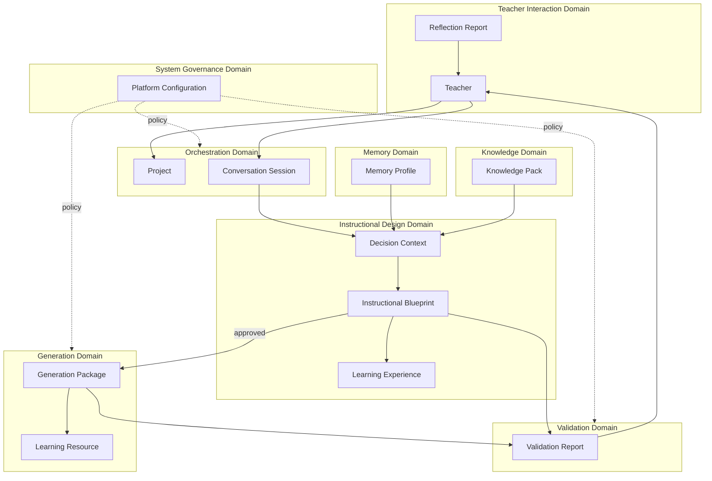

---

## Core Domain Entities

The following entities constitute the official PRIMA domain vocabulary.

### Primary Entities (required)

| Entity | Domain | Role |
|--------|--------|------|
| Teacher | Teacher Interaction | Human authority and owner of outcomes |
| Learning Experience | Instructional Design | Designed instructional outcome for learners |
| Project | Orchestration | Container for design work across sessions |
| Instructional Blueprint | Instructional Design | Canonical design contract |
| Instructional Objective | Instructional Design | Measurable learning outcome unit |
| Activity | Instructional Design | Designed learner/teacher action within a phase |
| Learning Resource | Generation | Generated classroom material unit |
| Assessment | Instructional Design | Designed evaluation approach |
| Validation Report | Validation | Quality and fidelity findings |
| Generation Package | Generation | Bundled output of a generation run |
| Knowledge Pack | Knowledge | Versioned curated knowledge release |
| Memory Profile | Memory | Teacher-owned personalization aggregate |
| Conversation Session | Orchestration | Single PRIMA interaction instance |
| Decision Context | Instructional Design | Scoped inputs for a reasoning pass |
| Reflection Report | Teacher Interaction | Teacher-facing interpretive summary |
| Export Package | Generation / Orchestration | Finalized deliverable bundle |
| Platform Configuration | System Governance | Platform policy and defaults |
| Architectural Principle | System Governance | Registered constitutional rule (reference) |

### Supporting Entities (architecturally justified)

| Entity | Domain | Justification |
|--------|--------|---------------|
| Knowledge Object | Knowledge | Atomic unit of curated knowledge; referenced by Knowledge Pack and Decision Context provenance |
| Validation Rule | Validation | Named compliance criterion; findings in Validation Report trace to rules |

---

## Entity Specification

### Teacher

**Purpose**  
Represent the human instructional designer who owns all PRIMA outcomes.

**Description**  
The Teacher is the authoritative decision-maker in the PRIMA domain. PRIMA assists; the Teacher approves, edits, overrides, and owns Learning Experiences, Instructional Blueprints, Learning Resources, and Export Packages.

**Owner**  
Teacher Interaction Domain.

**Created By**  
Platform account provisioning (external to PRIMA session flow).

**Modified By**  
Teacher (profile and preferences); Memory Domain (inferred patterns, subject to teacher visibility and correction).

**Consumed By**  
All domains — as authority reference, not as data input.

**Relationships**  
Owns Project, Memory Profile, and all teacher-facing outcomes. Approves Instructional Blueprint. Finalizes Learning Resources and Export Package.

**Lifecycle**  
`provisioned` → `active` → `suspended` (optional) → `deactivated`. Account lifecycle is independent of Project and Session lifecycles.

**Invariants**  
Teacher authority cannot be delegated to an engine. No generation or export occurs without explicit Teacher action where product policy requires it. Teacher data is never modified by Knowledge Domain.

**Architectural Notes**  
Aligns with teacher-first principles in Project Bible. Distinct from Memory Profile: Teacher is the actor; Memory Profile is the retained context.

---

### Learning Experience

**Purpose**  
Represent the designed instructional outcome — what learners will do, learn, and demonstrate.

**Description**  
A Learning Experience is the pedagogical intent that Instructional Blueprint describes and that generated materials realize after approval. It is a design concept, not a file or export.

**Owner**  
Instructional Design Domain (conceptual ownership); Teacher (authority).

**Created By**  
Emerges during Conversation Session discovery; formalized by Decision Engine into Instructional Blueprint.

**Modified By**  
Decision Engine (draft design); Teacher (review and approval); not modified by Generation or Validation domains.

**Consumed By**  
Instructional Blueprint (authoritative description); Generation Domain (execution target); Validation Domain (fidelity reference); Export Package (realized outcome).

**Relationships**  
One Learning Experience per design iteration within a Project. Described by exactly one authoritative Instructional Blueprint per iteration. Realized through Learning Resources after approval.

**Lifecycle**  
`conceived` (discovery) → `designed` (blueprint draft) → `approved` (blueprint approved) → `realized` (resources generated and validated) → `delivered` (exported) → `archived` (library).

**Invariants**  
Exactly one authoritative Instructional Blueprint per design iteration. Learning Experience design completes before Generation Domain activation. Realization must trace to approved Blueprint.

**Architectural Notes**  
Term fixed in Project Bible. Not synonymous with Activity Type (Lecție, Joc) — Activity Type scopes the builder; Learning Experience is the pedagogical outcome.

---

### Project

**Purpose**  
Provide a durable container for instructional design work that may span multiple sessions.

**Description**  
A Project groups Conversation Sessions, Blueprint versions, and continuity state for a coherent design effort — e.g., a Lecție in progress, a saved draft, or a Library item being revised.

**Owner**  
Orchestration Domain (lifecycle); Teacher (authority).

**Created By**  
Teacher action (Dashboard builder selection, explicit save, Library duplicate).

**Modified By**  
Orchestrator (checkpoints); Memory Domain (Project Memory segment); Teacher (rename, archive, delete).

**Consumed By**  
Dashboard (Continue working, My Projects); Orchestrator (resume); Memory Domain.

**Relationships**  
Contains one or more Conversation Sessions. References Instructional Blueprint versions. Associated with one Activity Type and one primary Learning Experience intent.

**Lifecycle**  
`created` → `in_progress` → `paused` → `completed` → `archived` → `deleted`.

**Invariants**  
Project Memory never substitutes for Instructional Blueprint authority. Resuming a Project restores session checkpoint — not approved design unless Blueprint state is `approved`.

**Architectural Notes**  
Distinct from Conversation Session: Project persists across sessions; Session is a single PRIMA interaction instance.

---

### Instructional Blueprint

**Purpose**  
Serve as the canonical, versioned contract between instructional design and execution.

**Description**  
The Instructional Blueprint encodes complete Learning Experience design — objectives, flow, activities, assessment, differentiation, resources — before any classroom material exists. It is the central aggregate of the Instructional Design Domain.

**Owner**  
Instructional Design Domain (structure and composition); Teacher (approval authority).

**Created By**  
Decision Engine (composition from Decision Context).

**Modified By**  
Decision Engine (draft and revision); Teacher (review edits triggering re-decision); not modified by Generation or Validation engines post-approval except via explicit revision flow.

**Consumed By**  
Generation Domain (approved state only); Validation Domain; Reflection Report; Export Package (reference); Project Memory (version reference).

**Relationships**  
Describes one Learning Experience. Contains Instructional Objectives, Activities, Assessment design, and additional sections per Blueprint Specification. Parent context: Project and Conversation Session.

**Lifecycle**  
Governed states: `draft` → `under_review` → `needs_revision` → `approved` → `superseded` → `archived`. Full transition rules: [`INSTRUCTIONAL_BLUEPRINT_SPECIFICATION.md`](./INSTRUCTIONAL_BLUEPRINT_SPECIFICATION.md).

**Invariants**  
No Generation without `approved` state. Blueprint contains design only — never generated text or export binaries. One authoritative Blueprint per Learning Experience design iteration. Version lineage is immutable once superseded.

**Architectural Notes**  
Structural sections are defined in Blueprint Specification — not duplicated here. This entity definition governs domain role and ownership only.

---

### Instructional Objective

**Purpose**  
Represent a measurable learning outcome that anchors backward design.

**Description**  
An Instructional Objective states what learners will know or be able to do. Objectives are first-class domain entities composed into Instructional Blueprint and traced through Activities, Assessment, Generation, and Validation.

**Owner**  
Instructional Design Domain.

**Created By**  
Decision Engine (from discovery success criteria and Knowledge alignment).

**Modified By**  
Decision Engine (revision loop); Teacher (indirectly via Blueprint review).

**Consumed By**  
Activity, Assessment, Generation Package (mapping), Validation Report (alignment checks).

**Relationships**  
Contained within Instructional Blueprint. Linked to competencies (Blueprint section). Activities and Assessment must align to Objectives.

**Lifecycle**  
`proposed` → `confirmed` → `approved` (with Blueprint) → `superseded` (Blueprint version change).

**Invariants**  
Every Activity and Assessment element must trace to at least one Objective or explicit design rationale. Objectives are not invented during Generation.

**Architectural Notes**  
Distinct from Competency (curriculum reference) and Success Criteria (teacher-defined acceptance conditions) — both Blueprint sections, not separate top-level entities here.

---

### Activity

**Purpose**  
Represent a designed unit of learner and teacher action within the Learning Flow.

**Description**  
An Activity describes what happens in a phase: student actions, teacher role, grouping, and materials class. It is instructional design — not the Activity Type builder category (Lecție, Joc).

**Owner**  
Instructional Design Domain.

**Created By**  
Decision Engine (Learning Activities composition).

**Modified By**  
Decision Engine (revision); Teacher (via Blueprint review).

**Consumed By**  
Generation Domain (Instruction Blocks, Student Tasks); Validation Domain (coverage checks).

**Relationships**  
Belongs to a Learning Flow phase within Instructional Blueprint. Aligns to Instructional Objectives. Realized partially by one or more Learning Resources.

**Lifecycle**  
`designed` → `approved` (with Blueprint) → `realized` (post-generation) → `superseded`.

**Invariants**  
Activities exist only within approved design before generation mapping. Generation may not add Activities not present in Blueprint.

**Architectural Notes**  
Ubiquitous language distinguishes **Activity** (designed action) from **Activity Type** (platform builder archetype).

---

### Learning Resource

**Purpose**  
Represent a generated, teacher-editable classroom material unit.

**Description**  
A Learning Resource is a draft or finalized material — worksheet, presentation, lesson plan document, quiz, etc. — produced from approved Instructional Blueprint. Resources are execution artifacts, not design authority.

**Owner**  
Generation Domain (production); Teacher (final ownership after edit).

**Created By**  
Generation Domain.

**Modified By**  
Teacher (Activity Editor); Generation Domain (scoped regeneration only).

**Consumed By**  
Validation Domain; Export Package; Library.

**Relationships**  
Maps to Instructional Blueprint sections and Activities. Bundled in Generation Package. Contributes to Export Package after teacher finalization.

**Lifecycle**  
`draft` → `validated` → `edited` → `finalized` → `exported` → `archived`.

**Invariants**  
Must trace to approved Instructional Blueprint. Draft until teacher finalization policy satisfied. Generation Domain never marks a resource as final — Teacher does.

**Architectural Notes**  
Distinct from Blueprint Resources section (design intent for materials needed) — same word, different domain entity; disambiguated in Ubiquitous Language.

---

### Assessment

**Purpose**  
Represent the designed approach for checking learning against Objectives and Success Criteria.

**Description**  
Assessment is instructional design — format, timing, cognitive level, alignment approach — not the generated quiz file. The generated quiz is a Learning Resource realizing Assessment design.

**Owner**  
Instructional Design Domain.

**Created By**  
Decision Engine (backward-design pass).

**Modified By**  
Decision Engine (revision); Teacher (via Blueprint review).

**Consumed By**  
Generation Domain; Validation Domain (objective alignment rules).

**Relationships**  
Contained in Instructional Blueprint. Aligns to Instructional Objectives. Realized by Assessment-type Learning Resources.

**Lifecycle**  
`designed` → `approved` (with Blueprint) → `realized` → `superseded`.

**Invariants**  
Assessment design must align to Objectives before approval. Validation enforces alignment in generated materials — Validation does not redesign Assessment.

**Architectural Notes**  
Pre-generation Assessment is design domain; post-generation quiz document is Generation domain.

---

### Validation Report

**Purpose**  
Communicate quality and blueprint-fidelity findings for a Generation Package.

**Description**  
A Validation Report aggregates pass/fail status, severity-classified findings, quality dimensions, and recommended teacher actions. It is a measurement artifact — not a design or content artifact.

**Owner**  
Validation Domain.

**Created By**  
Validation Engine.

**Modified By**  
Validation Engine (re-validation after scoped regen); Teacher (acknowledgment and override records).

**Consumed By**  
Teacher (decision input); Orchestrator (routing: regen, blueprint review, preview); Reflection Report (summary source).

**Relationships**  
References approved Instructional Blueprint version, Generation Package, Validation Rules, and affected Learning Resources.

**Lifecycle**  
`pending` → `completed` → `superseded` (new generation run) → `archived`.

**Invariants**  
Validation Report never modifies Instructional Blueprint or Learning Resource content. Findings must reference Validation Rules or Blueprint sections. Teacher retains final proceed authority per severity policy.

**Architectural Notes**  
Report structure detail resides in Validation Engine specification. This entity defines domain role only.

---

### Generation Package

**Purpose**  
Bundle the structured output of a single generation run for validation and teacher preview.

**Description**  
A Generation Package contains Learning Resources (drafts), generation metadata, and blueprint traceability maps produced from one approved Instructional Blueprint version.

**Owner**  
Generation Domain.

**Created By**  
Generation Engine.

**Modified By**  
Generation Engine (scoped regeneration replaces package segments); not modified by Validation Domain.

**Consumed By**  
Validation Domain; Teacher preview flow; Activity Editor.

**Relationships**  
Derived from one approved Instructional Blueprint version. Contains zero or more Learning Resources. Validated by one or more Validation Reports (re-runs).

**Lifecycle**  
`planned` → `generating` → `draft_complete` → `validated` → `superseded` (regen) → `archived`.

**Invariants**  
Produced only from `approved` Instructional Blueprint. No live Memory or Knowledge queries during package composition. Package does not override Blueprint authority.

**Architectural Notes**  
Internal consistency checks occur before Validation handoff — behavioural detail in Generation Engine specification.

---

### Knowledge Pack

**Purpose**  
Provide a versioned, scoped release of curated pedagogical and curriculum knowledge.

**Description**  
A Knowledge Pack bundles Knowledge Objects for a defined locale, school year, and education level. It is the unit of knowledge release and deprecation — not session-scoped retrieval cache.

**Owner**  
Knowledge Domain (curation and release); Platform governance (activation policy).

**Created By**  
Knowledge curation lifecycle (see Knowledge Engine specification).

**Modified By**  
Knowledge curation lifecycle (new pack versions); not modified by sessions, Memory, or Generation.

**Consumed By**  
Decision Context (scoped queries); Instructional Blueprint Curriculum section (pack version reference).

**Relationships**  
Contains Knowledge Objects. Referenced by Decision Context query scope. One active pack per locale/year/level combination at runtime.

**Lifecycle**  
`authoring` → `review` → `released` → `active` → `deprecated` → `retired`.

**Invariants**  
Knowledge Pack content is universal — never contains teacher-specific data. Session input never alters pack content. Decision queries always scoped to an active pack version.

**Architectural Notes**  
Aligns with KP-03 (Versioned Knowledge Packs) in Architectural Principles.

---

### Knowledge Object

**Purpose**  
Represent an atomic unit of curated, reviewable domain knowledge.

**Description**  
A Knowledge Object carries pedagogical or curriculum content with provenance, quality tier, layer assignment, and review status. Objects are composed into Knowledge Packs — never delivered directly to teachers during reasoning.

**Owner**  
Knowledge Domain.

**Created By**  
Knowledge curation lifecycle.

**Modified By**  
Knowledge curation lifecycle only.

**Consumed By**  
Decision Context (via Knowledge Pack retrieval); Instructional Blueprint (provenance references in Curriculum and Strategy sections).

**Relationships**  
Belongs to one or more Knowledge Packs (by inclusion). Cited in Decision Context response provenance.

**Lifecycle**  
`draft` → `reviewed` → `released` → `deprecated` → `legacy`.

**Invariants**  
Never contains teacher personal data. Never modified during PRIMA sessions. Retrieval always mediated through Knowledge Engine — not direct engine-to-engine object sharing.

**Architectural Notes**  
Supporting entity — required for pack integrity and provenance traceability.

---

### Memory Profile

**Purpose**  
Aggregate all teacher-owned cross-session context used for personalization.

**Description**  
Memory Profile is the root aggregate for teacher-specific memory: profile, teaching fingerprint, class model, project memory references, resource preferences, communication preferences, and success patterns. It is personal — not universal knowledge.

**Owner**  
Memory Domain; Teacher (authority over content).

**Created By**  
Accumulated from account baseline, session signals, and explicit teacher settings.

**Modified By**  
Memory Engine (structured updates post-session); Teacher (settings, corrections, deletion).

**Consumed By**  
Conversation Session (personalization hints); Decision Context (preference resolution — never override).

**Relationships**  
Owned by one Teacher. References Project Memory segments. Never embeds Knowledge Objects or Instructional Blueprint content as authoritative substitutes.

**Lifecycle**  
`initializing` → `active` → `stale` (refresh required) → `archived` (account deactivation).

**Invariants**  
Memory never modifies Knowledge Pack content. Memory never overrides explicit teacher statements. No individual student identities — class context is aggregate only. Memory suggestions do not change architectural decisions.

**Architectural Notes**  
Internal memory object types (Teacher Profile, Class Model, etc.) are components of this aggregate — detailed in Memory Engine specification.

---

### Conversation Session

**Purpose**  
Represent one continuous PRIMA interaction from entry through design completion or checkpoint.

**Description**  
A Conversation Session is the orchestrated unit of PRIMA work. It accumulates discovery capture, reflection logs, confidence maps, and Blueprint draft state — the evolving session model referenced across engine specifications.

**Owner**  
Orchestration Domain.

**Created By**  
Orchestrator on PRIMA Experience entry.

**Modified By**  
Conversation Engine, Reflection Engine, Decision Engine (structured writes); Orchestrator (state transitions); Teacher (responses and approvals).

**Consumed By**  
Decision Context construction; Project checkpoint; Memory Domain (post-session signals).

**Relationships**  
Belongs to one Project. Produces Decision Context. Hosts Instructional Blueprint draft evolution until approval or pause.

**Lifecycle**  
`opened` → `discovering` → `reasoning` → `reviewing` → `approved` | `paused` → `closed` → `archived`.

**Invariants**  
Single session object per PRIMA interaction — engines write through defined contracts, not parallel shadow state. Session cannot bypass Blueprint approval gate for Generation.

**Architectural Notes**  
Detailed session model fields will be specified in PRIMA Session Model document. This entity defines domain boundary and lifecycle.

---

### Decision Context

**Purpose**  
Capture the scoped input set for a single Decision Engine reasoning pass.

**Description**  
Decision Context assembles completed session capture, Knowledge query results, resolved Memory hints, activity type constraints, and revision triggers into one bounded input for pedagogical reasoning. It is ephemeral per reasoning pass — not a substitute for Instructional Blueprint output.

**Owner**  
Instructional Design Domain.

**Created By**  
Orchestrator and Decision Engine (context assembly).

**Modified By**  
Superseded by next reasoning pass — not incrementally edited by other engines.

**Consumed By**  
Decision Engine only.

**Relationships**  
Draws from Conversation Session, Memory Profile (hints), Knowledge Pack (query responses). Produces Instructional Blueprint draft and Reflection Report inputs (reasoning summary).

**Lifecycle**  
`assembled` → `reasoning` → `consumed` → `superseded`.

**Invariants**  
Teacher explicit statements in session capture prevail over Memory hints. Knowledge responses are evidence — not decisions. Decision Context does not persist as authoritative design.

**Architectural Notes**  
Separates *inputs to reasoning* from *output of reasoning* (Instructional Blueprint).

---

### Reflection Report

**Purpose**  
Provide teacher-facing interpretive summaries of understanding, reasoning, and validation outcomes.

**Description**  
A Reflection Report packages mirrors, confirmations, reasoning summaries, and validation narratives for teacher comprehension. It is expressive — not authoritative design. Instructional Blueprint remains the design authority.

**Owner**  
Teacher Interaction Domain (teacher-facing artifact); produced by Reflection Engine behaviour.

**Created By**  
Reflection Engine (from session mirrors, Decision reasoning summaries, Validation Report narratives).

**Modified By**  
Superseded by newer reports in the same session; not edited by Teacher as structured data (Teacher responds conversationally).

**Consumed By**  
Teacher; Prompt Engine (expression layer — behavioural detail in engine specs).

**Relationships**  
Interprets Conversation Session state, Decision outputs, and Validation Reports. Does not replace Instructional Blueprint or Validation Report.

**Lifecycle**  
`draft` → `presented` → `confirmed` | `corrected` → `superseded` → `archived`.

**Invariants**  
Reflection Report never authorizes Generation. Confirmation of understanding does not equal Blueprint approval. Reports must distinguish inference from teacher explicit statements.

**Architectural Notes**  
Distinct from Validation Report: Reflection emphasizes comprehension and partnership tone; Validation emphasizes compliance measurement.

---

### Export Package

**Purpose**  
Represent the finalized, teacher-owned deliverable bundle for classroom use and library storage.

**Description**  
An Export Package combines finalized Learning Resources, reference to approved Instructional Blueprint version, and export metadata for download, print, or library archival.

**Owner**  
Teacher (authority); Orchestration Domain (assembly lifecycle).

**Created By**  
Teacher-initiated export action after edit and validation satisfaction.

**Modified By**  
Teacher (re-export after edits); not modified by engines autonomously.

**Consumed By**  
Library; external classroom use (out of platform scope).

**Relationships**  
Derived from Generation Package after teacher finalization. References Project and Instructional Blueprint version. Contains finalized Learning Resources.

**Lifecycle**  
`preparing` → `ready` → `downloaded` → `library_saved` → `archived`.

**Invariants**  
Export never occurs autonomously from Validation pass. Export Package does not retroactively modify Instructional Blueprint. Library archival preserves Blueprint lineage.

**Architectural Notes**  
Export formats are implementation concerns; Export Package is the domain bundle concept.

---

### Platform Configuration

**Purpose**  
Define platform-wide policies, defaults, and operational boundaries affecting PRIMA behaviour.

**Description**  
Platform Configuration encodes locale defaults, activity type availability, severity policies, confidence thresholds, active Knowledge Pack selection, and feature gates. It governs domains — it is not session content.

**Owner**  
System Governance Domain.

**Created By**  
Platform operators and product policy.

**Modified By**  
Governed configuration change process.

**Consumed By**  
All domains (read-only policy consumption).

**Relationships**  
Constrains Orchestrator gates, Validation severity behaviour, Generation language defaults, and Knowledge Pack activation.

**Lifecycle**  
`draft_policy` → `active` → `superseded` → `retired`.

**Invariants**  
Configuration changes cannot violate Architectural Principles. Runtime session data never written into Platform Configuration.

**Architectural Notes**  
Distinct from Memory Profile (teacher-specific) and Knowledge Pack (curriculum content).

---

### Architectural Principle

**Purpose**  
Register an immutable architectural rule from the constitutional layer.

**Description**  
An Architectural Principle is a governed reference entity — not runtime data. It exists in this domain model so specifications can cite principle identifiers when asserting compliance.

**Owner**  
System Governance Domain.

**Created By**  
Documented in [`PRIMA_ARCHITECTURAL_PRINCIPLES.md`](./PRIMA_ARCHITECTURAL_PRINCIPLES.md).

**Modified By**  
Governance process only (see Architectural Principles document).

**Consumed By**  
All specifications (compliance reference); Compliance Rules section of this document.

**Relationships**  
Constrains entity invariants across all domains. Maps to engines via Traceability — principles are not owned by engines.

**Lifecycle**  
`proposed` → `ratified` → `active` → `deprecated` (with migration plan).

**Invariants**  
Principles are not overridden by engine behaviour or session outcomes. Implementation exceptions require documented governance approval.

**Architectural Notes**  
This entity makes the constitution addressable in traceability matrices. Principle text is not duplicated here.

---

### Validation Rule

**Purpose**  
Name a defined compliance criterion used to evaluate generated materials.

**Description**  
A Validation Rule identifies a checkable condition — blueprint fidelity, age appropriateness, objective alignment, completeness — with severity class and explainability reference. Rules form the Validation Domain catalog.

**Owner**  
Validation Domain (catalog); System Governance (policy-level rule sets).

**Created By**  
Validation rule curation — composed at Blueprint approval from Blueprint Validation Rules and platform quality model.

**Modified By**  
Governed rule set versioning — not modified per session finding.

**Consumed By**  
Validation Report findings; Generation Domain (pre-handoff internal checks reference overlapping criteria).

**Relationships**  
Applied against Generation Package and approved Instructional Blueprint. Each Validation Report finding references one or more Validation Rules.

**Lifecycle**  
`draft` → `active` → `deprecated` → `retired`.

**Invariants**  
Rules measure compliance — they do not generate or edit content. Rule changes do not retroactively alter approved Blueprints without explicit re-validation policy.

**Architectural Notes**  
Supporting entity — enables explainable Validation Reports without opaque judgment.

---

## Domain Relationships

Entities relate through **conceptual associations** — ownership, composition, derivation, and reference — not through implementation links.

### Structural Relationships

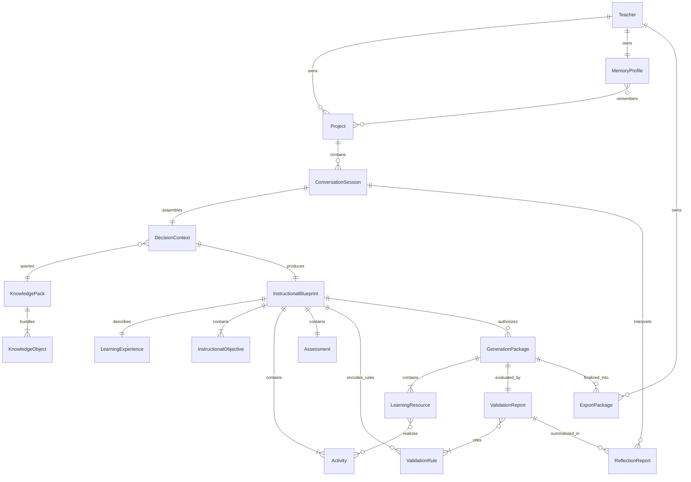

### Derivation Chain (Design to Delivery)

The authoritative flow from intent to classroom materials:

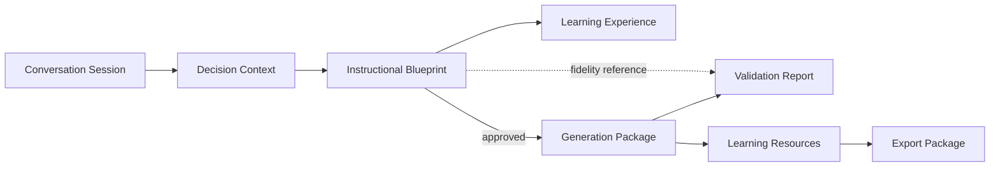

### Cross-Domain Reference Rules

| From | To | Relationship type | Constraint |
|------|-----|-------------------|------------|
| Decision Context | Knowledge Pack | Query scope | Read-only; pack version fixed for session reasoning pass |
| Decision Context | Memory Profile | Hint consumption | Hints never override teacher explicit capture |
| Instructional Blueprint | Learning Experience | Description | One authoritative Blueprint per design iteration |
| Generation Package | Instructional Blueprint | Derivation | Approved version only |
| Validation Report | Instructional Blueprint | Fidelity reference | Read-only |
| Validation Report | Generation Package | Evaluation target | No mutation |
| Export Package | Learning Resource | Composition | Finalized resources only |
| Reflection Report | Instructional Blueprint | Interpretation | Non-authoritative |

---

## Aggregate Roots

In Domain-Driven Design terms, aggregate roots enforce consistency boundaries. External domains reference aggregates by identity — not by internal mutation.

| Aggregate Root | Domain | Consistency Boundary | Why It Exists |
|----------------|--------|----------------------|---------------|
| **Project** | Orchestration | Session checkpoints, activity type, Blueprint version references, project metadata | Cross-session continuity requires a single lifecycle authority |
| **Conversation Session** | Orchestration | Session model evolution, stage state, draft Blueprint attachment pre-approval | Prevents parallel session state across engines |
| **Instructional Blueprint** | Instructional Design | All design sections, objectives, activities, assessment, versioning, approval state | Central design contract must mutate atomically through Decision revision flows |
| **Memory Profile** | Memory | All teacher-owned memory objects and preferences | Personalization data requires unified privacy and correction boundaries |
| **Knowledge Pack** | Knowledge | Pack manifest, object inclusion, version, deprecation | Curated knowledge releases must stay internally consistent |
| **Generation Package** | Generation | Draft Learning Resources, trace maps, generation metadata per run | Regeneration and validation scope require bundled consistency |
| **Export Package** | Orchestration / Generation | Finalized resources and export metadata | Delivery bundle must not partially finalize without teacher authority |

**Entities that are not aggregate roots**

| Entity | Reason |
|--------|--------|
| Instructional Objective, Activity, Assessment | Components within Instructional Blueprint aggregate |
| Learning Resource | Component within Generation Package until finalized into Export Package |
| Decision Context | Ephemeral input assembly — consumed, not governed longitudinally |
| Reflection Report, Validation Report | Output artifacts — referenced, not roots |
| Knowledge Object | Component within Knowledge Pack aggregate |
| Validation Rule | Catalog entity — referenced by Validation Report |
| Teacher | Actor and authority — not a mutable aggregate in PRIMA runtime flow |
| Platform Configuration, Architectural Principle | Governance references — not session aggregates |

**Ownership implication:** Mutations to components occur only through their aggregate root's governing engine and Orchestrator policy.

---

## Entity Ownership Matrix

| Entity | Primary Owner | Secondary Consumers | Lifecycle Authority |
|--------|---------------|---------------------|---------------------|
| Teacher | Teacher Interaction | All domains (authority) | Platform account governance |
| Learning Experience | Instructional Design | Generation, Validation, Export | Teacher + Decision Engine (design phase) |
| Project | Orchestration | Memory, Dashboard | Orchestrator + Teacher |
| Instructional Blueprint | Instructional Design | Generation, Validation, Orchestration | Decision Engine + Teacher approval |
| Instructional Objective | Instructional Design | Generation, Validation | Decision Engine (via Blueprint) |
| Activity | Instructional Design | Generation, Validation | Decision Engine (via Blueprint) |
| Assessment | Instructional Design | Generation, Validation | Decision Engine (via Blueprint) |
| Learning Resource | Generation | Validation, Teacher, Export | Generation Engine + Teacher |
| Validation Report | Validation | Teacher, Orchestration, Reflection | Validation Engine |
| Generation Package | Generation | Validation, Teacher preview | Generation Engine |
| Knowledge Pack | Knowledge | Instructional Design (via Decision Context) | Knowledge curation governance |
| Knowledge Object | Knowledge | Decision Context (provenance) | Knowledge curation governance |
| Memory Profile | Memory | Instructional Design, Orchestration | Memory Engine + Teacher |
| Conversation Session | Orchestration | All PRIMA engines (contractual) | Orchestrator |
| Decision Context | Instructional Design | Decision Engine | Decision Engine (ephemeral) |
| Reflection Report | Teacher Interaction | Teacher | Reflection Engine |
| Export Package | Orchestration | Library, Teacher | Teacher + Orchestrator |
| Platform Configuration | System Governance | All domains | Product / platform governance |
| Architectural Principle | System Governance | All specifications | Product Team governance |
| Validation Rule | Validation | Validation Report, Blueprint | Validation + governance |

---

## Lifecycle Model

Each major entity follows a governed lifecycle. States below are **domain states** — not UI or database representations.

### Instructional Blueprint Lifecycle

Reference: [`INSTRUCTIONAL_BLUEPRINT_SPECIFICATION.md`](./INSTRUCTIONAL_BLUEPRINT_SPECIFICATION.md). Domain summary:

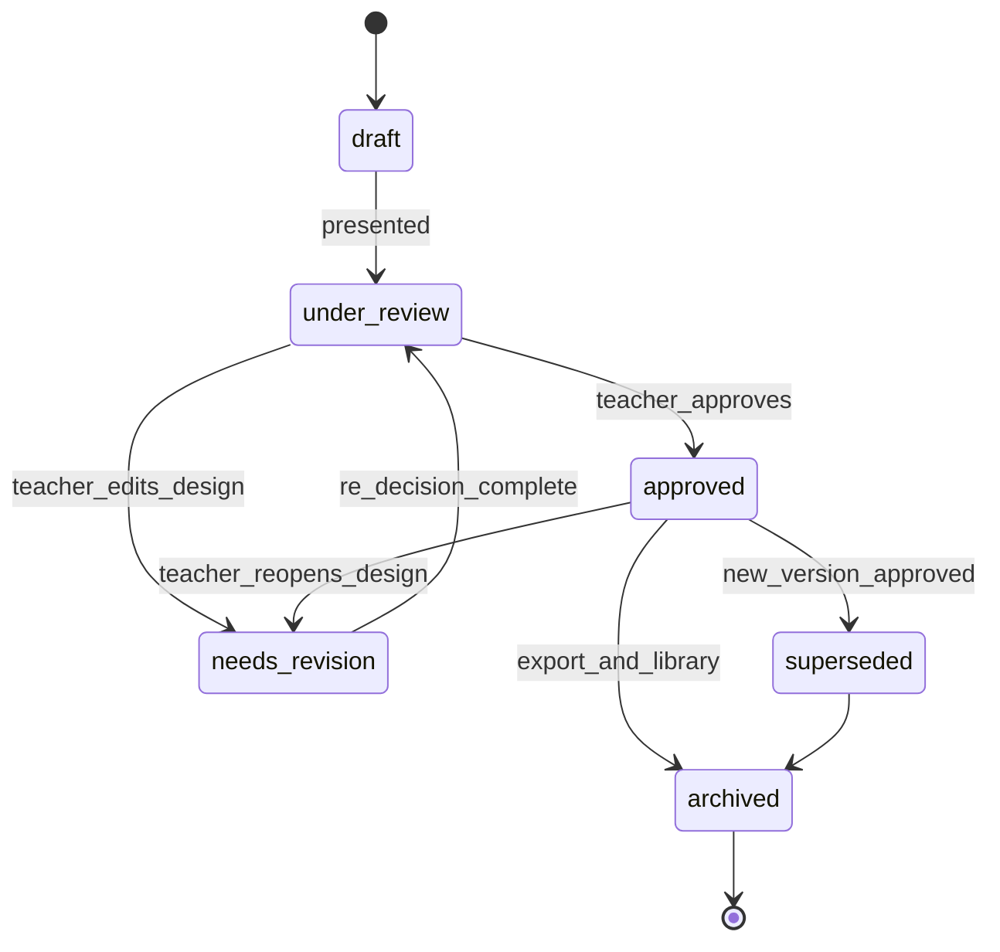

### Conversation Session Lifecycle

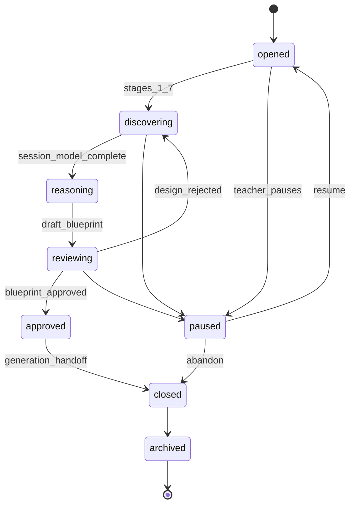

### Project Lifecycle

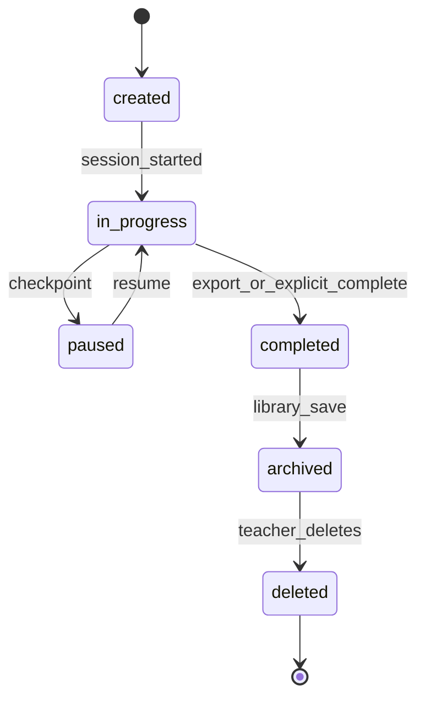

### Generation Package Lifecycle

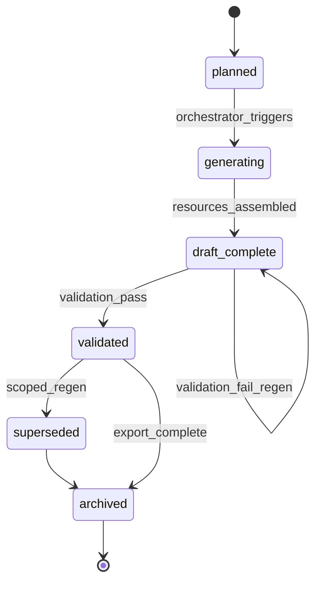

### Learning Resource Lifecycle

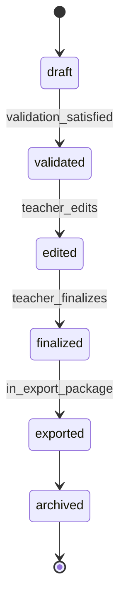

### Knowledge Pack Lifecycle

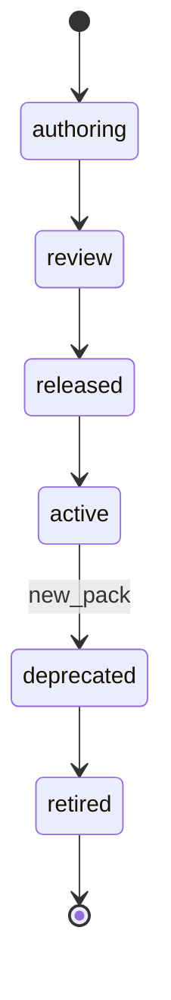

### Memory Profile Lifecycle

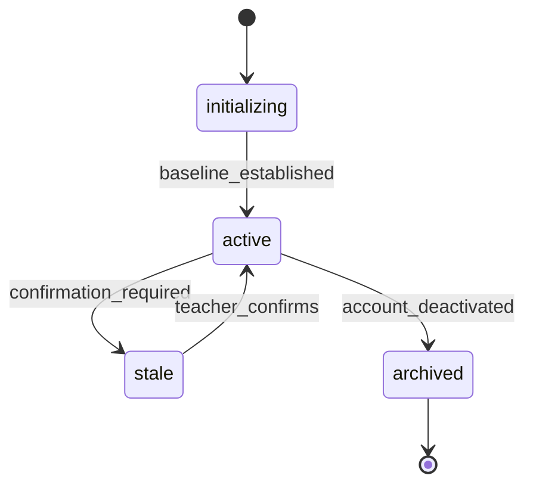

### Export Package Lifecycle

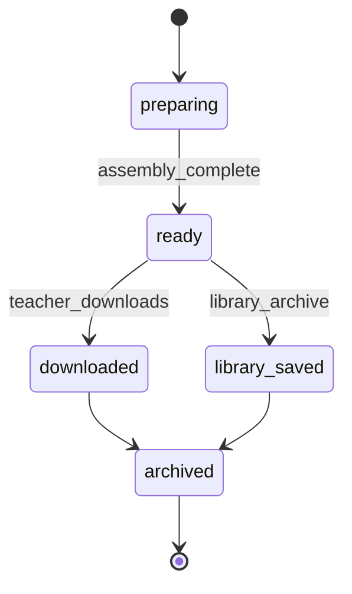

---

## Architectural Constraints

The following constraints are **immutable** within the PRIMA domain model. They instantiate Architectural Principles as entity-level rules.

| ID | Constraint |
|----|------------|
| **AC-01** | Instructional Blueprint approval precedes Generation Domain activation. |
| **AC-02** | Validation Domain never owns or mutates Instructional Blueprint. |
| **AC-03** | Knowledge Domain never modifies Teacher or Memory Profile content. |
| **AC-04** | Memory Domain never modifies Knowledge Pack content or architectural decisions. |
| **AC-05** | Generation Domain never becomes design authority — it executes approved Blueprint only. |
| **AC-06** | Teacher retains final authority over approval, export, and non-critical validation override. |
| **AC-07** | Exactly one authoritative Instructional Blueprint exists per Learning Experience design iteration. |
| **AC-08** | Learning Resources must trace to approved Instructional Blueprint sections. |
| **AC-09** | Validation findings must reference Validation Rules or Blueprint sections — not opaque judgment. |
| **AC-10** | Reflection Report and Validation Report are non-authoritative for design and export gates. |
| **AC-11** | Export Package assembly requires Teacher initiation — no autonomous export. |
| **AC-12** | Conversation Session uses a single evolving session model — no parallel shadow capture state. |
| **AC-13** | Decision Context is ephemeral input — never substitutes for Instructional Blueprint. |
| **AC-14** | Knowledge retrieval during design is scoped to active Knowledge Pack version. |
| **AC-15** | Class context in Memory Profile is aggregate only — no individual student identities. |
| **AC-16** | Instructional Blueprint contains design only — never generated text or export binaries. |
| **AC-17** | Superseded Blueprint versions remain read-only for lineage — never silently overwritten. |
| **AC-18** | Platform Configuration cannot override Architectural Principles. |

Violations require governance exception — not silent implementation workarounds.

---

## Ubiquitous Language

Official architectural vocabulary. Terms not listed here must not appear in PRIMA specifications without domain model amendment.

| Term | Definition |
|------|------------|
| **Activity** | A designed unit of learner/teacher action within a Learning Flow phase. Not the builder Activity Type. |
| **Activity Type** | Platform builder archetype (Lecție, Joc, Fișă, etc.) scoping generation rules and Project context. |
| **Approval** | Explicit Teacher authorization of Instructional Blueprint state transition to `approved`. |
| **Assessment** | Designed evaluation approach within Instructional Blueprint — distinct from generated quiz Learning Resource. |
| **Architectural Principle** | Immutable constitutional rule registered in PRIMA Architectural Principles. |
| **Blueprint Approval Gate** | Orchestration enforcement point blocking Generation until Blueprint is `approved`. |
| **Conversation Session** | Single PRIMA interaction instance with evolving session model. |
| **Decision Context** | Ephemeral assembled inputs for one Decision Engine reasoning pass. |
| **Design Iteration** | One complete design cycle from discovery through Blueprint approval for a Learning Experience. |
| **Export Package** | Teacher-owned finalized deliverable bundle for classroom use or library. |
| **Generation** | Execution phase transforming approved Blueprint into draft Learning Resources. |
| **Generation Package** | Bundled output of one generation run including drafts and traceability metadata. |
| **Instructional Blueprint** | Canonical versioned design contract between reasoning and execution. |
| **Instructional Design** | Domain of discovery, reasoning, and approval — preceding Generation. |
| **Instructional Objective** | Measurable learning outcome anchoring backward design. |
| **Knowledge Object** | Atomic curated knowledge unit with provenance and review status. |
| **Knowledge Pack** | Versioned release bundling Knowledge Objects for locale, year, and level. |
| **Learning Experience** | Designed instructional outcome for learners — what the Blueprint describes. |
| **Learning Resource** | Generated, editable classroom material unit (worksheet, slide deck, etc.). |
| **Memory Profile** | Teacher-owned aggregate of personalization and cross-session context. |
| **PRIMA** | Pedagogical Reasoning and Instructional Model Architecture — instructional intelligence core. |
| **PRIMA Experience** | Focused environment for PRIMA partnership — distinct from Dashboard. |
| **Project** | Durable container for design work spanning sessions. |
| **Reflection Report** | Teacher-facing interpretive summary — non-authoritative for gates. |
| **Regeneration** | Scoped re-execution of Generation for selected Learning Resources — not redesign. |
| **Teacher** | Human instructional designer with final authority over outcomes. |
| **Validation Report** | Compliance and quality findings for a Generation Package. |
| **Validation Rule** | Named checkable criterion applied during validation. |

**Disambiguation required in all specifications**

| Ambiguous term | Meaning A | Meaning B |
|----------------|-----------|-----------|
| **Resources** | Blueprint Resources section (design intent) | Learning Resources (generated materials) |
| **Activity** | Designed instructional activity | Activity Type (builder category) |
| **Session** | Conversation Session | Account session (authentication — out of scope) |
| **Approval** | Blueprint approval | Validation proceed acknowledgment |

---

## Traceability

Domain entities appear across PRIMA engines as producers, consumers, or authority references.

| Entity | Conversation | Reflection | Decision | Knowledge | Memory | Generation | Validation | Orchestrator |
|--------|:------------:|:----------:|:--------:|:---------:|:------:|:----------:|:----------:|:------------:|
| Teacher | ● | ● | ○ | — | ○ | ○ | ○ | ○ |
| Conversation Session | ● | ● | ○ | — | ○ | — | — | ● |
| Decision Context | ○ | — | ● | ○ | ○ | — | — | ○ |
| Instructional Blueprint | ○ | ○ | ● | ○ | ○ | ○ | ○ | ● |
| Learning Experience | ○ | ○ | ● | — | — | ○ | ○ | ○ |
| Instructional Objective | ○ | — | ● | ○ | — | ○ | ○ | — |
| Activity | ○ | — | ● | ○ | — | ○ | ○ | — |
| Assessment | ○ | — | ● | — | — | ○ | ○ | — |
| Reflection Report | ○ | ● | ○ | — | ○ | — | ○ | ○ |
| Memory Profile | ○ | ○ | ○ | — | ● | — | — | ○ |
| Knowledge Pack | — | — | ○ | ● | — | — | — | ○ |
| Knowledge Object | — | — | ○ | ● | — | — | — | — |
| Generation Package | — | — | — | — | — | ● | ○ | ● |
| Learning Resource | — | — | — | — | — | ● | ○ | ○ |
| Validation Report | — | ○ | — | — | — | ○ | ● | ○ |
| Validation Rule | — | — | ○ | — | — | ○ | ● | — |
| Project | ○ | — | — | — | ○ | — | — | ● |
| Export Package | — | — | — | — | ○ | ○ | ○ | ● |
| Platform Configuration | ○ | ○ | ○ | ○ | ○ | ○ | ○ | ● |

**Legend:** ● = primary interaction (create, mutate, or govern) · ○ = consume or reference · — = no direct relationship

### Entity-to-Domain Map

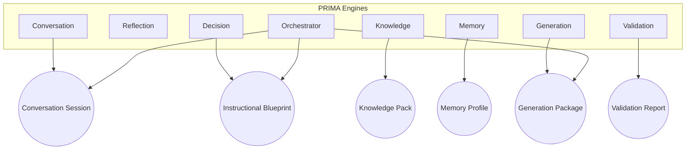

---

## Compliance Rules

Future PRIMA specifications must comply with the following rules when referencing domain concepts.

| Rule | Requirement |
|------|-------------|
| **CR-01** | Use entity names exactly as defined in Ubiquitous Language. |
| **CR-02** | Do not introduce synonymous terms for defined entities without domain model amendment. |
| **CR-03** | Specify Primary Owner when assigning lifecycle or mutation responsibility. |
| **CR-04** | Do not assign Instructional Blueprint mutation to Generation or Validation domains. |
| **CR-05** | Do not assign teacher personal data to Knowledge Domain entities. |
| **CR-06** | Reference Instructional Blueprint states using governed state names only. |
| **CR-07** | Trace every Learning Resource specification to Blueprint derivation. |
| **CR-08** | Treat Reflection Report as interpretive — never as approval authority. |
| **CR-09** | New entities require domain model version increment and ownership assignment. |
| **CR-10** | Engine specifications describe behaviour; entity definitions remain in this document. |
| **CR-11** | Disambiguate Resources, Activity, and Session per Ubiquitous Language. |
| **CR-12** | Cite Architectural Principle identifiers when asserting constitutional compliance — do not restate full principle text. |

Non-compliant specifications must be revised before implementation approval.

---

## Future Evolution

### Immutable (requires governance process)

- Core entity set and names for required entities in this document
- Aggregate root boundaries for Instructional Blueprint, Knowledge Pack, Memory Profile
- Architectural Constraints AC-01 through AC-18
- Teacher authority model
- Blueprint-before-Generation separation
- Knowledge/Memory domain separation

### Evolvable (minor domain model version)

- Supporting entities (additional catalog types, metadata entities)
- Lifecycle state granularity — additive states only, no semantic reversal
- Traceability matrix extensions for new engines
- Export Package composition rules as new Activity Types ship

### Expected downstream documents

| Document | Relationship |
|----------|--------------|
| PRIMA Session Model | Refines Conversation Session internal structure — subordinate to this entity definition |
| Future API / contract specifications | Must map to entities defined here |
| Implementation architecture | Maps entities to components — must not redefine domain meaning |

Amendment process: propose change in session log → Product Team review → domain model version bump → dependent spec alignment.

---

## Summary

This document establishes the **official conceptual language** of the PRIMA platform.

It defines twenty domain entities across eight bounded domains, assigns ownership and lifecycle authority, specifies aggregate boundaries and invariants, and provides the ubiquitous vocabulary that all PRIMA architectural specifications must share. Engines implement behaviour; this model defines **what exists**, **who owns it**, and **how concepts relate** — independent of technology, storage, or UI.

Every future PRIMA specification is subordinate to this domain model for terminology and entity ownership, and to [`PRIMA_ARCHITECTURAL_PRINCIPLES.md`](./PRIMA_ARCHITECTURAL_PRINCIPLES.md) for constitutional beliefs.

---

## Next Recommended Document

→ [`INSTRUCTIONAL_BLUEPRINT_SPECIFICATION.md`](./INSTRUCTIONAL_BLUEPRINT_SPECIFICATION.md) — Canonical structure of the Instructional Blueprint aggregate.
