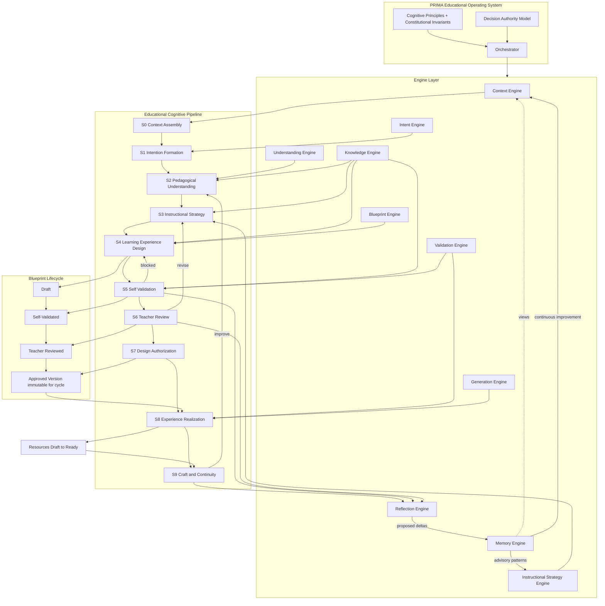
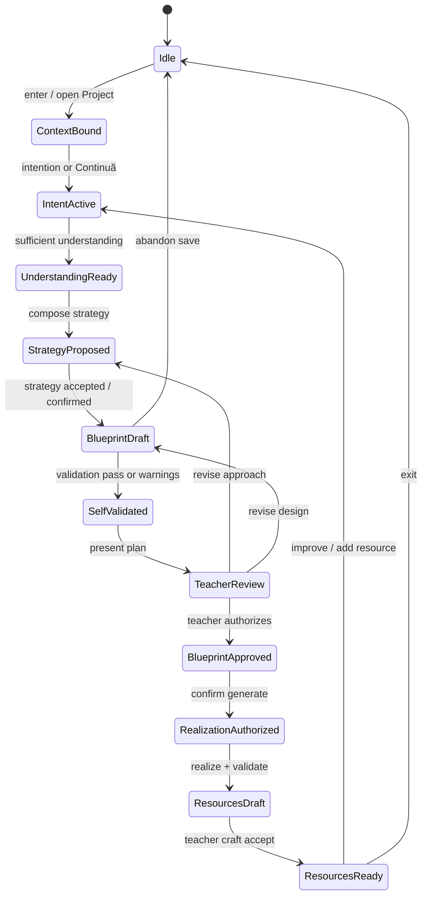

# PRIMA Educational Operating System (EOS)

**Version:** 1.0  
**Status:** Official — Constitutional Intelligence Architecture

> **PRIMA is not an AI application with a pipeline.  
> PRIMA is an Educational Operating System that uses AI as workers.**

This document is a **permanent architectural foundation**. It evolves the Educational Cognitive Pipeline into a full **Educational Operating System (EOS)**. The pipeline remains — as **one subsystem** of EOS — not the whole of PRIMA intelligence.

**Cognitive precedence:** [`PRIMA_COGNITIVE_MODEL.md`](./PRIMA_COGNITIVE_MODEL.md) (**PRIMA-CM-001**) defines *how PRIMA thinks*. EOS defines *which educational transitions are legal* and how Engines execute under that cognition.

**Baseline preserved:** Educational Cognitive Pipeline — Constitutional Intelligence Architecture (stages S0–S6 spine, Educational Intent, Blueprint authorization gate, fail-visible recovery, teacher authority).

**Independence rule:** EOS remains valid regardless of LLM provider, model, orchestration framework, implementation language, UI, or cloud infrastructure.

**Conformance rule:** Engines, products, and future capabilities shall comply with this constitution. Technology adapts to EOS; EOS does not adapt away its invariants for vendor convenience.

---

## Authority in the documentation stack

| Document | Governs |
|----------|---------|
| [`LUDI_ON_PROJECT_BIBLE.md`](./LUDI_ON_PROJECT_BIBLE.md) | Product intent and terminology |
| [`PRIMA_ARCHITECTURAL_PRINCIPLES.md`](./PRIMA_ARCHITECTURAL_PRINCIPLES.md) | Structural architectural beliefs |
| [`PRIMA_INTELLIGENCE_KERNEL.md`](./PRIMA_INTELLIGENCE_KERNEL.md) | Intelligence constitutional principles (CP-*) |
| **This document (EOS)** | Educational operating system: engines, pipeline, authority, invariants |
| Engine / model specs | Implementation of EOS contracts |

Where engine specs conflict with EOS invariants, **EOS wins** until this document is deliberately revised.

---

# 1. Educational Operating System Definition

## 1.1 What EOS is

The **Educational Operating System** is the constitutional intelligence layer of PRIMA. It defines:

- what must be true before any educational action  
- which capabilities (engines) exist and what they own  
- how cognition is ordered (the Educational Cognitive Pipeline)  
- who may decide at each authority level  
- which rules may never be skipped for speed or model power  

EOS is **permanent educational intelligence** — not a deployment topology and not a prompt library.

## 1.2 Why an Educational Operating System exists

Teachers trust PRIMA only if intelligence is **governed**:

- understanding before design  
- design before generation  
- teacher authorization before classroom materials  
- visible failure instead of silent degradation  

Without EOS, every new model, agent framework, or UI rewrite renegotiates pedagogy. With EOS, implementations change freely while **educational law** stays fixed.

EOS exists so PRIMA remains an **instructional design partnership** encoded in architecture — not a content generator with branding.

## 1.3 EOS is not AI

| AI (broad capability) | EOS |
|-----------------------|-----|
| Ability to infer, classify, or generate | **Law** for educational partnership |
| May optimize for fluency or engagement | Optimizes for **pedagogical integrity** and **teacher authority** |
| Can exist without a product | Exists to run **LUDI ON / PRIMA** as instructional design |

EOS *uses* AI. EOS is not “the AI.”

## 1.4 EOS is not an LLM

| LLM (or successor model) | EOS |
|--------------------------|-----|
| Probabilistic transform worker | Deterministic **governance of educational state** |
| No durable educational contract | Owns Intent, Strategy, Blueprint, Approval, Validation records |
| Replaceable | **Not replaceable** by a model swap |
| Can hallucinate context | **Forbids inventing educational context** |

Models implement *parts* of engines. They do not define stages, approvals, or publication rights.

## 1.5 EOS is not a workflow

| Workflow / job script | EOS |
|-----------------------|-----|
| Ordered steps for a UI or batch job | Cognitive **constitution** + engine contracts |
| Often shaped by screens | Technology- and UI-independent |
| Can be short-circuited for delivery speed | **Invariants cannot be short-circuited** |

A workflow may *realize* the pipeline. EOS defines which transitions are **legal**.

## 1.6 Why EOS must survive technology change

Models, orchestrators, clouds, and frontends will be rewritten. Teachers must still experience the same constitutional arc:

**Understand → Strategize → Design → Self-validate → Review → Authorize → Realize → Craft → Reflect into Memory.**

That sentence is EOS. Implementations are temporary.

## 1.7 EOS layer stack

```
Cognitive Model (PRIMA-CM-001)
        ↓
Educational Operating System
  (principles, invariants, decision authority, orchestrator)
        ↓
Engine Layer
        ↓
Educational Cognitive Pipeline
        ↓
Blueprint Lifecycle
        ↓
Generation / Realization
        ↓
Reflection → Memory → Continuous Improvement
```

The **Educational Cognitive Pipeline is one subsystem** of EOS — necessary, not sufficient.

---

# 2. Engine Architecture

## 2.1 Challenge to the candidate list

| Candidate | Verdict | Justification |
|-----------|---------|---------------|
| Context Engine | **Keep** | Situational binding; must not be merged with Knowledge |
| Knowledge Engine | **Keep** | Attributable educational substance; distinct from Context |
| Intent Engine | **Keep** | Educational Intent as first-class object |
| Understanding Engine | **Keep** | Shared pedagogical understanding |
| Instructional Strategy Engine | **Keep (mandatory)** | Bridge Understanding → Blueprint; was missing in early pipelines |
| Blueprint Engine | **Keep** | Design contract compose + version |
| Validation Engine | **Keep** | Self-Validation and Realization Validation |
| Generation Engine | **Keep** | Realization under approval only |
| Reflection Engine | **Keep** | Continuous — not only end-of-journey |
| Memory Engine | **Keep** | Durable improvement under teacher control |
| Orchestrator | **Add** | Governance kernel; not pedagogy; enforces gates |
| Monolithic Decision Engine | **Dissolve** | Next-best-action is EOS **Decision Authority Policy** + engine outputs — not a content engine |
| Prompt / Voice Engine | **Exclude from EOS core** | Implementation and tone policy; may sit under product layer, not constitutional engine set |

## 2.2 Permanent engine set

1. Orchestrator  
2. Context Engine  
3. Knowledge Engine  
4. Intent Engine  
5. Understanding Engine  
6. Instructional Strategy Engine  
7. Blueprint Engine  
8. Validation Engine  
9. Generation Engine  
10. Reflection Engine  
11. Memory Engine  

---

### 2.3 Orchestrator

| Field | Content |
|-------|---------|
| **Purpose** | Enforce EOS state, gates, and authority; sequence engines. |
| **Responsibilities** | Advance or inhibit pipeline transitions; route failures; bind Project session; audit material events. |
| **Inputs** | Teacher events; engine outputs; current educational state. |
| **Outputs** | Legal next actions; blocked illegal skips; session integrity signals. |
| **Dependencies** | All engines (coordinator — not peer pedagogical reasoner). |
| **Owns** | Session integrity; gate enforcement; binding of Teacher Approval to Blueprint versions. |
| **Never owns** | Pedagogy, curriculum truth, generated prose, memory content policy. |

### 2.4 Context Engine

| Field | Content |
|-------|---------|
| **Purpose** | Assemble **situational** Working Context for this teacher, session, and Project. |
| **Responsibilities** | Bind profile, Project, session entry, known classroom facts, preferences in force, portfolio pointers. |
| **Inputs** | Identity; Project; Continuă vs new intention; Memory *read* views. |
| **Outputs** | Working Context with sufficiency: `Sparse` \| `Partial` \| `Sufficient`. |
| **Dependencies** | Memory Engine (read); must not use Knowledge as fake situational truth. |
| **Owns** | What is already true *here and now*. |
| **Never owns** | Curriculum doctrine; Blueprint content; generation; invented school facts. |

### 2.5 Knowledge Engine

| Field | Content |
|-------|---------|
| **Purpose** | Provide **attributable educational knowledge** (curriculum, frameworks, domain pedagogy). |
| **Responsibilities** | Knowledge Assembly; provenance; refuse unsupported claims. |
| **Inputs** | Scoped queries from Understanding, Strategy, Blueprint, Validation; grade/subject bounds. |
| **Outputs** | Knowledge Packages with provenance and pack version identity. |
| **Dependencies** | Versioned knowledge packs (conceptual). |
| **Owns** | Evidential educational content. |
| **Never owns** | Unstated classroom reality; institutional rules not provided; Memory-as-curriculum. |

### 2.6 Intent Engine

| Field | Content |
|-------|---------|
| **Purpose** | Form and maintain **Educational Intent**. |
| **Responsibilities** | Classify intention; separate learning goal from format fetish; detect reuse; bind Project early. |
| **Inputs** | Teacher utterance or selection; Working Context; portfolio cues. |
| **Outputs** | Educational Intent (`Emerging` \| `Stable` \| `Superseded`). |
| **Dependencies** | Context Engine; Memory Engine (reuse hints). |
| **Owns** | Intent object lifecycle. |
| **Never owns** | Blueprint approval; resource text; strategy finality. |

### 2.7 Understanding Engine

| Field | Content |
|-------|---------|
| **Purpose** | Build **Pedagogical Understanding** shared with the teacher. |
| **Responsibilities** | Infer before asking; mirror understanding; ask only design-critical gaps; integrate Knowledge cues. |
| **Inputs** | Intent; Working Context; dialogue; Knowledge Packages. |
| **Outputs** | Understanding Model (goals, learners, constraints, risks, success notion). |
| **Dependencies** | Intent, Context, Knowledge. |
| **Owns** | Understanding quality gate into Strategy. |
| **Never owns** | Binding strategy choice; generation; inventing learner diagnoses. |

### 2.8 Instructional Strategy Engine

| Field | Content |
|-------|---------|
| **Purpose** | Decide **how learning will proceed** before composing the Blueprint document. |
| **Responsibilities** | Select approach family, sequencing principle, activity-pattern stance, assessment stance, differentiation stance, time hypothesis; attach rationales. |
| **Inputs** | Understanding Model; Knowledge Packages; constraints; advisory Memory patterns. |
| **Outputs** | **Instructional Strategy** (explicit, revisable). |
| **Dependencies** | Understanding Engine; Knowledge Engine; Memory (advisory only). |
| **Owns** | Strategy object prior to Blueprint composition. |
| **Never owns** | Teacher Authorization; generated materials; Knowledge pack mutation. |

### 2.9 Blueprint Engine

| Field | Content |
|-------|---------|
| **Purpose** | Compose and version the **Instructional Blueprint** (teacher-facing: Plan pedagogic). |
| **Responsibilities** | Map Strategy → structured design; support teacher edits; maintain version lineage. |
| **Inputs** | Instructional Strategy; Understanding Model; Knowledge Packages; teacher edits. |
| **Outputs** | Blueprint Draft and version lineage. |
| **Dependencies** | Strategy (mandatory); Understanding; Knowledge. |
| **Owns** | Design contract structure and versions. |
| **Never owns** | Approval; publication; bypass generation without approval. |

### 2.10 Validation Engine

| Field | Content |
|-------|---------|
| **Purpose** | Critique designs and realizations against coherence, evidence, and Blueprint fidelity. |
| **Responsibilities** | **Self-Validation** (before Teacher Review); **Realization Validation** (after generation). |
| **Inputs** | Blueprint Draft; Strategy; Understanding; Knowledge Packages; generated drafts. |
| **Outputs** | Validation Report: `ReadyForReview` \| `ReadyWithWarnings` \| `BlockedFromReview` \| realization pass/fail. |
| **Dependencies** | Blueprint, Strategy, Knowledge; Generation (for realization checks). |
| **Owns** | Pass/fail signals that Orchestrator must respect. |
| **Never owns** | Teacher Approval; silent “fix” by regenerating an unapproved plan. |

### 2.11 Generation Engine

| Field | Content |
|-------|---------|
| **Purpose** | Realize an **approved** Blueprint as editable classroom resources. |
| **Responsibilities** | Produce drafts; preserve traceability to Blueprint sections; never auto-publish. |
| **Inputs** | Approved Blueprint Version; resource scope; teacher generate confirmation. |
| **Outputs** | Resource drafts. |
| **Dependencies** | Design Authorization; Blueprint Engine; Validation Engine (after). |
| **Owns** | Execution artifacts (drafts). |
| **Never owns** | Design; approval; mutating Approved Blueprint mid-generation. |

### 2.12 Reflection Engine

| Field | Content |
|-------|---------|
| **Purpose** | Turn experience into **candidate learning** for future design quality. |
| **Responsibilities** | Capture signals (edits, rejects, reuse, validation history, optional teacher notes); propose Memory deltas. |
| **Inputs** | Session and stage outcomes; teacher feedback. |
| **Outputs** | Reflection Records; proposed Memory deltas. |
| **Dependencies** | Memory Engine (write proposals); Orchestrator. |
| **Owns** | Reflection process — **cross-cutting**, not only terminal. |
| **Never owns** | Silent preference locks; overriding teacher; changing Approved Blueprint. |

### 2.13 Memory Engine

| Field | Content |
|-------|---------|
| **Purpose** | Store **teacher-controlled** durable information that improves future cycles. |
| **Responsibilities** | Persist preferences, successful patterns, Project continuity, reuse pointers; expose views to Context. |
| **Inputs** | Approved Reflection proposals; explicit teacher settings. |
| **Outputs** | Memory views for Context and Strategy (advisory). |
| **Dependencies** | Reflection Engine; teacher control policy via Decision Authority. |
| **Owns** | Durable memory store (conceptual). |
| **Never owns** | Automatic learning of sensitive inferences; curriculum source of truth (Knowledge Engine). |

---

# 3. Updated Educational Cognitive Pipeline

## 3.1 Preservation statement

The prior pipeline spine remains correct:

Context → Intention → Understanding → Design → Authorization → Realization → Craft & Continuity.

EOS **evolves** it. It does **not** replace it with a generator funnel.

## 3.2 Evolved pipeline (mandatory)

```
S0  Context Assembly
S1  Intention Formation
S2  Pedagogical Understanding
S3  Instructional Strategy          ← mandatory (new)
S4  Learning Experience Design
S5  Self Validation                 ← mandatory internal (new)
S6  Teacher Review
S7  Design Authorization
S8  Experience Realization
S9  Craft & Continuity
    Reflection Engine               ← cross-cutting (not only final)
```

**Loops:** S2↔S3; S3↔S4; S5→S4 on block; S6→S3/S4 on revise; S9→S2/S3 for scoped improvement.

**Invariants of the pipeline subsystem:**

- Project is the **container** across states — not a pipeline stage.  
- Blueprint remains the design contract; generation remains consequence.  
- Teacher Authorization is never performed by AI.

### 3.3 Stage specifications (evolved; baseline preserved)

#### S0 — Context Assembly

| Field | Content |
|-------|---------|
| **Purpose** | Ground later reasoning in what is already known. |
| **Inputs** | Teacher identity; Projects; preferences; available knowledge packs; session entry. |
| **Outputs** | Working Context (`Sparse` / `Partial` / `Sufficient`). |
| **Internal reasoning** | Retrieve, rank, bind; detect pedagogically material gaps only. |
| **Teacher interaction** | Default none; rare confirm if dangerously sparse. |
| **Validation** | Sources attributable; no invented institutional facts. |
| **Failure / recovery** | Conflict → safe defaults + one confirm; never invent. |

#### S1 — Intention Formation

| Field | Content |
|-------|---------|
| **Purpose** | Capture educational purpose as Educational Intent; bind Project. |
| **Inputs** | Working Context; utterance or intention selection; resume cues. |
| **Outputs** | Educational Intent; Project binding. |
| **Teacher interaction** | Light confirm if ambiguous. |
| **Validation** | Intent educationally meaningful — not empty tool-selection without a learning aim. |
| **Failure / recovery** | Ask for learner outcome; offer Continuă/reuse; refuse generation. |

#### S2 — Pedagogical Understanding

| Field | Content |
|-------|---------|
| **Purpose** | Shared accurate understanding of learners, goals, constraints, success. |
| **Inputs** | Intent; Context; dialogue; Knowledge Packages. |
| **Outputs** | Understanding Model. |
| **Teacher interaction** | Optional clarification — one question at a time; propose defaults. |
| **Validation** | Minimum viable understanding for Strategy; mirror not contradicted. |
| **Failure / recovery** | Re-mirror; narrow scope; wait; never generate. |

---

## 3.4 Instructional Strategy Model (S3) — mandatory new stage

### Why pedagogically necessary

Moving from Understanding directly to a full Blueprint **collapses approach into document**. Teachers and systems then negotiate section text before agreeing **how learning should unfold** (e.g. guided discovery vs direct instruction; formative vs summative stance; collaborative vs individual; pacing logic).

**Instructional Strategy** is the missing middle:

- it decides instructional **logic**  
- it constrains Blueprint composition  
- it makes Self-Validation meaningful (checks against an explicit approach)  
- it makes recommendations explainable (*De ce această abordare?*)

Without Strategy, Blueprints become fluent outlines without pedagogical commitment.

### S3 specification

| Field | Content |
|-------|---------|
| **Purpose** | Choose how the Learning Experience will proceed before detailing the Blueprint. |
| **Inputs** | Understanding Model; Knowledge Packages; time/class constraints; advisory Memory patterns. |
| **Outputs** | Instructional Strategy: approach family; sequencing principle; activity-pattern stance; assessment stance; differentiation stance; time-boxing hypothesis; explicit uncertainties; rationales. |
| **Decision process** | Infer candidates → score against goals, constraints, evidence → propose primary (+ optional alternative) → attach rationales. |
| **Teacher interaction** | Typically **Recommend** or **Confirm**: short “Abordare” presentation; accept, switch, or correct. Lower ceremony on Continuă with high confidence. |
| **Validation** | Covers stated goals; respects time; non-contradictory; evidence-linked where claimed. |
| **Failure modes** | No viable strategy; conflict with Understanding; knowledge miss; format-only “strategy.” |
| **Recovery** | Return to S2; narrow goals; ask one strategic question; **never** compose Blueprint from empty Strategy. |

**Pipeline invariant:** No Strategy → No Blueprint composition.

#### S4 — Learning Experience Design

| Field | Content |
|-------|---------|
| **Purpose** | Compose Instructional Blueprint from Strategy + Understanding + Knowledge. |
| **Inputs** | Instructional Strategy; Understanding Model; Knowledge Packages; teacher edits. |
| **Outputs** | Blueprint Draft (objectives, phases, methods, differentiation, assessment approach, resource requirements — **design only**). |
| **Teacher interaction** | None required during internal compose; edits occur in Teacher Review. |
| **Validation** | Structural completeness for Self-Validation intake. |
| **Failure / recovery** | Incomplete compose → retry/narrow; do not soft-generate resources. |

#### S5 — Self Validation *(see §5)*

#### S6 — Teacher Review

| Field | Content |
|-------|---------|
| **Purpose** | Teacher examines plan (and warnings); edits; prepares for authorization. |
| **Inputs** | Blueprint Draft; Validation Report. |
| **Outputs** | Teacher-revised Blueprint ready for authorize, or revise request. |
| **Teacher interaction** | Primary — read, edit, ask *De ce?*, request changes. |
| **Failure / recovery** | Confusion → explain; revise → S3/S4. |

#### S7 — Design Authorization

| Field | Content |
|-------|---------|
| **Purpose** | Binding teacher authority: Approved Blueprint Version for this cycle. |
| **Inputs** | Reviewed Blueprint; readiness signals. |
| **Outputs** | Approved Blueprint Version **or** rejection/revision. |
| **Teacher interaction** | **Authorize** level — always explicit. |
| **Failure / recovery** | Never implicit approve; invalid drafts cannot enter S8. |

#### S8 — Experience Realization

| Field | Content |
|-------|---------|
| **Purpose** | Generate editable resources from Approved Blueprint; validate fidelity. |
| **Inputs** | Approved Blueprint Version; resource scope; generate confirm. |
| **Outputs** | Resource drafts + realization validation. |
| **Teacher interaction** | Confirm start; then mostly wait; address issues after. |
| **Failure / recovery** | Keep approval; scoped regen; fail visible. |

#### S9 — Craft & Continuity

| Field | Content |
|-------|---------|
| **Purpose** | Teacher completes craft; export/save; Continuă later. |
| **Inputs** | Drafts; edits; export acts. |
| **Outputs** | Ready resources; Library artifacts; Project state. |
| **Teacher interaction** | Dominant; suggestions optional; exit reflection optional. |
| **Failure / recovery** | Version restore; fail visible. |

---

# 4. Knowledge Model — Context vs Knowledge Assembly

## 4.1 Conceptual separation

**Context** = situational truth for this run: who is here, which Project is active, what was said, what is already known about *this* class/session, entry path, preferences in force, portfolio pointers.

**Knowledge** = attributable educational substance: curriculum expectations, pedagogical frameworks, subject structure, evidence-backed methods — **versioned and provenance-bearing**.

| Dimension | Context | Knowledge |
|-----------|---------|-----------|
| Changes with | Session / Project | Pack version / curriculum updates |
| Primary engine | Context (+ Memory views) | Knowledge |
| Invention | **Forbidden** | **Forbidden** |
| Role in claims | “What is true here” | “What education warrants” |

## 4.2 Knowledge Assembly

**Knowledge Assembly** is the Knowledge Engine’s act of gathering, scoping, and packaging evidence for a cognitive stage. Outputs are **Knowledge Packages** (scoped, cited, bound to pack version) — never anonymous model recollection.

| Stage | How Knowledge Assembly supports it |
|-------|-------------------------------------|
| S2 Understanding | Typical competencies, misconceptions, grade-topic expectations |
| S3 Strategy | Method evidence; assessment approaches suited to goals |
| S4 Design | Objective language norms; progression structure |
| S5 Self-Validation | Alignment checks against claimed curriculum links |
| S8 Realization | Age-appropriate bounds; content constraints |

---

# 5. Self Validation Model

## 5.1 Position in the pipeline

```
Learning Experience Design
        ↓
Self Validation          ← EOS-internal critique (mandatory)
        ↓
Teacher Review
        ↓
Design Authorization
```

Self-Validation **never replaces** Teacher Authorization. It protects teacher attention and pedagogical integrity.

## 5.2 Why Self-Validation belongs to EOS

Fluent models can emit coherent-looking but pedagogically broken plans. EOS must **refuse to present uncritiqued design as ready**. That duty is constitutional — independent of which worker drafted the Blueprint.

## 5.3 Check dimensions

| Check | Question |
|-------|----------|
| **Coherence** | Do sections contradict each other? |
| **Curriculum alignment** | Do claimed curriculum links hold in Knowledge Packages? |
| **Objective ↔ activity** | Does each major activity serve a stated objective? |
| **Assessment alignment** | Does assessment sample claimed objectives? |
| **Differentiation coverage** | Are stated learner variances addressed at strategy/design level? |
| **Time realism** | Can phases fit declared time? |

## 5.4 Outcomes

| Result | Orchestrator behaviour |
|--------|----------------------|
| `ReadyForReview` | Present to Teacher Review |
| `ReadyWithWarnings` | Present with honest warnings |
| `BlockedFromReview` | Return to Design/Strategy; do not present as ready |

---

# 6. Decision Authority Model

Replaces flatter “automatic vs confirm” schemes with a **rich hierarchy**. Higher levels override lower for binding outcomes.

```
Automatic → Recommend → Confirm → Authorize → Exclusive Teacher
```

| Level | Who decides | Who is responsible | AI may continue alone? | Teacher confirmation? |
|-------|-------------|--------------------|------------------------|------------------------|
| **Automatic** | EOS / engines within policy | Platform for process integrity | **Yes** for non-binding ops (context bind, run self-validation, internal draft compose) | No |
| **Recommend** | AI proposes; teacher may ignore | Shared until accepted | Yes for proposing; **no** for binding | Soft accept by continuing or dismiss |
| **Confirm** | Teacher accepts a specific proposal | Teacher for that choice | No beyond the confirm point | **Yes** |
| **Authorize** | Teacher grants contractual power (approve Blueprint; start generation) | **Teacher** for educational commitment; platform for gate honesty | **Never** | **Always** |
| **Exclusive Teacher** | Only the teacher | Teacher alone | **Never** | N/A — AI may inform, not decide |

### Illustrative mapping

| Act | Authority level |
|-----|-----------------|
| Assemble context; run Self-Validation | Automatic |
| Infer Intent; propose Strategy; draft Blueprint | Recommend (Strategy → Confirm when confidence low) |
| Accept Strategy; accept major suggested plan edits | Confirm |
| Approve Blueprint; confirm Generate | Authorize |
| Final classroom use; official student-facing publication; local ethical overrides | Exclusive Teacher |
| Export / mark finished for class | Exclusive Teacher |

**Publication is never Automatic or Recommend.**

---

# 7. Reflection Engine

## 7.1 Not a final stage

Reflection is a **standing engine**. It may run after Strategy rejection, Validation failures, heavy teacher edits, successful reuse, and optionally at session end. Exit is **never blocked** on reflection.

## 7.2 Experience → Memory

1. Observe signals (edits, rejects, time, validation issues, explicit notes).  
2. Form Reflection Record.  
3. Propose Memory delta (preference, pattern, avoid).  
4. Apply only at allowed Authority level (often Confirm for consequential prefs).  
5. Memory Engine stores; Context/Strategy consume later as advisory views.

## 7.3 How memory improves future designs

- Fewer redundant questions (Context sufficiency rises)  
- Better Strategy priors (“reuse what worked”)  
- Reuse-before-create ranking  

Memory is **advisory**, never a license to skip Authorization or invent Context.

## 7.4 What must never be learned automatically

- Sensitive inferences about students or families  
- Undisclosed disabilities or private data  
- Deficit framing of the teacher  
- Overwriting explicit preferences  
- Mutating institutional Knowledge packs from one session  

## 7.5 Teacher control

Teachers may view, edit, delete memory items, and disable advisory memory. Reflection prompts at exit remain skippable.

---

# 8. Memory Engine

| Field | Content |
|-------|---------|
| **Purpose** | Continuity and improvement without silent personality capture. |
| **Stores (conceptual)** | Preferences; successful Strategy patterns; Project continuity; reuse pointers. |
| **Serves** | Context Assembly; Strategy recommendations; reuse-before-create. |
| **Does not store as truth** | Curriculum (Knowledge); Approved Blueprint immutability (Blueprint + audit). |
| **Write path** | Reflection proposals + explicit settings under Decision Authority. |

---

# 9. Cognitive Principles

Permanent principles governing **every engine** and future capability:

1. **Understand before asking** — Prefer inference and mirrors over interrogation.  
2. **Infer before questioning** — Questions only for design-critical gaps.  
3. **One question at a time** — Protect cognitive load.  
4. **Reuse before creating** — Portfolio and Memory before blank design.  
5. **Context before reasoning; Knowledge before claims** — Never invent educational context or unsupported curriculum claims.  
6. **Strategy before Blueprint** — Approach precedes plan document.  
7. **Design before generating** — Learning experience precedes resources.  
8. **Self-validate before teacher review** — Do not waste teacher attention on uncritiqued design.  
9. **Authorize before realization** — No generation without Approved Blueprint and generate confirmation.  
10. **Teacher authority is final** — Exclusive Teacher acts are non-delegable.  
11. **Explain before major recommend** — Rationale available on request.  
12. **Fail visible** — No silent pedagogical degradation.  
13. **Reduce cognitive load** — One primary next action in the experience.  
14. **Learning experience precedes resources** — Generation is consequence, not purpose.  
15. **Workers change; EOS does not** — Models implement; constitution binds.

---

# 10. Constitutional Invariants

## 10.1 Challenge to example rules

| Example | Challenge | Outcome |
|---------|-----------|---------|
| No Context → No Understanding | Absolute “no context” is rare; sparse context exists | **I-01** partial context with declared unknowns |
| No Understanding → No Strategy | Keep | **I-03** |
| No Strategy → No Blueprint | Keep (new mandatory) | **I-04** |
| No Blueprint → No Validation | Keep for Self-Validation intake | **I-05** |
| No Approved Blueprint → No Generation | Keep | **I-08** |
| No Teacher Authority → No Publication | Keep | **I-09** |
| No Reflection → No Improvement | Blocks tired teachers; improvement can lag | **Rejected as gate**; see I-13 |

## 10.2 Definitive invariant list

| ID | Invariant |
|----|-----------|
| **I-01** | Without a Context path, PRIMA shall not claim deep Understanding; sparse context requires declared unknowns. |
| **I-02** | Without Intent stable enough for the act, PRIMA shall not treat Strategy as settled. |
| **I-03** | No Understanding Ready → No Instructional Strategy. |
| **I-04** | No Instructional Strategy → No Blueprint composition. |
| **I-05** | No Blueprint Draft → No Self-Validation. |
| **I-06** | Critical Self-Validation failure → Blueprint shall not be presented as ready for review. |
| **I-07** | No Teacher Authorization → No Experience Realization. |
| **I-08** | No Approved Blueprint Version → No Generation. |
| **I-09** | No Teacher act → No Publication. |
| **I-10** | Generation shall not mutate an Approved Blueprint Version. |
| **I-11** | Knowledge claims require provenance or shall be marked unsupported. |
| **I-12** | EOS shall not invent educational Context. |
| **I-13** | Reflection shall not block session exit; improvement may proceed asynchronously. |
| **I-14** | Memory writes that affect future pedagogy require an allowed Decision Authority level. |
| **I-15** | Orchestrator shall not skip I-03–I-09 for speed, cost, or model convenience. |

### One-breath law

> No understanding → no strategy.  
> No strategy → no blueprint.  
> No honest self-validation path → no “ready” review.  
> No teacher authorization → no resources.  
> No teacher authority → no publication.

---

# 11. Architecture Diagram



---

# 12. Educational State Machine (pipeline states)

Project remains the container. Pipeline states:



---

# 13. Future Evolution (decade)

| May change freely | Must not change |
|-------------------|-----------------|
| Model vendors, tools, agents, multimodal workers | Cognitive Principles (§9) |
| UI paradigms and clients | Invariants I-01…I-15 |
| Cloud and runtime | Authorize / Exclusive Teacher semantics |
| New resource types and classroom channels | Strategy before Blueprint; Approval before Generation |
| Richer Memory UX | No invented Context; teacher control of memory |

**Future AI replaces workers. It never replaces EOS.**

New capabilities plug in as engines or Realization kinds. They do **not** fork a second constitution.

---

# 14. Implementation Recommendations

1. Codify EOS state and invariants in the Orchestrator before wiring models.  
2. Persist first-class artifacts: Intent, Understanding, Strategy, Blueprint versions, Validation reports, Approval, Resources, Reflection records, Memory items.  
3. Treat LLMs as swappable workers behind Intent, Understanding, Strategy, Blueprint, and Generation.  
4. Implement Self-Validation with deterministic checks plus optional model critique; critical `BlockedFromReview` rules must not rely on model goodwill alone.  
5. Ship Strategy as a first-class object even if the UI shows a short “Abordare” card.  
6. Keep Knowledge packs separate from Memory; never promote chat into curriculum truth.  
7. Drive UX affordances from Decision Authority levels (silence / suggest / confirm / authorize).  
8. Evaluate strategy fitness, blueprint coherence, approval respect, and traceability — not only resource prose.  
9. Align existing engine documents (`PRIMA_*_ENGINE.md`, Decision Model, Context/Knowledge models) to this engine set without forking philosophy.  
10. When product and architecture conflict under delivery pressure, **EOS wins**.

---

# 15. Deliverable Index

| # | Deliverable | Location |
|---|-------------|----------|
| 1 | Educational Operating System Definition | §1 |
| 2 | Engine Architecture | §2 |
| 3 | Updated Educational Cognitive Pipeline | §3 |
| 4 | Knowledge Model | §4 |
| 5 | Instructional Strategy Model | §3.4 |
| 6 | Self Validation Model | §5 |
| 7 | Decision Authority Model | §6 |
| 8 | Reflection Engine | §7 / §2.12 |
| 9 | Memory Engine | §8 / §2.13 |
| 10 | Cognitive Principles | §9 |
| 11 | Constitutional Invariants | §10 |
| 12 | Complete Mermaid Architecture Diagram | §11 |
| 13 | Implementation Recommendations | §14 |

---

## Closing

The Educational Cognitive Pipeline remains the **heartbeat**.  
EOS is the **body of law** that keeps that heartbeat educational when every technical organ is transplanted.

> **Workers change.  
> Engines may be reimplemented.  
> EOS does not surrender teacher authority, strategy-before-design, or design-before-generation.**
