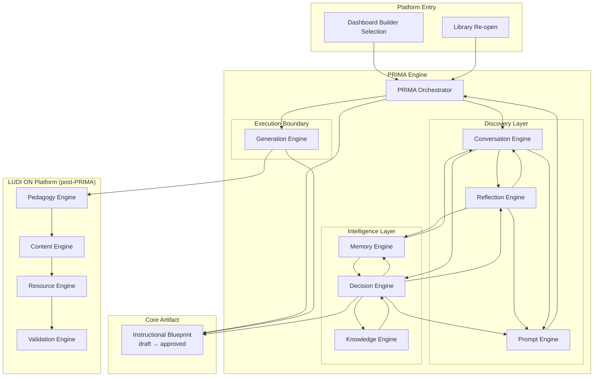
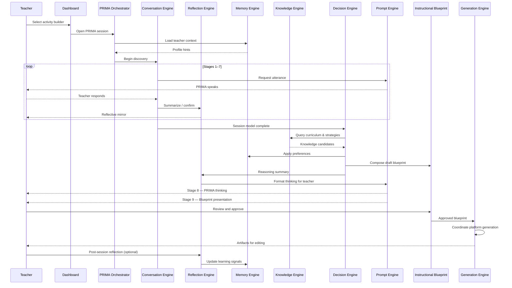
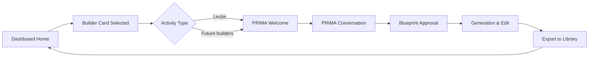
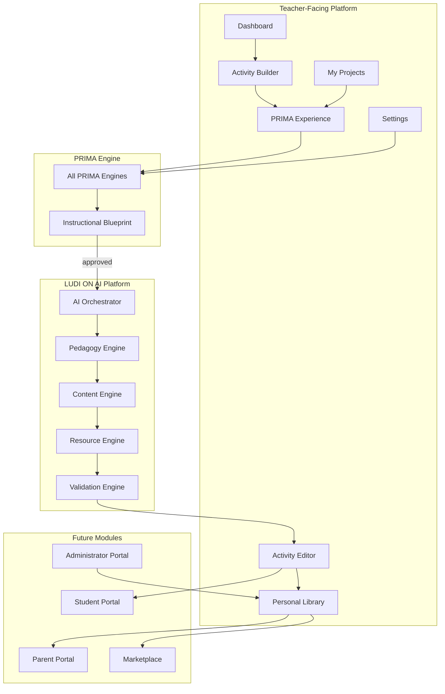
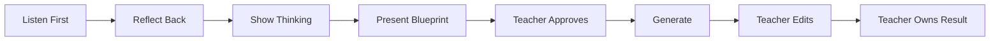

# PRIMA Engine — Product Architecture Specification

**P**edagogical **R**easoning and **I**nstructional **M**odel **A**rchitecture

---

## Purpose

This document defines the complete architecture of **PRIMA** as the pedagogical intelligence engine of LUDI ON.

PRIMA is the reason LUDI ON exists as an **instructional design platform** rather than a lesson generator. It is responsible for understanding what teachers want to achieve, reasoning about how students should learn it, and producing an approved **Instructional Blueprint** before any classroom content is created.

This specification describes **what PRIMA is**, **how its internal engines cooperate**, and **how PRIMA relates to every other part of the LUDI ON platform**. It does not describe implementation, code, APIs, or technology choices.

---

## Philosophy

PRIMA is built on a set of beliefs about teachers, pedagogy, and AI.

### Teachers are designers, not form fillers

Teachers arrive with expertise, intuition, and classroom context. PRIMA honors that expertise before asking for details. Discovery is a conversation — not a questionnaire, wizard, or configuration panel.

### Pedagogy before production

Instructional design must be explicit, reviewable, and approved before generation begins. PRIMA separates **design** (what and why students learn) from **execution** (worksheets, slides, games). The Instructional Blueprint is the contract between these two phases.

### AI as partner, not authority

PRIMA recommends. The teacher decides. Every inference PRIMA makes can be confirmed, corrected, or rejected. No generation runs without teacher approval of the blueprint.

### Inference over interrogation

PRIMA asks only what it cannot know or cannot responsibly assume. When confidence is high — especially for returning teachers — PRIMA confirms rather than re-interviews.

### Transparency at the right moment

PRIMA shows its thinking when the teacher is ready to review a plan — not while they are still imagining. Reflection and reasoning are deliberate stages, not background noise.

### Romanian classroom reality first

PRIMA is designed for Romanian primary and preschool teachers. Curriculum alignment, language quality, and classroom constraints are first-class concerns — not afterthoughts applied to a global template.

### Two worlds, one platform

The **Dashboard** is a creative studio where teachers choose what to build. The **PRIMA Experience** is a separate, focused universe where pedagogical partnership happens. The transition between them must feel intentional and premium.

---

## Responsibilities

PRIMA owns the full arc from teacher intent to approved instructional plan.

| Responsibility | Description |
|----------------|-------------|
| **Welcome** | Establish trust and emotional entry into the PRIMA experience |
| **Discover** | Co-construct instructional intent through guided conversation |
| **Reflect** | Mirror, summarize, and validate understanding with the teacher |
| **Reason** | Apply pedagogical logic to produce design decisions |
| **Know** | Access curriculum, frameworks, and domain pedagogy |
| **Remember** | Personalize through session and cross-session memory |
| **Express** | Speak as PRIMA — calm, human, Romanian, never bureaucratic |
| **Plan** | Compose and revise the Instructional Blueprint |
| **Coordinate** | Hand off approved plans to LUDI ON generation systems |
| **Learn** | Capture post-session signals to improve future assistance |

---

## What PRIMA Does Not Do

| Boundary | Rationale |
|----------|-----------|
| Generate final classroom materials without blueprint approval | Design must precede execution |
| Replace teacher judgment | AI partners; teachers own outcomes |
| Present as a chatbot, wizard, or form | Product identity and trust |
| Operate without explainability at blueprint stage | Teachers must understand what was designed and why |
| Store individual student identities | Privacy and scope |
| Publish directly to students | Teacher review is mandatory |
| Make export or formatting decisions during design | Generation engines own execution |

---

## Internal Architecture

PRIMA is not a monolith. It is an **orchestrated system of specialized engines**, each with a single domain of responsibility. Engines communicate through structured artifacts — never through shared implicit state.

### Engine Map

| Engine | Domain |
|--------|--------|
| **Conversation** | Discovery dialogue and session capture |
| **Reflection** | Mirroring, summaries, and post-session learning |
| **Decision** | Pedagogical reasoning and blueprint composition |
| **Knowledge** | Curriculum, frameworks, and domain intelligence |
| **Memory** | Session and cross-session personalization |
| **Prompt** | PRIMA voice, tone, and teacher-facing expression |
| **Generation** | Handoff and coordination of approved blueprint execution |

The **PRIMA Orchestrator** sequences engine calls, maintains session integrity, and enforces the approval gate. It contains no pedagogical logic of its own. Full specification: [`PRIMA_ORCHESTRATOR.md`](./PRIMA_ORCHESTRATOR.md).

### System Diagram — PRIMA Internal Architecture



### Data Flow Diagram — Session Lifecycle



---

## Core Artifact: Instructional Blueprint

The **Instructional Blueprint** is PRIMA's primary output and the central contract of the LUDI ON platform.

It represents complete instructional design — objectives, phases, differentiation, assessment, resources, and rationale — **before** any worksheet, slide, or game is written.

| Property | Requirement |
|----------|-------------|
| **Traceability** | Every section maps to discovery conversation |
| **Editability** | Teacher can revise any section before approval |
| **Versioning** | Draft → reviewed → approved states are explicit |
| **Explainability** | Rationale accompanies non-obvious decisions |
| **Generation gate** | No downstream engine runs without approval |

Blueprint schema evolution is documented in `docs/LUDI_ON_BLUEPRINT/INSTRUCTIONAL_BLUEPRINT.md`.

---

## PRIMA Session Model

Every PRIMA interaction produces one evolving **session** — a single persistent conversation object written incrementally across stages.

```
PRIMA Session
├── session_metadata (activity type, entry point, timestamps)
├── teacher_profile (known + inferred)
├── activity_intent
├── educational_context
├── learner_model
├── objectives
├── instructional_strategy
├── resource_constraints
├── personalization
├── reflection_log (mirrors and confirmations)
├── confidence_map (field-level inference strength)
├── instructional_blueprint (draft → approved)
└── generation_ref (post-approval only)
```

The Session Model is the shared memory of a single PRIMA interaction. It is consumed by all PRIMA engines and becomes the authoritative input for the Decision Engine.

Detailed session contracts will be specified in `PRIMA_SESSION_MODEL.md`.

---

## Relationship with the Dashboard

The Dashboard and PRIMA are **two worlds** within one platform. They serve different cognitive modes.

| Aspect | Dashboard | PRIMA Experience |
|--------|-----------|------------------|
| **Mode** | Inspiration and selection | Deep pedagogical partnership |
| **Feeling** | Calm creative studio (Canva-like) | Premium, human, focused |
| **Chrome** | Full platform navigation | No dashboard chrome |
| **PRIMA role** | Recommendations, continue working | Full discovery and design |
| **Entry** | Builder cards (Lecție, Joc, etc.) | Intentional transition from card click |

### Dashboard → PRIMA Flow



### What the Dashboard Provides PRIMA

| Input | Use |
|-------|-----|
| Activity type (Lecție, Fișă, Joc, etc.) | Conversation adaptation |
| Optional topic hint from card context | Seed inference |
| Continue-working session reference | Resume discovery or blueprint |
| Teacher account context | Memory Engine bootstrap |

### What PRIMA Returns to the Dashboard

| Output | Use |
|--------|-----|
| In-progress session | "Continue proiectul" |
| Completed activity | Recent resources |
| Preference signals | PRIMA recommendations |
| Satisfaction signals | Future personalization |

The Dashboard never embeds PRIMA conversation UI. Teachers always **enter PRIMA's universe** through a deliberate transition.

---

## Relationship with Platform Modules

PRIMA is the intelligence core of LUDI ON. Every major platform module either feeds PRIMA, consumes PRIMA output, or operates downstream of PRIMA approval.

### Module Relationship Matrix

| Platform Module | Relationship to PRIMA | Direction |
|-----------------|----------------------|-----------|
| **Dashboard** | Entry point; displays recommendations and resume | ↔ Bidirectional |
| **Activity Builder** | Hosts PRIMA experience per activity type | → PRIMA |
| **PRIMA Experience** | Primary surface for all PRIMA engines | Internal |
| **Activity Editor** | Edits generated artifacts traceable to blueprint | ← Generation output |
| **My Projects** | Stores in-progress PRIMA sessions and drafts | ↔ Session state |
| **Personal Library** | Stores approved activities and blueprints | ← Export |
| **Scenario Studio** | Future: narrative activities use PRIMA discovery | → PRIMA |
| **AI Teaching Assistant** | Future: lightweight PRIMA queries outside full session | → PRIMA (partial) |
| **Settings** | Memory controls, preferences, opt-out | ↔ Memory Engine |
| **Help** | Explains PRIMA; "Cum funcționează PRIMA?" | Informational |
| **AI Orchestrator** | Sequences post-approval generation pipeline | ← Generation Engine |
| **Pedagogy Engine** | Validates blueprint before content generation | ← Approved blueprint |
| **Content Engine** | Generates learner-facing content from blueprint | ← Validated blueprint |
| **Resource Engine** | Produces PDF, PPTX, worksheets | ← Content package |
| **Validation Engine** | Quality gate on full output | ← Generation pipeline |
| **Resource Center** | Preview, download, library storage | ← Resources |
| **Collaboration / Marketplace** | Share teacher-created activities | ← Library (future) |
| **Analytics** | Aggregate usage and satisfaction metrics | ← Session signals (anonymized) |
| **Student Portal** *(future)* | Receives teacher-assigned activities only | ← Teacher-published |
| **Parent Portal** *(future)* | Progress summaries from teacher content | ← Teacher-published |
| **Administrator Portal** *(future)* | Moderation, school config, usage reports | ← Platform data |

### Platform Position Diagram



---

## Engine Specifications

Each engine below is defined at product architecture level. Dedicated engine documents provide additional depth where noted.

---

### Conversation Engine

#### Why It Exists

Teachers think in stories, goals, and classroom images — not in form fields. The Conversation Engine exists to **capture instructional intent through natural dialogue** while progressively building the PRIMA Session Model.

It is PRIMA's ears. Without it, PRIMA would guess — and guessing erodes trust.

#### Inputs

| Input | Source |
|-------|--------|
| Activity type | Dashboard builder selection |
| Teacher utterances | PRIMA Experience UI |
| Session state | PRIMA Session Model (partial) |
| Memory hints | Memory Engine (skip/reduced questions) |
| Knowledge flags | Knowledge Engine (prerequisite gaps requiring clarification) |
| Stage context | Conversation Blueprint (stage definitions) |

#### Outputs

| Output | Consumer |
|--------|----------|
| `session_updates` | PRIMA Session Model |
| `stage_completion_signals` | PRIMA Orchestrator |
| `inference_candidates` | Decision Engine |
| `clarification_requests` | Prompt Engine |
| `confidence_updates` | Reflection Engine |

#### Responsibilities

- Conduct discovery across Conversation Blueprint Stages 1–7
- Maintain conversational continuity — one unfolding dialogue
- Decide what to ask vs what to infer
- Capture educational context, learner model, objectives, style, resources, preferences
- Never surface step numbers, form language, or wizard framing
- Hand off complete session model to Decision Engine

#### Dependencies

| Depends On | Reason |
|------------|--------|
| Memory Engine | Personalize and compress discovery |
| Knowledge Engine | Flag curriculum gaps needing teacher input |
| Prompt Engine | Render PRIMA utterances |
| Reflection Engine | Confirm understanding mid-conversation |
| PRIMA_CONVERSATION_BLUEPRINT.md | Authoritative stage definitions |

#### Future Evolution

| Phase | Capability |
|-------|------------|
| v1 | Text conversation, Stages 1–7, Lecție activity type |
| v2 | Compressed discovery for returning teachers |
| v3 | Voice input for discovery |
| v4 | Multimodal input (photo of textbook page) |
| v5 | Collaborative co-design (grade-level teams) |

→ Deep specification: [`PRIMA_CONVERSATION_BLUEPRINT.md`](./PRIMA_CONVERSATION_BLUEPRINT.md)

---

### Reflection Engine

#### Why It Exists

Discovery fails when teachers feel unheard. The Reflection Engine exists to **mirror, summarize, and validate understanding** — ensuring PRIMA and the teacher share the same mental model before reasoning begins.

It also closes the learning loop after classroom use, feeding the Memory Engine with structured signals about what worked.

Reflection is not decoration. It is a pedagogical act: making implicit teacher knowledge explicit.

#### Inputs

| Input | Source |
|-------|--------|
| Session fragments | Conversation Engine |
| Reasoning summary | Decision Engine |
| Blueprint draft | Decision Engine |
| Teacher confirmations / corrections | PRIMA Experience UI |
| Post-session feedback | Teacher (optional, future) |
| Edit diffs | Activity Editor (async) |

#### Outputs

| Output | Consumer |
|--------|----------|
| `reflective_summaries` | Prompt Engine → Teacher |
| `confirmation_status` | Conversation Engine (proceed or revisit) |
| `reasoning_presentation` | Prompt Engine (Stage 8) |
| `learning_signals` | Memory Engine (post-session) |
| `satisfaction_score` | Analytics (anonymized) |

#### Responsibilities

- Produce mid-conversation mirrors ("Deci vrei să construim…")
- Validate inferred fields before locking them in session model
- Format Decision Engine reasoning for Stage 8 — PRIMA thinking
- Present blueprint rationale in teacher-friendly language (Stage 9 support)
- Capture optional post-lesson reflection ("Cum a mers lecția?")
- Never argue with explicit teacher corrections — update session immediately

#### Dependencies

| Depends On | Reason |
|------------|--------|
| Conversation Engine | Source material for mirrors |
| Decision Engine | Reasoning to expose |
| Prompt Engine | Teacher-facing expression |
| Memory Engine | Store learning signals |

#### Future Evolution

| Phase | Capability |
|-------|------------|
| v1 | Mid-conversation summaries; Stage 8 reasoning presentation |
| v2 | Post-session reflection prompt (single question) |
| v3 | Structured reflection tied to blueprint sections |
| v4 | Class-level outcome patterns (aggregate, privacy-safe) |
| v5 | PRIMA suggests refinements based on reflection history |

---

### Decision Engine

#### Why It Exists

Captured intent is not yet instructional design. The Decision Engine exists to **convert discovered intent into pedagogically sound decisions** and a structured Instructional Blueprint.

It is PRIMA's mind — the layer where objectives, methods, structure, differentiation, and assessment are reasoned about explicitly.

#### Inputs

| Input | Source |
|-------|--------|
| Complete session model | Conversation Engine |
| Curriculum mappings | Knowledge Engine |
| Strategy recommendations | Knowledge Engine |
| Teacher preferences | Memory Engine |
| Activity type constraints | Dashboard / builder config |
| Teacher revisions | Reflection Engine / review UI |

#### Outputs

| Output | Consumer |
|--------|----------|
| `reasoning_summary` | Reflection Engine → Prompt Engine |
| `instructional_blueprint` | PRIMA Orchestrator, Generation Engine |
| `confidence_map` | Conversation Engine (re-ask if weak) |
| `revision_directives` | Generation Engine (post-approval) |
| `pedagogical_flags` | Reflection Engine (surface risks to teacher) |

#### Responsibilities

- Interpret natural language into structured instructional intent
- Select instructional strategies aligned with objectives and learner model
- Design phased activity structure with timing and transitions
- Plan differentiation and assessment approach
- Validate backward-design coherence (objectives ↔ activities ↔ assessment)
- Compose and revise Instructional Blueprint sections
- Explain non-obvious decisions in human-readable form
- Incorporate teacher corrections without restarting full discovery

#### Decision Layers

1. **Intent resolution** — topic, purpose, success criteria
2. **Instructional strategy selection** — methods aligned with context
3. **Structure design** — phases, timing, grouping, materials
4. **Differentiation planning** — tiers, support, extension
5. **Coherence validation** — alignment check across blueprint

#### Dependencies

| Depends On | Reason |
|------------|--------|
| Knowledge Engine | Curriculum and strategy retrieval |
| Memory Engine | Preference-aware defaults |
| Conversation Engine | Complete discovery input |
| Reflection Engine | Present reasoning to teacher |

#### Future Evolution

| Phase | Capability |
|-------|------------|
| v1 | Blueprint composition for Lecție; manual teacher revision |
| v2 | Multi-activity-type decision templates |
| v3 | Confidence-scored auto-completion of blueprint sections |
| v4 | Blueprint diff across versions |
| v5 | Cross-subject project-level planning |

→ Deep specification: [`PRIMA_DECISION_ENGINE.md`](./PRIMA_DECISION_ENGINE.md)

---

### Knowledge Engine

#### Why It Exists

Large language models alone do not guarantee Romanian curriculum alignment, consistent pedagogical quality, or auditable design decisions. The Knowledge Engine exists to provide **structured, retrievable pedagogical intelligence** that PRIMA queries during reasoning.

It is PRIMA's library — curated, versioned, and separate from parametric model knowledge.

#### Inputs

| Input | Source |
|-------|--------|
| Query context (grade, subject, topic, activity type) | Decision Engine |
| Prerequisite checks | Decision Engine |
| School year | Platform configuration |
| Knowledge pack version | Platform configuration |

#### Outputs

| Output | Consumer |
|--------|----------|
| `competency_mappings[]` | Decision Engine → Blueprint objectives |
| `strategy_recommendations[]` | Decision Engine Layer 2 |
| `vocabulary_ceiling` | Generation Engine (via Decision) |
| `prerequisite_gaps[]` | Conversation Engine (if critical) |
| `developmental_norms` | Decision Engine |
| `assessment_verb_library` | Decision Engine |

#### Responsibilities

- Maintain Romanian curriculum knowledge (grade bands, subjects, competencies)
- Provide instructional framework patterns (backward design, UDL, formative assessment)
- Supply activity archetype constraints (Lecție, Joc, Fișă, etc.)
- Offer subject-specific pedagogy (literacy vs sciences vs arts)
- Map Bloom taxonomy verbs in natural Romanian
- Version knowledge packs per school year
- Flag conflicting curriculum interpretations for human curation review

#### Dependencies

| Depends On | Reason |
|------------|--------|
| Manual curation pipeline | P0 knowledge source |
| Platform configuration | School year, locale |

#### Future Evolution

| Phase | Capability |
|-------|------------|
| v1 | Manual curation — Romanian primary curriculum P0 |
| v2 | LUDI ON pedagogical pattern library |
| v3 | Activity type template packs |
| v4 | Community-contributed patterns (moderated) |
| v5 | Live curriculum API integration (if available) |

→ Deep specification: [`PRIMA_KNOWLEDGE_ENGINE.md`](./PRIMA_KNOWLEDGE_ENGINE.md)

---

### Memory Engine

#### Why It Exists

Every session should not start from zero. The Memory Engine exists so PRIMA **remembers what helps** — teacher profile, teaching style, class patterns — while never overriding explicit teacher statements or storing student identities.

It is PRIMA's continuity across time.

#### Inputs

| Input | Source |
|-------|--------|
| Session completion metadata | PRIMA Orchestrator |
| Teacher profile (account) | Authentication & Accounts |
| Explicit preferences | Settings |
| Inferred patterns | Decision Engine |
| Learning signals | Reflection Engine |
| Edit diffs | Activity Editor (async) |
| Opt-out flags | Settings |

#### Outputs

| Output | Consumer |
|--------|----------|
| `teacher_context_hints` | Conversation Engine |
| `preference_defaults` | Decision Engine |
| `compression_eligibility` | Conversation Engine (skip stages) |
| `dashboard_recommendations` | Dashboard |
| `continue_working_context` | Dashboard, My Projects |

#### Memory Types

| Type | Scope |
|------|-------|
| Session memory | Current conversation only |
| Teacher profile | Grade, subject, role, school type |
| Teaching fingerprint | Methods, tone, resource constraints |
| Class model | Size, differentiation patterns (opt-in detail) |
| Success patterns | Anonymized aggregate satisfaction signals |

#### Responsibilities

- Bootstrap session with known teacher context
- Enable compressed discovery for high-confidence returning users
- Supply preference hints to Decision Engine — never override teacher
- Confirm inferences transparently ("Ca de obicei, folosești proiectorul?")
- Support memory export and deletion (GDPR-aligned)
- Operate asynchronously for learning signals — never block current session

#### Dependencies

| Depends On | Reason |
|------------|--------|
| Settings | Preference storage and opt-out |
| Reflection Engine | Post-session learning signals |
| Authentication | Teacher identity scope |

#### Future Evolution

| Phase | Capability |
|-------|------------|
| v1 | Session memory only |
| v2 | Cross-session teacher profile and preferences |
| v3 | Compressed discovery; dashboard recommendations |
| v4 | Teacher-visible Memory panel |
| v5 | School-level shared patterns (admin-controlled) |

→ Deep specification: [`PRIMA_MEMORY_ENGINE.md`](./PRIMA_MEMORY_ENGINE.md)

---

### Prompt Engine

#### Why It Exists

Pedagogical intelligence means nothing if PRIMA speaks like a bureaucratic chatbot. The Prompt Engine exists to govern **how PRIMA expresses itself** — voice, tone, Romanian quality, stage-appropriate language, and guardrails.

It is PRIMA's voice. It translates engine outputs into language teachers trust.

The Prompt Engine is not the Decision Engine. Decision reasons; Prompt speaks.

#### Inputs

| Input | Source |
|-------|--------|
| Utterance intent | Conversation Engine (what to say) |
| Reflective content | Reflection Engine (summaries, mirrors) |
| Reasoning content | Decision Engine (thinking presentation) |
| Blueprint sections | Decision Engine (presentation labels) |
| Stage rules | Conversation Blueprint |
| Tone preferences | Memory Engine |
| Guardrail policies | Product documentation |

#### Outputs

| Output | Consumer |
|--------|----------|
| `teacher_facing_utterances` | PRIMA Experience UI |
| `transition_phrases` | Conversation continuity |
| `error_recovery_messages` | PRIMA Experience UI |
| `generation_progress_copy` | Generation phase UI |

#### Responsibilities

- Maintain PRIMA persona: calm, expert, respectful, never condescending
- Enforce language rules — no "Step 1", "Form", "Submit", "Wizard"
- Produce natural Romanian classroom language
- Adapt tone to stage (welcoming → curious → reflective → confident)
- Format reasoning and blueprint for readability without jargon
- Apply activity-type-specific vocabulary (Lecție vs Joc vs Fișă)
- Surface generation progress in human terms, not technical ones

#### Guardrails (Non-Negotiable)

| Never say | Always prefer |
|-----------|---------------|
| "Step 3 of 10" | Natural transitions |
| "Complete this field" | "Povestește-mi…" |
| "AI generated" | "Am pregătit…" |
| Competency codes (default) | Teacher-friendly objectives |
| "I think you want…" (assertive) | "Deci vrei să…?" (reflective) |

#### Dependencies

| Depends On | Reason |
|------------|--------|
| Conversation Blueprint | Stage language rules |
| All content-producing engines | Source material to express |
| Memory Engine | Tone personalization |

#### Future Evolution

| Phase | Capability |
|-------|------------|
| v1 | Static persona rules; Romanian copy guide |
| v2 | Activity-type tone variants |
| v3 | Teacher tone preference (formal / warm / concise) |
| v4 | A/B tested utterance patterns for completion rate |
| v5 | Localized minority language support (future policy) |

→ Future specification: `PRIMA_COPY_GUIDE.md`

---

### Generation Engine

#### Why It Exists

Approved instructional design must become classroom-ready artifacts. The Generation Engine exists as PRIMA's **execution boundary** — coordinating the handoff from approved blueprint to LUDI ON's generation pipeline.

PRIMA designs. Generation executes. This separation protects pedagogical integrity.

#### Inputs

| Input | Source |
|-------|--------|
| Approved Instructional Blueprint | PRIMA Orchestrator |
| `revision_directives` | Decision Engine |
| `vocabulary_ceiling` | Knowledge Engine |
| Activity type output spec | Activity Builder config |
| Teacher resource selections | Conversation Stage 6–7 |

#### Outputs

| Output | Consumer |
|--------|----------|
| Generation request package | AI Orchestrator |
| Progress state | PRIMA Experience UI (via Prompt Engine) |
| Partial artifacts | Activity Editor |
| Final artifact bundle | Activity Editor, Library |
| Failure recovery scope | PRIMA Orchestrator (section-level retry) |

#### Responsibilities

- Enforce the approval gate — reject generation if blueprint not approved
- Package blueprint into orchestrator-ready generation request
- Coordinate Pedagogy → Content → Resource → Validation sequence
- Surface progress without technical jargon
- Enable section-level regeneration ("Regenerăm secțiunea X")
- Maintain traceability: every artifact links to blueprint section
- Return control to teacher for editing — never auto-publish

#### Generation Pipeline (Product View)

```
Approved Blueprint
       ↓
Pedagogy Validation
       ↓
Content Generation
       ↓
Resource Generation
       ↓
Validation Engine
       ↓
Teacher Editing Environment
       ↓
Export + Library Save
```

#### Dependencies

| Depends On | Reason |
|------------|--------|
| Decision Engine | Approved blueprint and directives |
| AI Orchestrator | Platform generation sequencing |
| Pedagogy Engine | Final pedagogical check |
| Content Engine | Learner-facing content |
| Resource Engine | Exportable materials |
| Validation Engine | Quality gate |
| Prompt Engine | Progress and error messaging |

#### Future Evolution

| Phase | Capability |
|-------|------------|
| v1 | Lecție end-to-end: plan, slides, worksheet, quiz |
| v2 | All activity types |
| v3 | Partial streaming results during generation |
| v4 | PRIMA-assisted inline regeneration in editor |
| v5 | Multi-format export bundles (offline USB package) |

→ Deep specification: [`PRIMA_GENERATION_ENGINE.md`](./PRIMA_GENERATION_ENGINE.md)

---

## Trust Model

PRIMA earns teacher trust through a deliberate sequence — not through claims of intelligence.



| Principle | Engine primarily responsible |
|-----------|------------------------------|
| Listen before structuring | Conversation |
| Confirm before assuming | Reflection |
| Explain before generating | Decision + Reflection + Prompt |
| Approve before executing | PRIMA Orchestrator + Generation |
| Edit before publishing | Activity Editor |
| Learn after delivery | Reflection + Memory |

---

## Version Strategy

PRIMA capability grows in layers aligned with the product roadmap.

| Version | PRIMA Milestone | Engines Active |
|---------|-----------------|----------------|
| **0.1** | Welcome experience | Prompt (partial) |
| **0.2** | Discovery conversation | Conversation, Reflection, Prompt, Memory (session) |
| **0.3** | Blueprint approval | + Decision, Knowledge (v1) |
| **0.4** | Full Lecție pipeline | + Generation |
| **0.6** | Cross-session memory | Memory (full) |
| **1.0** | Public release | All engines v1; all activity types |

---

## Architectural Principles

1. **Single session object** — All engines write to or read from the PRIMA Session Model through defined contracts.
2. **Approval gate** — Generation Engine cannot activate without explicit blueprint approval.
3. **Engine isolation** — No engine performs another engine's responsibility.
4. **Expression separation** — Decision reasons; Prompt speaks; Reflection mirrors.
5. **Knowledge retrieval** — Curriculum facts come from Knowledge Engine, not inference alone.
6. **Memory assists, never overrides** — Explicit teacher statements always win.
7. **Romanian first** — All teacher-facing expression defaults to natural Romanian.
8. **Documentation before implementation** — No engine ships without approved product specification.

---

## Future Documents That Depend on PRIMA_ENGINE.md

The following documents should be authored or updated as direct descendants of this specification. None may proceed to implementation without approval.

| Document | Purpose | Priority |
|----------|---------|----------|
| [`PRIMA_CONVERSATION_BLUEPRINT.md`](./PRIMA_CONVERSATION_BLUEPRINT.md) | Stage-by-stage conversation architecture | ✅ Exists |
| [`PRIMA_DECISION_ENGINE.md`](./PRIMA_DECISION_ENGINE.md) | Decision layers and blueprint composition detail | ✅ Exists |
| [`PRIMA_MEMORY_ENGINE.md`](./PRIMA_MEMORY_ENGINE.md) | Memory types, privacy, compression rules | ✅ Exists |
| [`PRIMA_KNOWLEDGE_ENGINE.md`](./PRIMA_KNOWLEDGE_ENGINE.md) | Curriculum packs and retrieval model | ✅ Exists |
| [`PRIMA_GENERATION_ENGINE.md`](./PRIMA_GENERATION_ENGINE.md) | Post-approval generation handoff | ✅ Exists |
| `PRIMA_SESSION_MODEL.md` | Session object schema, field contracts, versioning | P0 |
| `PRIMA_UI_FLOW.md` | Screen map from Welcome → Export; no step UI | P0 |
| `PRIMA_COPY_GUIDE.md` | Romanian voice, tone, utterance patterns for Prompt Engine | P0 |
| `PRIMA_REFLECTION_ENGINE.md` | Mirror patterns, Stage 8 format, post-session loop | P1 |
| `PRIMA_PROMPT_ENGINE.md` | Persona rules, guardrails, stage templates | P1 |
| `INSTRUCTIONAL_BLUEPRINT_SCHEMA.md` | Formal blueprint sections and validation rules | P0 |
| `PRIMA_ACTIVITY_TYPE_ADAPTATIONS.md` | Per-builder conversation and blueprint differences | P1 |
| `PRIMA_TRUST_AND_SAFETY.md` | Content safety, age appropriateness, failure modes | P1 |
| `PRIMA_ANALYTICS_MODEL.md` | Session metrics, completion funnels, anonymization | P2 |
| `PRIMA_API_CONTRACTS.md` *(technical)* | Engine-to-engine data contracts for engineering | P0 after product approval |

---

## Next Recommended Document

→ [`PRIMA_CONVERSATION_BLUEPRINT.md`](./PRIMA_CONVERSATION_BLUEPRINT.md) — Complete 14-stage conversation architecture that activates the Conversation, Reflection, and Prompt engines.
