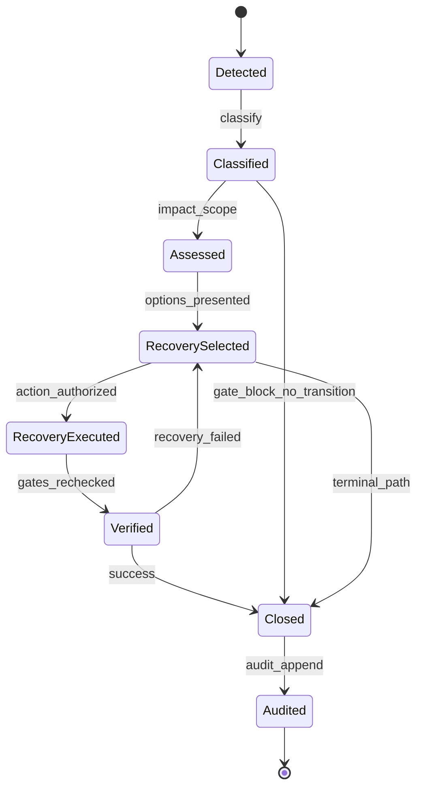
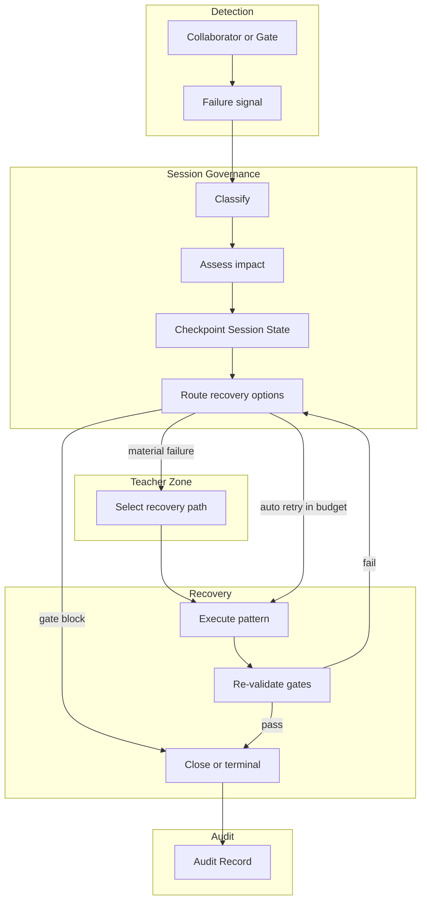
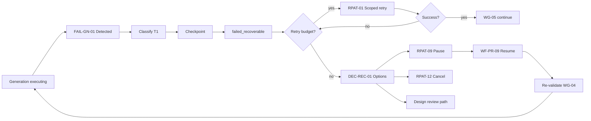
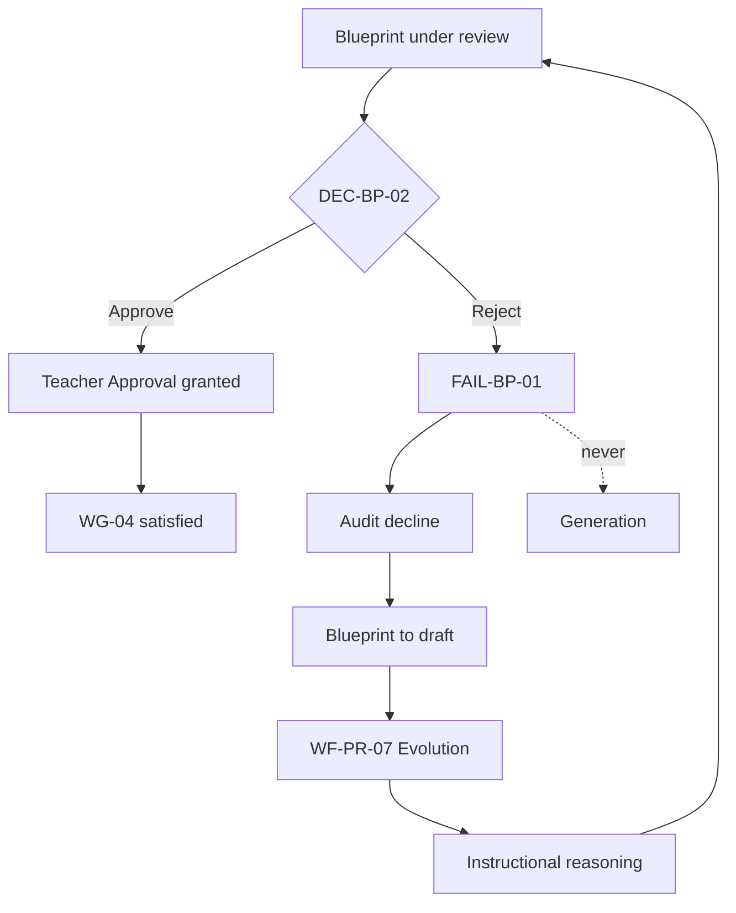
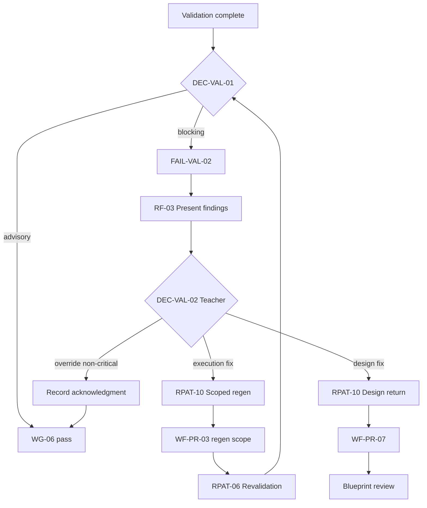
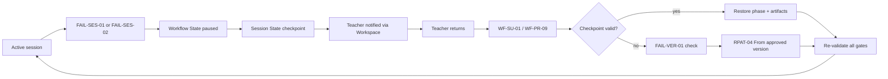
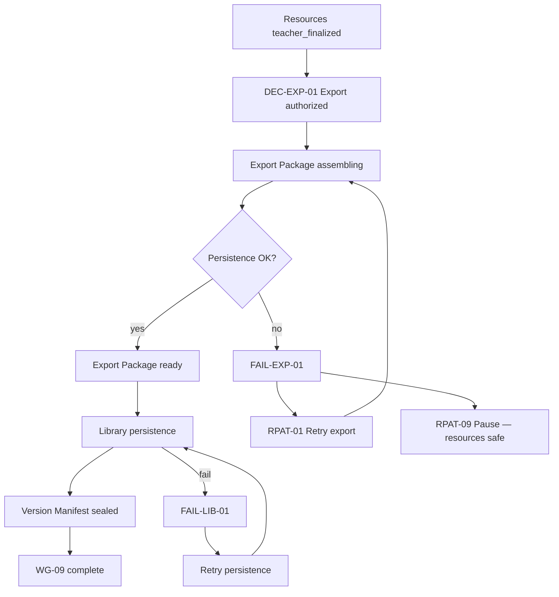
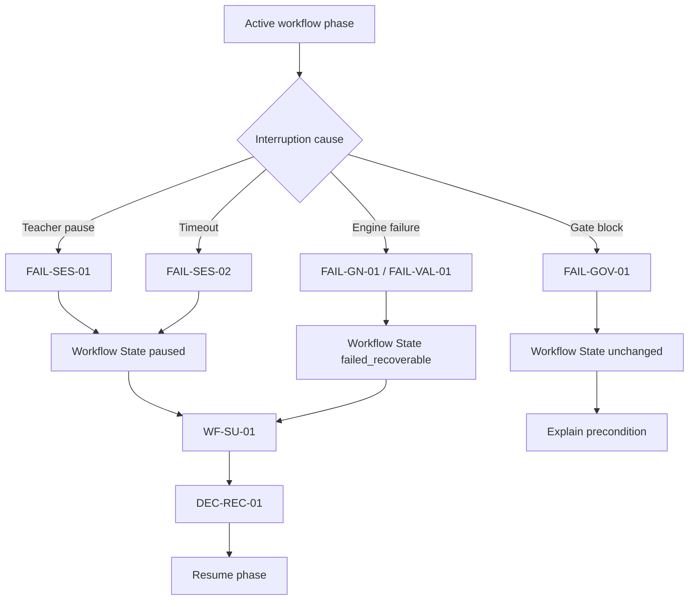
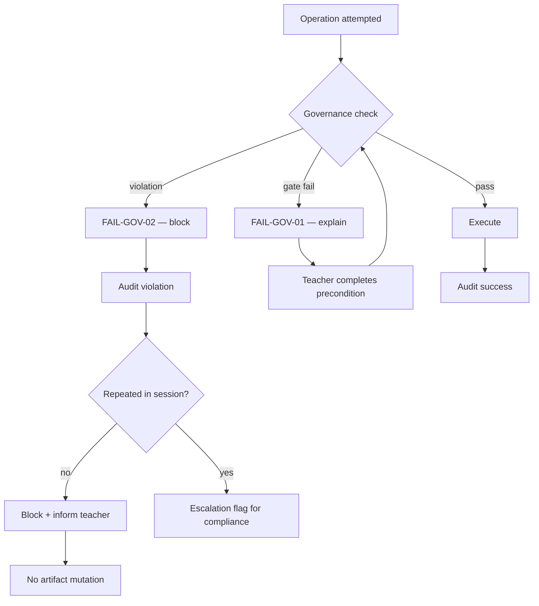

# PRIMA Failure Model

**Version:** 1.0  
**Status:** Official — Enterprise Failure Architecture Specification

---

## Purpose

This document defines the **official failure and resilience architecture** of the PRIMA platform within LUDI ON.

It answers one architectural question:

> *How does PRIMA preserve architectural integrity when expected or unexpected failures occur?*

The Failure Model specifies **what categories of failure exist**, **who owns them**, **how they are detected and classified**, **which recovery strategies apply**, **how business continuity is maintained**, and **how governance and traceability survive failure conditions**.

This document defines **enterprise failure architecture** — not HTTP status codes, exception hierarchies, retry algorithms, infrastructure failover, or monitoring alert rules. Solution-level error classification and routing detail live in [`solution/PRIMA_ERROR_MODEL.md`](./solution/PRIMA_ERROR_MODEL.md), which **implements** this framework.

---

## Scope

| In scope | Out of scope |
|----------|--------------|
| Failure taxonomy and business impact | Stack traces, log schemas, exception classes |
| Recovery strategies and patterns | Retry backoff timing, circuit breaker configuration |
| Failure ownership and escalation | Load balancer failover, database replication |
| Business continuity and gate preservation | Cloud region redundancy |
| Governance, auditability, severity model | UI error copy and localization |
| Failure lifecycle and architectural diagrams | Programming language error handling |

**Audience:** Enterprise architects, product architects, compliance reviewers, and implementation leads responsible for ensuring PRIMA remains governed, traceable, and teacher-centric under all failure conditions.

---

## Failure Philosophy

PRIMA operates in a **teacher partnership context** where silent failure destroys trust and corrupts instructional authority. The Failure Model treats failure as an **architectural event** — not an implementation accident.

### Core commitments

| Commitment | Architectural meaning |
|------------|------------------------|
| **Teacher-first** | Recovery options preserve teacher work and authority — platform never auto-abandons instructional outcomes |
| **Recoverable by default** | Session State checkpoints enable resume, retry, and scoped recovery before terminal outcomes |
| **Fail visible** | Teachers always know when failure occurred — no silent fallback or hidden degradation |
| **Non-destructive** | Approved artifacts, Teacher Approval records, and lineage are never silently overwritten |
| **Governed recovery** | Recovery never bypasses WG-04 Teacher Approval or other architectural gates |
| **Deterministic classification** | Same failure conditions yield the same architectural classification |
| **Auditable** | Every material failure and recovery action append Audit Record |
| **Traceable** | Version Manifest and artifact references reconstruct pre-failure state |
| **Explainable** | Teachers receive human-readable explanation of what failed and what options exist |

### Failure vs error vs decision

| Concept | Question answered | Specification |
|---------|-------------------|---------------|
| **Failure** | *What went wrong architecturally and what must be preserved?* | This document |
| **Error** | *How is failure classified and routed at solution level?* | [`PRIMA_ERROR_MODEL.md`](./solution/PRIMA_ERROR_MODEL.md) |
| **Recovery decision** | *Which recovery path does the teacher choose?* | [`PRIMA_DECISION_FRAMEWORK.md`](./PRIMA_DECISION_FRAMEWORK.md) — DEC-REC-01 |
| **State** | *What is the coordination condition after failure?* | [`PRIMA_STATE_MODEL.md`](./solution/PRIMA_STATE_MODEL.md) — `failed_recoverable`, `paused`, `failed_terminal` |

---

## Resilience Principles

These principles instantiate [`PRIMA_ARCHITECTURAL_PRINCIPLES.md`](./PRIMA_ARCHITECTURAL_PRINCIPLES.md) and [`PRIMA_DECISION_FRAMEWORK.md`](./PRIMA_DECISION_FRAMEWORK.md) as failure-level rules.

| ID | Principle | Source | Failure implication |
|----|-----------|--------|-------------------|
| **RP-01** | Fail Visible | DP-12, GV-06 | No silent failure paths; teacher notification mandatory |
| **RP-02** | Preserve Teacher Work | TP-01, WP-08 | Session State checkpoint before destructive action |
| **RP-03** | No Gate Bypass | WF-CR-08, DEC-C-12, SP-11 | Recovery never skips Teacher Approval or approved Blueprint Version |
| **RP-04** | Immutable Approval | ACR-05, LC-07 | Failure does not revoke `granted` Teacher Approval without new approval cycle |
| **RP-05** | Scope Failures | AP-01 | Failure bound to scope — partial success retained where possible |
| **RP-06** | Measurement Integrity | ACR-02, DEC-C-04 | Validation failure does not mutate Blueprint or Generated Resource content |
| **RP-07** | Orchestrator Routes | AP-02 | All failures route through Session Governance — no peer recovery mesh |
| **RP-08** | Teacher Chooses Recovery | DEC-REC-01 | Automatic retry only within declared budget; path selection requires teacher for material outcomes |
| **RP-09** | Append-Only Audit | LC-11, ACR-05 | Failure and recovery events append Audit Record — never silent history mutation |
| **RP-10** | Best-Effort Draft Save | ERR-C-03 | Terminal failure attempts preservation of in-progress design or partial generation |
| **RP-11** | Conflict Blocks Write | ACR-10 | Version conflict blocks operation — refresh from approved version offered |
| **RP-12** | Non-Destructive Terminal | LC-05 | Terminal states do not corrupt archived or approved lineage |

---

## Failure Taxonomy

Failures are classified along **three orthogonal dimensions**:

| Dimension | Values | Purpose |
|-----------|--------|---------|
| **Origin** | Design, Discovery, Knowledge, Generation, Validation, Session, Governance, Export, Future | Domain accountability |
| **Nature** | Expected business outcome, Recoverable interruption, Blocking condition, Integrity violation, Terminal | Recovery eligibility |
| **Severity** | Critical, High, Medium, Low, Informational | Business impact and escalation |

### Nature classes

| Class | Description | Typical recovery |
|-------|-------------|------------------|
| **Expected business outcome** | Teacher or process chose a non-happy path by design | Redesign, revision, alternative workflow |
| **Recoverable interruption** | Transient or scoped failure; work preserved | Retry, resume, scoped regen |
| **Blocking condition** | Preconditions unmet; no forward progress until resolved | Gate completion, teacher action |
| **Integrity violation** | Artifact or version contract breached | Block write; refresh from approved |
| **Terminal** | Unrecoverable within session policy | Safe termination; best-effort save |

---

## Failure Categories

Twenty-one failure categories are registered. Each maps to domain ownership and recovery pattern families.

| Category ID | Category | Primary owner domain | Nature class |
|-------------|----------|---------------------|--------------|
| **FC-INT** | Intent ambiguity | Instructional Design | Blocking |
| **FC-CTX** | Missing context | Instructional Design / Orchestration | Blocking |
| **FC-CON** | Conflicting teacher instructions | Teacher Interaction | Blocking |
| **FC-DIS** | Discovery incomplete | Instructional Design | Blocking |
| **FC-KN** | Knowledge inconsistency | Knowledge | Recoverable / Blocking |
| **FC-BP-R** | Blueprint rejection | Teacher Interaction | Expected outcome |
| **FC-BP-I** | Blueprint integrity failure | Instructional Design / Governance | Integrity |
| **FC-BP-F** | Blueprint reasoning failure | Instructional Design | Recoverable |
| **FC-GN-I** | Generation interruption | Generation | Recoverable |
| **FC-GN-C** | Generation cancellation | Teacher Interaction | Expected outcome |
| **FC-GN-P** | Partial generation failure | Generation | Recoverable |
| **FC-VAL-F** | Validation process failure | Validation | Recoverable |
| **FC-VAL-B** | Validation blocking findings | Validation | Blocking |
| **FC-GOV-G** | Gate precondition failure | Orchestration | Blocking |
| **FC-GOV-V** | Governance violation | System Governance | Integrity |
| **FC-GOV-A** | Approval expiration (future policy) | System Governance | Blocking |
| **FC-SES-I** | Session interruption | Orchestration | Recoverable |
| **FC-SES-T** | Session timeout | Orchestration | Recoverable |
| **FC-SES-X** | Terminal session failure | Orchestration | Terminal |
| **FC-MEM** | Memory inconsistency | Memory | Low impact — advisory |
| **FC-VER** | Artifact version conflict | System Governance | Integrity |
| **FC-EXP** | Export failure | Teacher Interaction / Orchestration | Recoverable |
| **FC-LIB** | Library persistence failure | Platform Services | Recoverable |
| **FC-FUT** | Future collaboration conflict | Future ecosystem | Future |

---

## Failure Lifecycle

Every material failure evolves through an **eight-phase lifecycle**. Phases may compress for deterministic gate blocks, but audit and verification are never skipped.

```
Detected
    ↓
Classified
    ↓
Assessed
    ↓
Recovery Selected
    ↓
Recovery Executed
    ↓
Verified
    ↓
Closed
    ↓
Audited
```

| Phase | Description | Primary actor | Artifact signal |
|-------|-------------|---------------|-----------------|
| **Detected** | Failure condition observed by component or gate evaluation | Any collaborator → Session Governance | Failure signal; gate reject |
| **Classified** | Severity, nature, and category assigned | Session Governance (CMP-I02) | Failure tier mapping (see Error Model) |
| **Assessed** | Business impact evaluated; affected artifacts and states identified | Session Governance | Scope descriptor; checkpoint trigger |
| **Recovery Selected** | Recovery pattern chosen — automatic or teacher-mediated | Teacher and/or Governance (DEC-REC-01) | Recovery routing decision |
| **Recovery Executed** | Authorized recovery action performed | Implementing components | State transition; artifact update |
| **Verified** | Gates re-evaluated; integrity confirmed | Session Governance (DEC-GOV-01) | Gate pass; preconditions satisfied |
| **Closed** | Failure resolved or safely terminal | Session Governance | Workflow State normalized or terminal |
| **Audited** | Full failure and recovery chain recorded | Audit and Lineage Service | Audit Record complete |



---

## Failure Detection

Failure detection occurs through **architectural observation points** — not implementation hooks.

| Detection point | What is observed | Failure signal |
|-----------------|------------------|------------------|
| **Gate evaluation** | WG-01–WG-09 preconditions | Gate block — preconditions unmet |
| **Lifecycle constraint** | LC-01–LC-12 violation attempt | Transition rejected |
| **Artifact invariant** | ACR-01–ACR-15 breach attempt | Integrity failure |
| **Collaboration timeout** | Active interaction exceeds policy | Session interruption |
| **Scope completion signal** | Expected artifact not produced | Process failure |
| **Measurement outcome** | Validation Report severity classification | Validation blocking |
| **Teacher explicit signal** | Decline, cancel, pause | Expected business outcome |
| **Version binding check** | Blueprint Version mismatch | Version conflict |
| **Persistence acknowledgment** | Export or Library write not confirmed | Export / Library failure |

**Rule:** Detectors **report** to Session Governance. Collaborators do not self-route recovery across boundaries (RP-07, AP-02).

---

## Failure Classification

Solution-level tier mapping implements architectural classification. See [`PRIMA_ERROR_MODEL.md`](./solution/PRIMA_ERROR_MODEL.md) for tier detail.

| Architectural class | Error Model tier | Workflow State signal |
|--------------------|------------------|----------------------|
| Recoverable interruption | T1 Recoverable Engine Failure | `failed_recoverable` |
| Scoped partial failure | T2 Scoped Partial Failure | `generating` or `failed_recoverable` |
| Gate / precondition block | T3 Gate Failure | No transition — remain in phase |
| Validation blocking | T4 Validation Block | `validating` — routing decision |
| Integrity / version conflict | T5 Conflict Failure | Block + `failed_recoverable` |
| Terminal | T6 Terminal Failure | `failed_terminal` or `cancelled` |
| Session timeout / pause | T7 Session Timeout | `paused` |

Classification is **deterministic**: same artifact states, same gate context, same failure class.

---

## Recovery Principles

| ID | Principle | Application |
|----|-----------|-------------|
| **RC-01** | Recovery preserves approved authority | Approved Blueprint Version and Teacher Approval `granted` remain valid unless teacher initiates new cycle |
| **RC-02** | Recovery re-validates gates | After recovery, DEC-GOV-01 re-evaluates applicable WG-* |
| **RC-03** | Scoped before global | Partial regen before full session restart |
| **RC-04** | Teacher path for material outcomes | Cancel, design return, override require teacher selection |
| **RC-05** | Checkpoint before retry | Session State written before scoped retry |
| **RC-06** | No silent retry | Automatic retry only within declared budget with audit |
| **RC-07** | Explain before act | Teacher receives options via Reflection / Prompt presentation — not raw failure codes |
| **RC-08** | Terminal is safe | Terminal failure never corrupts sealed Version Manifest or approved version |

---

## Recovery Patterns

Registered recovery patterns. Multiple patterns may combine (e.g., **Scoped retry** + **Teacher confirmation**).

| Pattern ID | Pattern | Description | When used |
|------------|---------|-------------|-----------|
| **RPAT-01** | Retry | Re-execute failed scope within budget | FC-GN-I, FC-VAL-F, FC-EXP |
| **RPAT-02** | Resume | Restore from Session State checkpoint | FC-SES-I, FC-SES-T |
| **RPAT-03** | Rollback | Revert Workflow State to last stable phase | Failed regen after partial advance |
| **RPAT-04** | Restart | New scoped run from approved binding | FC-VER after conflict resolution |
| **RPAT-05** | Teacher Confirmation | Teacher explicitly selects recovery path | DEC-REC-01 — all material failures |
| **RPAT-06** | Revalidation | Re-run validation after scoped regen | FC-VAL-B execution root cause |
| **RPAT-07** | Manual Intervention | Teacher edits or redesigns | FC-BP-R, FC-VAL-B design root cause |
| **RPAT-08** | Safe Termination | `cancelled` or `failed_terminal` with draft save | FC-SES-X, exhausted retry |
| **RPAT-09** | Deferred Continuation | `paused` — continue later | FC-SES-T, teacher exit |
| **RPAT-10** | Alternative Path | Route to design evolution vs execution regen | DEC-BP-03 |
| **RPAT-11** | Partial Completion | Retain succeeded scope; retry failed scope only | FC-GN-P |
| **RPAT-12** | Graceful Cancellation | Teacher-initiated cancel with optional draft preservation | FC-GN-C, FC-SES-I |

---

## Business Continuity

Business continuity ensures **instructional design value is not lost** and **architectural gates remain enforceable** across failure.

### Continuity objectives

| Objective | Mechanism | Constraint |
|-----------|-----------|------------|
| **Preserve in-progress design** | Session State checkpoint; Project continuity (PS-01) | ACR-07: checkpoint ≠ approved Blueprint substitute |
| **Preserve approved design** | Immutable Blueprint Version and Teacher Approval | LC-07, ACR-05 |
| **Preserve partial execution** | Partial Generation Package retention | RP-05 scoped failure |
| **Enable resume** | WF-PR-09 Project Resume; WF-SU-01 Session Recovery | Gates re-validated on resume |
| **Maintain traceability** | Audit Record + Version Manifest during recovery | GV-02, LC-11 |
| **Return to Workspace safely** | Terminal paths offer draft save; Library unaffected | RP-10 |

### Continuity by workflow phase

| Phase | Continuity priority | On failure |
|-------|--------------------|-----------|
| Discovery | Conversation Context, Teacher Intent | Resume discovery; intent `revised` |
| Reasoning / Blueprint | Instructional Blueprint draft | Return to draft; reasoning retry |
| Approval | Teacher Approval record | Decline → redesign — not data loss |
| Generation | Generation Package partial | Scoped retry / regen |
| Validation | Validation Report retained | Regen or design return |
| Editing | Generated Resource edits | Preserve edits on scoped regen |
| Export / Library | Export Package assembly | Retry export; manifest unsealed until success |

---

## Failure Registry

Architecturally material failures with full specifications. Expected teacher choices (rejection, cancellation) are included — they require governed routing even when not technical errors.

---

### FC-INT — Intent Failures

#### FAIL-INT-01 — Intent Ambiguity

| Field | Content |
|-------|---------|
| **Failure Name** | Intent Ambiguity |
| **Description** | Teacher Intent cannot be normalized — required fields missing or mutually unclear |
| **Business Impact** | Reasoning blocked; WG-01 cannot pass — **Medium** |
| **Detection Method** | Intent normalization evaluation; DEC-INT-01 outcome `blocked` |
| **Failure Owner** | Instructional Design Domain |
| **Affected Components** | CMP-I01 (Conversation), CMP-I02 |
| **Affected Workflows** | WF-PR-01 discovery phase |
| **Affected States** | Teacher Intent `forming`; Workflow State `discovery` |
| **Affected Artifacts** | Conversation Context, Teacher Intent |
| **Recovery Strategy** | Continue discovery dialogue; RF-01 mirroring; teacher clarification |
| **Recovery Authority** | Teacher provides clarification; System resumes capture |
| **Escalation Rules** | No escalation — remain in discovery until resolved or teacher cancels |
| **Business Continuity Rules** | Conversation Context preserved; no premature reasoning |
| **Audit Requirements** | Ambiguity flags recorded; not a failure tier — informational gate hold |
| **Architectural Constraints** | DEC-C-06; cannot proceed to DEC-BP-01 without `complete` intent |
| **Terminal Conditions** | Teacher cancels session — FC-SES-I path |

---

#### FAIL-INT-02 — Missing Context

| Field | Content |
|-------|---------|
| **Failure Name** | Missing Context |
| **Description** | Required session context absent — Activity Type, Project scope, or Platform Configuration unavailable |
| **Business Impact** | Gate or handoff blocked — **High** |
| **Detection Method** | Gate evaluation; Session State integrity check |
| **Failure Owner** | Orchestration Domain |
| **Affected Components** | CMP-I02, CMP-A01 |
| **Affected Workflows** | WF-PR-01 entry; WF-PR-09 resume |
| **Affected States** | Session State; Workflow State `idle` or checkpoint invalid |
| **Affected Artifacts** | Session State, Project reference |
| **Recovery Strategy** | RPAT-02 Resume after context restore; RPAT-08 Safe Termination if unrecoverable |
| **Recovery Authority** | Session Governance detects; Teacher chooses re-entry from Workspace |
| **Escalation Rules** | Repeated resume failure → terminal with draft save offer |
| **Business Continuity Rules** | No shadow session creation |
| **Audit Requirements** | Missing context descriptor; recovery path |
| **Architectural Constraints** | AC-12 single session model |
| **Terminal Conditions** | Unrecoverable Project reference → terminal |

---

#### FAIL-CON-01 — Conflicting Teacher Instructions

| Field | Content |
|-------|---------|
| **Failure Name** | Conflicting Teacher Instructions |
| **Description** | Explicit teacher statements contradict prior captured intent or approved design direction |
| **Business Impact** | Risk of silent wrong design — **High** if unresolved |
| **Detection Method** | Intent normalization; reasoning coherence check |
| **Failure Owner** | Teacher Interaction Domain |
| **Affected Components** | CMP-I01, CMP-E02 |
| **Affected Workflows** | WF-PR-01 discovery and review phases |
| **Affected States** | Teacher Intent `revised`; Instructional Blueprint `draft` |
| **Affected Artifacts** | Teacher Intent, Conversation Context, Reflection Report |
| **Recovery Strategy** | Surface conflict via RF-01; teacher resolves explicitly — never silent merge |
| **Recovery Authority** | **Teacher Authority** — explicit resolution |
| **Escalation Rules** | None — hold until teacher clarifies |
| **Business Continuity Rules** | Authority hierarchy: explicit statement wins (Decision Framework) |
| **Audit Requirements** | Conflict surfaced event; teacher resolution recorded |
| **Architectural Constraints** | DP-01, DP-07, ACR-04 |
| **Terminal Conditions** | Teacher cancel |

---

### FC-DIS — Discovery Failures

#### FAIL-DIS-01 — Discovery Incomplete

| Field | Content |
|-------|---------|
| **Failure Name** | Discovery Incomplete |
| **Description** | Reasoning attempted before WG-01 satisfied |
| **Business Impact** | Gate block — no design authority — **Medium** |
| **Detection Method** | DEC-GOV-01 gate evaluation — T3 |
| **Failure Owner** | Orchestration Domain |
| **Affected Components** | CMP-I02 |
| **Affected Workflows** | WF-PR-01 |
| **Affected States** | Workflow State remains `discovery` |
| **Affected Artifacts** | Teacher Intent (not `complete`) |
| **Recovery Strategy** | RPAT-07 — return to discovery; explain missing preconditions |
| **Recovery Authority** | System block; Teacher completes discovery |
| **Escalation Rules** | N/A — deterministic gate |
| **Business Continuity Rules** | No Workflow State advance |
| **Audit Requirements** | Gate block with precondition snapshot |
| **Architectural Constraints** | ERR-C-05, WF-CR-03 |
| **Terminal Conditions** | Teacher cancel |

---

### FC-KN — Knowledge Failures

#### FAIL-KN-01 — Knowledge Inconsistency

| Field | Content |
|-------|---------|
| **Failure Name** | Knowledge Inconsistency |
| **Description** | Knowledge Pack unavailable, query failed, or evidence internally inconsistent for reasoning scope |
| **Business Impact** | Reasoning degraded or blocked — **Medium** to **High** |
| **Detection Method** | Knowledge retrieval scope failure; empty or error Knowledge Package |
| **Failure Owner** | Knowledge Domain |
| **Affected Components** | CMP-I01 (Knowledge) |
| **Affected Workflows** | WF-PR-01 reasoning phase |
| **Affected States** | Decision Context assembly blocked |
| **Affected Artifacts** | Knowledge Package (missing or error) |
| **Recovery Strategy** | RPAT-01 Retry retrieval; RPAT-09 Deferred Continuation if pack unavailable; reasoning with flagged gaps if policy allows |
| **Recovery Authority** | System retry within budget; Teacher informed of evidence gap |
| **Escalation Rules** | Repeated failure → pause with explanation |
| **Business Continuity Rules** | Knowledge never substitutes decisions; teacher informed |
| **Audit Requirements** | Pack version; query scope; failure reason |
| **Architectural Constraints** | DEC-C-05, ACR-03, AC-14 |
| **Terminal Conditions** | Terminal if session cannot proceed without pack and teacher cancels |

---

### FC-BP — Blueprint Failures

#### FAIL-BP-01 — Blueprint Rejection

| Field | Content |
|-------|---------|
| **Failure Name** | Blueprint Rejection |
| **Description** | Teacher declines Instructional Blueprint at approval gate — `declined` Teacher Approval |
| **Business Impact** | Generation blocked by design — **Expected outcome**, severity **Informational** for failure taxonomy |
| **Detection Method** | DEC-BP-02 outcome `declined` |
| **Failure Owner** | Teacher Interaction Domain |
| **Affected Components** | CMP-E02, Teacher |
| **Affected Workflows** | WF-PR-02; WF-PR-07 Blueprint Evolution |
| **Affected States** | Teacher Approval `declined`; Instructional Blueprint `under_review`→`draft` |
| **Affected Artifacts** | Teacher Approval, Instructional Blueprint |
| **Recovery Strategy** | RPAT-07 Manual Intervention — redesign via ID-07 |
| **Recovery Authority** | **Teacher Authority** |
| **Escalation Rules** | None — valid business path |
| **Business Continuity Rules** | No generation authorized; prior draft preserved |
| **Audit Requirements** | Decline recorded; not an error tier |
| **Architectural Constraints** | TP-02; no generation without `granted` |
| **Terminal Conditions** | Teacher may cancel after repeated rejections |

---

#### FAIL-BP-02 — Blueprint Integrity Failure

| Field | Content |
|-------|---------|
| **Failure Name** | Blueprint Integrity Failure |
| **Description** | Instructional Blueprint violates schema, invariants, or aggregate rules — not merely teacher dislike |
| **Business Impact** | Presentation or binding blocked — **Critical** |
| **Detection Method** | Schema validation; aggregate invariant check before gate |
| **Failure Owner** | Instructional Design Domain / System Governance |
| **Affected Components** | CMP-I01, CMP-I02 |
| **Affected Workflows** | WF-PR-02 entry |
| **Affected States** | Blueprint remains `draft` — cannot reach `under_review` |
| **Affected Artifacts** | Instructional Blueprint |
| **Recovery Strategy** | RPAT-07 — recompose; RPAT-01 reasoning retry |
| **Recovery Authority** | System blocks; Intelligence recomposes |
| **Escalation Rules** | Repeated integrity failure → teacher notified; design review |
| **Business Continuity Rules** | Invalid blueprint never presented as approvable |
| **Audit Requirements** | Invariant violation IDs |
| **Architectural Constraints** | AC-07, LC-01 |
| **Terminal Conditions** | Terminal if unrecoverable corruption |

---

#### FAIL-BP-03 — Blueprint Reasoning Failure

| Field | Content |
|-------|---------|
| **Failure Name** | Blueprint Reasoning Failure |
| **Description** | Instructional reasoning pass fails to produce coherent Blueprint draft |
| **Business Impact** | Design arc stalled — **High** |
| **Detection Method** | Reasoning scope completion signal absent; INT-ID-01 failure |
| **Failure Owner** | Instructional Design Domain |
| **Affected Components** | CMP-I01 (Decision), CMP-I02 |
| **Affected Workflows** | WF-PR-01 reasoning phase |
| **Affected States** | Workflow State `reasoning`; `failed_recoverable` candidate |
| **Affected Artifacts** | Decision Context, partial Blueprint if any |
| **Recovery Strategy** | RPAT-01 Retry; RPAT-09 Pause; RPAT-07 Teacher-guided revision |
| **Recovery Authority** | DEC-REC-01 — Teacher selects path |
| **Escalation Rules** | Retry budget exhaustion → teacher options |
| **Business Continuity Rules** | Decision Context ephemeral — re-assemble on retry |
| **Audit Requirements** | T1 classification; scope and retry count |
| **Architectural Constraints** | ACR-09 |
| **Terminal Conditions** | Terminal after exhausted retry and teacher cancel |

---

### FC-GN — Generation Failures

#### FAIL-GN-01 — Generation Interruption

| Field | Content |
|-------|---------|
| **Failure Name** | Generation Interruption |
| **Description** | Platform Generation Pipeline fails before `draft_complete` |
| **Business Impact** | No classroom materials — **High** |
| **Detection Method** | Generation scope failure signal; T1 |
| **Failure Owner** | Generation Domain |
| **Affected Components** | CMP-X01, CMP-I02 |
| **Affected Workflows** | WF-PR-03 |
| **Affected States** | Generation Package `generating`→`failed_recoverable`; Workflow State `failed_recoverable` |
| **Affected Artifacts** | Generation Package (partial or absent) |
| **Recovery Strategy** | RPAT-01 Scoped retry; RPAT-05 Teacher Confirmation; RPAT-09 Pause |
| **Recovery Authority** | DEC-REC-01 after INT-GV-03 |
| **Escalation Rules** | Retry budget → teacher options → terminal |
| **Business Continuity Rules** | Approved Blueprint Version unchanged; WG-04 preserved |
| **Audit Requirements** | Failure scope; retry count; recovery outcome |
| **Architectural Constraints** | LC-02, LC-10, ACR-10, ERR-C-01 |
| **Terminal Conditions** | `failed_terminal` after exhausted recovery |

---

#### FAIL-GN-02 — Generation Cancellation

| Field | Content |
|-------|---------|
| **Failure Name** | Generation Cancellation |
| **Description** | Teacher explicitly cancels active generation |
| **Business Impact** | Execution stopped — **Expected outcome**, **Low** |
| **Detection Method** | Teacher cancel signal |
| **Failure Owner** | Teacher Interaction Domain |
| **Affected Components** | CMP-X01, CMP-I02, Teacher |
| **Affected Workflows** | WF-PR-03 |
| **Affected States** | Generation Package cancelled scope; Workflow State routing |
| **Affected Artifacts** | Generation Package (partial retained if policy allows) |
| **Recovery Strategy** | RPAT-12 Graceful Cancellation; optional restart from `approved` |
| **Recovery Authority** | **Teacher Authority** |
| **Escalation Rules** | None |
| **Business Continuity Rules** | Approval remains valid for future generation attempt |
| **Audit Requirements** | Cancel event; partial package disposition |
| **Architectural Constraints** | RP-04 |
| **Terminal Conditions** | May lead to session cancel or pause |

---

#### FAIL-GN-03 — Partial Generation Failure

| Field | Content |
|-------|---------|
| **Failure Name** | Partial Generation Failure |
| **Description** | Subset of Generation Package scope succeeds; subset fails |
| **Business Impact** | Incomplete materials — **Medium** |
| **Detection Method** | Scoped completion signal; T2 |
| **Failure Owner** | Generation Domain |
| **Affected Components** | CMP-X01, CMP-I02 |
| **Affected Workflows** | WF-PR-03 |
| **Affected States** | Generation Package partial; Workflow State `generating` or `failed_recoverable` |
| **Affected Artifacts** | Generation Package, partial Generated Resources |
| **Recovery Strategy** | RPAT-11 Partial Completion + RPAT-01 scoped retry on failed blocks |
| **Recovery Authority** | Teacher preview partial success; confirms retry scope |
| **Escalation Rules** | Standard retry budget |
| **Business Continuity Rules** | ERR-T05 — show partial success before retry prompt |
| **Audit Requirements** | Block-level success/failure map |
| **Architectural Constraints** | RP-05 |
| **Terminal Conditions** | Terminal if teacher abandons partial package |

---

### FC-VAL — Validation Failures

#### FAIL-VAL-01 — Validation Process Failure

| Field | Content |
|-------|---------|
| **Failure Name** | Validation Process Failure |
| **Description** | Validation measurement cannot complete — infrastructure-independent process failure |
| **Business Impact** | WG-05→WG-06 blocked — **High** |
| **Detection Method** | Validation scope error; T1 |
| **Failure Owner** | Validation Domain |
| **Affected Components** | CMP-X02, CMP-I02 |
| **Affected Workflows** | WF-PR-04 |
| **Affected States** | Validation Report `pending`; Workflow State `failed_recoverable` |
| **Affected Artifacts** | Generation Package (unchanged) |
| **Recovery Strategy** | RPAT-01 Retry validation; RPAT-09 Pause |
| **Recovery Authority** | DEC-REC-01 |
| **Escalation Rules** | Retry budget standard |
| **Business Continuity Rules** | DEC-C-04 — no content mutation |
| **Audit Requirements** | T1 record |
| **Architectural Constraints** | ACR-02, LC-03 |
| **Terminal Conditions** | Terminal after exhausted retry |

---

#### FAIL-VAL-02 — Validation Blocking Findings

| Field | Content |
|-------|---------|
| **Failure Name** | Validation Blocking Findings |
| **Description** | Validation Report `complete_blocking` — critical findings prevent editing progression |
| **Business Impact** | Teacher cannot accept materials until resolved — **High** |
| **Detection Method** | DEC-VAL-01 outcome; T4 |
| **Failure Owner** | Validation Domain |
| **Affected Components** | CMP-X02, CMP-E02, Teacher |
| **Affected Workflows** | WF-PR-04 |
| **Affected States** | Validation Report `complete_blocking`; WG-06 blocked |
| **Affected Artifacts** | Validation Report, Generation Package |
| **Recovery Strategy** | RPAT-10 Alternative Path — scoped regen (DEC-GN-02) OR design return (DEC-BP-03); RPAT-06 Revalidation after fix |
| **Recovery Authority** | **Teacher Authority** — DEC-VAL-02 |
| **Escalation Rules** | Critical findings cannot be silently overridden |
| **Business Continuity Rules** | Blueprint Version unchanged unless design return chosen |
| **Audit Requirements** | Finding IDs; teacher resolution path |
| **Architectural Constraints** | TP-04 for non-critical only; ERR-C-06 |
| **Terminal Conditions** | Teacher cancel session |

---

### FC-GOV — Governance Failures

#### FAIL-GOV-01 — Gate Precondition Failure

| Field | Content |
|-------|---------|
| **Failure Name** | Gate Precondition Failure |
| **Description** | Phase transition requested but WG-* preconditions not satisfied |
| **Business Impact** | False progress prevented — **Medium** (protective) |
| **Detection Method** | DEC-GOV-01; T3 |
| **Failure Owner** | Orchestration Domain |
| **Affected Components** | CMP-I02 |
| **Affected Workflows** | All WF-PR-* |
| **Affected States** | Workflow State unchanged |
| **Affected Artifacts** | Gate-relevant artifacts |
| **Recovery Strategy** | Explain missing precondition; RPAT-07 complete required step |
| **Recovery Authority** | System block — deterministic |
| **Escalation Rules** | None |
| **Business Continuity Rules** | ERR-C-05 |
| **Audit Requirements** | Gate ID; precondition snapshot |
| **Architectural Constraints** | DF-CR-07, WF-CR-03 |
| **Terminal Conditions** | N/A — protective block |

---

#### FAIL-GOV-02 — Governance Violation Attempt

| Field | Content |
|-------|---------|
| **Failure Name** | Governance Violation Attempt |
| **Description** | Operation attempted that would bypass Teacher Approval, mutate approved Blueprint, or violate ACR-* |
| **Business Impact** | Architectural integrity threat — **Critical** |
| **Detection Method** | Lifecycle constraint; invariant check |
| **Failure Owner** | System Governance Domain |
| **Affected Components** | CMP-I02, CMP-G02 |
| **Affected Workflows** | Any |
| **Affected States** | Transition rejected |
| **Affected Artifacts** | Protected artifacts unchanged |
| **Recovery Strategy** | Block operation; RPAT-04 Restart from approved binding if applicable |
| **Recovery Authority** | System Authority — no override |
| **Escalation Rules** | Repeated attempts logged for compliance review |
| **Business Continuity Rules** | RP-03, RP-04 |
| **Audit Requirements** | Violation type; attempted operation; blocker |
| **Architectural Constraints** | All ACR-* and LC-* |
| **Terminal Conditions** | Session may be cancelled if repeated abuse |

---

#### FAIL-GOV-03 — Approval Expiration (Future Policy)

| Field | Content |
|-------|---------|
| **Failure Name** | Approval Expiration |
| **Description** | Teacher Approval `granted` exceeds future policy validity window before generation bind |
| **Business Impact** | Generation blocked until re-approval — **Medium** (future) |
| **Detection Method** | Policy evaluation at DEC-GN-01 — **not active v1.0** |
| **Failure Owner** | System Governance Domain |
| **Affected Components** | CMP-I02, CMP-G02 |
| **Affected Workflows** | WF-PR-03 entry |
| **Affected States** | Teacher Approval supersession required |
| **Affected Artifacts** | Teacher Approval, Blueprint Version |
| **Recovery Strategy** | New approval cycle — DEC-BP-02 |
| **Recovery Authority** | **Teacher Authority** |
| **Escalation Rules** | Registered for future — v1.0: approval does not expire |
| **Business Continuity Rules** | Blueprint draft preserved |
| **Audit Requirements** | Expiration event; re-approval |
| **Architectural Constraints** | Must not auto-approve |
| **Terminal Conditions** | Teacher cancel |

---

### FC-SES — Session Failures

#### FAIL-SES-01 — Session Interruption

| Field | Content |
|-------|---------|
| **Failure Name** | Session Interruption |
| **Description** | Teacher exit, connectivity loss, or recoverable platform interruption mid-session |
| **Business Impact** | Collaboration paused — **Medium** |
| **Detection Method** | Session Governance signal; teacher exit |
| **Failure Owner** | Orchestration Domain |
| **Affected Components** | CMP-I02, CMP-A01, CMP-E02 |
| **Affected Workflows** | WF-SU-01 Session Recovery; WF-PR-09 |
| **Affected States** | Session State `paused`; Workflow State `paused` |
| **Affected Artifacts** | Session State checkpoint |
| **Recovery Strategy** | RPAT-02 Resume; RPAT-09 Deferred Continuation |
| **Recovery Authority** | Teacher resumes; Governance validates checkpoint |
| **Escalation Rules** | Stale checkpoint → refresh from approved version |
| **Business Continuity Rules** | Full checkpoint; gates re-validated |
| **Audit Requirements** | Pause reason; checkpoint refs |
| **Architectural Constraints** | ACR-07, DEC-SES-01 |
| **Terminal Conditions** | Extended abandon → cancel policy (future) |

---

#### FAIL-SES-02 — Session Timeout

| Field | Content |
|-------|---------|
| **Failure Name** | Session Timeout |
| **Description** | Inactivity or long-running await exceeds policy threshold |
| **Business Impact** | Session held — **Low** |
| **Detection Method** | T7; inactivity policy |
| **Failure Owner** | Orchestration Domain |
| **Affected Components** | CMP-I02 |
| **Affected Workflows** | WF-SU-01 |
| **Affected States** | Workflow State `paused` |
| **Affected Artifacts** | Session State |
| **Recovery Strategy** | RPAT-02 Resume on teacher return via Workspace |
| **Recovery Authority** | Teacher |
| **Escalation Rules** | None |
| **Business Continuity Rules** | Full checkpoint — identical to FAIL-SES-01 |
| **Audit Requirements** | Timeout event |
| **Architectural Constraints** | ERR-T04 — no auto-cancel without acknowledgement |
| **Terminal Conditions** | Teacher explicit cancel |

---

#### FAIL-SES-03 — Terminal Session Failure

| Field | Content |
|-------|---------|
| **Failure Name** | Terminal Session Failure |
| **Description** | Retry exhausted, unrecoverable corruption, or teacher declines all recovery options |
| **Business Impact** | Session ends — **Critical** for session; platform continues — **Low** |
| **Detection Method** | T6; recovery exhaustion |
| **Failure Owner** | Orchestration Domain |
| **Affected Components** | CMP-I02, CMP-G02, CMP-A01 |
| **Affected Workflows** | WF-SU-01 exit |
| **Affected States** | Workflow State `failed_terminal` or `cancelled` |
| **Affected Artifacts** | Best-effort draft artifacts |
| **Recovery Strategy** | RPAT-08 Safe Termination; RPAT-10 new session from Library if export existed |
| **Recovery Authority** | Teacher acknowledges; Governance executes |
| **Escalation Rules** | Compliance review on repeated terminal in same Project |
| **Business Continuity Rules** | RP-10 best-effort draft; approved versions preserved |
| **Audit Requirements** | Complete failure chain |
| **Architectural Constraints** | ERR-C-03, LC-05 |
| **Terminal Conditions** | Terminal by definition |

---

### FC-MEM — Memory Failures

#### FAIL-MEM-01 — Memory Inconsistency

| Field | Content |
|-------|---------|
| **Failure Name** | Memory Inconsistency |
| **Description** | Memory Context stale, conflicting with Teacher Intent, or delivery failed |
| **Business Impact** | Personalization degraded — **Low** |
| **Detection Method** | Memory Context assembly check |
| **Failure Owner** | Memory Domain |
| **Affected Components** | CMP-I01 (Memory), CMP-G01 |
| **Affected Workflows** | WF-PR-01 discovery/reasoning |
| **Affected States** | Memory Context `discarded` or not delivered |
| **Affected Artifacts** | Memory Context |
| **Recovery Strategy** | Discard memory hints; proceed with Teacher Intent only; optional rebuild |
| **Recovery Authority** | System — memory never blocks gates |
| **Escalation Rules** | None — advisory only |
| **Business Continuity Rules** | ACR-04, DP-07 |
| **Audit Requirements** | Memory discard reason |
| **Architectural Constraints** | LC-12 |
| **Terminal Conditions** | N/A |

---

### FC-VER — Version Failures

#### FAIL-VER-01 — Artifact Version Conflict

| Field | Content |
|-------|---------|
| **Failure Name** | Artifact Version Conflict |
| **Description** | Generation binding Blueprint Version ≠ current approved version; stale checkpoint; concurrent modification conflict |
| **Business Impact** | Wrong materials risk — **Critical** |
| **Detection Method** | Version binding check; T5 |
| **Failure Owner** | System Governance Domain |
| **Affected Components** | CMP-I02, CMP-G02, CMP-X01 |
| **Affected Workflows** | WF-PR-03, WF-PR-09 resume |
| **Affected States** | Operation blocked |
| **Affected Artifacts** | Blueprint Version, Generation Package, Version Manifest |
| **Recovery Strategy** | RPAT-04 Restart from current approved Blueprint Version |
| **Recovery Authority** | Teacher confirms refresh; System rebinds |
| **Escalation Rules** | Automatic block — no silent stale bind |
| **Business Continuity Rules** | RP-11; ERR-C-02 |
| **Audit Requirements** | Conflict descriptor; version IDs |
| **Architectural Constraints** | ACR-10, ACR-11, LC-07 |
| **Terminal Conditions** | Terminal if approved version lost — extremely rare |

---

### FC-EXP — Export Failures

#### FAIL-EXP-01 — Export Failure

| Field | Content |
|-------|---------|
| **Failure Name** | Export Failure |
| **Description** | Export Package assembly or write fails after teacher authorization |
| **Business Impact** | Deliverable not produced — **High** |
| **Detection Method** | Export acknowledgment absent; persistence failure |
| **Failure Owner** | Teacher Interaction / Orchestration |
| **Affected Components** | CMP-E04, CMP-I02, CMP-G02 |
| **Affected Workflows** | WF-PR-06, WF-PR-08 |
| **Affected States** | Export Package `assembling` retry; not `persisted` |
| **Affected Artifacts** | Export Package, Version Manifest (not sealed) |
| **Recovery Strategy** | RPAT-01 Retry export; RPAT-05 Teacher Confirmation |
| **Recovery Authority** | Teacher re-initiates; DEC-EXP-01 |
| **Escalation Rules** | Retry budget |
| **Business Continuity Rules** | Generated Resources `teacher_finalized` preserved; LC-09 unsealed until success |
| **Audit Requirements** | Export failure scope |
| **Architectural Constraints** | LC-04, ACR-12 |
| **Terminal Conditions** | Teacher pause with finalized resources in session |

---

### FC-LIB — Library Failures

#### FAIL-LIB-01 — Library Persistence Failure

| Field | Content |
|-------|---------|
| **Failure Name** | Library Persistence Failure |
| **Description** | Export Package or Version Manifest cannot be stored in Library |
| **Business Impact** | Reuse blocked — session deliverable may exist locally — **High** |
| **Detection Method** | WG-09 not satisfied; storage acknowledgment absent |
| **Failure Owner** | Platform Services |
| **Affected Components** | CMP-A02, CMP-G02 |
| **Affected Workflows** | WF-PR-08 |
| **Affected States** | Export Package `ready` — not `persisted` |
| **Affected Artifacts** | Export Package, Version Manifest |
| **Recovery Strategy** | RPAT-01 Retry persistence; RPAT-09 Deferred Continuation |
| **Recovery Authority** | Teacher informed; retry when available |
| **Escalation Rules** | Repeated failure → support escalation (operational — outside architecture) |
| **Business Continuity Rules** | Export Package ready state preserved; manifest not sealed until success |
| **Audit Requirements** | Persistence failure record |
| **Architectural Constraints** | LC-09 |
| **Terminal Conditions** | Teacher retains export-ready package in session scope |

---

### FC-FUT — Future Failures

#### FAIL-FUT-01 — Future Collaboration Conflict

| Field | Content |
|-------|---------|
| **Failure Name** | Future Collaboration Conflict |
| **Description** | Multi-teacher edit or co-design conflict when FE-04 active |
| **Business Impact** | Future — **TBD** |
| **Detection Method** | Future registration |
| **Failure Owner** | Future ecosystem |
| **Affected Components** | Future |
| **Affected Workflows** | WF-FU-* |
| **Affected States** | Future |
| **Affected Artifacts** | Future |
| **Recovery Strategy** | Teacher-mediated merge or branch — future specification |
| **Recovery Authority** | Future |
| **Escalation Rules** | Must not alter WG-04 |
| **Business Continuity Rules** | Single-teacher authority preserved in v1.0 |
| **Audit Requirements** | Future |
| **Architectural Constraints** | FE-04 registration required |
| **Terminal Conditions** | Future |

---

## Severity Model

| Severity | Business impact | Teacher experience | Typical response time | Examples |
|----------|-----------------|--------------------|-----------------------|----------|
| **Critical** | Architectural integrity or wrong-materials risk | Blocked until resolved; explicit explanation | Immediate | FAIL-GOV-02, FAIL-VER-01, FAIL-BP-02 |
| **High** | Phase blocked; no forward progress | Clear options; work preserved | Same session | FAIL-GN-01, FAIL-VAL-02, FAIL-EXP-01, FAIL-LIB-01 |
| **Medium** | Progress slowed; recovery available | Guided recovery | Same or next session | FAIL-INT-01, FAIL-KN-01, FAIL-SES-01, FAIL-GOV-01 |
| **Low** | Degraded advisory; gates unaffected | Minor notice | When convenient | FAIL-GN-02 cancel, FAIL-MEM-01, FAIL-SES-02 |
| **Informational** | Expected business path | Normal flow | N/A | FAIL-BP-01 rejection |

---

## Failure Matrices

### Failure → Workflow

| Failure ID | Primary workflow | Supporting workflow |
|------------|------------------|---------------------|
| FAIL-INT-01 | WF-PR-01 | — |
| FAIL-DIS-01 | WF-PR-01 | — |
| FAIL-BP-01 | WF-PR-02 | WF-PR-07 |
| FAIL-BP-03 | WF-PR-01 | WF-SU-01 |
| FAIL-GN-01 | WF-PR-03 | WF-SU-01 |
| FAIL-GN-03 | WF-PR-03 | WF-SU-01 |
| FAIL-VAL-01 | WF-PR-04 | WF-SU-01 |
| FAIL-VAL-02 | WF-PR-04 | WF-PR-07, WF-PR-03 |
| FAIL-GOV-01 | All WF-PR-* | — |
| FAIL-SES-01 | WF-SU-01 | WF-PR-09 |
| FAIL-SES-02 | WF-SU-01 | WF-PR-09 |
| FAIL-SES-03 | WF-SU-01 | — |
| FAIL-VER-01 | WF-PR-03 | WF-PR-09 |
| FAIL-EXP-01 | WF-PR-06 | WF-SU-01 |
| FAIL-LIB-01 | WF-PR-08 | WF-SU-01 |

---

### Failure → State

| Failure ID | Primary state transitions |
|------------|---------------------------|
| FAIL-GN-01 | Workflow State → `failed_recoverable`; Generation Package interrupted |
| FAIL-VAL-02 | Validation Report → `complete_blocking`; WG-06 blocked |
| FAIL-SES-01 | Session State / Workflow State → `paused` |
| FAIL-SES-03 | Workflow State → `failed_terminal` \| `cancelled` |
| FAIL-GOV-01 | No Workflow State change |
| FAIL-BP-01 | Teacher Approval → `declined` |
| FAIL-VER-01 | Operation blocked — states unchanged |

---

### Failure → Artifact

| Failure ID | Artifacts at risk | Artifacts preserved |
|------------|-------------------|---------------------|
| FAIL-GN-01 | Generation Package (incomplete) | Blueprint Version, Teacher Approval |
| FAIL-VAL-02 | Generation Package (blocked progression) | Validation Report, Blueprint Version |
| FAIL-VER-01 | Stale bind attempt | Approved Blueprint Version |
| FAIL-EXP-01 | Export Package (unpersisted) | Generated Resource `teacher_finalized` |
| FAIL-LIB-01 | Version Manifest (unsealed) | Export Package `ready` |
| FAIL-BP-01 | — | Instructional Blueprint draft, decline record |

---

### Failure → Component

| Failure ID | Detecting component | Recovery coordinator |
|------------|--------------------|-----------------------|
| FAIL-GN-01 | CMP-X01 | CMP-I02 |
| FAIL-VAL-01 | CMP-X02 | CMP-I02 |
| FAIL-GOV-01 | CMP-I02 | CMP-I02 |
| FAIL-GOV-02 | CMP-I02, CMP-G02 | CMP-I02 |
| FAIL-EXP-01 | CMP-E04, CMP-I02 | CMP-I02 |
| FAIL-LIB-01 | CMP-A02 | CMP-I02 |
| FAIL-VER-01 | CMP-G02, CMP-I02 | CMP-I02 |
| FAIL-SES-* | CMP-I02 | CMP-I02, CMP-A01 |

---

### Failure → Recovery

| Failure ID | Primary patterns | Decision |
|------------|------------------|----------|
| FAIL-GN-01 | RPAT-01, RPAT-05, RPAT-09 | DEC-REC-01 |
| FAIL-GN-03 | RPAT-11, RPAT-01 | DEC-REC-01 |
| FAIL-VAL-02 | RPAT-10, RPAT-06 | DEC-VAL-02, DEC-BP-03 |
| FAIL-BP-01 | RPAT-07 | DEC-BP-02 decline path |
| FAIL-SES-01 | RPAT-02, RPAT-09 | DEC-SES-01 |
| FAIL-VER-01 | RPAT-04 | Teacher confirm refresh |
| FAIL-EXP-01 | RPAT-01 | DEC-EXP-01 retry |
| FAIL-GOV-01 | RPAT-07 | Complete gate preconditions |

---

### Failure → Authority

| Failure ID | Classification authority | Recovery authority |
|------------|-------------------------|-------------------|
| FAIL-GOV-01 | System (deterministic) | Teacher completes gate |
| FAIL-GOV-02 | System (deterministic) | System block — no override |
| FAIL-BP-01 | Teacher | Teacher |
| FAIL-GN-01 | Session Governance | Teacher via DEC-REC-01 |
| FAIL-VAL-02 | Validation Domain | Teacher via DEC-VAL-02 |
| FAIL-SES-03 | Session Governance | Teacher acknowledge |
| FAIL-MEM-01 | Memory Domain | System discard hints |

---

### Failure → Severity

| Failure ID | Severity |
|------------|----------|
| FAIL-GOV-02 | Critical |
| FAIL-VER-01 | Critical |
| FAIL-BP-02 | Critical |
| FAIL-SES-03 | Critical |
| FAIL-GN-01 | High |
| FAIL-VAL-02 | High |
| FAIL-EXP-01 | High |
| FAIL-LIB-01 | High |
| FAIL-BP-03 | High |
| FAIL-INT-02 | High |
| FAIL-CON-01 | High |
| FAIL-INT-01 | Medium |
| FAIL-KN-01 | Medium |
| FAIL-DIS-01 | Medium |
| FAIL-GOV-01 | Medium |
| FAIL-SES-01 | Medium |
| FAIL-GN-03 | Medium |
| FAIL-VAL-01 | High |
| FAIL-MEM-01 | Low |
| FAIL-SES-02 | Low |
| FAIL-GN-02 | Low |
| FAIL-BP-01 | Informational |

---

## Failure Diagrams

### Diagram 1 — Overall failure lifecycle



---

### Diagram 2 — Generation recovery



---

### Diagram 3 — Blueprint rejection



---

### Diagram 4 — Validation recovery



---

### Diagram 5 — Session recovery



---

### Diagram 6 — Export recovery



---

### Diagram 7 — Workflow interruption



---

### Diagram 8 — Governance escalation



---

## Governance

### Who may resolve failures

| Actor | Resolution authority |
|-------|---------------------|
| **Teacher** | Recovery path selection (DEC-REC-01); validation override (non-critical); cancel; pause; resume; export retry; blueprint rejection and evolution |
| **Session Governance** | Classification, checkpoint, gate block, scoped auto-retry within budget, routing to teacher |
| **System Governance** | Version conflict block; integrity violation block; audit and lineage |
| **Domain components** | Failure **detection and reporting only** — not recovery routing across boundaries |

### When teacher approval is required

| Scenario | Teacher approval required |
|----------|:-------------------------:|
| Recovery path selection after material failure | ✓ |
| Blueprint re-approval after evolution | ✓ |
| Validation critical finding resolution | ✓ |
| Export retry | ✓ (re-initiation) |
| Automatic scoped retry within budget | ✗ (audited) |
| Gate block explanation | ✗ (informational) |
| Memory hint discard | ✗ (automatic) |
| Governance violation block | ✗ (deterministic) |

### When automatic recovery is allowed

| Automatic action | Condition | Audit |
|------------------|-----------|-------|
| Scoped retry | Within retry budget; same approved binding | ✓ |
| Session checkpoint | On pause or recoverable failure | ✓ |
| Memory discard on inconsistency | Memory advisory failure | ✓ |
| Gate block | Deterministic precondition fail | ✓ |
| Partial success retention | T2 partial generation | ✓ |

**Rule:** Automatic recovery **never** bypasses WG-04 or mutates approved Blueprint Version (RP-03, RP-04).

### Recovery decision recording

Every recovery produces:

| Record | Content |
|--------|---------|
| **Audit Record** | Failure ID, tier, phase, recovery pattern, outcome |
| **Teacher decision** | When DEC-REC-01 applies — choice and timestamp |
| **Workflow State transition** | From → to with gate re-validation result |
| **Version Manifest** | Updated only on successful phase completion — not on failure |

### Repeated failure escalation

| Pattern | Escalation |
|---------|------------|
| Same failure ID ≥ retry budget in one session | Terminal options presented — FAIL-SES-03 path |
| Repeated FAIL-GOV-02 in one session | Compliance flag in Audit Record |
| Repeated FAIL-LIB-01 | Operational escalation (outside architecture) |
| Repeated FAIL-KN-01 | Pause with evidence gap explanation |

---

## Auditability

| Requirement | Mechanism |
|-------------|-----------|
| Every material failure recorded | Audit Record via GV-03 before session close (ERR-C-07) |
| Failure tier preserved | Error Model tier in audit entry |
| Recovery pattern identified | RPAT-* ID in audit entry |
| Teacher choice preserved | DEC-REC-01 outcome when applicable |
| Pre-failure state reconstructable | Session State checkpoint + artifact refs |
| Post-recovery gates verified | DEC-GOV-01 pass/fail in audit chain |
| Explainability on demand | Reflection references Audit Record — "Why did generation stop?" |

Audit reconstruction requires **artifacts only** — consistent with [`PRIMA_CANONICAL_ARTIFACTS.md`](./PRIMA_CANONICAL_ARTIFACTS.md) §Traceability.

---

## Future Evolution

| Future area | Failure impact | Constraint |
|-------------|----------------|------------|
| **FE-04 Collaboration** | FAIL-FUT-01 activation | WG-04 unchanged |
| **FE-06 Analytics** | Read-only failure aggregation | No new recovery authority |
| **Approval expiration policy** | FAIL-GOV-03 activation | Requires teacher re-approval |
| **New failure categories** | Register in this document first | Capability and Error Model alignment |

New failures must complete the standard template and pass architecture review.

---

## Compliance Rules

| ID | Rule |
|----|------|
| **FM-CR-01** | Failures must never bypass governance gates — especially WG-04 Teacher Approval |
| **FM-CR-02** | Recovery must preserve traceability — Version Manifest and Audit Record intact |
| **FM-CR-03** | Recovery must never invalidate approved artifacts without new approval cycle |
| **FM-CR-04** | Every material recovery action must be auditable |
| **FM-CR-05** | Teacher authority must always be preserved during failure and recovery |
| **FM-CR-06** | No failure path may silently corrupt canonical artifacts |
| **FM-CR-07** | Classification must be deterministic for identical conditions |
| **FM-CR-08** | All failures route through Session Governance — no peer recovery mesh |
| **FM-CR-09** | Terminal failure must attempt best-effort draft preservation |
| **FM-CR-10** | Failure Model prevails on failure architecture conflict until officially revised |

---

## Summary

The **PRIMA Failure Model** defines the official **resilience architecture** of the PRIMA platform — twenty-one failure categories, twenty-four registered failure scenarios, twelve recovery patterns, a five-level severity model, and an eight-phase failure lifecycle aligned with teacher-centric instructional design.

Under failure conditions, PRIMA remains:

- **Teacher-first** — recovery options preserve work and authority  
- **Recoverable** — checkpoints, scoped retry, and resume before terminal outcomes  
- **Auditable** — append-only Audit Record for every material failure  
- **Traceable** — artifact chain reconstructs pre- and post-failure state  
- **Deterministic where possible** — gate blocks and integrity violations are rule-based  
- **Transparent and explainable** — teachers know what failed and what options exist  
- **Governed** — recovery never bypasses Teacher Approval or approved Blueprint Version  
- **Non-destructive** — approved artifacts and lineage are never silently corrupted  

All future PRIMA implementations — regardless of AI model, infrastructure, or programming language — **must conform to this Failure Model**. Solution-level routing and tier detail are implemented in [`PRIMA_ERROR_MODEL.md`](./solution/PRIMA_ERROR_MODEL.md). Recovery path selection is governed by [`PRIMA_DECISION_FRAMEWORK.md`](./PRIMA_DECISION_FRAMEWORK.md) — DEC-REC-01.

Architectural integrity is maintained under **all business failure scenarios** defined in this document.

---

## Document Authority

| Layer | Relationship |
|-------|--------------|
| [`PRIMA_ARCHITECTURAL_PRINCIPLES.md`](./PRIMA_ARCHITECTURAL_PRINCIPLES.md) | Constitutional — Resilience Principles derive from here |
| [`PRIMA_DECISION_FRAMEWORK.md`](./PRIMA_DECISION_FRAMEWORK.md) | Recovery decisions (DEC-REC-01) implement this model |
| [`PRIMA_WORKFLOW_MODEL.md`](./solution/PRIMA_WORKFLOW_MODEL.md) | WF-SU-01 Session Recovery implements continuity |
| [`PRIMA_STATE_MODEL.md`](./solution/PRIMA_STATE_MODEL.md) | `failed_recoverable`, `paused`, `failed_terminal` express failure condition |
| [`PRIMA_INTERACTION_MODEL.md`](./solution/PRIMA_INTERACTION_MODEL.md) | INT-GV-03 Failure Recovery Collaboration mediates recovery |
| [`PRIMA_CAPABILITY_MODEL.md`](./solution/PRIMA_CAPABILITY_MODEL.md) | GV-06 Failure Recovery capability owns recovery ability |
| [`PRIMA_ERROR_MODEL.md`](./solution/PRIMA_ERROR_MODEL.md) | Solution tier classification — implements this framework |

---

## Next Recommended Document

→ [`PRIMA_ARCHITECTURE_CONSISTENCY_REVIEW.md`](./PRIMA_ARCHITECTURE_CONSISTENCY_REVIEW.md) — Cross-document consistency audit including failure and recovery alignment.
