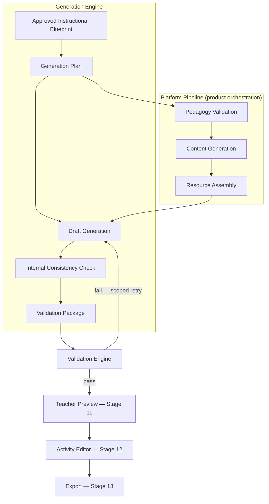
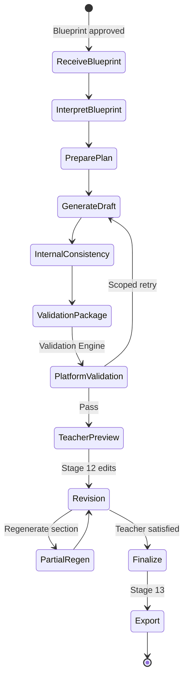
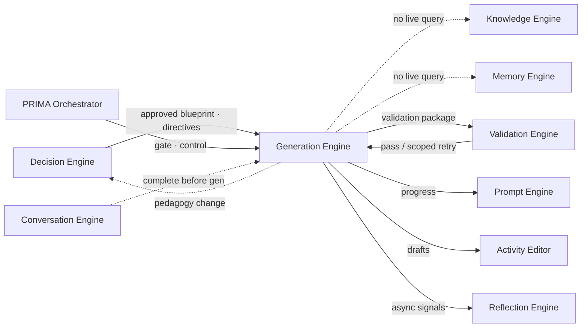
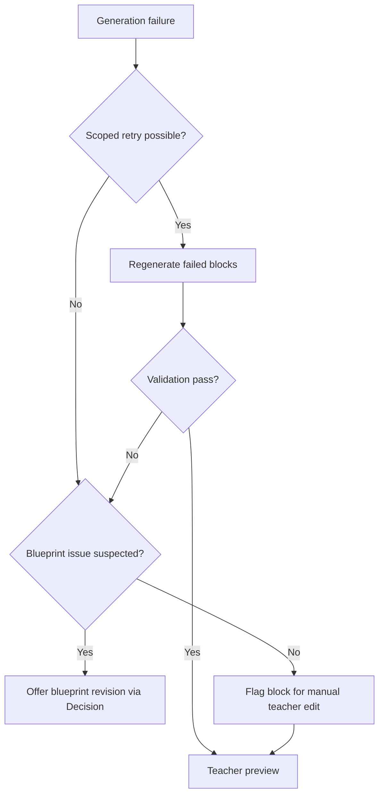

# PRIMA Generation Engine — Product Architecture Specification

---

## Purpose

This document defines the complete architectural role of the **Generation Engine** within PRIMA and LUDI ON.

The Generation Engine is the **execution layer** of PRIMA. It answers one product question:

> *How does PRIMA faithfully transform an approved Instructional Blueprint into educational resources?*

It does **not** answer how AI generates text, which models are used, or how files are rendered.

The Generation Engine **executes** instructional design. It does **not** decide it. Pedagogical reasoning belongs to the Decision Engine; universal facts belong to the Knowledge Engine; teacher context belongs to the Memory Engine — all resolved **before** blueprint approval. Generation receives a locked **Instructional Blueprint** and produces **teacher-editable drafts** that realize that design in the classroom.

### Why Generation Is Separated from Reasoning

| Separation benefit | Description |
|--------------------|-------------|
| **Trust** | Teachers approve design before content appears — no surprise pedagogy |
| **Consistency** | Every artifact traces to an approved blueprint section |
| **Auditability** | Generation failures are execution problems, not design disagreements |
| **Editability** | Drafts are structured objects teachers own — not irreversible outputs |
| **Speed without sacrifice** | Execution can iterate without reopening discovery |

This separation implements the Project Bible principle: **Blueprint Before Generation**.

### Core Rule

> **No generation without an approved Instructional Blueprint.**

PRIMA's design role ends at teacher approval. The Generation Engine begins only when the blueprint state is `approved`.

This specification describes **product architecture only**. It does not define LLM prompts, APIs, databases, code, model providers, rendering libraries, export format implementation, or token optimization.

Every future implementation of resource generation in PRIMA must conform to this document.

### Version 1.0 Generation Scope

| In scope | Out of scope |
|----------|--------------|
| Lecție end-to-end outputs (plan, presentation, worksheet, quiz) | Direct Knowledge Engine queries |
| Full and partial regeneration | Pedagogical re-design during generation |
| Blueprint-faithful draft production | Auto-publish to students |
| Teacher preview and edit (Stages 12–13) | LMS delivery |
| Romanian primary language output | Multi-language generation (future) |
| Validation package handoff | Real-time collaborative co-editing (future) |

---

## Generation Philosophy

The following principles govern all generation behaviour in LUDI ON.

### Generation executes

Generation transforms approved design into materials. It implements — it does not reinterpret teacher intent or redesign the Learning Experience.

### Generation never decides

Objectives, strategies, phase structure, and assessment approach are fixed by the approved blueprint. Generation may not alter pedagogical intent to "improve" output.

### Generation preserves pedagogical intent

Every generated section must map to a blueprint section. If execution cannot realize the blueprint faithfully, generation fails visibly — it does not silently simplify pedagogy.

### Generation is deterministic relative to the Blueprint

Given the same approved blueprint and generation directives, generation aims for consistent structural output. Creative variation operates within blueprint constraints — not outside them.

### Generation produces teacher-editable drafts

Output is structured, modifiable content — not final published materials. Teachers finalize; AI drafts.

### Generation favors consistency over creativity

Terminology, objective alignment, and phase sequencing remain stable across resources in the same activity. Visual flair never compromises instructional coherence.

### Generation is explainable

Every resource block traces to a blueprint section. Teachers and PRIMA can answer: *"This worksheet activity comes from Phase 2 of your blueprint."*

---

## Why a Dedicated Generation Engine

Raw AI text generation alone does not produce trustworthy classroom resources.

| Gap | Risk without Generation Engine |
|-----|----------------------------------|
| No blueprint gate | Content diverges from approved pedagogy |
| Undifferentiated generation | Worksheets, slides, and quizzes contradict each other |
| No validation boundary | Age-inappropriate or incomplete materials reach teachers |
| Design–execution blur | AI "fixes" pedagogy during writing |
| No regeneration scope | Full regen destroys teacher edits unnecessarily |

### Blueprint-First Architecture

```
Decision Engine  →  Instructional Blueprint (approved)
Generation Engine  →  Educational resources (draft)
Teacher  →  Final materials (owned)
```

The blueprint is the **authoritative contract**. Generation is **faithful rendering** of that contract into multiple resource types — coordinated through the platform generation pipeline (Pedagogy validation, Content, Resource, Validation) at product level.

### Separation from Decision Engine

| Decision Engine | Generation Engine |
|-----------------|-------------------|
| Reasons about pedagogy | Executes approved pedagogy |
| Composes blueprint | Consumes blueprint |
| Accepts teacher design edits | Accepts teacher content edits |
| Writes `revision_directives` | Reads `revision_directives` |
| May re-open discovery | Never re-opens discovery |

If pedagogy must change after approval, the teacher returns to **blueprint revision** (Decision Engine) — not silent generation override.

---

## Responsibilities

| Responsibility | Description |
|----------------|-------------|
| **Interpret approved blueprint** | Parse blueprint sections into generation scope |
| **Build generation plan** | Define resource types, section order, and block mapping |
| **Coordinate platform pipeline** | Hand off to Pedagogy, Content, Resource, and Validation engines (product orchestration) |
| **Generate educational content** | Produce learner-facing and teacher-facing draft materials |
| **Maintain pedagogical consistency** | Align all resources to same objectives and phases |
| **Maintain terminology consistency** | Unified vocabulary across lesson, worksheet, slides, assessment |
| **Produce editable outputs** | Structured resource objects — not frozen exports |
| **Respect encoded preferences** | Apply Memory-derived preferences **only** when encoded in blueprint or revision directives |
| **Prepare validation package** | Assemble output for Validation Engine quality gate |
| **Support full regeneration** | Regenerate entire activity from unchanged blueprint |
| **Support partial regeneration** | Regenerate single section or resource block |
| **Support multi-resource generation** | Produce coordinated resource set from one blueprint |
| **Surface progress** | Teacher-visible generation status (Stage 11) without technical jargon |
| **Hand off to editing** | Deliver drafts to Activity Editor (Stage 12) |

---

## Inputs

Every generation run consumes **only** approved design artifacts and execution directives. No live conversation, no raw Memory queries, no independent Knowledge retrieval.

| Input | Source | Role in generation |
|-------|--------|-------------------|
| **Approved Instructional Blueprint** | Decision Engine / PRIMA Orchestrator | Authoritative design contract — objectives, flow, activities, assessment, differentiation, resources |
| **Revision directives** | Decision Engine | Section-level constraints from blueprint approval (tone, emphasis, tier instructions) |
| **Vocabulary ceiling** | Encoded in blueprint from Knowledge Engine via Decision | Maximum linguistic complexity for grade |
| **Resource constraints** | Blueprint Resources section | Available materials, digital/offline requirements |
| **Language** | Platform configuration (Romanian v1) | Output language for all teacher and student materials |
| **Output type set** | Activity archetype + blueprint + teacher selections | Which resource types to generate (lesson, worksheet, presentation, etc.) |
| **Activity type** | Dashboard builder (Lecție, Joc, Fișă, etc.) | Archetype-specific generation rules |
| **Generation mode** | Teacher or system trigger | Full, partial, section, variant |
| **Teacher preferences (resolved)** | Blueprint / directives only | Export format hints, simplification flags — not live Memory reads |
| **Blueprint version ID** | Orchestrator | Traceability and regeneration lineage |

---

## Outputs

Generation produces **structured draft artifacts** consumed by the Activity Editor, Validation Engine, and export flow (Stage 13).

| Output | Description | Typical blueprint source |
|--------|-------------|--------------------------|
| **Lesson** | Complete lesson plan document — phases, timing, teacher script notes | Learning Flow + Activities + Teacher Notes |
| **Worksheet** | Printable student-facing activity sheet | Activities + Differentiation (support tier) |
| **Presentation** | Slide sequence for classroom delivery | Learning Flow + Activities (visual phases) |
| **Assessment** | Quiz, exit ticket, or rubric-aligned check | Assessment section |
| **Story** | Narrative text for story-based activities | Activities (narrative phases) |
| **Game** | Game rules, cards, board logic configuration | Activities (game phases) |
| **Mission** | Escape room / mission structure, clues, progression | Activities (mission archetype) |
| **Teacher Notes** | Implementation guidance, management tips, differentiation reminders | Teacher Notes section |
| **Student Materials** | Combined learner-facing pack (worksheet + activity instructions) | Activities + Differentiation |
| **Poster** | Visual summary or classroom display content | Objectives + key concepts |
| **Certificate** | Completion or achievement template | Optional — activity-type dependent |
| **Escape Room** | Clue chain, station instructions, solution key | Mission / Misiune archetype |
| **Generation metadata** | Status, lineage, blueprint version, block-to-section map | Internal + teacher traceability |
| **Validation package** | Assembled output for Validation Engine | All generated blocks |

Outputs are **drafts** until the teacher finalizes in Stage 12 and exports in Stage 13.

---

## Generation Architecture

Generation executes in conceptual stages from blueprint interpretation to teacher preview.

### Stage Model

```
Approved Blueprint
        ↓
Generation Plan
        ↓
Draft Generation
        ↓
Internal Consistency
        ↓
Validation Package
        ↓
Teacher Preview
        ↓
Approved Resource (post-edit)
```

### Architecture Diagram



### Platform Pipeline (Product View)

Preserved from v1 — Generation Engine coordinates; platform engines execute specialized steps:

```
Approved Blueprint
       ↓
Pedagogy Validation (final blueprint fidelity check)
       ↓
Content Generation (lesson body, activities, quiz items)
       ↓
Resource Generation (slides, worksheets, structured layouts)
       ↓
Validation Engine (quality + safety)
       ↓
Teacher Editing Environment
       ↓
Export + Library Save
```

---

## Generation Lifecycle

The complete lifecycle spans blueprint receipt through teacher-finalized resources.

### Lifecycle Phases

| Phase | Description | Conversation Blueprint |
|-------|-------------|------------------------|
| **Receive Blueprint** | Orchestrator confirms `approved` state; generation authorized | Post Stage 10 |
| **Interpret Blueprint** | Map sections to resource blocks and generation plan | Stage 11 start |
| **Prepare Generation Plan** | Define outputs, order, dependencies, terminology anchors | Stage 11 |
| **Generate Draft** | Execute platform pipeline; produce structured blocks | Stage 11 |
| **Validate** | Validation Engine quality gate; scoped retry on failure | Stage 11 |
| **Preview** | Teacher sees completed drafts with progress complete | Stage 11 end |
| **Revision** | Teacher edits or requests partial regeneration | Stage 12 |
| **Finalize** | Teacher satisfied; ready for export | Stage 12 → 13 |
| **Export** | Deliver formats; save to Library | Stage 13 |

### Lifecycle Diagram



### Pedagogy Change Escape Hatch

If generated output reveals a **design flaw** the teacher identifies, the path is:

```
Teacher requests blueprint change
        ↓
Decision Engine revision loop (not Generation override)
        ↓
Re-approval
        ↓
New generation run from updated blueprint
```

Generation never silently patches pedagogy.

---

## Generation Objects

Generation produces and manages **conceptual objects** — structured units traceable to blueprint sections.

---

### Generation Plan

**Definition:** The execution map from blueprint sections to resource outputs.

**Contains:** Output type list, section-to-block mapping, terminology anchors, generation order, dependency graph (e.g., presentation after lesson structure).

**Lifetime:** Single generation run; regenerated on partial regen scope.

**Used by:** Draft generation; progress UI; traceability.

---

### Generation Draft

**Definition:** The complete set of generated blocks before teacher finalization.

**Contains:** All resource blocks, metadata, blueprint version reference, validation status.

**Lifetime:** Until teacher finalizes or triggers full regen from same blueprint.

**Used by:** Teacher preview; Activity Editor; export.

---

### Resource Block

**Definition:** A discrete generated unit within a resource type — one worksheet section, one slide group, one quiz segment.

**Contains:** Content, blueprint section link, block ID, edit state, regen eligibility.

**Lifetime:** Persistent through edit cycle.

**Used by:** Partial regeneration; manual edit; traceability.

---

### Instruction Block

**Definition:** Teacher-facing implementation text — phase scripts, management notes, timing cues.

**Contains:** Instructional prose, differentiation implementation notes, materials list.

**Blueprint source:** Learning Flow, Teacher Notes, Activities.

---

### Assessment Block

**Definition:** Generated assessment items or rubric frames aligned to blueprint assessment section.

**Contains:** Questions, answer guidance, objective links, tier variants if specified.

**Blueprint source:** Assessment + Objectives.

---

### Visual Placeholder

**Definition:** Structured marker for visual content — diagram brief, illustration description, slide layout intent.

**Contains:** Description, placement, blueprint link — not final rendered asset at product level.

**Used by:** Presentation and poster generation; future visual composition.

---

### Teacher Note

**Definition:** Generated guidance separate from student-facing content.

**Contains:** Setup tips, common misconceptions, timing adjustments, differentiation reminders.

**Blueprint source:** Teacher Notes section.

---

### Student Activity

**Definition:** Learner-facing task content — instructions, prompts, exercise frames.

**Contains:** Age-appropriate language within vocabulary ceiling, tier variant if blueprint specifies.

**Blueprint source:** Activities + Differentiation.

---

## Resource Types

Each resource type has distinct generation rules — all subordinate to the same approved blueprint.

| Resource type | Primary purpose | Generation rules |
|---------------|-----------------|------------------|
| **Lesson** | Teacher implementation guide | Follows Learning Flow phase order exactly; includes timing; references all objectives |
| **Worksheet** | Student independent/practice work | Student-facing language only; respects vocabulary ceiling; differentiation tiers if specified |
| **Presentation** | Classroom visual delivery | One slide group per major phase; visual placeholders for concepts; minimal text density for grade |
| **Assessment** | Measure blueprint success criteria | Every item maps to ≥1 objective; cognitive level matches blueprint; no surprise content |
| **Game** | Gamified practice or review | Rules generated from game-phase blueprint; win condition aligns with objectives |
| **Story** | Narrative engagement | Narrative arc serves understanding objectives — not entertainment-only |
| **Mission** | Structured challenge / escape room | Clue progression matches phase sequence; assessment embedded at mission end |
| **Poster** | Visual summary | Key concepts from objectives only; age-appropriate visual brief |
| **Certificate** | Motivational completion artifact | Names activity; no competency claims beyond blueprint scope |
| **Escape Room** | Immersive mission subtype | Station timing from blueprint; clues trace to taught content; solution key for teacher |

### Multi-Resource Coherence Rules

| Rule | Description |
|------|-------------|
| **Shared terminology** | Same concept names across lesson, slides, worksheet |
| **Shared objective map** | Every resource references same objective set |
| **Phase alignment** | Worksheet activities match presentation phase content |
| **Assessment alignment** | Quiz items test what activities taught |
| **Differentiation parity** | Tier variants consistent across resource types |

---

## Generation Modes

| Mode | Trigger | Scope | Blueprint change |
|------|---------|-------|------------------|
| **Full Generation** | First run after approval | All output types in plan | None |
| **Partial Generation** | Validation failure recovery | Failed resource types only | None |
| **Section Regeneration** | Teacher request in editor | Single resource block or phase | None |
| **Variant Generation** | Teacher requests alternative | Alternate phrasing or layout — same pedagogy | None |
| **Localization** | Future — explicit locale | Language variant — same blueprint structure | None |
| **Accessibility Variant** | Teacher request | Simplified language, larger structure cues — within blueprint tiers | None |
| **Teacher Simplification** | Teacher assist ("Simplifică întrebarea 3") | Single block language reduction | None — vocabulary only |

All modes preserve blueprint pedagogical intent. Modes that would require objective or strategy change must route to Decision Engine.

---

## Generation Quality Model

Every generation run is evaluated against quality dimensions before teacher preview.

| Dimension | Definition | Failure consequence |
|-----------|------------|---------------------|
| **Blueprint Fidelity** | Output structurally matches approved blueprint sections | Scoped regeneration or block failure flag |
| **Pedagogical Consistency** | All resources align to same objectives and phases | Internal consistency retry |
| **Structural Completeness** | All planned outputs and blocks present | Validation block — cannot preview |
| **Language Quality** | Natural Romanian classroom language | Regenerate affected blocks |
| **Visual Organization** | Presentations and worksheets logically structured | Layout regeneration |
| **Age Appropriateness** | Within vocabulary ceiling and developmental norms | Validation failure — safety gate |
| **Differentiation Support** | Tiers present when blueprint specifies | Regenerate differentiation blocks |
| **Teacher Editability** | Structured objects — not opaque blobs | Reject output format |

### Quality Bars (Product)

Preserved and expanded from v1:

| Dimension | Requirement |
|-----------|-------------|
| Age-appropriate language | Match vocabulary ceiling encoded in blueprint |
| Objective alignment | Every activity maps to ≥1 objective |
| Differentiation | Tiered support present if blueprint specifies |
| Romanian quality | Natural classroom Romanian |
| Safety | Age-appropriate content; no harmful material |

---

## Generation Validation

Validation occurs at two product levels: **internal consistency** (Generation Engine) and **platform validation** (Validation Engine).

### Internal Consistency Checks

| Check | Description |
|-------|-------------|
| Blueprint alignment | Every block links to valid blueprint section |
| Missing sections | All blueprint phases represented in plan outputs |
| Terminology coherence | Key terms consistent across blocks |
| Cross-resource alignment | Worksheet matches presentation content |

### Platform Validation Checks

| Check | Description |
|-------|-------------|
| Vocabulary level | Within ceiling from blueprint |
| Timing references | Phase durations match blueprint |
| Assessment consistency | Items match objectives and cognitive level |
| Differentiation completeness | Tiers generated when specified |
| Formatting completeness | Required block fields populated |
| Safety | Age-appropriate; no harmful content |

### Validation Outcomes

| Outcome | Behaviour |
|---------|-----------|
| **Pass** | Proceed to teacher preview |
| **Scoped retry** | Regenerate failed blocks only — not full pipeline |
| **Block flag** | Present draft with flagged section for teacher decision |
| **Hard fail** | Cannot preview; offer blueprint review or support path |

Failed validation **never** auto-changes pedagogy to pass.

---

## Teacher Revision Model

Stage 12 editing is teacher-owned. Generation supports revision without reopening design.

### Revision Actions

| Action | Generation response | Blueprint |
|--------|---------------------|-----------|
| **Regenerate section** | Partial regen on selected block | Unchanged |
| **Edit manually** | Teacher edits structured object directly | Unchanged |
| **Keep approved sections** | Unaffected blocks preserved | Unchanged |
| **Replace activity** | Regenerate activity block from same phase definition | Unchanged unless teacher returns to blueprint |
| **Regenerate visuals only** | Visual placeholder regen — text preserved | Unchanged |
| **Partial update** | Merge regen output into existing draft | Unchanged |
| **PRIMA assist rewrite** | Variant generation on single block | Unchanged |

### Editing Contract

Preserved from v1 — all generated artifacts are:

- Structured objects, not frozen exports
- Individually regeneratable at block level
- Assistable by PRIMA ("Simplifică întrebarea 3", "Reformulează mai simplu")
- Traceable to blueprint sections

Auto-save is default during editing. Teachers are never asked "Do you want to save?" — per Conversation Blueprint Stage 12.

---

## Teacher Experience During Generation

Preserved and expanded from v1:

| Principle | Product behaviour |
|-----------|-------------------|
| **Progress visibility** | Stage 11 checklist — Plan ✓, Prezentare ✓, Fișă → — no technical jargon |
| **Partial results** | Completed resources previewable while others generate |
| **Clear failure recovery** | *"Regenerăm secțiunea X"* — scoped, not full restart |
| **No input during generation** | Unless validation requires decisive teacher choice |
| **Never blank wait** | Progress indicator always present |
| **Draft framing** | *"Resursele sunt pregătite. Poți modifica orice — nimic nu e definitiv."* |

Progress copy is delivered via **Prompt Engine** — Generation Engine supplies status; Prompt Engine speaks.

---

## Handoff from PRIMA Conversation

Conversation Blueprint Stages 11–13 map directly to this engine:

| Stage | Name | Generation Engine role |
|-------|------|------------------------|
| **11** | Generation | Execute lifecycle through teacher preview |
| **12** | Editing | Supply editable drafts; support partial regen |
| **13** | Export | Hand finalized objects to export flow (product boundary) |

Stage 10 (Teacher Review) is the **approval gate** — Generation cannot start until Stage 10 completes with blueprint approval.

---

## Relationship with Other PRIMA Engines

### Interaction Matrix

| Engine | Direction | Boundary |
|--------|-----------|----------|
| **Conversation Engine** | No direct link during generation | Discovery complete before generation |
| **Decision Engine** | Decision → Generation | Approved blueprint + revision directives only |
| **Decision Engine** | Generation → Decision | Pedagogy change requests route to blueprint revision — not generation |
| **Knowledge Engine** | Indirect only | vocabulary_ceiling encoded in blueprint — no live queries |
| **Memory Engine** | Indirect only | Preferences encoded in blueprint/directives — no live reads |
| **Reflection Engine** | Generation → Reflection | Optional post-generation satisfaction signals (async) |
| **Prompt Engine** | Generation → Prompt | Progress status, completion messages |
| **Validation Engine** | Generation ↔ Validation | Validation package in; pass/fail/retry out |
| **PRIMA Orchestrator** | ↔ Generation | Approval gate, lifecycle control, cancel/resume |

### Engine Relationship Diagram



### Boundary Summary

| Question | Owner |
|----------|-------|
| What should students learn and how? | Decision Engine (blueprint) |
| What text and materials implement the blueprint? | Generation Engine |
| What is universal curriculum truth? | Knowledge Engine (pre-decision) |
| What does this teacher prefer? | Memory Engine (pre-decision, encoded in blueprint) |
| Is output quality acceptable? | Validation Engine |
| How is progress communicated? | Prompt Engine |

---

## What the Generation Engine Never Does

| Boundary | Correct owner / behaviour |
|----------|---------------------------|
| Change objectives | Decision Engine + teacher approval |
| Invent competencies | Knowledge Engine (pre-decision) |
| Override teacher blueprint approval | Forbidden — gate enforced by Orchestrator |
| Change pedagogy during execution | Route to Decision revision |
| Edit or write Memory | Memory Engine |
| Retrieve Knowledge independently | Knowledge consumed via blueprint encoding |
| Start or continue discovery conversations | Conversation Engine |
| Evaluate student learning | Out of platform scope |
| Auto-publish to students | Teacher export decision |
| Speak directly to teacher | Prompt Engine |
| Decide trade-offs | Decision Engine |

---

## Failure Handling

| Scenario | Detection | Product behaviour |
|----------|-----------|-------------------|
| **Incomplete blueprint** | Missing required sections at approval | Block generation at Orchestrator — should not reach Generation |
| **Conflicting directives** | Revision directives contradict blueprint section | Fail with explicit conflict report; route to Decision |
| **Unsupported resource type** | Activity archetype cannot produce requested output | Offer supported alternatives; explain limitation |
| **Missing assets** | Visual or resource pattern unavailable | Generate text draft; flag visual for manual addition |
| **Generation failure** | Platform pipeline error | Scoped retry; then block-level flag; never silent skip |
| **Partial generation** | Some resources succeed, others fail | Preview completed; retry failed only |
| **Teacher interruption** | Cancel during Stage 11 | Save progress state; resume from last completed block |
| **Revision conflict** | Regen produces content inconsistent with other blocks | Internal consistency retry; offer manual edit |
| **Validation hard fail** | Safety or age-appropriateness failure | Block preview; scoped regen; escalate if persistent |

### Failure Escalation Path



### Teacher-Facing Failure Tone

Failures use collaborative language via Prompt Engine: *"Am întâmpinat o problemă la fișă — reîncerc secțiunea de exerciții."* — never blame the teacher or expose system internals.

---

## Future Evolution

The following capabilities are **future product scope** — not Version 1.0 commitments.

| Capability | Description |
|------------|-------------|
| **Collaborative generation** | Multiple teachers co-review drafts during generation |
| **Real-time co-editing** | Simultaneous edit during Stage 12 |
| **Multi-language generation** | Locale variants from same blueprint — explicit product decision |
| **Multi-modal generation** | Richer visual and audio assets beyond placeholders |
| **Adaptive resource bundles** | Auto-select output types by classroom context — encoded in blueprint |
| **Institution templates** | School-branded generation layouts — cosmetic, not pedagogical |
| **Reusable generation modules** | Teacher-saved block patterns for regen preferences |
| **AI-assisted visual composition** | Visual Placeholder → finished illustration pipeline |

All future capabilities preserve: **blueprint authority**, **teacher edit ownership**, **no pedagogy change during execution**.

---

## Architectural Principles

Permanent rules governing the Generation Engine.

| # | Principle |
|---|-----------|
| 1 | **Generation executes** — implements approved design; never re-decides |
| 2 | **Blueprint is authoritative** — no generation without approved blueprint |
| 3 | **Teacher always edits** — output is draft until teacher finalizes |
| 4 | **Generation is modular** — blocks regeneratable independently |
| 5 | **Generation is explainable** — every block traces to blueprint section |
| 6 | **Generation is deterministic relative to blueprint** — same blueprint, same structure |
| 7 | **Generation supports iteration** — partial regen without full pipeline restart |
| 8 | **Generation preserves instructional intent** — never silently alters pedagogy |
| 9 | **Knowledge and Memory are indirect** — encoded in blueprint, not queried live |
| 10 | **Validation before preview** — teacher sees quality-checked drafts |
| 11 | **Scoped failure recovery** — retry blocks, not redesign |
| 12 | **Pedagogy change requires Decision** — blueprint revision loop, not generation override |

---

## Next Recommended Document

→ [`../design/DESIGN_SYSTEM.md`](../design/DESIGN_SYSTEM.md) — Visual language for generated resources and PRIMA experiences.
