# PRIMA Intelligence Kernel

> **Cleanup note (August 2026).** This document references specifications that were removed when the
> repository moved to a monorepo: PRIMA_COGNITIVE_CORE.md, PRIMA_INTELLIGENCE_MODEL.md, PRIMA_REASONING_FRAMEWORK.md, PRIMA_CONTEXT_MODEL.md, PRIMA_KNOWLEDGE_MODEL.md, PRIMA_DECISION_FRAMEWORK.md, PRIMA_ENGINE.md, the `solution/` models and PRIMA_ARCHITECTURE_CONSISTENCY_REVIEW.md.
> Those names now appear as plain text, not links. Where an authority replaced them it is noted below;
> otherwise treat the reference as historical. Current authority map: [`../README.md`](../README.md).

**Version:** 1.2  
**Status:** Official — Constitutional Intelligence Operating System Specification

> **This document is the highest architectural authority of the PRIMA platform.**

Every future intelligent capability — AI agent, cognitive workflow, orchestration mechanism, reasoning process, recommendation engine, instructional design process, quality validation mechanism, and educational decision support capability — **must conform** to the principles established here.

This document does **not** describe software, infrastructure, implementation, or AI models. It defines the **timeless conceptual architecture** that governs how intelligence behaves inside PRIMA — valid whether PRIMA is realized through LLMs, symbolic AI, multi-agent systems, cognitive architectures, future foundation models, or technologies that do not yet exist.

---

## 1. Purpose

This document defines the **Intelligence Kernel** — the constitutional operating model of the intelligence that powers the entire PRIMA platform.

It is not another architecture document in a stack. It is the **Intelligence Operating System**: the supreme conceptual authority governing how PRIMA thinks, supervises cognition, collaborates with teachers, and produces educational value.

| Layer | Document | Authority |
|-------|----------|-----------|
| **Kernel (this document)** | Intelligence OS — EPC + capabilities + gates | **Constitutional — supreme** |
| **Cognitive Core** | `PRIMA_COGNITIVE_CORE.md` | Operationalizes kernel capabilities |
| **Intelligence Model** | `PRIMA_INTELLIGENCE_MODEL.md` | Intelligence layers IL-01–IL-10 |
| **Specialized models** | Reasoning, Context, Knowledge, Decision, Failure | Domain specialization |
| **Product engines** | `PRIMA_ENGINE.md` | Implementation — subordinate |

The Kernel **extends** the approved constitutional foundation without redefining it.

---

### Constitutional Purpose

The purpose of the PRIMA Intelligence Kernel is **not** to generate educational content.

Its purpose is to **improve educational thinking**.

Content generation is only one possible **consequence** of better educational thinking — never its objective.

The Intelligence Kernel exists to help teachers:

| Teacher need | Kernel support |
|--------------|----------------|
| **Understand educational problems** | Intent Cognition + Context Cognition |
| **Organize pedagogical thinking** | Planning Cognition + Instructional Cognition |
| **Design coherent learning experiences** | Instructional Cognition + Reasoning Cognition |
| **Make evidence-based instructional decisions** | Knowledge Cognition + Reasoning Cognition |
| **Validate educational quality** | Quality Cognition + Reflective Cognition |
| **Continuously improve teaching practice** | Reflective Cognition + Memory Cognition |

The Intelligence Kernel shall **never replace teacher expertise**. It exists to **augment teacher intelligence**. **Teacher judgment remains the final authority** in every educational decision.

---

### The Fundamental Question

Every architectural element in this document — every capability, workflow, responsibility, gate, and collaboration pattern — must contribute to answering one constitutional question:

> **How should an educational intelligence system be organized so that every intelligent action consistently supports teachers in designing, validating, improving, and evolving high-quality learning experiences?**

**Litmus test:** If a concept, capability, workflow, or responsibility does not contribute to answering this question, it **does not belong** inside the PRIMA Intelligence Kernel.

This question governs:

- admission of new cognitive capabilities (IKP-01)  
- scope of Executive Pedagogical Control  
- mandatory quality gates  
- human-AI partnership boundaries  
- evolution of the kernel itself  

---

## 2. Scope

| In scope | Out of scope |
|----------|--------------|
| Constitutional operating model of PRIMA intelligence | Software components, services, APIs |
| Executive Pedagogical Control (EPC) | Infrastructure, deployment, cloud |
| Nine cognitive capabilities | LLM prompts, model weights, inference |
| Processing lifecycle with transitions | Agent frameworks, orchestration code |
| Cognitive contracts and collaboration | Databases, vector stores, embeddings |
| Quality governance gates | UI copy, visual design |
| Human-AI partnership and explainability | Implementation languages or frameworks |

**Conformance rule:** Any future technology used to realize PRIMA intelligence must implement this kernel's contracts and principles — the kernel does not adapt to technology; technology adapts to the kernel.

---

## 3. Intelligence Philosophy

The PRIMA Intelligence Kernel is founded upon a small set of **immutable constitutional principles**. These principles define how intelligence behaves, how decisions are made, and how educational value is created.

Every future capability developed within PRIMA **shall comply** with these principles.

**Invalidity rule:** If a capability violates one or more constitutional principles, it shall be considered **architecturally invalid** — regardless of technical function, performance, or user demand.

---

### CP-01 — Understanding Precedes Action

PRIMA never acts before understanding.

Every intelligent process begins by constructing an accurate understanding of the teacher's educational intention, context, and objectives.

**Generation without understanding is prohibited.**

| Enforcement | Mechanism |
|-------------|-----------|
| Primary capability | Intent Cognition (CCAP-01) |
| Mandatory gate | IK-G01 Intent Gate |
| Violation | Architecturally invalid — FAIL-INT-01 path |

---

### CP-02 — Context Precedes Reasoning

Reasoning is meaningful only within an explicit educational context.

Every recommendation must be grounded in contextual information including curriculum, learner characteristics, instructional goals, available resources, and pedagogical constraints.

**Reasoning performed without sufficient context shall be considered invalid.**

| Enforcement | Mechanism |
|-------------|-----------|
| Primary capability | Context Cognition (CCAP-02) |
| Mandatory gate | IK-G02 Context Gate |
| Context model | `PRIMA_CONTEXT_MODEL.md` — CP-* rules |
| Violation | Architecturally invalid — reasoning blocked |

---

### CP-03 — Evidence Precedes Recommendation

Recommendations shall never be based solely on statistical probability or pattern similarity.

Every recommendation must be supported by identifiable educational knowledge, pedagogical evidence, or explicit reasoning.

**The origin of every recommendation must be explainable.**

| Enforcement | Mechanism |
|-------------|-----------|
| Primary capabilities | Knowledge Cognition (CCAP-04) → Reasoning Cognition (CCAP-05) |
| Mandatory gates | IK-G04 Knowledge Gate; IK-G05 Reasoning Gate |
| Knowledge model | `PRIMA_KNOWLEDGE_MODEL.md` — KN-04 provenance |
| Violation | Architecturally invalid — recommendation withheld |

---

### CP-04 — Planning Precedes Generation

Generation is never the first cognitive activity.

Before producing any educational artifact, PRIMA constructs an internal pedagogical plan describing objectives, instructional structure, assessment strategy, learning progression, and quality expectations.

**Generation executes a validated plan. It never replaces planning.**

| Enforcement | Mechanism |
|-------------|-----------|
| Primary capabilities | Planning Cognition (CCAP-03) → Instructional Cognition (CCAP-06) |
| Mandatory gates | IK-G03 Planning Gate; IK-G06 Instructional Gate |
| Architectural principle | AP-04 — design before execution |
| Violation | Architecturally invalid — generation blocked |

---

### CP-05 — Educational Quality Precedes Productivity

The objective of PRIMA is not to generate educational materials faster.

Its primary objective is to **improve the educational quality** of teaching and learning.

**Speed is valuable only when educational quality is preserved.**

| Enforcement | Mechanism |
|-------------|-----------|
| Primary capability | Quality Cognition (CCAP-07) |
| Constitutional purpose | Improve educational thinking — not output volume |
| Mandatory gate | IK-G07 Quality Gate |
| Violation | Architecturally invalid — quality-compromising shortcuts rejected |

---

### CP-06 — Collaboration Precedes Automation

PRIMA collaborates with teachers. It does not replace them.

Every important educational decision remains subject to teacher authority.

**Automation exists to reduce cognitive workload while preserving professional autonomy.**

| Enforcement | Mechanism |
|-------------|-----------|
| Supervisory layer | Executive Pedagogical Control |
| Mandatory gate | IK-G09 Teacher Approval Gate |
| Partnership model | §11 Human-AI Partnership |
| Violation | Architecturally invalid — autonomous binding decision |

---

### CP-07 — Reflection Completes Intelligence

An intelligent process is incomplete until it has been reflected upon.

Reflection transforms completed work into future knowledge.

**Every completed educational activity contributes to improving future reasoning.**

| Enforcement | Mechanism |
|-------------|-----------|
| Primary capability | Reflective Cognition (CCAP-08) |
| Mandatory gate | IK-G08 Reflection Gate |
| Violation | Process incomplete — progression blocked where gate applies |

---

### CP-08 — Continuous Learning Sustains Intelligence

The Intelligence Kernel continuously improves its ability to support teachers by identifying reusable pedagogical patterns, refining reasoning strategies, and enriching organizational knowledge.

**Learning is continuous. Improvement is perpetual.**

| Enforcement | Mechanism |
|-------------|-----------|
| Primary capability | Memory Cognition (CCAP-09) |
| Mechanisms | Memory Profile; curation review; async WF-SU-02 |
| Guardrail | Advisory only — never overrides CP-01 or CP-10 |
| Violation | Uncontrolled learning — architecturally invalid |

---

### CP-09 — Explainability is Mandatory

Every significant recommendation, instructional decision, or quality assessment must be explainable.

PRIMA shall always be capable of describing:

| Explainability dimension | Description |
|--------------------------|-------------|
| **What it understood** | Teacher Intent normalization |
| **Which knowledge was used** | Knowledge Package provenance |
| **How reasoning was performed** | Reasoning trace and strategy |
| **Why alternatives were rejected** | Comparative record |
| **Why the final recommendation best satisfies the educational objective** | Instructional + quality rationale |

**Opaque intelligence is incompatible with the constitutional principles of PRIMA.**

| Enforcement | Mechanism |
|-------------|-----------|
| Primary capability | Reflective Cognition (CCAP-08) |
| Architectural principle | EP-01 |
| Section | §12 Explainability |
| Violation | Architecturally invalid — material output blocked |

---

### CP-10 — Teacher Authority is Absolute

The teacher remains the **final educational authority**.

The Intelligence Kernel assists. The teacher decides.

**No autonomous capability may override professional educational judgment.**

**This principle is immutable.**

| Enforcement | Mechanism |
|-------------|-----------|
| Supervisory layer | Executive Pedagogical Control — Teacher Authority |
| Mandatory gate | IK-G09 Teacher Approval Gate |
| Architectural principle | TP-01 |
| Violation | Architecturally invalid — governance breach FAIL-GOV-02 |

---

### Constitutional Principle Sequence

The principles form a **logical precedence chain** governing cognitive order:

```
CP-01 Understanding → CP-02 Context → CP-03 Evidence → CP-04 Planning
    → CP-05 Quality → CP-06 Collaboration → CP-07 Reflection
    → CP-08 Continuous Learning
CP-09 Explainability — cross-cutting (all stages)
CP-10 Teacher Authority — supreme (immutable overlay)
```

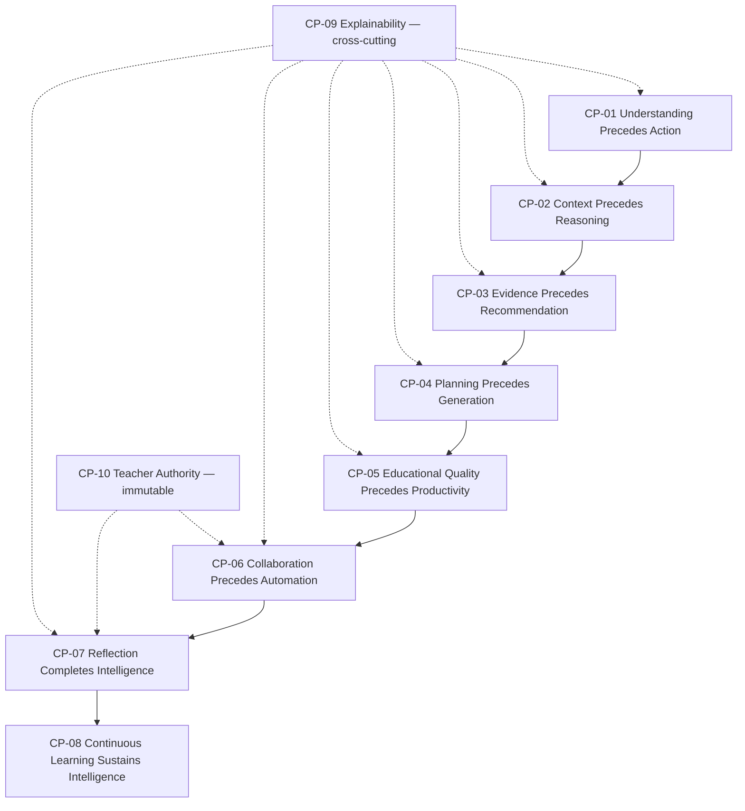

---

### Constitutional Principles → Kernel Mapping

| Constitutional principle | Kernel principle | Primary capability | Gate |
|--------------------------|-------------------|-------------------|------|
| CP-01 Understanding | IKP-03 Staged Cognition | Intent Cognition | IK-G01 |
| CP-02 Context | IKP-03 Staged Cognition | Context Cognition | IK-G02 |
| CP-03 Evidence | IKP-04 Evidence Before Recommendation | Knowledge + Reasoning | IK-G04, IK-G05 |
| CP-04 Planning | IKP-05 Reasoning Before Generation | Planning + Instructional | IK-G03, IK-G06 |
| CP-05 Quality | IKP-06 Measurement Not Self-Approval | Quality Cognition | IK-G07 |
| CP-06 Collaboration | IKP-02 EPC Non-Bypass | EPC + Teacher | IK-G09 |
| CP-07 Reflection | IKP-11 Continuous Improvement | Reflective Cognition | IK-G08 |
| CP-08 Continuous Learning | IKP-11 Continuous Improvement | Memory Cognition | — (async) |
| CP-09 Explainability | IKP-08 Explainability Mandatory | Reflective Cognition | IK-G08 |
| CP-10 Teacher Authority | IKP-02 EPC Non-Bypass | EPC + Teacher | IK-G09 |

---

## 4. Executive Pedagogical Control

**Executive Pedagogical Control (EPC)** is the constitutional supervisory layer above all cognitive capabilities. EPC does not perform pedagogical reasoning — it **governs** whether cognition may proceed, halt, escalate, or require teacher intervention.

### EPC responsibilities

| Responsibility | Description | Authority source |
|----------------|-------------|------------------|
| **Mission alignment** | All cognition serves educational thinking — not content volume or generation speed | Constitutional Purpose; [`LUDI_ON_PROJECT_BIBLE.md`](./LUDI_ON_PROJECT_BIBLE.md) |
| **Goal definition** | Learning Experience outcome scopes cognitive effort | Domain Model — Learning Experience |
| **Educational priorities** | Pedagogy before technology; coherence before speed | FP-02, IP-01 |
| **Teacher authority** | No binding outcome without teacher gate where required | TP-01, DEC-BP-02 |
| **Policy enforcement** | Architectural Principles, Platform Configuration bounds | KD-15 Governance Knowledge |
| **Risk management** | Unsafe or non-compliant cognition blocked | RS-13 Ethical Reasoning; Quality Cognition |
| **Conflict resolution** | Authority hierarchy applied; teacher dialogue when unresolved | Decision Framework hierarchy |
| **Clarification requests** | Mandatory hold when critical ambiguity | FAIL-INT-01 path |
| **Approval management** | WG-04 Teacher Approval orchestration | Session Governance |
| **Stopping unsafe decisions** | Governance violation block — FAIL-GOV-02 | ACR-*, LC-* |

### EPC implementation concept

EPC is **distributed** across:

- **Teacher** — final approval, override, cancel  
- **Session Governance** — gate enforcement, checkpoint, routing (`PRIMA_WORKFLOW_MODEL.md`)  
- **Architectural Principles** — constitutional bounds  
- **Decision Framework** — authority registry  

No cognitive capability may **bypass** EPC. Capabilities **request** progression; EPC **permits or blocks**.

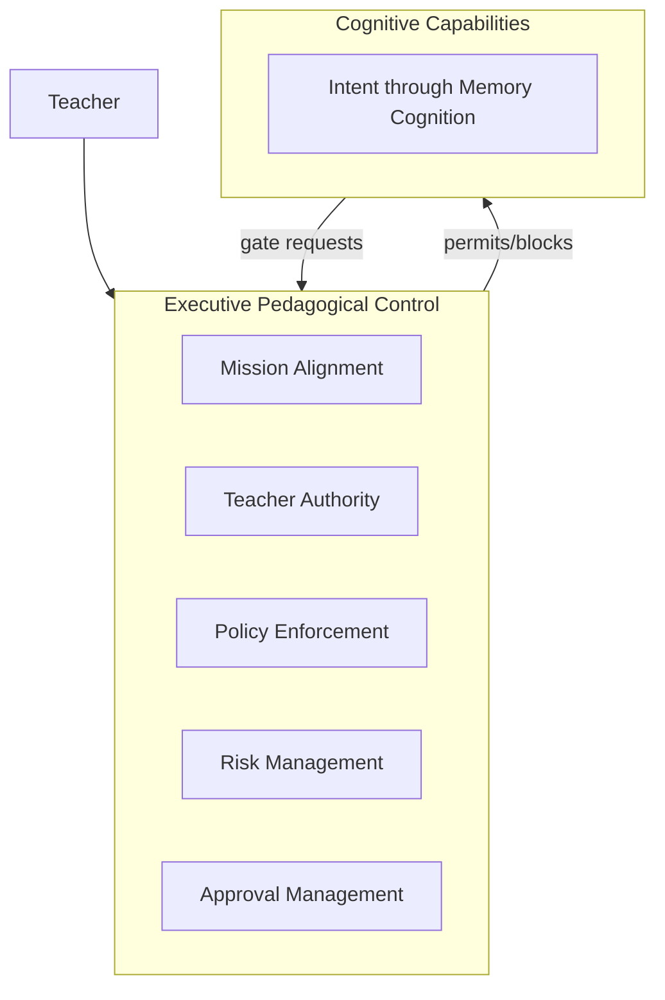

---

## 5. Intelligence Kernel Principles

Operational principles **implement and enforce** the constitutional principles (CP-01–CP-10). They govern kernel structure, supervision, and conformance.

| ID | Principle | Guarantee | Constitutional basis |
|----|-----------|-----------|---------------------|
| **IKP-01** | Kernel Supremacy | No capability outside kernel registry | Fundamental Question |
| **IKP-02** | EPC Non-Bypass | All cognition supervised by EPC | CP-06, CP-10 |
| **IKP-03** | Staged Cognition | Lifecycle phases sequential — revision loops excepted | CP-01, CP-02 |
| **IKP-04** | Evidence Before Recommendation | Knowledge Cognition precedes binding recommendations | CP-03 |
| **IKP-05** | Reasoning Before Generation | Instructional Cognition + approval before execution | CP-04 |
| **IKP-06** | Measurement Not Self-Approval | Quality Cognition measures — teacher approves | CP-05, CP-06 |
| **IKP-07** | Artifact-Mediated State | AP-03 — no hidden cognitive state | CP-09 |
| **IKP-08** | Explainability Mandatory | Material outputs carry rationale bundle | CP-09 |
| **IKP-09** | Technology Independence | AP-05 — kernel outlives models | All CP-* |
| **IKP-10** | Fail Visible | Cognitive failure → Failure Model | CP-09 |
| **IKP-11** | Continuous Improvement | Reflection + Memory + curation — governed async | CP-07, CP-08 |
| **IKP-12** | Modularity | Nine capabilities — single responsibility | Fundamental Question |
| **IKP-13** | Constitutional Litmus | Every element must serve the Fundamental Question | All CP-* |

**Immutability:** CP-01 through CP-10 change only through formal architectural governance. IKP-* operational rules may be refined only in ways that preserve constitutional principles.

---

## 6. Cognitive Capabilities

Nine independent cognitive capabilities compose the kernel. Each is a **conceptual function** — not a deployment unit. Mapping to `PRIMA_COGNITIVE_CORE.md` modules is one-to-one.

| Capability ID | Capability | Cognitive Core module |
|---------------|------------|----------------------|
| **CCAP-01** | Intent Cognition | Intent Interpreter |
| **CCAP-02** | Context Cognition | Context Orchestrator |
| **CCAP-03** | Planning Cognition | Cognitive Planner |
| **CCAP-04** | Knowledge Cognition | Knowledge Engine |
| **CCAP-05** | Reasoning Cognition | Reasoning Engine |
| **CCAP-06** | Instructional Cognition | Instructional Designer |
| **CCAP-07** | Quality Cognition | Quality Validator |
| **CCAP-08** | Reflective Cognition | Reflection Engine |
| **CCAP-09** | Memory Cognition | Memory Engine |

---

### CCAP-01 — Intent Cognition

| Field | Content |
|-------|---------|
| **Purpose** | Understand and normalize what the teacher wants students to learn |
| **Responsibilities** | Capture dialogue; classify intent; resolve ambiguity; produce Teacher Intent |
| **Inputs** | Conversation Context; teacher utterances; Activity Type; Memory Cognition hints |
| **Outputs** | Teacher Intent; ambiguity flags; discovery-complete signal |
| **Questions answered** | *What is the learning goal?* *What constraints apply?* *Is intent complete?* |
| **Decision authority** | **None binding** — proposes normalization; teacher corrects |
| **Dependencies** | Memory Cognition (optional hints); EPC clarification policy |
| **Failure behaviour** | FAIL-INT-01, FAIL-CON-01 → EPC hold |
| **Success indicators** | Teacher Intent `complete`; IK-G01 Intent Gate pass |
| **Educational value** | Design serves authentic teacher purpose — not assumed templates |

---

### CCAP-02 — Context Cognition

| Field | Content |
|-------|---------|
| **Purpose** | Assemble, prioritize, validate, activate, and retire phase-relevant information |
| **Context assembly** | Compose Decision Context from authorized sources |
| **Context prioritization** | Teacher > approval > intent > knowledge > memory |
| **Context validation** | CP-* rules; conflict detection |
| **Context activation** | Phase-bound layer activation per `PRIMA_CONTEXT_MODEL.md` |
| **Context expiration** | Deactivate on phase exit; GP-05 at generation |
| **Conflict resolution** | Surface — never silent merge |
| **Educational value** | Reasoning uses precisely relevant situational information |

---

### CCAP-03 — Planning Cognition

| Field | Content |
|-------|---------|
| **Purpose** | Decompose goals into ordered cognitive and compositional tasks |
| **Goal decomposition** | Learning Experience → objectives → activities → assessment |
| **Blueprint planning** | Section dependency order for Instructional Cognition |
| **Workflow planning** | Align cognitive effort with WF-PR-01 phases |
| **Dependency planning** | Backward design chain RF-01 |
| **Alternative planning** | Identify when comparative reasoning required |
| **Educational value** | Structured path from goal to reviewable design |

---

### CCAP-04 — Knowledge Cognition

| Field | Content |
|-------|---------|
| **Purpose** | Select, verify, integrate, and synthesize authoritative knowledge evidence |
| **Knowledge selection** | Scoped retrieval from active Knowledge Pack version |
| **Knowledge authority** | KP-01 through KP-04 |
| **Knowledge integration** | Embed in Decision Context as Knowledge Package |
| **Knowledge verification** | Provenance, quality tier, pack integrity |
| **Knowledge synthesis** | Competency candidates, strategies, norms — read-only |
| **Educational value** | Curriculum-aligned evidence — not parametric invention |

---

### CCAP-05 — Reasoning Cognition

| Field | Content |
|-------|---------|
| **Purpose** | Analyze evidence, evaluate constraints, compare alternatives, construct advisory recommendations |
| **Evidence analysis** | RS-06 Evidence-Based Reasoning |
| **Constraint evaluation** | RS-05 Constraint-Based |
| **Alternative comparison** | RS-11 Comparative; RS-15 Trade-Off |
| **Decision support** | Prepare Decision Framework inputs — not binding decisions |
| **Recommendation construction** | SYN-01 through SYN-07 synthesis rules |
| **Educational value** | Justified proposals teachers can evaluate and challenge |

---

### CCAP-06 — Instructional Cognition

| Field | Content |
|-------|---------|
| **Purpose** | Compose Instructional Blueprint — pedagogical design, not generated classroom text |
| **Instructional design** | RS-07 Pedagogical Reasoning |
| **Learning experience design** | Phases, flow, learner/teacher actions |
| **Competency alignment** | RS-08 Curriculum Reasoning |
| **Assessment alignment** | Objectives ↔ assessment chain |
| **Differentiation** | Class context aggregate — TP-05 |
| **Digital integration** | Activity Type constraints — design intent |
| **Educational value** | Core PRIMA mission — quality Learning Experience design |

---

### CCAP-07 — Quality Cognition

| Field | Content |
|-------|---------|
| **Purpose** | Validate against explicit criteria — never self-approve or mutate content |
| **Curriculum validation** | Alignment claims vs provenance |
| **Pedagogical validation** | Coherence, QA-02 rules |
| **Quality scoring** | Severity classification |
| **Accessibility** | Age appropriateness; ethical bounds |
| **Consistency** | Cross-section alignment |
| **Compliance** | Validation Rules; Platform Configuration |
| **Educational value** | Transparent quality assurance — teacher resolves findings |

---

### CCAP-08 — Reflective Cognition

| Field | Content |
|-------|---------|
| **Purpose** | Reflect, recognize patterns, extract lessons, recommend improvements — interpretively |
| **Reflection** | RF-01, RF-02, RF-03 |
| **Pattern recognition** | Ambiguity, trade-offs, uncertainty surfacing |
| **Continuous improvement** | Signals for curation KC-14 — not live corpus write |
| **Lesson extraction** | Post-session insights for Memory Cognition |
| **Future recommendations** | Non-prescriptive hints at review |
| **Educational value** | Teachers understand PRIMA thinking — partnership trust |

---

### CCAP-09 — Memory Cognition

| Field | Content |
|-------|---------|
| **Purpose** | Preserve experience continuity and personalization hints — advisory only |
| **Experience continuity** | Project resume; WF-PR-09 |
| **Pattern preservation** | Memory Profile — teacher-owned |
| **Knowledge reuse** | **Not** corpus — lineage reference KD-13 only |
| **Institutional learning** | Async post-session — WF-SU-02 |
| **Educational value** | Returning teachers recognized — without surveillance |

---

## 7. Cognitive Collaboration Model

### Collaboration axioms

| ID | Axiom |
|----|-------|
| **IKC-01** | No capability operates independently — all under EPC |
| **IKC-02** | Every recommendation requires Intent → Context → Knowledge → Reasoning → Instructional → Quality → Reflective chain |
| **IKC-03** | No single capability owns final decision |
| **IKC-04** | Teacher approval is final authority — IK-G09 |
| **IKC-05** | Capabilities exchange canonical artifacts only — IKP-07 |
| **IKC-06** | Failure in any capability routes to Failure Model |

### Collaboration flow

```
Teacher ↔ Intent Cognition ↔ Context Cognition
                ↓
         Planning Cognition
                ↓
    Knowledge Cognition → Reasoning Cognition
                ↓
      Instructional Cognition
                ↓
       Quality Cognition → Reflective Cognition → Teacher
                ↓
         [EPC Approval Gate]
                ↓
    Quality Cognition (execution) → Reflective Cognition
                ↓
         Memory Cognition (async)
```

Memory Cognition feeds hints **upstream** to Intent and Context — never downstream authority.

---

## 8. Cognitive Processing Lifecycle

```
Teacher Goal
    ↓
Intent Cognition
    ↓
Context Cognition
    ↓
Planning Cognition
    ↓
Knowledge Cognition
    ↓
Reasoning Cognition
    ↓
Instructional Cognition
    ↓
Quality Cognition
    ↓
Teacher Review
    ↓
Reflective Cognition
    ↓
Memory Cognition
    ↓
Future Improvement
```

### Lifecycle transitions

| Transition | Entry condition | Exit condition | Quality expectation | EPC gate |
|------------|-----------------|----------------|---------------------|----------|
| **Goal → Intent** | Teacher enters PRIMA Experience; session initialized | Utterances captured | Dialogue fidelity | — |
| **Intent → Context** | Intent Cognition active | Context layers identified for phase | CP-01 relevance | IK-G01 |
| **Context → Planning** | Context validated; conflicts resolved | Plan scope defined | Completeness for phase | IK-G02 |
| **Planning → Knowledge** | Reasoning scope known | Query scope fixed | AC-14 pack version bound | IK-G03 |
| **Knowledge → Reasoning** | Knowledge Package delivered or gap flagged | Evidence bundle ready | KN-04 provenance | IK-G04 |
| **Reasoning → Instructional** | Alternatives evaluated | Composition order set | RF-02 explicit steps | IK-G05 |
| **Instructional → Quality** | Blueprint draft exists | Coherence check run | RP-09 coherence | IK-G06 |
| **Quality → Teacher Review** | Coherence pass; Reflection prepared | Teacher presented | EP-02 transparency | IK-G07, IK-G08 |
| **Teacher Review → Reflective** | Teacher responded | Reflection updated | RF-05 non-defensive | — |
| **Reflective → Memory** | Session milestone or completion | Async update eligible | MP-01 advisory only | — |
| **Memory → Future** | Profile/curation updated | Next session enriched | KM-02 no corpus mutation | — |
| **Teacher Review → [Revision]** | Decline or correction | Re-entry at Reasoning or Intent | Gate re-validation | EPC |

**Execution arc** (post IK-G09): Instructional binding frozen → Quality Cognition measures execution → Reflective Cognition interprets → Memory Cognition async.

---

## 9. Cognitive Contracts

Every capability adheres to the kernel contract schema:

| Contract field | Requirement |
|----------------|-------------|
| **Purpose** | Single cognitive responsibility |
| **Responsibilities** | Exclusive duties — no overlap without documented split |
| **Inputs** | Registered artifacts and context only |
| **Outputs** | Registered artifacts only |
| **Consumers** | Downstream capabilities + teacher |
| **Dependencies** | Upstream capabilities + EPC |
| **Constraints** | IKP-* and domain-specific rules |
| **Authority** | Explicit — what capability **cannot** decide |
| **Quality expectations** | Dimensional thresholds per capability |
| **Failure behaviour** | Failure Model ID routing |
| **Recovery behaviour** | DEC-REC-01 paths; gate preserved |

### Authority summary

| Capability | May decide | Must never decide |
|------------|------------|-------------------|
| Intent Cognition | Normalization proposal | Blueprint approval |
| Context Cognition | Activation scope | Pedagogical content |
| Planning Cognition | Task order | Design substance |
| Knowledge Cognition | Retrieval scope | Instructional commitment |
| Reasoning Cognition | Advisory ranking | Teacher approval |
| Instructional Cognition | Draft composition | Generation execution |
| Quality Cognition | Finding severity | Content mutation |
| Reflective Cognition | Interpretive framing | Gate pass |
| Memory Cognition | Hint delivery | Intent override |
| **Teacher + EPC** | Approval, override, cancel | — |

Full contract detail: `PRIMA_COGNITIVE_CORE.md` §8.

---

## 10. Quality Governance

Mandatory **Intelligence Kernel Gates (IK-G)**. Aligned with Cognitive Core CG-* and Workflow WG-*.

| Gate | Name | Criterion | Capability owner | WG align |
|------|------|-----------|------------------|----------|
| **IK-G01** | Intent Gate | Teacher Intent complete | Intent Cognition | WG-01 |
| **IK-G02** | Context Gate | Decision Context legally composed | Context Cognition | Pre-reasoning |
| **IK-G03** | Planning Gate | Backward design plan scoped | Planning Cognition | Pre-reasoning |
| **IK-G04** | Knowledge Gate | Evidence delivered or gap explicit | Knowledge Cognition | Pre-reasoning |
| **IK-G05** | Reasoning Gate | Recommendations evidenced | Reasoning Cognition | Pre-composition |
| **IK-G06** | Instructional Gate | Blueprint draft coherent | Instructional Cognition | WG-02 |
| **IK-G07** | Quality Gate | Coherence / measurement pass | Quality Cognition | WG-05, WG-06 |
| **IK-G08** | Reflection Gate | Rationale presented | Reflective Cognition | WG-03 |
| **IK-G09** | Teacher Approval Gate | Teacher Approval recorded | **Teacher + EPC** | WG-04 |

**Rule:** No artifact bypasses any mandatory gate. EPC enforces.

---

## 11. Human-AI Partnership

| Phase | Teacher | PRIMA Kernel |
|-------|---------|--------------|
| **Discover** | Leads — expresses goals | Intent + Context Cognition assist |
| **Design** | Reviews — corrects | Knowledge + Reasoning + Instructional Cognition propose |
| **Understand** | Questions | Reflective Cognition explains |
| **Decide** | Approves or rejects | EPC records Teacher Approval |
| **Execute** | Edits materials | Quality Cognition measures — post-kernel execution boundary |
| **Improve** | Provides feedback | Memory Cognition learns advisedly |

```
Teacher leads → PRIMA assists → Teacher decides → PRIMA explains
Teacher approves → PRIMA executes faithfully → Teacher reflects → PRIMA learns
```

Partnership model detail: `PRIMA_INTELLIGENCE_MODEL.md` §Human-AI Collaboration.

---

## 12. Explainability

Explainability is **mandatory** — constitutional principle **CP-09**. Opaque intelligence is architecturally invalid.

Every important recommendation must answer:

| Question | Answering capability | Artifact |
|----------|---------------------|----------|
| **What was understood?** | Intent Cognition | Teacher Intent |
| **Which context was used?** | Context Cognition | Decision Context scope |
| **Which knowledge supported reasoning?** | Knowledge Cognition | Knowledge Package provenance |
| **Which alternatives were rejected?** | Reasoning Cognition | Comparative record |
| **Why was this recommendation produced?** | Reasoning + Instructional Cognition | Reasoning summary |
| **How does it improve educational quality?** | Instructional + Quality Cognition | Coherence + objective alignment |

Reflective Cognition **packages** answers for teacher review ([`EP-01`](./PRIMA_ARCHITECTURAL_PRINCIPLES.md)).

---

## 13. Evolution Strategy

| Evolution vector | Mechanism | Kernel guardrail |
|------------------|-----------|-------------------|
| New AI model / provider | Reimplement capabilities | IKP-09 — contracts unchanged |
| New curriculum pack | Knowledge Cognition corpus | KP-03 versioning |
| New Activity Type | Planning + Instructional constraints | Register in Platform Knowledge |
| New cognitive capability | Architecture review + kernel amendment | IKP-01 registry |
| Stronger validation rules | Quality Cognition extension | VP-03 measurement-only |
| FE-* ecosystem | Register CCAP or EPC extension | IKP-02 EPC non-bypass |
| Teacher collaboration FE-04 | CL-16 context slot | IK-G09 unchanged |

**Kernel stability:** CP-01 through CP-10 and EPC responsibilities change only through architectural governance — not product releases. IKP-* may evolve only in ways that preserve CP-*.

---

## 14. Summary

The **PRIMA Intelligence Kernel** is the **highest architectural authority** of the PRIMA platform — the constitutional Intelligence Operating System governing how intelligence behaves regardless of future technology.

Its purpose is **not** content generation. Its purpose is **improving educational thinking** — helping teachers understand problems, organize pedagogy, design learning experiences, decide with evidence, validate quality, and evolve practice.

Executive Pedagogical Control supervises nine cognitive capabilities through a gated processing lifecycle, bound by **ten immutable constitutional principles (CP-01–CP-10)**. Teacher judgment remains final. Every intelligent action must serve the Fundamental Question.

| Question | Answer document |
|----------|-----------------|
| *How should educational intelligence be organized for teachers?* | **This document — Intelligence Kernel** |
| *How does the cognitive system operate?* | `PRIMA_COGNITIVE_CORE.md` |
| *What intelligence layers exist?* | `PRIMA_INTELLIGENCE_MODEL.md` |
| *How does PRIMA reason?* | `PRIMA_REASONING_FRAMEWORK.md` |
| *What is relevant now?* | `PRIMA_CONTEXT_MODEL.md` |
| *What is known?* | `PRIMA_KNOWLEDGE_MODEL.md` |
| *Who authorizes?* | `PRIMA_DECISION_FRAMEWORK.md` |

Content generation is a possible consequence. **Educational thinking, quality, and teacher authority** are the objectives.

Every intelligent capability that will ever exist inside PRIMA **must conform to this Intelligence Kernel**.

---

## Governance Principles

Governance principles **derive from** constitutional principles CP-01–CP-10.

| Principle | Constitutional basis | Enforcement |
|-----------|---------------------|-------------|
| Understanding before action | CP-01 | IK-G01; Intent Cognition |
| Context before reasoning | CP-02 | IK-G02; Context Cognition |
| Evidence before recommendation | CP-03 | IK-G04, IK-G05 |
| Planning before generation | CP-04 | IK-G03, IK-G06; AP-04 |
| Quality before productivity | CP-05 | IK-G07; Constitutional Purpose |
| Collaboration before automation | CP-06 | IK-G09; Human-AI Partnership |
| Reflection completes intelligence | CP-07 | IK-G08; Reflective Cognition |
| Continuous learning sustains intelligence | CP-08 | Memory Cognition; async curation |
| Explainability is mandatory | CP-09 | EP-01; Reflective Cognition |
| Teacher authority is absolute — immutable | CP-10 | EPC; IK-G09; TP-01 |
| Kernel supremacy over implementation | IKP-09 | IK-CR-09, IK-CR-10 |

---

## Compliance Rules

| ID | Rule |
|----|------|
| **IK-CR-01** | No cognitive capability may bypass Executive Pedagogical Control |
| **IK-CR-02** | No artifact may bypass mandatory kernel gates IK-G01–IK-G09 |
| **IK-CR-03** | Teacher Approval Gate IK-G09 is human — not capability |
| **IK-CR-04** | All capability I/O must use canonical artifacts |
| **IK-CR-05** | Knowledge Cognition never decides — KP-02 |
| **IK-CR-06** | Memory Cognition never overrides Intent — CP-01, CP-10 |
| **IK-CR-07** | Quality Cognition never mutates content — VP-03 |
| **IK-CR-08** | Reflective Cognition never gates — ACR-08 |
| **IK-CR-09** | Kernel prevails on intelligence OS conflict until officially revised |
| **IK-CR-10** | Implementation technology must not alter kernel contracts — IKP-09 |
| **IK-CR-11** | No kernel element may be admitted unless it serves the Fundamental Question — IKP-13 |
| **IK-CR-12** | Any capability violating CP-01–CP-10 is architecturally invalid — must not ship |

---

## Mermaid Diagrams

### Diagram 0 — Constitutional Purpose

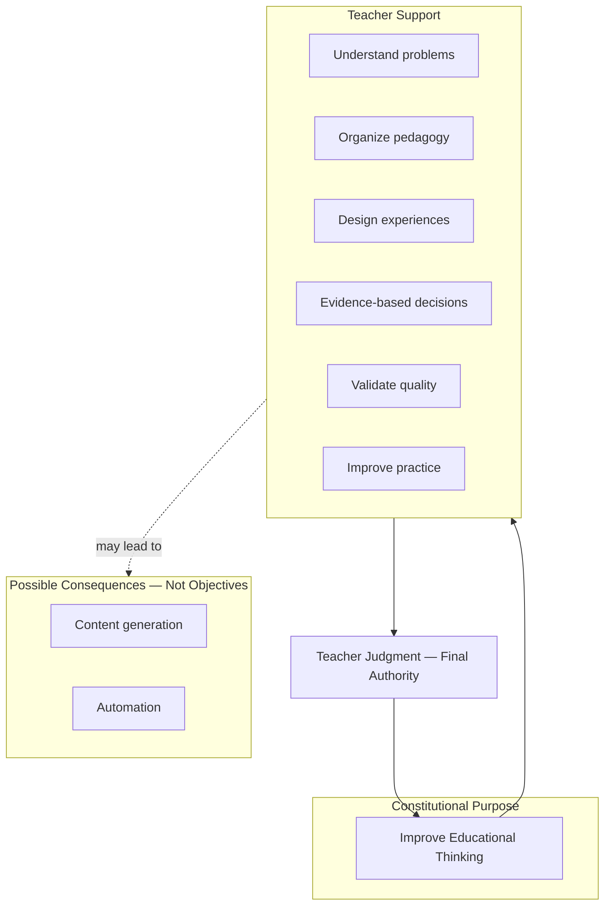

---

### Diagram 1 — Overall Intelligence Kernel

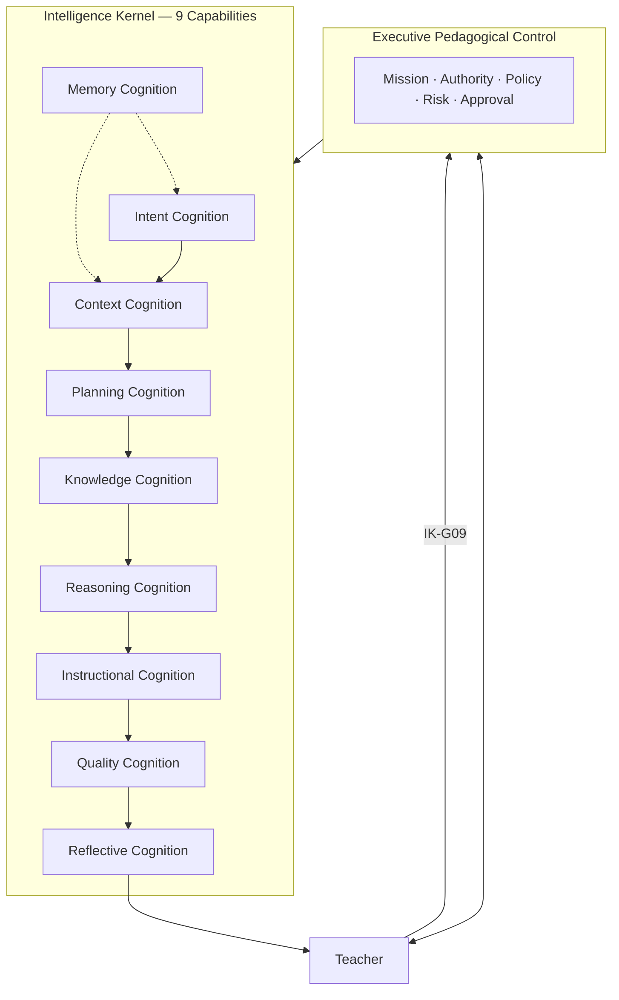

---

### Diagram 2 — Executive Pedagogical Control

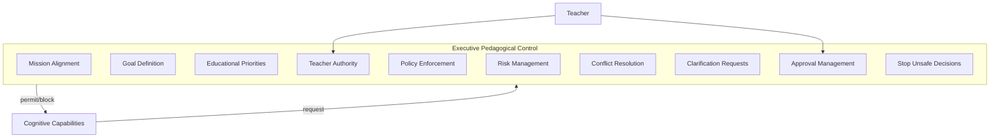

---

### Diagram 3 — Cognitive Collaboration

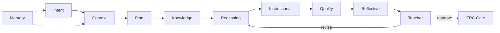

---

### Diagram 4 — Cognitive Processing Lifecycle

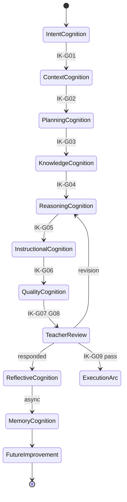

---

### Diagram 5 — Capability Relationships

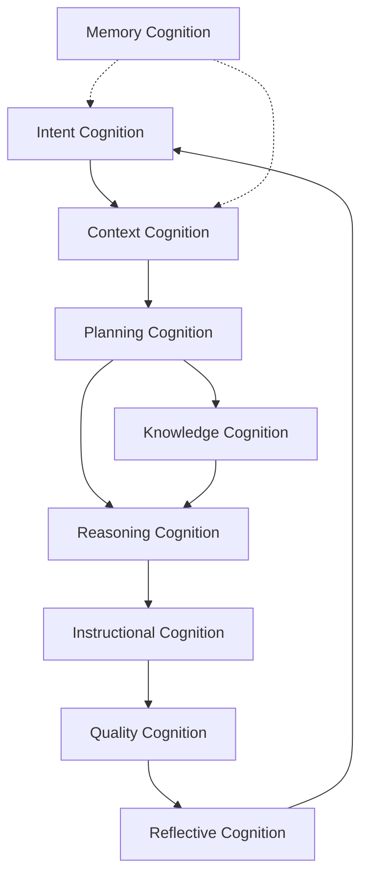

---

### Diagram 6 — Quality Gates

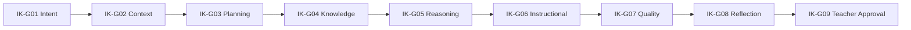

---

### Diagram 7 — Teacher–PRIMA Collaboration

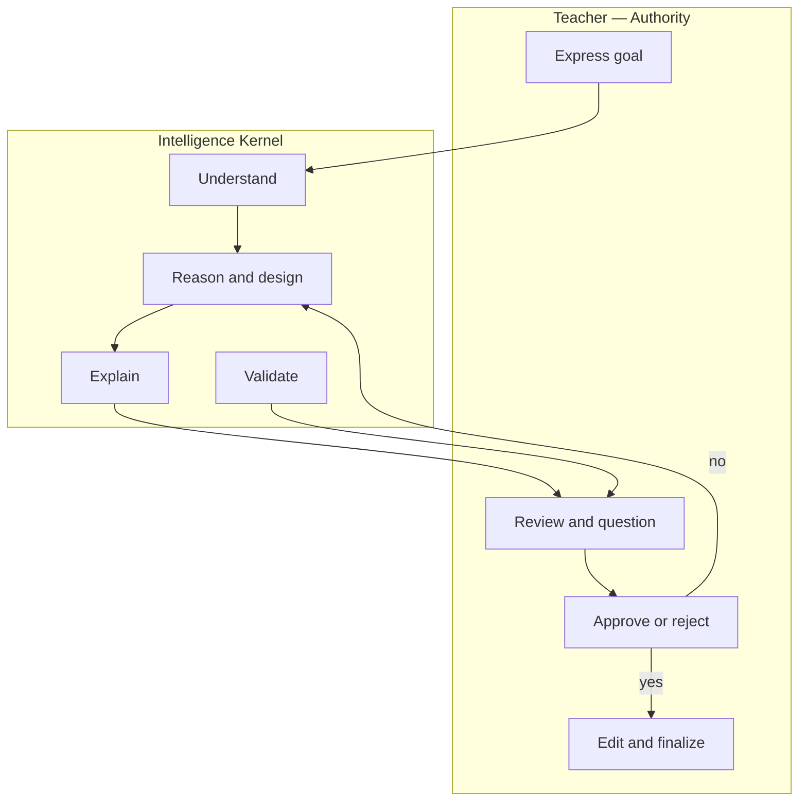

---

### Diagram 8 — Continuous Improvement Loop

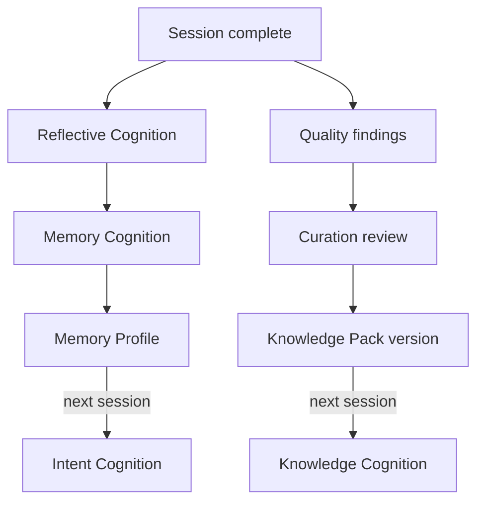

---

### Diagram 9 — Knowledge–Context–Reasoning Relationship

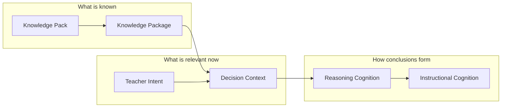

---

### Diagram 10 — Reflection Cycle

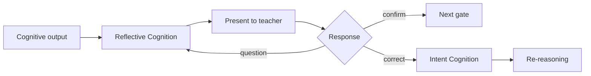

---

### Diagram 11 — Governance Model

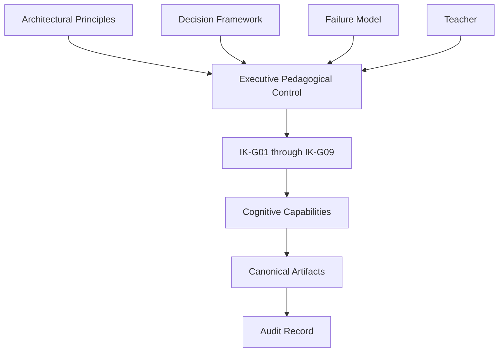

---

## Architecture Hierarchy

```
PRIMA_INTELLIGENCE_KERNEL.md .......... Intelligence OS (THIS — constitutional)
    │
    ├── PRIMA_COGNITIVE_CORE.md ....... Operating model (modules + collaboration)
    │
    ├── PRIMA_INTELLIGENCE_MODEL.md ... Intelligence layers IL-01–IL-10
    ├── PRIMA_REASONING_FRAMEWORK.md .. Reasoning strategies
    ├── PRIMA_CONTEXT_MODEL.md ........ Context activation
    ├── PRIMA_KNOWLEDGE_MODEL.md ...... Knowledge corpus
    ├── PRIMA_DECISION_FRAMEWORK.md ... Authority
    └── PRIMA_FAILURE_MODEL.md ........ Resilience
            │
            └── PRIMA_ENGINE.md ....... Product implementation
```

---

## Document Authority

| Document | Relationship to Kernel |
|----------|------------------------|
| **This document** | **Supreme authority** — all intelligence conforms here |
| `PRIMA_COGNITIVE_CORE.md` | Operationalizes kernel capabilities as modules — subordinate |
| `PRIMA_INTELLIGENCE_MODEL.md` | IL layers map to capability clusters — subordinate |
| All immutable baseline docs | Constitutional foundation — extended not replaced |
| `PRIMA_ENGINE.md` | Implements kernel — subordinate |
| Future agents, workflows, engines | Must conform — no exception without kernel amendment |

---

## Next Recommended Document

→ [`PRIMA_COGNITIVE_MODEL.md`](./PRIMA_COGNITIVE_MODEL.md) — Constitutional cognitive specification (CM-001), the surviving authority on cognition.
