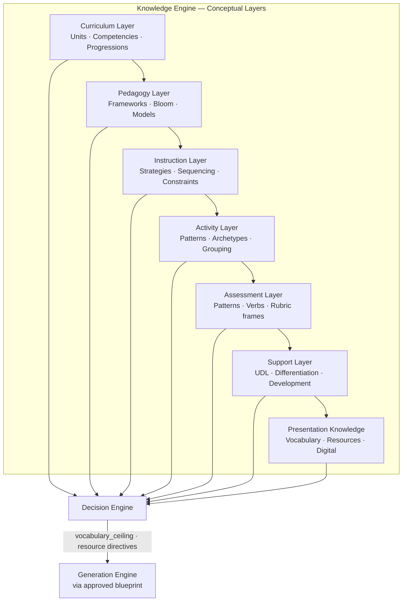
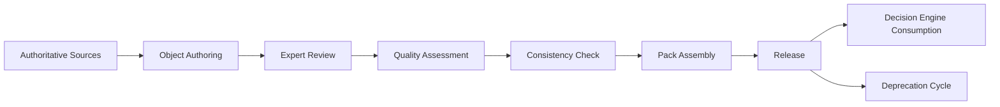
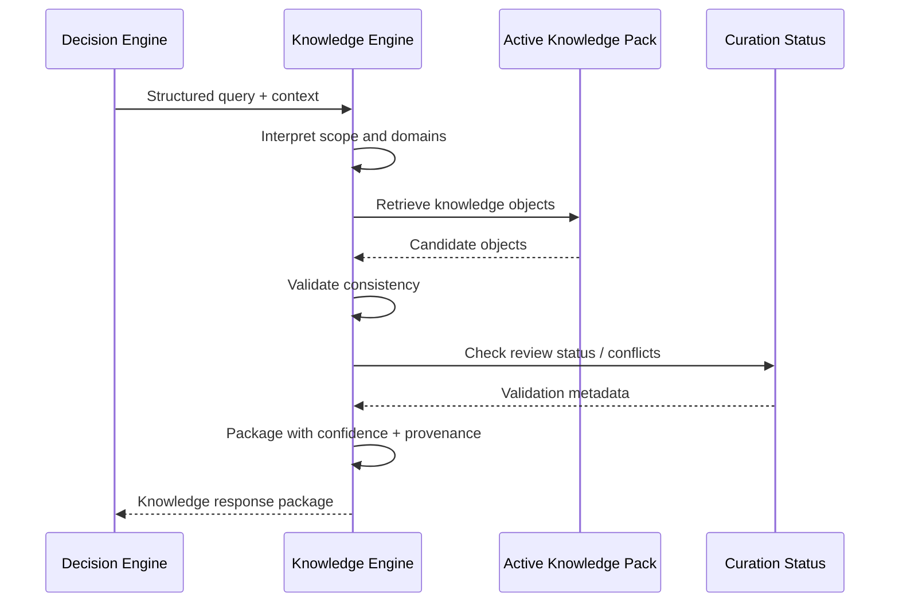
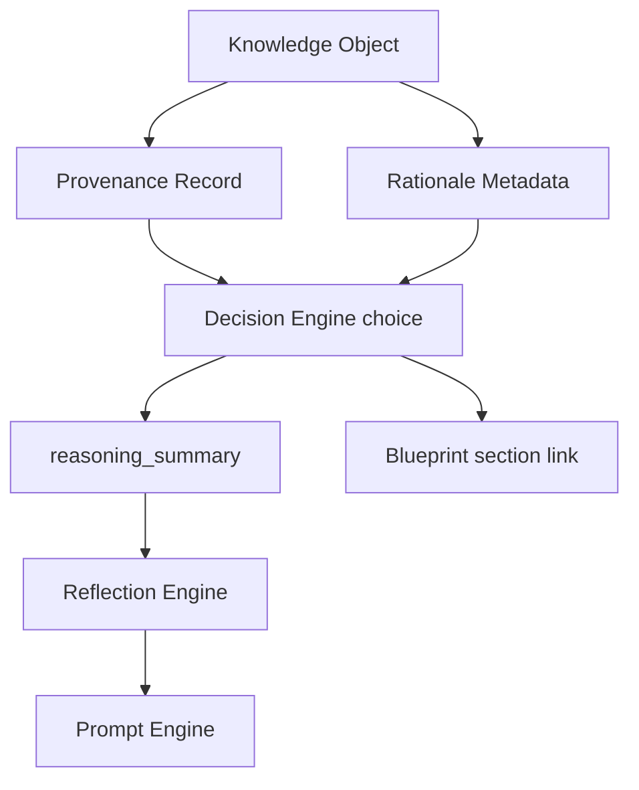
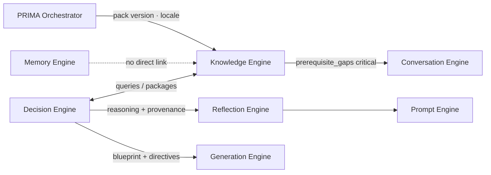
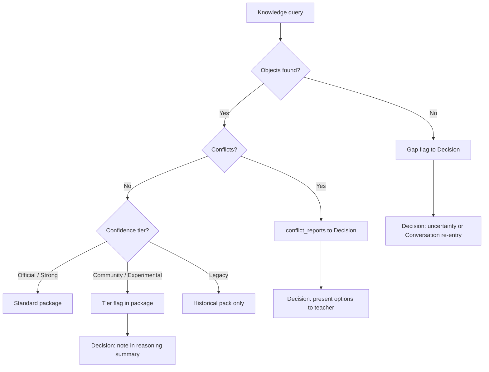

# PRIMA Knowledge Engine — Product Architecture Specification

---

## Purpose

This document defines the complete architectural role of the **Knowledge Engine** within PRIMA and LUDI ON.

The Knowledge Engine is the **authoritative pedagogical knowledge layer** that supplies validated, versioned, explainable knowledge to the Decision Engine. It answers one product question:

> *What reliable knowledge does PRIMA need in order to make good pedagogical decisions?*

It does **not** answer how knowledge is technically stored, indexed, or retrieved.

The Knowledge Engine is **not** a database, a search engine, or an AI model. It is a curated, governed body of pedagogical intelligence — curriculum facts, instructional frameworks, strategy patterns, assessment norms, and developmental rules — packaged for consumption during reasoning.

Without the Knowledge Engine, PRIMA would rely on undifferentiated parametric knowledge with no guarantee of Romanian curriculum alignment, repeatable pedagogical quality, or auditable design rationale. With it, every major Decision Engine recommendation can trace to an authoritative knowledge source.

This specification describes **product architecture only**. It does not define databases, APIs, embeddings, vector stores, LLM prompts, retrieval algorithms, or code.

Every future implementation of pedagogical knowledge in PRIMA must conform to this document.

### Version 1.0 Knowledge Scope

| In scope | Out of scope |
|----------|--------------|
| Romanian primary curriculum (cls. I–IV) | LMS course structures |
| Preschool curriculum bands | Student performance data |
| Lecție activity archetype (first) | Direct Generation queries |
| P0 curated pattern library | Unmoderated community knowledge |
| Single locale pack (Romanian) | Multi-country silent defaults |
| Manual curation pipeline | Real-time knowledge mutation per session |

---

## Knowledge Philosophy

The following principles govern how knowledge exists within LUDI ON and how it may be used.

### Knowledge is authoritative

Knowledge objects represent validated pedagogical and curricular facts — not opinions generated at runtime. When the Decision Engine queries the Knowledge Engine, it receives **candidates with provenance**, not open-ended invention.

### Knowledge is versioned

Curriculum changes, framework updates, and pattern revisions are tracked through **knowledge pack versions** tied to school year and locale. Reasoning always occurs against an identifiable knowledge version.

### Knowledge is explainable

Every knowledge object carries enough metadata for the Decision Engine to explain *where* a recommendation came from and *why* it is educationally appropriate — in teacher-friendly language via the Reflection and Prompt engines.

### Knowledge is curriculum-aware

Romanian primary and preschool curriculum structure is a first-class knowledge domain. Alignment is mandatory when grade and subject are known — not an optional overlay.

### Knowledge is evidence-based

Instructional patterns, strategies, and assessment guidance draw on established pedagogical frameworks and curated best practices — not arbitrary templates.

### Knowledge is retrieved — not invented

The Knowledge Engine **returns** knowledge. It does **not** fabricate curriculum codes, competencies, or strategies at query time. Gaps in knowledge are reported as gaps — not filled with guesses.

### Knowledge evolves independently of reasoning

Knowledge curation, review, and versioning operate on a separate lifecycle from individual PRIMA sessions. The Decision Engine consumes current knowledge packs; it does not modify them.

---

## Why a Dedicated Knowledge Engine

General AI capability alone does not guarantee:

| Gap | Risk without Knowledge Engine |
|-----|-------------------------------|
| Romanian curriculum alignment | Objectives misaligned with national expectations |
| Consistent competency references | Non-repeatable or incorrect mappings |
| Repeatable pedagogical quality | Variable design quality across sessions |
| Auditability of decisions | Unexplainable recommendations |
| Separation of facts from judgment | AI conflates retrieval with decision-making |

The Knowledge Engine provides **governed pedagogical intelligence** — structured knowledge the Decision Engine queries during Layers 1–5 reasoning. It separates **what is known** from **what is decided**.

---

## Responsibilities

| Responsibility | Description |
|----------------|-------------|
| **Maintain curriculum knowledge** | Grade bands, subjects, units, competencies for Romanian primary and preschool education |
| **Maintain pedagogical frameworks** | Backward design, UDL, formative assessment, instructional models |
| **Provide developmental knowledge** | Age-band cognitive, linguistic, and attention norms |
| **Provide instructional strategy knowledge** | Teaching methods matched to objectives, subjects, and contexts |
| **Provide assessment knowledge** | Bloom taxonomy, verb libraries, assessment pattern catalog |
| **Provide differentiation guidance** | Support tiers, UDL checkpoints, SEN adaptation patterns |
| **Provide resource patterns** | Typical materials, constraints, and activity-type resource templates |
| **Provide activity archetype knowledge** | Structural patterns for Lecție, Joc, Fișă, Evaluare, Poveste, Prezentare, Misiune |
| **Support explainability** | Provenance metadata on every returned knowledge object |
| **Support Decision Engine** | Respond to structured queries during reasoning pipeline |
| **Report knowledge gaps** | Signal missing, conflicting, or low-confidence knowledge — never invent |
| **Version knowledge packs** | School-year and locale-specific knowledge releases |

### What Responsibility Does Not Include

The Knowledge Engine **never makes pedagogical decisions**. It supplies candidates, constraints, and evidence. The Decision Engine selects, combines, and resolves trade-offs. The teacher approves.

---

## Inputs

| Input | Source | Purpose |
|-------|--------|---------|
| Structured knowledge queries | Decision Engine | Primary retrieval trigger |
| Prerequisite check requests | Decision Engine | Gap detection for Conversation Engine |
| Activity type context | PRIMA Orchestrator / builder | Archetype-scoped knowledge |
| Grade, subject, topic, school year | Session model (via Decision query) | Curriculum scoping |
| Knowledge pack version | Platform configuration | Version-locked retrieval |
| Locale | Platform configuration | Romanian-first defaults |

---

## Outputs

| Output | Primary consumer | Description |
|--------|------------------|-------------|
| `competency_mappings[]` | Decision Engine → Blueprint objectives | Curriculum-aligned competency candidates with provenance |
| `suggested_objectives[]` | Decision Engine Layer 1 | Objective patterns matched to topic and grade |
| `strategy_recommendations[]` | Decision Engine Layer 2 | Ranked strategy patterns with rationale metadata |
| `activity_patterns[]` | Decision Engine Layer 3 | Phase structures per activity archetype |
| `assessment_patterns[]` | Decision Engine Layer 5 | Assessment formats aligned to objective types |
| `differentiation_patterns[]` | Decision Engine Layer 4 | UDL and tier patterns for learner contexts |
| `developmental_norms` | Decision Engine Layers 2–4 | Age-band constraints on language, duration, complexity |
| `vocabulary_ceiling` | Decision Engine → Generation (via blueprint) | Maximum linguistic complexity for grade |
| `prerequisite_gaps[]` | Conversation Engine (if critical) | Missing foundational topics requiring teacher input |
| `resource_patterns[]` | Decision Engine Layer 3 | Typical materials per strategy and activity type |
| `knowledge_confidence` | Decision Engine | Confidence of knowledge object itself |
| `provenance_records[]` | Decision Engine explainability | Source, version, review status for each object |
| `conflict_reports[]` | Decision Engine, curation workflow | Ambiguous or conflicting curriculum interpretations |

PRIMA presents knowledge-derived content in **teacher-friendly language** by default — not bureaucratic competency codes — unless the teacher opts into formal curriculum view.

---

## Knowledge Domains

The Knowledge Engine organizes pedagogical intelligence into domains. Each domain is curated, versioned, and independently maintainable.

### Domain Index

| Domain | Primary layer | Decision Engine layers served |
|--------|---------------|-------------------------------|
| Romanian Curriculum | Curriculum | 1, 5 |
| Competencies | Curriculum | 1, 5 |
| Learning Objectives | Curriculum / Pedagogy | 1, 5 |
| Bloom Taxonomy | Pedagogy | 2, 5 |
| Instructional Models | Pedagogy | 2, 3 |
| Teaching Strategies | Instruction | 2 |
| Learning Activities | Activity | 3 |
| Assessment | Assessment | 5 |
| Differentiation | Support | 4 |
| UDL | Support | 4 |
| Developmental Psychology | Support | 2, 3, 4 |
| Primary Education Best Practices | Pedagogy / Instruction | 2, 3 |
| Digital Pedagogy | Presentation | 3, Resources |
| Resource Templates | Presentation | 3, Resources |
| Educational Constraints | Instruction / Assessment | 2–5 |
| Activity Archetypes | Cross-layer | 1–5 |

---

### Romanian Curriculum

**What it contains:** Official and curated mappings of Romanian national curriculum structure — grade bands (preșcolar, cls. I–IV), subject areas, thematic units, and expected learning progressions.

**Decision Engine use:** Layer 1 intent alignment; objective framing; scope validation.

**Example:** Grade 4 Științe ale naturii → unit on plant biology → photosynthesis within authorized scope.

---

### Competencies

**What it contains:** Competency statements and descriptors aligned to curriculum units — what students should demonstrate, not how teachers teach.

**Decision Engine use:** Blueprint objectives section; curriculum alignment validation.

**Example:** Competency candidate linking "explains basic plant processes" to Grade 4 life sciences unit.

---

### Learning Objectives

**What it contains:** **Objective patterns** — reusable templates for stating measurable outcomes using appropriate action verbs, cognitive levels, and Romanian classroom language.

**Decision Engine use:** Layer 1 success criteria formalization; Layer 5 objective–activity alignment.

**Example:** Understanding-level objective pattern for scientific processes vs recall-level pattern for terminology.

---

### Bloom Taxonomy

**What it contains:** Cognitive level definitions and Romanian verb libraries mapped to remember, understand, apply, analyze, evaluate, create.

**Decision Engine use:** Layer 2 strategy selection; Layer 5 assessment alignment; pedagogical risk flags (e.g., recall activity for understanding objective).

---

### Instructional Models

**What it contains:** Named instructional architectures — 5E, gradual release, direct instruction variants, inquiry cycles, problem-based frames — with applicability conditions.

**Decision Engine use:** Layer 3 structure design; candidate design generation.

**Example:** Guided inquiry model for science understanding objectives with sufficient time and resources.

---

### Teaching Strategies

**What it contains:** Method catalog — narrative hook, think-pair-share, gallery walk, manipulative-based discovery, Socratic questioning, visual storytelling — with context tags (subject, grade, class size, resources).

**Decision Engine use:** Layer 2 strategy selection; trade-off resolution when constraints conflict.

---

### Learning Activities

**What it contains:** **Activity patterns** — reusable activity structures (not generated content): role of activity, grouping, duration range, materials class, objective types served.

**Decision Engine use:** Layer 3 phase composition; blueprint Activities section.

---

### Assessment

**What it contains:** **Assessment patterns** — formative checks, exit tickets, rubric frames, oral assessment protocols, self-assessment prompts — mapped to objective types and cognitive levels.

**Decision Engine use:** Layer 5 validation; blueprint Assessment section.

---

### Differentiation

**What it contains:** Tier patterns (support / core / extension), UDL checkpoint mappings, SEN adaptation guidance for common primary-school needs (reading, attention, motor).

**Decision Engine use:** Layer 4 differentiation planning.

---

### UDL (Universal Design for Learning)

**What it contains:** Representation, engagement, and action/expression options structured for primary classroom application — not clinical diagnostic frameworks.

**Decision Engine use:** Layer 4; resource pattern selection for accessibility.

---

### Developmental Psychology

**What it contains:** **Development rules** — attention span ranges, abstract reasoning emergence, literacy development stages, social learning norms by age band for Romanian primary and preschool contexts.

**Decision Engine use:** Layer 3 timing; Layer 4 differentiation; vocabulary_ceiling; cognitive load validation.

---

### Primary Education Best Practices

**What it contains:** Curated classroom-tested patterns for Romanian primary education — pacing, transitions, management-compatible active learning, parent communication norms where relevant to activity design.

**Decision Engine use:** Layer 2–3 realism checks; trade-off resolution (large class + active learning).

---

### Digital Pedagogy

**What it contains:** Guidance on when and how digital resources support learning objectives — projector use, tablet activities, offline-first alternatives — without prescribing specific software.

**Decision Engine use:** Layer 3 resource patterns; constraint validation when digital resources unavailable.

---

### Resource Templates

**What it contains:** **Resource patterns** — classes of materials (visual cards, manipulatives, printable frames, slide structures) linked to strategies and activity types — not finished downloadable files.

**Decision Engine use:** Blueprint Resources section; Generation revision directives (via Decision).

---

### Educational Constraints

**What it contains:** Hard and soft limits — maximum feasible activities per lesson duration, minimum time per phase type, incompatible strategy–resource combinations, grade-inappropriate assessment formats.

**Decision Engine use:** Layer 5 validation; trade-off resolution; pedagogical flags.

---

### Activity Archetypes (Cross-Domain)

**What it contains:** Structural knowledge for each LUDI ON builder type — Lecție, Joc, Fișă, Evaluare, Poveste, Prezentare, Misiune — defining typical phases, output expectations, and design constraints.

**Decision Engine use:** All layers; scoped by Dashboard builder selection.

*This domain integrates curriculum, instruction, activity, and assessment knowledge per archetype.*

---

## Knowledge Architecture

Knowledge is organized in **conceptual layers** from foundational curriculum facts to presentation-oriented guidance. Upper layers depend on lower layers; retrieval may span multiple layers in a single query response.

### Layer Model

```
Curriculum Layer
        ↓
Pedagogy Layer
        ↓
Instruction Layer
        ↓
Activity Layer
        ↓
Assessment Layer
        ↓
Support Layer
        ↓
Presentation Knowledge
```

### Layer Definitions

| Layer | Contains | Serves |
|-------|----------|--------|
| **Curriculum** | Units, competencies, progressions, prerequisites | Objective grounding |
| **Pedagogy** | Frameworks, Bloom, instructional models, best practices | Strategy and model selection |
| **Instruction** | Teaching strategies, sequencing rules, constraints | Layer 2–3 reasoning |
| **Activity** | Activity patterns, archetype structures, grouping norms | Phase and activity design |
| **Assessment** | Assessment patterns, verb libraries, rubric frames | Assessment alignment |
| **Support** | Differentiation, UDL, developmental rules, SEN patterns | Layer 4 adaptations |
| **Presentation Knowledge** | Vocabulary ceilings, resource patterns, digital pedagogy | Resources and Generation directives |

### Knowledge Architecture Diagram



### Knowledge Packs

A **knowledge pack** is a versioned release bundling domain content for a specific **locale + school year + education level** (e.g., Romania · 2026–2027 · Primary). Decision Engine queries are always scoped to an active pack version.

---

## Knowledge Curation Lifecycle

Knowledge enters and evolves through a **curation lifecycle** separate from session-time retrieval. This describes how knowledge becomes trusted over time — not how it is technically stored.

| Phase | Description |
|-------|-------------|
| **Source identification** | Authoritative curriculum documents, frameworks, and reviewed pedagogical references selected |
| **Object authoring** | Knowledge objects created with required metadata and layer assignment |
| **Expert review** | Subject and pedagogical reviewers validate accuracy and applicability |
| **Quality assessment** | Objects scored against Knowledge Quality Model dimensions |
| **Consistency integration** | Cross-domain conflict checks within pack |
| **Pack assembly** | Objects bundled into versioned knowledge pack with manifest |
| **Release** | Pack activated for platform school year; changelog published |
| **Deprecation** | Superseded objects retired; Legacy tier retained for historical sessions |



Curation never occurs mid-session. Teacher input during PRIMA does not alter pack content — it flows to Memory Engine or Decision Engine only.

---

## Knowledge Retrieval Lifecycle

When the Decision Engine needs knowledge during reasoning, the Knowledge Engine executes a conceptual lifecycle. This describes **product behaviour** — not search algorithms.

### Lifecycle Stages

| Stage | Responsibility |
|-------|----------------|
| **1. Decision asks** | Decision Engine submits a structured query with context (grade, subject, topic, layer, activity type) |
| **2. Knowledge interprets** | Knowledge Engine maps query to domains and layers; identifies scope |
| **3. Knowledge retrieves** | Relevant knowledge objects are collected from active pack across required layers |
| **4. Knowledge validates** | Objects checked for pack version consistency, internal conflict, and quality thresholds |
| **5. Knowledge packages** | Results assembled with confidence, provenance, and conflict flags |
| **6. Knowledge returns** | Packaged response delivered to Decision Engine — never directly to teacher |

### Retrieval Lifecycle Diagram



### Query Types (Product Level)

| Query type | Typical Decision Engine trigger |
|------------|--------------------------------|
| Curriculum alignment | Layer 1 — topic + grade + subject |
| Strategy candidates | Layer 2 — objective type + learner model |
| Phase structure | Layer 3 — strategy + activity archetype |
| Assessment match | Layer 5 — objectives + cognitive level |
| Prerequisite check | Layer 1 — topic depth validation |
| Developmental limits | Layer 3 — timing and complexity |
| Differentiation patterns | Layer 4 — learner model flags |
| Vocabulary ceiling | Pre-Generation — grade + subject |

---

## Knowledge Objects

Knowledge is delivered as **conceptual objects** — structured units of validated information with metadata. These are product concepts, not database schemas.

---

### Curriculum Unit

**Definition:** A bounded segment of curriculum scope — subject, grade, thematic area, expected duration in annual plan.

**Contains:** Unit identifier, grade band, subject, topic cluster, related competencies, prerequisite units.

**Decision use:** Scope validation; prevents topic overreach or misalignment.

---

### Competency

**Definition:** A curriculum-aligned statement of expected student capability within a unit.

**Contains:** Descriptor text, grade, subject, unit link, cognitive level hint, provenance (official / curated).

**Decision use:** Objective mapping; curriculum alignment evidence in explainability chain.

---

### Objective Pattern

**Definition:** A reusable template for stating measurable learning objectives in appropriate Romanian classroom language.

**Contains:** Verb set, cognitive level, example phrasing, anti-patterns (what to avoid).

**Decision use:** Layer 1 formalization of teacher success criteria.

---

### Strategy Pattern

**Definition:** A named teaching approach with defined applicability conditions and expected outcomes.

**Contains:** Strategy name, context tags, compatible objective types, resource class requirements, duration sensitivity, evidence reference.

**Decision use:** Layer 2 candidate generation and evaluation.

---

### Activity Pattern

**Definition:** A structural template for a learning activity — not generated content.

**Contains:** Activity role, grouping, typical duration range, materials class, objective types served, management notes.

**Decision use:** Layer 3 phase and blueprint Activities composition.

---

### Assessment Pattern

**Definition:** A format for checking learning aligned to specific objective types.

**Contains:** Format type, cognitive levels served, timing, differentiation variants, misalignment warnings.

**Decision use:** Layer 5 assessment design and validation.

---

### Differentiation Pattern

**Definition:** A reusable adaptation structure for learner variance.

**Contains:** Tier definitions, UDL checkpoint links, SEN applicability, classroom feasibility notes.

**Decision use:** Layer 4 differentiation plan.

---

### Development Rule

**Definition:** An age-band constraint on instructional design parameters.

**Contains:** Grade range, parameter (attention minutes, abstraction level, text density), rule statement, source reference.

**Decision use:** Timing validation; vocabulary_ceiling; cognitive load checks.

---

### Resource Pattern

**Definition:** A class of materials linked to strategies and activity types.

**Contains:** Resource class, typical quantity, preparation burden, digital/offline flag, substitution options.

**Decision use:** Blueprint Resources; constraint validation.

---

### Provenance Record

**Definition:** Metadata tracing a knowledge object to its source and review status.

**Contains:** Source type, pack version, review date, reviewer category, confidence tier.

**Decision use:** Explainability Framework evidence chain.

---

## Knowledge Validation

Knowledge becomes **trusted** through a governed curation lifecycle — independent of any single PRIMA session.

### Validation Pipeline

| Stage | Description |
|-------|-------------|
| **Authoritative sources** | Official Romanian curriculum documents, approved frameworks, peer-reviewed pedagogical references |
| **Expert review** | Subject matter and pedagogical reviewers validate accuracy and classroom applicability |
| **Pedagogical review** | Instructional design reviewers validate framework alignment and age appropriateness |
| **Consistency check** | Cross-domain conflict detection (e.g., competency vs developmental rule) |
| **Versioning** | Pack release with changelog; school-year binding |
| **Curriculum updates** | Scheduled and ad-hoc updates when national curriculum changes |

### Trust States

| State | Meaning | Available to Decision Engine |
|-------|---------|------------------------------|
| **Authoritative** | Official or fully reviewed; highest confidence | Yes — primary use |
| **Reviewed** | Expert validated; not yet official | Yes — with provenance flag |
| **Provisional** | Pending review; limited use | Yes — Decision must flag low knowledge confidence |
| **Deprecated** | Superseded by newer pack version | No — retained for audit only |
| **Rejected** | Failed review | Never returned |

### Conflict Handling in Curation

When curriculum interpretations conflict, knowledge objects are flagged **unresolved** in the pack. The Knowledge Engine returns `conflict_reports[]` rather than selecting a winner. The Decision Engine surfaces options to the teacher via explainability — consistent with [`PRIMA_DECISION_ENGINE.md`](./PRIMA_DECISION_ENGINE.md) failure handling.

---

## Knowledge Quality Model

Every knowledge object is evaluated across quality dimensions before inclusion in an active pack.

| Dimension | Definition | Failure consequence |
|-----------|------------|---------------------|
| **Accuracy** | Factually correct relative to authoritative curriculum and frameworks | Object rejected or deprecated |
| **Completeness** | Required metadata and relationships present | Object cannot reach Authoritative state |
| **Consistency** | No unresolved conflict with other objects in same pack | Held in Provisional state |
| **Educational validity** | Pedagogically sound for stated grade and context | Pedagogical review rejection |
| **Explainability** | Provenance and rationale metadata sufficient for Decision trace | Incomplete metadata blocks Authoritative state |
| **Currency** | Reflects current school-year curriculum expectations | Scheduled update or deprecation |
| **Localization** | Romanian language quality; culturally appropriate examples | Localization review required |

### Pack Release Criteria

An active knowledge pack requires:

- All Authoritative-tier objects pass quality dimensions
- Provisional objects explicitly listed in pack manifest
- Changelog documenting additions, deprecations, and conflict resolutions
- School year and locale binding

---

## Knowledge Confidence

**Knowledge confidence** measures the trustworthiness of a knowledge object itself. This is **distinct from Decision Engine confidence**, which measures inference strength on session fields.

### Knowledge Confidence Tiers

| Tier | Definition | Examples | Decision Engine treatment |
|------|------------|----------|---------------------------|
| **Official curriculum** | Directly mapped from national curriculum documents | Published competency statements | Primary evidence; high explainability weight |
| **Strong evidence** | Expert-reviewed; multiple pedagogical sources agree | Reviewed strategy patterns, UDL mappings | Default use; cite in reasoning |
| **Community practice** | Moderated teacher-contributed patterns with usage validation | Popular activity structures from LUDI ON community | Use with provenance flag; teacher may override |
| **Experimental** | New patterns under evaluation | Pilot strategies in research catalog | Decision flags; prefer reviewed alternatives |
| **Legacy** | Superseded but retained for historical sessions | Prior-year competency phrasing | Return only when querying historical pack version |

### Interaction with Decision Confidence

| Scenario | Behaviour |
|----------|-----------|
| High decision confidence + high knowledge confidence | Blueprint section proceeds without extra confirmation |
| High decision confidence + low knowledge confidence | Decision proceeds but reasoning summary notes knowledge uncertainty |
| Low knowledge confidence on curriculum mapping | Decision Engine presents options; teacher selects |
| Missing knowledge (no object) | Gap report — never invented; may trigger Conversation re-entry |

---

## Explainability Support

The Knowledge Engine is the **evidence layer** for PRIMA explainability. Every Decision Engine recommendation that draws on knowledge must trace through the Explainability Framework defined in [`PRIMA_DECISION_ENGINE.md`](./PRIMA_DECISION_ENGINE.md).

### Evidence Chain

```
Knowledge Object
        ↓
Provenance Record (source · version · tier)
        ↓
Pedagogical rationale metadata (why appropriate for context)
        ↓
Decision Engine incorporation (which layer · which choice)
        ↓
Reflection + Prompt (teacher-friendly explanation)
        ↓
Blueprint section rationale link
```

### What Decision Engine Must Always Know

| Question | Knowledge Engine provides |
|----------|---------------------------|
| Where did this recommendation come from? | Provenance record — source type, pack version |
| Why is it appropriate? | Object rationale metadata + applicability tags |
| What evidence supports it? | Confidence tier + review status + framework reference |

### Teacher-Facing Presentation

Knowledge provenance is **never** exposed as bureaucratic codes by default. The Prompt Engine translates evidence into natural Romanian: *"Pentru clasa a IV-a, explorarea ghidată este potrivită când vrem înțelegerea proceselor"* — with competency codes available only on explicit teacher opt-in.

### Explainability Flow Diagram



---

## Interaction Model

Conceptual query–response pattern (preserved and expanded from v1):

```
Decision Engine asks:
  "What competencies align with Grade 4 · Științe · plants · photosynthesis?
   What strategies suit understanding objectives · visual preference · 50 min · pair-friendly?"

Knowledge Engine returns:
  competency_candidates[]     — with provenance and confidence tier
  suggested_objectives[]      — objective patterns
  strategy_recommendations[]  — ranked with applicability metadata
  developmental_norms         — attention and complexity limits
  prerequisite_gaps[]         — if foundational gaps detected
  provenance_records[]        — for explainability chain
  knowledge_confidence        — aggregate response confidence
```

---

## Knowledge Sources

| Source | Priority | Confidence tier | Notes |
|--------|----------|-----------------|-------|
| Manual curation — Romanian primary curriculum | P0 | Official curriculum | Foundation of v1 pack |
| LUDI ON pedagogical pattern library | P0 | Strong evidence | Internally reviewed |
| Activity type archetype structures | P1 | Strong evidence | Per builder |
| Research-backed strategy catalog | P2 | Strong evidence / Experimental | Versioned |
| Community-contributed patterns (moderated) | P2 | Community practice | Requires moderation pipeline |
| Special education extensions | P2 | Strong evidence | Future dedicated module |

---

## Guardrails

| Rule | Description |
|------|-------------|
| **Suggest, never decide** | Knowledge returns candidates; Decision Engine selects |
| **Retrieve, never invent** | Missing knowledge reported as gap |
| **Version-locked** | Queries scoped to active pack |
| **Conflict surfaced** | Unresolved curriculum conflicts returned, not hidden |
| **Teacher approves** | Knowledge informs blueprint; teacher approval gate unchanged |
| **Generation indirect** | Generation consumes blueprint — not Knowledge Engine directly |

---

## Relationship with Other PRIMA Engines

### Interaction Matrix

| Engine | Direction | Boundary |
|--------|-----------|----------|
| **Conversation Engine** | Knowledge → Conversation | Critical `prerequisite_gaps[]` only — scoped re-ask |
| **Conversation Engine** | Conversation → Knowledge | No direct queries; gaps routed via Decision |
| **Decision Engine** | ↔ Knowledge | Primary consumer; structured queries and packaged responses |
| **Memory Engine** | No direct link | Memory holds teacher preferences; Knowledge holds universal pedagogical facts |
| **Reflection Engine** | Knowledge → Reflection | Indirect — via Decision explainability only |
| **Prompt Engine** | Knowledge → Prompt | Indirect — provenance translated in teacher-facing copy |
| **Generation Engine** | Knowledge → Generation | **Indirect only** — via `vocabulary_ceiling` and resource directives in approved blueprint |
| **PRIMA Orchestrator** | → Knowledge | Pack version and locale context |

### Engine Relationship Diagram



### Boundary Summary

| Question | Owner |
|----------|-------|
| What does curriculum require? | Knowledge Engine |
| What should this lesson do? | Decision Engine |
| What does this teacher prefer? | Memory Engine |
| What did the teacher say in discovery? | Conversation Engine |
| How is it said to the teacher? | Prompt Engine |
| What content is produced? | Generation Engine |

---

## What the Knowledge Engine Never Does

| Boundary | Correct owner |
|----------|---------------|
| Generate lessons, worksheets, or slides | Generation Engine |
| Make pedagogical decisions or resolve trade-offs | Decision Engine |
| Store teacher preferences or class history | Memory Engine |
| Speak to teachers | Prompt Engine (via Reflection) |
| Edit or approve Instructional Blueprints | Decision Engine + teacher |
| Export or publish content | Platform export flow |
| Modify knowledge during a session based on teacher input | Curation workflow (async) |
| Replace teacher judgment | Teacher |

---

## Failure Handling

| Scenario | Detection | Product behaviour |
|----------|-----------|-------------------|
| **Missing knowledge** | No objects match query scope | Return empty with gap flag; Decision reports uncertainty; may trigger Conversation for critical gaps |
| **Conflicting curriculum** | Multiple authoritative mappings conflict | Return `conflict_reports[]`; Decision presents options; curation ticket raised |
| **Outdated knowledge** | Query against deprecated pack version | Orchestrator defaults to current pack; historical sessions may pin prior version |
| **Low-confidence knowledge** | Provisional or Experimental tier | Return with tier flag; Decision includes in reasoning summary |
| **Regional differences** | Future: multi-region packs | Locale-scoped pack selection; no cross-region silent defaults |
| **Future curriculum changes** | New national curriculum published | New pack version; changelog; prior pack deprecated on schedule |
| **Query out of scope** | Topic outside primary/preschool v1 coverage | Honest scope boundary; Decision flags; no invention |

### Teacher-Facing Failure Principle

Knowledge gaps are never hidden as confident answers. PRIMA acknowledges limits: *"Nu am o mapare oficială pentru acest subiul la această clasă — putem continua cu obiectivele pe care le-ai descris?"* — routed through Decision, Reflection, and Prompt engines.

### Failure Escalation Path



---

## Future Evolution

The following capabilities are **future product scope** — not Version 1.0 commitments.

| Capability | Description |
|------------|-------------|
| **Adaptive knowledge packs** | Dynamic pack composition based on teacher segment without changing authority model |
| **Country-specific curriculum modules** | Modular packs beyond Romania — locale-bound, never mixed silently |
| **Research updates pipeline** | Scheduled ingestion of peer-reviewed pedagogical research into Experimental tier |
| **School-specific guidance** | Optional school-level knowledge overlays (admin-controlled) atop national pack |
| **Plugin knowledge providers** | Governed third-party knowledge modules with review and versioning |
| **Special education modules** | Dedicated differentiation and developmental knowledge for adapted instruction |
| **Cross-grade progression maps** | Multi-year competency progression visualization for serial planning |
| **Community pattern marketplace** | Moderated community contributions elevated to Community practice tier |

Knowledge evolution remains **independent of session reasoning** in all future phases. Pack updates do not retroactively alter approved blueprints.

---

## Architectural Principles

Permanent rules governing the Knowledge Engine.

| # | Principle |
|---|-----------|
| 1 | **Knowledge is authoritative** — validated objects with provenance; not runtime invention |
| 2 | **Knowledge is versioned** — every query scoped to an identifiable pack |
| 3 | **Knowledge never decides** — returns candidates and constraints; Decision Engine selects |
| 4 | **Knowledge is reusable** — patterns shared across sessions, teachers, and activity types |
| 5 | **Knowledge is explainable** — provenance and rationale on every returned object |
| 6 | **Knowledge evolves independently** — curation lifecycle separate from PRIMA sessions |
| 7 | **Decision consumes knowledge** — primary consumer during reasoning Layers 1–5 |
| 8 | **Generation consumes decisions — not knowledge directly** — blueprint and directives only |
| 9 | **Gaps are honest** — missing knowledge reported, never fabricated |
| 10 | **Curriculum conflicts are surfaced** — not silently resolved by Knowledge Engine |
| 11 | **Romanian-first packs** — default locale and curriculum; others require explicit pack |
| 12 | **Teacher-facing language is translated** — Knowledge holds structure; Prompt holds voice |

---

## Next Recommended Document

→ [`PRIMA_MEMORY_ENGINE.md`](./PRIMA_MEMORY_ENGINE.md) — How PRIMA remembers teachers and classes across sessions, distinct from universal pedagogical knowledge.
