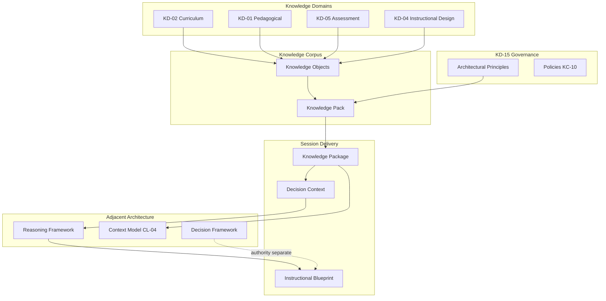
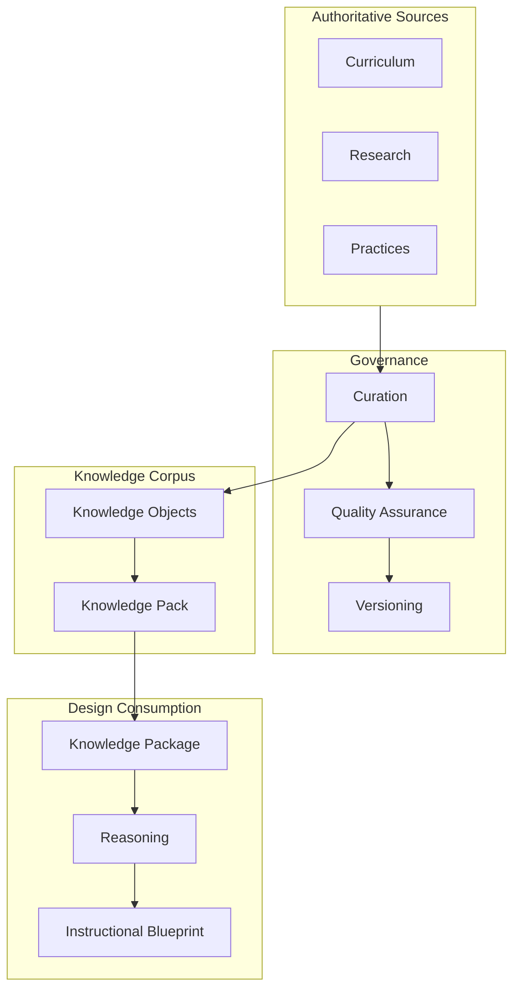
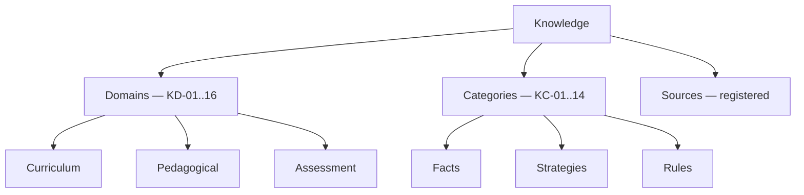
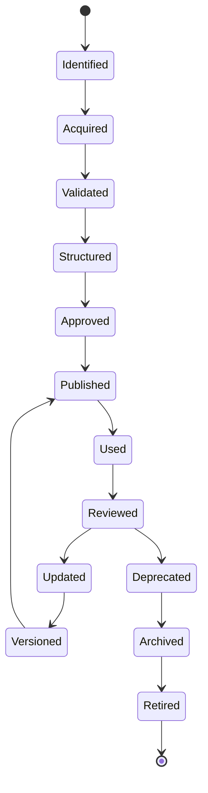
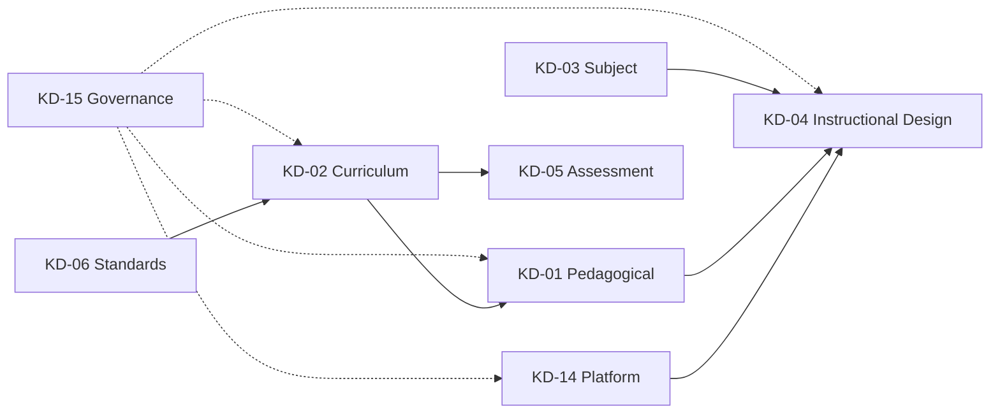
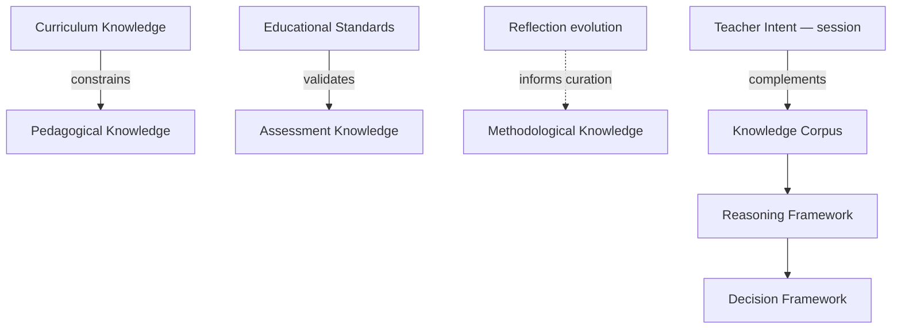
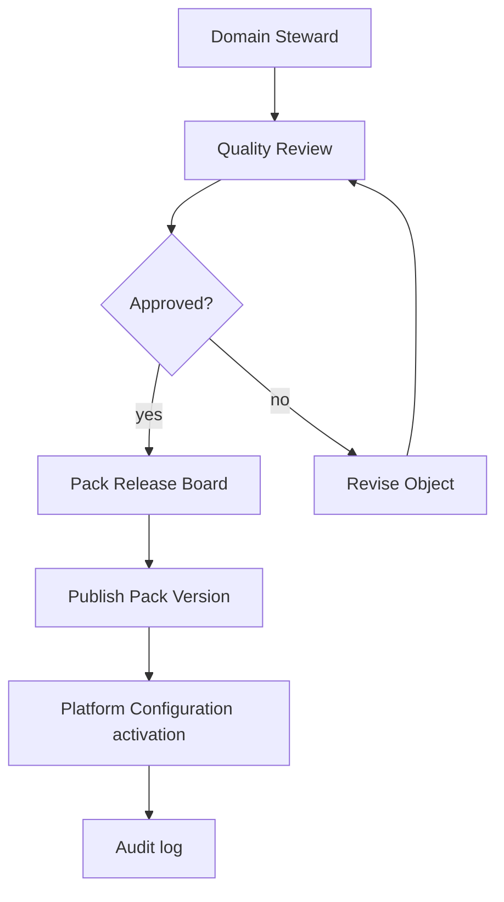
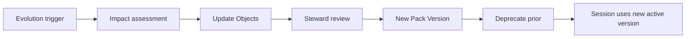
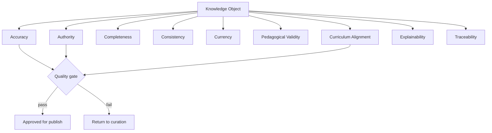
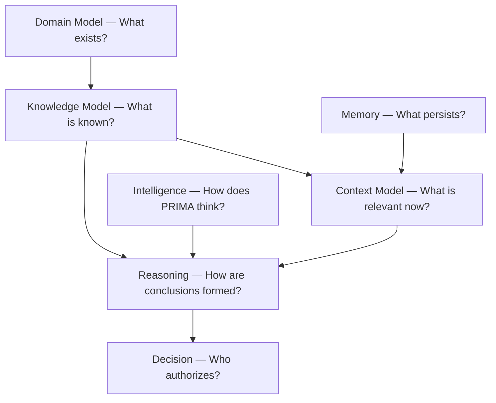

# PRIMA Knowledge Model

**Version:** 1.0  
**Status:** Official — Enterprise Knowledge Architecture Specification

> **EOS Knowledge units, domains, Pack vs Package, MVP governance gates:**  
> [`../engineering/ES-008_KNOWLEDGE_MODEL.md`](../engineering/ES-008_KNOWLEDGE_MODEL.md) is authoritative for Educational Operating System execution.  
> This document remains the broader enterprise knowledge philosophy; on EOS unit/domain identity conflicts, **ES-008 prevails** after Product confirmation.

---

## Purpose

This document defines the **official conceptual knowledge architecture** of the PRIMA platform within LUDI ON.

It answers one architectural question:

> *What does PRIMA know, and how is that knowledge conceptually organized?*

The Knowledge Model specifies **knowledge categories**, **knowledge domains**, **ownership**, **quality**, **lifecycle**, **governance**, **evolution**, and **relationships** among knowledge domains — without defining databases, vector stores, embeddings, retrieval algorithms, ontologies, RDF schemas, or implementation technology.

This document is **implementation-independent**, **technology-neutral**, and valid regardless of future AI technologies.

[`PRIMA_KNOWLEDGE_ENGINE.md`](./PRIMA_KNOWLEDGE_ENGINE.md) implements knowledge delivery at product level; it does not supersede this model.

---

## Scope

| In scope | Out of scope |
|----------|--------------|
| Conceptual knowledge taxonomy and domains | Database schemas, indexes, vector stores |
| Knowledge entities (Knowledge Object, Knowledge Pack) | Embedding models, similarity search |
| Quality model, lifecycle, governance | API contracts, query languages |
| Knowledge relationships and matrices | Prompt engineering, RAG pipelines |
| Distinction: knowledge vs memory vs context | LLM parametric knowledge as authority |
| Explainability requirements for knowledge | Curation tooling UI |

**Audience:** Knowledge architects, curriculum stewards, enterprise architects, compliance reviewers, and engineering leads ensuring PRIMA knowledge remains authoritative, versioned, and traceable.

---

## Knowledge Philosophy

**Knowledge is not Memory.**  
**Knowledge is not Context.**  
**Knowledge is not Reasoning.**

| Concept | Question | Nature |
|---------|----------|--------|
| **Knowledge** | *What is known?* | Validated, reusable, authoritative understanding |
| **Memory** | *What persists for this teacher?* | Personal, advisory — [`Memory Profile`](./PRIMA_DOMAIN_MODEL.md) |
| **Context** | *What is relevant now?* | Active subset — [`PRIMA_CONTEXT_MODEL.md`](./PRIMA_CONTEXT_MODEL.md) |
| **Reasoning** | *How are conclusions formed?* | Inference process — [`PRIMA_REASONING_FRAMEWORK.md`](./PRIMA_REASONING_FRAMEWORK.md) |

Knowledge **supports** reasoning; it does **not** decide ([`KP-02`](./PRIMA_ARCHITECTURAL_PRINCIPLES.md)). Knowledge **feeds** context activation via **Knowledge Package**; it is **not** the active bundle itself.

### Core commitments

| Commitment | Architectural meaning |
|------------|------------------------|
| **Validated** | Knowledge enters corpus through governed curation — not session inference |
| **Reusable** | Knowledge Objects compose into packs for many sessions |
| **Authoritative** | KP-01 — corpus knowledge outranks parametric model recall for curriculum |
| **Versioned** | KP-03 — identifiable release per locale, year, level |
| **Retrieved not invented** | KP-04 — gaps reported, not fabricated |
| **Governed** | Every element has identifiable authority and stewardship |
| **Explainable** | Provenance enables "where did this come from?" |
| **Evolves independently** | Curation lifecycle separate from PRIMA sessions |

---

## Foundational Principles

| ID | Principle | Source | Knowledge obligation |
|----|-----------|--------|---------------------|
| **KP-01** | Knowledge Is Authoritative | Architectural Principles | Corpus facts govern curriculum claims |
| **KP-02** | Knowledge Never Decides | Architectural Principles | Evidence only — Decision/Teacher decide |
| **KP-03** | Versioned Knowledge Packs | Architectural Principles | All consumption bound to pack version |
| **KP-04** Retrieved Not Invented | Architectural Principles | No runtime fabrication of competencies |
| **KM-01** | Universal Not Personal | Domain Model | Knowledge Pack never contains teacher-specific data |
| **KM-02** | Session Cannot Mutate Corpus | AC-04 | Sessions consume — never alter pack content |
| **KM-03** | Indirect Generation Path | GP-05 | Knowledge reaches classroom via approved Blueprint only |
| **KM-04** | Provenance Mandatory | EP-04; KN-04 Reasoning | Every curriculum citation traceable |
| **KM-05** | Deprecation Enforced | Pack lifecycle | Deprecated knowledge excluded from new designs |
| **KM-06** | Technology Independence | AP-05 | Model valid across storage and AI generations |

---

## Knowledge Definition

**Knowledge** in PRIMA is **governed pedagogical and curricular understanding** packaged for consumption during instructional design reasoning — expressed as **Knowledge Objects** composed into **Knowledge Packs**, delivered session-scoped as **Knowledge Package** artifacts.

### Structural units

| Unit | Layer | Role |
|------|-------|------|
| **Knowledge Object** | Corpus atom | Single validated knowledge element with provenance, quality tier, review status |
| **Knowledge Pack** | Corpus release | Versioned bundle for locale, school year, education level |
| **Knowledge Package** | Exchange artifact | Read-only evidence slice for one reasoning query — not corpus |
| **Validation Rule** | Platform knowledge | Named checkable criterion — Validation Domain supporting entity |
| **Architectural Principle** | Governance knowledge | Constitutional rules — reference registry |

**Distinction:** Domain Model defines **what entities exist**. Knowledge Model defines **how knowledge is organized, qualified, and governed** within those entities.

---

## Knowledge Taxonomy

Three orthogonal classification axes:

| Axis | Purpose | Examples |
|------|---------|----------|
| **Domain** | Subject matter area of knowledge | Curriculum, Pedagogical, Assessment |
| **Category** | Epistemic type of knowledge | Fact, Strategy, Rule, Pattern |
| **Source** | Origin and authority of knowledge | Romanian Curriculum, Curation board, Research |

Every Knowledge Object carries **domain**, **category**, and **source** metadata conceptually — enabling retrieval scope, quality review, and explainability.

---

## Knowledge Domains

Sixteen conceptual knowledge domains organize corpus content. These are **subject-matter partitions** within the DDD **Knowledge Domain** boundary (which owns Knowledge Pack and Knowledge Object entities).

---

### KD-01 — Pedagogical Knowledge

| Field | Content |
|-------|---------|
| **Purpose** | Instructional strategies, learning flow patterns, differentiation approaches |
| **Business Value** | High-quality Learning Experience design grounded in pedagogy |
| **Authority** | Knowledge curation governance; pedagogical review board |
| **Consumers** | Instructional Design reasoning (ID-03); Decision Context |
| **Dependencies** | KD-02 Curriculum; KD-07 Learning Science |
| **Constraints** | Must align with FP-02 Pedagogy Before Technology |
| **Relationships** | Constrained by KD-02; informs KD-04 Instructional Design |

---

### KD-02 — Curriculum Knowledge

| Field | Content |
|-------|---------|
| **Purpose** | National curriculum structure, competencies, subject progressions — Romania primary/preschool |
| **Business Value** | FP-04 Romanian Classroom First; institutional credibility |
| **Authority** | Official curriculum mapping + curation validation |
| **Consumers** | RS-08 Curriculum Reasoning; Blueprint Curriculum section |
| **Dependencies** | KD-11 Educational Standards |
| **Constraints** | KP-04 — retrieved from corpus; version-bound |
| **Relationships** | **Constrains** KD-01 Pedagogical; validates KD-05 Assessment |

---

### KD-03 — Subject Knowledge

| Field | Content |
|-------|---------|
| **Purpose** | Discipline-specific concepts, misconceptions, subject pedagogy |
| **Business Value** | Subject-accurate activities and objectives |
| **Authority** | Subject matter curators |
| **Consumers** | Reasoning Context; objective and activity design |
| **Dependencies** | KD-02 for grade-subject scope |
| **Constraints** | Scoped to pack inclusion matrix |
| **Relationships** | Composes into KD-04 design patterns |

---

### KD-04 — Instructional Design Knowledge

| Field | Content |
|-------|---------|
| **Purpose** | Blueprint structures, backward-design patterns, Activity archetypes (Lecție, Joc, Fișă) |
| **Business Value** | Consistent Instructional Blueprint quality |
| **Authority** | Product architecture + instructional design curation |
| **Consumers** | ID-04 Blueprint Composition; Activity Type rules |
| **Dependencies** | KD-01, KD-02, KD-05 |
| **Constraints** | Distinct from generated materials — design patterns only |
| **Relationships** | **Consumed by** reasoning; output is Blueprint not knowledge |

---

### KD-05 — Assessment Knowledge

| Field | Content |
|-------|---------|
| **Purpose** | Assessment types, rubric patterns, formative/summative guidance |
| **Business Value** | Coherent evaluation design in Blueprint |
| **Authority** | Assessment curation; validated by KD-11 standards |
| **Consumers** | Blueprint Assessment section; QA-02 quality rules |
| **Dependencies** | KD-02 curriculum competencies |
| **Constraints** | Assessment design ≠ generated quiz resource (Domain Model) |
| **Relationships** | Validated by KD-11 Educational Standards |

---

### KD-06 — Educational Standards

| Field | Content |
|-------|---------|
| **Purpose** | National standards, developmental norms, competency frameworks |
| **Business Value** | Compliance and alignment traceability |
| **Authority** | Official standards bodies + curation mapping |
| **Consumers** | Curriculum alignment; validation criteria |
| **Dependencies** | None — reference layer for KD-02 |
| **Constraints** | Must not contradict official published standards |
| **Relationships** | Validates KD-05, KD-02 |

---

### KD-07 — Learning Science Knowledge

| Field | Content |
|-------|---------|
| **Purpose** | Evidence-informed learning principles — cognitive load, scaffolding, retention |
| **Business Value** | Scientifically grounded design recommendations |
| **Authority** | Research-reviewed curation |
| **Consumers** | Pedagogical reasoning; strategy selection |
| **Dependencies** | KD-01 |
| **Constraints** | Presented as evidence — not medical/clinical claims |
| **Relationships** | Informs KD-01 Pedagogical |

---

### KD-08 — Methodological Knowledge

| Field | Content |
|-------|---------|
| **Purpose** | Teaching methods — cooperative learning, project-based, inquiry, etc. |
| **Business Value** | Method selection justified in design rationale |
| **Authority** | Pedagogical curation |
| **Consumers** | RS-04 Analogical Reasoning; strategy candidates |
| **Dependencies** | KD-01, KD-07 |
| **Constraints** | Enriched by reflection signals — not replaced by them |
| **Relationships** | Reflection outcomes may inform future curation (evolution) |

---

### KD-09 — Digital Tool Knowledge

| Field | Content |
|-------|---------|
| **Purpose** | Platform Activity Types, generation archetypes, editor capabilities |
| **Business Value** | Designs feasible within LUDI ON product |
| **Authority** | Product team + Platform Configuration |
| **Consumers** | Activity Type scoping; constraint-based reasoning |
| **Dependencies** | KD-14 Platform Knowledge |
| **Constraints** | Product-bound — not generic EdTech catalog |
| **Relationships** | Constrains KD-04 Instructional Design |

---

### KD-10 — Classroom Management Knowledge

| Field | Content |
|-------|---------|
| **Purpose** | Grouping, timing, transitions, classroom feasibility patterns |
| **Business Value** | Realistic Activity design for Romanian classrooms |
| **Authority** | Practitioner-validated curation |
| **Consumers** | Activity phase design; constraint reasoning |
| **Dependencies** | KD-01 |
| **Constraints** | Aggregate class patterns only — TP-05 |
| **Relationships** | Complements KD-08 Methodological |

---

### KD-11 — Educational Research Knowledge

| Field | Content |
|-------|---------|
| **Purpose** | Curated research summaries supporting strategy selection |
| **Business Value** | Evidence-based credibility beyond opinion |
| **Authority** | Research review governance |
| **Consumers** | RF-02 explainability; strategy justification |
| **Dependencies** | KD-07 |
| **Constraints** | Summaries — not primary research papers in session |
| **Relationships** | Supports KD-01, KD-08 |

---

### KD-12 — Institutional Knowledge

| Field | Content |
|-------|---------|
| **Purpose** | School policies, institutional constraints — future FE-05 scope |
| **Business Value** | Future school adoption |
| **Authority** | Institution — future adjacency |
| **Consumers** | Platform Configuration overlays — future |
| **Dependencies** | KD-15 Governance Knowledge |
| **Constraints** | v1.0: minimal — Platform Configuration only |
| **Relationships** | Adjacent to KD-14 Platform — not session corpus v1.0 |

---

### KD-13 — Project Knowledge (Lineage)

| Field | Content |
|-------|---------|
| **Purpose** | Approved design lineage from Library — reuse references, not live corpus |
| **Business Value** | Design iteration and reuse with traceability |
| **Authority** | Teacher-owned artifacts; System Governance lineage |
| **Consumers** | WF-PR-09 resume; ID-07 evolution — as **reference**, not pack content |
| **Dependencies** | Version Manifest, Export Package |
| **Constraints** | Approved Blueprint is artifact authority — not mutable knowledge corpus |
| **Relationships** | Distinct from Knowledge Pack — lineage not curation |

---

### KD-14 — Platform Knowledge

| Field | Content |
|-------|---------|
| **Purpose** | Platform Configuration, Activity Types, severity policies, feature gates |
| **Business Value** | Consistent product behaviour |
| **Authority** | System Governance Domain |
| **Consumers** | All domains — policy bounds |
| **Dependencies** | KD-15 Governance Knowledge |
| **Constraints** | Cannot override Architectural Principles (AC-18) |
| **Relationships** | Constrains all knowledge consumption |

---

### KD-15 — Governance Knowledge

| Field | Content |
|-------|---------|
| **Purpose** | Architectural Principles, validation governance, curation policies, compliance rules |
| **Business Value** | Architectural stability and auditability |
| **Authority** | LUDI ON Product Team; architecture review board |
| **Consumers** | All specifications; gate enforcement |
| **Dependencies** | None — constitutional layer |
| **Constraints** | Immutable without governance process |
| **Relationships** | **Governs** all other knowledge domains |

---

### KD-16 — Future Knowledge Domains

| Field | Content |
|-------|---------|
| **Purpose** | Registered slots — special education expansions, FE-07 adaptive, marketplace shared patterns |
| **Business Value** | Extensibility without architecture rewrite |
| **Authority** | Future registration required |
| **Consumers** | Future capabilities |
| **Dependencies** | Must comply with KP-01 through KP-04 |
| **Constraints** | Register before corpus inclusion |
| **Relationships** | Extend KD-02, KD-01 as approved |

---

## Knowledge Categories

Fourteen epistemic categories classify Knowledge Objects.

| Cat ID | Category | Purpose | Typical usage | Reliability | Governance | Evolution rules |
|--------|----------|---------|---------------|-------------|------------|-----------------|
| **KC-01** | Facts | Verifiable curriculum and pedagogical statements | Competency codes, grade mappings | High when sourced officially | Source verification | Update on official curriculum change |
| **KC-02** | Concepts | Defined educational constructs | "Scaffolding", "formative assessment" | Medium-high | Terminology review | Version with framework updates |
| **KC-03** | Principles | Enduring pedagogical truths | Backward design, alignment | High | Pedagogical board | Rare change — governance review |
| **KC-04** | Procedures | Stepwise curation or design procedures | Pack authoring workflow | High | Operations governance | Update on process change |
| **KC-05** | Strategies | Instructional approach options | Differentiation strategies | Medium-high | Practitioner + research review | Add/revise on validation |
| **KC-06** | Best Practices | Curated effective patterns | Lecție phase sequencing | Medium-high | Curation board | Review cycle mandatory |
| **KC-07** | Patterns | Reusable design templates | Activity structure patterns | Medium-high | Product + ID curation | Version with Activity Type |
| **KC-08** | Templates | Structural scaffolds for Blueprint sections | Objective wording patterns | Medium | ID curation | Revise with Blueprint spec |
| **KC-09** | Rules | Checkable criteria | Validation Rules; alignment rules | High | Validation governance | Version with pack |
| **KC-10** | Policies | Platform and curation policies | Severity thresholds | High | System Governance | Change control process |
| **KC-11** | Recommendations | Non-binding guidance | Strategy suggestions in packs | Medium | Curation — advisory label | Faster evolution cycle |
| **KC-12** | Validated Examples | Exemplar designs (de-identified) | Reference implementations | Medium | Example review | Add on validation; deprecate on drift |
| **KC-13** | Anti-patterns | Known poor practices to avoid | "Objective-less activity list" | High | Curation + QA findings | Add from validation learnings |
| **KC-14** | Lessons Learned | Curation and platform insights | Post-release pack improvements | Medium | Stewardship retrospective | Feed pack revision — not live session |

---

## Knowledge Relationships

| Relationship | Description | Business value |
|--------------|-------------|----------------|
| Curriculum → Pedagogical | KD-02 constrains strategy viability | Alignment over aesthetic choice |
| Standards → Assessment | KD-06 validates KD-05 design | Defensible evaluation approach |
| Learning Science → Pedagogical | KD-07 informs KD-01 | Evidence-based methods |
| Subject → Instructional Design | KD-03 scopes KD-04 content | Discipline accuracy |
| Platform → Instructional Design | KD-09 constrains feasibility | Buildable designs |
| Governance → All domains | KD-15 governs curation and use | Integrity |
| Instructional Design reasoning | Consumes multiple domains via Knowledge Package | Integrated design evidence |
| Reflection → Methodological (evolution) | RF insights inform future KC-14 | Continuous corpus improvement — not live mutation |
| Teacher expertise (session) | Complements corpus via Teacher Intent — **not** corpus | Teacher authority preserved |
| Validation → Anti-patterns | QA findings may spawn KC-13 | Quality flywheel |
| Reasoning Framework | RS-06 consumes Knowledge Package | Evidence-based conclusions |
| Context Model | CL-04 activates corpus slice | Relevance without full corpus load |
| Decision Framework | Knowledge informs DEC-CUR-01 — never DEC-BP-02 | Evidence vs authority |

---

## Knowledge Sources

| Source | Authority | Trust level | Maintenance | Update frequency | Business importance |
|--------|-----------|-------------|-------------|------------------|---------------------|
| **Romanian Curriculum** | Official MECE / national frameworks | Critical | Curriculum mapping team | Annual / on reform | Critical |
| **Educational Standards** | Standards bodies + curation | Critical | Standards stewards | On standard revision | Critical |
| **Knowledge Curation Board** | LUDI ON Product Team | High | Internal stewards | Continuous | Critical |
| **Scientific Literature** | Research review governance | High | Research curators | Periodic review | High |
| **Validated Educational Resources** | Licensed / curated imports | Medium-high | Resource reviewers | Pack cycle | High |
| **Institutional Policies** | Schools — future | Medium | Institution — future | Variable | Medium (future) |
| **Platform Experience** | Product analytics + QA — KC-14 | Medium | Product team | Release cycle | Medium |
| **Reflection Outcomes** | Teacher Interaction — evolution input only | Low-Medium | Curation retrospective | Async post-session | Medium |
| **Approved Artifacts** | Teacher + lineage — KD-13 reference | High for reuse | Teacher/library | Per export | Medium |
| **Validation Outcomes** | Validation Domain | High for rules | Validation governance | Per rule update | High |
| **Teacher Expertise (session)** | Teacher — **not corpus** | Highest in session | Teacher utterances | Per session | Critical in context |
| **Educational Communities** | Future certified sources | TBD | Future FE-03 | Future | Future |
| **Architectural Principles** | Product Team | Constitutional | Architecture review | Rare | Critical |

**Rule:** Only registered sources may populate Knowledge Objects. Teacher session input enters **Teacher Intent** — not Knowledge Pack — unless explicitly curated into corpus through governance.

---

## Knowledge Quality Model

| Dimension | Definition | Measurement concept |
|-----------|------------|---------------------|
| **Accuracy** | Factually correct against authoritative source | Source verification audit |
| **Authority** | Recognized steward and source tier | Source registry |
| **Completeness** | Sufficient for intended retrieval scope | Coverage matrix by grade/subject |
| **Consistency** | No internal contradiction within pack version | Pack integrity review |
| **Currency** | Up to date with active curriculum era | Pack version date vs school year |
| **Pedagogical Validity** | Educationally sound for target level | Pedagogical review board |
| **Curriculum Alignment** | Maps correctly to official competencies | Alignment audit |
| **Explainability** | Provenance sufficient for teacher rationale | Metadata completeness |
| **Traceability** | Object ID → pack version → source | Provenance chain |
| **Reliability** | Stable across repeated retrievals | Regression on pack release |
| **Educational Value** | Improves design quality when consumed | Outcome review — qualitative |

Quality gates apply at lifecycle transitions **Validated**, **Approved**, **Published**.

---

## Knowledge Lifecycle

### Knowledge Object lifecycle (conceptual)

```
Identified → Acquired → Validated → Structured → Approved
    → Published (in pack) → Used → Reviewed → Updated
    → Versioned → Deprecated → Archived → Retired
```

| Stage | Entry criteria | Exit criteria |
|-------|----------------|---------------|
| **Identified** | Gap or need registered in curation backlog | Source assigned |
| **Acquired** | Source material obtained legally and completely | Raw content available |
| **Validated** | Accuracy and authority verified | Passes quality gate |
| **Structured** | Metadata, domain, category, provenance assigned | Knowledge Object schema complete |
| **Approved** | Steward sign-off | Ready for pack inclusion |
| **Published** | Included in released Knowledge Pack | Active in pack version |
| **Used** | Retrieved in Knowledge Package during reasoning | Consumption logged |
| **Reviewed** | Periodic or triggered review | Review outcome recorded |
| **Updated** | Material change required | New object version or revision |
| **Versioned** | Pack release increments | Prior version preserved |
| **Deprecated** | Superseded by newer object/pack | Excluded from active queries |
| **Archived** | Read-only retention for lineage | Retention policy active |
| **Retired** | Removed from active corpus | No new retrieval |

### Knowledge Pack lifecycle (entity — Domain Model aligned)

```
authoring → review → released → active → deprecated → retired
```

Maps to object lifecycle at pack level: **released/active** = Published/Used; **deprecated/retired** = Deprecated/Retired.

### Knowledge Package lifecycle (artifact — exchange)

```
requested → delivered → embedded → archived
```

Per [`PRIMA_CANONICAL_ARTIFACTS.md`](./PRIMA_CANONICAL_ARTIFACTS.md) — session-scoped delivery, not corpus lifecycle.

---

## Knowledge Evolution

| Evolution driver | Process | Architectural guardrail |
|------------------|---------|---------------------------|
| **New curriculum** | New pack version; object updates | KP-03 versioning; KM-5 deprecation |
| **New standards** | KD-06 mapping revision | Traceability preserved |
| **Validated classroom experience** | KC-14 → curation review | Not live session → corpus |
| **Scientific research** | KD-11 update | Pedagogical review |
| **Teacher collaboration** | Future FE-03 certified sources | Governance registration |
| **Platform improvements** | KD-09, KD-14 updates | Product release cycle |
| **Validation learnings** | KC-13 anti-patterns; rule updates | QA governance |
| **Emerging methodologies** | KD-08 expansion | Review before publish |
| **Future AI technology** | Implementation swap only | KM-06 — corpus unchanged |

Evolution **preserves architectural stability**: KP principles immutable; pack version increments; deprecated content blocked from new designs ([`KM-CR-06`](#compliance-rules)).

---

## Knowledge Governance

### Ownership

| Asset | Owner | Steward |
|-------|-------|---------|
| Knowledge Object | Knowledge Domain (entity) | Domain steward by KD-* |
| Knowledge Pack | Knowledge Domain | Release manager |
| Knowledge Package | Knowledge Domain (artifact) | Knowledge Engine delivery |
| Validation Rule | Validation Domain | Validation governance |
| Architectural Principles | System Governance | Product Team |

### Stewardship

Stewards responsible for: quality review, provenance accuracy, deprecation recommendations, coverage gaps.

### Approval

| Gate | Approver | Object |
|------|----------|--------|
| Object approval | Domain steward | Knowledge Object |
| Pack release | Curation board | Knowledge Pack |
| Active activation | Platform Configuration | Pack version for locale/year |
| Rule change | Validation governance | Validation Rule |

### Review

| Review type | Frequency |
|-------------|-----------|
| Pack integrity | Each release |
| Curriculum alignment | Annual + on reform |
| Pedagogical validity | Per major release |
| Deprecated usage audit | Quarterly |

### Versioning

- Knowledge Object: immutable within version; supersession creates new ID or version tag  
- Knowledge Pack: semantic release identity (locale, year, level, version)  
- Reasoning consumption: **one active pack version per reasoning pass** (AC-14)  

### Retirement

Deprecated objects excluded from active queries. Retired packs unavailable for new sessions. Lineage references in approved Blueprints preserved read-only.

### Conflict resolution

| Conflict | Resolution |
|----------|------------|
| Object contradiction in pack | Curation review before release — pack integrity gate |
| Curriculum vs research | Curriculum (KD-02) prevails for alignment claims |
| Pack version vs session | Active pack from Platform Configuration |
| Corpus vs teacher statement | Teacher prevails in session — KP-02 |

### Quality assurance

Quality dimensions assessed at **Validated** and **Approved** transitions. Failed objects do not publish.

### Audit

Pack releases, object changes, deprecation events, and retrieval provenance logged for compliance reconstruction.

---

## Explainability

Every important knowledge element must answer:

| Question | Answer location |
|----------|-----------------|
| **What is known?** | Knowledge Object content + category |
| **Why is it considered valid?** | Quality review status; source tier |
| **Who is the authority?** | Steward + source registry |
| **When was it validated?** | Review timestamp; pack version date |
| **Where is it used?** | Domain tags; retrieval scope |
| **How does it support educational quality?** | RF-02 rationale link; competency mapping |

Delivery to teachers via **Reflection Report** and **Blueprint provenance references** — not raw object dumps.

---

## Future Evolution

| Area | Direction | Constraint |
|------|-----------|------------|
| Multi-locale packs | Beyond Romanian v1.0 | KP-03 per locale |
| Marketplace shared patterns | FE-03 | Certification governance |
| Special education expansion | KD-16 | Pedagogical review |
| Certified community sources | Source registry extension | Authority required |
| Adaptive knowledge hints | FE-07 | Cannot override KP-02 |

---

## Knowledge Graph



---

## Knowledge Matrices

### Knowledge Domain → Capability

| Domain | Primary capabilities |
|--------|---------------------|
| KD-02 Curriculum | ID-03, ID-04 (via evidence) |
| KD-01 Pedagogical | ID-03, RF-02 |
| KD-04 Instructional Design | ID-04, ID-07 |
| KD-05 Assessment | ID-04, QA-02 |
| KD-14 Platform | PS-06 Configuration |
| KD-15 Governance | GV-01 through GV-06 |
| All corpus domains | Knowledge Engine delivery (product) |

### Knowledge Domain → Workflow

| Domain | Workflow phase |
|--------|----------------|
| KD-02, KD-01, KD-03, KD-04 | WF-PR-01 reasoning |
| KD-05 | WF-PR-01 assessment design; WF-PR-04 validation |
| KD-14 | All workflows — policy bounds |
| KD-13 | WF-PR-09 resume; WF-PR-07 evolution |

### Knowledge Domain → Decision

| Domain | Informs decision | Never authorizes |
|--------|------------------|------------------|
| KD-02 | DEC-CUR-01, DEC-KN-01 | DEC-BP-02 |
| KD-04 | DEC-BP-01 | DEC-GN-01 |
| KD-05 | DEC-VAL-01 (rules) | DEC-TI-01 |

### Knowledge Domain → Context

| Domain | Context layer |
|--------|---------------|
| Corpus domains | CL-04 Curriculum Context |
| KD-14 | CL-02 Global Context |
| KD-13 | CL-08 Project Context (lineage ref) |

### Knowledge Domain → Artifact

| Domain | Artifact |
|--------|----------|
| Corpus | Knowledge Object, Knowledge Pack |
| Delivery | Knowledge Package |
| KD-05 + QA | Validation Report references Validation Rules |
| KD-02 | Instructional Blueprint Curriculum provenance |

### Knowledge Domain → Component

| Domain | Component |
|--------|-----------|
| Corpus curation | Knowledge stewardship (logical — outside session) |
| Delivery | CMP-I01 Knowledge (Engine Suite) |
| KD-14 | CMP-G01 Configuration adjacency |

### Knowledge Domain → Intelligence Layer

| Domain | IL layer |
|--------|----------|
| Corpus domains | IL-03 Knowledge Intelligence |
| KD-15 | IL-10 Governance Intelligence |
| Delivery consumption | IL-04 Reasoning Intelligence |

### Knowledge Source → Authority

| Source | Authority tier |
|--------|----------------|
| Romanian Curriculum / Standards | Critical — official |
| Curation Board | High — governed |
| Research (reviewed) | High |
| Platform Experience | Medium |
| Reflection (evolution input) | Low — not direct corpus |
| Teacher session | Critical in session — not corpus |

### Knowledge Category → Quality Attributes

| Category | Primary quality dimensions |
|----------|---------------------------|
| KC-01 Facts | Accuracy, Authority, Curriculum Alignment |
| KC-05 Strategies | Pedagogical Validity, Educational Value |
| KC-09 Rules | Consistency, Traceability, Reliability |
| KC-13 Anti-patterns | Accuracy, Pedagogical Validity |
| KC-11 Recommendations | Currency, Explainability |

---

## Knowledge Diagrams

### Diagram 1 — Overall knowledge architecture



---

### Diagram 2 — Knowledge taxonomy



---

### Diagram 3 — Knowledge lifecycle



---

### Diagram 4 — Knowledge domains map



---

### Diagram 5 — Knowledge relationships



---

### Diagram 6 — Knowledge governance



---

### Diagram 7 — Knowledge evolution



---

### Diagram 8 — Knowledge quality model



---

### Diagram 9 — Knowledge flow (corpus to classroom)


---

### Diagram 10 — Cognitive architecture placement



---

## Compliance Rules

| ID | Rule |
|----|------|
| **KM-CR-01** | Every knowledge element must have an identifiable authority |
| **KM-CR-02** | Knowledge must be versioned — KP-03 |
| **KM-CR-03** | Knowledge must be traceable — provenance to source |
| **KM-CR-04** | Knowledge must never contradict approved official curriculum without governance exception |
| **KM-CR-05** | Knowledge quality must be periodically reviewed |
| **KM-CR-06** | Deprecated knowledge must not be used in new instructional designs |
| **KM-CR-07** | Knowledge must remain independent of implementation technology — KM-06 |
| **KM-CR-08** | Knowledge never decides — KP-02; informs reasoning only |
| **KM-CR-09** | Sessions cannot mutate Knowledge Pack content — KM-02 |
| **KM-CR-10** | Knowledge Model prevails on knowledge architecture conflict until officially revised |

---

## Summary

The **PRIMA Knowledge Model** defines the conceptual **knowledge architecture** of the PRIMA platform — what is known, how it is organized, qualified, governed, versioned, and delivered to support instructional design.

### Cognitive architecture map

| Model | Question |
|-------|----------|
| **Domain Model** | *What exists?* |
| **Knowledge Model** | *What is known?* |
| **Context Model** | *What is relevant now?* |
| **Memory** (Memory Profile) | *What persists across time for this teacher?* |
| **Reasoning Framework** | *How are conclusions formed?* |
| **Intelligence Model** | *How does PRIMA think?* |
| **Decision Framework** | *Who authorizes action?* |

Together these models establish the **complete cognitive architecture** of PRIMA.

Knowledge is **validated, reusable, authoritative, versioned, governed, and explainable**. It evolves through curation — not through session inference. It supports reasoning and educational quality while **never overriding teacher authority** or **never reaching Generation live** except through approved Instructional Blueprint.

All present and future PRIMA implementations **must conform to this Knowledge Model** regardless of storage technology or AI model.

---

## Document Authority

| Layer | Relationship |
|-------|--------------|
| [`PRIMA_DOMAIN_MODEL.md`](./PRIMA_DOMAIN_MODEL.md) | Knowledge Pack, Knowledge Object entities |
| [`PRIMA_CANONICAL_ARTIFACTS.md`](./PRIMA_CANONICAL_ARTIFACTS.md) | Knowledge Package artifact contract |
| [`PRIMA_CONTEXT_MODEL.md`](./PRIMA_CONTEXT_MODEL.md) | CL-04 Curriculum Context activates corpus slice |
| [`PRIMA_REASONING_FRAMEWORK.md`](./PRIMA_REASONING_FRAMEWORK.md) | RS-06 Evidence-Based Reasoning consumes Knowledge Package |
| [`PRIMA_ARCHITECTURAL_PRINCIPLES.md`](./PRIMA_ARCHITECTURAL_PRINCIPLES.md) | KP-01 through KP-04 constitutional knowledge rules |
| [`PRIMA_KNOWLEDGE_ENGINE.md`](./PRIMA_KNOWLEDGE_ENGINE.md) | Product implementation of corpus delivery |

---

## Next Recommended Document

→ [`PRIMA_ARCHITECTURE_CONSISTENCY_REVIEW.md`](./PRIMA_ARCHITECTURE_CONSISTENCY_REVIEW.md) — Cross-document consistency audit including knowledge, context, reasoning, and artifact alignment.
